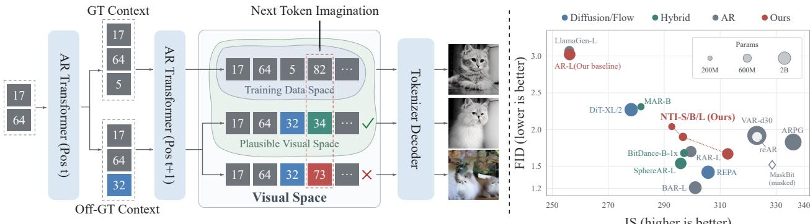
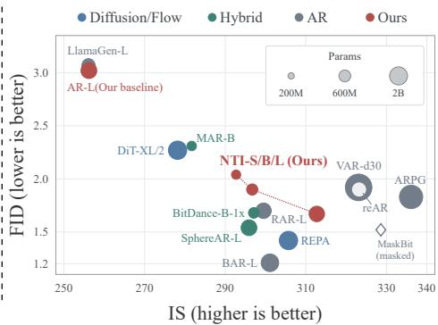
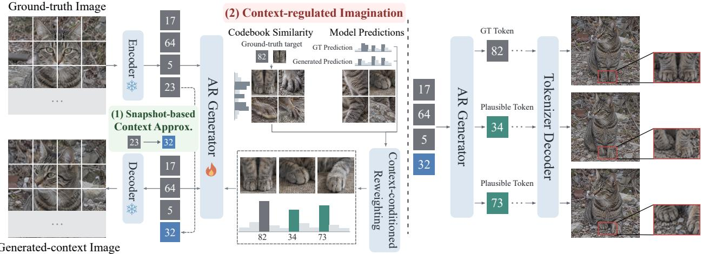
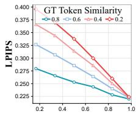
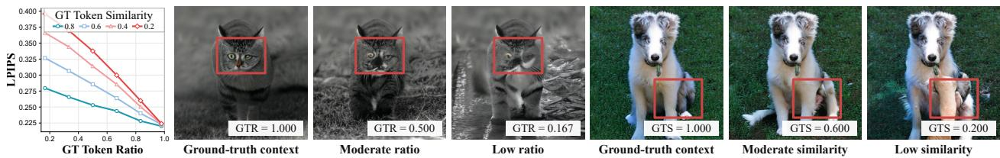
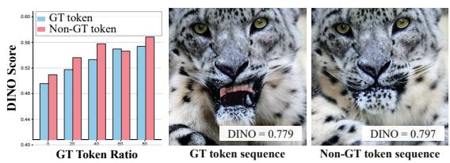
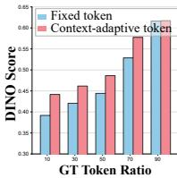
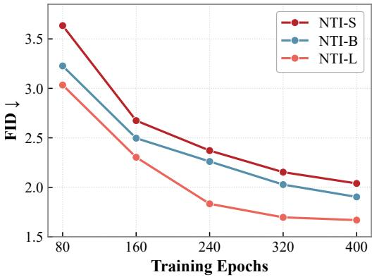
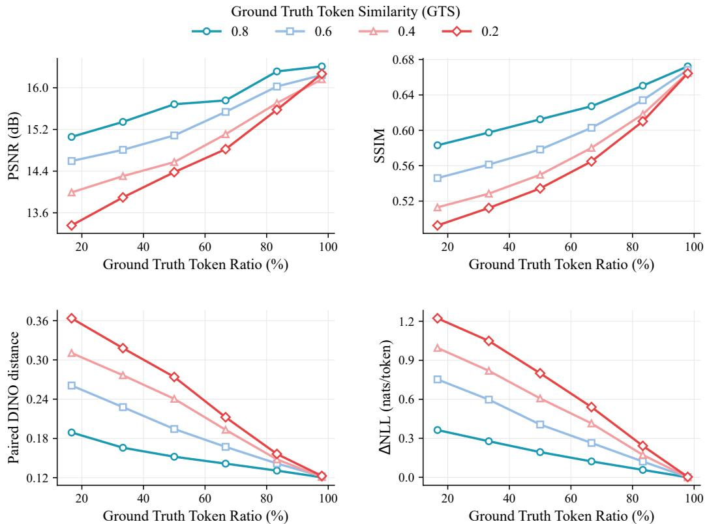
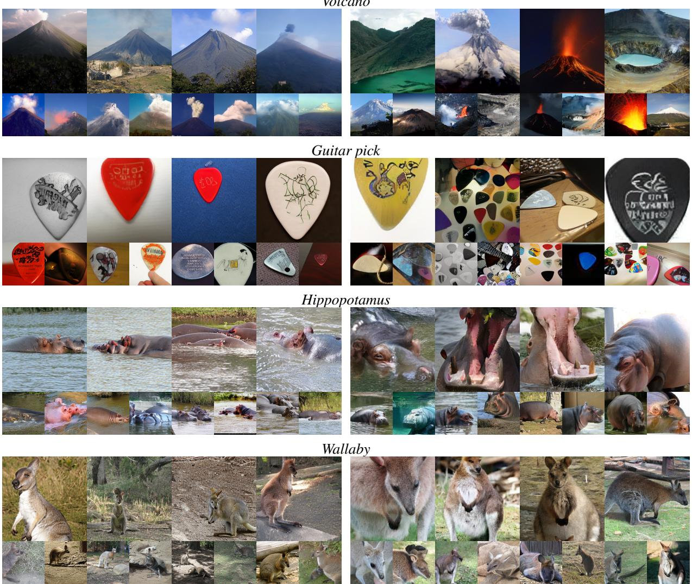

# VISUAL AUTOREGRESSIVE GENERATION WITH NEXT TOKEN IMAGINATION

A PREPRINT

Ruihang Jiang1 Zongyao Zhao1 Zhaolin Wang1 Yuanwei Liu1 Xiatian Zhu2

1University of Hong Kong 2University of Surrey

## ABSTRACT

The space of possible visual content is enormous, and arguably unbounded. Any training set, however large, therefore covers only a tiny fraction of it. Yet generative models are typically trained to fit only the images they are given. In visual autoregressive (AR) generation, for example, each token is predicted from the preceding ground-truth (GT) tokens and supervised solely by the GT next token. Confining learning to observed data in this way limits how much of the visual distribution a model can capture. In this work, we hypothesize that letting a model imagine beyond its training data, by exploring plausible visual realizations it has never observed, can ease this limitation. We use visual AR generation as a proof of concept, since its fixed, discrete token space makes imagination easier to steer and constrain. We propose Next Token Imagination (NTI), a method that allows the model to explore beyond the GT next token, subject to a carefully designed criterion that keeps this imagination bounded by the underlying visual distribution. Extensive experiments on ImageNet show that NTI substantially and consistently improves the fidelity of generated images, approaching state-of-the-art diffusion and AR models while using a smaller model and lower training cost. Code and checkpoints are available at https://github.com/JackRuihang/NTI.

## 1 Introduction

Autoregressive (AR) models, trained to predict each token from its preceding context, form the basis of modern language generation (Brown et al., 2020). Inspired by their success in text, AR modeling has been extended to image generation through discrete visual tokenization (Esser et al., 2021; Sun et al., 2024). However, standard visual AR models still lag behind leading diffusion and flow-matching models in generation quality (Peebles & Xie, 2023; Ma et al., 2024; Yu et al., 2025b). We therefore revisit visual AR training to identify what constrains its generative capability.

The standard visual AR pipeline consists of a visual tokenizer and a causal Transformer. The tokenizer encodes each image into a sequence of discrete codebook indices and decodes the corresponding codebook embeddings to reconstruct the image (van den Oord et al., 2017; Esser et al., 2021; Lee et al., 2022). The Transformer models this sequence, typically in raster order, through next token prediction (Parmar et al., 2018; Esser et al., 2021; Sun et al., 2024). Advances in visual AR have largely focused on tokenizer design (Yu et al., 2024a; Xiong et al., 2025), token representation (Yu et al., 2024b; Bachmann et al., 2025), generation order (Yu et al., 2025a; Pang et al., 2025), and model scaling (Sun et al., 2024; Han et al., 2025). In contrast, generator training still follows the standard paradigm. During training, each position is supervised by the corresponding ground-truth (GT) next token, with the prediction conditioned on the GT prefix (Bengio et al., 2015; Sun et al., 2024). At inference, however, the model samples a token from its predictive distribution at each position, so non-GT tokens can accumulate through AR generation, causing the generated sequence to depart from the GT sequence.

In this work, we revisit standard visual AR training from a distributional perspective. A non-GT next token does not necessarily move the generation outside the space of plausible visual realizations. Instead, it can lead subsequent generation toward another valid visual realization beyond the GT sequence. Through controlled experiments, we examine this hypothesis, motivating the model to explore plausible non-GT next tokens during training.

(a) NTI breaks the GT-only constraint in visual AR training by expanding next token prediction to plausible non-GT choices. These choices naturally induce off-GT contexts, where NTI regulates subsequent imagination to favor plausible continuations and explore visual space beyond observed GT sequences.  
  
(b) NTI substantially advances standard raster-order AR generation on ImageNet, reducing FID from 3.02 to 1.67 and increasing IS from 256.2 to 312.72.  
Figure 1: NTI unlocks broader visual space for stronger visual AR generation.

First, standard visual AR training imposes a restricted next token space. Given a context, the GT next token represents only one observed choice within a much larger space of plausible continuations. As illustrated in Figure 1(a), the generator predicts token 32 instead of the GT token 5, while the resulting sequence still produces a visually plausible cat. This indicates that plausible non-GT next tokens exist beyond the GT target, motivating the model to explore a broader next token space during training.

Second, a restricted next token space further leads to a restricted context space during training. Since each sampled token becomes part of the prefix for later positions, sampling a non-GT token naturally creates an off-GT context. Related work on exposure bias (Bengio et al., 2015; Wang & Sennrich, 2020) typically treats such contexts as consequences of prediction errors and focuses on improving model robustness. We instead view off-GT contexts as natural states induced by the model’s next token choices. The same example in Figure 1(a) further illustrates this process. Once the model samples token 32 instead of the GT token 5, the next position is conditioned on an off-GT context. Given this prefix, token 34 still produces a visually plausible cat, whereas token 73 leads to structural distortion. This suggests that broadening the next token space alone is insufficient; in other words, training must distinguish plausible non-GT predictions from implausible ones.

Motivated by these observations, we propose Next Token Imagination (NTI), a plug-and-play training paradigm that breaks the constraint of GT-only next token supervision. Specifically, NTI uses Context-Regulated Imagination (CRI) to assign probability to plausible non-GT tokens according to the current context. Ideally, such imagination should be incorporated directly into the AR process, where each imagined next token becomes part of the context for subsequent positions. However, performing this sequential rollout during training is extremely expensive. We therefore introduce Snapshot-based Context Approximation (SCA) to efficiently construct model-generated contexts without explicit sequential rollout. Together, these two mechanisms move visual AR training beyond the observed GT sequence while keeping imagination regulated.

Experiments on ImageNet establish NTI as a strong training paradigm for visual AR generation. With a standard raster-order AR backbone, NTI reduces FID from 3.02 to 1.67 and improves IS from 256.20 to 312.72, with consistent gains across model scales. NTI further outperforms representative AR methods including reAR (He et al., 2026), RAR (Yu et al., 2025a), LlamaGen (Sun et al., 2024), and BitDance (Ai et al., 2026), while remaining competitive with substantially larger or more specialized generative models. NTI also transfers effectively to non-standard tokenizers such as GigaTok (Xiong et al., 2025) and AliTok (Wu et al., 2026), demonstrating that its gains are not tied to a particular tokenizer design. Notably, these improvements are achieved without changing the inference pipeline. Collectively, these results establish NTI as a general and effective training paradigm for substantially advancing visual AR generation.

Our contributions are threefold. (1) We expose a fundamental limitation of visual AR training: GT-only next token supervision unnecessarily restricts valid continuations beyond the observed GT sequence. (2) We introduce NTI, a plugand-play training paradigm that enables context-regulated exploration beyond the GT sequence. (3) We demonstrate that NTI consistently improves visual AR generation across model scales and tokenizer designs, without modifying the tokenizer, generation order, or inference pipeline.

  
(a) NTI Training: SCA + CRI  
Figure 2: Overview of NTI, a plug-and-play training paradigm with regulated imagination.

## 2 Preliminaries

Visual autoregressive generation follows a three-stage pipeline. (1) A visual tokenizer encodes images into latent sequences. (2) An AR generator models the distribution over these sequences and generates new sequences at inference. (3) The generated sequences are decoded back into images by the tokenizer decoder.

Visual tokenizer. Visual AR models commonly use discrete visual tokenizers to represent images as codebook indices (van den Oord et al., 2017; Esser et al., 2021; Lee et al., 2022). The tokenizer consists of an encoder $\mathcal { E } ,$ a vector quantizer Q with a codebook $\mathcal { C } = \{ \mathbf { c } _ { k } \} _ { k = 1 } ^ { K } \subset \mathbb { R } ^ { d }$ , and a decoder D, where K is the codebook size and d is the latent embedding dimension. Given an image $\overset { \scriptscriptstyle \mathrm { \prime \prime } } { \mathrm { \bf I } } \in \mathbb { R } ^ { 3 \times H \times W }$ , where H and W denote the image height and width, the encoder maps it to a latent feature grid $\mathbf { u } = \mathcal { E } ( \mathbf { I } ) \in \mathbb { R } ^ { h \times w \times d }$ , where h and w denote the height and width of the latent grid. The quantizer Q assigns each latent feature to its nearest codebook entry, forming a quantized latent grid that is decoded by D to reconstruct the image:

$$
z _ { i j } = \arg \operatorname* { m i n } _ { k \in \{ 1 , \dots , K \} } \| \mathbf { u } _ { i j } - \mathbf { c } _ { k } \| _ { 2 } ^ { 2 } , \qquad \widehat { \mathbf { u } } _ { i j } = \mathbf { c } _ { z _ { i j } } , \qquad \widehat { \mathbf { I } } = \mathcal { D } ( \widehat { \mathbf { u } } ) .\tag{1}
$$

Visual autoregressive generation. In standard visual AR models, the $h \times w$ grid of codebook indices is typically flattened in raster order into a token sequence ${ \bf z } = ( z _ { 1 } , \dots , z _ { N } )$ of length $N = h w$ (Parmar et al., 2018; Esser et al., 2021; Sun et al., 2024). We refer to z as the GT sequence. Given conditioning information y, a causal generator pθ factorizes its distribution as

$$
p _ { \theta } ( \mathbf { z } \mid y ) = \prod _ { t = 1 } ^ { N } p _ { \theta } ( z _ { t } \mid \mathbf { z } _ { < t } , y ) , \qquad \mathbf { z } _ { < t } = ( z _ { 1 } , \ldots , z _ { t - 1 } ) .\tag{2}
$$

We refer to $\mathbf { z } _ { < t }$ as the GT context at position t. During standard training, the generator predicts the GT next token $z _ { t }$ from $\mathbf { z } _ { < t }$ by minimizing the negative log-likelihood:

$$
\mathcal { L } _ { \mathrm { A R } } ( \theta ) = - \frac { 1 } { N } \sum _ { t = 1 } ^ { N } \log p _ { \theta } ( z _ { t } \mid \mathbf { z } _ { < t } , y ) .\tag{3}
$$

At inference, the generator instead conditions on its previously generated tokens. We denote the generated token sequence as $\widetilde { \mathbf z } = ( \widetilde { \widetilde { z } } _ { 1 } , \dots , \widetilde { z } _ { N } )$ and its prefix $\widetilde { \mathbf { z } } _ { < t } = ( \widetilde { z } _ { 1 } , \dots , \widetilde { z } _ { t - 1 } )$ as the generated context at position t:

$$
\widetilde { z } _ { t } \sim p _ { \theta } \big ( \cdot \mid \widetilde { \mathbf { z } } _ { < t } , y \big ) .\tag{4}
$$

## 3 Next Token Imagination

We formulate visual AR training from the perspective of next token prediction. At position $t ,$ standard training predicts the GT next token $z _ { t }$ conditioned on the $\mathrm { \bar { G } T }$ context $\mathbf { z } _ { < t }$ . At inference, the sampled token $\widetilde { z } _ { t }$ becomes part of the context for the next position, with $\widetilde { \mathbf { z } } _ { < t + 1 } = ( \widetilde { \mathbf { z } } _ { < t } , \widetilde { z } _ { t } )$ . Existing methods on exposure bias introduce such off-GT contexts during training but continue to supervise each position with the GT token $z _ { t } .$ . Such supervision implicitly regards off-GT contexts as states arising from accumulated prediction errors and trains the model to return toward the GT sequence. This view is natural for conventional compression, where the objective is to recover a given source. Generation is different: the plausible visual space is enormous, while the GT sequences in the training data cover only a small fraction of it. Forcing every off-GT context back toward the GT sequence therefore suppresses the diversity that a generative model should capture. Valid non-GT next token predictions should instead be encouraged, allowing the model to recursively explore valid continuations beyond the observed GT sequences and thereby cover a broader plausible visual space.

  
Figure 3: NTI is feasible beyond the GT sequence: off-GT contexts can remain within a plausible visual space.

  
(a) GT vs. non-GT tokens

  
(b) Fixed vs. context-adaptive targets  
Figure 4: NTI requires context regulation: non-GT tokens can be plausible supervision targets, but their validity depends on the current context.

We quantitatively analyze the effects of deviations in next token predictions and their induced contexts on visual generation in Section 3.1. Based on these results, we propose NTI, a plug-and-play training paradigm for visual AR models. Specifically, CRI extends the supervision from the GT token to plausible non-GT ones. To improve training efficiency, instead of autoregressively rolling out contexts, we introduce SCA to construct model-generated contexts in a single forward pass. Together, they allow the model to explore beyond the visual space covered by the training data.

## 3.1 Understanding Restricted Next Token Space

Given a GT context $\mathbf { z } _ { < t }$ and a generated context $\widetilde { \mathbf { z } } _ { < t }$ , we consider a context window $\mathcal { W } _ { t } \subseteq \{ 1 , \dots , t - 1 \}$ of length $L = | \mathcal { W } _ { t } | . \operatorname { L e t } \mathcal { A } = \{ i \in \mathcal { W } _ { t } : \widetilde { z } _ { i } \neq z _ { i } \}$ denote the positions where the two contexts differ. We measure their deviation using Ground Truth Token Ratio (GTR) and Ground Truth Token Similarity (GTS); specifically, $\mathrm { { G T R } = 1 - }$ $| \mathcal { A } | / \bar { L }$ and $\begin{array} { r } { \mathrm { G T S } = | \boldsymbol { \mathcal { A } } | ^ { - 1 } \sum _ { i \in \mathcal { A } } \mathrm { s i m } ( \mathbf { c } _ { \widetilde { \boldsymbol { z } } _ { i } } , \mathbf { c } _ { \boldsymbol { z } _ { i } } ) } \end{array}$ , with GTS = 1 when A = ∅, where sim $( \cdot , \cdot )$ denotes cosine similarity. We further use LPIPS (Zhang et al., 2018) and a class-conditional DINOv2 similarity score (Oquab et al., 2024) to evaluate perceptual deviation and class-conditional semantic similarity in the decoded images. The following two controlled experiments show that NTI is feasible but requires regulation.

Feasibility of NTI. To examine whether NTI can move beyond the GT sequence while remaining within a plausible visual space, we study how contexts induced by non-GT next token predictions affect subsequent generation. We construct perturbed contexts from GT contexts under two settings: varying GTR at fixed GTS, and varying GTS while fixing the replacement positions and GTR. Starting from each perturbed context, we autoregressively generate the remaining tokens and measure the perceptual deviation of the decoded images using LPIPS.

Figure 3 shows that context deviations influence subsequent generation: lower GTR and lower GTS generally lead to higher LPIPS, indicating larger perceptual deviations in the decoded images. However, off-GT contexts do not necessarily result in failed generations. As shown in the cat examples, the facial features become progressively blurred as the context deviates further from the GT context, while in the dog examples, moderate deviations still preserve coherent leg structures before severe distortions emerge. These results demonstrate that contexts induced by non-GT next token predictions can remain within a plausible visual space, supporting NTI beyond the GT sequence.

Regulation of NTI. Having established that NTI can move beyond the GT sequence, we further investigate how NTI should be regulated. Specifically, we examine (1) whether non-GT tokens can serve as plausible supervision targets under off-GT contexts, and (2) whether suitable targets vary with the current context. We conduct two comparisons under generated contexts and evaluate the resulting images using DINO score.

For the first aspect, we compare GT and non-GT tokens under the same generated context. Across different GTR values, non-GT tokens achieve comparable or even higher mean DINO scores than GT tokens. Figure 4(a) shows this trend, while the snow leopard examples demonstrate that both choices can produce visually plausible images. These results demonstrate that the GT token is not the only plausible supervision target under an off-GT context, supporting NTI beyond the GT token.

Based on this observation, a straightforward approach is to include non-GT tokens according to codebook similarity (Hu et al., 2025; Tang et al., 2025). However, such targets remain fixed across different contexts. We therefore compare fixed selection, which uses the same non-GT token across contexts, with context-adaptive selection. As shown in Figure 4(b), the two perform similarly at high GTR, while context-adaptive selection performs better as GTR decreases. When GTR decreases further, both non-GT choices degrade, indicating that the imagination range should contract toward the GT token. These results demonstrate that NTI must be regulated by the current context.

## 3.2 Training with Next Token Imagination

We realize NTI with a simple and efficient training procedure. SCA constructs model-generated contexts without AR rollout. Using predictions under the GT and model-generated contexts, CRI directly determines which non-GT tokens should be included in supervision and how much probability they should receive.

Snapshot-based Context Approximation. Based on the above findings, the ideal NTI training procedure would construct each context and its corresponding supervision through step-by-step AR rollout. However, performing AR rollout for every sequence is computationally expensive. Previous work uses scheduled sampling (Bengio et al., 2015; Zhan et al., 2022) to construct model-generated contexts. Such online construction, however, requires an additional prediction pass during training. We therefore introduce SCA, which uses a periodically refreshed frozen snapshot $p _ { \bar { \theta } }$ of the current generator $p _ { \theta }$ to approximate model-generated contexts for NTI while preserving a single forward pass during training.

Concretely, given a GT sequence z, the snapshot computes the prediction distribution under the GT context as ${ \bf p } _ { t } ^ { \mathrm { G T } } =$ $p _ { \bar { \theta } } ( \cdot \ | \ \mathbf { z } _ { < t } , y )$ for all positions in parallel. We sample $\widehat { z } _ { i } \sim \mathbf { p } _ { i } ^ { \mathrm { G T } }$ and $b _ { i } \ \sim \ \mathrm { B e r n o u l l i } ( \rho )$ , where $\rho$ controls the probability of replacing a GT token with a model prediction. We then construct ez as

$$
\widetilde { z } _ { i } = \left\{ \begin{array} { l l } { z _ { i } , } & { b _ { i } = 0 , } \\ { \widehat { z } _ { i } , } & { b _ { i } = 1 , } \end{array} \right. \quad i = 1 , \ldots , N .\tag{5}
$$

For each GT sequence, we sample $\rho \sim \mathcal { U } ( 0 , \rho _ { \mathrm { m a x } } ( s ) )$ , where s denotes training progress and $\rho _ { \mathrm { m a x } } ( s )$ controls the maximum replacement ratio. The prefix $\widetilde { \mathbf { z } } _ { < t }$ approximates the model-generated context at position t, and the snapshot computes $\mathbf { p } _ { t } ^ { \mathrm { g e n } } = p _ { \bar { \theta } } ( \cdot \mid \widetilde { \mathbf { z } } _ { < t } , y )$ from this context. The predictions under the GT and model-generated contexts are then used to regulate NTI.

Context-Regulated Imagination. To construct the NTI supervision target, we address three questions: (1) which non-GT tokens can be included in imagination; (2) how their relative weights should adapt to the current context; and (3) how much supervision should be assigned to imagination overall. We answer these questions using codebook similarity, the predictions under the GT and model-generated contexts, and model confidence, respectively.

(1) Imagination Candidates. To determine which non-GT tokens can be included in imagination, we first use codebook similarity as a context-independent prior. Our analysis in Section 3.1 shows that replacing GT tokens with more similar codebook entries generally induces smaller perceptual deviations, suggesting that nearby tokens are more likely to remain within the plausible visual space. We therefore define the affinity between each token k and the GT token $z _ { t }$ as

$$
A _ { z _ { t } , k } = \exp \left( \frac { \sin ( \mathbf { c } _ { z _ { t } } , \mathbf { c } _ { k } ) - 1 } { \tau } \right) ,\tag{6}
$$

where sim $( \cdot , \cdot )$ denotes cosine similarity and $\tau > 0$ controls the concentration around the GT token. This affinity identifies plausible non-GT candidates for imagination, but remains fixed across different contexts.

(2) Context-Adaptive Weighting. Our analysis in Figure 4(b) shows that suitable non-GT targets depend on the current context. Codebook affinity alone cannot capture this dependency. We therefore compare the prediction distributions under the GT and model-generated contexts, $\mathbf { p } _ { t } ^ { \mathrm { G T } }$ and $\mathbf { p } _ { t } ^ { \mathrm { g e n } }$ , and measure their consistency using total variation (TV)

distance:

$$
g _ { t } = 1 - \mathrm { T V } \left( \mathbf { p } _ { t } ^ { \mathrm { G T } } , \mathbf { p } _ { t } ^ { \mathrm { g e n } } \right) = 1 - \frac { 1 } { 2 } \sum _ { k = 1 } ^ { K } \left| \mathbf { p } _ { t } ^ { \mathrm { G T } } ( k ) - \mathbf { p } _ { t } ^ { \mathrm { g e n } } ( k ) \right| ,\tag{7}
$$

where K is the codebook size. A larger $g _ { t }$ indicates more consistent predictions under the two contexts. We combine the two distributions according to $g _ { t }$ , relying more on the model-generated context when they remain consistent and shifting toward the GT context as they diverge. We then combine this context-dependent prediction with the codebook affinity and normalize over non-GT tokens to obtain $r _ { t } .$ , a distribution over non-GT tokens:

$$
\begin{array} { r l } & { u _ { t } ( k ) = A _ { z _ { t } , k } \left[ ( 1 - g _ { t } ) \mathbf { p } _ { t } ^ { \mathrm { G T } } ( k ) + g _ { t } \mathbf { p } _ { t } ^ { \mathrm { g e n } } ( k ) \right] , } \\ & { r _ { t } ( k ) = \left\{ \begin{array} { l l } { \displaystyle \frac { u _ { t } ( k ) } { \sum _ { j \neq z _ { t } } u _ { t } ( j ) } , } & { k \neq z _ { t } , } \\ { 0 , } & { k = z _ { t } . } \end{array} \right. } \end{array}\tag{8}
$$

(3) Imagination Strength. Finally, we determine how much supervision should be assigned to imagination. While $r _ { t }$ specifies the distribution over non-GT tokens, we introduce $d _ { t }$ to control their total probability. We compute $d _ { t }$ from three factors. First, $c _ { t } = 1 - \mathcal { H } ( \mathbf { p } _ { t } ^ { \mathrm { G T } } ) _ { / }$ / log K measures the prediction confidence under the GT context, where H denotes Shannon entropy. Second, $\bar { 1 } - \mathbf { p } _ { t } ^ { \mathrm { G T } } ( z _ { t } )$ measures how much probability the model assigns beyond the GT token. Third, $g _ { t }$ measures the consistency between predictions under the $\mathrm { G T }$ and model-generated contexts. Combining these factors, we define

$$
d _ { t } = c _ { t } \big ( 1 - \mathbf { p } _ { t } ^ { \mathrm { G T } } ( z _ { t } ) \big ) g _ { t } ,\tag{9}
$$

so that imagination is reduced when the model is uncertain, strongly favors the GT token, or becomes inconsistent under the model-generated context. The final NTI target distribution is

$$
q _ { t } ( k ) = ( 1 - d _ { t } ) \mathbf { 1 } \{ k = z _ { t } \} + d _ { t } r _ { t } ( k ) .\tag{10}
$$

Training Objective. NTI augments the standard AR objective with context-regulated supervision under modelgenerated contexts. We keep $\mathcal { L } _ { \mathrm { A R } }$ in Equation 3 for direct learning from the GT sequence. For an SCA sequence $\widetilde { \mathbf { z } } ,$ let $m _ { t } = { \bf 1 } [ \widetilde { \bf z } _ { < t } \neq { \bf z } _ { < t } ]$ indicate whether position t has a model-generated context. We supervise positions with $m _ { t } = 1$ using the NTI target distribution $q _ { t } \mathrm { . }$

$$
\mathcal { L } _ { \mathrm { N T I } } ( \theta ) = - \frac { 1 } { \mathbb { E } _ { \mathrm { S C A } } \left[ \sum _ { t = 1 } ^ { N } m _ { t } \right] } \mathbb { E } _ { \mathrm { S C A } } \left[ \sum _ { t = 1 } ^ { N } m _ { t } \sum _ { k = 1 } ^ { K } q _ { t } ( k ) \log p _ { \theta } \left( k \mid \widetilde { \mathbf { z } } _ { < t } , y \right) \right] .\tag{11}
$$

GT and model-generated sequences are mixed within each training batch and processed in a single forward pass. The AR and NTI objectives are normalized over their respective supervised tokens, with $\lambda ( s ) = \lambda \rho _ { \mathrm { m a x } } ( s ) / \rho _ { \mathrm { m a x } }$ controlling the contribution of NTI supervision, and combined as

$$
\begin{array} { r } { \mathcal { L } ( \theta ) = \mathcal { L } _ { \mathrm { A R } } ( \theta ) + \lambda ( s ) \mathcal { L } _ { \mathrm { N T I } } ( \theta ) . } \end{array}\tag{12}
$$

## 4 Experiments

## 4.1 Experimental Setup

Dataset and evaluation. We conduct class-conditional generation experiments on ImageNet-1K (Deng et al., 2009) at a resolution of $2 5 6 \times 2 5 6$ . Following the ADM evaluation protocol (Dhariwal & Nichol, 2021), we generate 50,000 images with classifier-free guidance (Ho & Salimans, 2022) and report Frechet Inception Distance (FID) (Heusel et al.,´ 2017) and Inception Score (IS) (Salimans et al., 2016).

Model configuration. We adopt a pretrained MaskGIT-VQGAN tokenizer (Chang et al., 2022) with 1,024 codebook entries and a spatial downsampling factor of 16, encoding each image into 256 discrete tokens. NTI-S/B/L consist of $2 0 / 2 4 / 2 4$ causal Transformer layers with hidden dimensions of 768/768/1024, respectively, and all variants use 16 attention heads.

Training. We train all models for 400 epochs with a global batch size of 2,048, using AdamW (Loshchilov & Hutter, 2019). The learning rate is linearly warmed up to $4 \times 1 0 ^ { - 4 }$ during the first 100 epochs and then decayed to $1 0 ^ { - 5 }$ with a cosine schedule over the remaining 300 epochs. We apply gradient clipping with a maximum norm of 1.0 and drop class labels with probability 0.1 for classifier-free guidance (Ho & Salimans, 2022).

NTI implementation. We set the affinity temperature to $\tau = 0 . 0 5$ The maximum replacement probability first increases to 0.3 and then decreases to zero by epoch 320, after which the remaining 80 epochs use only GT sequences. SCA contexts are regenerated every 16 epochs. Further experimental details are provided in Appendix A.

Table 1: Results on 256×256 class-conditional generation on ImageNet-1K. N/A indicates that a discrete codebook is not applicable; N/R denotes values not reported in the original paper; – indicates that the corresponding checkpoint is not publicly available. Throughput is measured in images per second. ↑ and ↓ indicate that higher and lower values are better, respectively. † indicates that the model is not provided and it’s trained with our implementation.
<table><tr><td>Type</td><td>Model</td><td>Codebook size Epochs #Params</td><td></td><td></td><td>FID↓</td><td></td><td>IS↑ Throughput (img/s)↑</td></tr><tr><td rowspan="3">Diff./Flow</td><td>DiT-XL/2 (Peebles &amp; Xie, 2023)</td><td>N/A</td><td>1,400</td><td>675M</td><td>2.27</td><td>278.2</td><td>0.592</td></tr><tr><td>REPA (Yu et al., 2025b)</td><td>N/A</td><td>800</td><td>675M</td><td>1.42</td><td>305.7</td><td>0.671</td></tr><tr><td>FreqFlow-H (Ren et al., 2026)</td><td>N/A</td><td>N/R</td><td>1.08B</td><td>1.38</td><td>N/R</td><td></td></tr><tr><td rowspan="2">Masked Gen.</td><td>MAR-B (Li et al., 2024)</td><td>N/A</td><td>800</td><td>208M</td><td>2.31</td><td>281.7</td><td>0.541</td></tr><tr><td>MaskBit (Weber et al., 2024)</td><td>16,384</td><td>1,080</td><td>305M</td><td>1.52</td><td>328.6</td><td>0.949</td></tr><tr><td rowspan="3">Alt.-order AR</td><td>VAR-d30 (Tian et al., 2024)</td><td>4,096</td><td>350</td><td>2.0B</td><td>1.92</td><td>323.1</td><td>26.759</td></tr><tr><td>RAR-L (Yu et al., 2025a)</td><td>1,024</td><td>400</td><td>461M</td><td>1.70</td><td>299.5</td><td>12.864</td></tr><tr><td>ARPG-XXL (32 steps) (Li et al., 2026)</td><td>16,384</td><td>400</td><td>1.3B</td><td>1.83</td><td>336.1</td><td>43.861</td></tr><tr><td rowspan="2">Continuous AR</td><td>SphereAR-L (Ke &amp; Xue, 2026)</td><td>N/A</td><td>400</td><td>479M</td><td>1.54</td><td>295.9</td><td>2.375</td></tr><tr><td>BAR-L (Tang et al., 2026)</td><td>N/A</td><td>800</td><td>608M</td><td>1.21</td><td>301.1</td><td></td></tr><tr><td rowspan="3">Sequential AR</td><td>LlamaGen-L (Sun et al., 2024)</td><td>16,384</td><td>300</td><td>343M</td><td>3.07</td><td>256.1</td><td>2.194</td></tr><tr><td>BitDance-B-1x (Ai et al., 2026)</td><td>232</td><td>800</td><td>242M</td><td>1.68</td><td>297.1</td><td>1.701</td></tr><tr><td>reAR-L (CFG=11) (He et al., 2026)</td><td>1,024</td><td>400</td><td>461M</td><td>1.90</td><td>323.2</td><td>9.522</td></tr><tr><td rowspan="4">Ours</td><td>AR-L† (Yu et al., 2025a)</td><td>1,024</td><td>400</td><td>461M</td><td>3.02</td><td>256.20</td><td></td></tr><tr><td>NTI-S</td><td>1,024</td><td>400</td><td>218M</td><td>±0.032.04</td><td>±1.41292.70</td><td>20.709</td></tr><tr><td>NTI-B</td><td>1,024</td><td>400</td><td>261M</td><td>±0.021.90</td><td>±0.76296.71</td><td>17.519</td></tr><tr><td>NTI-L (CFG=14)</td><td>1,024</td><td>400</td><td>461M</td><td>±0.011.67</td><td>±1.02312.72</td><td>13.957</td></tr></table>

  
Figure 5: Scaling effect of NTI.

Table 2: Generalization of NTI. NTI consistently improves non-standard visual AR models without changing their tokenizer or generator.
<table><tr><td>Model</td><td>Epochs</td><td>Params.</td><td>FID↓</td></tr><tr><td>GigaTok</td><td></td><td></td><td></td></tr><tr><td>GigaTok baseline</td><td>400</td><td>111M</td><td>3.94</td></tr><tr><td>GigaTok + NTI</td><td>400</td><td>111M</td><td>3.66</td></tr><tr><td>AliTok</td><td></td><td></td><td></td></tr><tr><td>AliTok baseline</td><td>400</td><td>177M</td><td>1.61</td></tr><tr><td>AliTok + NTI</td><td>400</td><td>177M</td><td>1.51</td></tr></table>

## 4.2 Main Results

Class-conditional generation. Table 1 shows that NTI achieves strong performance with a standard raster-order AR backbone. On the same AR-L backbone, NTI-L reduces FID from 3.02 to 1.67 and improves IS from 256.20 to 312.72. Figure 5 further shows consistent gains across NTI-S/B/L as model size increases. NTI-L also outperforms reAR-L, RAR-L, LlamaGen-L, and BitDance-B-1x in FID while retaining a standard discrete tokenizer and rasterorder generation. With only 461M parameters and 400 training epochs, it remains competitive with substantially larger or more expensive state-of-the-art generative models, showing that NTI can markedly improve visual AR generation without specialized architectures, tokenizers, or decoding strategies.

Generalization. We further evaluate NTI on GigaTok (Xiong et al., 2025) and AliTok (Wu et al., 2026), keeping their original tokenizers and generators unchanged and only adding NTI training. NTI improves FID from 3.94 to 3.66 on GigaTok and from 1.61 to 1.51 on AliTok, demonstrating that NTI generalizes across different visual AR configurations.

Computational cost. NTI introduces little additional computation. On 8 NVIDIA A100 GPUs, the estimated perepoch training times of vanilla AR, NTI, and online two-pass construction are 11.62, 12.80, and 22.90 minutes, respectively. The NTI estimate includes the cost of periodic context construction using a frozen snapshot, averaged over the epochs between refreshes. Thus, NTI adds only about 10% training overhead, whereas online two-pass training nearly doubles the cost. NTI does not modify the inference pipeline; NTI-S/B/L achieve throughputs of 20.709/17.519/13.957 images/s.

## 4.3 Ablation Studies

We ablate the key design choices of NTI, including CRI, SCA, and the training hyperparameters.

CRI and SCA. We ablate CRI and SCA using NTI-S, with all variants trained for 400 epochs. For context-independent supervision, we follow prior work that constructs soft targets from codebook similarity (Hu et al., 2025; Tang et al., 2025). As shown in Table $^ { 3 , }$ this strategy achieves an FID of 2.10 under the GT context, while SCA with GT supervision yields 2.11. These results show that neither context-independent imagination nor modelgenerated contexts alone are sufficient. Under the same SCA contexts, CRI reduces FID from 2.11 to 2.04, demonstrating the importance of regulating imagination according to the current context. Online scheduled sampling with CRI achieves 2.03 FID, only 0.01 lower than NTI, showing that SCA preserves nearly all the benefit of online context construction while eliminating its additional prediction pass.

Loss weight. As shown in Table 3, the loss weight has little impact on generation quality, with $\lambda = 0 . 5$ and 1.0 yielding comparable performance. This limited sensitivity may be partly attributed to the scale-free property of AdamW, whose adaptive updates are relatively insensitive to gradient rescaling (Loshchilov & Hutter, 2019; Zhuang et al., 2022). We therefore use $\lambda \ : = \ : 0 . 5$ for all experiments.

Table 3: Ablation studies of NTI.
<table><tr><td>Ablation setting</td><td>FID↓</td></tr><tr><td> $T r a i n i n g s t r a t e g y ( 4 0 0 e p o c h s )$   $\mathbf { S C A } + \mathbf { G T } \mathbf { \ s u p e r v i s i o n }$  GT context + context-independent NTI  $( \mathbf { S C A } + \mathbf { C R I } )$ </td><td>2.11 2.10 2.04</td></tr><tr><td> $\mathrm { S c h e d u l e d \ s a m p l i n g + C R I }$   $L o s s w e i g h t \ : ( 8 O \ : e p o c h s )$ </td><td>2.03</td></tr><tr><td> $\lambda : = 0 . 5$   $\lambda : = 1 . 0$ </td><td>3.63 3.61</td></tr><tr><td>Peak replacement probability (400 epochs)</td><td></td></tr><tr><td> $\rho _ { \mathrm { m a x } } = 0 . 1 0$ </td><td>2.09</td></tr><tr><td> $\rho _ { \mathrm { m a x } } = 0 . 2 0$ </td><td>2.05</td></tr><tr><td> $\rho _ { \mathrm { m a x } } = 0 . 3 0$ </td><td></td></tr><tr><td> $\rho _ { \mathrm { m a x } } = 0 . 4 0$ </td><td>2.04</td></tr><tr><td></td><td>2.09</td></tr><tr><td>Codebook temperature (80 epochs)</td><td></td></tr><tr><td></td><td></td></tr><tr><td> $\tau : = 0 . 0 5$ </td><td>3.55</td></tr><tr><td> $\tau : = 0 . 1 0$ </td><td>3.63</td></tr></table>

Replacement probability. We ablate the peak replacement probability $\rho _ { \mathrm { m a x } }$ in $\rho \sim \mathcal { U } ( 0 , \rho _ { \mathrm { m a x } } ( s ) )$ , which controls the upper bound of context replacement in $\operatorname { s c A }$ . Using NTI-S trained for 400 epochs, increasing the peak $\rho _ { \mathrm { m a x } }$ from 0.10 to 0.30 improves FID from 2.09 to 2.04, while further increasing it to 0.40 degrades FID to 2.09 (Table 3). This shows that sufficiently exposing the model to off-GT contexts is beneficial, whereas excessive replacement harms generation quality. We therefore use a peak $\rho _ { \mathrm { m a x } } = 0 . 3 0$

Codebook temperature. We further study the codebook temperature τ in Equation $^ { 6 , }$ which controls the concentration of the affinity over non-GT codebook candidates. A smaller τ emphasizes tokens that are more similar to the GT token, whereas a larger τ produces a broader candidate distribution. Using NTI-S trained for 80 epochs, $\tau = 0 . 0 5$ achieves an FID of 3.55, compared with 3.63 for $\tau = 0 . 1 0$ (Table 3). We therefore set $\tau = 0 . 0 5$ in all experiments.

## 5 Related Work

Visual autoregressive generation. Early visual AR models perform sequential prediction directly over image elements, conditioned on preceding context (Parmar et al., 2018). To reduce the cost of pixel-level modeling, tokenizers compress images into discrete code sequences (van den Oord et al., 2017; Esser et al., 2021), enabling scalable causal Transformers for image generation (Sun et al., 2024). Recent work has improved components of this pipeline. Tokenizer design has progressed toward more compact and scalable representations (Yu et al., 2024b; Xiong et al., 2025), flexible one-dimensional sequences and causality-aligned dependencies (Bachmann et al., 2025; Wu et al., 2026), and larger discrete vocabularies with sub-token prediction (Luo et al., 2024). Other studies relax the fixed raster order through randomized sequence modeling (Yu et al., 2025a; Pang et al., 2025), while alternative formulations replace discrete next token prediction with continuous representations (Li et al., 2024), next-scale prediction (Tian et al., 2024), or more flexible prediction units (Ren et al., 2025). In contrast, NTI keeps the tokenizer, generation order, and prediction unit unchanged, and instead revisits the supervision of standard next token prediction.

Exposure bias. Exposure bias has long been studied in autoregressive sequence modeling, where scheduled sampling exposes the model to its own predictions during training while retaining the GT token as supervision (Bengio et al., 2015). Similar strategies have been adopted in visual AR models: RQ-Transformer introduces stochastic sampling during training (Lee et al., 2022), IQ-VAE mixes GT and predicted tokens through Gumbel-softmax (Zhan et al., 2022), and reAR introduces noisy contexts while continuing to predict the GT next token (He et al., 2026). More recently, autoregressive video generation methods have reduced the training–inference gap through inference-like contexts or self-generated rollouts (Zhou et al., 2025; Huang et al., 2025a). These approaches reduce the training– inference mismatch through different context-construction and supervision mechanisms. NTI instead focuses on the supervision under off-GT contexts: an off-GT context can still represent a plausible visual state, and its next token need not be restricted to the GT token. NTI therefore regulates plausible non-GT supervision according to the current context, enabling the model to explore valid continuations beyond the observed GT sequence.

Supervision beyond the GT token. Beyond-GT supervision has been explored in discrete autoregressive modeling. OCD derives context-dependent valid next token targets from optimal completions of generated prefixes using dynamic programming (Sabour et al., 2019), while DIST2Loss replaces one-hot targets with distance-aware distributions defined by token metrics (Chung et al., 2026). In visual AR generation, IAR constructs cluster-oriented supervision from codebook similarity (Hu et al., 2025), and DCPE extracts discriminative priors from the visual codebook (Tang et al., 2025). However, DIST2Loss, IAR, and DCPE determine non-GT supervision from token relationships without adapting it to the current AR context. NTI instead treats plausible non-GT next tokens as context-dependent valid continuations and regulates their supervision according to the current context. Additional discussion is provided in Appendix D.

## 6 Conclusion

In this paper, we identify a key limitation of visual AR training: standard supervision treats the GT token as the sole target, even though plausible non-GT next tokens can lead to valid continuations. To address this, we propose Next Token Imagination (NTI), which reframes next token prediction from GT-only supervision to other plausible continuations. With CRI and SCA, NTI substantially improves standard visual AR models, and generalizes across different tokenizer and generator designs. We hope this work encourages future visual AR models to move beyond the visual space covered by the training data and explore a broader space of plausible visual content.

## AI use statement

We used generative AI tools, including ChatGPT and Codex, to assist with research ideation, experimental design, code development and debugging, literature retrieval, and the preparation of figures and tables. We also used these tools to draft and revise portions of the manuscript and improve writing clarity. The authors reviewed and revised the AI-assisted content, checked references against the original sources, and tested AI-assisted code. We take full responsibility for the final content of this work, including its text, methods, experimental results, and conclusions.

## References

Yuang Ai, Jiaming Han, Shaobin Zhuang, Weijia Mao, Xuefeng Hu, Ziyan Yang, Zhenheng Yang, Yali Wang, Huaibo Huang, Xiangyu Yue, and Hao Chen. BitDance: Scaling autoregressive generative models with binary tokens. arXiv preprint arXiv:2602.14041, 2026.

Roman Bachmann, Jesse Allardice, David Mizrahi, Enrico Fini, Oguzhan Fatih Kar, Elmira Amirloo, Alaaeldin El-Nouby, Amir Zamir, and Afshin Dehghan. FlexTok: Resampling images into 1D token sequences of flexible length. In Proceedings ofthe 42nd International Conference on Machine Learning, volume 267 of Proceedings ofMachine Learning Research, pp. 2241–2292, 2025.

Samy Bengio, Oriol Vinyals, Navdeep Jaitly, and Noam Shazeer. Scheduled sampling for sequence prediction with recurrent neural networks. In Advances in Neural Information Processing Systems, volume 28, 2015.

Tom B. Brown, Benjamin Mann, Nick Ryder, Melanie Subbiah, Jared D. Kaplan, Prafulla Dhariwal, Arvind Neelakantan, Pranav Shyam, Girish Sastry, Amanda Askell, Sandhini Agarwal, Ariel Herbert-Voss, Gretchen Krueger, Tom Henighan, Rewon Child, Aditya Ramesh, Daniel M. Ziegler, Jeffrey Wu, Clemens Winter, Christopher Hesse, Mark Chen, Eric Sigler, Mateusz Litwin, Scott Gray, Benjamin Chess, Jack Clark, Christopher Berner, Sam McCandlish, Alec Radford, Ilya Sutskever, and Dario Amodei. Language models are few-shot learners. In Advances in Neural Information Processing Systems, volume 33, pp. 1877–1901, 2020.

Huiwen Chang, Han Zhang, Lu Jiang, Ce Liu, and William T. Freeman. MaskGIT: Masked generative image transformer. In Proceedings of the IEEE/CVF Conference on Computer Vision and Pattern Recognition, pp. 11315– 11325, 2022.

Yitong Chen, Zuxuan Wu, Xipeng Qiu, and Yu-Gang Jiang. CaTok: Taming mean flows for one-dimensional causal image tokenization. In Proceedings of the IEEE/CVF Conference on Computer Vision and Pattern Recognition, pp. 23161–23171, 2026.

Jiwan Chung, Saejin Kim, Yongrae Jo, Jaewoo Park, Dongjun Min, and Youngjae Yu. Teaching metric distance to discrete autoregressive language models. In International Conference on Learning Representations, 2026.

Jia Deng, Wei Dong, Richard Socher, Li-Jia Li, Kai Li, and Li Fei-Fei. ImageNet: A large-scale hierarchical image database. In Proceedings ofthe IEEE Conference on Computer Vision and Pattern Recognition, 2009.

Prafulla Dhariwal and Alexander Nichol. Diffusion models beat GANs on image synthesis. In Advances in Neural Information Processing Systems, volume 34, pp. 8780–8794, 2021.

Patrick Esser, Robin Rombach, and Bjorn Ommer. Taming transformers for high-resolution image synthesis. In Proceedings of the IEEE/CVF Conference on Computer Vision and Pattern Recognition, pp. 12873–12883, 2021.

Shanghua Gao, Pan Zhou, Ming-Ming Cheng, and Shuicheng Yan. Masked diffusion transformer is a strong image synthesizer. In Proceedings of the IEEE/CVF International Conference on Computer Vision, pp. 23164–23173, 2023.

Jian Han, Jinlai Liu, Yi Jiang, Bin Yan, Yuqi Zhang, Zehuan Yuan, Bingyue Peng, and Xiaobing Liu. Infinity: Scaling bitwise autoregressive modeling for high-resolution image synthesis. In Proceedings of the IEEE/CVF Conference on Computer Vision and Pattern Recognition, pp. 15733–15744, 2025.

Qiyuan He, Yicong Li, Haotian Ye, Jinghao Wang, Xinyao Liao, Pheng-Ann Heng, Stefano Ermon, James Y. Zou, and Angela Yao. reAR: Rethinking visual autoregressive models via token-wise consistency regularization. In International Conference on Learning Representations, 2026.

Martin Heusel, Hubert Ramsauer, Thomas Unterthiner, Bernhard Nessler, and Sepp Hochreiter. GANs trained by a two time-scale update rule converge to a local Nash equilibrium. In Advances in Neural Information Processing Systems, volume 30, 2017.

Jonathan Ho and Tim Salimans. Classifier-free diffusion guidance. arXiv preprint arXiv:2207.12598, 2022.

Teng Hu, Jiangning Zhang, Ran Yi, Jieyu Weng, Yabiao Wang, Xianfang Zeng, Zhucun Xue, and Lizhuang Ma. Improving autoregressive visual generation with cluster-oriented token prediction. In Proceedings ofthe IEEE/CVF Conference on Computer Vision and Pattern Recognition, pp. 9351–9360, 2025.

Xun Huang, Zhengqi Li, Guande He, Mingyuan Zhou, and Eli Shechtman. Self forcing: Bridging the train-test gap in autoregressive video diffusion. In Advances in Neural Information Processing Systems, volume 38, 2025a.

Yuanhui Huang, Weiliang Chen, Wenzhao Zheng, Yueqi Duan, Jie Zhou, and Jiwen Lu. SpectralAR: Spectral autoregressive visual generation. In Proceedings of the IEEE/CVF International Conference on Computer Vision, pp. 15842–15852, 2025b.

Guolin Ke and Hui Xue. Hyperspherical latents improve continuous-token autoregressive generation. In International Conference on Learning Representations, 2026.

Doyup Lee, Chiheon Kim, Saehoon Kim, Minsu Cho, and Wook-Shin Han. Autoregressive image generation using residual quantization. In Proceedings of the IEEE/CVF Conference on Computer Vision and Pattern Recognition, pp. 11523–11532, 2022.

Haopeng Li, Jinyue Yang, Guoqi Li, and Huan Wang. Autoregressive image generation with randomized parallel decoding. In International Conference on Learning Representations, 2026.

Tianhong Li, Yonglong Tian, He Li, Mingyang Deng, and Kaiming He. Autoregressive image generation without vector quantization. In Advances in Neural Information Processing Systems, volume 37, 2024.

Ilya Loshchilov and Frank Hutter. Decoupled weight decay regularization. In International Conference on Learning Representations, 2019.

Zhuoyan Luo, Fengyuan Shi, Yixiao Ge, Yujiu Yang, Limin Wang, and Ying Shan. Open-MAGVIT2: An open-source project toward democratizing auto-regressive visual generation. arXiv preprint arXiv:2409.04410, 2024.

Nanye Ma, Mark Goldstein, Michael S. Albergo, Nicholas M. Boffi, Eric Vanden-Eijnden, and Saining Xie. SiT: Exploring flow and diffusion-based generative models with scalable interpolant transformers. In European Conference on Computer Vision, pp. 23–40, 2024.

Maxime Oquab, Timothee Darcet, Th´ eo Moutakanni, Huy V. Vo, Marc Szafraniec, Vasil Khalidov, Pierre Fernandez,´ Daniel Haziza, Francisco Massa, Alaaeldin El-Nouby, Mido Assran, Nicolas Ballas, Wojciech Galuba, Russell Howes, Po-Yao Huang, Shang-Wen Li, Ishan Misra, Michael Rabbat, Vasu Sharma, Gabriel Synnaeve, Hu Xu, Herve J´ egou, Julien Mairal, Patrick Labatut, Armand Joulin, and Piotr Bojanowski. DINOv2: Learning robust´ visual features without supervision. Transactions on Machine Learning Research, 2024.

Ziqi Pang, Tianyuan Zhang, Fujun Luan, Yunze Man, Hao Tan, Kai Zhang, William T. Freeman, and Yu-Xiong Wang. RandAR: Decoder-only autoregressive visual generation in random orders. In Proceedings ofthe IEEE/CVF Conference on Computer Vision and Pattern Recognition, pp. 45–55, 2025.

Niki Parmar, Ashish Vaswani, Jakob Uszkoreit, Lukasz Kaiser, Noam Shazeer, Alexander Ku, and Dustin Tran. Image transformer. In Proceedings of the 35th International Conference on Machine Learning, volume 80 of Proceedings ofMachine Learning Research, pp. 4055–4064. PMLR, 2018.

William Peebles and Saining Xie. Scalable diffusion models with transformers. In Proceedings of the IEEE/CVF International Conference on Computer Vision, pp. 4195–4205, 2023.

Sucheng Ren, Qihang Yu, Ju He, Xiaohui Shen, Alan Yuille, and Liang-Chieh Chen. Beyond next-token: Next-X prediction for autoregressive visual generation. In Proceedings of the IEEE/CVF International Conference on Computer Vision, pp. 15781–15791, 2025.

Sucheng Ren, Qihang Yu, Ju He, Xiaohui Shen, and Liang-Chieh Chen. Frequency-aware flow matching for highquality image generation. In Proceedings of the IEEE/CVF Conference on Computer Vision and Pattern Recognition, pp. 9074–9083, 2026.

Sara Sabour, William Chan, and Mohammad Norouzi. Optimal completion distillation for sequence learning. In International Conference on Learning Representations, 2019.

Tim Salimans, Ian Goodfellow, Wojciech Zaremba, Vicki Cheung, Alec Radford, and Xi Chen. Improved techniques for training GANs. In Advances in Neural Information Processing Systems, volume 29, 2016.

Peize Sun, Yi Jiang, Shoufa Chen, Shilong Zhang, Bingyue Peng, Ping Luo, and Zehuan Yuan. Autoregressive model beats diffusion: Llama for scalable image generation. arXiv preprint arXiv:2406.06525, 2024.

Longxiang Tang, Ruihang Chu, Xiang Wang, Yujin Han, Pingyu Wu, Chunming He, Yingya Zhang, Shiwei Zhang, and Jiaya Jia. Exploiting discriminative codebook prior for autoregressive image generation. arXiv preprint arXiv:2508.10719, 2025.

Zhicong Tang, Dong Chen, Jianmin Bao, and Baining Guo. BAR: Refactor the basis of autoregressive visual generation. In International Conference on Learning Representations, 2026.

Keyu Tian, Yi Jiang, Zehuan Yuan, Bingyue Peng, and Liwei Wang. Visual autoregressive modeling: Scalable image generation via next-scale prediction. In Advances in Neural Information Processing Systems, volume 37, 2024.

Aaron van den Oord, Oriol Vinyals, and Koray Kavukcuoglu. Neural discrete representation learning. In Advances in Neural Information Processing Systems, volume 30, 2017.

Chaojun Wang and Rico Sennrich. On exposure bias, hallucination and domain shift in neural machine translation. In Proceedings of the 58th Annual Meeting of the Association for Computational Linguistics, pp. 3544–3552. Association for Computational Linguistics, 2020.

Zhou Wang, Alan C. Bovik, Hamid R. Sheikh, and Eero P. Simoncelli. Image quality assessment: From error visibility to structural similarity. IEEE Transactions on Image Processing, 13(4):600–612, 2004. doi: 10.1109/TIP.2003. 819861.

Mark Weber, Lijun Yu, Qihang Yu, Xueqing Deng, Xiaohui Shen, Daniel Cremers, and Liang-Chieh Chen. MaskBit: Embedding-free image generation via bit tokens. Transactions on Machine Learning Research, 2024.

Pingyu Wu, Kai Zhu, Yu Liu, Longxiang Tang, Jian Yang, Yansong Peng, Wei Zhai, Yang Cao, and Zheng-Jun Zha. Towards sequence modeling alignment between tokenizer and autoregressive model. In International Conference on Learning Representations, 2026.

Tianwei Xiong, Jun Hao Liew, Zilong Huang, Jiashi Feng, and Xihui Liu. GigaTok: Scaling visual tokenizers to 3 billion parameters for autoregressive image generation. In Proceedings of the IEEE/CVF International Conference on Computer Vision, pp. 18770–18780, 2025.

Lijun Yu, Jose Lezama, Nitesh B. Gundavarapu, Luca Versari, Kihyuk Sohn, David Minnen, Yong Cheng, Agrim Gupta, Xiuye Gu, Alexander G. Hauptmann, Boqing Gong, Ming-Hsuan Yang, Irfan Essa, David A. Ross, and Lu Jiang. Language model beats diffusion – tokenizer is key to visual generation. In International Conference on Learning Representations, 2024a.

Qihang Yu, Mark Weber, Xueqing Deng, Xiaohui Shen, Daniel Cremers, and Liang-Chieh Chen. An image is worth 32 tokens for reconstruction and generation. In Advances in Neural Information Processing Systems, volume 37, pp. 128940–128966, 2024b.

Qihang Yu, Ju He, Xueqing Deng, Xiaohui Shen, and Liang-Chieh Chen. Randomized autoregressive visual generation. In Proceedings ofthe IEEE/CVF International Conference on Computer Vision, pp. 18431–18441, 2025a.

Sihyun Yu, Sangkyung Kwak, Huiwon Jang, Jongheon Jeong, Jonathan Huang, Jinwoo Shin, and Saining Xie. Representation alignment for generation: Training diffusion transformers is easier than you think. In International Conference on Learning Representations, 2025b.

Fangneng Zhan, Yingchen Yu, Rongliang Wu, Jiahui Zhang, Kaiwen Cui, Changgong Zhang, and Shijian Lu. Autoregressive image synthesis with integrated quantization. In European Conference on Computer Vision, 2022.

Richard Zhang, Phillip Isola, Alexei A. Efros, Eli Shechtman, and Oliver Wang. The unreasonable effectiveness of deep features as a perceptual metric. In Proceedings of the IEEE Conference on Computer Vision and Pattern Recognition, pp. 586–595, 2018.

Anlin Zheng, Haochen Wang, Yucheng Zhao, Weipeng Deng, Tiancai Wang, Xiangyu Zhang, and Xiaojuan Qi. Holistic tokenizer for autoregressive image generation. In Proceedings of the IEEE/CVF International Conference on Computer Vision, pp. 16916–16926, 2025.

Deyu Zhou, Quan Sun, Yuang Peng, Kun Yan, Runpei Dong, Duomin Wang, Zheng Ge, Nan Duan, and Xiangyu Zhang. Taming teacher forcing for masked autoregressive video generation. In Proceedings of the IEEE/CVF Conference on Computer Vision and Pattern Recognition, pp. 7374–7384, 2025.

Zhenxun Zhuang, Mingrui Liu, Ashok Cutkosky, and Francesco Orabona. Understanding AdamW through proximal methods and scale-freeness. Transactions on Machine Learning Research, 2022.

## A Additional Experimental Details

Code and checkpoints. Our training and evaluation code, together with the NTI-S/B/L inference checkpoints, is publicly available at https://github.com/JackRuihang/NTI. The repository includes model configurations and instructions for sampling and computing FID and IS.

## A.1 Dataset, Backbone, and Optimization

Dataset and evaluation. We evaluate class-conditional image generation on ImageNet-1K at $2 5 6 \times 2 5 6$ resolution (Deng et al., 2009). For each evaluation, we generate 50,000 images and compute FID and IS following the ADM evaluation protocol (Dhariwal & Nichol, 2021; Heusel et al., 2017; Salimans et al., 2016). We use the same ImageNet-256 reference archive, VIRTUAL imagenet256 labeled.npz, for all evaluations.

Tokenizer and generator. For the standard raster-order experiments, we use a frozen MaskGIT-VQGAN tokenizer (Chang et al., 2022) with a downsampling factor of 16, producing a 16 × 16 token grid and a sequence length of 256. The tokenizer has a codebook of 1,024 entries with an embedding dimension of 256. NTI-S/B/L use $2 0 / \hat { 2 } 4 / 2 4$ causal Transformer layers with hidden dimensions of 768/768/1024, respectively. All variants use 16 attention heads, learned positional embeddings, class-conditioned adaptive layer normalization, query–key normalization, an MLP expansion ratio of 4, and dropout of 0.1 in the attention and feed-forward layers.

Optimization. We train the standard raster-order models for 250,000 optimization steps (approximately 400 epochs) with a global batch size of 2,048. We use AdamW (Loshchilov & Hutter, 2019) with $( \beta _ { 1 } , \bar { \beta } _ { 2 } ) \overset { - } { = } ( 0 . 9 , 0 . 9 \overset { . } { 6 } )$ and weight decay 0.03. The learning rate is linearly warmed up to $4 \times 1 0 ^ { - 4 }$ during the first 62,500 steps and then decayed to $1 0 ^ { - 5 }$ with a cosine schedule. Training uses bfloat16 mixed precision and gradient clipping with a maximum norm of 1.0. Class labels are dropped with probability 0.1 for classifier-free guidance (Ho & Salimans, 2022).

## A.2 Snapshot-Based Context Construction

Replacement schedule. Let $s \in [ 0 , 1 ]$ denote normalized training progress and $\rho _ { \mathrm { m a x } }$ denote the peak replacement probability. We use a cosine rise-and-decay schedule:

$$
\rho _ { \mathrm { m a x } } ( s ) = \left\{ \begin{array} { l l } { \displaystyle \frac { \rho _ { \mathrm { m a x } } } { 2 } \left[ 1 - \cos \left( \pi \frac { s } { 0 . 2 5 } \right) \right] , } & { 0 \leq s < 0 . 2 5 , } \\ { \displaystyle \frac { \rho _ { \mathrm { m a x } } } { 2 } \left[ 1 + \cos \left( \pi \frac { s - 0 . 2 5 } { 0 . 5 5 } \right) \right] , } & { 0 . 2 5 \leq s < 0 . 8 , } \\ { 0 , } & { 0 . 8 \leq s \leq 1 . } \end{array} \right.\tag{13}
$$

We set the peak replacement probability to $\rho _ { \mathrm { m a x } } = 0 . 3$ by default. The schedule reaches its peak at 25% of training and decreases to zero at $8 0 \%$ , after which only GT sequences are used. For each sequence, we sample $\rho \sim \mathcal { U } ( 0 , \rho _ { \mathrm { m a x } } ( s ) )$ . The CRI affinity temperature is set to $\tau = 0 . 0 5$ unless otherwise specified.

Periodic context construction. Context construction starts at step 10,000 and is refreshed every 10,000 steps until step 200,000, corresponding to approximately 16 epochs between refreshes. At each refresh, a frozen snapshot computes predictions under GT contexts, constructs SCA contexts.

Single-pass optimization. GT sequences and cached SCA records are mixed within each training batch and processed in a single forward pass of the trainable generator. Snapshot computations are performed only during periodic context construction. The cached SCA contexts and CRI targets remain fixed between successive refreshes.

NTI loss normalization. We use $\mathbb { E } _ { \mathrm { S C A } }$ in Equation 11 to denote the expectation over

$$
\begin{array} { r } { ( \mathbf { z } , y ) \sim \mathcal { D } _ { \mathrm { t r a i n } } , \qquad \rho \sim \mathcal { U } ( 0 , \rho _ { \operatorname* { m a x } } ( s ) ) , \qquad \widetilde { \mathbf { z } } \sim \mathcal { P } _ { \mathrm { S C A } } ( \cdot \mid \mathbf { z } , y , \rho ; \bar { \theta } ) . } \end{array}
$$

The NTI loss is normalized by the total number of valid NTI positions rather than independently within each sequence. With $m _ { t } = { \bf 1 } [ \widetilde { \bf z } _ { < t } \neq { \bf z } _ { < t } ]$ , all positions with $m _ { t } = 1$ contribute equally to $\mathcal { L } _ { \mathrm { { N T I } } }$ . When no valid NTI positions are present, only the standard AR objective is applied.

Effective supervision weight. We use a base weight of $\lambda = 0 . 5$ unless otherwise specified. The effective NTI supervision weight follows the replacement schedule:

$$
\lambda ( s ) = \lambda { \frac { \rho _ { \mathrm { m a x } } ( s ) } { \rho _ { \mathrm { m a x } } } } .\tag{14}
$$

In the mixed-record implementation, this relative weighting is realized through record sampling. With the GT record weight set to 1, the probability of sampling an SCA record is

$$
\pi ( s ) = \frac { \lambda ( s ) } { 1 + \lambda ( s ) } .\tag{15}
$$

We evaluate $\pi ( s )$ at the midpoint of each refresh interval.

## A.3 Sampling and Efficiency Evaluation

Sampling settings. The standard raster-order generator samples 256 tokens and decodes them with the frozen tokenizer. We use a sampling temperature of 1.0 with no top-k or nucleus truncation. Following prior work (Gao et al., 2023; He et al., 2026), we use a power-cosine classifier-free guidance schedule. At zero-based token position j, the guidance strength is

$$
w _ { j } = 1 + { \frac { w - 1 } { 2 } } \left[ 1 - \cos \left( \pi ( j / N ) ^ { \gamma } \right) \right] , \qquad j = 0 , \ldots , N - 1 ,\tag{16}
$$

where $N = 2 5 6 .$ , w is the guidance-scale parameter, and γ controls its progression. NTI-S and NTI-B use $( w , \gamma ) =$ (22, 2.75) and (14.5, 2.25), respectively. For the NTI-L result reported in Table 1, we use $( w , \gamma ) = ( 1 4 , 1 . 7 5 )$

Training-budget curves. Figure 5 evaluates checkpoints at 50K, 100K, 150K, 200K, and 250K optimization steps, corresponding to approximately 80, 160, 240, 320, and 400 epochs. The first four checkpoints are evaluated with sampling seed 42. For the final checkpoint, we report the average over sampling seeds 42, 142, and 242.

Sampling throughput. We measure sampling throughput on a single NVIDIA A100-SXM4-80GB GPU with batch size 128. The timed region includes token generation and tokenizer decoding, but excludes image-file writing. Sampling uses KV caching and FP32 inference without autocast or model compilation. We discard three warm-up batches and run three timing repetitions, each with at least ten batches and 30 seconds of sampling. CUDA synchronization is applied at the timing boundaries.

Training-cost accounting. We estimate per-epoch training time by accounting for the optimization cost and periodic SCA construction cost. For NTI, the latter includes context construction with a frozen snapshot and is averaged over the epochs between successive refreshes. The online comparator performs two-pass context construction at each optimization step.

## B Analysis Details of Next Token Imagination

This section provides additional details for the two analysis experiments in Section 3.1. We describe the controlled comparisons, evaluation metrics, and interpretation of the results, following the GTR and GTS definitions in the main text.

## B.1 Feasibility of Next Token Imagination

Controlled comparisons. The experiment in Figure 3 examines how deviations in the context affect subsequent generation. We construct perturbed contexts from GT contexts within the context window defined in Section 3.1. We consider two settings: varying GTR at fixed GTS, and varying GTS while fixing GTR and the replacement positions. Non-GT replacements are selected according to their codebook cosine similarity to the corresponding GT tokens, separating the extent of context replacement from the similarity of the replaced tokens.

Starting from each perturbed context, we autoregressively generate the remaining tokens. We additionally generate a continuation from the corresponding GT context using the same source, target position, and sampling randomness. Let $I _ { \mathrm { p e r t } }$ and $I _ { \mathrm { G T } }$ denote the decoded images generated from the perturbed and GT contexts, respectively. The following image-level metrics compare these paired generations.

Metric conventions. For all analyzed positions, we use a non-empty context window with $L > 0$ . When ${ \mathcal { A } } = \emptyset .$ , the perturbed and GT contexts coincide within $\mathcal { W } _ { t } ;$ in this case, we set GTR = 1 and $\mathrm { G T S } = 1$ . Otherwise, GTR and GTS follow the definitions in Section 3.1.

Perceptual deviation. We use LPIPS (Zhang et al., 2018) to measure the perceptual difference between the paired generations:

$$
\mathrm { L P I P S } ( I _ { \mathrm { p e r t } } , I _ { \mathrm { G T } } ) = \sum _ { \ell } \frac { 1 } { H _ { \ell } W _ { \ell } } \sum _ { h , w } \Big \| \mathbf { w } _ { \ell } \odot \Big ( \widehat { \mathbf { f } } _ { \ell } ( I _ { \mathrm { p e r t } } ) _ { h w } - \widehat { \mathbf { f } } _ { \ell } ( I _ { \mathrm { G T } } ) _ { h w } \Big ) \Big \| _ { 2 } ^ { 2 } ,\tag{17}
$$

where $\widehat { \mathbf { f } } _ { \ell }$ denotes the channel-normalized feature map at layer ℓ of the perceptual network, $H _ { \ell } \times W _ { \ell }$ is its spatial resolution, and $\mathbf { w } _ { \ell }$ contains the learned calibration weights. Lower LPIPS indicates greater perceptual similarity between the generations from the perturbed and GT contexts.

Pixel-wise and structural similarity. We supplement LPIPS with PSNR and SSIM (Wang et al., 2004). For RGB images with pixel values in [0, 1], PSNR is defined as

$$
\mathrm { M S E } = \frac { \left\| I _ { \mathrm { p e r t } } - I _ { \mathrm { G T } } \right\| _ { 2 } ^ { 2 } } { 3 H W } , \qquad \mathrm { P S N R } = 1 0 \log _ { 1 0 } \frac { 1 } { \mathrm { M S E } } .\tag{18}
$$

SSIM measures local structural similarity. For corresponding image patches u and $v ,$ it is given by

$$
\mathrm { S S I M } ( u , v ) = \frac { ( 2 \mu _ { u } \mu _ { v } + C _ { 1 } ) ( 2 \sigma _ { u v } + C _ { 2 } ) } { ( \mu _ { u } ^ { 2 } + \mu _ { v } ^ { 2 } + C _ { 1 } ) ( \sigma _ { u } ^ { 2 } + \sigma _ { v } ^ { 2 } + C _ { 2 } ) } ,\tag{19}
$$

where $\mu , \sigma ^ { 2 } .$ , and $\sigma _ { u v }$ denote local means, variances, and covariance, respectively. The positive constants $C _ { 1 }$ and $C _ { 2 }$ stabilize the ratios. We average local scores over spatial positions and color channels. Higher PSNR and SSIM indicate greater pixel-wise and structural similarity between the generations from the perturbed and GT contexts.

Paired DINO distance. To measure feature-level deviation, we use the normalized global DINOv2 feature (Oquab et al., 2024), $\phi ( I ) = f _ { \mathrm { D I N O } } ( I ) / \| f _ { \mathrm { D I N O } } ( I ) \| _ { 2 }$ , and compute

$$
\begin{array} { r } { d _ { \mathrm { p a i r } } \big ( I _ { \mathrm { p e r t } } , I _ { \mathrm { G T } } \big ) = 1 - \phi \big ( I _ { \mathrm { p e r t } } \big ) ^ { \top } \phi ( I _ { \mathrm { G T } } ) . } \end{array}\tag{20}
$$

A smaller distance indicates greater feature similarity between the paired generations. Paired DINO distance measures deviation from the corresponding GT-context generation, whereas the Class-DINO score used in Experiment 2 measures similarity to real images from the target class.

Compatibility with the GT suffix. In addition to the image-level metrics, we evaluate the likelihood of a fixed GT suffix under the GT and perturbed contexts. For a context h at position $t ,$ we define

$$
\mathcal { E } ( h ) = - \frac { 1 } { H _ { \mathrm { s u f } } } \sum _ { j = t } ^ { t + H _ { \mathrm { s u f } } - 1 } \log p _ { \theta } ( z _ { j } \mid h , z _ { t : j - 1 } , y ) , \qquad H _ { \mathrm { s u f } } = 3 2 ,\tag{21}
$$

where $z _ { t : j - 1 }$ is empty when $j = t ,$ , and each suffix token is evaluated conditioned on the preceding GT suffix tokens. Let $\mathbf { z } _ { < t } ^ { \mathrm { p e r t } }$ denote the perturbed context. We report

$$
\begin{array} { r } { \Delta \mathrm { N L L } = \mathcal { E } ( \mathbf { z } _ { < t } ^ { \mathrm { p e r t } } ) - \mathcal { E } ( \mathbf { z } _ { < t } ) . } \end{array}\tag{22}
$$

A larger ∆ NLL indicates lower compatibility between the perturbed context and the GT suffix.

Results and interpretation. Figure 6 shows that lower GTR generally reduces PSNR and SSIM while increasing paired DINO distance and ∆NLL. Under stronger context perturbations, higher GTS generally preserves greater image similarity and yields a smaller increase in GT-suffix NLL.

  
Figure 6: Additional measurements for Experiment 1. Colors indicate requested GTS levels. Each curve connects the same six measured GTR levels used in the main-text visualization, without smoothing. PSNR, SSIM, and paired DINO distance compare perturbed-context generations with their paired GT-context generations. ∆NLL measures the change in negative log-likelihood of a fixed GT suffix.

Together with the decoded examples in Figure 3, these results show that larger context deviations increasingly affect subsequent generation, while perturbed contexts can still lead to coherent generations beyond the GT sequence. This further supports the feasibility of NTI beyond the GT sequence.

## B.2 Regulation of Next Token Imagination

Class-conditional semantic evaluation. The experiment in Figure 4 evaluates the class-conditional semantic similarity of the resulting images using DINOv2 (Oquab et al., 2024). Let ϕ(I) denote the normalized DINOv2 feature defined above, and let $\mathcal { R } _ { y } = \{ R _ { y , 1 } , . . . , R _ { y , M } \}$ be a reference set of real images from target class y. The reference set excludes the source images used in the analysis. Let $\sqrt { \boldsymbol { \mathbf { \mathit { k } } } } ( I , \boldsymbol { y } )$ denote the indices of the k reference images with the highest cosine similarity to I. We define the Class-DINO score as

$$
S _ { y } ( I ) = \frac { 1 } { k } \sum _ { j \in \mathcal { N } _ { k } ( I , y ) } \phi ( I ) ^ { \top } \phi ( R _ { y , j } ) , \qquad M = 2 0 , \quad k = 5 .\tag{23}
$$

A higher score indicates greater feature similarity to real images from the target class.

GT versus non-GT continuations. In Figure 4(a), we hold the generated context and target class fixed and compare continuations obtained by selecting the GT token or a non-GT token at the next position. The remaining tokens are generated using the same continuation protocol, and the decoded images are evaluated using Equation 23. Comparable or higher Class-DINO scores for non-GT continuations show that the GT token is not the only choice that can preserve the target-class semantics under a generated context.

Fixed versus context-adaptive selection. Figure 4(b) compares fixed and context-adaptive selection of non-GT tokens. Fixed selection uses the same non-GT token across different contexts, whereas context-adaptive selection reselects the token according to the current context by combining codebook cosine similarity with the model prediction. The resulting continuations are evaluated using the same Class-DINO score. This comparison measures how the suitability of a non-GT token changes with the current context.

Relation to the plausible visual space. Class-DINO measures semantic similarity to real images from the target class. Together with the decoded examples in Figure 4, the results show that plausible continuations can extend beyond the observed GT sequence and that suitable non-GT targets depend on the current context.

## C Qualitative Evidence of Expanded Visual Space

The controlled analyses in Appendix B characterize deviations from the GT sequence through pixel, perceptual, feature, and likelihood spaces. We further examine the generated images directly to investigate whether the broader supervision introduced by NTI translates into a broader range of plausible visual realizations at inference.

Figure 7 compares samples generated by AR-L and NTI-L under the same class conditions. The difference is particularly visible in object morphology and composition. For volcanoes, AR-L predominantly generates distant conical mountains with similar eruption patterns, whereas NTI-L produces substantially more varied realizations, including crater lakes, explosive ash plumes, lava eruptions, snow-covered volcanoes, and close-up volcanic structures. For guitar picks, AR-L mainly generates isolated picks with similar centered compositions, while NTI-L exhibits greater variation in appearance, arrangement, viewpoint, and interaction with surrounding objects.

The same effect appears in object pose. AR-L hippopotamuses are frequently generated in similar partially submerged configurations, whereas NTI-L produces markedly different poses and viewpoints, including frontal close-ups, openmouth poses, and standing or on-land configurations. Wallabies generated by NTI-L likewise span a broader range of viewpoints and poses, including close-up, frontal, side-view, standing, walking, and crouching configurations.

Together with the controlled experiments in Appendix B, these qualitative results show that NTI expands the range of plausible visual realizations produced by a standard visual AR model. The broader supervision encountered during NTI training therefore translates into a broader visual space at inference.

## D Additional Discussion on Related Work

This section expands the comparisons in Section 5. We discuss approaches that improve visual AR generation through generation order, tokenization, alternative prediction formulations, and additional training supervision. Across these directions, we focus on how they differ from NTI, which extends next token supervision beyond the GT token and regulates non-GT supervision according to the current context.

## D.1 Randomized Generation Order

RandAR. RandAR (Pang et al., 2025) introduces position-instruction tokens to specify the spatial locations of tokens to be generated. This allows a decoder-only Transformer to generate image tokens in randomized orders rather than a fixed raster order. By providing multiple position instructions, RandAR also supports parallel decoding. Its approach changes both the sequence organization and the generation procedure.

RAR. RAR (Yu et al., 2025a) incorporates target-position information into autoregressive prediction and trains with randomized token orders. The degree of randomization decreases during training, eventually recovering raster-order modeling. This exposes the generator to different spatial contexts during training while retaining raster-order autoregressive generation at inference.

ARPG. ARPG (Li et al., 2026) separates positional queries from content representations to support randomized parallel generation. Its shared KV cache allows previously computed content representations to be reused when querying multiple positions. ARPG therefore improves both generation-order flexibility and parallel decoding efficiency.

Summary. Randomized-order methods vary which spatial tokens precede each prediction in the autoregressive sequence, exposing the generator to contexts beyond a fixed raster order. NTI instead retains raster-order generation and modifies the supervision under a given context by allowing plausible non-GT next tokens according to the current context.

## D.2 1D and Causality-Aligned Tokenization

TiTok. TiTok (Yu et al., 2024b) represents images with compact one-dimensional token sequences rather than a fixed two-dimensional token grid. This substantially reduces the number of visual tokens required for reconstruction and generation.

AR-L  
NTI-L  
  
Figure 7: NTI expands the range of plausible visual realizations. Compared with AR-L, NTI-L generates substantially greater variation in visual appearance, composition, pose, and viewpoint across the same ImageNet classes. Volcanoes and guitar picks exhibit broader morphological and compositional variation, while hippopotamuses and wallabies show markedly richer pose and viewpoint diversity. These results complement the controlled analyses in Appendix B, showing that the broader supervision introduced by NTI translates into a broader visual space at inference.

GigaTok. GigaTok (Xiong et al., 2025) studies the scaling of visual tokenizers for autoregressive generation. It intro duces semantic regularization with pretrained visual features and scales the tokenizer to improve both reconstruction quality and downstream generation. Its contribution primarily concerns the representation provided to the generator.

FlexTok. FlexTok (Bachmann et al., 2025) resamples images into ordered one-dimensional token sequences of flexible length. Its coarse-to-fine representation allows different token budgets to capture different levels of visual detail, supporting reconstruction and generation at varying sequence lengths.

AliTok. AliTok (Wu et al., 2026) addresses the dependency mismatch between visual tokenization and autoregressive generation. It uses a bidirectional encoder constrained by a causal decoder to learn representations that are more compatible with forward sequence modeling. A two-stage tokenizer training procedure further improves reconstruction while preserving this dependency structure.

CaTok. CaTok (Chen et al., 2026) develops a one-dimensional causal image tokenizer whose token dependencies are explicitly aligned with autoregressive generation. It uses a MeanFlow decoder to construct causal representations over ordered token intervals.

SpectralAR. SpectralAR (Huang et al., 2025b) constructs ordered spectral tokens from low- to high-frequency image components. This produces a causal coarse-to-fine visual sequence for autoregressive generation.

Hita. Hita (Zheng et al., 2025) introduces a holistic-to-local tokenization scheme, placing learned holistic tokens before local patch tokens and using causal attention to align the representation with autoregressive generation.

Summary. These approaches improve token compactness, representation quality, or compatibility with causal generation. NTI instead modifies the supervision used to train the generator on a given representation. Table 2 shows that NTI reduces FID from 3.94 to 3.66 on GigaTok and from 1.61 to 1.51 on AliTok without changing their tokenizers or generator architectures. These results show that tokenizer improvements and context-regulated supervision are complementary.

## D.3 Alternative Autoregressive Formulations

MAR. MAR (Li et al., 2024) extends autoregressive image generation to continuous visual tokens. It models pertoken conditional distributions with a diffusion loss and further generalizes the formulation to masked autoregressive generation. Its prediction mechanism therefore differs from categorical next token prediction over a discrete codebook.

VAR. VAR (Tian et al., 2024) replaces next token prediction with next-scale prediction. Starting from a coarse representation, it progressively generates finer token maps conditioned on previously generated scales, with tokens within each scale predicted in parallel. This changes both the prediction unit and the autoregressive factorization of the image.

xAR. xAR (Ren et al., 2025) generalizes the prediction unit from individual tokens to flexible entities such as cells, subsamples, scales, or entire images. It further replaces discrete token classification with continuous regression using flow matching and introduces noisy-context training.

Other prediction formulations. Other baselines in Table 1 adopt different prediction spaces or generation mechanisms. MaskBit (Weber et al., 2024) performs masked generation over binary token representations. SphereAR (Ke & Xue, 2026) performs continuous-token autoregressive generation with hyperspherical latents. BAR (Tang et al., 2026) learns an end-to-end transformation of the token basis for autoregressive generation. BitDance (Ai et al., 2026) uses a binary diffusion head for token prediction and supports parallel next-patch generation.

Summary. These methods modify the prediction space, prediction unit, or autoregressive factorization. NTI instead retains discrete raster-order next token prediction and constructs a context-regulated supervision distribution over the existing vocabulary.

## D.4 Training Regularization and Supervision

REPA. REPA (Yu et al., 2025b) improves diffusion Transformer training by aligning intermediate representations with features from a pretrained visual encoder. This provides an additional representation-learning signal during denoising, acting on intermediate features rather than directly modifying the output target distribution.

reAR. reAR (He et al., 2026) improves consistency between the autoregressive generator and its tokenizer. It introduces token-wise regularization based on tokenizer representations and trains the generator under noisy contexts, while retaining GT next token supervision.

RQ-Transformer. RQ-Transformer (Lee et al., 2022) introduces soft labeling and stochastic sampling for visual AR training. Its soft targets are constructed from distances between codebook embeddings, while stochastic sampling exposes the generator to different discrete code sequences.

IQ-VAE. IQ-VAE (Zhan et al., 2022) uses reliability-based Gumbel sampling to mix predicted tokens with GT tokens during training, reducing the discrepancy between training and autoregressive inference.

MAGI. MAGI (Zhou et al., 2025) studies exposure bias in masked autoregressive video generation and introduces training strategies that expose the model to inference-like conditions.

Token-aware supervision. IAR (Hu et al., 2025) and DCPE (Tang et al., 2025) exploit codebook structure and discriminative priors to construct supervision beyond one-hot GT targets. DIST2Loss (Chung et al., 2026) similarly introduces distance-aware supervision based on token metrics. These methods use relationships among tokens to shape the supervision distribution.

Generated-context supervision. OCD (Sabour et al., 2019) derives valid next token targets from optimal continuations of generated prefixes under an edit-distance objective. Self Forcing (Huang et al., 2025a) trains autoregressive video models using self-generated rollouts and sequence-level distribution matching. Both consider supervision beyond standard GT-context training, but operate under different sequence objectives and prediction spaces.

Summary. NTI directly modifies the next token supervision distribution for visual AR generation. Codebook affinity identifies plausible non-GT candidates, while predictions under GT and model-generated contexts regulate their relative weights and overall supervision strength. The resulting supervision therefore adapts to the current context while retaining the standard discrete visual AR formulation.