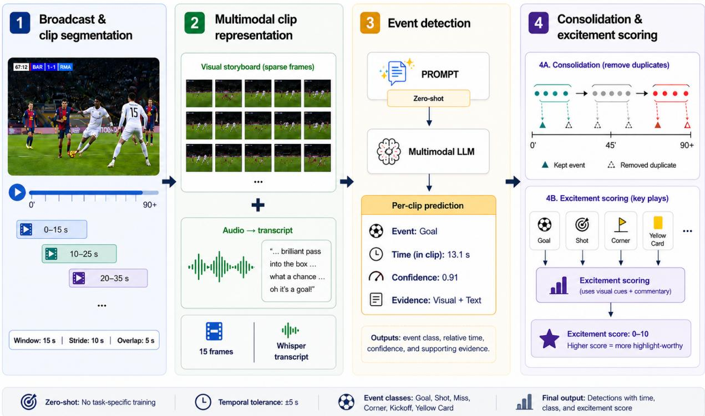
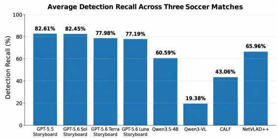
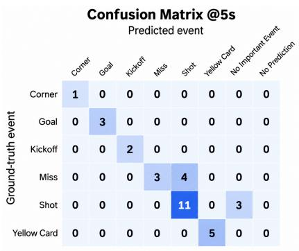
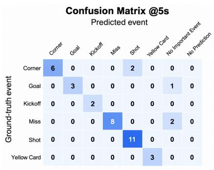
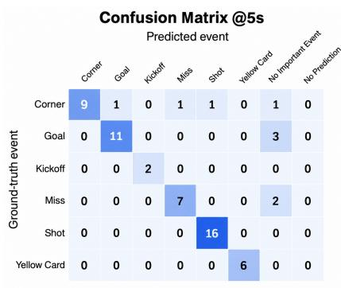

# Zero-Shot Multimodal Event Spotting in Soccer Broadcasts

Sadia Kamal

Department of Computer Science and Engineering

University of Maryland Baltimore County

Maryland, USA

sadia1402@umbc.edu

Mahmudul Hasan Comcast Applied AI Comcast Philadelphia, USA Mdmahmudul Hasan@comcast.com

Tony Braskich   
Comcast Applied AI   
Comcast   
Philadelphia, USA   
tony braskich@comcast.com

Abstract—Automatic soccer event spotting supports highlight generation, video indexing, and sports analytics, but existing methods depend on large annotated datasets and soccerspecific training. We present a zero-shot framework that detects, classifies, and temporally localizes events in full-length soccer broadcasts without task-specific parameter training. Each match is segmented into overlapping clips represented by a compact visual storyboard and the aligned commentary transcript, which a general-purpose multimodal model processes jointly. On three manually annotated matches containing 130 events, the best configuration achieves 72.0% F1@5s and outperforms SoccerNettrained CALF and NetVLAD++ in a cross-dataset setting, while the storyboard representation reduces inference cost by 72% compared with individual frames. We further analyze the effects of model family, input representation, and prompt optimization, and introduce an evidence-grounded excitement-scoring stage that ranks detected events with natural-language explanations for highlight selection.

Index Terms—soccer event detection, zero-shot learning, multimodal large language models, multimodal reasoning.

## I. INTRODUCTION

Soccer broadcasts contain long periods of routine gameplay interrupted by sparse but important events such as goals, shots, misses, corners, kickoffs, and disciplinary actions. Automatically detecting and temporally localizing these events supports applications such as highlight generation, video indexing, content retrieval, and sports analytics. This task is commonly formulated as action spotting, where events must be recognized and localized within complete, untrimmed matches [1], [2]. It remains challenging because events are brief, visually similar across classes, and often surrounded by replays, celebrations, and recap sequences.

Existing soccer action-spotting approaches largely rely on task-specific models trained on annotated datasets. Prior work has improved performance through temporal modeling and multimodal information [3], [4], while soccer-specific frameworks such as MatchVision [5] and SoccerMaster [6] use large-scale domain-specific training. These approaches can be effective but require soccer-specific data, training, and computational resources.

Multimodal large language models (MLLMs) offer an alternative by jointly reasoning over visual and textual information without task-specific parameter fine-tuning. Recent work has also demonstrated their ability to reason about temporal information in long videos [7]. However, applying general-purpose MLLMs to full soccer broadcasts requires detecting sparse events, distinguishing closely related outcomes, temporally localizing them, and handling replay or recap content.

In this work, we investigate zero-shot multimodal event spotting and temporal localization directly from complete soccer broadcasts. We study five questions covering zero-shot feasibility (RQ1), multimodal input representation (RQ2), prompt optimization (RQ3), comparison with supervised soccer-specific methods (RQ4), and multimodal excitement scoring (RQ5). Full soccer matches are divided into overlapping clips represented using sparse visual information and aligned commentary, from which general-purpose multimodal models jointly predict event categories and their temporal locations.

The main contributions of this work are:

• We formulate soccer event spotting over complete broadcasts as a zero-shot multimodal task that jointly performs detection, classification, and temporal localization without task-specific training.

• We evaluate the effects of input representation, model choice, and prompt optimization on detection accuracy, temporal localization, and inference cost.

• We compare the zero-shot framework with supervised action-spotting methods under a common six-class evaluation protocol.

• We introduce an interpretable excitement-scoring stage for highlight ranking and assess its consistency using two LLM-based judging protocols, including FlowJudge and a stronger GPT-based evaluator.

## II. RELATED WORKS

## A. Soccer Event Spotting and Multimodal Understanding

SoccerNet [1] and SoccerNet-v2 [2] established benchmarks for event spotting in soccer broadcasts. Subsequent methods improved temporal modeling through context-aware learning [3], feature aggregation [11], and transformer architectures [10], [12], [18]. Multimodal methods incorporate audio and commentary [4], [17], while MatchVision [5] and Soccer-Master [6] employ soccer-specific representation learning.

  
Fig. 1: Proposed zero-shot multimodal event-spotting framework. Full-match broadcasts are segmented into overlapping clips represented by sparse visual storyboards and aligned commentary. A multimodal LLM predicts event class, timestamp, confidence, and evidence, followed by temporal consolidation and excitement scoring.

X-VARS [13] explores multimodal refereeing, and Jiang et al. [14] investigate domain adaptation of vision-language models. In contrast, we study zero-shot event spotting in full-length broadcasts using general-purpose multimodal models without task-specific parameter training.

## B. Multimodal Temporal Reasoning and Prompt Optimization

TimeChat [7], Grounded-VideoLLM [15], and TimeSuite [16] improve temporal video understanding through specialized representations or training. We instead evaluate generalpurpose models for event detection and localization without fine-tuning. We also investigate MIPROv2 [9] and GEPA [8], which optimize prompts using task performance and reflection, respectively, to assess their effects on detection and temporal localization.

## III. METHODOLOGY

## A. Dataset

Our evaluation dataset consists of three full-length soccer broadcasts from publicly available YouTube videos. All three are professionally produced multi-camera broadcast feeds with standard broadcast editing, including camera cuts, close-up views, replays, and retrospective recap sequences, rather than recordings from a single stationary camera. The matches were manually annotated with temporal intervals for six event categories: goal, shot, miss, corner, kickoff, and yellow card, resulting in 130 annotated events. The source video URLs, temporal annotations, and evaluation metadata are publicly available in our GitHub repository.

Each match is segmented into 15-second clips with a 5-second overlap, with 15 frames uniformly sampled per clip. Commentary is transcribed using Whisper Medium and aligned with each clip. We use this configuration as the default after preliminary experiments with shorter, denser clips produced higher recall but lower precision.

## B. Problem Formulation

A match V is divided into overlapping clips $\begin{array} { r l } { \mathcal { C } } & { { } = } \end{array}$ $\{ C _ { 1 } , \ldots , C _ { N } \}$ , where each clip $\begin{array} { l l l } { C _ { i } } & { = } & { ( S _ { i } , { \mathcal T } _ { i } , t _ { i } ^ { \mathrm { s t a r t } } , t _ { i } ^ { \mathrm { e n d } } ) } \end{array}$ consists of a storyboard $S _ { i }$ of sampled frames, the aligned commentary transcript $\mathcal { T } _ { i } ,$ and its start and end times on the match timeline. For each clip, the model outputs ${ \hat { y } } _ { i } =$ $( \hat { d } _ { i } , \hat { e } _ { i } , \hat { \tau } _ { i } , \hat { c } _ { i } , \hat { r } _ { i } )$ : a detection flag, an event category, a cliprelative timestamp $\hat { \tau } _ { i } \in [ 0 , t _ { i } ^ { \mathrm { e n d } } - t _ { i } ^ { \mathrm { s t a r t } } ]$ , a confidence score, and supporting evidence. Detected events are mapped to the match timeline as

$$
\hat { t } _ { i } ^ { \mathrm { a b s } } = t _ { i } ^ { \mathrm { s t a r t } } + \hat { \tau } _ { i } .\tag{1}
$$

Unlike event-centered classification, the model must jointly decide whether an event occurs, what it is, and when it occurs.

## C. Pipeline Overview

As illustrated in Fig. 1, the framework processes overlapping clips using sparse frame sampling, storyboard construction, commentary alignment, multimodal event detection, temporal localization, consolidation, and excitement scoring.

1) Sparse Frame Sampling: Frames are uniformly sampled across each clip to provide observations throughout the temporal window. The default configuration extracts 15 frames from each 15-second clip.

2) Storyboard Construction: Sampled frames are resized to 384 × 216 pixels and arranged chronologically into a single storyboard, with each frame associated with its relative timestamp. For the default 15-frame configuration, the frames are organized in a 5 × 3 grid, resulting in a storyboard resolution of 1920 × 648 pixels. This compact representation allows the model to reason over temporal progression within a single visual input while reducing the number of separate visual inputs. We compare this representation with providing the same sampled frames individually at the same per-frame resolution.

3) Commentary Alignment: The aligned commentary transcript is provided alongside the visual input, providing complementary semantic evidence about event occurrence and outcome.

4) Multimodal Event Detection: The visual representation and aligned commentary are jointly provided to a generalpurpose multimodal model. The model predicts one event category or no important event, together with a relative timestamp, confidence score, and supporting visual and textual evidence. Outputs follow a structured format for automatic parsing and evaluation.

5) Absolute Temporal Localization: Each predicted cliprelative timestamp τˆ is mapped to the full-match timeline using Eq. 1, allowing predictions from different clips to be compared on a common temporal axis.

6) Temporal Consolidation: Subsequent overlapping clips can produce multiple predictions for the same event. Predictions are grouped by event category and ordered by absolute timestamp. Same-class detections are clustered using a 20- second temporal window, with a 30-second window for goals and corners, and the highest-confidence prediction in each cluster is retained. Predictions from different event classes are never merged.

## D. Prompt Optimization

We compare manually designed and automatically optimized prompts while keeping model parameters fixed.

a) Manual storyboard prompt: Our primary prompt is designed for the storyboard representation. It defines the event taxonomy, provides event-specific decision guidance, and instructs the model to reason jointly over the temporally ordered visual evidence and aligned commentary. The model considers the progression of the clip before assigning an event label and is instructed to distinguish live events from replay or recap segments. Predictions follow a structured format containing the event decision, category, relative timestamp, confidence score, and supporting visual and textual evidence.

b) Two-prompt decomposition: We additionally evaluate a two-prompt configuration that separates recognition from verification. The first prompt performs event recognition and coarse temporal localization, while the second re-examines the initial prediction and multimodal evidence to produce the final event decision and refined timestamp. This tests whether separating initial recognition from verification improves prediction reliability.

c) Automatic prompt optimization: We additionally apply GEPA and MIPROv2 to investigate whether the manually designed instructions can be systematically improved. Both methods use labeled development examples to optimize taskspecific instructions. Separate training, validation, and held-out test splits are used while all model parameters remain fixed. The optimization modifies the textual instructions and reasoning guidance while preserving the event taxonomy, multimodal input representation, and structured output format. The optimized prompts are fixed and applied unchanged during fullmatch inference. Thus, GEPA and MIPROv2 perform labelguided prompt optimization without task-specific parameter fine-tuning, allowing us to examine how prompt structure affects detection and temporal localization within the same parameter-frozen inference framework.

## E. Models

We evaluate several models under the same zero-shot soccer event-detection setting, including GPT-5.5, GPT-5.6 Sol, GPT-5.6 Terra, GPT-5.6 Luna, Qwen3.5-4B, and Qwen3-VL-8B Embedding. The GPT variants are selected to compare different capability–cost operating points within the same model family, while Qwen3.5-4B provides a lightweight open-source generative baseline that can be deployed on a single consumer GPU. The generative models receive either sampled frames or storyboards together with aligned commentary and produce the event category, relative timestamp, confidence score, and supporting multimodal evidence.

We additionally evaluate Qwen3-VL-8B Embedding as an embedding-based baseline, where clip representations are compared with event-description prototypes. This allows us to examine whether generative multimodal reasoning provides an advantage over representation-based similarity matching. All models are evaluated without task-specific fine-tuning under the same evaluation protocol.

## F. Excitement Scoring

For excitement analysis, we evaluate the 175 postconsolidation predictions belonging to the six event categories used in the main event-spotting evaluation. Predictions outside the benchmark taxonomy are excluded to maintain consistency with the detection evaluation. Each retained event is scored once, avoiding repeated assessments of the same event arising from overlapping clips. GPT-5.4 Mini scores each event using its predicted category, detection confidence, supporting visual evidence, and aligned transcript rather than reprocessing the original video.

$$
S _ { \mathrm { e x c } } = w _ { 1 } S _ { \mathrm { e v e n t } } + w _ { 2 } S _ { \mathrm { v i s u a l } } + w _ { 3 } S _ { \mathrm { t e x t } } ,\tag{2}
$$

where $w _ { 1 } , \ w _ { 2 }$ , and $w _ { 3 }$ control the relative contribution of event importance, visual intensity, and transcript intensity, respectively, with $w _ { 1 } + w _ { 2 } + w _ { 3 } = 1$

In our experiments, we set $w _ { 1 } = 0 . 4 0 , w _ { 2 } = 0 . 3 5 .$ , and $w _ { 3 } ~ = ~ 0 . 2 5$ . These values place greater emphasis on event importance and visual evidence while retaining commentary as complementary semantic and emotional context. The weights are heuristic design choices rather than learned parameters and can be adjusted depending on the desired highlight-selection behavior or application requirements.

In addition to the excitement score, the model generates a confidence score and a concise natural-language explanation describing the evidence supporting its assessment, providing an interpretable estimate of event excitement for highlight ranking.

## IV. EVALUATION

## A. Evaluation Protocol

We evaluate event detection using event-level precision, recall, F1 score, mean Average Precision (mAP), and temporal localization error. Since predictions are single timestamps while ground-truth events are temporal intervals, a prediction is temporally matched if it lies within the annotated interval or within a predefined tolerance around it.

Unless otherwise stated, we use a temporal tolerance of ±5 seconds. A prediction is a true positive (TP) when it matches a ground-truth event of the same category within this tolerance. Unmatched predictions are false positives (FP), and unmatched ground-truth events are false negatives (FN). Each prediction and ground-truth event can participate in at most one match. The 130 annotated events constitute the ground-truth set for the six-class event-spotting evaluation. Prediction counts are computed after temporal consolidation and therefore need not equal the ground-truth count; unmatched predictions are counted as false positives.

We report Precision@5s, Recall@5s, and F1@5s. For matched events, temporal localization is measured by the mean absolute error (MAE) between each prediction and its ground-truth interval, taken as zero inside the interval and as the distance to the nearest boundary otherwise. For mAP, predictions for each event category are ranked by confidence and average precision (AP) is computed from the resulting precision–recall curve. mAP is obtained by averaging AP across event categories using the same ±5-second temporal matching criterion.

## B. Excitement-Score Evaluation

We assess excitement-score consistency over the same 175 post-consolidation event predictions using two LLM-based judges: FlowJudge [20] and GPT-5.6 Sol. Each judge receives the predicted event category, extracted visual evidence, and aligned commentary, while the original GPT-5.4 Mini excitement score, confidence, and explanation are withheld to avoid anchoring. Both judges assign scores on the same 0–10 scale. Because the intended application is event ranking, Spearman’s rank correlation (ρ) [19] is the primary agreement metric; we additionally report mean absolute error (MAE) to characterize differences in absolute score calibration.

  
Fig. 2: Average detection recall across three matches. GPT-5.5 and GPT-5.6 Sol achieve the highest recall, while NetVLAD++ and CALF obtain 65.96% and 43.06%, respectively.

## V. RESULTS

All experiments were conducted using AWS EC2 g5.2xlarge instances as the common experimental environment. Preprocessing, feature extraction, baseline execution, and open-source model inference were performed locally, while API-based multimodal models were accessed through their respective APIs. Results are organized around the five research questions introduced earlier.

## A. RQ1: Overall Event Detection Performance

Table I summarizes average event-detection performance across the three matches. Among the evaluated multimodal configurations, GPT-5.5 with storyboard input achieves the highest overall performance, with 63.85% Precision@5s, 82.61% Recall@5s, 72.02% F1@5s, and 76.24% mAP@5s. It also achieves the lowest temporal localization error of 0.27 seconds.

GPT-5.6 Sol performs comparably, achieving 82.45% Recall@5s and 70.05% F1@5s. The 0.16-point recall difference is small in this three-match evaluation. GPT-5.6 Terra provides a lower-cost alternative, achieving 67.75% F1@5s at \$7.20 per match, compared with \$18.01 for GPT-5.5 and GPT-5.6 Sol. GPT-5.6 Luna further reduces the cost to \$0.72 while retaining 77.19% recall, but its lower precision (45.83%) reduces F1@5s to 57.32%.

The Qwen models perform substantially worse overall. Qwen3.5-4B achieves 60.59% recall but 30.46% precision, while Qwen3-VL-8B obtains only 19.38% recall. Within our three-match evaluation, these results show substantial variation in zero-shot event-spotting capability across multimodal model families.

Fig. 2 compares Recall@5s across all methods: the GPT configurations recover 77–83% of annotated events, compared with 65.96% for NetVLAD++ and 43.06% for CALF.

Table II further shows substantial variation across event categories. Qwen3.5-4B obtains the highest goal recall (90.5%)

TABLE I: Average event-detection performance across three matches, with task-specific training and per-match inference cost.
<table><tr><td>Model</td><td>Training</td><td>Input</td><td>P@5s</td><td>R@5s</td><td>F1@5s</td><td>mAP@5s</td><td>MAE (s)</td><td>Pred./match</td><td>Cost/match</td></tr><tr><td>CALF</td><td>Yes (SoccerNet)</td><td>Video</td><td>12.91</td><td>43.06</td><td>19.60</td><td>31.95</td><td>0.94</td><td>147</td><td>N/A</td></tr><tr><td>NetVLAD++</td><td>Yes (SoccerNet-v2)</td><td>Video</td><td>27.23</td><td>65.96</td><td>38.49</td><td>56.82</td><td>0.81</td><td>103</td><td>N/A</td></tr><tr><td>GPT-5.5</td><td>No</td><td>Storyboard</td><td>63.85</td><td>82.61</td><td>72.02</td><td>76.24</td><td>0.27</td><td>56</td><td>$18.01</td></tr><tr><td>GPT-5.6 Sol</td><td>No</td><td>Storyboard</td><td>60.93</td><td>82.45</td><td>70.05</td><td>74.77</td><td>0.47</td><td>58</td><td>$18.01</td></tr><tr><td>GPT-5.6 Terra</td><td>No</td><td>Storyboard</td><td>59.90</td><td>77.98</td><td>67.75</td><td>74.08</td><td>0.35</td><td>56</td><td>$7.20</td></tr><tr><td>GPT-5.6 Luna</td><td>No</td><td>Storyboard</td><td>45.83</td><td>77.19</td><td>57.32</td><td>67.16</td><td>0.30</td><td>74</td><td>$0.72</td></tr><tr><td>Qwen3.5-4B</td><td>No</td><td>Storyboard</td><td>30.46</td><td>60.59</td><td>39.73</td><td>17.96</td><td>1.14</td><td>88</td><td>$0.25</td></tr><tr><td>Qwen3-VL-8B</td><td>No</td><td>Storyboard</td><td>17.17</td><td>19.38</td><td>16.96</td><td>34.27</td><td>0.37</td><td>56</td><td>$0.25</td></tr></table>

TABLE II: Class-wise event recall across the three soccer matches. Each entry reports correctly detected over annotated events for each class.
<table><tr><td>Model</td><td>Corner</td><td>Goal</td><td>Kickoff</td><td>Miss</td><td>Shot</td><td>Yellow Card</td></tr><tr><td>GPT-5.5</td><td>16/22 (72.7%)</td><td>18/21 (85.7%)</td><td>6/6 (100.0%)</td><td>19/26 (73.1%)</td><td>35/41 (85.4%)</td><td>14/14 (100.0%)</td></tr><tr><td>GPT-5.6 Sol</td><td>16/22 (72.7%)</td><td>17/21 (81.0%)</td><td>6/6 (100.0%)</td><td>18/26 (69.2%)</td><td>37/41 (90.2%)</td><td>14/14 (100.0%)</td></tr><tr><td>GPT-5.6 Terra</td><td>17/22 (77.3%)</td><td>17/21 (81.0%)</td><td>6/6 (100.0%)</td><td>17/26 (65.4%)</td><td>31/41 (75.6%)</td><td>14/14 (100.0%)</td></tr><tr><td>GPT-5.6 Luna</td><td>15/22 (68.2%)</td><td>18/21 (85.7%)</td><td>6/6 (100.0%)</td><td>15/26 (57.7%)</td><td>33/41 (80.5%)</td><td>12/14 (85.7%)</td></tr><tr><td>Qwen3.5-4B</td><td>14/22 (63.6%)</td><td>19/21 (90.5%)</td><td>3/6 (50.0%)</td><td>15/26 (57.7%)</td><td>14/41 (34.1%)</td><td>14/14 (100.0%)</td></tr><tr><td>Qwen3-VL-8B</td><td>7/22 (31.8%)</td><td>11/21 (52.4%)</td><td>0/6 (0.0%)</td><td>0/26 (0.0%)</td><td>0/41 (0.0%)</td><td>7/14 (50.0%)</td></tr><tr><td>CALF</td><td>18/22 (81.8%)</td><td>8/21 (38.1%)</td><td>1/6 (16.7%)</td><td>9/26 (34.6%)</td><td>12/41 (29.3%)</td><td>8/14 (57.1%)</td></tr><tr><td>NetVLAD++</td><td>21/22 (95.5%)</td><td>10/21 (47.6%)</td><td>3/6 (50.0%)</td><td>20/26 (76.9%)</td><td>20/41 (48.8%)</td><td>11/14 (78.6%)</td></tr></table>

while detecting only 34.1% of shots, and NetVLAD++ achieves the highest corner recall (95.5%) despite lower aggregate performance. In contrast, the stronger GPT configurations provide more balanced recall across event categories. Qwen3- VL-8B fails to recover kickoffs, misses, and shots.

Table I reports metrics macro-averaged across matches, whereas Table II pools detections across matches, explaining the small differences between aggregate recall and pooled class-wise counts. Overall, RQ1 shows that, on the evaluated broadcasts, general-purpose multimodal models can perform soccer event spotting and temporal localization without soccerspecific parameter fine-tuning, although performance varies across model families.

## B. RQ2: Effect of Input Representation and Modality

To isolate the effect of input representation and modality, we conduct this ablation on a single full-length match using GPT-5.6. We compare four configurations: transcript only, 15 visual frames only, 15 frames with transcript, and storyboard with transcript, using the same event taxonomy, evaluation protocol, and post-processing.

Table III shows that transcript-only input achieves 50.00% F1@5s, while visual frames alone improve it to 63.57%. Combining frames with commentary further increases F1@5s to 72.31%, demonstrating the benefit of multimodal information. The storyboard achieves the highest Recall@5s (85.00%) and F1@5s (73.91%). Compared with individual frames plus transcript, it also reduces inference cost from \$64.69 to \$18.01 (72.2%) while slightly improving F1@5s.

Class-wise, commentary alone performs poorly on outcomesensitive events such as misses (22.2%), while combining visual and textual evidence raises miss recall to 77.8%, indicating that the modalities are complementary. Overall, RQ2 indicates that multimodal input improves event spotting and that, in this single-match ablation, the storyboard gives the strongest aggregate performance at substantially lower cost.

TABLE III: Input representation and modality ablation on a single full-length soccer match using GPT-5.6 with a ±5- second matching tolerance.
<table><tr><td>Input</td><td>P@5s</td><td>R@5s</td><td>F1@5s</td><td>MAE</td><td>Pred.</td><td>Cost</td></tr><tr><td>Transcript only</td><td>53.85</td><td>46.67</td><td>50.00</td><td>0.68</td><td>52</td><td>13.56</td></tr><tr><td>15 frames only</td><td>59.42</td><td>68.33</td><td>63.57</td><td>0.24</td><td>69</td><td>64.47</td></tr><tr><td>15 frames + transcript</td><td>67.14</td><td>78.33</td><td>72.31</td><td>0.91</td><td>70</td><td>64.69</td></tr><tr><td>Storyboard + transcript</td><td>65.38</td><td>85.00</td><td>73.91</td><td>0.43</td><td>78</td><td>18.01</td></tr></table>

## C. RQ3: Prompt Structure and Optimization

Table IV compares the manually designed storyboard prompt, a two-prompt variant, and prompts optimized using GEPA and MIPROv2. Here, manually designed denotes a researcher-authored prompt specifying the event taxonomy, decision rules, temporal reasoning guidance, and structured output format without automated optimization. The manually designed storyboard prompt achieves the highest Recall@5s (82.45%) and F1@5s (70.05%). Storyboard-2 produces a more conservative detector, with the highest precision (62.24%), fewest predictions (54), and lowest temporal MAE (0.14 s), but its recall decreases to 71.5%.

Among the automatically optimized prompts, MIPROv2 achieves 80.37% recall, approaching the storyboard prompt, but its lower precision (53.09%) results in 63.89% F1@5s. GEPA achieves 55.41% precision, 71.83% recall, and 62.17% F1@5s. Both optimized prompts improve temporal localization over the storyboard baseline, with MAEs of 0.23 s for

TABLE IV: Comparison of manual and automatically optimized prompting strategies across three soccer matches.
<table><tr><td>Prompt Strategy</td><td>Model</td><td>P@5s</td><td>R@5s</td><td>F1@5s</td><td>MAE (s)</td><td>Pred./match</td><td>Cost ($)</td></tr><tr><td>Storyboard</td><td>GPT-5.6 Sol</td><td>60.93%</td><td>82.45%</td><td>70.05%</td><td>0.47</td><td>58</td><td>18.01</td></tr><tr><td>Storyboard-2</td><td>GPT-5.6 Sol</td><td>62.24%</td><td>71.5%</td><td>61.30%</td><td>0.14</td><td>54</td><td>18.01</td></tr><tr><td>GEPA</td><td>GPT-5.6 Sol</td><td>55.41%</td><td>71.83%</td><td>62.17%</td><td>0.23</td><td>56</td><td>20.00</td></tr><tr><td>MIPROv2</td><td>GPT-5.6 Sol</td><td>53.09%</td><td>80.37%</td><td>63.89%</td><td>0.27</td><td>65</td><td>20.00</td></tr></table>

GEPA and 0.27 s for MIPROv2 compared with 0.47 s for the storyboard prompt.

Table V shows that the effect of prompt optimization is event dependent. The storyboard prompt achieves the highest shot recall (90.2%) and ties for the highest recall on several other classes. MIPROv2 achieves the highest miss recall (73.1%) while matching the storyboard on goals, kickoffs, and yellow cards. GEPA matches storyboard recall for corners and goals but performs worse on the remaining classes, while Storyboard-2 generally exhibits lower class-wise recall.

Although GEPA and MIPROv2 are designed to improve task-specific prompting, their gains are limited in our setting because many errors arise from the multimodal evidence itself rather than from the textual instructions alone. Sparse visual sampling, ambiguous event outcomes, and broadcast or recap content can leave insufficient evidence for distinguishing closely related events. Prompt optimization can therefore modify the detector’s decision behavior, but it cannot recover visual or temporal information that is absent from the input. This helps explain why the optimized prompts improve some classes or temporal localization without consistently improving overall F1.

Overall, RQ3 shows that automatic prompt optimization does not uniformly improve event spotting but changes the detector’s precision, recall, temporal localization, and class sensitivity. MIPROv2 favors broader event coverage, while GEPA improves temporal localization but has lower aggregate detection performance. The manually designed storyboard prompt achieves the highest Recall@5s and F1@5s among the evaluated strategies.

## D. RQ4: Comparison with Soccer-Specific Baselines

We compare the proposed zero-shot multimodal approach with CALF and NetVLAD++, two supervised action-spotting models pretrained on SoccerNet. Both baselines are evaluated on the same three matches using the same six-class taxonomy and temporal evaluation protocol.

As shown in Table I, NetVLAD++ achieves 65.96% Recall@5s and 38.49% F1@5s, while CALF achieves 43.06% Recall@5s and 19.60% F1@5s. Both methods also produce substantially more predictions than the strongest storyboardbased configurations.

Under this common six-class evaluation, the strongest zeroshot multimodal configurations achieve higher precision, recall, F1@5s, and mAP@5s than the evaluated supervised baselines. However, CALF and NetVLAD++ are pretrained on SoccerNet and evaluated here without retraining. Their results therefore represent cross-dataset transfer rather than their original in-domain performance, and differences in annotation conventions and broadcast characteristics may affect the comparison.

Overall, RQ4 shows that general-purpose multimodal models can achieve strong cross-dataset soccer event-spotting performance without soccer-specific parameter fine-tuning.

## E. RQ5: Excitement-Score Analysis

We evaluate excitement scoring over 175 post-consolidation event predictions across the three matches and six event categories. Unlike the clip-level detector outputs, each retained prediction represents a single event candidate after temporal consolidation, preventing overlapping detections of the same event from being counted repeatedly.

As shown in Table VI, GPT-5.4 Mini assigns an overall mean excitement score of 5.07. Goals receive the highest average score (7.87), followed by shots (5.81) and misses (5.03), while corners (2.66), kickoffs (2.44), and yellow cards (2.36) receive lower scores. This ordering is broadly preserved by both LLM-based judges, indicating that the scoring framework differentiates events according to estimated highlight relevance.

To assess scoring consistency, we compare GPT-5.4 Mini with FlowJudge and a stronger GPT-based judge. As shown in Table VII, FlowJudge achieves an overall Spearman rank correlation of ρ = 0.716 with an MAE of 1.37, while the GPT-based judge achieves substantially stronger agreement with ρ = 0.926 and an MAE of 0.64. FlowJudge assigns a lower mean score than GPT-5.4 Mini (4.46 versus 5.07), indicating more conservative absolute-score calibration, whereas the GPT-based judge produces a similar overall mean score (5.25). Positive rank agreement is observed across all three matches for both judges.

Overall, RQ5 demonstrates consistent excitement ranking across two LLM-based judges, while human evaluation remains necessary to establish alignment with perceived highlight relevance.

## F. Error Analysis

a) Class ambiguity: We examine event-level confusion matrices for the GPT-5.6 Sol storyboard configuration across the three matches using the same ±5 s temporal tolerance as the main evaluation.

The confusion patterns show that errors are concentrated among semantically related attacking events. In Match 1, four of seven misses are classified as shots, indicating difficulty distinguishing an off-target miss from an on-target attempt. In Matches 2 and 3, corner errors sometimes correspond to the goal-directed action following the set piece. Event rejection also contributes to errors, including three of fourteen shots in Match 1 and three of fourteen goals in Match 3 classified as No Important Event.

TABLE V: Event-level Recall@5s across event classes for different prompt strategies.
<table><tr><td>Prompt</td><td>Model</td><td>Corner</td><td>Goal</td><td>Kickoff</td><td>Miss</td><td>Shot</td><td>Yellow Card</td></tr><tr><td>Storyboard</td><td>GPT-5.6 Sol</td><td>72.7% (16/22)</td><td>81.0% (17/21)</td><td>100.0% (6/6)</td><td>69.2% (18/26)</td><td>90.2% (37/41)</td><td>100.0% (14/14)</td></tr><tr><td>Storyboard-2</td><td>GPT-5.6 Sol</td><td>63.6% (14/22)</td><td>76.2% (16/21)</td><td>66.7% (4/6)</td><td>65.4% (17/26)</td><td>73.2% (30/41)</td><td>85.7% (12/14)</td></tr><tr><td>GEPA</td><td>GPT-5.6 Sol</td><td>72.7% (16/22)</td><td>81.0% (17/21)</td><td>83.3% (5/6)</td><td>65.4% (17/26)</td><td>68.3% (28/41)</td><td>85.7% (12/14)</td></tr><tr><td>MIPROv2</td><td>GPT-5.6 Sol</td><td>68.2% (15/22)</td><td>81.0% (17/21)</td><td>100.0% (6/6)</td><td>73.1% (19/26)</td><td>85.4% (35/41)</td><td>100.0% (14/14)</td></tr></table>

  
(a) Match 1

  
(b) Match 2

  
(c) Match 3  
Fig. 3: Per-match event-level confusion matrices for GPT-5.6 Sol with storyboard and transcript input. Rows denote groundtruth classes and columns predicted classes.

TABLE VI: Excitement-score analysis over 175 postconsolidation event predictions from the six benchmark categories across the three evaluated matches.
<table><tr><td>Event</td><td>N</td><td>GPT Avg. Avg. Conf. Flow Avg.</td><td></td><td></td><td>GPT-J Avg.</td></tr><tr><td>Corner</td><td>21</td><td>2.66</td><td>0.79</td><td>2.67</td><td>3.38</td></tr><tr><td>Goal</td><td>27</td><td>7.87</td><td>0.92</td><td>7.70</td><td>8.00</td></tr><tr><td>Kickoff</td><td>11</td><td>2.44</td><td>0.86</td><td>1.45</td><td>2.18</td></tr><tr><td>Miss</td><td>26</td><td>5.03</td><td>0.85</td><td>4.46</td><td>4.81</td></tr><tr><td>Shot</td><td>72</td><td>5.81</td><td>0.82</td><td>4.69</td><td>5.96</td></tr><tr><td>Yellow Card</td><td>18</td><td>2.36</td><td>0.87</td><td>2.56</td><td>3.00</td></tr><tr><td>Overall</td><td>175</td><td>5.07</td><td>0.84</td><td>4.46</td><td>5.25</td></tr></table>

These patterns suggest that class ambiguity depends on the temporal context within a clip. A corner may be immediately followed by a shot, while distinguishing a shot from a miss requires evidence of the attempt’s final trajectory. Sparse storyboard sampling may therefore capture the attacking action while providing less explicit evidence of its final outcome.

b) Broadcast–recap confusion: We additionally conduct a qualitative analysis of broadcast state for goal predictions. An event is labeled broadcast when the clip contains its original occurrence and recap when a later segment revisits an earlier event. Broadcast state is determined manually by inspecting the surrounding temporal context.

Among four manually inspected goal predictions from one representative match, three correspond to the original broadcast occurrence and one to a recap. In the recap case, a previously occurring scoring sequence is shown again and interpreted as a new goal. Although this small qualitative sample does not support estimating a general recap-confusion rate, it demonstrates that recap content can produce falsepositive event detections despite explicit prompt instructions to distinguish live events from retrospective footage.

These observations suggest that prompt-based broadcaststate reasoning can handle some replay or recap sequences but is not fully reliable. Explicit broadcast-state modeling may provide a more robust mechanism for distinguishing new events from retrospective content.

## VI. CONCLUSION

This work presented a zero-shot multimodal framework for soccer event spotting, temporal localization, and excitement scoring from complete match broadcasts without task-specific parameter fine-tuning. Across three annotated matches with 130 events from six categories, we evaluated multiple models, input representations, temporal settings, and prompt-optimization strategies. Combining visual and commentary evidence improved event spotting, while storyboard input provided strong performance at lower inference cost than individual-frame multimodal input. Prompt optimization changed precision–recall and class-level behavior but did not consistently improve overall performance.

Excitement scores showed positive rank agreement with two LLM-based evaluators, with particularly strong agreement from the GPT-based judge. However, the excitement analysis remains model-based and requires human validation to establish alignment with perceived highlight relevance. The three-match evaluation limits conclusions about generalization across leagues, broadcast styles, and commentary conditions. Sparse frame sampling may omit short-duration visual cues, while replay and recap sequences can introduce falsepositive detections. CALF and NetVLAD++ are evaluated cross-dataset without retraining, so annotation and broadcast differences may affect the comparison.

TABLE VII: Agreement of GPT-5.4 Mini excitement scores with two LLM-based judges.
<table><tr><td>Match</td><td>N</td><td>GPT  $\mathbf { \delta A v g . }$ </td><td>Flow  $\mathbf { A v g . }$ </td><td>Flow  $\rho$ </td><td>Flow MAE</td><td>GPT-Judge  $\mathbf { A v g } .$ </td><td>GPT-Judge  $\rho$ </td><td>GPT-Judge MAE</td></tr><tr><td>Match 1</td><td>78</td><td>5.05</td><td>4.46</td><td>0.785</td><td>1.28</td><td>5.28</td><td>0.943</td><td>0.57</td></tr><tr><td>Match 2</td><td>43</td><td>5.52</td><td>4.53</td><td>0.683</td><td>1.51</td><td>5.67</td><td>0.908</td><td>0.66</td></tr><tr><td>Match 3</td><td>54</td><td>4.74</td><td>4.39</td><td>0.581</td><td>1.38</td><td>4.87</td><td>0.880</td><td>0.72</td></tr><tr><td>Overall</td><td>175</td><td>5.07</td><td>4.46</td><td>0.716</td><td>1.37</td><td>5.25</td><td>0.926</td><td>0.64</td></tr></table>

TABLE VIII: Representative excitement-scoring examples from the three matches.

Match Event GPT-5.4 Conf. FlowJudge GPT-5.6 Explanation
<table><tr><td>Match 1 Goal</td><td>8.61</td><td>0.91</td><td>9.0</td><td>9.0</td><td>Ferran Torres scores after a cross, with the ball inside the goal and sustained celebration from the scorer and team. The commentator&#x27;s disbelief at two goals</td></tr><tr><td>Match 2 Shot</td><td>8.62</td><td>0.93</td><td>6.0</td><td>8.0</td><td>in two minutes makes the moment highly exciting. The goalkeeper saves a close-range Aguero attempt after a City move into the penalty area. The commentator&#x27;s “to seal it for City! What a save&quot; makes the</td></tr><tr><td>Match 3 Miss</td><td>5.83</td><td>0.88</td><td>4.0</td><td>6.0</td><td>moment highly dramatic. Bruno Fernandes spots Ortega off his line and attempts a long-range effort toward an open goal, but it goes wide. The near-open-goal setup adds tension, while the miss and muted commentary limit the excitement.</td></tr></table>

Overall, the results demonstrate the potential of generalpurpose multimodal models for soccer video understanding, while motivating larger-scale evaluation, better replay handling, and human validation of highlight relevance.

## REFERENCES

[1] S. Giancola, M. Amine, T. Dghaily, and B. Ghanem, “SoccerNet: A scalable dataset for action spotting in soccer videos,” in Proc. IEEE/CVF Conf. Comput. Vis. Pattern Recognit. Workshops (CVPRW), 2018, pp. 1711–1721.

[2] A. Deliege, A. Cioppa, S. Giancola, M. J. Seikavandi, J. V. Dueholm, K. Nasrollahi, B. Ghanem, T. B. Moeslund, and M. Van Droogenbroeck, “SoccerNet-v2: A dataset and benchmarks for holistic understanding of broadcast soccer videos,” in Proc. IEEE/CVF Conf. Comput. Vis. Pattern Recognit. Workshops (CVPRW), 2021, pp. 4503–4514.

[3] A. Cioppa, A. Deliege, S. Giancola, B. Ghanem, M. Van Droogenbroeck, R. Gade, and T. B. Moeslund, “A context-aware loss function for action spotting in soccer videos,” in Proc. IEEE/CVF Conf. Comput. Vis. Pattern Recognit. (CVPR), 2020, pp. 13126–13136.

[4] B. Vanderplaetse and S. Dupont, “Improved soccer action spotting using both audio and video streams,” in Proc. IEEE/CVF Conf. Comput. Vis. Pattern Recognit. Workshops (CVPRW), 2020, pp. 3921–3931.

[5] J. Rao, H. Wu, H. Jiang, Y. Zhang, Y. Wang, and W. Xie, “Towards universal soccer video understanding,” in Proc. IEEE/CVF Conf. Comput. Vis. Pattern Recognit. (CVPR), 2025, pp. 8384–8394.

[6] H. Yang, J. Rao, H. Wu, and W. Xie, “SoccerMaster: A vision foundation model for soccer understanding,” in Proc. IEEE/CVF Conf. Comput. Vis. Pattern Recognit. (CVPR), 2026, pp. 21549–21560.

[7] S. Ren, L. Yao, S. Li, X. Sun, and L. Hou, “TimeChat: A time-sensitive multimodal large language model for long video understanding,” in Proc. IEEE/CVF Conf. Comput. Vis. Pattern Recognit. (CVPR), 2024, pp. 14313–14323.

[8] L. A. Agrawal, S. Tan, D. Soylu, N. Ziems, R. Khare, K. Opsahl-Ong, A. Singhvi, H. Shandilya, M. J. Ryan, M. Jiang, C. Potts, K. Sen, A. G. Dimakis, I. Stoica, D. Klein, M. Zaharia, and O. Khattab, “GEPA: Reflective prompt evolution can outperform reinforcement learning,” 2025, arXiv:2507.19457.

[9] K. Opsahl-Ong, M. J. Ryan, J. Purtell, D. Broman, C. Potts, M. Zaharia, and O. Khattab, “Optimizing instructions and demonstrations for multistage language model programs,” in Proc. 2024 Conf. Empirical Methods Natural Language Processing (EMNLP), 2024, pp. 9340–9366.

[10] A. Xarles, S. Escalera, T. B. Moeslund, and A. Clapes, “ASTRA:´ An action spotting TRAnsformer for soccer videos,” in Proc. 6th Int. Workshop Multimedia Content Analysis Sports (MMSports), 2023, pp. 93–102.

[11] S. Giancola and B. Ghanem, “Temporally-aware feature pooling for action spotting in soccer broadcasts,” in Proc. IEEE/CVF Conf. Comput. Vis. Pattern Recognit. Workshops (CVPRW), 2021, pp. 4490–4499.

[12] A. Xarles, S. Escalera, T. B. Moeslund, and A. Clapes, “T-DEED:´ Temporal-discriminability enhancer encoder-decoder for precise event spotting in sports videos,” in Proc. IEEE/CVF Conf. Comput. Vis. Pattern Recognit. Workshops (CVPRW), 2024, pp. 3410–3419.

[13] J. Held, H. Itani, A. Cioppa, S. Giancola, B. Ghanem, and M. Van Droogenbroeck, “X-VARS: Introducing explainability in football refereeing with multi-modal large language models,” in Proc. IEEE/CVF Conf. Comput. Vis. Pattern Recognit. Workshops (CVPRW), 2024, pp. 3267–3279.

[14] T. Jiang, H. Wang, M. S. Salekin, P. Atighehchian, and S. Zhang, “Domain adaptation of VLM for soccer video understanding,” in Proc. IEEE/CVF Conf. Comput. Vis. Pattern Recognit. Workshops (CVPRW), 2025, pp. 6157–6167.

[15] H. Wang, Z. Xu, Y. Cheng, S. Diao, Y. Zhou, Y. Cao, Q. Wang, W. Ge, and L. Huang, “Grounded-VideoLLM: Sharpening fine-grained temporal grounding in video large language models,” 2024, arXiv:2410.03290.

[16] X. Zeng, K. Li, C. Wang, X. Li, T. Jiang, Z. Yan, S. Li, Y. Shi, Z. Yue, Y. Wang, Y. Wang, Y. Qiao, and L. Wang, “TimeSuite: Improving MLLMs for long video understanding via grounded tuning,” 2024, arXiv:2410.19702.

[17] T. Kumakura, R. Orihara, Y. Tahara, A. Ohsuga, and Y. Sei, “ASPERA: Multimodal soccer action spotting with visual, auditory, and textual modalities,” IEICE Trans. Inf. Syst., vol. E109-D, no. 8, pp. 1205–1218, 2026.

[18] S. Santra, V. Chudasama, P. Wasnik, and V. N. Balasubramanian, “Precise event spotting in sports videos: Solving long-range dependency and class imbalance,” in Proc. IEEE/CVF Conf. Comput. Vis. Pattern Recognit. (CVPR), 2025, pp. 3163–3172.

[19] C. Spearman, “The proof and measurement of association between two things,” The American Journal of Psychology, vol. 15, no. 1, pp. 72–101, 1904.

[20] Flow AI, “Flow Judge: An open small language model for LLM system evaluations,” 2024. [Online]. https://flow-ai.com/blog/flow-judge