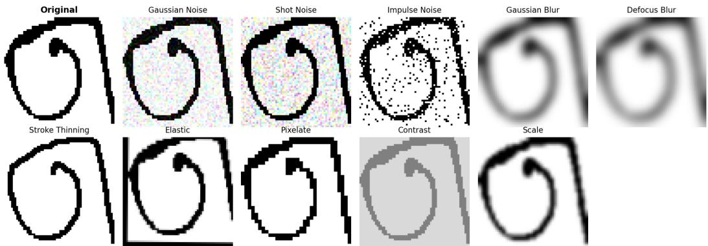
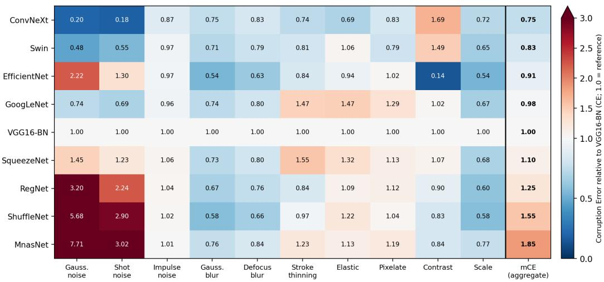
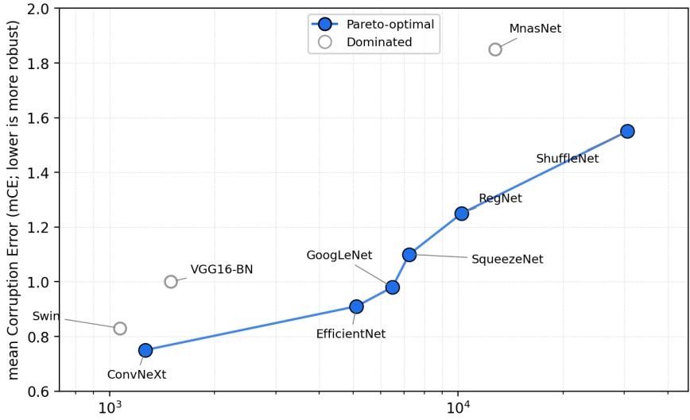

# uTHCD-C: A Corruption-Robustness Benchmark for Tamil Handwritten Character Recognition

Preethi S∗ Dept. of Electronics and Communication Engineering Kongu Engineering College Erode, Tamil Nadu, India

Meeradevi T Dept. of Electronics and Communication Engineering Kongu Engineering College Erode, Tamil Nadu, India

Arun Prakash A AI4Bharat Indian Institute of Technology Madras Chennai, Tamil Nadu, India

## Abstract

Evaluation of Tamil handwritten character recognition (HCR) has largely focused on clean test images, and a standardized multi-corruption robustness benchmark for isolated Tamil HCR has not been established. We introduce uTHCD-C, a corruption-robustness benchmark based on the unconstrained Tamil Handwritten Character Database (uTHCD). The benchmark defines ten corruption types, including a handwriting-specific stroke-thinning corruption, at five severity levels. We evaluate nine convolutional and transformer-based architectures using five-fold stratified cross-validation and writer-independent testing. Robustness is quantified using mean Corruption Error (mCE), normalized against a VGG16-BN reference. We additionally compare parameter count, computational complexity, and inference throughput to characterize the computational requirements of the evaluated architectures. The results establish comparative robustness baselines for Tamil HCR, revealing substantial differences across architectures: ConvNeXt and Swin achieve the lowest mCE values (0.75 and 0.83, respectively), whereas ShuffleNet and MnasNet exhibit higher values (1.55 and 1.85, respectively). The accompanying efficiency measurements characterize the trade-offs between corruption robustness and computational requirements. By providing standardized corruption configurations, evaluation protocols, and comparative results, uTHCD-C establishes a reproducible basis for future research on robust and computationally efficient Tamil HCR.

Keywords: Tamil handwritten character recognition, corruption robustness, benchmark, image degradation, character classification

Code and data: https://github.com/pre-prakash/uTHCD-C-Bench

## 1 Introduction

Handwritten character recognition (HCR) is an important component of document digitization and language technology. However, recognition accuracy on clean test images does not fully characterize a model’s performance when handwriting is affected by image degradation. Scanned and cameracaptured documents may contain noise, blur, reduced contrast, spatial distortions, and variations in stroke visibility. Such degradations can alter the structural details that distinguish visually similar characters and reduce recognition performance even when a model performs well under clean conditions.

The unconstrained Tamil Handwritten Character Database (uTHCD) provides a substantial resource for isolated Tamil handwritten-character recognition, comprising 90,950 samples across 156 character classes written by 753 individuals Shaffi and Hajamohideen [2021]. Subsequent Tamil HCR studies have established recognition baselines using conventional evaluation protocols Kavitha et al. [2022], Kavitha and Srimathi [2022]. These studies provide important foundations for character recognition, but clean-image evaluation does not systematically establish how model performance changes across controlled corruption types and severity levels. Benchmarks such as ImageNet-C and MNIST-C provide established protocols for evaluating robustness to common corruptions Hendrycks and Dietterich [2019], Mu and Gilmer [2019]. To the best of our knowledge, no comparable multicorruption benchmark has been established for isolated Tamil handwritten character recognition.

To address this gap, we introduce uTHCD-C, a corruption-robustness benchmark for isolated Tamil HCR based on uTHCD. The benchmark defines ten corruption types evaluated at five severity levels, including a handwriting-specific stroke-thinning corruption. Nine corruption types are adapted from established corruption-benchmarking conventions, while stroke thinning addresses changes in glyph structure that may not be adequately represented by general image degradations. We evaluate nine convolutional and transformer-based architectures using five-fold stratified cross-validation and writer-independent testing. Robustness is summarized using mean Corruption Error (mCE), normalized against a VGG16-BN reference, alongside clean-data accuracy and corruption-specific results.

We additionally report parameter count, computational complexity, and measured inference through put alongside the robustness results to support model selection under differing accuracy, robustness, and resource constraints. The evaluation reveals substantial differences in corruption robustness among architectures with similarly high clean-data accuracy: ConvNeXt and Swin achieve the lowest aggregate mCE values, whereas ShuffleNet and MnasNet exhibit substantially higher corruption error. The accompanying efficiency measurements further show that parameter count, computational complexity, and throughput are not interchangeable, exposing distinct robustness–efficiency trade-offs.

The contributions of this study are threefold:

1. Benchmark construction: We introduce uTHCD-C, a reproducible multi-corruption benchmark for Tamil handwritten-character recognition, comprising ten corruption types and five severity levels, including a handwriting-specific stroke-thinning corruption.

2. Comparative robustness evaluation: We establish corruption-robustness baselines for nine recognition architectures using five-fold stratified cross-validation, aggregate mCE, corruption-specific results, and writer-independent testing.

3. Multi-criteria characterization: We complement the robustness analysis with comparisons of clean recognition accuracy, parameter count, computational complexity, and measured inference throughput. The results characterize robustness–efficiency trade-offs and support model selection against different computational constraints. We release the corruption definitions, severity configurations, evaluation framework, and associated results to support reproducible comparisons.

The remainder of the paper describes the dataset, benchmark construction, and evaluation protocol; presents the recognition, robustness, and efficiency results; discusses their implications and limitations; and concludes with directions for future research.

## 2 Related Work

## 2.1 Tamil Handwritten Character Recognition

Tamil handwritten-character recognition has been studied using handcrafted features, conventional classifiers, and deep learning methods Shanthi and Duraiswamy [2010], Banumathi and Nasira [2011],

Bhattacharya et al. [2007], Vijayaraghavan and Sra [2015], Prakash and Preethi [2018], Kavitha and Srimathi [2022]. The HPL isolated Tamil character dataset supported early recognition benchmarks, while the unconstrained Tamil Handwritten Character Database (uTHCD) provided a larger collection of handwritten samples representing diverse writing styles Shaffi and Hajamohideen [2021], HP Labs India [2006]. Shaffi and Hajamohideen [2021] introduced uTHCD with 156 character classes and approximately 91,000 samples. Subsequent studies investigated deep-learning-based recognition and evaluated model performance on Tamil character datasets Kavitha et al. [2022], Kavitha and Srimathi [2022].

These studies provide important datasets and recognition baselines. However, their primary objective is character recognition under conventional evaluation settings, rather than systematic comparison under a standardized set of image corruptions. Although uTHCD contains natural variations in handwriting and image quality, these variations do not replace controlled evaluation across explicitly defined corruption types and severity levels.

## 2.2 Corruption-Robustness Benchmarks and Degraded Handwriting

ImageNet-C established a systematic framework for evaluating image classifiers under common corruptions at multiple severity levels, using mean Corruption Error (mCE) to summarize robustness Hendrycks and Dietterich [2019]. MNIST-C extended corruption-based evaluation to handwritten-digit classification, demonstrating the relevance of controlled degradation testing even for relatively simple visual recognition tasks Mu and Gilmer [2019]. Related work has also investigated robustness in scene-text detection, where image degradation can affect text localization and recognition Wu et al. [2021]. However, these benchmarks address different recognition tasks and do not directly establish robustness baselines for isolated Tamil handwritten characters.

Research on degraded handwriting in Indic scripts has addressed related but distinct problems. Karki et al. [2018] investigated pixel-level reconstruction and classification of noisy Bangla handwritten characters and numerals. Chaudhury et al. [2022] developed an OCR system for degraded Bangla documents, combining text-foreground segmentation with recognition. These studies address noise handling and degraded-document recognition, respectively, rather than providing a standardized, multi-corruption benchmark for comparing recognition architectures on Tamil handwritten characters.

Research gap. The literature reviewed for this study did not identify a benchmark specifically designed to evaluate isolated Tamil handwritten-character recognition across multiple corruption types and severity levels using a consistent evaluation protocol. To address this gap, we introduce uTHCD-C, which defines ten corruption types at five severity levels, including a stroke-thinning corruption tailored to handwritten glyphs. The benchmark provides a common evaluation framework for comparing nine recognition architectures and reporting their corruption robustness using mCE. Table 1 summarizes how the most relevant prior work relates to uTHCD-C.

## 3 Methodology

## 3.1 Dataset and Preprocessing

We use the unconstrained Tamil Handwritten Character Database (uTHCD) Shaffi and Hajamohideen [2021], which contains 90,950 handwritten character images from 156 Tamil character classes and 753 writers. The native image resolution is 64×64 pixels with three color channels. All images are resized to 224 × 224 pixels to accommodate the input requirements of the evaluated ImageNet-pretrained architectures. Table 2 summarizes the dataset.

The training pipeline uses random rotation within ±7◦, horizontal flipping, and color jitter, followed by normalization with the ImageNet channel means and standard deviations. The same preprocessing convention is maintained across architectures to facilitate comparison. Random augmentations are applied during training, whereas evaluation uses the unaugmented images or their deterministically generated corrupted counterparts.

## 3.2 Recognition Architectures and Training

We evaluate nine architectures spanning conventional convolutional networks and transformerbased or modern convolutional designs. The evaluated models are VGG16-BN Simonyan and

Table 1: Comparison of relevant prior work and the proposed uTHCD-C benchmark.
<table><tr><td rowspan=1 colspan=1>Study</td><td rowspan=1 colspan=1>Script and task</td><td rowspan=1 colspan=1>Degradation evalua-tion</td><td rowspan=1 colspan=1>Role relative to uTHCD-C</td></tr><tr><td rowspan=1 colspan=1>Shaffiand Hajamo-hideen [2021]</td><td rowspan=1 colspan=1>Tamil, isolated HCR</td><td rowspan=1 colspan=1>Clean images only</td><td rowspan=1 colspan=1>Provides the uTHCD datasetthat uTHCD-C extends</td></tr><tr><td rowspan=1 colspan=1>Kavitha et al. [2022]</td><td rowspan=1 colspan=1>Tamil, isolated HCR</td><td rowspan=1 colspan=1>Clean images only</td><td rowspan=1 colspan=1>Recognition baseline onuTHĆD without corruptionevaluation</td></tr><tr><td rowspan=1 colspan=1>Kavitha and Srimathi[2022]</td><td rowspan=1 colspan=1>Tamil, isolated HCR</td><td rowspan=1 colspan=1>Clean images only</td><td rowspan=1 colspan=1>CNN recognition baselinewithout corruption evalua-tion</td></tr><tr><td rowspan=1 colspan=1>Karki et al. [2018]</td><td rowspan=1 colspan=1>Bangla, charactersand numerals</td><td rowspan=1 colspan=1>Pixel-level noise (recon-struction and classifica-tion)</td><td rowspan=1 colspan=1>Addresses noise handlingfor a different script, not abenchmark</td></tr><tr><td rowspan=1 colspan=1>Chaudhury et al. [2022]</td><td rowspan=1 colspan=1>Bangla, degraded-document OCR</td><td rowspan=1 colspan=1>Degraded scanned docu-ments</td><td rowspan=1 colspan=1>Document-level OCR, notan architecture-level robust-ness benchmark</td></tr><tr><td rowspan=1 colspan=1>This work (uTHCD-C)</td><td rowspan=1 colspan=1>Tamil, isolated HCR</td><td rowspan=1 colspan=1>Ten corruption types ×five severity levels</td><td rowspan=1 colspan=1>Standardized       multi-corruption    benchmarkcomparing nine architec-tures via mCE</td></tr></table>

Table 2: Summary of the uTHCD dataset.
<table><tr><td>Characteristic</td><td>Value</td></tr><tr><td>Dataset</td><td>uTHCD</td></tr><tr><td>Script</td><td>Tamil</td></tr><tr><td>Number of samples</td><td>90,950</td></tr><tr><td>Number of classes</td><td>156</td></tr><tr><td>Number of writers</td><td>753</td></tr><tr><td>Native image resolution</td><td> $6 4 \times 6 4 \times 3$ </td></tr></table>

Zisserman [2015], GoogLeNet Szegedy et al. [2015], EfficientNet-B0 Tan and Le [2019], RegNetX-400MF Radosavovic et al. [2020], MnasNet-0.5 Tan et al. [2019], ShuffleNet V2-0.5 Ma et al. [2018], SqueezeNet 1.0 Iandola et al. [2016], ConvNeXt-Tiny Liu et al. [2022], and Swin-T Liu et al. [2021]. The final classification layers are adapted to the 156 Tamil character classes. VGG16-BN serves as the reference model for corruption-error normalization and provides a baseline for comparison with earlier Tamil HCR studies. Table 3 lists each model with its exact torchvision variant.

Transfer learning has been applied to handwritten-character recognition across Indic scripts, including Tamil by Gayathri and Babitha Lincy [2022], Devanagari by Aneja and Aneja [2019], and Telugu and Kannada by Sahoo et al. [2020]. Surveys of offline handwritten Indic-script recognition also document the range of datasets and recognition approaches developed across these scripts [Sharma and Kaushik, 2020, Singh et al., 2023]. Following these precedents, we initialize all nine architectures with ImageNet-pretrained weights and fine-tune them for the 156-class Tamil HCR task using the same training settings. This protocol provides a consistent basis for comparing their corruption robustness under a common fine-tuning regime.

All architectures are fine-tuned using AdamW Loshchilov and Hutter [2019] with a learning rate of $3 \times 1 0 ^ { - 4 }$ , weight decay of $1 \times \bar { 1 0 } ^ { - 4 }$ , and a batch size of 32. Training proceeds for up to 30 epochs, with early stopping based on a held-out validation set and a patience of seven epochs. The same training settings are used across architectures. Experiments are implemented using PyTorch 2.0 Paszke et al. [2019] on an NVIDIA A100 GPU with 40 GB of memory.

## 3.3 Parameter Count, Computational Complexity, and Inference Throughput

We characterize the evaluated architectures using parameter count, computational complexity, and inference throughput. These metrics capture different aspects of computational requirements and are reported separately.

Table 3: Evaluated architectures and their exact torchvision variants.
<table><tr><td>Model</td><td>TorchVision variant</td></tr><tr><td>VGG16-BN</td><td>vgg16_bn</td></tr><tr><td>GoogLeNet</td><td>googlenet</td></tr><tr><td>EfficientNet-B0</td><td>efficientnet_b0</td></tr><tr><td>RegNetX-400MF</td><td>regnet_x_400mf</td></tr><tr><td>MnasNet-0.5</td><td>mnasnet0_5</td></tr><tr><td>ShuffleNet V2-0.5</td><td>shufflenet_v2_x0_5</td></tr><tr><td>SqueezeNet 1.0</td><td>squeezenet1_0</td></tr><tr><td>ConvNeXt-Tiny</td><td>convnext_tiny</td></tr><tr><td>Swin-T</td><td></td></tr><tr><td></td><td>swin_t</td></tr></table>

Parameter count. We report the number of learnable parameters in each evaluated architecture, including the classification head adapted to the 156 Tamil character classes. Parameter count is calculated by summing the number of elements across the model’s parameter tensors. It characterizes the number of learned parameters but is not equivalent to the serialized checkpoint size, which also depends on numerical precision and storage format.

Computational complexity. We report multiply–accumulate operations (MACs) for a single forward pass with a 224 × 224 input, expressed in GMACs. The values are obtained using an operation-counting profiler on each evaluated model configuration. MACs characterize the arithmetic operations counted by the profiler and should not be interpreted as a direct measurement of execution time.

Inference throughput. We measure inference throughput on an NVIDIA A100 GPU with 40 GB of memory, using FP32 precision and 224 × 224 inputs. Each model is placed in evaluation mode and all measurements are taken under disabled gradient tracking (torch.no\_grad()). Images are processed in batches of 128. For each model we run 20 warm-up batches to reach steady-state execution and then time 60 consecutive batches; the device is synchronized with torch.cuda.synchronize() immediately before and after the timed region, which is measured with a monotonic wall-clock timer (time.perf\_counter). Throughput is computed as the total number of images processed in the timed region divided by its elapsed time, and is reported in images per second; it therefore reflects batched execution rather than single-image latency. Disk access and host-side preprocessing are excluded so that the measurements characterize model execution under the specified setup. Because throughput depends on the hardware, numerical precision, batch size, software implementation, and timing procedure, the reported values are specific to this configuration, and the measurement script is released with the benchmark.

Parameter count, GMACs, and throughput are interpreted as complementary measurements rather than interchangeable indicators of efficiency. We use these measurements to compare the evaluated architectures under a common experimental setup; the resulting throughput values should not be treated as hardware-independent deployment estimates. The measurements are reported in Section 4.2.

## 3.4 Corruption Suite

uTHCD-C comprises ten corruption types, each evaluated at five severity levels. The suite includes nine corruption types adapted from established corruption-benchmarking conventions Hendrycks and Dietterich [2019], Mu and Gilmer [2019] and a handwriting-specific stroke-thinning operator. The corruptions represent noise, blur, geometric or digital degradation, and changes in stroke width.

The noise group comprises Gaussian, shot, and impulse noise. Gaussian and defocus blur represent focus-related degradation. Elastic deformation, pixelation, contrast reduction, and scaling simulate geometric distortions and digital image degradation. Stroke thinning addresses the loss of stroke width that can alter the distinguishing structure of handwritten glyphs.

For stroke thinning, each image is binarized and reduced to a single-pixel skeleton using Zhang–Suen thinning Zhang and Suen [1984]. The skeleton is then dilated with a square structuring element whose size controls the resulting stroke width. Smaller kernels produce thinner strokes. Table 4 specifies the parameter values used at each severity level for all ten corruptions, and Figure 1 shows a representative Tamil character under each corruption at a single fixed severity level.

Table 4: Corruption types and parameter settings for the five nominal severity levels. Parameter effects depend on the corruption operator: larger Gaussian-noise, impulse-noise, blur, and elastic-deformation parameters produce stronger corruption, whereas smaller shot-noise scales, contrast factors, and stroke-thinning re-dilation kernels produce stronger degradation. Pixelation uses the listed downsampling factor before restoring the image to its original resolution. For scale corruption, the listed intermediate target sizes are followed by restoration to the native 64 × 64 resolution; target sizes of 128 and 64 pixels do not constitute downsampling from the native resolution. Stroke-thinning levels 4 and 5 use the same kernel size of 1 and therefore produce identical transformations.
<table><tr><td>Corruption</td><td>Parameter</td><td>s1</td><td>s2</td><td>s3</td><td>s4</td><td>s5</td></tr><tr><td>Gaussian noise</td><td>std. dev. σ</td><td>10</td><td>20</td><td>30</td><td>40</td><td>60</td></tr><tr><td>Shot noise</td><td>Poisson scale</td><td>60</td><td>40</td><td>25</td><td>15</td><td>8</td></tr><tr><td>Impulse noise</td><td>corruption prob.</td><td>0.03</td><td>0.06</td><td>0.12</td><td>0.18</td><td>0.25</td></tr><tr><td>Gaussian blur</td><td>radius</td><td>0.7</td><td>1.5</td><td>2.5</td><td>3.5</td><td>5.0</td></tr><tr><td>Defocus blur</td><td>radius</td><td>1</td><td>2</td><td>3</td><td>4</td><td>6</td></tr><tr><td>Stroke thinning</td><td>re-dilation kernel</td><td>9</td><td>7</td><td>3</td><td>1</td><td>1</td></tr><tr><td>Elastic</td><td>max. displacement (px)</td><td>1</td><td>2</td><td>3</td><td>4</td><td>6</td></tr><tr><td>Pixelate</td><td>downsampling factor</td><td>0.9</td><td>0.7</td><td>0.5</td><td>0.33</td><td>0.2</td></tr><tr><td>Contrast</td><td>contrast factor</td><td>0.7</td><td>0.5</td><td>0.35</td><td>0.2</td><td>0.1</td></tr><tr><td>Scale</td><td>intermediate target size (px)</td><td>128</td><td>64</td><td>32</td><td>16</td><td>8</td></tr></table>

  
Figure 1: The ten corruption types in uTHCD-C applied to a single representative Tamil character at a fixed severity level (severity 3). Stroke thinning is the handwriting-specific operator; the remaining nine corruptions are adapted from established corruption benchmarks.

All corruptions are applied to the native 64 × 64 images before resizing them to the network input resolution. Noise magnitudes are specified on the 0–255 pixel-intensity scale, and clean and corrupted images undergo the same subsequent preprocessing. Corrupted images are generated deterministically using random seeds associated with sample indices, ensuring that all architectures are evaluated on identical inputs. The corruption implementations and severity configurations are provided with the benchmark to support reproducible evaluation. The two mildest scale levels (target sizes of 64 pixels or greater) introduce relatively little degradation. For stroke thinning, severity levels 4 and 5 use the same re-dilation kernel size of 1 and therefore produce identical transformations, resulting in four distinct parameter settings across the five nominal severity levels.

## 3.5 Evaluation Protocol and Robustness Metric

The primary evaluation uses five-fold stratified cross-validation over the full uTHCD dataset. In each fold, a fresh model is fine-tuned from ImageNet-pretrained weights, and the held-out fold is evaluated under the clean condition and all ten corruption types at five severity levels. Each sample is held out for evaluation once across the five folds. Corruption robustness is summarized across folds using the mean and standard deviation.

We additionally evaluate generalization to unseen writers using a writer-independent partition. Writer identifiers are used to ensure that no writer contributes samples to both the training and test sets. The experiment uses a 70:30 partition with 226 of the 753 writers assigned to the held-out set; all 156 character classes are represented in the test set. Three independent partitions, using seeds 1, 42, and 123, are evaluated to assess the consistency of the findings.

Robustness is measured using the mean Corruption Error (mCE), following the ImageNet-C evaluation framework Hendrycks and Dietterich [2019]. Let $E _ { m , c , s }$ denote the classification error of model m under corruption c at severity $s ,$ and let $E _ { \mathrm { V G G 1 6 - B N } , c , s }$ denote the corresponding error of the VGG16-BN reference model. For each corruption, the normalized corruption error is

$$
\mathrm { C E } _ { m , c } = \frac { \sum _ { s = 1 } ^ { 5 } { E _ { m , c , s } } } { \sum _ { s = 1 } ^ { 5 } { E _ { \mathrm { V G G 1 6 - B N } , c , s } } } .
$$

The aggregate corruption error is calculated by averaging over the ten corruption types:

$$
\mathrm { m C E } _ { m } = \frac { 1 } { 1 0 } \sum _ { c = 1 } ^ { 1 0 } \mathrm { C E } _ { m , c } .
$$

Lower mCE indicates lower corruption error relative to the reference model. The VGG16-BN reference has an mCE of 1 by construction. Clean-data accuracy is reported separately to contextualize the robustness results. Unless otherwise stated, the main corruption-robustness results are summarized over the five cross-validation folds.

## 4 Results and Discussion

This section evaluates nine recognition architectures on uTHCD-C in terms of clean-data accuracy, computational requirements, corruption robustness, and writer-independent generalization. The results also examine the trade-off between corruption robustness and inference throughput. Unless otherwise specified, recognition and corruption-robustness results are reported as means over five-fold stratified cross-validation.

## 4.1 Clean-Data Performance

Table 5 reports clean-data accuracy under five-fold stratified cross-validation. All nine architectures achieve accuracies above 95%, with ConvNeXt obtaining the highest accuracy (97.82%), followed closely by EfficientNet (97.77%) and RegNet (97.73%). SqueezeNet achieves the lowest accuracy (95.74%).

Table 5: Clean-data recognition accuracy under 5-fold stratified cross-validation (mean ± standard deviation over five folds, sorted by accuracy). The reference model is shown in bold.
<table><tr><td colspan="2">Model Clean accuracy (%)</td></tr><tr><td>ConvNeXt</td><td> $9 7 . 8 2 \pm 0 . 1 3$ </td></tr><tr><td>EfficientNet</td><td> $9 7 . 7 7 \pm 0 . 1 1 $ </td></tr><tr><td>RegNet</td><td> $9 7 . 7 3 \pm 0 . 1 9$ </td></tr><tr><td>Swin</td><td> $9 7 . 5 7 \pm 0 . 1 4$ </td></tr><tr><td>ShuffleNet</td><td> $9 7 . 2 7 \pm 0 . 1 4$ </td></tr><tr><td>MnasNet</td><td> $9 7 . 1 1 \pm 0 . 2 4$ </td></tr><tr><td>VGG16-BN</td><td> ${ \bf 9 7 . 0 0 \pm 0 . 1 3 }$ </td></tr><tr><td>GoogLeNet</td><td> $9 6 . 3 3 \pm 0 . 6 8$ </td></tr><tr><td>SqueezeNet</td><td> $9 5 . 7 4 \pm 0 . 2 4$ </td></tr></table>

## 4.2 Parameter Count, Computational Complexity, and Inference Throughput

Table 6 summarizes the parameter count, computational complexity, and measured inference throughput of the evaluated architectures. Parameter counts range from 0.50M for ShuffleNet to 134.9M for VGG16-BN, while computational complexity ranges from 0.04 to 15.48 GMACs per forward pass.

Table 6: Resource characteristics of the evaluated architectures: parameter count (classifier resized to 156 classes), computational complexity (GMACs for one 224 × 224 forward pass), and inference throughput (images/s, measured on an NVIDIA A100 in FP32 at 224 × 224; higher is faster). Clean accuracy (5-fold mean) is repeated for reference. Sorted by parameter count. The reference model is shown in bold.
<table><tr><td>Model</td><td>Clean acc. (%)</td><td>Params (M)</td><td>GMACs</td><td>Throughput (img/s)</td></tr><tr><td>ShuffleNet</td><td>97.27</td><td>0.50</td><td>0.04</td><td>30,591</td></tr><tr><td>SqueezeNet</td><td>95.74</td><td>0.81</td><td>0.75</td><td>7,240</td></tr><tr><td>MnasNet</td><td>97.11</td><td>1.14</td><td>0.10</td><td>12,750</td></tr><tr><td>EfficientNet</td><td>97.77</td><td>4.21</td><td>0.38</td><td>5,110</td></tr><tr><td>RegNet</td><td>97.73</td><td>5.16</td><td>0.41</td><td>10,242</td></tr><tr><td>GoogLeNet</td><td>96.33</td><td>5.70</td><td>1.50</td><td>6,479</td></tr><tr><td>Swin</td><td>97.57</td><td>27.64</td><td>4.50</td><td>1,072</td></tr><tr><td>ConvNeXt</td><td>97.82</td><td>27.94</td><td>4.47</td><td>1,266</td></tr><tr><td>VGG16-BN</td><td>97.00</td><td>134.9</td><td>15.48</td><td>1,498</td></tr></table>

Measured throughput ranges from 1,072 images/s for Swin to 30,591 images/s for ShuffleNet under the evaluated A100 FP32 configuration.

The rankings differ across these measures. ShuffleNet has both the lowest computational complexity (0.04 GMACs) and the highest throughput, but computational complexity does not predict throughput in general: GoogLeNet (1.50 GMACs) attains higher throughput than EfficientNet (0.38 GMACs), and VGG16-BN, despite having the largest parameter count and computational complexity, achieves higher throughput than Swin and ConvNeXt. These results demonstrate substantial differences in computational requirements among architectures with similarly high clean-data accuracy.

## 4.3 Aggregate Corruption Robustness

Table 7 reports mean Corruption Error (mCE), normalized against the VGG16-BN reference using the ratio-of-sums definition described in Section 3.5. Values are reported as means and standard deviations across the five folds; lower values indicate lower corruption error relative to the reference.

ConvNeXt achieves the lowest mCE $( 0 . 7 5 \pm 0 . 0 3 )$ , followed by Swin $( 0 . 8 3 \pm 0 . 0 7 ) $ . EfficientNet $( 0 . 9 1 \pm 0 . 1 6 )$ and GoogLeNet $( 0 . 9 8 \pm 0 . 1 6 ) $ also achieve values below the reference value of 1.00. In contrast, SqueezeNet, RegNet, ShuffleNet, and MnasNet obtain mCE values of 1.10, 1.25, 1.55, and 1.85, respectively.

The results establish distinct corruption-robustness baselines for the nine architectures. In particular, MnasNet and ShuffleNet exhibit substantially higher aggregate corruption error than ConvNeXt and Swin, despite achieving clean-data accuracies above 97%.

Table 7: Aggregate corruption robustness under 5-fold stratified cross-validation, measured by mCE (VGG16- BN reference, lower is better; mean ± standard deviation over five folds, sorted by mCE). The reference model is shown in bold.
<table><tr><td>Model</td><td>mCE</td></tr><tr><td>ConvNeXt Swin</td><td> $0 . 7 5 \pm 0 . 0 3$   $0 . 8 3 \pm 0 . 0 7$ </td></tr><tr><td>EfficientNet</td><td> $0 . 9 1 \pm 0 . 1 6$ </td></tr><tr><td>GoogLeNet</td><td> $0 . 9 8 \pm 0 . 1 6$ </td></tr><tr><td>VGG16-BN</td><td> ${ \bf 1 . 0 0 \pm 0 . 0 0 }$ </td></tr><tr><td>SqueezeNet</td><td> $1 . 1 0 \pm 0 . 1 5$ </td></tr><tr><td></td><td></td></tr><tr><td>RegNet</td><td> $1 . 2 5 \pm 0 . 1 6$ </td></tr><tr><td>ShuffleNet</td><td> $1 . 5 5 \pm 0 . 2 2$ </td></tr><tr><td></td><td></td></tr><tr><td>MnasNet</td><td> $1 . 8 5 \pm 0 . 3 3$ </td></tr></table>

## 4.4 Performance under Individual Corruptions

Aggregate mCE summarizes performance across corruption types but can obscure differences under particular degradations. Table 8 compares clean-data accuracy with accuracy under Gaussian noise at a standard deviation of 30, illustrating the variation between architectures under a specific corruption condition.

ConvNeXt retains 97.81% accuracy under this corruption, compared with 97.82% on clean data. Swin retains 97.57%, while EfficientNet decreases from 97.77% to 84.69% and RegNet from 97.73% to 68.35%. The corresponding accuracies for ShuffleNet and MnasNet fall to 11.16% and 0.66%, respectively.

Table 8: Clean-data accuracy and accuracy under Gaussian noise (σ = 30), 5-fold mean (%). Models with similar clean accuracy differ sharply under additive noise.
<table><tr><td>Model</td><td>Clean (%)</td><td>Gaussian σ = 30 (%)</td></tr><tr><td>ConvNeXt</td><td>97.82</td><td>97.81</td></tr><tr><td>Swin</td><td>97.57</td><td>97.57</td></tr><tr><td>VGG16-BN</td><td>97.00</td><td>96.44</td></tr><tr><td>GoogLeNet</td><td>96.33</td><td>94.71</td></tr><tr><td>SqueezeNet</td><td>95.74</td><td>94.91</td></tr><tr><td>EfficientNet</td><td>97.77</td><td>84.69</td></tr><tr><td>RegNet</td><td>97.73</td><td>68.35</td></tr><tr><td>ShuffleNet</td><td>97.27</td><td>11.16</td></tr><tr><td>MnasNet</td><td>97.11</td><td>0.66</td></tr></table>

Figure 2 presents the per-corruption mCE values across all architectures. The largest differences in relative corruption error occur under Gaussian and shot noise. The per-corruption accuracy results in Appendix A additionally show that impulse noise produces low absolute accuracy across architectures. Together, these results identify the degradation conditions associated with the largest performance differences and complement the aggregate robustness ranking.

Per-corruption mCE by architecture (ratio-of-sums; lower is better)  
  
Figure 2: Per-corruption mCE by architecture (5-fold mean, ratio-of-sums definition; VGG16-BN = 1.0, lower is better). Rows are ordered by aggregate mCE and the rightmost column repeats the aggregate value. The largest cross-architecture differences occur under Gaussian and shot noise, with additional variation under several other corruption types. The color scale is capped at 3.0; cells exceeding this value are shown saturated, and the annotations report the exact mCE.

## 4.5 Writer-Independent Evaluation

Table 9 compares corruption robustness under a fixed writer-dependent 70:30 split and three writerindependent partitions, using seeds 1, 42, and 123. The writer-independent protocol ensures that writers represented in the test set are excluded from training.

ConvNeXt maintains an mCE of $0 . 8 1 \pm 0 . 0 3$ , while Swin achieves $0 . 9 2 \pm 0 . 0 5$ . MnasNet and ShuffleNet exhibit the highest writer-independent mCE values, at $2 . 6 5 \pm 0 . 5 9$ and $2 . 1 5 \pm 0 . 4 8$ respectively. Both models also show higher mCE under the writer-independent protocol than under the fixed writer-dependent split.

The results preserve the broad distinction between the more robust architectures and those with higher corruption error, while showing that the magnitude of the measured error depends on the evaluation protocol. The writer-independent results therefore complement the five-fold evaluation by characterizing robustness on writers excluded from training.

Table 9: Writer-independent corruption robustness (mCE, VGG16-BN reference, lower is better). “Writerdependent” is the single fixed 70:30 split; “writer-independent” is the mean ± standard deviation over three writer-disjoint partitions (seeds 1, 42, 123). Sorted by writer-independent mCE; the reference model is shown in bold.
<table><tr><td>Model</td><td>Writer-dependent mCE</td><td>Writer-independent mCE</td></tr><tr><td>ConvNeXt</td><td>0.81</td><td> $0 . 8 1 \pm 0 . 0 3$ </td></tr><tr><td>Swin</td><td>0.85</td><td> $0 . 9 2 \pm 0 . 0 5$ </td></tr><tr><td>VGG16-BN</td><td>1.00</td><td> ${ \bf 1 . 0 0 \pm 0 . 0 0 }$ </td></tr><tr><td>GoogLeNet</td><td>0.97</td><td> $1 . 1 3 \pm 0 . 2 4$ </td></tr><tr><td>EfficientNet</td><td>0.88</td><td> $1 . 1 4 \pm 0 . 1 1$ </td></tr><tr><td>SqueezeNet</td><td>1.13</td><td> $1 . 3 2 \pm 0 . 0 9$ </td></tr><tr><td>RegNet</td><td>1.38</td><td> $1 . 4 3 \pm 0 . 1 1$ </td></tr><tr><td>ShuffleNet</td><td>1.61</td><td> $2 . 1 5 \pm 0 . 4 8$ </td></tr><tr><td>MnasNet</td><td>2.08</td><td> $2 . 6 5 \pm 0 . 5 9$ </td></tr></table>

## 4.6 Robustness–Efficiency Trade-offs

To examine the relationship between corruption robustness and inference speed, we analyze the Pareto frontier defined by throughput and mCE. Throughput is maximized and mCE is minimized. An architecture is Pareto-optimal if no other evaluated architecture is both faster and more robust under these two criteria. Figure 3 plots the evaluated architectures in throughput–mCE space, identifying the Pareto-optimal models and those dominated on both criteria.

Six architectures lie on the resulting frontier: ConvNeXt, EfficientNet, GoogLeNet, SqueezeNet, RegNet, and ShuffleNet. Ordered by increasing throughput, their mCE values increase from 0.75 to 1.55, describing a trade-off between measured inference speed and aggregate corruption robustness.

The remaining three architectures—Swin, VGG16-BN, and MnasNet—are dominated in this twodimensional comparison. ConvNeXt is both faster and more robust than Swin; EfficientNet is both faster and more robust than VGG16-BN; and ShuffleNet is both faster and more robust than MnasNet.

The frontier identifies different operating points rather than a universally preferable architecture. ConvNeXt achieves the lowest mCE, whereas ShuffleNet achieves the highest throughput but has a substantially higher mCE. The appropriate choice therefore depends on the relative importance of corruption robustness and inference speed. Parameter count, computational complexity, and clean-data accuracy provide additional selection criteria, but they are not incorporated into this two-dimensional Pareto analysis.

## 4.7 Summary

The evaluation establishes corruption-robustness baselines for nine Tamil HCR architectures, characterizing substantial differences in aggregate robustness, corruption-specific failures, and writerindependent performance. The accompanying efficiency measurements and throughput–mCE Pareto

  
Inference throughput (images/s, log scale; higher is faster)  
Figure 3: Pareto frontier of inference throughput and corruption robustness. Each point represents one evaluated architecture. Higher throughput and lower mCE are preferable. Pareto-optimal models are those for which no other evaluated architecture is simultaneously faster and more robust. The frontier is defined over these two criteria only.

analysis provide complementary evidence for comparing architectures under different computational and robustness requirements.

## 5 Conclusion

This study introduced uTHCD-C, a corruption-robustness benchmark for isolated Tamil handwritten character recognition based on the unconstrained Tamil Handwritten Character Database (uTHCD). The benchmark comprises ten corruption types evaluated at five severity levels, including a handwriting-specific stroke-thinning corruption. Using five-fold stratified cross-validation and writer-independent testing, we established comparative robustness baselines for nine convolutional and transformer-based architectures and quantified corruption robustness using mean Corruption Error (mCE).

The results characterize substantial differences in corruption robustness across architectures with similarly high clean-data accuracy. ConvNeXt and Swin achieved the lowest aggregate mCE values (0.75 and 0.83, respectively), whereas ShuffleNet and MnasNet exhibited higher values (1.55 and 1.85, respectively). Corruption-specific evaluation identified pronounced performance degradation under additive noise, while writer-independent testing showed that the principal differences in robustness persisted when evaluation was restricted to writers unseen during training.

The accompanying analysis of parameter count, computational complexity, and inference throughput extends the benchmark’s utility to practical model comparison. The throughput–mCE Pareto analysis identified six non-dominated architectures, representing different trade-offs between inference speed and corruption robustness. These results provide a basis for selecting recognition models according to application-specific requirements rather than relying on a single performance measure. The efficiency measurements complement the benchmark’s central contribution by characterizing the computational requirements associated with the observed robustness differences. By providing standardized corruption configurations, evaluation protocols, and comparative results, uTHCD-C establishes a reproducible foundation for further research on corruption robustness in Tamil handwritten-character recognition.

This study has limitations. The benchmark applies synthetic corruptions to a single dataset of isolated handwritten characters; therefore, the results do not establish how the evaluated architectures will perform on naturally degraded documents or other Tamil handwriting datasets. Inference throughput was measured under a specific hardware, precision, and implementation configuration, and the resulting comparisons may differ under other execution environments. Future work should investigate the relationship between synthetic and real-world degradation, evaluate additional handwriting datasets, and examine whether the observed robustness patterns extend to other scripts and recognition tasks.

## A Per-Corruption Accuracy

Table 10 reports, for every architecture and every corruption, the accuracy (%) averaged over the five severity levels (5-fold mean). These results complement the aggregate mCE of Table 7 and the per-corruption heatmap of Figure 2, which are computed from severity-specific errors normalized against the reference model. The largest accuracy reductions for MnasNet and ShuffleNet occur under Gaussian and shot noise, while impulse noise also yields low absolute accuracy across the evaluated architectures; under several other corruptions, including stroke thinning and elastic deformation, both models retain substantially higher accuracy. The complete per-severity tables for all ten corruptions are released with the benchmark code.

Table 10: Accuracy (%) under each corruption, averaged over the five severity levels (5-fold mean); higher is better. The noise columns (Gauss., Shot, Impulse) carry the largest differences across architectures. Full per-severity tables are available in the released benchmark.
<table><tr><td>Model</td><td>Gauss.</td><td>Shot</td><td>Impulse</td><td>G.blur</td><td>Defoc.</td><td>Thin</td><td>Elastic</td><td>Pixel.</td><td>Contr.</td><td>Scale</td></tr><tr><td>VGG16-BN</td><td>86.1</td><td>66.0</td><td>11.1</td><td>22.9</td><td>19.1</td><td>95.8</td><td>94.0</td><td>70.5</td><td>77.2</td><td>57.2</td></tr><tr><td>GoogLeNet</td><td>90.0</td><td>76.9</td><td>14.5</td><td>43.1</td><td>35.3</td><td>94.0</td><td>91.2</td><td>62.2</td><td>76.8</td><td>71.3</td></tr><tr><td>EfficientNet</td><td>71.5</td><td>58.2</td><td>13.4</td><td>58.5</td><td>49.1</td><td>96.5</td><td>94.4</td><td>70.1</td><td>96.8</td><td>77.0</td></tr><tr><td>RegNet</td><td>59.3</td><td>26.8</td><td>7.9</td><td>48.1</td><td>38.7</td><td>96.5</td><td>93.5</td><td>67.1</td><td>79.4</td><td>74.3</td></tr><tr><td>MnasNet</td><td>0.8</td><td>0.7</td><td>10.3</td><td>41.2</td><td>32.3</td><td>94.9</td><td>93.2</td><td>64.9</td><td>80.9</td><td>66.9</td></tr><tr><td>ShuffleNet</td><td>25.7</td><td>4.6</td><td>9.4</td><td>55.6</td><td>46.6</td><td>96.0</td><td>92.7</td><td>69.3</td><td>81.1</td><td>75.3</td></tr><tr><td>SqueezeNet</td><td>82.2</td><td>60.6</td><td>5.7</td><td>43.8</td><td>35.2</td><td>93.6</td><td>92.1</td><td>66.9</td><td>75.6</td><td>70.8</td></tr><tr><td>ConvNeXt</td><td>97.3</td><td>93.7</td><td>22.9</td><td>42.0</td><td>32.6</td><td>97.0</td><td>95.9</td><td>75.7</td><td>61.5</td><td>69.0</td></tr><tr><td>Swin</td><td>93.3</td><td>81.1</td><td>14.2</td><td>45.1</td><td>36.4</td><td>96.7</td><td>93.7</td><td>76.8</td><td>65.9</td><td>72.1</td></tr></table>

## Data and Code Availability

uTHCD is available from its maintainers Shaffi and Hajamohideen [2021] and the HP Labs isolated Tamil character set from its distributors HP Labs India [2006]. The corruption suite, the ratioof-sums mCE implementation, the model-benchmarking and aggregation scripts, and the raw permodel results behind every table and figure are available at https://github.com/pre-prakash/ uTHCD-C-Bench.

## References

N. Aneja and S. Aneja. Transfer learning using CNN for handwritten Devanagari character recognition. In 2019 1st International Conference on Advances in Information Technology (ICAIT), pages 293– 296, Chikmagalur, India, 2019. doi: 10.1109/ICAIT47043.2019.8987286.

P. Banumathi and G. M. Nasira. Handwritten tamil character recognition using artificial neural networks. In 2011 International Conference on Process Automation, Control and Computing, pages 1–5, 2011. doi: 10.1109/PACC.2011.5978989.

Ujjwal Bhattacharya, SK Ghosh, and S Parui. A two stage recognition scheme for handwritten tamil characters. In Ninth International Conference on Document Analysis and Recognition (ICDAR 2007), volume 1, pages 511–515. IEEE, 2007.

Ayan Chaudhury, Partha Sarathi Mukherjee, Sudip Das, Chandan Biswas, and Ujjwal Bhattacharya. A deep OCR for degraded Bangla documents. ACM Transactions on Asian and Low-Resource Language Information Processing (TALLIP), 21(5):1–19, 2022. doi: 10.1145/3511807.

R. Gayathri and R. Babitha Lincy. Transfer learning based handwritten character recognition of Tamil script using Inception-V3 model. Journal of Intelligent & Fuzzy Systems, 42(6):6091–6102, 2022. doi: 10.3233/JIFS-212378.

Dan Hendrycks and Thomas Dietterich. Benchmarking neural network robustness to common corruptions and perturbations, 2019. URL https://arxiv.org/abs/1903.12261.

HP Labs India. The hpl isolated handwritten tamil character dataset, 2006. Available https: //lipitk.sourceforge.net/datasets/tamilchardata.htm.

Forrest N Iandola, Song Han, Matthew W Moskewicz, Khalid Ashraf, William J Dally, and Kurt Keutzer. Squeezenet: Alexnet-level accuracy with 50x fewer parameters and < 0.5 mb model size. arXiv preprint arXiv:1602.07360, 2016.

Manohar Karki, Qun Liu, Robert DiBiano, Saikat Basu, and Supratik Mukhopadhyay. Pixellevel reconstruction and classification for noisy handwritten Bangla characters, 2018. URL https://arxiv.org/abs/1806.08037.

B Rose Kavitha and C b Srimathi. Benchmarking on offline handwritten tamil character recognition using convolutional neural networks. Journal ofKing Saud University-Computer and Information Sciences, 34(4):1183–1190, 2022.

BR Kavitha, Noushath Shaffi, Mufti Mahmud, Faizal Hajamohideen, and Priyalakshmi Narayanan. A new model evaluation framework for tamil handwritten character recognition. In International Conference on Trends in Electronics and Health Informatics, pages 93–106. Springer, 2022.

Ze Liu, Yutong Lin, Yue Cao, Han Hu, Yixuan Wei, Zheng Zhang, Stephen Lin, and Baining Guo. Swin transformer: Hierarchical vision transformer using shifted windows. In Proceedings ofthe IEEE/CVF International Conference on Computer Vision (ICCV), 2021.

Zhuang Liu, Hanzi Mao, Chao-Yuan Wu, Christoph Feichtenhofer, Trevor Darrell, and Saining Xie. A convnet for the 2020s. In Proceedings of the IEEE/CVF conference on computer vision and pattern recognition, pages 11976–11986, 2022.

Ilya Loshchilov and Frank Hutter. Decoupled weight decay regularization, 2019. URL https: //arxiv.org/abs/1711.05101.

Ningning Ma, Xiangyu Zhang, Hai-Tao Zheng, and Jian Sun. Shufflenet v2: Practical guidelines for efficient cnn architecture design. In Proceedings of the European Conference on Computer Vision (ECCV), pages 116–131, 2018.

Norman Mu and Justin Gilmer. Mnist-c: A robustness benchmark for computer vision, 2019. URL https://arxiv.org/abs/1906.02337.

Adam Paszke, Sam Gross, Francisco Massa, Adam Lerer, James Bradbury, Gregory Chanan, Trevor Killeen, Zeming Lin, Natalia Gimelshein, Luca Antiga, Alban Desmaison, Andreas Köpf, Edward Yang, Zachary DeVito, Martin Raison, Alykhan Tejani, Sasank Chilamkurthy, Benoit Steiner, Lu Fang, Junjie Bai, and Soumith Chintala. Pytorch: An imperative style, high-performance deep learning library. In Advances in Neural Information Processing Systems, volume 32, pages 8024–8035. Curran Associates, Inc., 2019.

A. Arun Prakash and S. Preethi. Isolated offline tamil handwritten character recognition using deep convolutional neural network. In 2018 International Conference on Intelligent Computing and Communicationfor Smart World (I2C2SW), pages 278–281, 2018. doi: 10.1109/I2C2SW45816. 2018.8997144.

Ilija Radosavovic, Raj Prateek Kosaraju, Ross Girshick, Kaiming He, and Piotr Dollár. Designing network design spaces. In Proceedings of the IEEE/CVF Conference on Computer Vision and Pattern Recognition (CVPR), pages 10428–10436, 2020.

S. Sahoo, B. Prem Kumar, and R. Lakshmi. Offline handwritten character classification of the same scriptural family languages by using transfer learning techniques. In 2020 3rd International Conference on Emerging Technologies in Computer Engineering: Machine Learning and Internet ofThings (ICETCE), pages 1–4, 2020. doi: 10.1109/ICETCE48199.2020.9091744.

Noushath Shaffi and Faizal Hajamohideen. uthcd: A new benchmarking for tamil handwritten ocr. IEEE Access, 9:101469–101493, 2021. doi: 10.1109/ACCESS.2021.3096823.

N Shanthi and K Duraiswamy. A novel svm-based handwritten tamil character recognition system. Pattern Analysis and Applications, 13:173–180, 2010.

R. Sharma and B. Kaushik. Offline recognition of handwritten Indic scripts: A state-of-the-art survey and future perspectives. Computer Science Review, 38:100302, 2020. doi: 10.1016/j.cosrev.2020. 100302.

Karen Simonyan and Andrew Zisserman. Very deep convolutional networks for large-scale image recognition. In International Conference on Learning Representations, 2015.

S. Singh, A. Sharma, and V. K. Chauhan. Indic script family and its offline handwriting recognition for characters/digits and words: a comprehensive survey. Artificial Intelligence Review, 56:3003–3055, 2023. doi: 10.1007/s10462-023-10597-y.

Christian Szegedy, Wei Liu, Yangqing Jia, Pierre Sermanet, Scott Reed, Dragomir Anguelov, Dumitru Erhan, Vincent Vanhoucke, and Andrew Rabinovich. Going deeper with convolutions. In Proceedings of the IEEE Conference on Computer Vision and Pattern Recognition (CVPR), pages 1–9, 2015. doi: 10.1109/CVPR.2015.7298594.

Mingxing Tan and Quoc Le. EfficientNet: Rethinking model scaling for convolutional neural networks. In Kamalika Chaudhuri and Ruslan Salakhutdinov, editors, Proceedings of the 36th International Conference on Machine Learning, volume 97 of Proceedings ofMachine Learning Research, pages 6105–6114, Long Beach, California, USA, 09–15 Jun 2019. PMLR.

Mingxing Tan, Bo Chen, Quoc V. Le, Ruoming Pang, and Vijay Vasudevan. Mnasnet: Platform-aware neural architecture search for mobile. In Proceedings of the IEEE/CVF Conference on Computer Vision and Pattern Recognition (CVPR), pages 2820–2828, 2019. doi: 10.1109/CVPR.2019.00293.

Prashanth Vijayaraghavan and Misha Sra. Handwritten Tamil recognition using a convolutional neural network. New England Machine Learning Day (NEML), poster, 2015.

Shilian Wu, Wei Zhai, Yongrui Li, Kewei Wang, and Zengfu Wang. On exploring and improving robustness of scene text detection models, 2021. URL https://arxiv.org/abs/2110.05700.

T. Y. Zhang and C. Y. Suen. A fast parallel algorithm for thinning digital patterns. Communications ofthe ACM, 27(3):236–239, 1984. doi: 10.1145/357994.358023.