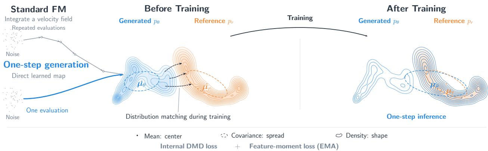
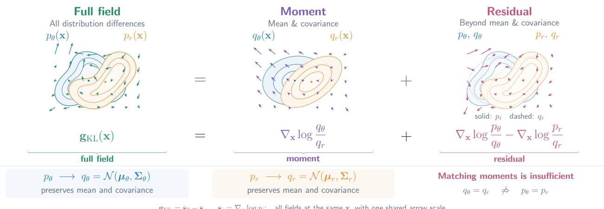
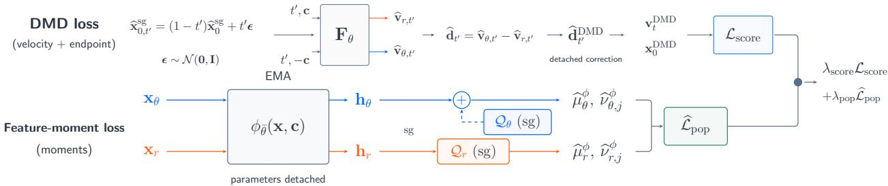
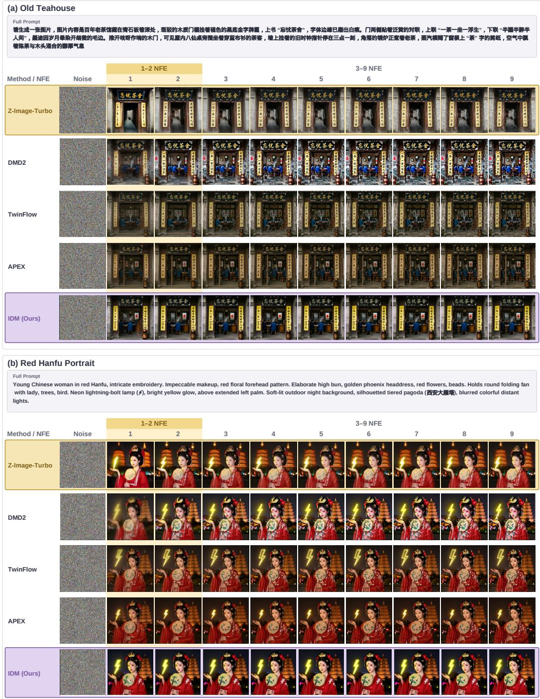
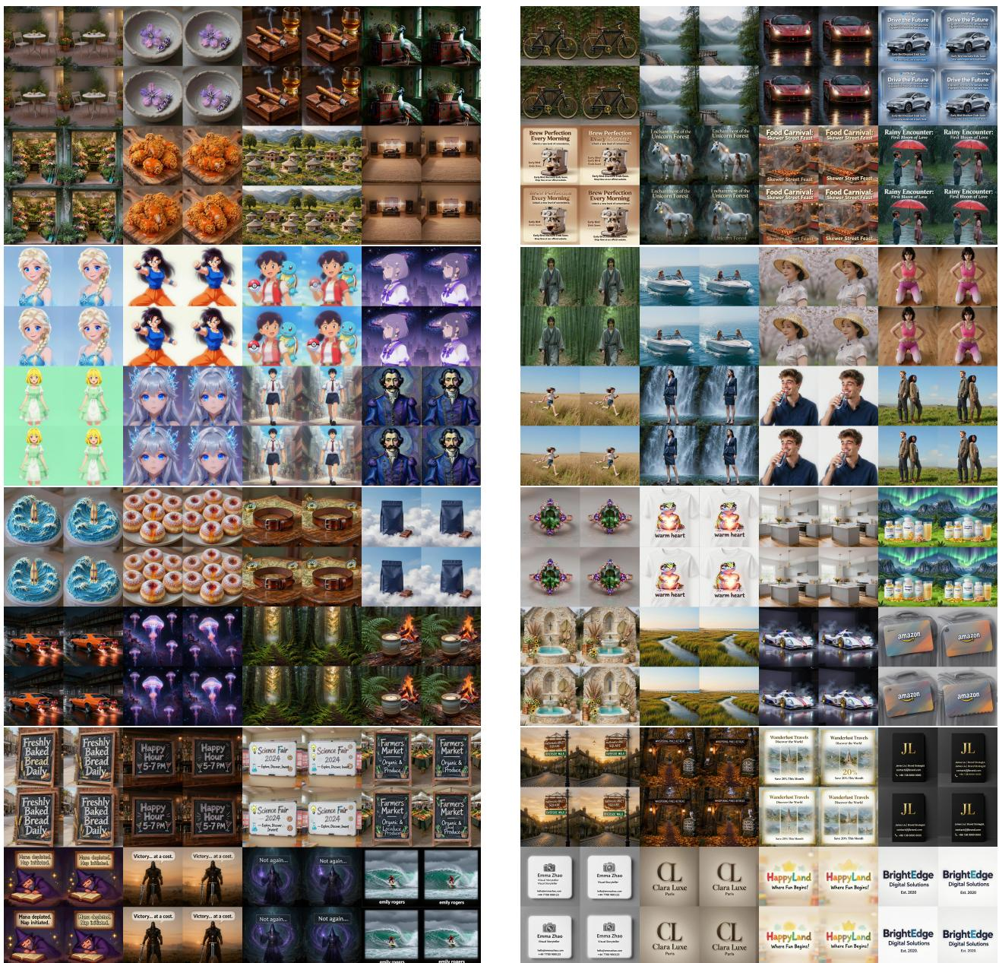

# Intrinsic Distribution Matching

Deyuan Liu1,2,† Yansen Han2,4,† Kaiwen Zheng3,† Jun Xie1,2,4,5 Jiacheng Liu1,6 Zhenglin Cheng1,2,4,5 Peng Sun1,2,4 Jintao Zhang3,∗ Jianguo Li1,∗ Tao Lin1,2,∗

1Inclusion AI 2Westlake University 3Tsinghua University 4Zhejiang University 5Shanghai Innovation Institute 6MBZUAI

## Abstract

One-step and few-step text-to-image generation must accurately render the details specified in the prompt despite limited opportunities for refinement. Distribution matching distillation (DMD) uses score differences to bring the generated distribution closer to a reference distribution. Following prior work, we estimate this difference with internal velocity branches, avoiding a separate fake-score network. We ask whether an explicit moment constraint improves this learned score supervision. A decomposition of the reverse-KL field into a Gaussian moment component and a non-Gaussian residual identifies statistics that can be constrained explicitly. We introduce Intrinsic Distribution Matching (IDM), which retains the full DMD correction and matches feature means and per-coordinate standard deviations using the generator’s exponential-moving-average (EMA) copy, requiring no external feature encoder. Experiments use full-parameter and low-rank adaptation (LoRA) tuning on Z-Image-Turbo 6B and Qwen-Image 20B. At two network evaluations, IDM reaches 94.25% and 90.20% on Chinese and English LongText-Bench, the highest scores among the compared methods at this budget. Controlled ablations show gains from the added moment loss, while generator EMA features perform competitively with an external DINOv2 encoder across the five reported metrics. Code is available here.

## 1 Introduction

Diffusion and flow-matching models produce high-quality images, but their repeated network evaluations impose substantial inference cost (Ho et al., 2020; Song et al., 2020; Lipman et al., 2022; Liu et al., 2023). One and few-step generation reduces this cost by learning a much shorter sampling process. The challenge is to accurately render the details specified in the prompt using only one or a few sampling steps. Long-text rendering makes this challenge concrete: many characters must remain legible and correct within a coherent image (Geng et al., 2025b; Wu et al., 2025a). It therefore provides a demanding test of whether fast generation retains detailed conditional information.

Distribution matching distillation (DMD) trains a fast generator to match a reference distribution (Yin et al., 2024b;a). A score describes the local direction of increasing log density. A pretrained teacher supplies the reference score, while an auxiliary fake-score network estimates the score of the current generated distribution. Their difference guides updates to generated samples. These updates are applied sample by sample, but their direction depends on both distributions. Distribution matching can complement trajectory-based training: rCM combines score regularization with continuous-time consistency training (Zheng et al., 2025).

TwinFlow and APEX obtain this score difference from internally separated velocity branches of the generator (Cheng et al., 2025; Liu et al., 2026a). The model-score estimate is still learned, but no separate fake-score network is needed. We adopt this internal construction and ask whether the generator can also supply an explicit constraint on statistics across samples. Although the exact DMD field contains full distributional information, learned score estimates and finite training can leave discrepancies that an additional statistical objective may help reduce.

Different routes, one generation goal  
  
Figure 1: Overview of IDM for one-step generation. Multi-step sampling refines samples iteratively, whereas one-step generation learns a direct noise-to-data map. IDM combines an internal DMD loss with a feature-moment loss in the generator’s EMA feature space. The right panel illustrates idealized alignment with single-evaluation inference.

To motivate such a constraint, we revisit the reverse-KL score difference underlying DMD. Building on the Gaussian-plus-residual score representation (Wang & Vastola, 2023; 2024), we separate a component determined by means and covariances from the remaining score structure in Section 3.3 . This identifies statistics that can be constrained explicitly, while showing why moments alone do not determine the full distribution. We therefore retain the full DMD correction and add a moment loss, testing its benefit through controlled ablations in a shared training setting.

We introduce Intrinsic Distribution Matching (IDM), which augments internal DMD with moment matching in the generator’s own feature space. Its exponential-moving-average (EMA) copy provides a shared representation for generated and reference samples; we match the means and per-coordinate standard deviations of these features. Unlike objectives that obtain features from an external encoder or teacher (Yang et al., 2026; Zhang et al., 2026b), this design reuses the generator for both score estimation and feature extraction. Both training signals are obtained from the generator and its EMA copy, without a separate discriminator, score model, or external feature encoder.

We evaluate IDM using Z-Image-Turbo 6B and Qwen-Image 20B with full-parameter and LoRA tuning in Section 5 . LongText-Bench evaluates the Chinese and English long-text rendering fidelity emphasized above, with subsets denoted LongText-CN and LongText-EN (Geng et al., 2025b). At two network evaluations (2 NFE), IDM on Z-Image-Turbo achieves state-of-the-art scores among the compared methods: 94.25% and 90.20%, improving over Z-Image-Turbo++ by 2.63 and 0.32 percentage points, respectively in Table 5 .

## Our main contributions are:

a. Intrinsic distributional supervision. We augment internal DMD with an explicit loss on the means and per-coordinate standard deviations of generator EMA features. This adds statistical supervision across samples without a separate external feature encoder.

b. Distribution-gradient explanation. Building on the Gaussian-plus-residual score representation, we motivate an explicit moment constraint alongside the full DMD correction.

c. Few-step training and evaluation. We demonstrate full-parameter and LoRA training on 6B and 20B backbones. Ablations assess the added moment loss, EMA features, and regression choices, while LongText-Bench evaluates fine-grained text fidelity.

  
Figure 2: IDM (Z-Image), 2 NFE. Text rendering and portrait generation.

## 2 Background

Continuous Generative Models. Diffusion and flow-matching models transform noise into data through repeated network evaluations (Ho et al., 2020; Song et al., 2020; Lipman et al., 2022). Distillation learns a shorter process (Salimans & Ho, 2022; Song et al., 2023). We use rectified flow to define the generator and then explain the DMD supervision used to train it.

Rectified Flow and Few-Step Generation. Let $p _ { z } = \mathcal { N } ( \mathbf { 0 } , \mathbf { I } _ { d } )$ be the noise distribution and $p _ { r }$ the referencedata distribution. Rectified flow uses the path ${ \bf x } _ { r , t } = ( 1 - t ) { \bf x } _ { r } + t \epsilon ,$ , with independently sampled $\mathbf { x } _ { r } \sim p _ { r }$ and $\epsilon \sim p _ { z }$ (Liu et al., 2023). Thus $t = 0$ denotes clean data and $t = 1$ pure noise. A network $F _ { \theta } ( \mathbf { x } _ { r , t } , t , \mathbf { \dot { c } } )$ regresses the pair velocity $\epsilon - { \bf x } _ { r } ,$ where $\mathbf { c } \in { \mathcal { C } }$ is a text-conditioning vector. At the squared-error optimum it recovers the marginal velocity, the conditional average of pair velocities at the same noisy input and condition. Few-step generation integrates this field from $t = 1 \stackrel { \triangledown } { \boldsymbol { \mathrm { t o } } } t = 0$ with a small number of forward-Euler steps. At one network evaluation, the generator is $G _ { \theta } ( \mathbf { z } , \mathbf { c } ) = \mathbf { z } - F _ { \theta } ( \mathbf { z } , 1 , \mathbf { c } )$ for $\mathbf { z } \sim p _ { z }$

Distribution Matching Distillation. The generator induces a distribution $p _ { \theta }$ . DMD aims to match it to $p _ { r }$ through the reverse-KL gradient (Wang et al., 2023; Yin et al., 2024b). At a fixed condition and noise level $t \in \check { ( 0 , 1 ) }$ , let $p _ { \theta , t }$ and $p _ { r , t }$ be their noised distributions. A score $\mathbf { s } _ { i , t } = \nabla _ { \mathbf { x } _ { t } }$ log $p _ { i , t }$ points locally toward increasing log density. Evaluated at the same noised model sample, $\mathbf { s } _ { r , t } - \mathbf { s } _ { \theta , t }$ points toward a lower modelto-reference density ratio in Section 3.1 . The reference score is supplied by a frozen pretrained teacher. Since the generator provides samples but no tractable score, DMD trains a separatefake-score network on its outputs. This network estimates the generated distribution; the generator itself produces the images. The fake-score estimate must track the changing generator. The reference score guides samples toward regions supported by the target, while the model score accounts for the generator’s current concentration of probability mass. Both enter the distributional update, so the model score must still be learned when a separate network is removed.

Score–Velocity Identity. For independent $\mathbf { x } \sim p$ and $\epsilon \sim p _ { z } ,$ set ${ \bf x } _ { t } = ( 1 - t ) { \bf x } + t { \bf \epsilon }$ . For $t \in ( 0 , 1 )$ , the score $\mathbf { s } _ { t } : = \nabla _ { \mathbf { x } _ { t } } \log \bar { p _ { t } }$ and marginal velocity $\mathbf { v } _ { t } ^ { * } ( \mathbf { x } _ { t } ) : = \mathrm { i } \mathbb { E } [ \epsilon - \mathbf { x } \mid \dot { \mathbf { x } _ { t } } ]$ satisfy

$$
\mathbf { \boldsymbol { s } } _ { t } ( \mathbf { \boldsymbol { x } } _ { t } ) = - \frac { \mathbf { \boldsymbol { x } } _ { t } + ( 1 - t ) \mathbf { \boldsymbol { v } } _ { t } ^ { * } ( \mathbf { \boldsymbol { x } } _ { t } ) } { t } .\tag{1}
$$

Thus a velocity estimate also provides a score estimate in Appendix B.3 . Subtracting two velocities at the same input gives a scaled score difference.

Internal Score Estimation. TwinFlow and APEX use two internally separated velocity branches of one generator to estimate the reference and model scores (Cheng et al., 2025; Liu et al., 2026a). This removes the separate fake-score network while retaining model-score learning. Following APEX, we use this construction for DMD in Section 4.1 . We next examine the statistics represented by its target field to motivate additional supervision from the generator’s features.

## 3 A Distribution-Gradient View

The score difference in DMD defines a direction for changing the generated distribution. Separating the contribution of means and covariances from the remaining score structure clarifies what moment matching can constrain and why the full DMD correction is still needed.

## 3.1 Reverse-KL Field

The one-step generator maps $\mathbf { z } \sim p _ { \mathrm { { z } } }$ to $\mathbf { x } _ { \theta } = G _ { \theta } ( \mathbf { z } , \mathbf { c } )$ , inducing $p _ { \theta } ( \cdot \mid \mathbf { c } ) ; p _ { r } ( \cdot \mid \mathbf { c } )$ is the reference law. Here x is a sample in the generator’s output representation, and conditions follow $p _ { c }$ independently of z. For differentiable positive densities, define $\mathbf { \boldsymbol { s } } _ { i } ( \mathbf { \boldsymbol { \hat { x } } } \mid \mathbf { \boldsymbol { c } } ) : = \nabla _ { \mathbf { \boldsymbol { x } } } \log p _ { i } ( \mathbf { \boldsymbol { x } } \mid \mathbf { \boldsymbol { c } } ) , i \in \{ r , \theta \}$ . At fixed $\mathbf { c , }$ the reverse KL is

$$
\mathcal { D } _ { \mathrm { K L } } ( p _ { \theta } \| p _ { r } ) = \int p _ { \theta } ( \mathbf { x } \mid \mathbf { c } ) \log \frac { p _ { \theta } ( \mathbf { x } \mid \mathbf { c } ) } { p _ { r } ( \mathbf { x } \mid \mathbf { c } ) } \mathrm { d } \mathbf { x } .\tag{2}
$$

Its sample-space distribution gradient is

$$
\mathbf { g } _ { \mathrm { K L } } ( \mathbf { x } \mid \mathbf { c } ) = \mathbf { s } _ { \boldsymbol { \theta } } ( \mathbf { x } \mid \mathbf { c } ) - \mathbf { s } _ { r } ( \mathbf { x } \mid \mathbf { c } ) .\tag{3}
$$

The descent direction is $- \mathbf { g } _ { \mathrm { K L } } = \mathbf { s } _ { r } - \mathbf { s } _ { \theta } .$ , pointing locally toward a lower model-to-reference density ratio. It changes as the generator distribution changes. Applying the same identity to $p _ { \theta , t }$ and $p _ { r , t }$ gives $\mathbf { g } _ { \mathrm { K L } , t } =$ $\mathbf { s } _ { \theta , t } - \mathbf { s } _ { r , t }$ , the noisy field estimated in DMD. We state the identities below for clean laws under the regularity assumptions in Appendix B.1 ; the decomposition also applies to the noisy laws at each fixed $t ,$ with their own means, covariances, and score residuals.

  
Figure 3: Reverse-KL Field Decomposition. The full field ${ \bf g } _ { \mathrm { K L } } = { \bf s } _ { \boldsymbol { \theta } } - { \bf s } _ { r }$ (left) is the sum of a Gaussian moment component (middle) and a non-Gaussian residual component (right). Solid contours show $p _ { i }$ and dashed contours its moment-matched Gaussian $q _ { i } , \mathrm { f o r } i \in \{ r , \theta \}$ . Equal means and covariances eliminate the Gaussian component but can leave a nonzero residual. All fields use the same evaluation points and arrow scale.

## 3.2 Parameter Gradient

The field above specifies a sample update. To relate it to training, consider a discrepancy $\mathcal { D } ( p _ { \theta } , p _ { r } )$ with a differentiable first-variation potential, which describes how redistributing probability mass changes . Its spatial gradient specifies the field used in the sample update:

$$
\mathbf { g } _ { \mathcal { D } } ( \mathbf { x } \mid \mathbf { c } ) : = \nabla _ { \mathbf { x } } \frac { \delta \mathcal { D } ( p _ { \theta } , p _ { r } ) } { \delta p _ { \theta } } ( \mathbf { x } \mid \mathbf { c } ) .\tag{4}
$$

Under the assumptions in Appendix B.1 ,

$$
\nabla _ { \theta } \mathcal { D } ( p _ { \theta } , p _ { r } ) = \mathbb { E } _ { \mathbf { z } \sim p _ { z } } \left[ \underbrace { \left[ J _ { \theta } G _ { \theta } ( \mathbf { z } , \mathbf { c } ) \right] ^ { \top } } _ { \mathrm { J a c o b i a n ~ t r a n s p o s e ~ d i s t r i b u t i o n ~ g r a d i e n t } } \underbrace { \mathbf { g } _ { \mathcal { D } } ( G _ { \theta } ( \mathbf { z } , \mathbf { c } ) \mid \mathbf { c } ) } _ { \mathrm { g r a c o s i a n t } } \right] .\tag{5}
$$

Here $J _ { \theta } G _ { \theta } : = \partial G _ { \theta } / \partial \theta ;$ backpropagation applies its transpose, and training averages over c. For reverse $\mathrm { K L } ,$ , the first variation is $\log ( { \dot { p } _ { \theta } } / { \dot { p } _ { r } } ) + 1 .$ , recovering $\operatorname { E q . 3 } .$ . Thus the score difference gives the distributional direction that is passed back through the generator. This separates the distributional change that reduces the discrepancy from the parameter update that realizes this change. The decomposition below concerns the former and does not depend on a particular generator architecture.

## 3.3 Decomposition of the Reverse-KL Field

To identify which statistics this field contains, let p be a smooth positive density with finite second moment, mean $\mu _ { p } ,$ and positive-definite covariance $\Sigma _ { p } .$ Its moment-matched Gaussian is $q _ { p } : = \mathcal { N } ( \mu _ { p } , \Sigma _ { p } )$ , with score ${ \bf s } _ { q _ { p } } ( { \bf x } ) = - \Sigma _ { p } ^ { - 1 } ( { \bf x } - \mu _ { p } )$ . The score of p decomposes exactly as

$$
\begin{array} { r } { \pmb { \mathscr { s } } _ { p } ( \pmb { x } ) = \underbrace { \pmb { \mathscr { s } } _ { q _ { p } } ( \pmb { x } ) } _ { = - \pmb { \Sigma } _ { p } ^ { - 1 } ( \pmb { x } - \mu _ { p } ) } + \underbrace { \eta _ { p } ( \pmb { x } ) } _ { \mathrm { n o n - G a u s s i a n ~ s c o r e ~ r e s i d u a l } } , } \end{array}\tag{6}
$$

where $\eta _ { p } : = \mathbf { s } _ { p } - \mathbf { s } _ { q _ { p } }$ contains the score structure beyond this Gaussian approximation (Wang & Vastola, 2023; 2024). At fixed c, use $q _ { i } : = q _ { p _ { i } }$ and $\eta _ { i } : = \eta _ { p _ { i } }$ for the conditional laws $p _ { i } ( \cdot \mid \mathbf { c } ) , i \in \{ r , \theta \}$ . Subtracting their decompositions gives

$$
\begin{array} { r } { \mathbf { g } _ { \mathrm { K L } } ( \mathbf { x } \mid \mathbf { c } ) = \underbrace { \left( \mathbf { s } _ { q _ { \theta } } ( \mathbf { x } \mid \mathbf { c } ) - \mathbf { s } _ { q _ { r } } ( \mathbf { x } \mid \mathbf { c } ) \right) } _ { \mathbf { g } _ { \mathrm { K L } } ^ { \mathrm { G } } : \mathrm { G a u s s i a n m o m e n t c o m p o n e n t } } + \underbrace { \left( \eta _ { \theta } ( \mathbf { x } \mid \mathbf { c } ) - \eta _ { r } ( \mathbf { x } \mid \mathbf { c } ) \right) } _ { \mathbf { g } _ { \mathrm { K L } } ^ { \mathrm { n G } } : \mathrm { n o n - C a u s s i a n r e s i d u a l ~ c o m p o n e n t } } . } \end{array}\tag{7}
$$

The Gaussian component depends only on means and covariances. Two distributions can share these moments yet have different shapes, leaving a nonzero residual in Figure 3 . Replacing pi by $p _ { i , t }$ gives the same decomposition for the noisy field used in DMD.

Under the integrability and boundary conditions in Appendix B.2.2 ,

$$
\mathbb { E } _ { p } [ \pmb { \eta } _ { p } ( \pmb { x } ) ] = \mathbf { 0 } , \qquad \mathbb { E } _ { p } [ \pmb { \eta } _ { p } ( \pmb { x } ) \pmb { x } ^ { \top } ] = \mathbf { 0 } _ { d \times d } .\tag{8}
$$

Each score residual is orthogonal to constant and linear functions under its own distribution; their difference need not be orthogonal under either distribution. The moment-matched Gaussian is used to analyze the score; the generated samples are not assumed to follow a Gaussian distribution. The residual does not identify a single higher-order moment: it collects all score structure left after subtracting the Gaussian score for the corresponding distribution.

Implication for training. Exact DMD already contains both components. In practice, its learned score estimates and finite training need not align all statistics accurately. The decomposition identifies moments as quantities that can be constrained explicitly, while the residual explains why moment matching alone is insufficient. We therefore keep the full DMD correction and add a loss on feature means and standard deviations. Features from the generator’s EMA copy provide a shared representation without introducing an external encoder. This is an additional feature-space objective motivated by the decomposition, not a separate estimate of its sample-space Gaussian or residual component. The ablations in Section 5.3 test whether this explicit constraint improves generation.

## 4 Intrinsic Distribution Matching

Intrinsic Distribution Matching (IDM) retains internal DMD supervision and adds the feature-moment constraint motivated in Section 3.3 . The DMD loss $\mathcal { L } _ { \mathrm { s c o r e } }$ uses the full internal score-difference estimate; $\mathcal { L } _ { \mathrm { p o p } }$ explicitly matches statistics of generator EMA features. We first define how the DMD correction supervises velocity and endpoint predictions, then describe the feature constraint, the empirical moment estimates, and the gradients used in joint training.

## 4.1 DMD Loss

At a fixed condition $\mathbf { c , }$ let $p _ { r , t }$ and $p _ { \theta , t }$ denote the reference and model marginals under the linear noising construction of Section 2 , with scores $\mathbf { s } _ { r , t } , \mathbf { s } _ { \theta , t }$ and exact marginal velocities $\mathbf { v } _ { r , t } ^ { * } , \mathbf { v } _ { \theta , t } ^ { * }$ . Applying Eq. 1 to both at the same point $\mathbf { x } _ { t }$ gives, for $t \in ( 0 , 1 )$

$$
\mathbf { d } _ { t } ^ { * } ( \mathbf { x } _ { t } ) : = \mathbf { v } _ { \theta , t } ^ { * } ( \mathbf { x } _ { t } ) - \mathbf { v } _ { r , t } ^ { * } ( \mathbf { x } _ { t } ) = \frac { t } { 1 - t } \left( \mathbf { s } _ { r , t } ( \mathbf { x } _ { t } ) - \mathbf { s } _ { \theta , t } ( \mathbf { x } _ { t } ) \right) ,\tag{9}
$$

so gKL $\begin{array} { r } { \mathbf { \Xi } _ { , t } : = \mathbf { s } _ { \theta , t } - \mathbf { s } _ { r , t } = - \frac { 1 - t } { t } \mathbf { d } _ { t } ^ { * } } \end{array}$ is the reverse-KL field on these noisy marginals in Eq. 3.

Internal velocity branches. Following APEX (Liu et al., 2026a), we separate the reference and model velocity branches by negating the condition vector:

$$
\widehat { \mathbf { v } } _ { r , t } ( { \mathbf { x } } _ { t } \mid \mathbf { c } ) : = F _ { \boldsymbol { \theta } } ( { \mathbf { x } } _ { t } , t , \mathbf { c } ) , \qquad \widehat { \mathbf { v } } _ { \boldsymbol { \theta } , t } ( { \mathbf { x } } _ { t } \mid \mathbf { c } ) : = F _ { \boldsymbol { \theta } } ( { \mathbf { x } } _ { t } , t , - \mathbf { c } ) ,\tag{10}
$$

Here $- \mathbf { c }$ selects the model branch for condition $\mathbf { c , }$ and $\widehat { \mathbf { d } } _ { t } ( \mathbf { x } _ { t } \mid \mathbf { c } ) : = \widehat { \mathbf { v } } _ { \theta , t } ( \mathbf { x } _ { t } \mid \mathbf { c } ) - \widehat { \mathbf { v } } _ { r , t } ( \mathbf { x } _ { t } \mid \mathbf { c } )$ is their pointwise difference. This interpretation requires both branches to approximate their marginal velocities.

Velocity and endpoint regression. The same DMD correction can supervise velocity predictions or their corresponding clean-sample endpoints. We compare these regression forms and their combinations in Section 5.3 to select the training configuration.

For fixed input $\mathbf { x } _ { t }$ at time $t \in ( 0 , 1 ]$ , the endpoint prediction is $\widehat { \mathbf { x } } _ { 0 } ( \mathbf { x } _ { t } , t , \mathbf { c } ) : = \mathbf { x } _ { t } - t F _ { \theta } ( \mathbf { x } _ { t } , t , \mathbf { c } )$ . At t = 1 and $\mathbf { x } _ { t } = \mathbf { z } _ { }$ , this equals $G _ { \theta } ( \mathbf { z } , \mathbf { c } ) ;$ ; predictions at intermediate times need not follow the one-step output law $p _ { \theta }$ Let sg denote stop-gradient. Set $\widehat { \mathbf { x } } _ { 0 } ^ { s g } : = s \mathbf { g } ( \widehat { \mathbf { x } } _ { 0 } ( \mathbf { x } _ { t } , t , \mathbf { c } ) )$ and re-noise it as $\widehat { \mathbf { x } } _ { 0 , t ^ { \prime } } ^ { s g } : = ( 1 - t ^ { \prime } ) \widehat { \mathbf { x } } _ { 0 } ^ { s g } \dot { { + } } t ^ { \prime } \epsilon ,$ , where the re-noising time $t ^ { \prime } \in ( 0 , 1 )$ and $\epsilon \sim p _ { z }$ are sampled independently of each other and of the regression input. Evaluate the branch difference $\widehat { \mathbf { d } } _ { t ^ { \prime } } ( \widehat { \mathbf { x } } _ { 0 , t ^ { \prime } } ^ { s g } \mid \mathbf { c } )$ at this re-noised prediction. Its weighted, normalized value is detached to obtain $\widehat { \mathbf { d } } _ { t ^ { \prime } } ^ { \mathrm { { D M D } } }$ ; without processing, the correction is $\mathrm { s g } \left( \widehat { \mathbf { d } } _ { t ^ { \prime } } ( \widehat { \mathbf { x } } _ { 0 , t ^ { \prime } } ^ { s \mathbf { g } } \mid \mathbf { c } ) \right)$ . The DMD targets are

$$
\begin{array} { r l } & { { \mathbf { v } } _ { t } ^ { \mathrm { D M D } } : = \mathrm { s g } \Big ( { \cal F } _ { \theta } ( { \mathbf { x } } _ { t } , t , { \mathbf { c } } ) - \widehat { { \mathbf { d } } } _ { t ^ { \prime } } ^ { \mathrm { D M D } } \Big ) , } \\ & { { \mathbf { x } } _ { 0 } ^ { \mathrm { D M D } } : = \mathrm { s g } \Big ( { \mathbf { x } } _ { t } - t { \mathbf { v } } _ { t } ^ { \mathrm { D M D } } \Big ) . } \end{array}\tag{11}
$$

  
Figure 4: Intrinsic losses of IDM. Top, DMD loss: re-noise the predicted clean sample and use the internal velocity difference to construct detached velocity and endpoint targets for $\dot { \mathcal { L } } _ { \mathrm { s c o r e } }$ in Eq. 12. Bottom, feature-moment loss: match means and per-coordinate standard deviations of EMA features $\mathbf { h } _ { i } : = \phi _ { \bar { \theta } } ( \mathbf { x } _ { i } , \mathbf { c } )$ using current model features and detached model/reference queues $\mathcal { Q } _ { \theta } ,$ , r in Eq. 13. Base objective omitted

Subtracting this correction from the velocity target adds $t \widehat { \mathbf { d } } _ { t ^ { \prime } } ^ { \mathrm { { D M D } } }$ to the detached clean-sample prediction. Thus the same correction defines both targets. The combined squared regression loss, with both targets detached, averages over conditions, regression inputs and times, and re-noising draws:

$$
\begin{array} { r } { \mathcal { L } _ { \mathrm { s c o r e } } ( \theta ) : = \mathbb { E } \left[ \underbrace { \| F _ { \theta } ( \mathbf { x } _ { t } , t , \mathbf { c } ) - \mathbf { v } _ { t } ^ { \mathrm { D M D } } \| _ { 2 } ^ { 2 } } _ { \ell _ { v } ( t ) } + \underbrace { \| \widehat { \mathbf { x } } _ { 0 } ( \mathbf { x } _ { t } , t , \mathbf { c } ) - \mathbf { x } _ { 0 } ^ { \mathrm { D M D } } \| _ { 2 } ^ { 2 } } _ { \ell _ { x } ( t ) } \right] . } \end{array}\tag{12}
$$

At fixed $\left( { \bf x } _ { t } , t \right)$ , these squared losses satisfy $\ell _ { x } ( t ) = t ^ { 2 } \ell _ { v } ( t )$ , so equal weights give an effective factor $1 + t ^ { 2 }$ on velocity regression in Appendix B.4 . A separate discussion of conditional-mean regression and covariance appears in Appendix B.7 .

## 4.2 Feature-Moment Loss

Alongside the learned DMD correction, we compare generated and reference samples in the feature space of the generator’s EMA copy. The EMA supplies the representation, while reference samples provide the target statistics for moment matching.

Intrinsic feature map. $\phi : = \phi _ { \bar { \theta } } : \mathbb { R } ^ { d } \times \mathcal { C }  \mathbb { R } ^ { d _ { \phi } }$ mean-pools the last-layer hidden activations of the generator’s EMA copy into one feature vector per sample. Generated and reference samples use the noising construction of Section 2 at high noise levels, with noising arguments suppressed in $\phi .$ . Here $\bar { \theta }$ denotes EMA parameters and $d _ { \phi }$ the feature dimension; each update fixes $\bar { \theta }$ while retaining input derivatives. We compare this choice with frozen-encoder (Yang et al., 2026), teacher-feature (Zhang et al., 2026b), and live self-feature alternatives in Section 5.3 .

Matching feature moments. Let $\mu _ { i } ^ { \phi }$ and $\nu _ { i , j } ^ { \phi }$ denote the mean and per-coordinate variance of $\phi ( \mathbf { x } , \mathbf { c } )$ under the joint law $( \mathbf { x } , \mathbf { c } ) \sim p _ { i } ( \cdot \mid \mathbf { c } ) p _ { c }$ , also averaging over feature-extraction noise, for $i \in \{ r , \theta \}$ . These statistics pool across conditions rather than matching conditional distributions. We match these pooled statistics with

$$
\mathcal { L } _ { \mathrm { p o p } } = \Vert \mu _ { \theta } ^ { \phi } - \mu _ { r } ^ { \phi } \Vert _ { 2 } ^ { 2 } + \sum _ { j = 1 } ^ { d _ { \phi } } \Bigg ( \sqrt { \nu _ { \theta , j } ^ { \phi } } - \sqrt { \nu _ { r , j } ^ { \phi } } \Bigg ) ^ { 2 } .\tag{13}
$$

This is the squared 2-Wasserstein distance between the diagonal Gaussians $\mathcal { N } ( \mu _ { i } ^ { \phi } , \mathrm { d i a g } ( \nu _ { i } ^ { \phi } ) ) .$ ; it is nonnegative and vanishes exactly when their feature means and per-coordinate standard deviations match. At the feature level, the mean term shifts the average toward the reference mean, while the standard-deviation term adjusts the spread around that average. These roles are explicit in the empirical gradient in Prop. 4. Their effect on images is mediated by the fixed EMA feature Jacobian and the generator, so the objective does not prescribe a pixel-wise correction. A nonlinear feature map can capture properties not determined by raw-sample means and covariances. Matching its moments therefore constrains statistics in a learned representation. The loss still uses only pooled feature means and per-coordinate standard deviations; it does not estimate the sample-space Gaussian component or match the full feature distribution.

Queues $\mathcal { Q } _ { \theta }$ and $\mathcal { Q } _ { r }$ store up to K = 16384 detached model and reference features, respectively. Model moments combine B current-batch features with $\mathcal { Q } _ { \boldsymbol { \theta } } ;$ reference moments use $\mathcal { Q } _ { r } , \mathrm { g i v i n g } B \dot { + } K$ and K features with full queues. These moments define ${ \widehat { \mathcal { L } } } _ { \mathrm { { p o p } } }$ . Queue entries come from earlier model and EMA states, so the moments approximate current population statistics. Prop. 4 gives the exact empirical-loss gradient at fixed queues in Appendix B.6 .

## 4.3 Training Objective

We use the RCGM loss (Sun & Lin, 2025), which supervises generation across time intervals through recursive consistent velocity-field estimation, as $\mathcal { L } _ { \mathrm { b a s e } }$ . The main generator objective is

$$
\mathcal { L } _ { \mathrm { I D M } } ( \theta ) = \mathcal { L } _ { \mathrm { b a s e } } ( \theta ) + \lambda _ { \mathrm { s c o r e } } \mathcal { L } _ { \mathrm { s c o r e } } ( \theta ) + \lambda _ { \mathrm { p o p } } \widehat { \mathcal { L } } _ { \mathrm { p o p } } .\tag{14}
$$

Each iteration generates current samples and extracts their high-noise EMA features. The current features retain their computation graph and are combined with the detached queues to evaluate ${ \widehat { \mathcal { L } } } _ { \mathrm { { p o p } } }$ . Its gradient passes through the fixed EMA network to the current samples and generator; queued features receive no gradients. Across iterations, we refresh the queues with detached features and update the EMA as $\bar { \theta }  0 . 9 9 \bar { \theta } + 0 . 0 1 \theta$ . The weights $\lambda _ { \mathrm { s c o r e } }$ and $\lambda _ { \mathsf { p o p } }$ remain fixed in Section 5.1 . Feature extraction and queues are used only during training. Freezing the EMA parameters does not freeze the current features: their values change with the generated images. Detaching these features would also remove the moment-loss gradient to the generator. The detached queues provide historical statistics without retaining computation graphs from previous iterations. Auxiliary flow matching $\mathcal { L } _ { \mathrm { f a k e } }$ trains the internal model-velocity branch on detached generated samples and also updates the shared parameters in Appendix B.5 . One-step inference generates $\mathbf { x } _ { \theta } = G _ { \theta } ( \mathbf { z } , \mathbf { c } )$ in one forward pass; the same checkpoint also supports few-step sampling.

## 5 Experiments

Our experiments assess the added value of $\mathcal { L } _ { \mathrm { p o p } }$ over internal DMD, the suitability of generator EMA features relative to an external encoder, and the choice of velocity and endpoint regression. System-level comparisons evaluate the complete training setting; controlled ablations examine these individual choices under the shared data, backbone, and sampling budget. Throughout this section, $\mathcal { L } _ { \mathrm { p o p } }$ refers to the empirical loss ${ \widehat { \mathcal { L } } } _ { \mathrm { { p o p } } }$

## 5.1 Experimental Setup

Backbones and tuning. We initialize IDM from Z-Image-Turbo 6B (Team, 2025) and Qwen-Image 20B (Wu et al., 2025a), using full-parameter tuning and LoRA with ranks 32 and 64. We denote the resulting models by IDM (Z-Image) and IDM (Qwen-Image); the former uses the Turbo checkpoint rather than the undistilled Z-Image base model.

Training data. The reference data defining $p _ { r }$ combine ShareGPT-4o (Chen et al., 2025c), BLIP-3o (Chen et al., 2025a), and samples synthesized with Qwen-Image-2512 and Z-Image-Turbo: 600K from FLUX-Reason-6M prompts (Fang et al., 2025) and 5M from text-rendering prompts. Compared with the 200K poster-prompt samples used by APEX (Liu et al., 2026a), this larger text-focused collection provides more training examples for dense text rendering.

Training configuration. All models use BF16, FlashAttention4, and FSDP2 with global batch size 64. Training runs for 15K steps on Z-Image-Turbo 6B and 10K steps for Qwen-Image 20B LoRA, using 32 H100 80GB and 8 A100 80GB GPUs. The default weights are $\lambda _ { \mathrm { s c o r e } } = 1$ and $\lambda _ { \mathsf { p o p } } = \breve { 0 } . 5$ , fixed throughout training. Each trained checkpoint is evaluated at both 1 and 2 NFE without changing the training loss weights for either sampling budget.

Evaluation. We follow the same standard benchmark protocols used for the APEX comparisons, reporting each method at its stated NFE budget. Published reference results retain their training data and configuration; the internal IDM ablations use the shared configuration above. We evaluate compositional prompt following with GenEval (Ghosh et al., 2023), FID and CLIP score on MJHQ-30K (Li et al., 2024a), detailed prompt following on DPG-Bench (Hu et al., 2024), and world knowledge on WISE (Niu et al., 2025). Z-Image comparisons and ablations additionally report OneIG (Chang et al., 2026) and LongText-Bench (Geng et al., 2025b); LongText-CN and LongText-EN measure Chinese and English long-text rendering, respectively.

Table 1: System-level comparison of efficiency and quality. Speeds are on a single A100 (BF16). Throughput is samples/s (batch=10); latency is seconds (batch=1). GenEval measures compositional prompt following; FID/CLIP complement the efficiency comparison. LongText results appear in Table 5 . † indicates that distinct models are required for different NFEs. ‡ marks a noncanonical operating point or a secondary comparison source. § indicates that the LoRA weights are merged into the base weights before timing. Params: backbone size in billions; LoRA entries additionally give rank r and trainable parameters in parentheses. Blue/red backbone counts indicate full/LoRA tuning, respectively.
<table><tr><td>Methods</td><td>NFEs</td><td>Throughput (samples/s)</td><td>Latency (s)</td><td>Params (B)</td><td>FID↓</td><td>CLIP↑</td><td>GenEval ↑</td></tr><tr><td>SDXL-LCM Luo et al. (2023)</td><td></td><td>2.89</td><td>0.40</td><td>0.9</td><td>18.11</td><td>27.51</td><td>0.44</td></tr><tr><td>PixArt-LCM Chen et al. (2024c)</td><td></td><td>3.52</td><td>0.31</td><td>0.6</td><td>10.33</td><td>27.24</td><td>0.42</td></tr><tr><td>SD3.5-Turbo (Esser et al., 2024)‡</td><td></td><td>1.61</td><td>0.68</td><td>8.0</td><td>51.47</td><td>25.59</td><td>0.53</td></tr><tr><td>PCM Wang et al. (2024a)+</td><td></td><td>2.62</td><td>0.56</td><td>0.9</td><td>14.70</td><td>27.66</td><td>0.55</td></tr><tr><td>SDXL-DMD2 Yin et al. (2024a)†</td><td>２２２２２２２２２</td><td>2.89</td><td>0.40</td><td>0.9</td><td>7.61</td><td>28.87</td><td>0.58</td></tr><tr><td>FLUX-schnell (Labs, 2024)</td><td></td><td>0.92</td><td>1.15</td><td>12.0</td><td>7.75</td><td>28.25</td><td>0.71</td></tr><tr><td>Sana-Sprint (Chen et al., 2025b)</td><td></td><td>6.46</td><td>0.25</td><td>0.6</td><td>6.54</td><td>28.40</td><td>0.76</td></tr><tr><td>Sana-Sprint (Chen et al., 2025b)</td><td></td><td>5.68</td><td>0.24</td><td>1.6</td><td>6.50</td><td>28.45</td><td>0.77</td></tr><tr><td>Qwen-Image-Lightning (ModelTC, 2025)‡</td><td></td><td>3.15</td><td>0.48</td><td>20.0 (r=64,0.4)§</td><td>6.76</td><td>28.37</td><td>0.85</td></tr><tr><td>TwinFlow (Qwen-Image) (Cheng et al., 2025)</td><td>2</td><td>3.15</td><td>0.48</td><td>20.0 (r=64,0.4)§</td><td>1</td><td></td><td>0.87</td></tr><tr><td>APEX (Qwen-Image) (Liu et al., 2026a)</td><td></td><td>3.21</td><td>0.49</td><td>20.0 (r=32,0.2)§</td><td>6.72</td><td>28.71</td><td>0.87</td></tr><tr><td>APEX (Qwen-Image) (Liu et al., 2026a)</td><td>２２2</td><td>3.17</td><td>0.47</td><td>20.0 (r=64,0.4)s</td><td>6.51</td><td>28.42</td><td>0.89</td></tr><tr><td>APEX (Qwen-Image) (Liu et al., 2026a)</td><td></td><td>3.30</td><td>0.45</td><td>20.0</td><td>6.44</td><td>28.51</td><td>0.90</td></tr><tr><td>IDM (Z-Image) IDM (Z-Image)</td><td>2</td><td>5.18</td><td>0.30</td><td>6.0 (r=32,0.2)§</td><td>6.98</td><td>28.41</td><td>0.76</td></tr><tr><td></td><td>2</td><td>5.18</td><td>0.30</td><td>6.0 (r=64,0.4)§</td><td>6.79</td><td>28.13</td><td>0.77</td></tr><tr><td>IDM (Z-Image)</td><td>2</td><td>5.18</td><td>0.30</td><td>6.0</td><td>6.71</td><td>28.22</td><td>0.78</td></tr><tr><td>IDM (Qwen-Image)</td><td>2</td><td>3.28</td><td>0.44</td><td>20.0 (r=32,0.2)§</td><td>6.62</td><td>28.76</td><td>0.89</td></tr><tr><td>IDM (Qwen-Image) IDM (Qwen-Image)</td><td>2</td><td>3.28</td><td>0.44</td><td>20.0 (r=64,0.4)§</td><td>6.41</td><td>28.47</td><td>0.90</td></tr><tr><td>SDXL-LCM Luo et al. (2023)</td><td>2</td><td>3.28</td><td>0.44</td><td>20.0</td><td>6.34</td><td>28.56</td><td>0.91</td></tr><tr><td>eunde  -dels</td><td>1</td><td>3.36</td><td>0.32</td><td>0.9</td><td>50.51</td><td>24.45</td><td>0.28</td></tr><tr><td>PixArt-LCM Chen et al. (2024c)</td><td>1</td><td>4.26</td><td>0.25</td><td>0.6</td><td>73.35</td><td>23.99</td><td>0.41</td></tr><tr><td>PixArt-DMD (Chen et al., 2024b; Yin et al., 2024b)†</td><td>1</td><td>4.26</td><td>0.25</td><td>0.6</td><td>9.59</td><td>26.98</td><td>0.45</td></tr><tr><td>SD3.5-Turbo (Esser et al., 2024)‡</td><td>1</td><td>2.48</td><td>0.45</td><td>8.0</td><td>52.40</td><td>25.40</td><td>0.51</td></tr><tr><td>PCM Wang et al. (2024a)†</td><td>1</td><td>3.16</td><td>0.40</td><td>0.9</td><td>30.11</td><td>26.47</td><td>0.42</td></tr><tr><td>SDXL-DMD2 Yin et al. (2024a)†</td><td>11</td><td>3.36</td><td>0.32</td><td>0.9</td><td>7.10</td><td>28.93</td><td>0.59</td></tr><tr><td>FLUX-schnell (Labs, 2024)</td><td></td><td>1.58</td><td>0.68</td><td>12.0</td><td>7.26</td><td>28.49</td><td>0.69</td></tr><tr><td>Sana-Sprint (Chen et al., 2025b)</td><td>1 1</td><td>7.22</td><td>0.21</td><td>0.6</td><td>7.04</td><td>28.04</td><td>0.72</td></tr><tr><td>Sana-Sprint (Chen et al., 2025b)</td><td></td><td>6.71</td><td>0.21</td><td>1.6</td><td>7.69</td><td>28.27</td><td>0.76</td></tr><tr><td>Qwen-Image-Lightning (ModelTC, 2025)‡</td><td>1</td><td>3.29</td><td>0.40</td><td>20.0 (r=64,0.4)§</td><td>7.06</td><td>28.35</td><td>0.85</td></tr><tr><td>TwinFlow (Qwen-Image) (Cheng et al., 2025)</td><td>1</td><td>3.29</td><td>0.40</td><td>20.0 (r=64,0.4)§</td><td></td><td></td><td>0.86</td></tr><tr><td>APEX (Qwen-Image) (Liu et al., 2026a)</td><td>1</td><td>3.29</td><td>0.39</td><td>20.0 (r=32,0.2)§</td><td>7.22</td><td>28.62</td><td>0.88</td></tr><tr><td>APEX (Qwen-Image) (Liu et al., 2026a)</td><td>1</td><td>3.27</td><td>0.39</td><td>20.0 (r=64,0.4)§</td><td>7.14</td><td>28.45</td><td>0.89</td></tr><tr><td>APEX (Qwen-Image) (Liu et al., 2026a)</td><td>1</td><td>3.50</td><td>0.34</td><td>20.0</td><td>6.87</td><td>28.66</td><td>0.89</td></tr><tr><td>IDM (Z-Image)</td><td>1</td><td>5.41</td><td>0.25</td><td>6.0 (r=32,0.2)§</td><td>7.49</td><td>28.33</td><td>0.75</td></tr><tr><td>IDM (Z-Image)</td><td>1</td><td>5.41</td><td>0.25</td><td>6.0 (r=64,0.4)§</td><td>7.40</td><td>28.16</td><td>0.76</td></tr><tr><td>IDM (Z-Image)</td><td>1</td><td>5.41</td><td>0.25</td><td>6.0</td><td>7.13</td><td>28.37</td><td>0.77</td></tr><tr><td>IDM (Qwen-Image)</td><td>1</td><td>3.44</td><td>0.35</td><td>20.0 (r=32,0.2)§</td><td>7.12</td><td>28.67</td><td>0.88</td></tr><tr><td>IDM (Qwen-Image)</td><td>1</td><td>3.44</td><td>0.35</td><td>20.0 (r=64,0.4)§</td><td>7.04</td><td>28.50</td><td>0.89</td></tr><tr><td>IDM (Qwen-Image)</td><td>1</td><td>3.44</td><td>0.35</td><td>20.0</td><td>6.77</td><td>28.71</td><td>0.90</td></tr></table>

## 5.2 Main Comparison

Long-text rendering. At 2 NFE, IDM (Z-Image) achieves 94.25% on LongText-CN and 90.20% on LongText-EN, the highest scores among the compared methods at this budget in Table 5 . These improve over Z-Image-Turbo++ by 2.63 and 0.32 percentage points and over APEX by 3.87 and 1.44 points, respectively. This directly supports the fine-grained text-rendering objective introduced above. The table places external comparisons alongside the controlled ablations, allowing the contribution of each loss to be examined.

General quality and efficiency. With full-parameter tuning, IDM achieves GenEval scores of 0.78 on Z-Image and 0.91 on Qwen-Image at 2 NFE in Table 1 . On Qwen-Image under the same NFE and tuning setting, APEX scores 0.90; FID is 6.34 for IDM and 6.44 for APEX, with latencies of 0.44 and 0.45 seconds. Thus, the quality improvement comes at comparable sampling latency. At 1 NFE, Qwen-Image IDM reaches 0.90 GenEval at 0.35 seconds per sample, giving a faster sampling option with the same trained checkpoint.

The same full-parameter checkpoints improve from 1 to 2 NFE on both backbones: Z-Image FID decreases from 7.13 to 6.71 and Qwen-Image FID from 6.77 to 6.34, while each gains 0.01 GenEval. Thus the learned objectives remain useful when the sampling budget allows an additional network evaluation. With rank-64 LoRA, Qwen-Image IDM trains 0.4B parameters and reaches 0.90 GenEval at 2 NFE, compared with 0.91 under full tuning. This setting retains most of the compositional performance while updating substantially fewer parameters. DPG-Bench and WISE provide complementary evaluations of prompt following and

Table 2: Quantitative evaluation on GenEval. Per-category and overall scores at the NFE shown in each model label; unlabeled published baselines use their reported default sampling budget. Z-Image is the base model ( 100 NFE), whereas Z-Image-Turbo is the 8-NFE distilled model.
<table><tr><td>Model</td><td>Single Object</td><td>Two Object</td><td>Counting</td><td>Colors</td><td>Position</td><td>Attribute Binding</td><td>Overall↑</td></tr><tr><td>Show-o (Xie et al., 2024)</td><td>0.95</td><td>0.52</td><td>0.49</td><td>0.82</td><td>0.11</td><td>0.28</td><td>0.53</td></tr><tr><td>Emu3-Gen (Wang et al., 2024b)</td><td>0.98</td><td>0.71</td><td>0.34</td><td>0.81</td><td>0.17</td><td>0.21</td><td>0.54</td></tr><tr><td>PixArt-α (Chen et al., 2024d)</td><td>0.98</td><td>0.50</td><td>0.44</td><td>0.80</td><td>0.08</td><td>0.07</td><td>0.48</td></tr><tr><td>SD3 Medium (Esser et al., 2024)</td><td>0.98</td><td>0.74</td><td>0.63</td><td>0.67</td><td>0.34</td><td>0.36</td><td>0.62</td></tr><tr><td>FLUX.1 [Dev] (BlackForest, 2024)</td><td>0.98</td><td>0.81</td><td>0.74</td><td>0.79</td><td>0.22</td><td>0.45</td><td>0.66</td></tr><tr><td>SD3.5 Large (Esser et al., 2024)‡</td><td>0.98</td><td>0.89</td><td>0.73</td><td>0.83</td><td>0.34</td><td>0.47</td><td>0.71</td></tr><tr><td>JanusFlow (Ma et al., 2025)</td><td>0.97</td><td>0.59</td><td>0.45</td><td>0.83</td><td>0.53</td><td>0.42</td><td>0.63</td></tr><tr><td>Lumina-Image 2.0 (Qin et al., 2025)</td><td></td><td>0.87</td><td>0.67</td><td></td><td></td><td>0.62</td><td>0.73</td></tr><tr><td>Janus-Pro-7B (Chen et al., 2025d)</td><td>0.99</td><td>0.89</td><td>0.59</td><td>0.90</td><td>0.79</td><td>0.66</td><td>0.80</td></tr><tr><td>HiDream-I1-Full (Cai et al., 2025)</td><td>1.00</td><td>0.98</td><td>0.79</td><td>0.91</td><td>0.60</td><td>0.72</td><td>0.83</td></tr><tr><td>GPT Image 1 [High] (OpenAI, 2025)</td><td>0.99</td><td>0.92</td><td>0.85</td><td>0.92</td><td>0.75</td><td>0.61</td><td>0.84</td></tr><tr><td>Seedream 3.0 (Gao et al., 2025)</td><td>0.99</td><td>0.96</td><td>0.91</td><td>0.93</td><td>0.47</td><td>0.80</td><td>0.84</td></tr><tr><td>BAGEL (Deng et al., 2025)</td><td>0.98</td><td>0.95</td><td>0.84</td><td>0.95</td><td>0.78</td><td>0.77</td><td>0.88</td></tr><tr><td>Qwen-Image (Wu et al., 2025a)</td><td>0.99</td><td>0.92</td><td>0.89</td><td>0.88</td><td>0.76</td><td>0.77</td><td>0.87</td></tr><tr><td>Hyper-BAGEL (Lu et al., 2025)</td><td>0.97</td><td>0.86</td><td>0.75</td><td>0.90</td><td>0.67</td><td>0.62</td><td>0.80</td></tr><tr><td>Qwen-Image-Lightning (ModelTC, 2025; Liu et al., 2026a)‡</td><td>0.99</td><td>0.89</td><td>0.85</td><td>0.87</td><td>0.75</td><td>0.76</td><td>0.85</td></tr><tr><td>Z-Image (Team, 2025) (base; ~100 NFE)</td><td>1.00</td><td>0.94</td><td>0.78</td><td>0.93</td><td>0.62</td><td>0.77</td><td>0.84</td></tr><tr><td>Z-Image-Turbo (Team, 2025; Liu et al., 2026b)</td><td>1.00</td><td>0.89</td><td>0.72</td><td>0.85</td><td>0.46</td><td>0.59</td><td>0.75</td></tr><tr><td>DMD2 (Yin et al., 2024a; Liu et al., 2026b) (2 NFE)</td><td>1.00</td><td>0.90</td><td>0.68</td><td>0.84</td><td>0.49</td><td>0.66</td><td>0.76</td></tr><tr><td>TwinFlow (Cheng et al., 2025; Liu et al., 2026b) (2 NFE)</td><td>1.00</td><td>0.87</td><td>0.68</td><td>0.85</td><td>0.40</td><td>0.55</td><td>0.72</td></tr><tr><td>Z-Image-Turbo++ (Liu et al., 2026b) (2 NFE)</td><td>1.00</td><td>0.88</td><td>0.69</td><td>0.85</td><td>0.49</td><td>0.65</td><td>0.76</td></tr><tr><td>TwinFlow (Qwen-Image) (Cheng et al., 2025) (1 NFE)</td><td>1.00</td><td>0.91</td><td>0.84</td><td>0.90</td><td>0.75</td><td>0.74</td><td>0.86</td></tr><tr><td>APEX (Qwen-Image) (LoRA&amp;r=32) (1 NFE)</td><td>0.99</td><td>0.95</td><td>0.85</td><td>0.90</td><td>0.79</td><td>0.78</td><td>0.88</td></tr><tr><td>APEX (Qwen-Image) (LoRA&amp;r=64) (1 NFE)</td><td>0.99</td><td>0.94</td><td>0.88</td><td>0.90</td><td>0.85</td><td>0.78</td><td>0.89</td></tr><tr><td>APEX (Qwen-Image) (Full) (1 NFE)</td><td>0.99</td><td>0.92</td><td>0.83</td><td>0.91</td><td>0.86</td><td>0.81</td><td>0.89</td></tr><tr><td>IDM (Z-Image) (LoRA&amp;r=32) (2 NFE)</td><td>1.00</td><td>0.90</td><td>0.69</td><td>0.87</td><td>0.47</td><td>0.62</td><td>0.76</td></tr><tr><td>IDM (Z-Image) (LoRA&amp;r=64) (2 NFE)</td><td>1.00</td><td>0.90</td><td>0.70</td><td>0.87</td><td>0.49</td><td>0.64</td><td>0.77</td></tr><tr><td>IDM (Z-Image) (Full) (2 NFE)</td><td>1.00</td><td>0.91</td><td>0.71</td><td>0.88</td><td>0.51</td><td>0.66</td><td>0.78</td></tr><tr><td>IDM (Z-Image) (LoRA&amp;r=32) (1 NFE)</td><td>1.00</td><td>0.89</td><td>0.68</td><td>0.86</td><td>0.45</td><td>0.61</td><td>0.75</td></tr><tr><td>IDM (Z-Image) (LoRA&amp;r=64) (1 NFE)</td><td>1.00</td><td>0.90</td><td>0.69</td><td>0.87</td><td>0.47</td><td>0.63</td><td>0.76</td></tr><tr><td>IDM (Z-Image) (Full) (1 NFE)</td><td>1.00</td><td>0.90</td><td>0.70</td><td>0.87</td><td>0.49</td><td>0.64</td><td>0.77</td></tr><tr><td>IDM (Qwen-Image) (LoRA&amp;r=32) (2 NFE)</td><td>1.00</td><td>0.95</td><td>0.87</td><td>0.92</td><td>0.79</td><td>0.83</td><td>0.89</td></tr><tr><td>IDM (Qwen-Image) (LoRA&amp;r=64) (2 NFE)</td><td>1.00</td><td>0.95</td><td>0.88</td><td>0.92</td><td>0.81</td><td>0.84</td><td>0.90</td></tr><tr><td>IDM (Qwen-Image) (Full) (2 NFE)</td><td>1.00</td><td>0.96</td><td>0.89</td><td>0.93</td><td>0.83</td><td>0.86</td><td>0.91</td></tr><tr><td>IDM (Qwen-Image) (LoRA&amp;r=32) (1 NFE)</td><td>1.00</td><td>0.94</td><td>0.86</td><td>0.91</td><td>0.77</td><td>0.81</td><td>0.88</td></tr><tr><td>IDM (Qwen-Image) (LoRA&amp;r=64) (1 NFE)</td><td>1.00</td><td>0.95</td><td>0.87</td><td>0.92</td><td>0.79</td><td>0.83</td><td>0.89</td></tr><tr><td>IDM (Qwen-Image) (Full) (1 NFE)</td><td>1.00</td><td>0.95</td><td>0.88</td><td>0.92</td><td>0.81</td><td>0.84</td><td>0.90</td></tr></table>

Table 3: Quantitative evaluation on WISE (Niu et al., 2025). Per-domain and overall world-knowledge grounding scores.
<table><tr><td>Model</td><td>Cultural</td><td>Time</td><td>Space</td><td>Biology</td><td>Physics</td><td>Chemistry</td><td>Overall↑</td></tr><tr><td>SD v1.5 (Rombach et al., 2022)</td><td>0.34</td><td>0.35</td><td>0.32</td><td>0.28</td><td>0.29</td><td>0.21</td><td>0.32</td></tr><tr><td>SDXL (Podell et al., 2023)</td><td>0.43</td><td>0.48</td><td>0.47</td><td>0.44</td><td>0.45</td><td>0.27</td><td>0.43</td></tr><tr><td>SD3.5-Large (Esser et al., 2024)‡</td><td>0.44</td><td>0.50</td><td>0.58</td><td>0.44</td><td>0.52</td><td>0.31</td><td>0.46</td></tr><tr><td>PixArt-α (Chen et al., 2024d)</td><td>0.45</td><td>0.50</td><td>0.48</td><td>0.49</td><td>0.56</td><td>0.34</td><td>0.47</td></tr><tr><td>Playground-v2.5 (Li et al., 2024a)</td><td>0.49</td><td>0.58</td><td>0.55</td><td>0.43</td><td>0.48</td><td>0.33</td><td>0.49</td></tr><tr><td>FLUX.1 [Dev] (BlackForest, 2024)</td><td>0.48</td><td>0.58</td><td>0.62</td><td>0.42</td><td>0.51</td><td>0.35</td><td>0.50</td></tr><tr><td>Janus (Wu et al., 2025b)</td><td>0.16</td><td>0.26</td><td>0.35</td><td>0.28</td><td>0.30</td><td>0.14</td><td>0.23</td></tr><tr><td>VILA-u-7B-256 (Wu et al., 2024)</td><td>0.26</td><td>0.33</td><td>0.37</td><td>0.35</td><td>0.39</td><td>0.23</td><td>0.31</td></tr><tr><td>Show-o (Xie et al., 2024)</td><td>0.28</td><td>0.40</td><td>0.48</td><td>0.30</td><td>0.46</td><td>0.30</td><td>0.35</td></tr><tr><td>Janus-Pro-7B (Chen et al., 2025d)</td><td>0.30</td><td>0.37</td><td>0.49</td><td>0.36</td><td>0.42</td><td>0.26</td><td>0.35</td></tr><tr><td>Emu3-Gen (Wang et al., 2024b)</td><td>0.34</td><td>0.45</td><td>0.48</td><td>0.41</td><td>0.45</td><td>0.27</td><td>0.39</td></tr><tr><td>MetaQuery-XL (Pan et al., 2025)</td><td>0.56</td><td>0.55</td><td>0.62</td><td>0.49</td><td>0.63</td><td>0.41</td><td>0.55</td></tr><tr><td>BAGEL (Deng et al., 2025)</td><td>0.44</td><td>0.55</td><td>0.68</td><td>0.44</td><td>0.60</td><td>0.39</td><td>0.52</td></tr><tr><td>GPT-Image-1 (OpenAI, 2025)</td><td>0.81</td><td>0.71</td><td>0.89</td><td>0.83</td><td>0.79</td><td>0.74</td><td>0.80</td></tr><tr><td>TwinFlow (Qwen-Image; 1 NFE) (Cheng et al., 2025)</td><td>一</td><td></td><td></td><td></td><td>一</td><td></td><td>0.54</td></tr><tr><td>APEX (Qwen-Image) (LoRA&amp;r=32) (1 NFE)</td><td></td><td></td><td></td><td></td><td></td><td></td><td></td></tr><tr><td>APEX (Qwen-Image) (LoRA&amp;r=64) (1 NFE)</td><td></td><td></td><td></td><td></td><td></td><td></td><td></td></tr><tr><td>APEX (Qwen-Image) (Full) (1 NFE)</td><td>0.53</td><td>0.54</td><td>0.66</td><td>0.48</td><td>0.61</td><td>0.41</td><td>0.54</td></tr><tr><td>IDM (Z-Image) (LoRA&amp;r=32) (2 NFE)</td><td>0.45</td><td>0.46</td><td>0.56</td><td>0.41</td><td>0.52</td><td>0.37</td><td>0.46</td></tr><tr><td>IDM (Z-Image) (LoRA&amp;r=64) (2 NFE)</td><td>0.46</td><td>0.47</td><td>0.58</td><td>0.42</td><td>0.54</td><td>0.37</td><td>0.47</td></tr><tr><td>IDM (Z-Image) (Full) (2 NFE)</td><td>0.47</td><td>0.48</td><td>0.59</td><td>0.43</td><td>0.55</td><td>0.38</td><td>0.48</td></tr><tr><td>IDM (Z-Image) (LoRA&amp;r=32) (1 NFE)</td><td>0.43</td><td>0.44</td><td>0.55</td><td>0.40</td><td>0.51</td><td>0.36</td><td>0.45</td></tr><tr><td>IDM (Z-Image) (LoRA&amp;r=64) (1 NFE)</td><td>0.44</td><td>0.45</td><td>0.56</td><td>0.41</td><td>0.52</td><td>0.36</td><td>0.46</td></tr><tr><td>IDM (Z-Image) (Full) (1 NFE)</td><td>0.46</td><td>0.47</td><td>0.58</td><td>0.42</td><td>0.54</td><td>0.37</td><td>0.47</td></tr><tr><td>IDM (Qwen-Image) (LoRA&amp;r=32) (2 NFE)</td><td>0.53</td><td>0.54</td><td>0.65</td><td>0.48</td><td>0.60</td><td>0.41</td><td>0.54</td></tr><tr><td>IDM (Qwen-Image) (LoRA&amp;r=64) (2 NFE)</td><td>0.54</td><td>0.55</td><td>0.67</td><td>0.49</td><td>0.62</td><td>0.41</td><td>0.55</td></tr><tr><td>IDM (Qwen-Image) (Full) (2 NFE)</td><td>0.55</td><td>0.56</td><td>0.68</td><td>0.50</td><td>0.63</td><td>0.42</td><td>0.56</td></tr><tr><td>IDM (Qwen-Image) (LoRA&amp;r=32) (1 NFE)</td><td>0.51</td><td>0.52</td><td>0.64</td><td>0.47</td><td>0.59</td><td>0.40</td><td>0.52</td></tr><tr><td>IDM (Qwen-Image) (LoRA&amp;r=64) (1 NFE)</td><td>0.53</td><td>0.54</td><td>0.65</td><td>0.48</td><td>0.60</td><td>0.41</td><td>0.54</td></tr><tr><td>IDM (Qwen-Image) (Full) (1 NFE)</td><td>0.54</td><td>0.55</td><td>0.67</td><td>0.49</td><td>0.62</td><td>0.41</td><td>0.55</td></tr></table>

world knowledge. Figure 6 presents qualitative comparisons across sampling budgets.  
Table 2 , Table 3 , and Table 4 provide the per-category results for GenEval, WISE, and DPG-Bench.

Table 4: Quantitative evaluation on DPG-Bench. NFE notation follows Table 2 .
<table><tr><td>Model</td><td>Global</td><td>Entity</td><td>Attribute</td><td>Relation</td><td>Other</td><td>Overall↑</td></tr><tr><td>SD v1.5 (Rombach et al., 2022)</td><td>74.63</td><td>74.23</td><td>75.39</td><td>73.49</td><td>67.81</td><td>63.18</td></tr><tr><td>PixArt-α (Chen et al., 2024d)</td><td>74.97</td><td>79.32</td><td>78.60</td><td>82.57</td><td>76.96</td><td>71.11</td></tr><tr><td>Lumina-Next (Zhuo et al., 2024)</td><td>82.82</td><td>88.65</td><td>86.44</td><td>80.53</td><td>81.82</td><td>74.63</td></tr><tr><td>SDXL (Podell et al., 2023)</td><td>83.27</td><td>82.43</td><td>80.91</td><td>86.76</td><td>80.41</td><td>74.65</td></tr><tr><td>Hunyuan-DiT (Li et al., 2024b)</td><td>84.59</td><td>80.59</td><td>88.01</td><td>74.36</td><td>86.41</td><td>78.87</td></tr><tr><td>Janus (Wu et al., 2025b)</td><td>82.33</td><td>87.38</td><td>87.70</td><td>85.46</td><td>86.41</td><td>79.68</td></tr><tr><td>PixArt-Σ (Chen et al., 2024a)</td><td>86.89</td><td>82.89</td><td>88.94</td><td>86.59</td><td>87.68</td><td>80.54</td></tr><tr><td>Emu3-Gen (Wang et al., 2024b)</td><td>85.21</td><td>86.68</td><td>86.84</td><td>90.22</td><td>83.15</td><td>80.60</td></tr><tr><td>Janus-Pro-1B (Chen et al., 2025d)</td><td>87.58</td><td>88.63</td><td>88.17</td><td>88.98</td><td>88.30</td><td>82.63</td></tr><tr><td>DALL-E 3 (OpenAI, 2023)</td><td>90.97</td><td>89.61</td><td>88.39</td><td>90.58</td><td>89.83</td><td>83.50</td></tr><tr><td>FLUX.1 [Dev] (BlackForest, 2024)</td><td>74.35</td><td>90.00</td><td>88.96</td><td>90.87</td><td>88.33</td><td>83.84</td></tr><tr><td>SD3 Medium (Esser et al., 2024)</td><td>87.90</td><td>91.01</td><td>88.83</td><td>80.70</td><td>88.68</td><td>84.08</td></tr><tr><td>SD3.5-Turbo (Esser et al., 2024)‡</td><td>79.03</td><td>80.12</td><td>86.13</td><td>84.73</td><td>91.86</td><td>78.29</td></tr><tr><td>SD3.5-Large (Esser et al., 2024)‡</td><td>83.21</td><td>84.27</td><td>88.99</td><td>87.35</td><td>93.28</td><td>80.35</td></tr><tr><td>FLUX.1-schnell Labs (2024)</td><td>84.94</td><td>86.62</td><td>90.82</td><td>88.35</td><td>93.45</td><td>82.00</td></tr><tr><td>Janus-Pro-7B (Chen et al., 2025d)</td><td>86.90</td><td>88.90</td><td>89.40</td><td>89.32</td><td>89.48</td><td>84.19</td></tr><tr><td>HiDream-I1-Full (Cai et al., 2025)</td><td>76.44</td><td>90.22</td><td>89.48</td><td>93.74</td><td>91.83</td><td>85.89</td></tr><tr><td>Lumina-Image 2.0 (Qin et al., 2025)</td><td></td><td>91.97</td><td>90.20</td><td>94.85</td><td></td><td>87.20</td></tr><tr><td>Seedream 3.0 (Gao et al., 2025)</td><td>94.31</td><td>92.65</td><td>91.36</td><td>92.78</td><td>88.24</td><td>88.27</td></tr><tr><td>GPT Image 1 [High] (OpenAI, 2025) Qwen-Image (Wu et al., 2025a)</td><td>88.89</td><td>88.94</td><td>89.84</td><td>92.63</td><td>90.96</td><td>85.15</td></tr><tr><td>Z-Image (Team, 2025) (base; ~100 NFE)</td><td>91.32</td><td>91.56</td><td>92.02</td><td>94.31</td><td>92.73</td><td>88.32</td></tr><tr><td>Z-Image-Turbo (Team, 2025; Liu et al., 2026b)</td><td>93.39</td><td>91.22</td><td>93.16 90.14</td><td>92.22</td><td>91.52</td><td>88.14</td></tr><tr><td>DMD2 (Yin et al., 2024a; Liu et al., 2026b) (2 NFE)</td><td>91.29 83.59</td><td>89.59 91.10</td><td>88.88</td><td>92.16 93.81</td><td>88.68</td><td>84.86</td></tr><tr><td>TwinFlow (Cheng et al., 2025; Liu et al., 2026b) (2 NFE)</td><td>81.46</td><td>91.83</td><td>89.02</td><td>94.16</td><td>85.60</td><td>85.40</td></tr><tr><td>Z-Image-Turbo++ (Liu et al., 2026b) (2 NFE)</td><td>83.89</td><td>91.84</td><td>89.30</td><td>94.58</td><td>87.60 89.60</td><td>85.98</td></tr><tr><td>TwinFlow (Qwen-Image) (Cheng et al., 2025) (1 NFE)</td><td></td><td></td><td></td><td></td><td></td><td>85.86</td></tr><tr><td>APEX (Qwen-Image) (LoRA&amp;r=32) (1 NFE)</td><td>93.12</td><td>90.95</td><td>91.38</td><td>90.65</td><td>91.73</td><td>86.52</td></tr><tr><td>APEX (Qwen-Image) (LoRA&amp;r=64) (1 NFE)</td><td>92.46</td><td>91.14</td><td>90.71</td><td>91.30</td><td>91.98</td><td>86.17</td></tr><tr><td>APEX (Qwen-Image) (Full) (1 NFE)</td><td>93.25</td><td>89.76</td><td>90.65</td><td>91.17</td><td>90.75</td><td>85.77 84.59</td></tr><tr><td>IDM (Z-Image) (LoRA&amp;r=32) (2 NFE)</td><td>80.04</td><td>92.78</td><td>89.47</td><td>94.43</td><td></td><td></td></tr><tr><td>IDM (Z-Image) (LoRA&amp;r=64) (2 NFE)</td><td>80.46</td><td>92.94</td><td>89.59</td><td>94.52</td><td>89.46 89.74</td><td>86.03</td></tr><tr><td>IDM (Z-Image) (Full) (2 NFE)</td><td>80.85</td><td>93.08</td><td>89.70</td><td>94.60</td><td>90.00</td><td>86.44 86.82</td></tr><tr><td>IDM (Z-Image) (LoRA&amp;r=32) (1 NFE)</td><td>79.56</td><td>92.60</td><td>89.34</td><td>94.32</td><td>89.14</td><td>85.56</td></tr><tr><td>IDM (Z-Image) (LoRA&amp;r=64) (1 NFE)</td><td>79.96</td><td>92.75</td><td>89.45</td><td>94.41</td><td>89.40</td><td>85.95</td></tr><tr><td>IDM (Z-Image) (Full) (1 NFE)</td><td>80.33</td><td>92.89</td><td>89.55</td><td>94.49</td><td>89.65</td><td>86.31</td></tr><tr><td>IDM (Qwen-Image) (LoRA&amp;r=32) (2 NFE)</td><td>93.29</td><td>90.06</td><td>91.02</td><td>91.38</td><td>92.02</td><td>86.44</td></tr><tr><td>IDM (Qwen-Image) (LoRA&amp;r=64) (2 NFE)</td><td>93.68</td><td>90.20</td><td>91.13</td><td>91.46</td><td>92.28</td><td>86.82</td></tr><tr><td>IDM (Qwen-Image) (Full) (2 NFE)</td><td>94.03</td><td>90.33</td><td>91.23</td><td>91.53</td><td>92.52</td><td>87.16</td></tr><tr><td>IDM (Qwen-Image) (LoRA&amp;r=32) (1 NFE)</td><td>92.74</td><td>89.86</td><td>90.86</td><td>91.26</td><td>91.66</td><td>85.91</td></tr><tr><td>IDM (Qwen-Image) (LoRA&amp;r=64) (1 NFE)</td><td>93.12</td><td>90.00</td><td>90.97</td><td>91.34</td><td>91.92</td><td>86.28</td></tr><tr><td>IDM (Qwen-Image) (Full) (1 NFE)</td><td>93.46</td><td>90.12</td><td>91.07</td><td>91.41</td><td>92.14</td><td>86.61</td></tr><tr><td></td><td></td><td></td><td></td><td></td><td></td><td></td></tr></table>

## 5.3 Key Ablations

All controlled ablations use IDM (Z-Image) with full-parameter tuning at 2 NFE and the shared training configuration above. The default combines equal-weight DMD velocity and endpoint regression with $\mathcal { L } _ { \mathrm { p o p } }$ using generator EMA features.

Added value of feature-moment matching. Adding $\mathcal { L } _ { \mathrm { p o p } }$ to the shared DMD control raises GenEval from 77.46 to 77.81, LongText-CN from 93.87 to 94.25, and LongText-EN from 89.79 to 90.20, with gains on all five aggregate metrics. Removing $\mathcal { L } _ { \mathrm { s c o r e } }$ instead gives 76.90 GenEval; removing both losses gives 76.24. The other two aggregate metrics also improve: OneIG rises from 52.87 to 53.06 and DPG-Bench from 86.54 to 86.82. The GenEval breakdown further identifies the gains from $\mathcal { L } _ { \mathrm { p o p } } \mathrm { : }$ color-attribute binding rises from 65.25 to 66.25, position from 50.75 to 51.25, and counting from 70.94 to 71.25, with unchanged single- and two-object scores in Table 6 . Removing DMD gives a larger GenEval decrease (0.91 points) than removing moment matching (0.35 points). Moment matching improves this DMD control while the score correction remains central.

Generator EMA features. Moment matching with DINOv2 or generator EMA features improves all five metrics over the internal DMD control. From the same control without ${ \mathcal { L } } _ { \mathrm { p o p } } ,$ DINOv2 raises GenEval from 77.46 to 77.75 (+0.29 points), while EMA reaches 77.81 (+0.35). Their LongText-CN scores are close: 94.13 and 94.25. Live self-features and teacher features reach 77.51 and 77.36 GenEval. EMA features add moment supervision beyond internal DMD, with performance close to DINOv2 and no external feature encoder.

Velocity and endpoint regression. To select how the DMD correction supervises predictions, we compare v regression, x regression, and their combinations while retaining $\mathcal { L } _ { \mathrm { p o p } }$

Both single-regression controls therefore include the added moment constraint, so this block tests how to apply DMD within the combined objective. Since $\ell _ { x } ( t ) = t ^ { 2 } \ell _ { v } ( t )$ in Eq. 12, these choices change time weighting and update magnitude. Equal-weight v+x reaches 77.81 GenEval, versus 76.64 for v only and 77.26 for x only; 2x+v and x+2v reach 77.71 and 77.59. Equal weights lead on the five aggregate metrics and are our empirical default, although x+2v gives a higher position score, 52.00 versus 51.25. The mixed losses apply alternative weightings to the same detached correction; these results do not establish independent distributional information in the two regression terms.

Table 5: Overall ablation results across benchmarks (2 NFE). Scores are percentages. Row ⃝1 is the full configuration and the shared control; rows ⃝2 –⃝11 vary the losses, DMD regression weights, or feature map. The v-only and x-only controls retain $\mathcal { L } _ { \mathrm { p o p } } .$ . APEX (Liu et al., 2026a) is the published Z-Image reference from its comparison with TwinFlow; rows ⃝12 –⃝16 are from Liu et al. (2026b), with row ⃝16 evaluated at 8 NFE.
<table><tr><td>Idx</td><td>Model</td><td>NFE</td><td>OneIG</td><td>GenEval</td><td>DPG-Bench</td><td>LongText-CN</td><td>LongText-EN</td></tr><tr><td colspan="8">Distribution  $M a t c h i n g L o s s A b l a t i o n$ </td></tr><tr><td>②</td><td>w/o Lscore (DMD loss)</td><td>2</td><td>52.58</td><td>76.90</td><td>86.15</td><td>93.33</td><td>89.62</td></tr><tr><td>③</td><td>w/o  $\mathcal { L } _ { \mathrm { { p o p } } }$  (feature-moment loss)</td><td>2</td><td>52.87</td><td>77.46</td><td>86.54</td><td>93.87</td><td>89.79</td></tr><tr><td>④</td><td>w/o Lscore and  $\mathcal { L } _ { \mathrm { { p o p } } }$ </td><td>2</td><td>52.25</td><td>76.24</td><td>85.68</td><td>92.70</td><td>88.88</td></tr><tr><td colspan="8">DMD Regression Ablation</td></tr><tr><td>⑤</td><td>v-loss only</td><td></td><td>52.43</td><td>76.64</td><td>85.93</td><td>93.03</td><td>89.17</td></tr><tr><td>⑥</td><td>x-loss only</td><td>22</td><td>52.78</td><td>77.26</td><td>86.42</td><td>93.71</td><td>89.74</td></tr><tr><td>⑦</td><td>2×x-loss+v-loss</td><td>2</td><td>53.01</td><td>77.71</td><td>86.75</td><td>94.17</td><td>90.13</td></tr><tr><td>⑧</td><td>x-loss+2×v-loss</td><td>2</td><td>52.95</td><td>77.59</td><td>86.66</td><td>94.05</td><td>90.04</td></tr><tr><td colspan="8">Feature-Map Ablation</td></tr><tr><td>⑨</td><td>DINOv2</td><td>2</td><td>53.00</td><td>77.75</td><td>86.71</td><td>94.13</td><td>90.09</td></tr><tr><td>⑩</td><td>Teacher features</td><td></td><td>52.82</td><td>77.36</td><td>86.49</td><td>93.79</td><td>89.81</td></tr><tr><td>①</td><td>Live self-features</td><td>22</td><td>52.91</td><td>77.51</td><td>86.60</td><td>93.95</td><td>89.95</td></tr><tr><td colspan="8">Comparative</td></tr><tr><td>① IDM</td><td></td><td>22</td><td>53.06</td><td>77.81</td><td>86.82</td><td>94.25</td><td>90.20</td></tr><tr><td>⑤</td><td>Z-Image-Turbo</td><td></td><td>50.94</td><td>76.53</td><td>85.78</td><td>78.48</td><td>72.89</td></tr><tr><td></td><td>DMD2</td><td></td><td>50.70</td><td>76.12</td><td>85.40</td><td>85.30</td><td>80.99</td></tr><tr><td>④</td><td>TwinFlow</td><td></td><td>51.38</td><td>72.41</td><td>85.98</td><td>78.65</td><td>71.99</td></tr><tr><td>A</td><td>APEX</td><td>2２2２</td><td>52.60</td><td>77.23</td><td>88.64</td><td>90.38</td><td>88.76</td></tr><tr><td>①</td><td>Z-Image-Turbo++</td><td></td><td>52.50</td><td>75.70</td><td>85.86</td><td>91.62</td><td>89.88</td></tr><tr><td colspan="8">Higher-NFE baseline</td></tr><tr><td>①6</td><td>Z-Image-Turbo</td><td>8</td><td>52.84</td><td>75.01</td><td>84.86</td><td>92.56</td><td>91.74</td></tr></table>

Relation to APEX and the internal controls. IDM builds on APEX’s internal velocity-difference construction (Liu et al., 2026a), adding endpoint regression and EMA feature-moment matching in Figure 5 . The published APEX reference uses a smaller training collection, so the comparison reflects the complete training settings. IDM scores 90.20 on LongText-EN versus APEX’s 88.76, while APEX leads on DPG-Bench, 88.64 versus 86.82. Within the IDM training setting, the loss-removal and feature-map controls separate these objective choices from differences in training data.

Qualitative comparison. In the examples of Figure 5 , full IDM shows more consistent preservation of dense text across the displayed sampling budgets, particularly in the multi-line menu. The menu combines a prominent title with several rows of small characters, making it a demanding test of text rendering beyond a few large words. Its entries pair Chinese and English drink names, including Americano and Latte, with prices. Each row combines both scripts with numbers and currency symbols, all within the compact layout of a chalkboard menu. The v+x control without $\mathcal { L } _ { \mathrm { p o p } }$ produces more saturated colors, most visibly in the orange and yellow regions of the sushi poster. The LongText results quantify text fidelity across the benchmark.

  
Figure 5: Reference methods and IDM loss configurations. The two prompts are evaluated at 1 and 2 NFE. The v+x control omits ${ \mathcal { L } } _ { \mathrm { p o p } } ,$ while full IDM includes EMA feature-moment matching. APEX is an external reference trained on a smaller collection; the IDM loss ablations share the same training setting.

Table 6 , Table 7 , and Table 8 expand the benchmark scores in Table 5 into their individual categories.  
Table 6: Detailed GenEval ablation results. Scores are percentages; Overall is the mean of the six category scores. Configurations, row groups, and sources follow Table 5
<table><tr><td>Idx</td><td>Model</td><td>NFE</td><td>Overall</td><td>Two obj.</td><td>Color attr.</td><td>Position</td><td>Counting</td><td>Colors</td><td>Single obj.</td></tr><tr><td colspan="10">Distribution Matching Loss Ablation</td></tr><tr><td>②</td><td>w/o Lscore (DMD loss)</td><td></td><td>76.90</td><td>90.40</td><td>64.50</td><td>49.25</td><td>70.31</td><td>87.23</td><td>99.69</td></tr><tr><td>③</td><td>w/o Lpop (feature-moment loss)</td><td>22</td><td>77.46</td><td>90.91</td><td>65.25</td><td>50.75</td><td>70.94</td><td>87.23</td><td>99.69</td></tr><tr><td>④</td><td>w/o Lscore and  $\mathcal { L } _ { \mathrm { p o p } }$ </td><td>2</td><td>76.24</td><td>90.15</td><td>63.75</td><td>49.25</td><td>68.44</td><td>86.17</td><td>99.69</td></tr><tr><td colspan="10">DMD Regression Ablation</td></tr><tr><td>⑤</td><td>v-loss only</td><td></td><td>76.64</td><td>90.40</td><td>64.00</td><td>50.00</td><td>69.06</td><td>86.70</td><td>99.69</td></tr><tr><td>⑥</td><td>x-loss only</td><td></td><td>77.26</td><td>90.66</td><td>65.50</td><td>50.50</td><td>70.00</td><td>87.23</td><td>99.69</td></tr><tr><td>⑦</td><td>2×x-loss+v-loss</td><td></td><td>77.71</td><td>91.16</td><td>65.75</td><td>51.25</td><td>70.63</td><td>87.77</td><td>99.69</td></tr><tr><td>⑧</td><td>x-loss+2×v-loss</td><td>２２２２</td><td>77.59</td><td>91.16</td><td>66.00</td><td>52.00</td><td>70.00</td><td>86.70</td><td>99.69</td></tr><tr><td colspan="10">Feature-Map Ablation</td></tr><tr><td>⑨</td><td>DINOv2</td><td></td><td>77.75</td><td>91.16</td><td>65.75</td><td>51.75</td><td>70.94</td><td>87.23</td><td>99.69</td></tr><tr><td>①</td><td>Teacher features</td><td>2２２</td><td>77.36</td><td>90.66</td><td>65.50</td><td>50.75</td><td>70.31</td><td>87.23</td><td>99.69</td></tr><tr><td>①</td><td>Live self-features</td><td></td><td>77.51</td><td>90.91</td><td>66.00</td><td>51.25</td><td>70.00</td><td>87.23</td><td>99.69</td></tr><tr><td colspan="10">Comparative</td></tr><tr><td>①</td><td>IDM</td><td></td><td>77.81</td><td>90.91</td><td>66.25</td><td>51.25</td><td>71.25</td><td>87.50</td><td>99.69</td></tr><tr><td>⑤</td><td>Z-Image-Turbo</td><td></td><td>76.53</td><td>89.39</td><td>57.75</td><td>50.50</td><td>74.38</td><td>87.77</td><td>99.38</td></tr><tr><td>①</td><td>DMD2</td><td></td><td>76.12</td><td>90.40</td><td>65.50</td><td>49.00</td><td>67.50</td><td>84.31</td><td>100.00</td></tr><tr><td>④</td><td>TwinFlow</td><td></td><td>72.41</td><td>87.12</td><td>54.75</td><td>40.00</td><td>67.81</td><td>85.11</td><td>99.69</td></tr><tr><td>A</td><td>APEX</td><td>２２２２２２</td><td>77.23</td><td>90.66</td><td>65.50</td><td>50.25</td><td>70.31</td><td>86.97</td><td>99.69</td></tr><tr><td>①</td><td>Z-Image-Turbo++</td><td></td><td>75.70</td><td>87.63</td><td>64.50</td><td>48.75</td><td>69.06</td><td>84.57</td><td>99.69</td></tr><tr><td colspan="10">Higher-NFE baseline 6</td></tr><tr><td></td><td>Z-Image-Turbo</td><td>8</td><td>75.01</td><td>88.89</td><td>58.75</td><td>45.75</td><td>71.88</td><td>85.11</td><td>99.69</td></tr></table>

Table 7: Detailed DPG-Bench ablation results. Scores are percentages. Overall follows the standard prompt-level aggregation over the benchmark question hierarchy, rather than the mean of the five category columns. Configurations, row groups, and sources follow Table 5 .
<table><tr><td>Idx</td><td>Model</td><td>NFE</td><td>Overall</td><td>Attribute</td><td>Global</td><td>Relation</td><td>Other</td><td>Entity</td></tr><tr><td colspan="9">Distribution Matching Loss Ablation</td></tr><tr><td>②</td><td>w/o Lscore (DMD loss)</td><td>2</td><td>86.15</td><td>89.33</td><td>80.23</td><td>94.32</td><td>89.54</td><td>92.58</td></tr><tr><td>③</td><td> $\mathbf { w } / \mathrm { o } \ \mathcal { L } _ { \mathrm { p o p } } \ ( \mathrm { f e a t u r e - m o m e n t l o s s } )$ </td><td>2</td><td>86.54</td><td>89.54</td><td>79.94</td><td>94.48</td><td>89.41</td><td>92.88</td></tr><tr><td>④</td><td> $w / 0 \mathcal { L } _ { \mathrm { s c o r e } } ^ { \mathrm { ~ ~ } } \mathrm { a n d } \mathcal { L } _ { \mathrm { p o p } }$ </td><td>2</td><td>85.68</td><td>89.07</td><td>80.01</td><td>94.12</td><td>89.37</td><td>92.23</td></tr><tr><td colspan="9">DMD Regression Ablation</td></tr><tr><td>⑤</td><td>v-loss only</td><td>2</td><td>85.93</td><td>89.21</td><td>79.45</td><td>94.22</td><td>89.05</td><td>92.42</td></tr><tr><td>⑥</td><td>x-loss only</td><td>2</td><td>86.42</td><td>89.48</td><td>79.56</td><td>94.43</td><td>89.15</td><td>92.78</td></tr><tr><td>⑦</td><td>2×x-loss+v-loss</td><td>2</td><td>86.75</td><td>89.68</td><td>81.62</td><td>94.57</td><td>90.44</td><td>93.04</td></tr><tr><td>⑧</td><td>x-loss+2×v-loss</td><td>2</td><td>86.66</td><td>89.64</td><td>80.79</td><td>94.55</td><td>89.92</td><td>92.99</td></tr><tr><td colspan="9">Feature-Map Ablation</td></tr><tr><td>⑨</td><td>DINOv2</td><td>2</td><td>86.71</td><td>89.66</td><td>82.26</td><td>94.56</td><td>90.85</td><td>92.87</td></tr><tr><td>①⑩</td><td>Teacher features</td><td>2</td><td>86.49</td><td>89.52</td><td>80.36</td><td>94.46</td><td>89.68</td><td>92.83</td></tr><tr><td>①</td><td>Live self-features</td><td>2</td><td>86.60</td><td>89.58</td><td>80.97</td><td>94.51</td><td>90.08</td><td>92.91</td></tr><tr><td colspan="9">Comparative</td></tr><tr><td>①</td><td>IDM</td><td>2</td><td>86.82</td><td>89.70</td><td>80.85</td><td>94.60</td><td>90.00</td><td>93.08</td></tr><tr><td>⑤</td><td>Z-Image-Turbo</td><td>2</td><td>85.78</td><td>88.78</td><td>84.19</td><td>94.16</td><td>89.60</td><td>91.73</td></tr><tr><td></td><td>DMD2</td><td>2</td><td>85.40</td><td>88.88</td><td>83.59</td><td>93.81</td><td>85.60</td><td>91.10</td></tr><tr><td>④</td><td>TwinFlow</td><td>2</td><td>85.98</td><td>89.02</td><td>81.46</td><td>94.16</td><td>87.60</td><td>91.83</td></tr><tr><td>A</td><td>APEX</td><td>2</td><td>88.64</td><td>90.20</td><td>88.35</td><td>95.10</td><td>90.80</td><td>92.88</td></tr><tr><td>①</td><td>Z-Image-Turbo++</td><td>2</td><td>85.86</td><td>89.30</td><td>83.89</td><td>94.58</td><td>89.60</td><td>91.84</td></tr><tr><td colspan="9">Higher-NFE baseline</td></tr><tr><td>16</td><td>Z-Image-Turbo</td><td>8</td><td>84.86</td><td>90.14</td><td>91.29</td><td>92.16</td><td>88.68</td><td>89.59</td></tr></table>

Table 8: Detailed OneIG ablation results. Scores are percentages; Overall is the mean of the five category scores. Configurations, row groups, and sources follow Table 5 .
<table><tr><td>Idx</td><td>Model</td><td>NFE</td><td>Overall</td><td>Alignment</td><td>Text</td><td>Diversity</td><td>Style</td><td>Reasoning</td></tr><tr><td colspan="9">Distribution Matching Loss Ablation</td></tr><tr><td>②</td><td>w/o Lscore (DMD loss)</td><td>2</td><td>52.58</td><td>86.13</td><td>97.09</td><td>12.74</td><td>38.04</td><td>28.90</td></tr><tr><td>③</td><td>w/o Lpop (feature-moment loss)</td><td>2</td><td>52.87</td><td>86.31</td><td>97.73</td><td>12.81</td><td>38.16</td><td>29.34</td></tr><tr><td>④</td><td> $w / 0 \mathcal { L } _ { \mathrm { s c o r e } } ^ { \mathrm { ~ ~ } } \mathrm { a n d } \mathcal { L } _ { \mathrm { p o p } }$ </td><td>2</td><td>52.25</td><td>85.94</td><td>96.37</td><td>12.67</td><td>37.90</td><td>28.37</td></tr><tr><td colspan="9">DMD Regression Ablation</td></tr><tr><td>⑤</td><td>v-loss only</td><td>2</td><td>52.43</td><td>86.04</td><td>96.76</td><td>12.71</td><td>37.97</td><td>28.67</td></tr><tr><td>⑥</td><td>x-loss only</td><td>2</td><td>52.78</td><td>86.25</td><td>97.53</td><td>12.79</td><td>38.12</td><td>29.21</td></tr><tr><td>⑦</td><td>2×x-loss+v-loss</td><td>2</td><td>53.01</td><td>86.39</td><td>98.06</td><td>12.84</td><td>38.22</td><td>29.54</td></tr><tr><td>⑧</td><td>x-loss+2×v-loss</td><td>2</td><td>52.95</td><td>86.36</td><td>97.94</td><td>12.83</td><td>38.20</td><td>29.42</td></tr><tr><td colspan="9">Feature-Map Ablation</td></tr><tr><td>⑨</td><td>DINOv2</td><td>2</td><td>53.00</td><td>86.58</td><td>97.72</td><td>12.88</td><td>38.36</td><td>29.46</td></tr><tr><td>①</td><td>Teacher features</td><td>2</td><td>52.82</td><td>86.28</td><td>97.62</td><td>12.80</td><td>38.14</td><td>29.26</td></tr><tr><td>①</td><td>Live self-features</td><td>2</td><td>52.91</td><td>86.33</td><td>97.82</td><td>12.82</td><td>38.18</td><td>29.40</td></tr><tr><td colspan="9">Comparative</td></tr><tr><td>①</td><td>IDM</td><td>2</td><td>53.06</td><td>86.42</td><td>98.15</td><td>12.85</td><td>38.24</td><td>29.65</td></tr><tr><td>⑤</td><td>Z-Image-Turbo</td><td>2</td><td>50.94</td><td>83.92</td><td>92.85</td><td>13.85</td><td>36.25</td><td>27.86</td></tr><tr><td></td><td>DMD2</td><td>2</td><td>50.70</td><td>85.21</td><td>90.82</td><td>12.75</td><td>36.77</td><td>27.93</td></tr><tr><td>④</td><td>TwinFlow</td><td>2</td><td>51.38</td><td>85.26</td><td>90.61</td><td>15.49</td><td>38.03</td><td>27.52</td></tr><tr><td>A</td><td>APEX</td><td>2</td><td>52.60</td><td>86.10</td><td>97.05</td><td>12.70</td><td>38.00</td><td>29.15</td></tr><tr><td>②</td><td>Z-Image-Turbo++</td><td>2</td><td>52.50</td><td>85.65</td><td>97.09</td><td>11.75</td><td>37.87</td><td>30.12</td></tr><tr><td colspan="9">Higher-NFE baseline</td></tr><tr><td>①6</td><td>Z-Image-Turbo</td><td>8</td><td>52.84</td><td>84.03</td><td>99.32</td><td>13.85</td><td>36.81</td><td>30.19</td></tr></table>

NFE Comparison Old Teahouse and Red Hanfu Portrait  
  
Figure 6: Sampling-budget comparison on Z-Image. Final outputs from Z-Image-Turbo, DMD2, TwinFlow, APEX, and IDM at the indicated NFE budgets, grouped by two prompts. Each column represents a sampling budget, not an intermediate state of one trajectory.

## 5.4 Qualitative Results

Figure 6 compares sampling budgets. Figure 2 shows text rendering and portraits; Figure 7 provides additional samples across styles and content.

  
Figure 7: IDM (Z-Image), 2 NFE. Additional samples across styles and content. Every panel uses the same model and sampling budget; the grid is a gallery of outputs rather than a method or NFE comparison.

## 6 Conclusion

We presented Intrinsic Distribution Matching (IDM), which builds on internal DMD and adds an explicit constraint on generator EMA feature statistics. The reverse-KL field decomposition motivates retaining full score-difference supervision while additionally matching feature means and standard deviations. Controlled ablations show gains over the internal DMD baseline from EMA feature moments, with performance close to DINOv2. On Z-Image-Turbo 6B, IDM reaches 94.25% and 90.20% on Chinese and English LongText-Bench, the highest scores among the compared two-NFE methods. Experiments on backbones up to 20B parameters support using the generator’s predictions and representations together for few-step text-to-image generation.

## References

Luigi Ambrosio and Giuseppe Savaré. Gradient flows of probability measures. In Handbook of differential equations: evolutionary equations, volume 3, pp. 1–136. Elsevier, 2007.

Martin Arjovsky, Soumith Chintala, and Léon Bottou. Wasserstein generative adversarial networks. In International conference on machine learning, pp. 214–223. PMLR, 2017.

BlackForest. Flux. https://github.com/black-forest-labs/flux, 2024.

Qi Cai, Jingwen Chen, Yang Chen, Yehao Li, Fuchen Long, Yingwei Pan, Zhaofan Qiu, Yiheng Zhang, Fengbin Gao, Peihan Xu, et al. Hidream-i1: A high-efficient image generative foundation model with sparse diffusion transformer. arXiv preprint arXiv:2505.22705, 2025.

Jingjing Chang, Yixiao Fang, Peng Xing, Shuhan Wu, Wei Cheng, Rui Wang, Xianfang Zeng, Gang Yu, and Hai-Bao Chen. Oneig-bench: Omni-dimensional nuanced evaluation for image generation. Advances in Neural Information Processing Systems, 38, 2026.

Chuyan Chen, Haoxing Chen, Kun Chen, Zhenglin Cheng, Long Cui, Ruishan Fang, Zhangxuan Gu, Zhicheng Huang, Zhenzhong Lan, Yuanting Lei, et al. Llada-image: Building strong image generators with fully open training recipes. arXiv preprint arXiv:2609.03796, 2026.

Jiuhai Chen, Zhiyang Xu, Xichen Pan, Yushi Hu, Can Qin, Tom Goldstein, Lifu Huang, Tianyi Zhou, Saining Xie, Silvio Savarese, et al. Blip3-o: A family of fully open unified multimodal models-architecture, training and dataset. arXiv preprint arXiv:2505.09568, 2025a.

Junsong Chen, Chongjian Ge, Enze Xie, Yue Wu, Lewei Yao, Xiaozhe Ren, Zhongdao Wang, Ping Luo, Huchuan Lu, and Zhenguo Li. PixArt-Σ: Weak-to-strong training of diffusion transformer for 4k text-toimage generation. arXiv preprint arXiv:2403.04692, 2024a.

Junsong Chen, Chongjian Ge, Enze Xie, Yue Wu, Lewei Yao, Xiaozhe Ren, Zhongdao Wang, Ping Luo, Huchuan Lu, and Zhenguo Li. Pixart-σ: Weak-to-strong training of diffusion transformer for 4k text-toimage generation. arXiv preprint arXiv:2403.04692, 2024b.

Junsong Chen, Yue Wu, Simian Luo, Enze Xie, Sayak Paul, Ping Luo, Hang Zhao, and Zhenguo Li. Pixart- delta : Fast and controllable image generation with latent consistency models. arXiv preprint arXiv:2401.05252, 2024c.

Junsong Chen, Jincheng Yu, Chongjian Ge, Lewei Yao, Enze Xie, Zhongdao Wang, James T Kwok, Ping Luo, Huchuan Lu, and Zhenguo Li. Pixart-α: Fast training of diffusion transformer for photorealistic text-to-image synthesis. In ICLR, 2024d.

Junsong Chen, Shuchen Xue, Yuyang Zhao, Jincheng Yu, Sayak Paul, Junyu Chen, Han Cai, Enze Xie, and Song Han. Sana-sprint: One-step diffusion with continuous-time consistency distillation. arXiv preprint arXiv:2503.09641, 2025b.

Junying Chen, Zhenyang Cai, Pengcheng Chen, Shunian Chen, Ke Ji, Xidong Wang, Yunjin Yang, and Benyou Wang. Sharegpt-4o-image: Aligning multimodal models with gpt-4o-level image generation. arXiv preprint arXiv:2506.18095, 2025c.

Xiaokang Chen, Zhiyu Wu, Xingchao Liu, Zizheng Pan, Wen Liu, Zhenda Xie, Xingkai Yu, and Chong Ruan. Janus-pro: Unified multimodal understanding and generation with data and model scaling. arXiv preprint arXiv:2501.17811, 2025d.

Zhenglin Cheng, Peng Sun, Jianguo Li, and Tao Lin. Twinflow: Realizing one-step generation on large models with self-adversarial flows. arXiv preprint arXiv:2512.05150, 2025.

Chaorui Deng, Deyao Zhu, Kunchang Li, Chenhui Gou, Feng Li, Zeyu Wang, Shu Zhong, Weihao Yu, Xiaonan Nie, Ziang Song, Guang Shi, and Haoqi Fan. Emerging properties in unified multimodal pretraining. arXiv preprint arXiv:2505.14683, 2025.

Mingyang Deng, He Li, Tianhong Li, Yilun Du, and Kaiming He. Generative modeling via drifting. arXiv preprint arXiv:2602.04770, 2026.

Patrick Esser, Sumith Kulal, Andreas Blattmann, Rahim Entezari, Jonas Müller, Harry Saini, Yam Levi, Dominik Lorenz, Axel Sauer, Frederic Boesel, et al. Scaling rectified flow transformers for high-resolution image synthesis. In International Conference on Machine Learning, 2024.

Rongyao Fang, Aldrich Yu, Chengqi Duan, Linjiang Huang, Shuai Bai, Yuxuan Cai, Kun Wang, Si Liu, Xihui Liu, and Hongsheng Li. Flux-reason-6m & prism-bench: A million-scale text-to-image reasoning dataset and comprehensive benchmark. arXiv preprint arXiv:2509.09680, 2025.

Jean-Yves Franceschi, Mike Gartrell, Ludovic Dos Santos, Thibaut Issenhuth, Emmanuel de Bézenac, Mickaël Chen, and Alain Rakotomamonjy. Unifying gans and score-based diffusion as generative particle models. Advances in Neural Information Processing Systems, 36:59729–59760, 2023.

Kevin Frans, Danijar Hafner, Sergey Levine, and Pieter Abbeel. One step diffusion via shortcut models. arXiv preprint arXiv:2410.12557, 2024.

Yu Gao, Lixue Gong, Qiushan Guo, Xiaoxia Hou, Zhichao Lai, Fanshi Li, Liang Li, Xiaochen Lian, Chao Liao, Liyang Liu, et al. Seedream 3.0 technical report. arXiv preprint arXiv:2504.11346, 2025.

Zhengyang Geng, Mingyang Deng, Xingjian Bai, J Zico Kolter, and Kaiming He. Mean flows for one-step generative modeling. arXiv preprint arXiv:2505.13447, 2025a.

Zhengyang Geng, Yiyang Lu, Zongze Wu, Eli Shechtman, J Zico Kolter, and Kaiming He. Improved mean flows: On the challenges of fastforward generative models. In Proceedings of the IEEE/CVF Conference on Computer Vision and Pattern Recognition, pp. 30467–30476, 2026.

Zigang Geng, Yibing Wang, Yeyao Ma, Chen Li, Yongming Rao, Shuyang Gu, Zhao Zhong, Qinglin Lu, Han Hu, Xiaosong Zhang, et al. X-omni: Reinforcement learning makes discrete autoregressive image generative models great again. arXiv preprint arXiv:2507.22058, 2025b.

Dhruba Ghosh, Hannaneh Hajishirzi, and Ludwig Schmidt. Geneval: An object-focused framework for evaluating text-to-image alignment. Advances in Neural Information Processing Systems, 36:52132–52152, 2023.

Ian Goodfellow, Jean Pouget-Abadie, Mehdi Mirza, Bing Xu, David Warde-Farley, Sherjil Ozair, Aaron Courville, and Yoshua Bengio. Generative adversarial nets. In Advances in Neural Information Processing Systems, 2014.

Jiaqi Han, Puheng Li, Qiushan Guo, Renyuan Xu, Stefano Ermon, and Emmanuel J Candès. One-step generative modeling via wasserstein gradient flows. arXiv preprint arXiv:2605.11755, 2026a.

Yansen Han, Shengyi Liao, Peng Sun, Deyuan Liu, Yuanxing Zhang, Pengfei Wan, and Tao Lin. Flowcpo: A unified divergence view of preference alignment for flow models. arXiv preprint arXiv:2609.09905, 2026b.

Martin Heusel, Hubert Ramsauer, Thomas Unterthiner, Bernhard Nessler, and Sepp Hochreiter. GANs trained by a two time-scale update rule converge to a local nash equilibrium. In Advances in Neural Information Processing Systems, 2017.

Jonathan Ho, Ajay Jain, and Pieter Abbeel. Denoising diffusion probabilistic models. Advances in neural information processing systems, 33:6840–6851, 2020.

Peter Holderrieth and Ezra Erives. An introduction to flow matching and diffusion models. arXiv preprint arXiv:2506.02070, 2025.

Xiwei Hu, Rui Wang, Yixiao Fang, Bin Fu, Pei Cheng, and Gang Yu. Ella: Equip diffusion models with llm for enhanced semantic alignment. arXiv preprint arXiv:2403.05135, 2024.

Black Forest Labs. Flux, 2024. URL https://blackforestlabs.ai/.

Chun-Liang Li, Wei-Cheng Chang, Yu Cheng, Yiming Yang, and Barnabás Póczos. MMD GAN: Towards deeper understanding of moment matching network. Advances in Neural Information Processing Systems, 30, 2017.

Daiqing Li, Aleks Kamko, Ehsan Akhgari, Ali Sabet, Linmiao Xu, and Suhail Doshi. Playground v2. 5: Three insights towards enhancing aesthetic quality in text-to-image generation. arXiv preprint arXiv:2402.17245, 2024a.

Yujia Li, Kevin Swersky, and Rich Zemel. Generative moment matching networks. In International Conference on Machine Learning, pp. 1718–1727, 2015.

Zhimin Li, Jianwei Zhang, Qin Lin, Jiangfeng Xiong, Yanxin Long, Xinchi Deng, Yingfang Zhang, Xingchao Liu, Minbin Huang, Zedong Xiao, et al. Hunyuan-dit: A powerful multi-resolution diffusion transformer with fine-grained chinese understanding. arXiv preprint arXiv:2405.08748, 2024b.

Yaron Lipman, Ricky TQ Chen, Heli Ben-Hamu, Maximilian Nickel, and Matt Le. Flow matching for generative modeling. arXiv preprint arXiv:2210.02747, 2022.

Deyuan Liu, Peng Sun, Xufeng Li, and Tao Lin. Efficient generative model training via embedded representation warmup. arXiv preprint arXiv:2504.10188, 2025.

Deyuan Liu, Peng Sun, Yansen Han, Zhenglin Cheng, Chuyan Chen, and Tao Lin. Self-adversarial one step generation via condition shifting. arXiv preprint arXiv:2604.12322, 2026a.

Dongyang Liu, Ruoyi Du, David Liu, Dengyang Jiang, Liangchen Li, Qilong Wu, Zhen Li, Steven CH Hoi, Hongsheng Li, and Peng Gao. High-fidelity two-step image generation via teacher-aligned end-to-end distillation. arXiv preprint arXiv:2606.12575, 2026b.

Qiang Liu, Jason Lee, and Michael Jordan. A kernelized stein discrepancy for goodness-of-fit tests. In International conference on machine learning, pp. 276–284. PMLR, 2016.

Xingchao Liu, Chengyue Gong, and Qiang Liu. Flow straight and fast: Learning to generate and transfer data with rectified flow. In International Conference on Learning Representations, 2023.

Cheng Lu and Yang Song. Simplifying, stabilizing and scaling continuous-time consistency models. arXiv preprint arXiv:2410.11081, 2024.

Yanzuo Lu, Xin Xia, Manlin Zhang, Huafeng Kuang, Jianbin Zheng, Yuxi Ren, and Xuefeng Xiao. Hyper-bagel: A unified acceleration framework for multimodal understanding and generation, 2025.

Simian Luo, Yiqin Tan, Longbo Huang, Jian Li, and Hang Zhao. Latent consistency models: Synthesizing high-resolution images with few-step inference. arXiv preprint arXiv:2310.04378, 2023.

Yiyang Ma, Xingchao Liu, Xiaokang Chen, Wen Liu, Chengyue Wu, Zhiyu Wu, Zizheng Pan, Zhenda Xie, Haowei Zhang, Xingkai Yu, et al. Janusflow: Harmonizing autoregression and rectified flow for unified multimodal understanding and generation. In Proceedings of the Computer Vision and Pattern Recognition Conference, pp. 7739–7751, 2025.

ModelTC. Qwen-image-lightning. GitHub-ModelTC/Qwen-Image-Lightning:Qwen-Image-Lightning: SpeedupQwen-Imagemodelwithdistilla, 2025.

Yuwei Niu, Munan Ning, Mengren Zheng, Weiyang Jin, Bin Lin, Peng Jin, Jiaqi Liao, Chaoran Feng, Kunpeng Ning, Bin Zhu, et al. Wise: A world knowledge-informed semantic evaluation for text-to-image generation. arXiv preprint arXiv:2503.07265, 2025.

Sebastian Nowozin, Botond Cseke, and Ryota Tomioka. f-gan: Training generative neural samplers using variational divergence minimization. Advances in neural information processing systems, 29, 2016.

OpenAI. Dalle-3, 2023. URL https://openai.com/dall-e-3.

OpenAI. Gpt-image-1, 2025. URL https://openai.com/index/introducing-4o-image-generation/.

Xichen Pan, Satya Narayan Shukla, Aashu Singh, Zhuokai Zhao, Shlok Kumar Mishra, Jialiang Wang, Zhiyang Xu, Jiuhai Chen, Kunpeng Li, Felix Juefei-Xu, et al. Transfer between modalities with metaqueries. arXiv preprint arXiv:2504.06256, 2025.

Dustin Podell, Zion English, Kyle Lacey, Andreas Blattmann, Tim Dockhorn, Jonas Müller, Joe Penna, and Robin Rombach. SDXL: Improving latent diffusion models for high-resolution image synthesis. arXiv preprint arXiv:2307.01952, 2023.

Qi Qin, Le Zhuo, Yi Xin, Ruoyi Du, Zhen Li, Bin Fu, Yiting Lu, Jiakang Yuan, Xinyue Li, Dongyang Liu, et al. Lumina-image 2.0: A unified and efficient image generative framework. arXiv preprint arXiv:2503.21758, 2025.

Robin Rombach, Andreas Blattmann, Dominik Lorenz, Patrick Esser, and Björn Ommer. High-resolution image synthesis with latent diffusion models. In IEEE Conference on Computer Vision and Pattern Recognition, 2022.

Tim Salimans and Jonathan Ho. Progressive distillation for fast sampling of diffusion models. arXiv preprint arXiv:2202.00512, 2022.

Axel Sauer, Dominik Lorenz, Andreas Blattmann, and Robin Rombach. Adversarial diffusion distillation. arXiv preprint arXiv:2311.17042, 2023.

Axel Sauer, Frederic Boesel, Tim Dockhorn, Andreas Blattmann, Patrick Esser, and Robin Rombach. Fast highresolution image synthesis with latent adversarial diffusion distillation. arXiv preprint arXiv:2403.12015, 2024.

Yang Song, Jascha Sohl-Dickstein, Diederik P Kingma, Abhishek Kumar, Stefano Ermon, and Ben Poole. Score-based generative modeling through stochastic differential equations. arXiv preprint arXiv:2011.13456, 2020.

Yang Song, Prafulla Dhariwal, Mark Chen, and Ilya Sutskever. Consistency models. In Proceedings of the 40th International Conference on Machine Learning, pp. 32211–32252, 2023.

Peng Sun and Tao Lin. Any-step generation via n-th order recursive consistent velocity field estimation, 2025. URL https://github.com/LINs-lab/RCGM. GitHub repository.

Peng Sun, Zhenglin Cheng, Deyuan Liu, Jun Xie, Xinyi Shang, and Tao Lin. Three-body scattering for generative modeling. arXiv preprint arXiv:2607.18198, 2026a.

Peng Sun, Xinyi Shang, Tao Lin, and Zhiqiang Shen. Duality models: An embarrassingly simple one-step generation paradigm. arXiv preprint arXiv:2602.17682, 2026b.

Z-Image Team. Z-image: An efficient image generation foundation model with single-stream diffusion transformer. arXiv preprint arXiv:2511.22699, 2025.

Binxu Wang and John J Vastola. The hidden linear structure in score-based models and its application. arXiv preprint arXiv:2311.10892, 2023.

Binxu Wang and John J Vastola. The unreasonable effectiveness of gaussian score approximation for diffusion models and its applications. arXiv preprint arXiv:2412.09726, 2024.

Fu-Yun Wang, Zhaoyang Huang, Alexander William Bergman, Dazhong Shen, Peng Gao, Michael Lingelbach, Keqiang Sun, Weikang Bian, Guanglu Song, Yu Liu, et al. Phased consistency model. arXiv preprint arXiv:2405.18407, 2024a.

Xinlong Wang, Xiaosong Zhang, Zhengxiong Luo, Quan Sun, Yufeng Cui, Jinsheng Wang, Fan Zhang, Yueze Wang, Zhen Li, Qiying Yu, et al. Emu3: Next-token prediction is all you need. arXiv preprint arXiv:2409.18869, 2024b.

Yifei Wang, Weimin Bai, Debing Zhang, Weijian Luo, He Sun, et al. Uni-instruct: One-step diffusion model through unified diffusion divergence instruction. Advances in Neural Information Processing Systems, 38: 57097–57132, 2026.

Zhengyi Wang, Cheng Lu, Yikai Wang, Fan Bao, Chongxuan Li, Hang Su, and Jun Zhu. Prolificdreamer: High-fidelity and diverse text-to-3d generation with variational score distillation. Advances in Neural Information Processing Systems, 36:8406–8441, 2023.

Romann M Weber. The score-difference flow for implicit generative modeling. arXiv preprint arXiv:2304.12906, 2023.

Chenfei Wu, Jiahao Li, Jingren Zhou, Junyang Lin, Kaiyuan Gao, Kun Yan, Sheng-ming Yin, Shuai Bai, Xiao Xu, Yilei Chen, et al. Qwen-image technical report. arXiv preprint arXiv:2508.02324, 2025a.

Chengyue Wu, Xiaokang Chen, Zhiyu Wu, Yiyang Ma, Xingchao Liu, Zizheng Pan, Wen Liu, Zhenda Xie, Xingkai Yu, Chong Ruan, et al. Janus: Decoupling visual encoding for unified multimodal understanding and generation. In Proceedings of the Computer Vision and Pattern Recognition Conference, pp. 12966–12977, 2025b.

Yecheng Wu, Zhuoyang Zhang, Junyu Chen, Haotian Tang, Dacheng Li, Yunhao Fang, Ligeng Zhu, Enze Xie, Hongxu Yin, Li Yi, et al. Vila-u: a unified foundation model integrating visual understanding and generation. arXiv preprint arXiv:2409.04429, 2024.

Jinheng Xie, Weijia Mao, Zechen Bai, David Junhao Zhang, Weihao Wang, Kevin Qinghong Lin, Yuchao Gu, Zhijie Chen, Zhenheng Yang, and Mike Zheng Shou. Show-o: One single transformer to unify multimodal understanding and generation. arXiv preprint arXiv:2408.12528, 2024.

Yilun Xu, Weili Nie, and Arash Vahdat. One-step diffusion models with f-divergence distribution matching. arXiv preprint arXiv:2502.15681, 2025.

Jiawei Yang, Zhengyang Geng, Xuan Ju, Yonglong Tian, and Yue Wang. Representation fréchet loss for visual generation. arXiv:2604.28190, 2026. URL https://arxiv.org/abs/2604.28190.

Mingxuan Yi, Zhanxing Zhu, and Song Liu. Monoflow: Rethinking divergence gans via the perspective of wasserstein gradient flows. In International Conference on Machine Learning, pp. 39984–40000. PMLR, 2023.

Tianwei Yin, Michaël Gharbi, Taesung Park, Richard Zhang, Eli Shechtman, Fredo Durand, and William T Freeman. Improved distribution matching distillation for fast image synthesis. arXiv:2405.14867, 2024a.

Tianwei Yin, Michaël Gharbi, Richard Zhang, Eli Shechtman, Fredo Durand, William T Freeman, and Taesung Park. One-step diffusion with distribution matching distillation. In Proceedings of the IEEE/CVF conference on computer vision and pattern recognition, pp. 6613–6623, 2024b.

Sihyun Yu, Sangkyung Kwak, Huiwon Jang, Jongheon Jeong, Jonathan Huang, Jinwoo Shin, and Saining Xie. Representation alignment for generation: Training diffusion transformers is easier than you think. arXiv preprint arXiv:2410.06940, 2024.

Jintao Zhang, Kai Jiang, Jintao Chen, Xu Wang, Deyuan Liu, Jungang Li, Dechuang Chen, Ming Lin, Jingjiang Zhou, Haopeng Jin, et al. Vidu s2: Real-time interactive, editable, and spatial video generation. arXiv preprint arXiv:2609.11638, 2026a.

Yuan Zhang, Chenyi Li, Guoqing Ma, Jiajun Zha, Yuanming Yang, Bo Wang, Wei Tang, Wenbo Li, Haoyang Huang, and Nan Duan. Teacher-feature drifting: One-step diffusion distillation with pretrained diffusion representations. arXiv preprint arXiv:2605.07327, 2026b.

Kaiwen Zheng, Yuji Wang, Qianli Ma, Huayu Chen, Jintao Zhang, Yogesh Balaji, Jianfei Chen, Ming-Yu Liu, Jun Zhu, and Qinsheng Zhang. Large scale diffusion distillation via score-regularized continuous-time consistency. arXiv preprint arXiv:2510.08431, 2025.

Le Zhuo, Ruoyi Du, Han Xiao, Yangguang Li, Dongyang Liu, Rongjie Huang, Wenze Liu, Xiangyang Zhu, Fu-Yun Wang, Zhanyu Ma, et al. Lumina-next: Making lumina-t2x stronger and faster with next-dit. Advances in Neural Information Processing Systems, 37:131278–131315, 2024.

1 Introduction 1   
2 Background 4   
3 A Distribution-Gradient View   
3.1 Reverse-KL Field   
3.2 Parameter Gradient .   
3.3 Decomposition of the Reverse-KL Field   
4 Intrinsic Distribution Matching 6   
4.1 DMD Loss   
4.2 Feature-Moment Loss . 7   
4.3 Training Objective .   
5 Experiments 8   
5.1 Experimental Setup 8   
5.2 Main Comparison 9   
5.3 Key Ablations . 11   
5.4 Qualitative Results 15   
6 Conclusion 16   
A Related Work 23   
B Theoretical Proofs 24   
B.1 Unified Gradient Structure . 24   
B.1.1 First variation form . 24   
B.1.2 f-divergence specialization 25   
B.1.3 Important special cases 27   
B.2 Score Decomposition of the Reverse-KL Field . 28   
B.2.1 Score Decomposition Identity . 28   
B.2.2 Orthogonality of the Residual . 28   
B.2.3 Reverse-KL Field Decomposition 30   
B.2.4 Diagonal Form and Connection to Estimators 30   
B.2.5 Variational characterization via L2 projection 31   
B.3 Score–Velocity Identity . 32   
B.4 DMD Loss: Score-Difference Identity and Regression 33   
B.5 Internal model-velocity training . . . 35   
B.6 Gradient of the Feature-Moment Loss 35   
B.7 Covariance Contraction Under Regression . 37

## A Related Work

Fast Generative Models. Progressive distillation, consistency models, shortcut models, and MeanFlow reduce sampling steps by learning transitions or relations along a generative trajectory (Salimans & Ho, 2022; Song et al., 2023; Lu & Song, 2024; Frans et al., 2024; Geng et al., 2025a; 2026). Duality Models jointly predict velocities and flow maps with a shared backbone (Sun et al., 2026b). Distributional approaches use adversarial or score-based supervision to train generated outputs directly (Sauer et al., 2023; 2024; Yin et al., 2024b;a). rCM combines continuous-time consistency with score regularization and demonstrates their complementarity on large image and video models (Zheng et al., 2025). LLaDA-Image-Turbo supports inference in two to four steps, while Vidu S2 targets real-time interactive video generation and editing (Chen et al., 2026; Zhang et al., 2026a). IDM studies distributional supervision from the generator itself.

Distribution Gradients and Internal Score Estimation. DMD estimates the score difference between noised reference and generated distributions using a reference network and an online fake-score model (Yin et al., 2024b); DMD2 adds adversarial supervision and techniques for stable few-step distillation (Yin et al., 2024a). Related work connects adversarial and score-based updates through sample-space fields (Franceschi et al., 2023; Weber, 2023) and extends distribution matching to broader divergence families (Xu et al., 2025; Wang et al., 2026). FlowCPO develops an offline forward-KL formulation for preference alignment in flow models (Han et al., 2026b). TwinFlow and APEX estimate score differences through internally separated velocity branches (Cheng et al., 2025; Liu et al., 2026a). IDM adds a feature-moment loss to internal DMD.

Feature-Space Distribution Matching. GMMN and MMD-GAN use moment or kernel discrepancies for generative training (Li et al., 2015; 2017). FD-Loss turns a full-covariance Gaussian feature discrepancy into a training objective and uses queue or EMA estimators to connect population statistics with batch gradients (Heusel et al., 2017; Yang et al., 2026). Three-Body Scattering derives one-step regression targets from energy-distance interactions in frozen features (Sun et al., 2026a). Drifting and W-Flow construct distributional updates through kernel interactions and batchwise optimal transport, respectively (Deng et al., 2026; Han et al., 2026a), while Teacher-Feature Drifting uses representations from a pretrained teacher (Zhang et al., 2026b). IDM instead matches feature means and per-coordinate standard deviations in the generator’s EMA feature space.

Gaussian Score Structure and Intrinsic Representations. The Gaussian-plus-residual score representation of Wang & Vastola (2023; 2024) underlies our reverse-KL field decomposition and motivates an additional feature-moment constraint. REPA shows that diffusion-transformer hidden states contain useful semantic information and can be strengthened through external representation alignment (Yu et al., 2024). Embedded Representation Warmup adds a dedicated representation-alignment stage before generative training (Liu et al., 2025). Our EMA feature map reuses such internal representations and evolves with the generator; its utility is evaluated against external, teacher, and live self-feature alternatives in Section 5.3

Text Rendering in Image Generation. Recent text-to-image models, including Qwen-Image and X-Omni, place increasing emphasis on accurate text rendering (Wu et al., 2025a; Geng et al., 2025b). LongText-Bench evaluates extended Chinese and English text across multiple scenarios (Geng et al., 2025b), complementing the broader dimensions assessed by OneIG (Chang et al., 2026). Z-Image-Turbo++ reports LongText as a sensitive measure of text quality under a limited sampling budget (Liu et al., 2026b). We focus on LongText performance at 2 NFE.

## B Theoretical Proofs

Conventions. The distribution-gradient and score identities are stated at fixed condition $\mathbf { c } \sim p _ { c } ,$ with conditioning omitted when unambiguous; training averages the resulting conditional gradients over c. In contrast, feature moments pool samples from the joint law $p _ { i } ( \mathbf { x } \mid \mathbf { c } ) p _ { c } ( \mathbf { \check { c } } )$ . A subscript t denotes a noisy marginal, a star an exact marginal quantity, and a hat a learned or empirical estimate. Thus $\mathcal { L } _ { \mathrm { p o p } }$ denotes the population moment loss and ${ \widehat { \mathcal { L } } } _ { \mathrm { { p o p } } }$ its empirical counterpart. For full queues of equal size $K ,$ the model estimator uses $N _ { \phi } = B + K$ features, where B is the global current-batch size; the reference estimator uses the K queued reference features.

## B.1 Unified Gradient Structure

## B.1.1 First variation form

We give regularity assumptions and prove the general identity behind (5). We use the standard first-variation calculation for functionals of a density obeying a continuity equation, in the sense of gradient flows of probability measures (Ambrosio & Savaré, 2007). The pushforward step converts the sample-space integral into an expectation over the noise prior and clarifies its dependence on generator parameters.

Definition 1 (Distribution Gradient) . For a distributional discrepancy $\mathcal { D } ( p _ { \theta } , p _ { r } )$ admitting a differentiable first-variation potential $\psi ( \mathbf { x } ) : = \delta { \mathcal { D } } \left( p _ { \theta } , p _ { r } \right) / \delta p _ { \theta } ( \mathbf { x } )$ , the sample-space distribution gradient is

$$
\begin{array} { r } { \mathbf { g } _ { \mathcal { D } } ( \mathbf { x } ) : = \nabla _ { \mathbf { x } } \psi ( \mathbf { x } ) . } \end{array}\tag{15}
$$

Assumption 1 (Regularity for the first variation) . Fix c and let $G _ { \theta } ( \cdot , \mathbf { c } )$ push $p _ { z }$ to $p _ { \theta } ( \cdot \mid \mathbf { c } )$ . The reference law $p _ { r } i s f i x e d ,$ and the discrepancy depends on θ only through $p _ { \theta } .$ . For each direction ∆θ, define $\dot { \theta } _ { \epsilon } \dot { = } \theta + \dot { \epsilon } \dot { \Delta } \theta$ and $p _ { \theta _ { \epsilon } } \vdots = ( \dot { G } _ { \theta _ { \epsilon } } ( \cdot , \mathbf { c } ) ) _ { \# } p _ { z }$

(a) $G _ { \theta }$ is differentiable in $\theta ,$

(b) $p _ { \theta _ { \epsilon } }$ admits a smooth density near $\epsilon = 0 ,$ , and differentiation can be exchanged with the relevant integrals.

(c) For any first-variation potential ψ used below, the boundary term in integration by parts vanishes; for example, $\psi ( \mathbf { x } ) p _ { \theta } ( \mathbf { x } ) \mathbf { u } ( \mathbf { x } )$ decays sufficiently fast as $\| { \mathbf x } \| \to \infty .$

On condition (b): when does the model law admit a density? Condition (b) is an assumption rather than a consequence of the generator construction. For a locally Lipschitz deterministic map $G _ { \theta } ( \cdot , \mathbf { c } ) : \mathbb { R } ^ { d }  \mathbb { R } ^ { d }$ , the area formula implies that a Jacobian $\partial G _ { \theta } / \partial \mathbf { z }$ singular on a set of positive $p _ { z }$ -measure produces a singular component in the image law. The full model law then has no Lebesgue density, so its clean score $\mathbf { s } _ { \boldsymbol { \theta } } =$ $\nabla _ { \mathbf { x } } \log { p _ { \theta } }$ is not defined as assumed. This is not a pathological case. A generator that collapses a direction of the seed space, for instance one that has learned to ignore part of z, produces exactly this degeneracy. It is the same manifold-support obstruction identified by Arjovsky et al. (2017) for implicit generators, which there motivates replacing f-divergences by a weaker metric; we instead retain the divergence and carry the density assumption explicitly.

The clean-distribution results in Section 3 therefore assume smooth, strictly positive densities on a common domain, together with the integrability and boundary conditions required by each result. The factorization (5), reverse-KL field (3), and decomposition (7) are exact within that setting. This restriction is distinct from the noisy-marginal setting: adding independent nondegenerate Gaussian noise gives a smooth positive density for every $t \in ( 0 , 1 )$ , even when the clean law is singular. The score–velocity identity in Appendix B.3 therefore does not require a clean density; its finite-second-moment assumption suffices for the stated velocity regression. A noisy reverse-KL objective additionally requires the relevant divergence and gradient integrals to exist. The practical losses in Section 4 remain computable without evaluating clean scores. Singular clean laws invalidate the clean-field interpretation, but do not by themselves invalidate the noisy score fields or feature-moment objective.

Proof of (5). Fix an arbitrary direction $\Delta \theta$ and write $\theta _ { \epsilon } = \theta + \epsilon \Delta \theta$ . For $\mathbf { x } = G _ { \theta } ( \mathbf { z } , \mathbf { c } )$ , the generated sample has the first-order expansion:

$$
\begin{array} { r } { \pmb { x } _ { \theta _ { \epsilon } } = G _ { \theta + \epsilon \Delta \theta } ( \mathbf { z } , \mathbf { c } ) = \mathbf { x } + \epsilon \mathbf { u } _ { \mathbf { z } } + o ( \epsilon ) , \qquad \mathbf { u } _ { \mathbf { z } } : = J _ { \theta } G _ { \theta } ( \mathbf { z } , \mathbf { c } ) \Delta \theta . } \end{array}\tag{16}
$$

The corresponding velocity field is the conditional mean displacement of samples currently located at x:

$$
\mathbf { u } ( \mathbf { x } ) : = \mathbb { E } [ \mathbf { u } _ { \mathbf { z } } \mid G _ { \boldsymbol { \theta } } ( \mathbf { z } , \mathbf { c } ) = \mathbf { x } ] .\tag{17}
$$

We first identify the density perturbation induced by this sample displacement. For any smooth compactly supported test function $\varphi ,$ the pushforward definition and (16) give

$$
\left. \frac { d } { d \epsilon } \int \varphi ( \boldsymbol { x } ) p _ { \theta _ { \epsilon } } ( \boldsymbol { x } ) \mathrm { d } \boldsymbol { x } \right| _ { \epsilon = 0 } = \frac { d } { d \epsilon } \mathbb { E } _ { \mathbf { z } } \left[ \varphi \big ( G _ { \theta + \epsilon \Delta \theta } ( \mathbf { z } , \mathbf { c } ) \big ) \right] \bigg | _ { \epsilon = 0 }\tag{18}
$$

$$
= \frac { d } { d \epsilon } \mathbb { E } _ { \mathbf { z } } \left[ \varphi ( \mathbf { x } + \epsilon \mathbf { u } _ { \mathbf { z } } ) \right] \bigg \vert _ { \epsilon = 0 }\tag{19}
$$

$$
\mathbf { \Omega } = \mathbb { E } _ { \mathbf { z } } \left[ \nabla _ { \mathbf { x } } \varphi ( G _ { \theta } ( \mathbf { z } , \mathbf { c } ) ) ^ { \top } \mathbf { u } _ { \mathbf { z } } \right]\tag{20}
$$

$$
= \int \nabla _ { \mathbf { x } } \varphi ( \mathbf { x } ) ^ { \top } p _ { \boldsymbol { \theta } } ( \mathbf { x } ) \mathbf { u } ( \mathbf { x } ) \mathrm { d } \mathbf { x } .\tag{21}
$$

The last equality is exactly the conditional-expectation definition of $\mathbf { u } ( \mathbf { x } )$ . Since (21) holds for all such $\varphi ,$ the density path satisfies the continuity equation in the weak sense:

$$
\partial _ { \epsilon } p _ { \theta _ { \epsilon } } ( \mathbf { x } ) \big \vert _ { \epsilon = 0 } = - \nabla _ { \mathbf { x } } \cdot ( p _ { \theta } ( \mathbf { x } ) \mathbf { u } ( \mathbf { x } ) ) .\tag{22}
$$

Now consider a distributional discrepancy $\mathcal { D } ( p _ { \theta } , p _ { r } )$ with first variation

$$
\psi ( \mathbf { x } ) : = \frac { \delta \mathcal { D } ( p _ { \theta } , p _ { r } ) } { \delta p _ { \theta } } ( \mathbf { x } ) ,\tag{23}
$$

meaning that, along the density path $p _ { \theta _ { \epsilon } }$ ,

$$
\frac { d } { d \epsilon } \mathcal { D } ( p _ { \theta _ { \epsilon } } , p _ { r } ) \Big | _ { \epsilon = 0 } = \int \psi ( \mathbf { x } ) \partial _ { \epsilon } p _ { \theta _ { \epsilon } } ( \mathbf { x } ) \big | _ { \epsilon = 0 } \mathrm { d } \mathbf { x }\tag{24}
$$

$$
= - \int \psi ( \mathbf { x } ) \nabla _ { \mathbf { x } } \cdot \left( p _ { \theta } ( \mathbf { x } ) \mathbf { u } ( \mathbf { x } ) \right) \mathrm { d } \mathbf { x }\tag{25}
$$

$$
= \int \nabla _ { \mathbf { x } } \psi ( \mathbf { x } ) \cdot p _ { \boldsymbol { \theta } } ( \mathbf { x } ) \mathbf { u } ( \mathbf { x } ) \mathrm { d } \mathbf { x } ,\tag{26}
$$

where the last equality is integration by parts, using the vanishing boundary term in Assump. 1(c). By (17), any integrable vector field $\tilde { \mathbf { w } ( \mathbf { x } ) }$ satisfies the following pushforward-expectation identity (converting an expectation under $p _ { \theta }$ to one under the noise prior):

$$
\int p _ { \theta } ( \mathbf { x } ) \mathbf { w } ( \mathbf { x } ) ^ { \top } \mathbf { u } ( \mathbf { x } ) \mathrm { d } \mathbf { x } = \mathbb { E } _ { \mathbf { z } } \left[ \mathbf { w } \big ( G _ { \theta } ( \mathbf { z } , \mathbf { c } ) \big ) ^ { \top } \mathbf { u } _ { \mathbf { z } } \right] .\tag{27}
$$

Taking $\mathbf { w } = \nabla _ { x } \psi$ in (27) gives

$$
\int p _ { \theta } ( { \pmb x } ) \nabla _ { \pmb x } \psi ( { \pmb x } ) \cdot { \mathbf { u } } ( { \pmb x } ) \mathrm { d } { \mathbf x } = \mathbb { E } _ { \mathbf { z } } \left[ \nabla _ { \mathbf { x } } \psi \big ( G _ { \theta } ( \mathbf { z } , { \mathbf { c } } ) \big ) ^ { \top } { \mathbf { u } } _ { \mathbf { z } } \right] = \mathbb { E } _ { \mathbf { z } } \left[ \nabla _ { \mathbf { x } } \psi \big ( G _ { \theta } ( \mathbf { z } , { \mathbf { c } } ) \big ) ^ { \top } J _ { \theta } G _ { \theta } ( \mathbf { z } , { \mathbf { c } } ) \Delta \theta \right] .\tag{28}
$$

Combining (26) and (28), the directional derivative in the direction $\Delta \theta$ is

$$
\frac { d } { d \epsilon } \mathcal { D } ( p _ { \theta _ { \epsilon } } , p _ { r } ) \bigg \vert _ { \epsilon = 0 } = \left. \mathbb { E } _ { \mathbf { z } } \left[ \left[ J _ { \theta } G _ { \theta } ( \mathbf { z } , \mathbf { c } ) \right] ^ { \top } \nabla _ { \mathbf { x } } \psi ( G _ { \theta } ( \mathbf { z } , \mathbf { c } ) ) \right] , \Delta \theta \right. .\tag{29}
$$

Since $\Delta \theta$ is arbitrary,

$$
\nabla _ { \boldsymbol { \theta } } \mathcal { D } ( p _ { \boldsymbol { \theta } } , p _ { r } ) = \mathbb { E } _ { \mathbf { z } } \left[ \left[ J _ { \boldsymbol { \theta } } G _ { \boldsymbol { \theta } } ( \mathbf { z } , \mathbf { c } ) \right] ^ { \top } \underbrace { \nabla _ { \mathbf { x } } \psi ( G _ { \boldsymbol { \theta } } ( \mathbf { z } , \mathbf { c } ) ) } _ { \mathbf { g } _ { \mathcal { D } } ( G _ { \boldsymbol { \theta } } ( \mathbf { z } , \mathbf { c } ) ) } \right] .\tag{30}
$$

Thus the sample-space distribution gradient in (5) is ${ \bf g } _ { \mathcal { D } } ( { \bf x } ) = \nabla _ { \bf x } \psi ( { \bf x } )$ whenever the discrepancy admits the first variation $\psi = \dot { \delta } \mathcal { D } \big ( p _ { \theta } , p _ { r } \big ) / \delta p _ { \theta }$ □

## B.1.2 f-divergence specialization

Here $\rho ( { \mathbf { x } } ) : = p _ { \theta } ( { \mathbf { x } } ) / p _ { r } ( { \mathbf { x } } )$ denotes the density ratio.

The following template is the f-divergence distribution-matching result of Xu et al. (2025), whose variational form goes back to $f { \mathrm { - } } \mathrm { G A N }$ (Nowozin et al., 2016). We restate it in the present notation, and add in Appendix B.1.3 the distinction between an identified f-divergence first variation and a detached optimaldiscriminator update field, which the two coincide on only for particular generators.

Theorem 1 (Unified Gradient Template for f-divergences) . Let $G _ { \theta } ( \mathbf { z } , \mathbf { c } ) = \mathbf { x }$ be the generator at fixed c and $h : ( 0 , \infty ) \to \mathbb { R }$ be a twice continuously differentiable convex divergence generator with $\begin{array} { r } { \dot { h ( 1 ) } = 0 } \end{array}$ , and define

$$
D _ { h } ( p _ { \theta } \| p _ { r } ) = \int p _ { r } ( { \bf x } ) h ( \rho ( { \bf x } ) ) \mathrm { d } { \bf x } , \qquad \rho ( { \bf x } ) : = \frac { p _ { \theta } ( { \bf x } ) } { p _ { r } ( { \bf x } ) } .\tag{31}
$$

Assume Assump. 1 applies to $\mathcal { L } [ p _ { \theta } ] = D _ { h } ( p _ { \theta } \| p _ { r } )$ , and assume $p _ { \theta }$ and $p _ { r }$ are smooth and strictly positive on an open set containing supp $\left( p _ { \theta } \right)$ . Then the distribution gradient is

$$
\mathbf { g } _ { h } ( \mathbf { x } ) = h ^ { \prime \prime } ( \rho ( \mathbf { x } ) ) \rho ( \mathbf { x } ) ( \mathbf { s } _ { \theta } ( \mathbf { x } ) - \mathbf { s } _ { r } ( \mathbf { x } ) ) ,\tag{32}
$$

and

$$
\nabla _ { \theta } D _ { h } ( p _ { \theta } \| p _ { r } ) = \mathbb { E } _ { z \sim p _ { z } } \left[ \left[ J _ { \theta } G _ { \theta } ( \mathbf { z } , \mathbf { c } ) \right] ^ { \top } \left[ w ( \mathbf { x } ) ( \mathbf { s } _ { \theta } ( \mathbf { x } ) - \mathbf { s } _ { r } ( \mathbf { x } ) ) \right] _ { \mathbf { x } = G _ { \theta } ( \mathbf { z } , \mathbf { c } ) } \right] ,\tag{33}
$$

where $w ( { \bf x } ) = h ^ { \prime \prime } ( \rho ( { \bf x } ) ) \rho ( { \bf x } )$

Proof. We first compute the first variation with respect to the model density $p _ { \theta . }$ , while keeping $p _ { r }$ fixed. Let $p _ { \epsilon } = p _ { \theta } + \epsilon \delta p$ be an admissible smooth perturbation with $\begin{array} { r } { \int \delta p ( { \bf x } ) \mathrm { d } { \bf x } = 0 } \end{array}$ , and define $\rho _ { \epsilon } ( \mathbf { x } ) : = p _ { \epsilon } ( \mathbf { x } ) / p _ { r } ( \mathbf { x } )$ Since $p _ { r }$ is fixed, we have

$$
\rho _ { \epsilon } ( { \bf x } ) = \rho ( { \bf x } ) + \epsilon \frac { \delta p ( { \bf x } ) } { p _ { r } ( { \bf x } ) } .\tag{34}
$$

Therefore the derivative is

$$
\left. \frac { d } { d \epsilon } D _ { h } ( p _ { \epsilon } \| p _ { r } ) \right| _ { \epsilon = 0 } = \int p _ { r } ( \mathbf { x } ) \left[ \left. \frac { d } { d \epsilon } h \left( \rho _ { \epsilon } ( \mathbf { x } ) \right) \right| _ { \epsilon = 0 } \right] \mathrm { d } \mathbf { x }\tag{35}
$$

$$
= \int p _ { r } ( \mathbf { x } ) \left[ \frac { d } { d \epsilon } h \left( \rho ( \mathbf { x } ) + \epsilon \frac { \delta p ( \mathbf { x } ) } { p _ { r } ( \mathbf { x } ) } \right) \bigg | _ { \epsilon = 0 } \right] \mathbf { d x }\tag{36}
$$

$$
= \int p _ { r } ( \mathbf { x } ) h ^ { \prime } ( \rho ( \mathbf { x } ) ) \frac { \delta p ( \mathbf { x } ) } { p _ { r } ( \mathbf { x } ) } \mathrm { d } \mathbf { x }\tag{37}
$$

$$
{ \bf \rho } = \int h ^ { \prime } ( \rho ( { \bf x } ) ) \delta p ( { \bf x } ) \mathrm { d } { \bf x } .\tag{38}
$$

By definition, the first-variation potential is any function $\psi _ { h }$ whose pairing with every admissible density perturbation $\delta p$ gives the directional derivative:

$$
\left. \frac { d } { d \epsilon } D _ { h } ( p _ { \theta } + \epsilon \delta p \| p _ { r } ) \right| _ { \epsilon = 0 } = \int \psi _ { h } ( \mathbf { x } ) \delta p ( \mathbf { x } ) \mathrm { d } \mathbf { x } .\tag{39}
$$

Comparing this defining identity (39) with (38), we can identify

$$
\psi _ { h } ( { \bf x } ) : = \frac { \delta D _ { h } } { \delta p _ { \theta } } ( { \bf x } ) = h ^ { \prime } ( \rho ( { \bf x } ) ) .\tag{40}
$$

This identification is unique up to an additive constant on the support of admissible perturbations, because $\begin{array} { r } { \int \delta p ( { \bf x } ) \mathrm { d } { \bf x } = 0 } \end{array}$ and

$$
\int { \big ( } \psi _ { h } ( \mathbf { x } ) + c _ { 0 } { \big ) } \delta p ( \mathbf { x } ) \mathrm { d } \mathbf { x } = \int \psi _ { h } ( \mathbf { x } ) \delta p ( \mathbf { x } ) \mathrm { d } \mathbf { x }\tag{41}
$$

for any scalar constant $c _ { 0 }$ (distinct from the conditioning vector c).

We now compute the sample-space field. By the chain rule,

$$
\nabla _ { \mathbf { x } } \psi _ { h } ( \mathbf { x } ) = h ^ { \prime \prime } ( \rho ( \mathbf { x } ) ) \nabla _ { \mathbf { x } } \rho ( \mathbf { x } ) .\tag{42}
$$

It remains to express $\nabla _ { \mathbf { x } } \rho$ in terms of the two scores. Since $\rho = p _ { \theta } / p _ { r }$ and both densities are positive,

$$
\nabla _ { \mathbf { x } } \rho ( \mathbf { x } ) = \frac { \nabla _ { \mathbf { x } } p _ { \theta } ( \mathbf { x } ) } { p _ { r } ( \mathbf { x } ) } - \frac { p _ { \theta } ( \mathbf { x } ) \nabla _ { \mathbf { x } } p _ { r } ( \mathbf { x } ) } { p _ { r } ( \mathbf { x } ) ^ { 2 } } .\tag{43}
$$

Using $\nabla _ { \mathbf { x } } p _ { \theta } = p _ { \theta } \mathbf { s } _ { \theta }$ and $\nabla _ { \mathbf { x } } p _ { r } = p _ { r } \mathbf { s } _ { r }$ , this becomes

$$
\begin{array} { c l } { \nabla _ { \mathbf x } \rho ( \mathbf x ) = \displaystyle \frac { p _ { \theta } ( \mathbf x ) \mathbf s _ { \theta } ( \mathbf x ) } { p _ { r } ( \mathbf x ) } - \frac { p _ { \theta } ( \mathbf x ) p _ { r } ( \mathbf x ) \mathbf s _ { r } ( \mathbf x ) } { p _ { r } ( \mathbf x ) ^ { 2 } } } \\ { = \rho ( \mathbf x ) \big ( \mathbf s _ { \theta } ( \mathbf x ) - \mathbf s _ { r } ( \mathbf x ) \big ) . } \end{array}\tag{44}
$$

Substituting this identity into (42) gives

$$
\nabla _ { \mathbf { x } } \psi _ { h } ( \mathbf { x } ) = h ^ { \prime \prime } ( \rho ( \mathbf { x } ) ) \rho ( \mathbf { x } ) ( \mathbf { s } _ { \theta } ( \mathbf { x } ) - \mathbf { s } _ { r } ( \mathbf { x } ) ) .\tag{45}
$$

Therefore the distribution gradient is

$$
\mathbf { g } _ { h } ( { \mathbf x } ) = \nabla _ { { \mathbf x } } \psi _ { h } ( { \mathbf x } ) = h ^ { \prime \prime } ( \rho ( { \mathbf x } ) ) \rho ( { \mathbf x } ) ( \mathbf { s } _ { \theta } ( { \mathbf x } ) - \mathbf { s } _ { r } ( { \mathbf x } ) ) .\tag{46}
$$

Finally, applying the general first-variation template (30) to $\mathcal { L } [ p _ { \theta } ] = D _ { h } ( p _ { \theta } | | p _ { r } )$ yields

$$
\begin{array} { r l } & { \nabla _ { \theta } D _ { h } ( p _ { \theta } \| p _ { r } ) = \mathbb { E } _ { z \sim p _ { z } } \left[ \left[ J _ { \theta } G _ { \theta } ( \mathbf { z } , \mathbf { c } ) \right] ^ { \top } \mathbf { g } _ { h } ( G _ { \theta } ( \mathbf { z } , \mathbf { c } ) ) \right] } \\ & { \qquad = \mathbb { E } _ { z \sim p _ { z } } \left[ \left[ J _ { \theta } G _ { \theta } ( \mathbf { z } , \mathbf { c } ) \right] ^ { \top } \left[ h ^ { \prime \prime } ( \rho ( \mathbf { x } ) ) \rho ( \mathbf { x } ) ( \mathbf { s } _ { \theta } ( \mathbf { x } ) - \mathbf { s } _ { r } ( \mathbf { x } ) ) \right] _ { \mathbf { x } = G _ { \theta } ( \mathbf { z } , \mathbf { c } ) } \right] . } \end{array}\tag{47}
$$

With $w ( { \bf x } ) = h ^ { \prime \prime } ( \rho ( { \bf x } ) ) \rho ( { \bf x } )$ , this is exactly (33).

## B.1.3 Important special cases

The density-ratio-weighted form $w ( \mathbf { x } ) ( \mathbf { s } _ { \theta } - \mathbf { s } _ { r } )$ with $w = h ^ { \prime \prime } ( \rho ) \rho$ is the one-step f-divergence template of Xu et al. (2025), later extended to broader divergence families by Wang et al. (2026); reading the optimaldiscriminator field of GANs as a weighted score difference follows Yi et al. (2023).

Reverse KL / DMD. For $h ( \rho ) = \rho \log \rho ,$ we have $h ^ { \prime \prime } ( \rho ) = 1 / \rho ,$ , hence $w = \rho h ^ { \prime \prime } ( \rho ) = 1$ . The distribution gradient is therefore

$$
\mathbf { g } _ { \mathrm { K L } } ( \mathbf { x } ) = \mathbf { s } _ { \boldsymbol { \theta } } ( \mathbf { x } ) - \mathbf { s } _ { r } ( \mathbf { x } ) .\tag{48}
$$

This is the ideal reverse-KL field; the score-difference component of practical DMD estimates its noisymarginal counterpart with approximate reference and online fake score models. It is not the complete DMD objective: the original method also uses an LPIPS regression term on pre-generated teacher pairs, and its finite-training online fake-score estimate can be lagged or biased (Yin et al., 2024b). The corresponding sample-space descent direction is $- \mathbf { g } _ { \mathrm { K L } } = \mathbf { s } _ { r } - \mathbf { s } _ { \theta }$

Scaled Jensen–Shannon / saturating GAN. Using twice the conventional equal-mixture JSD generator (the scale is chosen to match the saturating GAN field),

$$
h _ { \mathrm { J S D } } ( \rho ) = \rho \log \rho - ( 1 + \rho ) \log \frac { 1 + \rho } { 2 } ,\tag{49}
$$

we have

$$
h _ { \mathrm { J S D } } ^ { \prime \prime } ( \rho ) = \frac { 1 } { \rho ( 1 + \rho ) } , \qquad w _ { \mathrm { J S D } } ( \rho ) = \frac { 1 } { 1 + \rho } = D ^ { \ast } ( \mathbf { x } ) ,\tag{50}
$$

where $D ^ { * } ( \mathbf { x } ) = p _ { r } / ( p _ { r } + p _ { \theta } )$ is the optimal real-probability discriminator (Goodfellow et al., 2014) (here the superscript ∗ denotes optimality, distinct from its use for exact marginal velocity fields elsewhere).

Detached optimal discriminator generator updates. Assume smooth positive densities and an exact optimal discriminator. We hold the discriminator parameters fixed while retaining derivatives with respect to its input. Under $D ^ { * } ( \mathbf { x } ) = p _ { r } / ( p _ { r } + p _ { \theta } )$ , we have $1 { - } D ^ { * } = p _ { \theta } / ( p _ { r } + p _ { \theta } )$ . For the saturating objective $\ell _ { \mathrm { s a t } } ( \mathbf { x } ) \doteq \log ( 1 - D ^ { * } ( \mathbf { x } ) ) = \log \dot { p } _ { \boldsymbol { \theta } } - \log \bigl ( \dot { p } _ { r } + p _ { \boldsymbol { \theta } } \bigr )$

$$
\begin{array} { l } { \nabla _ { \mathbf { x } } \ell _ { \mathrm { s a t } } ( \mathbf { x } ) = \mathbf { s } _ { \theta } ( \mathbf { x } ) - \frac { p _ { r } \mathbf { s } _ { r } ( \mathbf { x } ) + p _ { \theta } \mathbf { s } _ { \theta } ( \mathbf { x } ) } { p _ { r } + p _ { \theta } } } \\ { = \mathbf { s } _ { \theta } - D ^ { * } \mathbf { s } _ { r } - ( 1 - D ^ { * } ) \mathbf { s } _ { \theta } = D ^ { * } ( \mathbf { x } ) ( \mathbf { s } _ { \theta } ( \mathbf { x } ) - \mathbf { s } _ { r } ( \mathbf { x } ) ) . } \end{array}\tag{51}
$$

For the non-saturating objective $\ell _ { \mathrm { n s } } ( { \pmb x } ) = - \log D ^ { * } ( { \pmb x } ) = \log ( p _ { r } + p _ { \theta } ) - \log p _ { r }$

$$
\begin{array} { l } { \nabla _ { \mathbf { x } } \ell _ { \mathrm { n s } } ( \mathbf { x } ) = \frac { p _ { r } \mathbf { s } _ { r } ( \mathbf { x } ) + p _ { \theta } \mathbf { s } _ { \theta } ( \mathbf { x } ) } { p _ { r } + p _ { \theta } } - \mathbf { s } _ { r } ( \mathbf { x } ) } \\ { = D ^ { * } \mathbf { s } _ { r } + ( 1 - D ^ { * } ) \mathbf { s } _ { \theta } - \mathbf { s } _ { r } = ( 1 - D ^ { * } ( \mathbf { x } ) ) ( \mathbf { s } _ { \theta } ( \mathbf { x } ) - \mathbf { s } _ { r } ( \mathbf { x } ) ) . } \end{array}\tag{52}
$$

The saturating field agrees with the distribution gradient of the scaled JSD above; the non-saturating field is instead a detached-optimal-discriminator generator update.

Special cases.

<table><tr><td>Objective / divergence</td><td> $h ( \rho )$ </td><td> $h ^ { \prime \prime } ( \rho )$ </td><td> $w = h ^ { \prime \prime } ( \rho ) \cdot \rho$ </td></tr><tr><td>Reverse KL (DMD)</td><td> $\rho \log \rho$ </td><td> $1 / \rho$ </td><td>1</td></tr><tr><td>Scaled JSD (2×JSD)</td><td> $\begin{array} { r } { \rho \log \rho - ( 1 + \rho ) \log \frac { 1 + \rho } { 2 } } \end{array}$ </td><td> $\frac { 1 } { \rho ( 1 + \rho ) }$ </td><td> $\begin{array} { r } { \frac { 1 } { 1 + \rho } = D ^ { * } } \end{array}$ </td></tr><tr><td>NS-GAN detached update</td><td>_+</td><td></td><td> $1 - D ^ { * }$ </td></tr><tr><td>Saturating GAN</td><td>scaled JSD above</td><td>as above</td><td> $D ^ { * }$ </td></tr></table>

Here † denotes only the detached optimal-D∗ generator update field, not an identified f-divergence first variation; the saturating-GAN row is the scaled $2 \times \mathrm { { J S D } }$ field in the preceding row.

## B.2 Score Decomposition of the Reverse-KL Field

## B.2.1 Score Decomposition Identity

Definition 2 (Moment-Matched Gaussian) . For any distribution $p$ over $\mathbb { R } ^ { d }$ with finite first and second moments and positive-definite covariance, define its moment-matched Gaussian as

$$
\begin{array} { r l r l } & { } & { q _ { p } : = \mathcal { N } \big ( \mu _ { p } , \Sigma _ { p } \big ) , \quad } & { \mu _ { p } : = \mathbb { E } _ { p } [ { \mathbf x } ] , } & { \Sigma _ { p } : = { \mathrm { C o v } } _ { p } ( { \mathbf x } ) . } \end{array}\tag{53}
$$

Definition 3 (Non-Gaussian Score Residual) . For any smooth distribution p satisfying Def. 2, with score $\mathbf { \boldsymbol { s } } _ { p } ( \mathbf { \boldsymbol { x } } ) = \nabla _ { \mathbf { \boldsymbol { x } } } \log p ( \mathbf { \boldsymbol { x } } )$ and moment-matched Gaussian $q _ { p } ,$ define the non-Gaussian score residual as

$$
\pmb { \eta } _ { p } ( \pmb { x } ) : = \pmb { \mathscr { s } } _ { p } ( \pmb { x } ) - \pmb { \mathscr { s } } _ { q _ { p } } ( \pmb { x } ) .\tag{54}
$$

where $\begin{array} { r } { { \bf s } _ { { q } _ { p } } ( { \bf x } ) = - \Sigma _ { p } ^ { - 1 } ( { \bf x } - { \mu } _ { p } ) . } \end{array}$

Therefore, based on Def. 2 and Def. 3, we can decompose the score function of any distribution p as

$$
{ \bf s } _ { p } ( { \bf x } ) = { \bf s } _ { q _ { p } } ( { \bf x } ) + \eta _ { p } ( { \bf x } ) .\tag{55}
$$

This is the score decomposition in Eq. 6 of the main text.

## B.2.2 Orthogonality of the Residual

We use the following scalar-test-function form of Stein’s identity (Liu et al., 2016, Def. 2.1 and Lem. 2.2). If $\varphi : \mathbb { R } ^ { d }  \mathbb { R }$ belongs to the Stein class of $p ,$ then

$$
\mathbb { E } _ { p } [ { \pmb s } _ { p } ( { \pmb x } ) \varphi ( { \pmb x } ) + \nabla _ { \pmb { x } } \varphi ( { \pmb x } ) ] = { \pmb 0 } .\tag{56}
$$

The two identities in Lem. 1 correspond to $\varphi ( \mathbf { x } ) = 1$ and $\varphi ( \mathbf { x } ) = x _ { l }$ . We include a coordinate proof for clarity.

Lemma 1 (Score Stein Identities) . Let p be a strictly positive smooth density on $\mathbb { R } ^ { d }$ with score ${ \bf s } _ { p } ( { \bf x } ) =$ $\nabla _ { \mathbf { x } } \log p ( \mathbf { x } )$ . Assume

$$
\begin{array} { r } { \mathbb { E } _ { p } [ \| \pmb { \mathscr { s } } _ { p } ( \pmb { x } ) \| ] < \infty , \qquad \mathbb { E } _ { p } [ \| \pmb { \mathscr { s } } \| \| \pmb { \mathscr { s } } _ { p } ( \pmb { x } ) \| ] < \infty . } \end{array}\tag{57}
$$

For $B _ { R } = \{ { \mathbf { x } } : \| { \mathbf { x } } \| \leq R \}$ , let $n _ { k }$ be the k-th coordinate of the outward unit normal on $\partial { B _ { R } } .$ . Assume also that the following boundary condition holds for all coordinates (k, l):

$$
\operatorname* { l i m } _ { R \to \infty } \int _ { \partial B _ { R } } p ( { \pmb x } ) n _ { k } { \mathrm { d } S } = 0 , \qquad \operatorname* { l i m } _ { R \to \infty } \int _ { \partial B _ { R } } p ( { \pmb x } ) x _ { l } n _ { k } { \mathrm { d } S } = 0 .\tag{58}
$$

Then

$$
\mathbb { E } _ { p } [ { \pmb s } _ { p } ( { \pmb x } ) ] = { \bf 0 } , \qquad \mathbb { E } _ { p } [ { \pmb s } _ { p } ( { \pmb x } ) { \pmb x } ^ { \top } ] = - { \bf I } _ { d } .\tag{59}
$$

Proof. Since $p ( \mathbf { x } ) \mathbf { s } _ { p } ( \mathbf { x } ) = \nabla _ { \mathbf { x } } p ( \mathbf { x } )$ , the k-th coordinate of $\mathbb { E } _ { p } [ \mathbf { s } _ { p } ( \mathbf { x } ) ]$ is

$$
\mathbb { E } _ { p } [ [ \mathbf { s } _ { p } ( \mathbf { x } ) ] _ { k } ] = \int \frac { \partial p ( \mathbf { x } ) } { \partial x _ { k } } \mathbf { d } \mathbf { x } .\tag{60}
$$

By the divergence theorem on $B _ { R }$

$$
\int _ { B _ { R } } \frac { \partial p ( \mathbf { x } ) } { \partial x _ { k } } \mathrm { d } \mathbf { x } = \int _ { \partial B _ { R } } p ( \mathbf { x } ) n _ { k } \mathrm { d } S .\tag{61}
$$

By (57), the volume integrand is absolutely integrable. Taking $R \to \infty$ and using the first limit in (58) gives

$$
\int \frac { \partial p ( \mathbf { x } ) } { \partial x _ { k } } \mathrm { d } \mathbf { x } = 0 .\tag{62}
$$

Since this holds for every $k ,$

$$
\begin{array} { r } { \mathbb { E } _ { p } [ { \bf s } _ { p } ( { \bf x } ) ] = { \bf 0 } . } \end{array}\tag{63}
$$

For the second identity, fix coordinates (k, l). Again by the divergence theorem,

$$
\int _ { B _ { R } } \frac { \partial } { \partial x _ { k } } [ p ( \mathbf { x } ) x _ { l } ] ~ \mathrm { d } \mathbf { x } = \int _ { \partial B _ { R } } p ( \mathbf { x } ) x _ { l } n _ { k } \mathrm { d } S .\tag{64}
$$

The second condition in (57) makes the expanded derivative integrable. Taking $R \to \infty$ and using the second limit in (58) gives

$$
\int { \frac { \partial } { \partial x _ { k } } } [ p ( \mathbf { x } ) x _ { l } ] ~ \mathrm { d } \mathbf { x } = 0 .\tag{65}
$$

Expanding the derivative gives

$$
\frac { \partial } { \partial x _ { k } } [ p ( \mathbf { x } ) x _ { l } ] = \frac { \partial p ( \mathbf { x } ) } { \partial x _ { k } } x _ { l } + p ( \mathbf { x } ) \delta _ { k l } = p ( \mathbf { x } ) [ \mathbf { s } _ { p } ( \mathbf { x } ) ] _ { k } x _ { l } + p ( \mathbf { x } ) \delta _ { k l } ,\tag{66}
$$

where $\delta _ { k l }$ is the Kronecker delta. Integrating and using $\begin{array} { r } { \int p ( { \bf x } ) \mathrm { d } { \bf x } = 1 } \end{array}$ yields

$$
\mathbb { E } _ { p } \big [ [ \mathbf { s } _ { p } ( \mathbf { x } ) ] _ { k } x _ { l } \big ] + \delta _ { k l } = 0 .\tag{67}
$$

Thus $\mathbb { E } _ { p } [ [ \mathbf { s } _ { p } ( \mathbf { x } ) ] _ { k } x _ { l } ] = - \delta _ { k l }$ for all (k, l), or in matrix form,

$$
\mathbb { E } _ { p } [ \pmb { \mathscr { s } } _ { p } ( \pmb { x } ) \pmb { x } ^ { \top } ] = - \mathbf { I } _ { d } .\tag{68}
$$

Proposition 1 (Orthogonality of the Non-Gaussian Score Residual) . Let p be a strictly positive smooth density on $\mathbb { R } ^ { d }$ with finite second moment and positive-definite covariance $\Sigma _ { p } .$ . Assume the integrability condition (57) and boundary condition (58). Finite Fisher information together with the finite second moment is sufficient for (57) by Cauchy–Schwarz. Then the non-Gaussian score residual $\eta _ { p } = \mathsf { \pmb { s } } _ { p } - \mathsf { \pmb { s } } _ { q _ { p } }$ satisfies

(i) $\mathbb { E } _ { p } [ \pmb { \eta } _ { p } ( \pmb { x } ) ] = \pmb { 0 } .$

(ii) $\begin{array} { r } { \mathbb { E } _ { p } [ \pmb { \eta } _ { p } ( \pmb { x } ) \pmb { x } ^ { \top } ] = \mathbf { 0 } _ { d \times d } . } \end{array}$

Proof. Step 1: Score Stein identities. By Lem. $^ { 1 , }$

$$
\mathbb { E } _ { p } [ \pmb { \mathscr { s } } _ { p } ( \pmb { x } ) ] = \mathbf { 0 } , \qquad \mathbb { E } _ { p } [ \pmb { \mathscr { s } } _ { p } ( \pmb { x } ) \pmb { x } ^ { \top } ] = - \mathbf { I } _ { d } .\tag{69}
$$

Step 2: The moment-matched Gaussian has the same two identities under $p .$ By definition, the score of $q _ { p } \doteq \mathcal { N } ( \mu _ { p } , \Sigma _ { p } )$ is

$$
\begin{array} { r } { { \bf s } _ { { q } _ { p } } ( { \bf x } ) = - \Sigma _ { p } ^ { - 1 } ( { \bf x } - { \mu } _ { p } ) . } \end{array}\tag{70}
$$

Taking expectation under p gives

$$
\begin{array} { r } { \mathbb { E } _ { p } [ \pmb { \mathscr { s } } _ { q _ { p } } ( \pmb { x } ) ] = - \pmb { \Sigma } _ { p } ^ { - 1 } \big ( \mathbb { E } _ { p } [ \pmb { x } ] - \mu _ { p } \big ) = \pmb { 0 } . } \end{array}\tag{71}
$$

For the first-moment identity,

$$
\begin{array} { r l } & { \mathbb { E } _ { p } [ \mathbf { s } _ { q _ { p } } ( \pmb { x } ) \pmb { x } ^ { \top } ] = - \Sigma _ { p } ^ { - 1 } \mathbb { E } _ { p } [ ( \pmb { x } - \mu _ { p } ) \pmb { x } ^ { \top } ] } \\ & { \quad \quad \quad \quad = - \Sigma _ { p } ^ { - 1 } \mathbb { E } _ { p } [ ( \pmb { x } - \mu _ { p } ) ( ( \pmb { x } - \mu _ { p } ) + \mu _ { p } ) ^ { \top } ] } \\ & { \quad \quad \quad = - \Sigma _ { p } ^ { - 1 } \left( \mathbb { E } _ { p } [ ( \pmb { x } - \mu _ { p } ) ( \pmb { x } - \mu _ { p } ) ^ { \top } ] + \mathbb { E } _ { p } [ \pmb { x } - \mu _ { p } ] \mu _ { p } ^ { \top } \right) } \\ & { \quad \quad \quad = - \Sigma _ { p } ^ { - 1 } \Sigma _ { p } = - \mathbf { I } _ { d } . } \end{array}\tag{72}
$$

Step 3: Subtract the Gaussian identities from the true-score identities. Since $\eta _ { p } = \pmb { \mathscr { s } } _ { p } - \pmb { \mathscr { s } } _ { q _ { p } }$ , the identities in Lem. 1 and Step 2 imply

$$
\begin{array} { r } { \mathbb { E } _ { p } [ \pmb { \eta } _ { p } ( \pmb { x } ) ] = \mathbb { E } _ { p } [ \pmb { \mathscr { s } } _ { p } ( \pmb { x } ) ] - \mathbb { E } _ { p } [ \pmb { \mathscr { s } } _ { q _ { p } } ( \pmb { x } ) ] = \mathbf { 0 } . } \end{array}\tag{73}
$$

Similarly,

$$
\begin{array} { r } { \mathbb { E } _ { p } [ \pmb { \eta } _ { p } ( \mathbf { x } ) \mathbf { x } ^ { \top } ] = \mathbb { E } _ { p } [ \mathbf { s } _ { p } ( \mathbf { x } ) \mathbf { x } ^ { \top } ] - \mathbb { E } _ { p } [ \mathbf { s } _ { q _ { p } } ( \mathbf { x } ) \mathbf { x } ^ { \top } ] = - \mathbf { I } _ { d } - ( - \mathbf { I } _ { d } ) = \mathbf { 0 } _ { d \times d } . } \end{array}\tag{74}
$$

Finally, combining (i) and (ii) yields the equivalent centered form:

$$
\mathbb { E } _ { p } [ \eta _ { p } ( \pmb { x } ) ( \mathbf { x } - \mu _ { p } ) ^ { \top } ] = \mathbb { E } _ { p } [ \eta _ { p } ( \pmb { x } ) \pmb { x } ^ { \top } ] - \mathbb { E } _ { p } [ \eta _ { p } ( \mathbf { x } ) ] \mu _ { p } ^ { \top } = \mathbf { 0 } _ { d \times d } .\tag{75}
$$

## B.2.3 Reverse-KL Field Decomposition

Theorem 2 (Reverse-KL Field Decomposition) . Assume p and p are strictly positive smooth densities satisfying Def. 2, and set $q _ { i } : = q _ { p _ { i } }$ and $\bar { \eta } _ { i } : = \eta _ { p _ { i } } f o r i \in \{ \dot { r , \theta } \}$ . For the reverse-KL distribution gradient gKL $( { \bf x } ) = { \bf s } _ { \theta } ( { \bf x } ) - { \bf s } _ { r } ( { \bf x } )$

$$
\begin{array} { r } { \mathbf { g } _ { \mathrm { K L } } ( \mathbf { x } ) = \underbrace { \left( \mathbf { s } _ { q _ { \theta } } ( \mathbf { x } ) - \mathbf { s } _ { q _ { r } } ( \mathbf { x } ) \right) } _ { \mathbf { g } _ { \mathrm { K L } } ^ { \mathrm { G } } ( \mathbf { x } ) : \mathrm { ~ } \mathrm { ~ } \mathrm { ~ } \mathrm { ~ } \mathrm { ~ } \mathrm { ~ } \mathrm { ~ } \mathrm { ~ } m o m e n t \ c o m p o n e n t \quad } + \underbrace { \left( \eta _ { \theta } ( \mathbf { x } ) - \eta _ { r } ( \mathbf { x } ) \right) } _ { \mathbf { g } _ { \mathrm { K L } } ^ { \mathrm { n G } } ( \mathbf { x } ) : \textit { n o n - G a u s s i a n } r e s i d u a l \ c o m p o n e n t \ : \mathrm { ~ } } } \end{array}\tag{76}
$$

where $\begin{array} { r } { \mathbf { g } _ { \mathrm { K L } } ^ { \mathrm { G } } ( \mathbf { x } ) = - \Sigma _ { \theta } ^ { - 1 } ( \mathbf { x } - \boldsymbol { \mu } _ { \theta } ) + \Sigma _ { r } ^ { - 1 } ( \mathbf { x } - \boldsymbol { \mu } _ { r } ) } \end{array}$ depends only on thefirst two moments, and $\mathbf { g } _ { \mathrm { K L } } ^ { \mathrm { n G } } ( \mathbf { x } ) = \eta _ { \boldsymbol { \theta } } ( \mathbf { x } ) -$ $\eta _ { r } ( \mathbf { x } )$ captures the remaining score structure. This exact decomposition is statedfor the unweighted reverse-KL field. For a general f-divergencefield ${ w ( \mathbf { x } ) ( \mathbf { s } _ { \theta } - \mathbf { s } _ { r } ) }$ , the algebraic decomposition is multiplied by $w ( \pmb { x } )$ , but the residual orthogonality identities need not be preserved after weighting.

Proof. Apply the score decomposition in (55) to both $\mathbf { s } _ { \theta }$ and $\mathbf { s } _ { r } \mathbf { : }$

$$
\begin{array} { r } { \mathbf { \boldsymbol { s } } _ { \theta } ( \mathbf { \boldsymbol { x } } ) - \mathbf { \boldsymbol { s } } _ { r } ( \mathbf { \boldsymbol { x } } ) = \left[ \mathbf { \boldsymbol { s } } _ { q _ { \theta } } ( \mathbf { \boldsymbol { x } } ) + \eta _ { \theta } ( \mathbf { \boldsymbol { x } } ) \right] - \left[ \mathbf { \boldsymbol { s } } _ { q _ { r } } ( \mathbf { \boldsymbol { x } } ) + \eta _ { r } ( \mathbf { \boldsymbol { x } } ) \right] } \\ { = \underbrace { \left( \mathbf { \boldsymbol { s } } _ { q _ { \theta } } ( \mathbf { \boldsymbol { x } } ) - \mathbf { \boldsymbol { s } } _ { q _ { r } } ( \mathbf { \boldsymbol { x } } ) \right) } _ { \mathbf { \boldsymbol { g } } _ { \mathrm { K L } } ^ { \mathrm { G } } } + \underbrace { \left( \eta _ { \theta } ( \mathbf { \boldsymbol { x } } ) - \eta _ { r } ( \mathbf { \boldsymbol { x } } ) \right) } _ { \mathbf { \boldsymbol { g } } _ { \mathrm { K L } } ^ { \mathrm { n G } } } . } \end{array}\tag{77}
$$

## B.2.4 Diagonal Form and Connection to Estimators

In the diagonal case $\Sigma _ { i } = \mathrm { d i a g } ( \sigma _ { i , 1 } ^ { 2 } , \dots , \sigma _ { i , d } ^ { 2 } )$ , where $\sigma _ { i , j } > 0$ is the standard deviation of coordinate j under $p _ { i }$ for $i \in \{ r , \theta \}$ ,

$$
g _ { \mathrm { K L } , j } ^ { \mathbb { C } } ( \mathbf { x } ) : = [ \mathbf { g } _ { \mathrm { K L } } ^ { \mathbb { C } } ( \mathbf { x } ) ] _ { j } = [ - \Sigma _ { \theta } ^ { - 1 } ( \mathbf { x } - \mu _ { \theta } ) + \Sigma _ { r } ^ { - 1 } ( \mathbf { x } - \mu _ { r } ) ] _ { j } = - \frac { x _ { j } - \mu _ { \theta , j } } { \sigma _ { \theta , j } ^ { 2 } } + \frac { x _ { j } - \mu _ { r , j } } { \sigma _ { r , j } ^ { 2 } } .\tag{78}
$$

Requiring $g _ { \mathrm { K L } , j } ^ { \mathrm { G } } ( \mathbf { x } ) = 0$ for all x forces the coefficient of $x _ { j }$ to vanish:

$$
\frac { 1 } { \sigma _ { r , j } ^ { 2 } } - \frac { 1 } { \sigma _ { \theta , j } ^ { 2 } } = 0 \implies \sigma _ { \theta , j } = \sigma _ { r , j } .\tag{79}
$$

Substituting back into the constant term gives $\mu _ { \theta , j } = \mu _ { r , j } .$ . In the same coordinate space, this is the fixed-point condition for diagonal Gaussian moment matching; Eq. 13 imposes the analogous condition on pooled feature moments. In ϕ-space, the moment-matching gradient in Prop. 4 defines a pooled feature-space regularizer motivated by $\mathbf { g } _ { \mathrm { K I } } ^ { \mathrm { G } }$ . At fixed feature-map parameters and queues, let $\mathbf h _ { k } = \phi _ { \bar { \theta } } ( { \mathbf x } _ { k } , { \mathbf c } _ { k } )$ be a current model feature. Its empirical sample-gradient contribution is

$$
\frac { \partial \widehat { \mathcal { L } } _ { \mathrm { p o p } } } { \partial \mathbf { x } _ { k } } = \left[ J _ { \mathbf { x } } \phi _ { \bar { \theta } } ( \mathbf { x } _ { k } , \mathbf { c } _ { k } ) \right] ^ { \top } \frac { \partial \widehat { \mathcal { L } } _ { \mathrm { p o p } } } { \partial \mathbf { h } _ { k } } ,\tag{80}
$$

where $J _ { \mathbf { x } } \phi _ { \bar { \theta } } : = \partial \phi _ { \bar { \theta } } / \partial \mathbf { x } ,$ and the feature derivative is given in Prop. 4. Thus the feature-moment loss is a pooled feature-space moment regularizer motivated by $\mathbf { g } _ { \mathrm { K L } } ^ { \mathrm { G } } .$ , not an estimate of it.

The internal velocity difference in the DMD loss in Section 4.1 yields an estimate of the full noisy reverse-KL field through Eq. 9, including both moment and residual components. The feature-moment loss adds an explicit constraint on pooled feature statistics alongside this pointwise signal. Whether this signal has lower empirical gradient variance is an experimental question, not a consequence of the decomposition.

## B.2.5 Variational characterization via $L ^ { 2 }$ projection

The score decomposition (6) admits a variational interpretation that explains why the moment-matched Gaussian is not an arbitrary choice but rather the unique optimal affine approximation.

Assume that p satisfies the regularity conditions of Prop. 1 and additionally has finite Fisher information:

$$
\begin{array} { r } { \mathbb { E } _ { p } [ \| \mathbf { s } _ { p } ( \mathbf { x } ) \| ^ { 2 } ] = \mathbb { E } _ { p } [ \| \nabla _ { \mathbf { x } } \log p ( \mathbf { x } ) \| ^ { 2 } ] < \infty . } \end{array}\tag{81}
$$

This ensures that the $L ^ { 2 } ( p )$ optimization problem below is well-posed.

Consider the problem of approximating the score function $\mathbf { s } _ { p }$ by an affine function in $L ^ { 2 } ( p )$

$$
\operatorname* { m i n } _ { \mathbf { A } \in \mathbb { R } ^ { d \times d } , \mathbf { b } \in \mathbb { R } ^ { d } } \mathbb { E } _ { p } [ \| \mathbf { s } _ { p } ( \mathbf { x } ) - \left( \mathbf { A } \mathbf { x } + \mathbf { b } \right) \| ^ { 2 } ] .\tag{82}
$$

The first-order optimality conditions (normal equations) for this least-squares problem are:

$$
\mathbb { E } _ { p } [ { \pmb { \mathscr { s } } } _ { p } ( { \pmb x } ) - ( { \pmb A } { \pmb x } + { \pmb b } ) ] = { \pmb 0 } ,\tag{83}
$$

$$
\begin{array} { r } { \mathbb { E } _ { p } [ ( \pmb { \mathscr { s } } _ { p } ( \pmb { \mathscr { x } } ) - ( \mathbf { A } \pmb { \mathscr { x } } + \pmb { \mathscr { b } } ) ) \pmb { \mathscr { x } } ^ { \top } ] = \pmb { 0 } . } \end{array}\tag{84}
$$

These are exactly the orthogonality conditions (8).

To solve for A and b, expand the first condition:

$$
\mathbb { E } _ { p } [ { \bf s } _ { p } ( { \bf x } ) ] = { \bf A } \mathbb { E } _ { p } [ { \bf x } ] + { \bf b } .\tag{85}
$$

By Stein’s identity in Lem. 1, $\mathbb { E } _ { p } [ \mathbf { \mathsf { s } } _ { p } ( \mathbf { x } ) ] = \mathbf { 0 }$ and $\mathbb { E } _ { p } [ \mathbf { x } ] = \mu _ { p } , \mathbf { s }$ o

$$
\mathbf { b } = - \mathbf { A } \mu _ { p } .\tag{86}
$$

Substituting into the second condition and expanding:

$$
\mathbb { E } _ { p } [ \pmb { \mathscr { s } } _ { p } ( \pmb { x } ) \pmb { x } ^ { \top } ] = \pmb { \Delta } \mathbb { E } _ { p } [ \pmb { \mathscr { x } } \pmb { x } ^ { \top } ] + \pmb { \ b } \mathbb { E } _ { p } [ \pmb { \mathscr { x } } ] ^ { \top }
$$

$$
= \mathbf { A } \mathbb { E } _ { p } [ \mathbf { x } \mathbf { x } ^ { \top } ] - \mathbf { A } \mu _ { p } \mu _ { p } ^ { \top }\tag{87}
$$

(88)

$$
= \mathbf { A } ( \mathbb { E } _ { p } [ \mathbf { x } \mathbf { x } ^ { \top } ] - \mu _ { p } \mu _ { p } ^ { \top } )\tag{89}
$$

$$
= \mathbf { A } \Sigma _ { p } .\tag{90}
$$

Again by Stein’s identity, $\mathbb { E } _ { p } [ { \pmb { \mathscr { s } } } _ { p } ( { \pmb x } ) { \pmb x } ^ { \top } ] = - { \bf I } _ { d } .$ , thus

$$
\mathbf { A } = - { \boldsymbol { \Sigma } } _ { p } ^ { - 1 } .\tag{91}
$$

Combining (86) and (91) recovers

$$
\begin{array} { r } { { \sf s } _ { q _ { p } } ( { \bf x } ) = { \bf A } { \bf x } + { \bf b } = - \Sigma _ { p } ^ { - 1 } ( { \bf x } - { \boldsymbol \mu } _ { p } ) , } \end{array}\tag{92}
$$

which is exactly the score of the moment-matched Gaussian $q _ { p } = \mathcal { N } ( \mu _ { p } , \Sigma _ { p } )$

Therefore, $\mathbf { s } _ { q _ { p } }$ is the orthogonal projection of $\mathbf { s } _ { p }$ onto the space of affine functions in $L ^ { 2 } ( p )$ , and the residual $\eta _ { p } : = \mathbf { s } _ { p } - \mathbf { s } _ { q _ { p } }$ is orthogonal to all affine functions. This yields a Pythagorean energy decomposition:

$$
\mathbb { E } _ { p } [ \| \pmb { \mathscr { s } } _ { p } \| ^ { 2 } ] = \mathbb { E } _ { p } [ \| \pmb { \mathscr { s } } _ { q _ { p } } \| ^ { 2 } ] + \mathbb { E } _ { p } [ \| \pmb { \eta } _ { p } \| ^ { 2 } ] .\tag{93}
$$

Implications for the field decomposition. This projection property holds within each distribution separately: $\pmb { \eta } _ { \theta }$ is the $L ^ { 2 } ( p _ { \theta } )$ )-orthogonal residual, and $\eta _ { r }$ is the $L ^ { \bar { 2 } } ( p _ { r } )$ -orthogonal residual. The Pythagorean decomposition (93) applies to each score function individually under its own measure.

However, the difference field ${ \bf g } _ { \mathrm { K L } } = ( { \bf s } _ { \theta } - { \bf s } _ { r } )$ does not automatically inherit this orthogonality structure. While each residual has mean zero under its own measure, the cross-terms between $\mathbf { g } _ { \mathrm { K L } } ^ { \mathrm { G } } = ( \mathbf { s } _ { q _ { \theta } } - \mathbf { s } _ { q _ { r } } )$ and $\mathbf { g } _ { \mathrm { K L } } ^ { \mathrm { n G } } = \left( \eta _ { \theta } - \eta _ { r } \right)$ need not vanish under either $p _ { \theta } \mathrm { ~ o r ~ } p _ { r }$ . When these cross-moments exist, neither vanishing cross-term is guaranteed:

$$
\mathbb { E } _ { p _ { \theta } } \big [ \mathbf { g } _ { \mathrm { K L } } ^ { \mathrm { G } } \cdot \mathbf { g } _ { \mathrm { K L } } ^ { \mathrm { n G } } \big ] \operatorname* { m a y } { \mathrm { b e ~ n o n z e r o } } , \quad \mathbb { E } _ { p _ { r } } \big [ \mathbf { g } _ { \mathrm { K L } } ^ { \mathrm { G } } \cdot \mathbf { g } _ { \mathrm { K L } } ^ { \mathrm { n G } } \big ] \operatorname* { m a y } { \mathrm { b e ~ n o n z e r o } } .\tag{94}
$$

The decomposition is exact algebraically but not energetically orthogonal in the combined field. The two losses therefore constrain complementary statistical structures rather than forming an exact orthogonal decomposition of gradient variance.

## B.3 Score–Velocity Identity

This section proves the general score–velocity identity in Eq. 1 for the linear Gaussian path. The identity is a specialization of the Gaussian-path score–velocity conversion arising in stochastic-interpolant formulations and summarized pedagogically by Holderrieth and Erives (Holderrieth & Erives, 2025) to the case $\alpha _ { t } =$ 1 t, $\beta _ { t } = t$

Proposition 2 (Score–Velocity Identity for the Linear Gaussian Path) . Let $\mathbf { x } \sim p$ have finite second moment, let $\epsilon \sim p _ { z } = \mathcal { N } ( \mathbf { 0 } , \mathbf { I } _ { d } )$ be independent, and define $\mathbf { x } _ { t } = ( 1 - t ) \mathbf { x } + t \epsilon f o r \ t \in ( 0 , \dot { 1 } )$ . Let pt denote the marginal density of xt and let $\mathbf { \boldsymbol { s } } _ { t } ( \mathbf { \boldsymbol { x } } _ { t } ) : = \nabla _ { \mathbf { \boldsymbol { x } } _ { t } } \log { p _ { t } ( \mathbf { \boldsymbol { x } } _ { t } ) }$ . For fixed $t ,$ the marginal velocity field is the $L ^ { \dot { 2 } } ( p _ { t } )$ -unique minimizer, up to $p _ { t } .$ -null sets, over measurable vector fields:

$$
\mathbf { v } _ { t } ^ { * } \in \underset { \mathbf { v } : \mathbb { R } ^ { d }  \mathbb { R } ^ { d } } { \arg \operatorname* { m i n } } \mathbb { E } \Big [ \| \mathbf { v } ( \mathbf { x } _ { t } ) - ( \epsilon - x ) \| _ { 2 } ^ { 2 } \Big ] , \qquad \mathbf { v } _ { t } ^ { * } ( \mathbf { x } _ { t } ) = \mathbb { E } [ \epsilon - x \mid \mathbf { x } _ { t } ] .\tag{95}
$$

Then, we have the following identity:

$$
\mathbf { \boldsymbol { s } } _ { t } ( \mathbf { \boldsymbol { x } } _ { t } ) = - \frac { \mathbf { \boldsymbol { x } } _ { t } + ( 1 - t ) \mathbf { \boldsymbol { v } } _ { t } ^ { * } ( \mathbf { \boldsymbol { x } } _ { t } ) } { t } .\tag{96}
$$

Proof. Step 1: Rewrite as an additive Gaussian observation model. The OT interpolant is ${ \bf x } _ { t } = ( 1 - t ) { \bf x } + t { \bf \epsilon }$ Define $\mathbf { x } ^ { \prime } : = ( 1 - t ) \mathbf { x }$ . Then ${ \mathbf { x } } _ { t } = { \mathbf { x } } ^ { \prime } + t { \epsilon }$ and $\mathbf { x } _ { t } \mid \mathbf { x } ^ { \prime } \sim \mathcal { N } ( \mathbf { x } ^ { \prime } , t ^ { 2 } \mathbf { I } _ { d } )$

Step 2: Apply the Gaussian posterior-mean identity. For a Gaussian perturbation model $\mathbf { y } = \mathbf { x } ^ { \prime } + \sigma \mathbf { \epsilon } ,$ direct differentiation of the Gaussian convolution gives $\mathbb { E } [ { \mathbf { x } } ^ { \prime } \mid { \mathbf { y } } ] = { \mathbf { y } } + \sigma ^ { 2 } \nabla _ { \mathbf { y } } \mathbf { \bar { l o g } } p _ { Y } ( \mathbf { y } )$ , where $p _ { Y }$ is the observation density. In our case, $\mathbf { y } = \mathbf { x } _ { t } , \sigma = t ,$ so:

$$
\mathbb { E } \big [ { \mathbf { x } } ^ { \prime } \mid { \mathbf { x } } _ { t } \big ] = { \mathbf { x } } _ { t } + t ^ { 2 } { \mathbf { s } } _ { t } \big ( { \mathbf { x } } _ { t } \big ) .\tag{97}
$$

Step 3: Recover $\mathbb { E } [ \mathbf { x } \mid \mathbf { x } _ { t } ]$ . Since $\mathbf { x } ^ { \prime } = ( 1 - t ) \mathbf { x } ,$ , we have $\mathbb { E } [ { \bf x } \mid { \bf x } _ { t } ] = \mathbb { E } [ { \bf x } ^ { \prime } \mid { \bf x } _ { t } ] / ( 1 - t )$

$$
\mathbb { E } [ { \bf x } \mid { \bf x } _ { t } ] = \frac { { \bf x } _ { t } + t ^ { 2 } { \bf s } _ { t } ( { \bf x } _ { t } ) } { 1 - t } .\tag{98}
$$

Step 4: Recover $\mathbb { E } [ \boldsymbol { \epsilon } \mid \mathbf { x } _ { t } ]$ . From $\mathbf { x } _ { t } = t \epsilon + ( 1 - t ) \mathbf { x } , \epsilon = ( \mathbf { x } _ { t } - ( 1 - t ) \mathbf { x } ) / t$ . Taking conditional expectations:

$$
\begin{array} { l } { \mathbb { E } [ \epsilon \mid \mathbf { x } _ { t } ] = \displaystyle \frac { 1 } { t } \left[ \mathbf { x } _ { t } - ( 1 { - } t ) \mathbb { E } [ \mathbf { x } \mid \mathbf { x } _ { t } ] \right] } \\ { = \displaystyle \frac { 1 } { t } \left[ \mathbf { x } _ { t } - ( 1 { - } t ) \cdot \frac { \mathbf { x } _ { t } + t ^ { 2 } \mathbf { s } _ { t } \left( \mathbf { x } _ { t } \right) } { 1 - t } \right] } \\ { = \displaystyle \frac { 1 } { t } \left[ \mathbf { x } _ { t } - \mathbf { x } _ { t } - t ^ { 2 } \mathbf { s } _ { t } ( \mathbf { x } _ { t } ) \right] } \\ { = - t \mathbf { s } _ { t } ( \mathbf { x } _ { t } ) . } \end{array}\tag{99}
$$

Step 5: Form the marginal velocity field. This field is the conditional expectation of the target $\epsilon - { \bf x } \cdot$

$$
\begin{array} { c } { { { \bf v } _ { t } ^ { * } ( { \bf x } _ { t } ) = \mathbb { E } [ \epsilon - { \bf x } \mid { \bf x } _ { t } ] = \mathbb { E } [ \epsilon \mid { \bf x } _ { t } ] - \mathbb { E } [ { \bf x } \mid { \bf x } _ { t } ] } } \\ { { = - t { \bf s } _ { t } ( { \bf x } _ { t } ) - \displaystyle \frac { { \bf x } _ { t } + t ^ { 2 } { \bf s } _ { t } ( { \bf x } _ { t } ) } { 1 - t } . } } \end{array}\tag{100}
$$

Step 6: Rearrange to obtain the identity. Multiplying both sides by (1 t):

$$
\begin{array} { l } { ( 1 - t ) { \mathbf v } _ { t } ^ { * } ( { \mathbf x } _ { t } ) = - t ( 1 - t ) { \mathbf s } _ { t } ( { \mathbf x } _ { t } ) - { \mathbf x } _ { t } - t ^ { 2 } { \mathbf s } _ { t } ( { \mathbf x } _ { t } ) } \\ { = - t { \mathbf s } _ { t } ( { \mathbf x } _ { t } ) \underbrace { [ ( 1 - t ) + t ] } _ { = 1 } - { \mathbf x } _ { t } } \\ { = - t { \mathbf s } _ { t } ( { \mathbf x } _ { t } ) - { \mathbf x } _ { t } . } \end{array}\tag{101}
$$

Rearranging and dividing by −t gives

$$
\mathbf { \boldsymbol { s } } _ { t } ( \mathbf { \boldsymbol { x } } _ { t } ) = - \frac { \mathbf { \boldsymbol { x } } _ { t } + ( 1 - t ) \mathbf { \boldsymbol { v } } _ { t } ^ { * } ( \mathbf { \boldsymbol { x } } _ { t } ) } { t } .\tag{102}
$$

Remark 1 (Boundary t = 1) . $A t \ t = 1 , \mathbf { x } _ { 1 } = \epsilon \sim \mathcal { N } ( \mathbf { 0 } , \mathbf { I } _ { d } )$ irrespective of the clean distribution $p ,$ so $p _ { 1 } = p _ { z }$ and s1 $( { \bf x } _ { 1 } ) = - { \bf x } _ { 1 }$ . The right-hand side gives $- ( { \bf { x } } _ { 1 } + 0 \cdot { \bf { v } } _ { 1 } ^ { * } ( { \bf { x } } _ { 1 } ) ) / 1 = - { \bf { \dot { x } } } _ { 1 }$ , confirming the identity at $\dot { t } = 1$

Corollary 1 (Marginal Velocity Difference Recovers Score Difference) . For $i \in \{ 1 , 2 \}$ , let $\mathbf { x } ^ { ( i ) } \sim p _ { i }$ have finite second moment, and independent $\epsilon ^ { ( i ) } \sim p _ { z } ,$ and define $\mathbf { x } _ { t } ^ { ( i ) } = ( 1 - t ) \mathbf { x } ^ { ( i ) } + t \epsilon ^ { ( i ) } f o r t \in ( 0 , 1 )$ . Let $p _ { i , t }$ be the marginal density $o f \mathbf { x } _ { t } ^ { ( i ) }$ , and $\mathbf { \boldsymbol { s } } _ { i , t } ( \mathbf { \boldsymbol { x } } _ { t } ) : = \nabla _ { \mathbf { \boldsymbol { x } } _ { t } } \log { p _ { i , t } ( \mathbf { \boldsymbol { x } } _ { t } ) }$ be its marginal score. Define the corresponding marginal velocity field by $\mathbf { v } _ { i , t } ^ { * } ( \mathbf { x } _ { t } ) : = \mathbb { E } [ \epsilon ^ { ( i ) } - \mathbf { x } ^ { ( i ) } \ | \ \mathbf { x } _ { t } ^ { ( i ) } = \mathbf { x } _ { t } ]$ . Then, for every $\mathbf { x } _ { t }$ where both quantities are well defined,

$$
{ \bf v } _ { 1 , t } ^ { * } ( { \bf x } _ { t } ) - { \bf v } _ { 2 , t } ^ { * } ( { \bf x } _ { t } ) = - \frac { t } { 1 - t } \left( { \bf s } _ { 1 , t } ( { \bf x } _ { t } ) - { \bf s } _ { 2 , t } ( { \bf x } _ { t } ) \right) .\tag{103}
$$

Proof. Applying the Score–Velocity Identity to each field separately:

$$
\mathbf { s } _ { 1 , t } ( \mathbf { x } _ { t } ) = - \frac { \mathbf { x } _ { t } + ( 1 - t ) \mathbf { v } _ { 1 , t } ^ { * } ( \mathbf { x } _ { t } ) } { t } ,\tag{104}
$$

$$
\mathbf { s } _ { 2 , t } ( \mathbf { x } _ { t } ) = - \frac { \mathbf { x } _ { t } + ( 1 - t ) \mathbf { v } _ { 2 , t } ^ { * } ( \mathbf { x } _ { t } ) } { t } .\tag{105}
$$

Subtracting the second from the first:

$$
\begin{array} { l } { { \displaystyle { \bf s } _ { 1 , t } \big ( { \bf x } _ { t } \big ) - { \bf s } _ { 2 , t } \big ( { \bf x } _ { t } \big ) = - \frac { 1 } { t } \left[ ( { \bf x } _ { t } + ( 1 - t ) { \bf v } _ { 1 , t } ^ { * } ) - ( { \bf x } _ { t } + ( 1 - t ) { \bf v } _ { 2 , t } ^ { * } ) \right] } \ ~ } \\ { { \displaystyle ~ = - \frac { 1 - t } { t } \left[ { \bf v } _ { 1 , t } ^ { * } ( { \bf x } _ { t } ) - { \bf v } _ { 2 , t } ^ { * } ( { \bf x } _ { t } ) \right] . } \ ~ } \end{array}\tag{106}
$$

Rearranging for the velocity difference:

$$
{ \bf v } _ { 1 , t } ^ { * } ( { \bf x } _ { t } ) - { \bf v } _ { 2 , t } ^ { * } ( { \bf x } _ { t } ) = - \frac { t } { 1 - t } \left( { \bf s } _ { 1 , t } ( { \bf x } _ { t } ) - { \bf s } _ { 2 , t } ( { \bf x } _ { t } ) \right) .\tag{107}
$$

## B.4 DMD Loss: Score-Difference Identity and Regression

Following the conventions above, $\mathbf { g } _ { \mathrm { K L } , t } ( \mathbf { x } _ { t } ) : = \mathbf { s } _ { \theta , t } ( \mathbf { x } _ { t } ) - \mathbf { s } _ { r , t } ( \mathbf { x } _ { t } )$ denotes the reverse-KL field of the noisy marginals $p _ { \theta , t }$ and $p _ { r , t }$ at noise level $t ,$ the time-t analog of the endpoint field ${ \bf g } _ { \mathrm { K L } } = { \bf s } _ { \theta } - { \bf s } _ { r }$

Proposition 3 (Noisy-Marginal Score Difference) . Let $\mathbf { v } _ { \theta , i } ^ { * }$ and $\mathbf { v } _ { r , t } ^ { * }$ denote the marginal velocity fields of $p _ { \theta , t }$ and $p _ { r , t } ,$ , evaluated at the same $\mathbf { x } _ { t }$ . Then the exact velocity difference

$$
\mathbf { d } _ { t } ^ { * } ( \mathbf { x } _ { t } ) : = \mathbf { v } _ { \theta , t } ^ { * } ( \mathbf { x } _ { t } ) - \mathbf { v } _ { r , t } ^ { * } ( \mathbf { x } _ { t } )\tag{108}
$$

is proportional to the noisy-marginal reverse-KL field:

$$
\mathbf { d } _ { t } ^ { * } ( { \pmb x } _ { t } ) = \frac { t } { 1 - t } \left( { \pmb s } _ { r , t } ( { \pmb x } _ { t } ) - { \pmb s } _ { \theta , t } ( { \pmb x } _ { t } ) \right) = - \frac { t } { 1 - t } { \pmb \mathrm { g } } _ { \mathrm { K L } , t } ( { \pmb x } _ { t } ) ,\tag{109}
$$

where $\mathbf { g } _ { \mathrm { K L } , t } : = \mathbf { s } _ { \theta , t } - \mathbf { s } _ { r , t }$ . Equivalently, the noisy-marginal distribution gradient can be recovered as

$$
\mathbf { g } _ { \mathrm { K L } , t } ( \mathbf { x } _ { t } ) = - \frac { 1 - t } { t } \mathbf { d } _ { t } ^ { * } ( \mathbf { x } _ { t } ) .\tag{110}
$$

Proof. By Cor. 1 with indices $1 = \theta$ and $2 = r ,$

$$
\mathbf { d } _ { t } ^ { * } = \mathbf { v } _ { \theta , t } ^ { * } - \mathbf { v } _ { r , t } ^ { * } = - \frac { t } { 1 - t } \big ( \mathbf { s } _ { \theta , t } ( \boldsymbol { x } _ { t } ) - \mathbf { s } _ { r , t } ( \boldsymbol { x } _ { t } ) \big ) = \frac { t } { 1 - t } \big ( \mathbf { s } _ { r , t } ( \boldsymbol { x } _ { t } ) - \mathbf { s } _ { \theta , t } ( \boldsymbol { x } _ { t } ) \big ) .\tag{111}
$$

Since $\mathbf { g } _ { \mathrm { K L } , t } = \mathbf { s } _ { \theta , t } - \mathbf { s } _ { r , t }$ , we have $\begin{array} { r } { \mathbf { d } _ { t } ^ { * } = - \frac { t } { 1 - t } \mathbf { g } _ { \mathrm { K L } , t } ( \mathbf { x } _ { t } ) } \end{array}$ . Rearranging gives (110).

Prop. 3 is exact for marginal velocity fields and time-t noisy marginals only when both fields recover their respective exact marginals at the same $\left( { \bf x } _ { t } , t \right)$ . Practical neural branches and mixed objectives do not guarantee recovery of these exact marginal velocities. TwinFlow and APEX use internally separated branches to turn this conversion into practical one-step distribution estimators (Cheng et al., 2025; Liu et al., 2026a); we adopt APEX-style condition separation with $\mathbf { c } _ { \mathrm { f a k e } } = - \mathbf { c }$ and use the losses defined in Section 4.1 . In practice, $\widehat { \mathbf { d } } _ { t } ( \mathbf { x } _ { t } \mid \mathbf { c } ) : = \widehat { \mathbf { v } } _ { \theta , t } ( \mathbf { x } _ { t } \mid \mathbf { c } ) - \widehat { \mathbf { v } } _ { r , t } ( \mathbf { x } _ { t } \mid \mathbf { c } )$ approximates $\mathbf { d } _ { t } ^ { * } ( { \bf x } _ { t } )$ . The correction queries it at $\widehat { \mathbf { x } } _ { 0 , t } ^ { s \mathrm { g } }$ and detaches the result after weighting and normalization. With neither processing step, $\widehat { \mathbf { d } } _ { t ^ { \prime } } ^ { \mathrm { D M D } } = \mathrm { s g } \left( \widehat { \mathbf { d } } _ { t ^ { \prime } } ( \widehat { \mathbf { x } } _ { 0 , t ^ { \prime } } ^ { s ^ { \mathrm { g } } } \mid \mathbf { c } ) \right)$ . In Eq. 11, subtracting $\widehat { \mathbf { d } } _ { t ^ { \prime } } ^ { \mathrm { { D M D } } }$ from the velocity target adds $t \widehat { \mathbf { d } } _ { t ^ { \prime } } ^ { \mathrm { { D M D } } }$ to the endpoint target.

Gradient of the detached DMD regression. For fixed $\mathbf { x } _ { t }$ and $t > 0$ , both targets in Eq. 11 are held constant during differentiation. Their velocity-to-endpoint conversion gives

$$
\widehat { \mathbf { x } } _ { 0 } - \mathbf { x } _ { 0 } ^ { \mathrm { { D M D } } } = - t \big ( F _ { \theta } ( \mathbf { x } _ { t } , t , \mathbf { c } ) - \mathbf { v } _ { t } ^ { \mathrm { { D M D } } } \big ) , \qquad \ell _ { x } ( t ) = t ^ { 2 } \ell _ { v } ( t ) .
$$

Hence $\nabla _ { \theta } \ell _ { x } ( t ) = t ^ { 2 } \nabla _ { \theta } \ell _ { v } ( t )$ , and the equal-weight DMD loss in Eq. 12 satisfies

$$
\begin{array} { r l } & { \mathcal { L } _ { \mathrm { s c o r e } } = \mathbb { E } \left[ ( 1 + t ^ { 2 } ) \ell _ { v } ( t ) \right] , } \\ & { \nabla _ { \theta } \mathcal { L } _ { \mathrm { s c o r e } } = 2 \mathbb { E } \left[ ( 1 + t ^ { 2 } ) [ J _ { \theta } \pmb { F } _ { \theta } ( \pmb { x } _ { t } , t , \mathbf { c } ) ] ^ { \top } \widehat { \mathbf { d } } _ { t ^ { \prime } } ^ { \mathrm { D M D } } \right] . } \end{array}
$$

If the correction equals the exact, unweighted velocity difference $\mathbf { d } _ { t ^ { \prime } } ^ { * } ( \widehat { \mathbf { x } } _ { 0 , t ^ { \prime } } ^ { s \mathrm { g } } )$ , then Eq. 109 and $J _ { \theta } \widehat { \mathbf { x } } _ { 0 } = - t J _ { \theta } F _ { \theta }$ yield the per-example identity

$$
\nabla _ { \theta } ( \ell _ { v } ( t ) + \ell _ { x } ( t ) ) = \frac { 2 t ^ { \prime } ( 1 + t ^ { 2 } ) } { t ( 1 - t ^ { \prime } ) } [ J _ { \theta } \widehat { \mathbf { x } } _ { 0 } ] ^ { \top } \mathbf { g } _ { \mathrm { K L } , t ^ { \prime } } ( \widehat { \mathbf { x } } _ { 0 , t ^ { \prime } } ^ { \mathrm { s g } } ) .
$$

This is a pointwise pullback of the field defined by $p _ { \theta , t ^ { \prime } }$ and $p _ { r , t ^ { \prime } }$ . An on-policy KL interpretation additionally requires the queried prediction law to agree with the model law used to train the model-velocity branch. For the one-step law of Section 3.1 , this agreement is immediate at $t = 1 , \mathbf { x } _ { t } = \mathbf { z } ,$ but is not implied for intermediate regression inputs. For the squared losses above, the two per-example gradients are collinear and their combination changes the time weighting and magnitude; at $t = \dot { 1 } , \ell _ { x } = \ell _ { v }$ . Separate residual-dependent normalizations can change the proportionality factor and must be included when applying this calculation to a normalized loss. With approximate branches and correction processing, Eq. 12 does not in general have the same gradient as the unweighted time-averaged noisy reverse KL.

## B.5 Internal model-velocity training

Draw $\mathbf { z } , \epsilon \sim p _ { z }$ independently, set $\mathbf { x } _ { \theta } ^ { \mathrm { s g } } : = \mathrm { s g } ( G _ { \theta } ( \mathbf { z } , \mathbf { c } ) )$ and $\mathbf { x } _ { \theta , t } ^ { \mathrm { s g } } : = ( 1 - t ) \mathbf { x } _ { \theta } ^ { \mathrm { s g } } + t \epsilon ,$ , and minimize

$$
\mathcal { L } _ { \mathrm { f a k e } } ( \theta ) = \mathbb { E } _ { \mathbf { z } , \epsilon , t , \mathbf { c } } \left[ \| \widehat { \mathbf { v } } _ { \theta , t } ( \mathbf { x } _ { \theta , t } ^ { \mathrm { s g } } \mid \mathbf { c } ) - ( \epsilon - \mathbf { x } _ { \theta } ^ { \mathrm { s g } } ) \| _ { 2 } ^ { 2 } \right] ,\tag{112}
$$

Here $\mathbf { c } \sim p _ { c } , \mathbf { z } , \epsilon \sim p _ { z }$ are independent, and t is independently sampled from a distribution supported on $( 0 , 1 )$ . This auxiliary regression uses the one-step output law $p _ { \theta }$ defined in Section 3.1 . Gradients pass through the model-velocity branch, while generated samples and regression targets are detached. The branches share θ, so this auxiliary regression also updates shared parameters.

## B.6 Gradient of the Feature-Moment Loss

Fixed-feature updates. Within an update, the EMA feature-map parameters and queued features are held fixed, while derivatives through the current model samples are retained. The feature-moment loss therefore cannot be reduced by directly changing the feature-map parameters within that update. This removes a direct feature-collapse shortcut of one update but does not rule out slow degeneration as the EMA map evolves over training.

Proposition 4 (Gradient of the Feature-Moment Loss) . Let $\mathbf { h } _ { n } , n = 1 , \ldots , N _ { \phi } ,$ , denote model features: current entries $\mathbf h _ { n } = \phi ( \mathbf x _ { n } , \mathbf c _ { n } )$ retain gradients, while stored queue entries are detached. Define the empirical means and biased empirical variances

$$
\widehat { \mu } _ { \theta } ^ { \phi } : = N _ { \phi } ^ { - 1 } \sum _ { n } \mathbf { h } _ { n } , \qquad \widehat { \nu } _ { \theta , j } ^ { \phi } : = N _ { \phi } ^ { - 1 } \sum _ { n } ( h _ { n , j } - \widehat { \mu } _ { \theta , j } ^ { \phi } ) ^ { 2 } ,
$$

and for the queued reference features, let $\{ \mathbf { h } _ { k } ^ { r } \} _ { k = 1 } ^ { K }$ denote the K pre-computed feature vectors stored in $\mathcal { Q } _ { r }$ (computed as $\phi ( \mathbf { x } _ { k } , \mathbf { c } _ { k } )$ at enqueue time and detached), and define

$$
\widehat { \mu } _ { r } ^ { \phi } : = K ^ { - 1 } \sum _ { k = 1 } ^ { K } \mathbf { h } _ { k } ^ { r } , \qquad \widehat { \nu } _ { r , j } ^ { \phi } : = K ^ { - 1 } \sum _ { k = 1 } ^ { K } ( h _ { k , j } ^ { r } - \widehat { \mu } _ { r , j } ^ { \phi } ) ^ { 2 } ;
$$

assume $\widehat { \nu } _ { \theta , j } ^ { \phi } > 0$ . These are estimators of the population quantities $\mu _ { i } ^ { \phi } , \nu _ { i , j } ^ { \phi }$ defined in Section $4 . 2$ . Write $\widehat { \mathcal { L } } _ { p o p }$ for Eq. 13 evaluated at these empirical moments. Its gradient with respect to a current feature ${ \bf h } _ { k }$ is

$$
\frac { \partial \widehat { \mathcal { L } } _ { p o p } } { \partial h _ { k , j } } = \frac { 2 } { N _ { \phi } } \left[ ( \widehat { \mu } _ { \theta , j } ^ { \phi } - \widehat { \mu } _ { r , j } ^ { \phi } ) + \frac { h _ { k , j } - \widehat { \mu } _ { \theta , j } ^ { \phi } } { \sqrt { \widehat { \nu } _ { \theta , j } ^ { \phi } } } \left( \sqrt { \widehat { \nu } _ { \theta , j } ^ { \phi } } - \sqrt { \widehat { \nu } _ { r , j } ^ { \phi } } \right) \right] .\tag{113}
$$

This is the exact gradient of the empirical objective at fixed queues; it is not, in general, an unbiased estimate of the gradient of the population loss $\mathcal { L } _ { p o p }$

Proof. The empirical loss decomposes as $\widehat { \mathcal { L } } _ { \mathrm { p o p } } = \mathcal { L } _ { \mu } + \mathcal { L } _ { \sigma } .$ , where

$$
\mathcal { L } _ { \mu } = \sum _ { j } ( \widehat { \mu } _ { \theta , j } ^ { \phi } - \widehat { \mu } _ { r , j } ^ { \phi } ) ^ { 2 } ,\tag{114}
$$

$$
\mathcal { L } _ { \sigma } = \sum _ { j } ( \sqrt { \widehat { \nu } _ { \theta , j } ^ { \phi } } - \sqrt { \widehat { \nu } _ { r , j } ^ { \phi } } ) ^ { 2 } .\tag{115}
$$

(a) Mean term. Since $\partial \widehat { \mu } _ { \theta , j } ^ { \phi } / \partial h _ { k , j } = 1 / N _ { \phi }$

$$
\frac { \partial \mathcal { L } _ { \mu } } { \partial h _ { k , j } } = \frac { 2 } { N _ { \phi } } ( \widehat { \mu } _ { \theta , j } ^ { \phi } - \widehat { \mu } _ { r , j } ^ { \phi } ) .\tag{116}
$$

(b) Variance term. Since $\begin{array} { r } { \hat { \nu } _ { \theta , j } ^ { \phi } = N _ { \phi } ^ { - 1 } \sum _ { n } ( h _ { n , j } - \hat { \mu } _ { \theta , j } ^ { \phi } ) ^ { 2 } . } \end{array}$

$$
\frac { \partial ( h _ { n , j } - \widehat { \mu } _ { \theta , j } ^ { \phi } ) } { \partial h _ { k , j } } = \delta _ { n k } - \frac { 1 } { N _ { \phi } } .\tag{117}
$$

By the chain rule and the centered-sum identity, summing over n gives

$$
\frac { \partial \widehat { \nu } _ { \theta , j } ^ { \phi } } { \partial h _ { k , j } } = \frac { 2 } { N _ { \phi } } ( h _ { k , j } - \widehat { \mu } _ { \theta , j } ^ { \phi } ) .\tag{118}
$$

Applying the chain rule to the standard deviation gives

$$
\frac { \partial \mathcal { L } _ { \sigma } } { \partial h _ { k , j } } = \frac { 2 } { N _ { \phi } } \frac { h _ { k , j } - \widehat { \mu } _ { \theta , j } ^ { \phi } } { \sqrt { \widehat { \nu } _ { \theta , j } ^ { \phi } } } \big ( \sqrt { \widehat { \nu } _ { \theta , j } ^ { \phi } } - \sqrt { \widehat { \nu } _ { r , j } ^ { \phi } } \big ) .\tag{119}
$$

Combining. Summing (a) and (b):

$$
\frac { \partial \widehat { \mathcal { L } } _ { \mathrm { p o p } } } { \partial h _ { k , j } } = \frac { 2 } { N _ { \phi } } \left[ ( \widehat { \mu } _ { \theta , j } ^ { \phi } - \widehat { \mu } _ { r , j } ^ { \phi } ) + \frac { h _ { k , j } - \widehat { \mu } _ { \theta , j } ^ { \phi } } { \sqrt { \widehat { \nu } _ { \theta , j } ^ { \phi } } } \left( \sqrt { \widehat { \nu } _ { \theta , j } ^ { \phi } } - \sqrt { \widehat { \nu } _ { r , j } ^ { \phi } } \right) \right] .\tag{120}
$$

For a stabilized version with $\sqrt { \widehat { \nu } _ { i , j } ^ { \phi } + \delta } ,$ , where $\delta > 0$ is a scalar stabilizer, the same derivation replaces every standard deviation in the gradient by its stabilized value, including the denominator. The displayed gradient is for the unstabilized objective under the stated positive-variance assumption. □

## B.7 Covariance Contraction Under Regression

This result shows a limitation of interpreting squared-error regression as distribution matching: a conditionalmean predictor need not preserve the target covariance. It is a separate observation about regression, not a consequence of the reverse-KL field decomposition or a claim that DMD lacks variance information.

Proposition 5 (Covariance Contraction Under Regression) . Let $( \pmb { X } , \pmb { Y } )$ be any square-integrable jointly distributed random vectors and let $\mathbf { m } ( \mathbf { Y } ) : = \mathbb { E } [ \mathbf { X } \mid \mathbf { Y } ]$ be the optimal squared-error predictor. Then

$$
\operatorname { C o v } ( \mathbf { m } ( \mathbf { Y } ) ) \preceq \operatorname { C o v } ( \mathbf { X } ) .\tag{121}
$$

$$
M o r e o v e r , \mathrm { T r } { \mathrm { C o v } } ( \mathbf { m } ( \mathbf { Y } ) ) < \mathrm { T r } { \mathrm { C o v } } ( \mathbf { X } ) w h e n e v e r \mathbb { E } [ \mathrm { T r } { \mathrm { C o v } } ( \mathbf { X } \mid \mathbf { Y } ) ] > 0 .
$$

Proof. By the law of total covariance,

$$
\operatorname { C o v } ( \mathbf { X } ) = \mathbb { E } [ \operatorname { C o v } ( \mathbf { X } \mid \mathbf { Y } ) ] + \operatorname { C o v } ( \mathbb { E } [ \mathbf { X } \mid \mathbf { Y } ] ) = \mathbb { E } [ \operatorname { C o v } ( \mathbf { X } \mid \mathbf { Y } ) ] + \operatorname { C o v } ( \mathbf { m } ( \mathbf { Y } ) ) .\tag{122}
$$

The conditional-covariance term is positive semidefinite, proving the matrix inequality. Taking traces gives the strict statement. □

This proposition applies only when the trained predictor realizes the conditional mean under the chosen squared-error coupling. Strict covariance contraction occurs only when unresolved conditional variance remains. It therefore motivates possible variance suppression in ambiguous endpoint regression, but it does not imply that deterministic or one-step generators generally underestimate variance. Note that exact score differences do contain variance information: for $p _ { \theta } \overset { ^ { \cdot } } { = } \mathcal { N } ( 0 , \overset { ^ { \cdot } } { \sigma _ { \theta } ^ { 2 } } )$ and $p _ { r } = \mathcal N ( 0 , \sigma _ { r } ^ { 2 } )$

$$
\begin{array} { l } { \displaystyle { { \bf s } _ { \theta } ( x ) - { \bf s } _ { r } ( x ) = - \frac { x } { \sigma _ { \theta } ^ { 2 } } + \frac { x } { \sigma _ { r } ^ { 2 } } , } } \end{array}\tag{123}
$$

so the descent direction $\mathbf { \mathscr { s } } _ { r } ( x ) - \mathbf { \mathscr { s } } _ { \theta } ( x ) = x ( 1 / \sigma _ { \theta } ^ { 2 } - 1 / \sigma _ { r } ^ { 2 } )$ pushes samples outward when $\sigma _ { \theta } < \sigma _ { r }$ . The learned pointwise estimator can nevertheless be noisy because it depends on the accuracy of the learned velocity branches and random time/noise samples. The pooled feature-moment loss provides an explicit population-statistic correction. Under an approximately independent, stationary-feature idealization with finite moments, the model- and reference-side mean-estimation variances scale as $ { \mathrm { \bar { O } } } ( 1 / N _ { \phi } )$ and $O ( 1 / K ) ;$ this does not establish that its empirical parameter-gradient variance is lower than that of the DMD loss, and queue staleness can introduce bias.