# L3G-WORLD: REAL-TIME INFINITE WORLD GENERATION WITH LATENT 3D GAUSSIAN MEMORY

Jinhyeok Choi1∗ JoungBin Lee1∗ Jongmin Lee1 Minkyeong Jeon1 Jiyoung Kim1 Kaeun Han2 Yoonjin Yoon1,3† Seungryong Kim1† 1KAIST AI 2Ewha Womans University 3KAIST Urban AI Institute

https://cvlab-kaist.github.io/L3G-World/

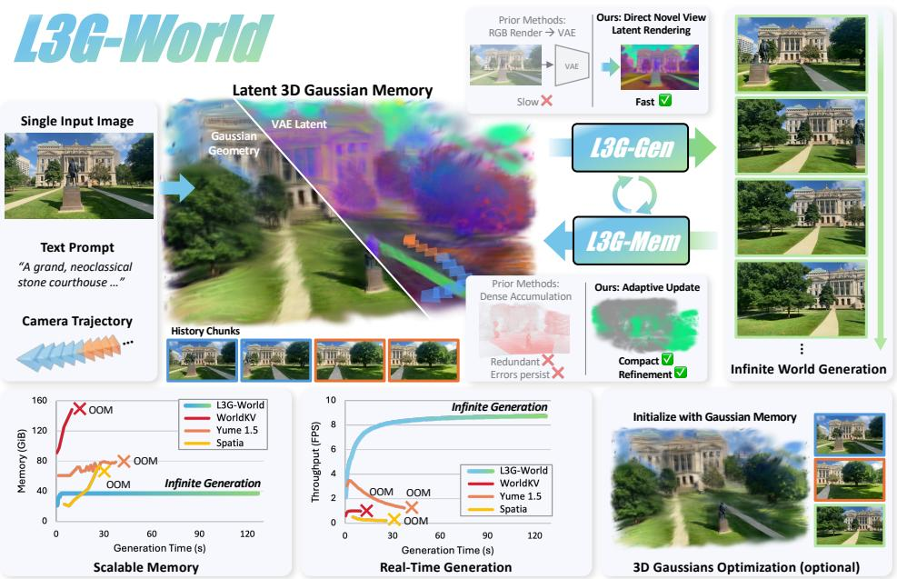

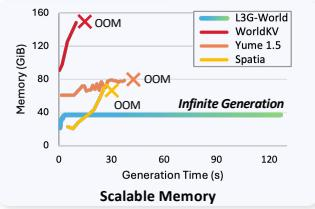

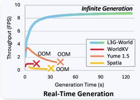  
Figure 1: Teaser. L3G-World generates an explorable, spatially consistent world in real time from a single image and a camera trajectory. To this end, L3G-Mem maintains a latent 3D Gaussian memory, and L3G-Gen generates video conditioned on VAE latents rendered from the memory.

## ABSTRACT

Interactive world models generate visual content conditioned on user actions, yet maintaining spatial consistency over long-horizon exploration in real time remains challenging. Existing approaches rely on either temporal context or explicit 3D memory, both of which scale poorly because memory grows with the length of the generated stream. Moreover, explicit 3D memories condition latent video generators by re-encoding RGB renderings, which precludes real-time generation. In this paper, we introduce a Latent 3D Gaussian Memory (L3G) that combines the efficiency of feed-forward reconstruction with a compact, rapidly renderable scene representation. Building on this memory, we propose L3G-World, in which a memory updater and a video diffusion transformer (DiT) alternate autoregressively to generate spatially consistent worlds. The memory updater spawns Gaussians in newly observed regions and refines existing ones, so that the memory grows with scene extent rather than stream length. Each Gaussian further stores a VAE latent feature, allowing the memory to be rendered directly into the DiT’s latent space without VAE re-encoding. Experiments show that L3G-World achieves state-of-the-art results on generation quality and long-horizon self-consistency, with up to 38.6× fewer 3D primitives, 3.2× faster memory reconstruction, and 359× faster VAE feature rendering relative to the most efficient prior 3D-memory baseline for each metric, enabling real-time world generation at 9 FPS.

## 1 INTRODUCTION

Interactive video world models (Seo et al., 2026; Nam et al., 2026; Bruce et al., 2024; Team et al., 2026; Mao et al., 2026; Sun et al., 2025; Wang et al., 2026; Gao et al., 2026; Basant et al., 2026), which generate visual content conditioned on user-provided actions, have recently emerged as a promising framework for real-world simulation (Seo et al., 2026; Mao et al., 2026; Basant et al., 2026), interactive game generation (Bruce et al., 2024; Team et al., 2026; Sun et al., 2025; Wang et al., 2026; Gao et al., 2026), and embodied simulation (Agarwal et al., 2026; Chen et al., 2026b). A central challenge lies in maintaining spatial consistency during long-horizon exploration and loop closures while still supporting real-time generation.

One line of work employ temporal context, by retrieving history frames or KV caches of selfattention layers in diffusion models during autoregressive generation (Team et al., 2026; Wang et al., 2026; Mao et al., 2026; Yi et al., 2026). By allowing each new chunk to attend to information from earlier generations through attention, these methods help maintain scene consistency (Kwon et al., 2026). However, its memory and attention costs grows with the length of the generated stream and spatial resolution. As shown in Tab. 1, this linear growth makes long-horizon generation increasingly expensive and can eventually lead to out-of-memory failures.

Another line of work explicitly stores scene information in persistent 3D representations. These approaches preserve previously generated content by reconstructing frames into point-cloud-based memories (Ren et al., 2025; Zhao et al., 2026; Wu et al., 2026a; Shen et al., 2026; Lee et al., 2026) or 3D Gaussian primitives (De Lutio et al., 2026; Wu et al., 2025; Yang et al., 2026). Such spatially anchored representations improve consistency across revisited regions while enabling fine-grained camera control. However, as shown in Tab. 1, existing approaches exhibit a fundamental trade-off between reconstruction efficiency and throughput. Feed-forward methods based on per-pixel point clouds or Gaussian primitives enable fast scene reconstruction, but predicting dense 3D representations for every pixel introduces substantial memory overhead. As generation proceeds, these dense primitives are repeatedly accumulated over the same spatial regions, resulting in increasingly redundant scene representations and slower target-view rendering. Moreover, since previously stored primitives are not adaptively updated, geometrically inaccurate regions may persist over time. In contrast, optimization-based methods (De Lutio et al., 2026; Wu et al., 2025) maintain more compact representations whose memory footprint primarily scales with scene extent, but their iterative optimization introduces substantial latency, making them unsuitable for real-time generation.

To address these challenges, we introduce a compact Latent 3D Gaussian Memory (L3G), which is continually read and updated online, and whose size grows primarily with the spatial extent of the explored scene rather than with the length of the generated stream. Building on this memory, we propose L3G-World, a world-generation framework composed of two modules: a feed-forward memory updater L3G-Mem, and a memory-conditioned video diffusion transformer L3G-Gen. As the two modules alternate autoregressively, L3G-Mem spawns new Gaussians only in uncovered regions, and refines the existing Gaussians in explored regions through residual updates. The memory is therefore not a buffer that accumulates primitives, but a persistent scene representation revised over time, which avoids redundant accumulation and progressively corrects geometrically inaccurate Gaussians. Since each Gaussian additionally stores a VAE latent feature, the memory is rendered directly into the latent space of L3G-Gen under the target cameras, conditioning the generation of the next video chunk without VAE re-encoding. The generated chunk is then fed back to L3G-Mem, which again updates the memory, closing the autoregressive loop. Combined with few-step distillation of L3G-Gen, this design enables real-time, long-horizon world generation.

Experiments demonstrate that L3G-World achieves state-of-the-art long-horizon consistency and generation quality while using 26.7–38.9× fewer 3D primitives, performing memory reconstruction 3.0–3.2× faster, and providing 349–359× higher VAE-space rendering throughput than the most efficient prior explicit 3D-memory baseline for each metric. Combined with few-step distillation of L3G-Gen, this enables real-time world generation at 9.02 FPS on one H100 GPU.

## 2 RELATED WORKS

Video Diffusion and World Models. Video diffusion models have made substantial progress in high-quality video generation (Yang et al., 2025; Wan et al., 2025; Ali et al., 2025; Agarwal et al.,

Table 1: Computational efficiency of memory analysis. We compare memory scaling across meth ods and report memory and throughput for constructing and rendering explicit scene representations. For memory scaling, $\dot { T }$ denotes the number of generated frames, R denotes the resolution size, and S denotes the spatial coverage of the scene. ‘OOM’ denotes out-of-memory error. All cost analyses are measured by 400-frame video generation on one H100 GPU.
<table><tr><td colspan="6">Method</td><td rowspan="2"></td><td rowspan="2">Peak GPU Memory↓</td><td rowspan="2">Total FPS↑</td><td rowspan="2">Real-time</td></tr><tr><td></td><td>Resolution</td><td>Memory Type</td><td>Memory Build</td><td>Refinement</td><td>Scaling ↓</td></tr><tr><td>WorldKV (Yi et al., 2026)</td><td> $4 6 4 \times 8 3 2$ </td><td>Temporal context</td><td>KV cache</td><td>一</td><td>O(TR)</td><td>OOM</td><td></td><td>OOM</td><td>x</td></tr><tr><td>Yume 1.5 (Mao et al., 2026)</td><td> $7 0 4 \times 1 , 2 8 0$ </td><td>Temporal context</td><td>Frame compression</td><td></td><td></td><td>O(TR)</td><td>66.7 GiB</td><td>1.42</td><td>x</td></tr><tr><td>Spatia (Zhao et al., 2026)</td><td> $\overline { { 7 0 4 \times 1 , 2 4 8 } }$ </td><td>Point clouds</td><td>Feed-forward</td><td>x</td><td>O(TR)</td><td></td><td>32.6 GiB</td><td>0.24</td><td>X</td></tr><tr><td>NeoVerse (Yang et al., 2026)</td><td> $3 3 6 \times 5 6 0$ </td><td>3D Gaussians</td><td>Feed-forward</td><td>x</td><td>O(TR)</td><td></td><td>36.8 GiB</td><td>1.99</td><td>x</td></tr><tr><td>ArtiFixer (De Lutio et al., 2026)</td><td> $5 4 0 \times 9 6 0$ </td><td>3D Gaussians</td><td>Optimization</td><td>V</td><td>O(S)</td><td></td><td>11.7 GiB</td><td>0.10</td><td>x</td></tr><tr><td>L3G-World (Ours)</td><td> $4 8 0 \times 8 3 2$ </td><td>Latent 3D Gaussians</td><td>Feed-forward</td><td>√</td><td></td><td>O(S)</td><td>7.4 GiB</td><td>9.02</td><td>√</td></tr></table>

2026; HaCohen et al., 2026). Most adopt latent diffusion (Rombach et al., 2021; Blattmann et al., 2023), where raw videos are compressed into a latent space using a VAE. Reducing the number of sampling steps, together with causal generation, has further enabled low-latency video streaming (Yin et al., 2025; Huang et al., 2026; Lin et al., 2026; Nie et al., 2026; Gu et al., 2026). They improve few-step generation by training on model-generated histories to mitigate exposure bias, or by combining flow-based transitions with on-policy distillation. Building on these advances, interactive world models (Seo et al., 2026; Nam et al., 2026; Bruce et al., 2024; Team et al., 2026; Mao et al., 2026; Sun et al., 2025; Wang et al., 2026; Gao et al., 2026; Basant et al., 2026; Yi et al., 2025) generate interactive environments conditioned on user or agent actions.

Feed-forward 3D Reconstruction. Traditional reconstruction methods (Mildenhall et al., 2020; Kerbl et al., 2023) rely on per-scene optimization, whereas recent feed-forward approaches directly predict 3D geometry from input images in a single forward pass. They typically predict per-pixel pointmap (Wang et al., 2025a; Lin et al., 2025) or 3D Gaussians (Charatan et al., 2024; Chen et al., 2024; Xu et al., 2025). Recent works (Wang et al., 2025b; Zhuo et al., 2025; Li et al., 2025; Chen et al., 2025) further introduce streaming formulations that sequentially process incoming images for online reconstruction. Complementarily, token-based 3DGS methods (An et al., 2025; Veicht et al., 2026; Ren et al., 2026; Yoo et al., 2026) decode compact sets of Gaussian primitives from visual or learnable tokens rather than predicting dense per-pixel Gaussians.

Consistent World Generation. To improve long-term spatial consistency, several world models maintain explicit 3D scene memories, typically represented as point clouds (Ren et al., 2025; Zhao et al., 2026; Wu et al., 2026a; Shen et al., 2026; Lee et al., 2026) or 3D Gaussians (Yang et al., 2026; De Lutio et al., 2026; Wu et al., 2025). These methods reconstruct 3D representations from generated frames and render them into subsequent target views to provide spatially grounded conditioning. Such explicit 3D memories improve consistency and camera controllability, but feed-forward approaches typically rely on dense per-frame reconstruction and continuously accumulate new 3D primitives, causing memory consumption and rendering cost to grow with the generation horizon. Some methods (De Lutio et al., 2026; Wu et al., 2025) use optimization-based reconstruction to maintain a scene-level 3D representation rather than simply accumulating per-frame primitives, but their slow per-scene optimization introduces substantial latency and is difficult to reconcile with real-time generation. In contrast, L3G-World maintains compact 3D Gaussians as scene memory, by adaptively spawning new primitives or refining existing ones. Moreover, each Gaussian directly stores VAE latent features, enabling efficient conditioning of the video diffusion model for real-time world generation.

## 3 METHODOLOGY

## 3.1 MOTIVATION AND OVERVIEW

Real-time interactive world generation that maintains geometric consistency places two competing demands on a 3D memory. Consistency over a long horizon requires storing previously generated content, while keeping pace with generation requires a memory that stays compact and fast to read and write. Dense per-frame accumulation stores everything but grows unboundedly, since redundant primitives pile up over the same regions and slow down rendering. We adopt 3D Gaussians as the memory representation for their robust target-view rendering, and design latent 3D Gaussian memory around two decisions. First, the memory is updated selectively: it spawns new Gaussians only for newly observed geometry and refines existing ones to correct reconstruction errors from earlier steps, so that memory usage remains largely independent of the number of generated frames. Second, each Gaussian stores a VAE latent feature, so that the memory is rendered directly in the latent space of the video generator and conditions the generator without VAE re-encoding.

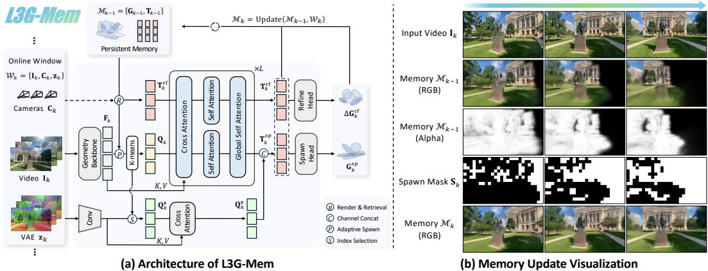  
Figure 2: L3G-Mem. (a) L3G-Mem takes the current window $\mathcal { W } _ { k }$ and the memory $\mathcal { M } _ { k - 1 }$ . Rendering $\mathcal { M } _ { k - 1 }$ into the current cameras determines which geometry features are clustered by K-means into spawning queries, and identifies the visible Gaussians whose memory tokens are retrieved as refinement tokens. Both token sets are jointly processed by a transformer and decoded into new Gaussians and residual updates, respectively. (b) Given the input video chunk, RGB and opacity rendered from the previous memory identify regions requiring new Gaussians through a spawning mask. As a result, the updated memory can fully reconstruct the observed scene.

As illustrated in Fig. 2, L3G-World realizes these decisions with two modules that alternate autoregressively: a memory updater, L3G-Mem, which reads and updates the latent 3D Gaussian memory with each generated chunk, and a video generator, L3G-Gen, which generates the next chunk conditioned on the memory rendered in its latent space. We first present L3G-Mem and the latent 3D Gaussian memory (Sec. 3.2), then describe how L3G-Gen is conditioned on the memory and distilled for real-time inference (Sec. 3.3), and finally provide the world generation framework L3G-World (Sec. 3.4). Implementation details are provided in Sec. B.1 and Sec. B.2, respectively.

## 3.2 L3G-MEM: 3D GAUSSIANS AS WORLD MEMORY

Online Window-Based Memory Update. L3G-Mem processes a stream of images $ { \mathrm { I } ^ { i } } \in \mathbb { R } ^ { 3 \times H \times W }$ and their corresponding camera parameters Ci in windows of size V . At autoregressive step $k ,$ we define the input window as ${ \mathcal { W } } _ { k } \mathbf { \bar { \Sigma } } = \{ ( \mathrm { I } _ { k } ^ { i } , \mathrm { C } _ { k } ^ { i } , z _ { k } ^ { i } ) \} _ { i = 1 } ^ { V } = \{ \mathbf { I } _ { k } , \mathbf { C } _ { k } , \mathbf { z } _ { k } \}$ , where $\mathbf { z } _ { k }$ denotes the VAE latent of $\mathbf { I } _ { k }$ . The latent 3D Gaussian memory after processing this window is represented as:

$$
\mathcal { M } _ { k } = \{ ( \mathrm { G } _ { j } , \mathrm { T } _ { j } ) \} _ { j = 1 } ^ { N _ { k } } = \{ \mathbf { G } _ { k } , \mathbf { T } _ { k } \} ,\tag{1}
$$

where $\mathrm { T } _ { j }$ denotes a memory token, $\mathrm { G } _ { j }$ is the corresponding 3D Gaussians, and $N _ { k }$ is the number of memory tokens after processing the k-th window. The Gaussian parameters are decoded from each memory token using an MLP-based Gaussian head, $\mathrm { G } _ { j } = \mathrm { H e a d } ( \mathbf { \bar { T } } _ { j } )$

Given the previous memory $\mathcal { M } _ { k - 1 }$ and the current input window $\mathcal { W } _ { k }$ , our model updates the memory autoregressively as:

$$
\mathcal { M } _ { k } = \mathrm { U p d a t e } \left( \mathcal { M } _ { k - 1 } , \mathcal { W } _ { k } \right) .\tag{2}
$$

Adaptive Gaussian Spawning. To keep latent 3D Gaussian memory compact, L3G-Mem selectively spawns new Gaussians only where additional scene geometry is needed. This requires identifying regions that are insufficiently represented by the current memory and initializing spawning query tokens from those regions, leaving well-represented regions to the existing Gaussians. To identify such regions, we render the Gaussians stored in $\mathcal { M } _ { k - 1 }$ from the current camera views $\mathbf { C } _ { k }$ to obtain RGB images and opacity maps. The opacity indicates whether each pixel is covered by the memory, and the per-pixel RGB error against $\mathbf { I } _ { k }$ indicates whether the memory reproduces that pixel faithfully. We mark pixels with low opacity or high error as insufficiently represented, and collect them into a spawn mask $\mathbf { S } _ { k }$

The spawn mask then determines where new Gaussians are spawned: we draw the spawning queries from the masked observation, so that the new Gaussians fill the regions marked by $\mathbf { S } _ { k }$ . Specifically, we encode $\mathbf { I } _ { k }$ with a geometric foundation model (Lin et al., 2025) to obtain geometry features $\mathbf { F } _ { k } = \{ \operatorname { F } _ { k } ^ { l } \} _ { l = 1 } ^ { L } .$ , where $L { = } 3$ denotes the selected feature layers, and retain only the features of $\mathrm { F } _ { k } ^ { 1 }$ inside $\mathbf { S } _ { k }$ as spawning candidates. Following ZipSplat (Veicht et al., 2026), we apply K-means to these candidates to initialize a compact set of spawning query tokens $\mathbf { Q } _ { k }$ . Thus, rather than clustering over all input geometry features, our updater allocates its spawning budget only to content missing from the memory.

Gaussian Refinement. The refinement stream of L3G-Mem updates existing Gaussians that are visible in the current window, rather than leaving previously stored content fixed. We render the Gaussians stored in $\mathcal { M } _ { k - 1 }$ from the current camera views $\mathbf { C } _ { k }$ , retrieve the memory tokens associated with the visible Gaussians, and use them as refinement tokens, denoted by $\mathbf { T } _ { k } ^ { \mathrm { r f } }$ . These tokens and their corresponding Gaussian parameters are subsequently updated using observations from the current window $\mathcal { W } _ { k }$

Joint Token Processing. L3G-Mem concatenates the spawning and refinement tokens along the token dimension and processes them with a single transformer ${ \mathcal { F } } _ { \theta } \colon$

$$
\left( \bar { \mathbf { Q } } _ { k } , \bar { \mathbf { T } } _ { k } ^ { \mathrm { r f } } \right) = \mathcal { F } _ { \boldsymbol { \theta } } \left( \left[ \mathbf { Q } _ { k } ; \mathbf { T } _ { k } ^ { \mathrm { r f } } \right] , \mathbf { F } _ { k } \right) ,\tag{3}
$$

where $[ \cdot ; \cdot ]$ denotes concatenation along the token dimension. The transformer consists of $L$ blocks. In each block $l ,$ the two streams first cross-attend to the geometric features $\mathrm { F } _ { k } ^ { l }$ , followed by streamwise self-attention. A global self-attention layer is then applied over the concatenated spawning query and refinement tokens, enabling information exchange between newly observed and previously reconstructed scene content.

VAE Latent Lifting. Since video diffusion models operate in the VAE latent space, we additionally lift VAE features into latent 3D Gaussian memory, allowing it to be rendered directly in the latent space of the diffusion model. A dedicated latent-lifting branch initializes latent queries $\mathbf { Q } _ { k } ^ { \mathbf { z } }$ from $\mathbf { z } _ { k }$ using the same spatial indices as the spawning query tokens, and cross-attends to $\mathbf { z } _ { k }$ . This produces VAE latent tokens that are spatially aligned with the corresponding query tokens, and can therefore be jointly decoded as $\mathbf { T } _ { k } ^ { \mathrm { s p } } = \dot { \operatorname { C o n c a t } } _ { c } ( \mathbf { \check { Q } } _ { k } ; \bar { \mathbf { Q } } _ { k } ^ { \mathbf { z } } )$ , where $\mathrm { C o n c a t } _ { c } ( \cdot ; \cdot )$ is channel-wise concatenation.

Gaussian Decoding and Memory Update. The processed spawning tokens are concatenated with their corresponding VAE latent tokens and decoded into new Gaussian primitives, while the refine ment tokens are decoded into residual updates for the retrieved Gaussians:

$$
\mathbf { G } _ { k } ^ { \mathrm { s p } } = \operatorname { H e a d } _ { \mathrm { s p } } \left( \mathbf { T } _ { k } ^ { \mathrm { s p } } \right) , \qquad \Delta \mathbf { G } _ { k } ^ { \mathrm { r f } } = \operatorname { H e a d } _ { \mathrm { r f } } \left( \bar { \mathbf { T } } _ { k } ^ { \mathrm { r f } } \right) ,\tag{4}
$$

Where $\mathrm { H e a d _ { s p } ( \cdot ) }$ and ${ \mathrm { H e a d } } _ { \mathrm { r f } } ( \cdot )$ are MLP-based Gaussian head for spawn and refine tokens, respectively. To obtain $\mathcal { M } _ { k }$ , L3G-Mem updates $\mathcal { M } _ { k - 1 }$ in two ways. It appends the newly spawned Gaussians together with their memory tokens, and updates the retrieved Gaussians in place by applying the predicted residuals and replacing their memory tokens with the refinement outputs. All memory entries not selected for refinement remain unchanged.

Autoregressive Training. We train over K consecutive windows, starting from an empty memory $\mathcal { M } _ { 0 } = \emptyset$ . We apply stop gradients through $\mathcal { M } _ { k - 1 }$ at each step k to ensure causality. At step $k ,$ we supervise renderings of $\mathcal { M } _ { k }$ from the target views of all windows up to $k ,$ , with the overall objective

$$
\mathcal { L } = \frac { 1 } { K } \sum _ { k = 1 } ^ { K } \left( \mathcal { L } _ { \mathrm { r g b } } ^ { k } + \lambda _ { \mathrm { l p i p s } } \mathcal { L } _ { \mathrm { l p i p s } } ^ { k } + \lambda _ { \mathrm { d e p t h } } \mathcal { L } _ { \mathrm { d e p t h } } ^ { k } + \lambda _ { \mathrm { v a e } } \mathcal { L } _ { \mathrm { v a e } } ^ { k } + \lambda _ { \mathrm { v i s } } \mathcal { L } _ { \mathrm { v i s } } ^ { k } \right) .\tag{5}
$$

The terms denote RGB $\ell _ { 1 }$ , LPIPS, depth $\ell _ { 1 }$ , VAE latent MSE, and visibility losses, respectively. The visibility loss (Ren et al., 2026) encourages each Gaussian to lie within at least one input-view frustum.

## 3.3 L3G-GEN: MEMORY-CONDITIONED AUTOREGRESSIVE VIDEO GENERATION

We introduce L3G-Gen, a memory-conditioned autoregressive video diffusion model for longhorizon world generation. At each autoregressive step, the model retrieves previously generated information from the persistent 3D Gaussian memory to guide the generation of the next video chunk. This provides spatially aligned conditioning for preserving scene consistency when revisiting previously explored regions. To support real-time interaction, we further distill the model into a few-step generator.

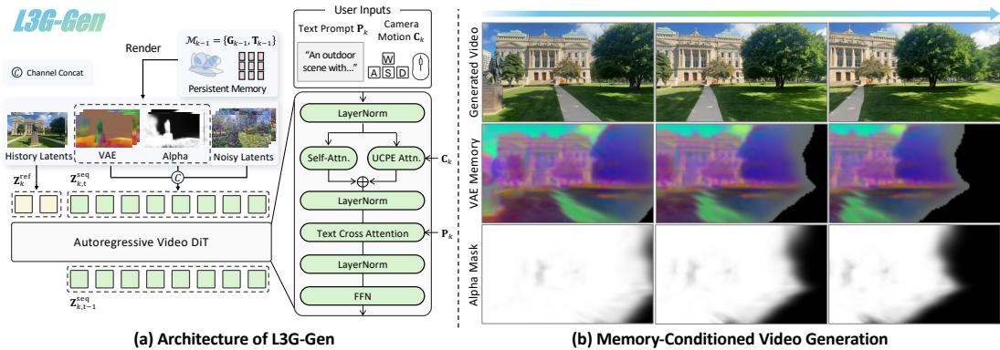  
Figure 3: L3G-Gen. (a) L3G-Gen renders the VAE latents and opacity of the 3D memory to the target cameras, concatenates them with the noisy latents along the channel dimension, and generates the next chunk conditioned on the history latents. (b) We visualize the ground-truth and generated video, with target-view rendered VAE condition from the latent 3D Gaussian memory, illustrating that spatially aligned latent memory provides consistent conditioning for video generation.

Conditioning for Generation. At autoregressive step $k ,$ , we render the VAE latents stored in $\mathcal { M } _ { k - 1 }$ under the target cameras $\mathbf { C } _ { k }$ to obtain spatially aligned VAE latents $\mathbf { z } _ { k } ^ { \mathrm { m e m } }$ and alpha mask $\mathbf { o } _ { k } ^ { \mathrm { m e m } }$ We concatenate them with the target video latents ${ \bf z } _ { k , t }$ along the channel dimension, providing geometric conditioning without introducing additional memory tokens. The previously generated reference latents ${ \bf z } _ { k } ^ { \mathrm { r e f } }$ are concatenated with zero-filled channels to match the channel dimension of the concatenated target latents. The input sequence is formed by token-wise concatenation:

$$
\begin{array} { r } { { \bf z } _ { k , t } ^ { \mathrm { s e q } } = \left[ { \bf z } _ { k } ^ { \mathrm { r e f } } ; \mathrm { C o n c a t } _ { c } ( { \bf z } _ { k , t } ; { \bf z } _ { k } ^ { \mathrm { m e m } } ; { \bf o } _ { k } ^ { \mathrm { m e m } } ) \right] . } \end{array}\tag{6}
$$

Only the target video latents are denoised, while the reference latents remain fixed. Following (Zhang et al., 2026), we add the residual camera ray rotary positional embedding (RayRoPE (Wu et al., 2026b)) on the self attention in each DiT layer.

Temporal Positional Encoding. Following (Seo et al., 2026), we assign the reference latents a temporally offset rotary positional embedding (Su et al., 2021) (RoPE) preceding the current generation chunk. The temporal RoPE positions associated with the input sequence are

$$
\begin{array} { r } { \mathbf { p } _ { k } ^ { \mathrm { s e q } } = \left[ \underbrace { - L _ { \mathrm { r e f } } , \ldots , - 1 } _ { \mathrm { r e f e r e n c e } } ; \underbrace { 0 , \ldots , L - 1 } _ { \mathrm { t a r g e t } } \right] , } \end{array}\tag{7}
$$

where $L _ { \mathrm { r e f } }$ and L denote the numbers of reference and target latents, respectively. All spatial tokens within each latent frame share its temporal RoPE position. The reference latents serve as conditioning rather than a future prediction target, and remain accessible to all target tokens.

Training Objective. We train the memory-conditioned teacher model with rectified flow (Lipman et al., 2022). Let $\mathbf { z } _ { k , 0 }$ denote the clean target video latents and ${ \bf z } _ { k , t } = ( 1 - t ) { \bf z } _ { k , 0 } + t \epsilon$ is noisy target latents, where $\epsilon \sim \mathcal { N } ( 0 , \mathbf { I } )$ is a sampled noise and $t \sim \mathcal { U } ( 0 , 1 )$ is a noise level. Conditioned on the rendered memory latents $\mathbf { z } _ { k } ^ { \mathrm { m e m } }$ , opacity map $\mathbf { o } _ { k } ^ { \mathrm { m e m } }$ , retrieved reference latents ${ \bf z } _ { k } ^ { \mathrm { r e f } }$ , target cameras $\mathbf { C } _ { k } .$ , and the text prompt ${ \bf P } _ { k } ^ { \mathrm { ~ \tiny ~ \cdot ~ } }$ the teacher $\mathbf { v } _ { \phi }$ is optimized as

$$
\mathcal { L } _ { \mathrm { F M } } = \mathbb { E } _ { \mathbf { z } _ { k , 0 } , \epsilon , t } \left[ \left| \left| \mathbf { v } _ { \phi } \left( \mathbf { z } _ { k , t } , t \mid \mathbf { z } _ { k } ^ { \mathrm { m e m } } , \mathbf { o } _ { k } ^ { \mathrm { m e m } } , \mathbf { z } _ { k } ^ { \mathrm { r e f } } , \mathbf { C } _ { k } , \mathbf { P } _ { k } \right) - \left( \epsilon - \mathbf { z } _ { k , 0 } \right) \right| \right| _ { 2 } ^ { 2 } \right] .\tag{8}
$$

The loss is applied only to the target video latents, while the clean reference latents remain fixed conditioning inputs.

On-Policy Distillation. To reduce the sampling cost, we distill the memory-conditioned teacher $\mathbf { v } _ { \phi }$ into a few-step autoregressive student following AnyFlow (Gu et al., 2026). The student is conditioned on both the source and destination noise levels and learns flow-map transitions between arbitrary points along the denoising trajectory. After flow-map initialization, we jointly optimize the flow-map objective and on-policy distribution matching. Specifically, the student generates samples through its own autoregressive rollout, which are re-noised and compared against the frozen teacher through distribution matching. Training on the student’s own generation trajectory, rather than relying solely on noisy ground-truth samples, reduces the train–test mismatch in few-step autoregressive generation. Detailed distillation objectives and training configurations are provided in Sec. A.1.

## 3.4 L3G-WORLD: CONSISTENT WORLD GENERATION FRAMEWORK

Combining L3G-Mem and L3G-Gen, L3G-World performs world generation through an autoregressive loop of adaptive memory update and memory-conditioned video generation. Given an input image, L3G-Mem first initializes the persistent Gaussian memory M0. At each generation step k, the VAE features stored in $\mathcal { M } _ { k - 1 }$ are rendered from the target cameras $\mathbf { C } _ { k }$ to provide spatially aligned latent conditioning for L3G-Gen. Importantly, we directly render memory in the VAE latent space, avoiding RGB rendering followed by VAE re-encoding.

Conditioned on the rendered memory, L3G-Gen generates the next video chunk in the VAE latent space. These generated latents are passed directly to L3G-Mem for VAE feature lifting, while the corre-

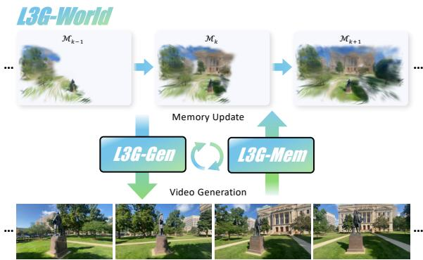  
Figure 4: L3G-World Pipeline. L3G-World couples video generation and memory updating in a chunkwise loop, where each generated chunk updates the persistent 3D memory, which in turn conditions subsequent chunk generation.

sponding RGB frames are obtained once through the VAE decoder. The updater then update the memory, producing $\mathcal { M } _ { k }$ for the next generation step. By repeatedly reading from and writing back to the same persistent 3D memory, L3G-World continuously extends and corrects the generated world while avoiding redundant latent encoding between the two modules. L3G-World Fast employ few-step student model of L3G-Gen, enabling real-time world generation.

## 4 EXPERIMENTS

## 4.1 EXPERIMENTAL SETUP

Implementation Details. We implement L3G-Mem inspired by ZipSplat (Veicht et al., 2026), using Depth Anything 3 (DA3) (Lin et al., 2025) as the geometry backbone. For L3G-Gen, we adopt Cosmos-Predict2.5 (NVIDIA et al., 2025). We train L3G-Mem on DL3DV (Ling et al., 2024), and L3G-Gen on DL3DV and RealEstate10K (Zhou et al., 2018). We fine-tune Diffusion Transformer (DiT) backbone of the video generator using LoRA (Hu et al., 2022), and we adopt AnyFlow (Gu et al., 2026) for few-step distillation. We refer to the few-step distilled variant as ‘L3G-World Fast in our experiments. All models are optimized using AdamW (Loshchilov & Hutter, 2017) on four NVIDIA A100 GPUs, with a batch size of 8 and 16 for the memory updater and world model, respectively. The implementation and training details of the memory updater and video DiT are provided in Sec. B.1 and B.2.

Baselines. We compare L3G-World against state-of-the-art world models with either explicit or implicit memory, including point-cloud-based methods, Lyra 2.0 (Shen et al., 2026), GEN3C (Ren et al., 2025), Spatia (Zhao et al., 2026), SPMem (Wu et al., 2026a), and 3DScenePrompt (Lee et al., 2026); the Gaussian-based method NeoVerse (Yang et al., 2026); and temporal-context-based methods, Yume 1.5 (Mao et al., 2026) and Matrix-Game 3.0 (Wang et al., 2026). For a fair comparison in our single-image setting, we use Depth Anything 3 GIANT-1.1-NESTED (Lin et al., 2025) to obtain metric depth for all explicit 3D-memory methods, aligning the scale of the reconstructed scene representation with the evaluation camera trajectory. For Gaussian-based methods, including Neo-Verse and L3G-World, we align the initially predicted Gaussian geometry to the same metric depth.

Table 2: Video generation evaluation. We evaluate generation quality, self-consistency, and efficiency on DL3DV and RealEstate10K. The best and second-best results for each metric within each dataset are shown in bold and underline, respectively.
<table><tr><td rowspan="2">Method</td><td colspan="4">3D Memory Efficiency</td><td colspan="4">Self-Consistency</td><td colspan="5">Generation Quality</td><td colspan="2">Pose Error</td><td>3D Consistency</td></tr><tr><td># Primitives (K) ↓</td><td>Memory (MiB) ↓</td><td>Recon. FPS ↑</td><td>Render FPS (RGB) ↑</td><td>Render FPS (VAE) ↑</td><td>PSNR ↑ SSIM↑</td><td>LPIPS ↓</td><td>LPIPS ↓</td><td>FID ↓</td><td>IQ↑</td><td>AQ↑</td><td>SC↑</td><td>BC↑</td><td>TransErr ↓</td><td>RotErr (°) ↓</td><td>MEt3R↓</td></tr><tr><td></td><td></td><td></td><td></td><td></td><td></td><td></td><td>DL3DV</td><td></td><td></td><td></td><td></td><td></td><td></td><td></td><td></td><td></td></tr><tr><td>Temporal Context</td><td></td><td></td><td></td><td></td><td></td><td></td><td></td><td></td><td></td><td></td><td></td><td></td><td></td><td></td><td></td><td></td></tr><tr><td>Yume 1.5</td><td></td><td></td><td></td><td></td><td></td><td>13.71 12.26</td><td>0.487 0.401</td><td>0.655 0.540</td><td>0.699 50.88 67.78</td><td>0.601 0.609</td><td>0.514 0.431</td><td>0.805</td><td>0.888</td><td>0.904 0.376</td><td>11.09 3.11</td><td>0.050 0.070</td></tr><tr><td>Matrix Game 3.0</td><td></td><td></td><td></td><td></td><td></td><td></td><td></td><td></td><td>0.681</td><td></td><td></td><td>0.774</td><td>0.865</td><td></td><td></td><td></td></tr><tr><td>Explicit 3D Memory</td><td></td><td>47.27</td><td></td><td></td><td></td><td></td><td></td><td></td><td></td><td></td><td></td><td></td><td></td><td></td><td></td><td></td></tr><tr><td>GEN3C</td><td>1,802 9,647</td><td>220.80</td><td>0.117 1.517</td><td>1.70 0.29</td><td>0.40 0.08</td><td>13.54 13.96</td><td>0.464 0.398</td><td>0.474 0.571</td><td>0.618</td><td>48.65 0.510 0.546</td><td>0.480</td><td>0.813</td><td>0.869</td><td>0.210</td><td>4.24</td><td>0.075 0.122</td></tr><tr><td>Spatia SPMem</td><td>1,667</td><td>38.16</td><td>4.788</td><td>0.22</td><td>0.06</td><td>12.53</td><td>0.513</td><td>0.637</td><td>0.638 0.711</td><td>89.39 74.23</td><td>0.382</td><td>0.719</td><td>0.831</td><td>0.738 0.799</td><td>15.92 10.10</td><td>0.056</td></tr><tr><td>Lyra 2.0</td><td>1,273</td><td>92.27</td><td>4.231</td><td>11.36</td><td>1.69</td><td>13.60</td><td>0.382</td><td>0.493</td><td>0.618</td><td>0.504 52.26 0.651</td><td>0.448 0.481</td><td>0.758</td><td>0.868</td><td>0.348</td><td>4.79</td><td>0.074</td></tr><tr><td>3DScenePrompt</td><td>149,880</td><td>6,292.00</td><td>5.635</td><td>0.24</td><td>0.06</td><td>13.63</td><td>0.528</td><td>0.609</td><td>0.706</td><td>87.99 0.544</td><td>0.400</td><td>0.801</td><td>0.882 0.810</td><td>0.759</td><td>11.22</td><td>0.080</td></tr><tr><td>NeoVerse</td><td>8,766</td><td>501.57</td><td>12.519</td><td>55.56</td><td>3.11</td><td>13.53</td><td>0.525</td><td>0.652</td><td>0.755</td><td>152.25 0.417</td><td>0.305</td><td>0.704 0.649</td><td>0.797</td><td>0.508</td><td>7.80</td><td>0.089</td></tr><tr><td>L3G-World</td><td>33</td><td>11.88</td><td>40.088</td><td>460.73</td><td>1,086.58</td><td>16.00</td><td>0.441</td><td>0.366</td><td></td><td></td><td></td><td></td><td></td><td></td><td></td><td></td></tr><tr><td>L3G-World Fast</td><td>70</td><td>25.55</td><td>37.814</td><td>323.25</td><td>823.71</td><td>14.59</td><td>0.395</td><td>0.430</td><td>0.547 40.57 0.569 43.05</td><td>0.658 0.672</td><td>0.497 0.515</td><td>0.820</td><td>0.893</td><td>0.142 0.200</td><td>3.41 5.47</td><td>0.078 0.091</td></tr><tr><td></td><td></td><td></td><td></td><td></td><td></td><td></td><td>RealEstate10K</td><td></td><td></td><td></td><td></td><td>0.810</td><td>0.889</td><td></td><td></td><td></td></tr><tr><td>Temporal Context</td><td></td><td></td><td></td><td></td><td></td><td></td><td></td><td></td><td></td><td></td><td></td><td></td><td></td><td></td><td></td><td></td></tr><tr><td>Yume 1.5</td><td></td><td></td><td></td><td></td><td></td><td>15.22</td><td>0.652</td><td>0.634</td><td>0.698 48.01</td><td>0.618</td><td>0.490</td><td>0.796</td><td>0.881</td><td>0.818</td><td>10.19</td><td>0.048</td></tr><tr><td>Matrix Game 3.0</td><td></td><td></td><td></td><td></td><td></td><td>17.95</td><td>0.657</td><td>0.437</td><td>0.752</td><td>178.49 0.475</td><td>0.340</td><td>0.647</td><td>0.803</td><td>0.618</td><td>3.37</td><td>0.076</td></tr><tr><td>Explicit 3D Memory</td><td></td><td></td><td></td><td></td><td></td><td></td><td></td><td></td><td></td><td></td><td></td><td></td><td></td><td></td><td></td><td></td></tr><tr><td>GEN3C</td><td>1,802</td><td>42.27</td><td>0.101</td><td>1.89</td><td>0.44</td><td>16.62</td><td>0.653</td><td>0.358</td><td>0.537 43.76</td><td>0.572</td><td>0.472</td><td>0.819</td><td>0.905</td><td>0.112</td><td>0.46</td><td>0.027</td></tr><tr><td>Spatia</td><td>2,849</td><td>67.52</td><td>1.740</td><td>0.88</td><td>0.22</td><td>16.93</td><td>0.628</td><td>0.388</td><td>0.578 59.70</td><td>0.553</td><td>0.414</td><td>0.797</td><td>0.889</td><td>0.399</td><td>2.43</td><td>0.052</td></tr><tr><td>SPMem</td><td>655</td><td>14.99</td><td>5.995</td><td>0.78</td><td>0.19</td><td>13.76</td><td>0.660</td><td>0.577</td><td>0.531 54.12</td><td>0.617</td><td>0.480</td><td>0.789</td><td>0.857</td><td>0.672</td><td>4.08</td><td>0.023</td></tr><tr><td>Lyra 2.0</td><td>1,273</td><td>92.27</td><td>4.350</td><td>11.63</td><td>1.70</td><td>17.30</td><td>0.607</td><td>0.313</td><td>0.550 37.36</td><td>0.720</td><td>0.512</td><td>0.824</td><td>0.893</td><td>0.091</td><td>0.20</td><td>0.025</td></tr><tr><td>3DScenePrompt</td><td>149,880</td><td>6,292.00</td><td>5.642</td><td>0.28</td><td>0.07</td><td>15.46</td><td>0.700</td><td>0.470</td><td>0.648 64.81</td><td>0.484</td><td>0.418</td><td>0.773</td><td>0.858</td><td>0.572</td><td>3.45</td><td>0.033</td></tr><tr><td>NeoVerse</td><td>10,437</td><td>597.21</td><td>12.968</td><td>55.56</td><td>3.07</td><td>12.87</td><td>0.542</td><td>0.638</td><td>0.737</td><td>142.75 0.515</td><td>0.361</td><td>0.652</td><td>0.799</td><td>0.759</td><td>5.98</td><td>0.061</td></tr><tr><td>L3G-World L3G-World Fast</td><td>25 42</td><td>8.91 15.15</td><td>38.881 42.823</td><td>577.00 516.10</td><td>1,101.94 1,209.89</td><td>18.36 16.19</td><td>0.668</td><td>0.269 0.442</td><td>0.518 36.09</td><td>0.653</td><td>0.454</td><td>0.841</td><td>0.923</td><td>0.216</td><td>1.23</td><td>0.029</td></tr><tr></table>

All methods are evaluated on a single NVIDIA A100 GPU, including the efficiency measurements.   
Detailed baseline configurations are provided in Sec. B.3.

Evaluation Benchmark. We evaluate L3G-World and all baselines on DL3DV (Ling et al., 2024) and RealEstate10K (Zhou et al., 2018). To evaluate long-horizon spatial consistency, we construct 481-frame loop-closure trajectories that explore away from the initial view and then retrace the same camera path in reverse. We measure self-consistency by comparing generated frames at corresponding camera poses along the outgoing and returning trajectories using PSNR, SSIM, and LPIPS. For generation quality, we report LPIPS, FID (Heusel et al., 2017), and four VBench (Huang et al., 2024) metrics: Imaging Quality (IQ), Aesthetic Quality (AQ), Subject Consistency (SC), and Background Consistency (BC). Following (Seo et al., 2026), we evaluate camera controllability using translation error (TransErr) and rotation error (RotErr), and evaluate geometric consistency using MEt3R (Asim et al., 2025), following (Jang et al., 2026).

To evaluate the efficiency of 3D memory, we measure the number of stored primitives, memory footprint, reconstruction and rendering FPS. We separately report RGB rendering FPS and VAEspace conditioning FPS, where the latter includes VAE encoding after RGB rendering for methods without directly renderable VAE features. Further evaluation details are provided in Sec. B.4.

## 4.2 QUANTITATIVE RESULTS

Tab. 2 compares L3G-World and L3G-World Fast with the baselines in terms of long-horizon selfconsistency, memory efficiency, generation quality, camera pose accuracy, and 3D consistency.

Memory Efficiency. Compared with NeoVerse, a Gaussian-based method, L3G-World uses 266– 417× fewer primitives and 42–67× less memory across the two datasets. Its compact representation enables 8.3–10.4× faster RGB rendering, while directly rendering the stored VAE latent features increases VAE-conditioning throughput by 349–359×. The advantage also holds against pointcloud-based memories. Compared with Lyra 2.0, a particularly efficient point-cloud baseline, L3G-World performs memory reconstruction 8.9–9.5× faster while using 7.8–10.4× less memory, and achieves 643–648× higher VAE-rendering throughput. These gains directly reflect our two design choices: instead of accumulating dense primitives, L3G-Mem adds Gaussians only for previously uncovered or high-error regions and updates existing ones; moreover, storing VAE features in each Gaussian eliminates the cost of VAE re-encoding required for conditioning the DiT.

Self-Consistency. On DL3DV, the two L3G-World variants achieve the best and second-best PSNR and LPIPS, with L3G-World obtaining the best scores. On RealEstate10K, L3G-World further achieves the best PSNR and LPIPS, and the second-best SSIM. These results support our motivation that a persistent, spatially anchored scene memory can preserve previously observed content when the camera revisits a region after long-horizon exploration.

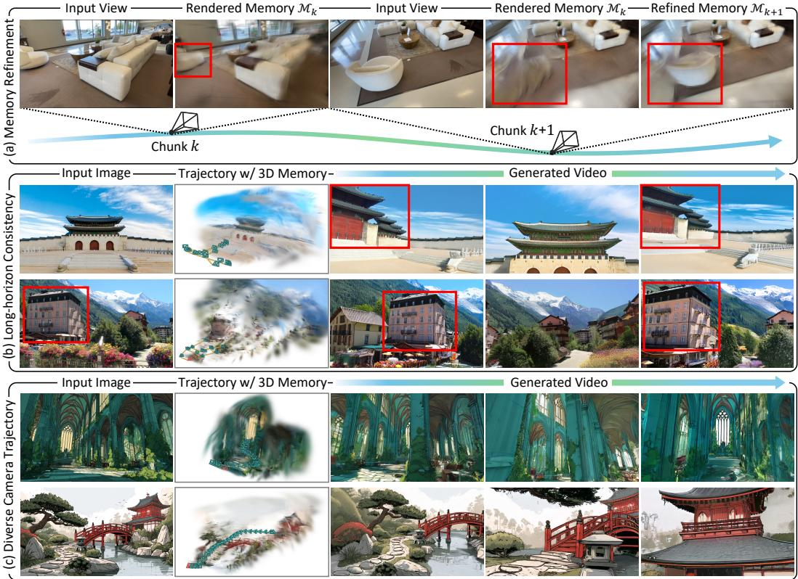  
Figure 5: Qualitative results of L3G-World. (a) L3G-Mem corrects geometric errors in the 3D memory through residual refinement using video chunks generated by L3G-Gen. (b) L3G-World maintains scene consistency over long-horizon generation through its persistent 3D memory. (c) Rendering the memory’s VAE features from target camera views provides spatially aligned conditioning, enabling consistent video generation along diverse camera trajectories.

Generation Quality and 3D Consistency. Importantly, these efficiency gains are accompanied by strong generation quality. On DL3DV, L3G-World achieves the best LPIPS, FID, SC, and BC, while L3G-World Fast obtains the best IQ and AQ. On RealEstate10K, L3G-World achieves the best LPIPS, FID, SC, and BC, together with the second-best IQ. For camera control, L3G-World achieves the lowest translation error and second-lowest rotation error on DL3DV. While other baselines achieve lower pose and MEt3R errors on RealEstate10K, L3G-World maintains strong generation quality and long-horizon self-consistency.

## 4.3 QUALITATIVE RESULTS

Fig. 5 presents qualitative results of L3G-World. As shown in (a), L3G-Mem corrects geometric errors in the persistent 3D memory using observations from the next video chunk. Specifically, rendering the memory $\mathcal { M } _ { k }$ from chunk k into the camera views of chunk k+1 reveals geometric errors (red bounding box). Using the newly generated video chunk k+1, L3G-Mem refines the existing Gaussians while spawning new ones in previously unobserved regions. This adaptive memory update enables L3G-World to maintain a compact and efficient 3D memory while preserving scene consistency throughout minute-long autoregressive generation (b). Furthermore, by rendering the memory’s VAE features from target camera views, L3G-World provides spatially aligned conditioning to extrapolate the world from an input image along diverse camera trajectories (c).

Fig. 6 presents qualitative comparisons under long-horizon loop-closure trajectories. For each scene, all methods start from the same input view, explore previously unseen regions, and eventually return to the initial camera location; thus, the final frame directly reveals whether the generated world remains consistent after long-horizon exploration. Temporal-context-based methods, Matrix-Game 3.0 and Yume 1.5, often exhibit noticeable appearance or geometric drift when returning to previously observed regions. Among explicit 3D-memory approaches, Spatia and NeoVerse show substantial blur and rendering artifacts as generation progresses, while GEN3C and Lyra 2.0 produce comparatively stronger results but often struggle to extrapolate plausible geometry and appearance far beyond the single input view. In contrast, L3G-World preserves scene structure and appearance throughout long-horizon exploration and recovers a visually consistent scene upon loop closure. L3G-World Distill also retains this behavior while enabling few-step generation. Additional qualitative comparisons with all baselines are provided in Sec. C.

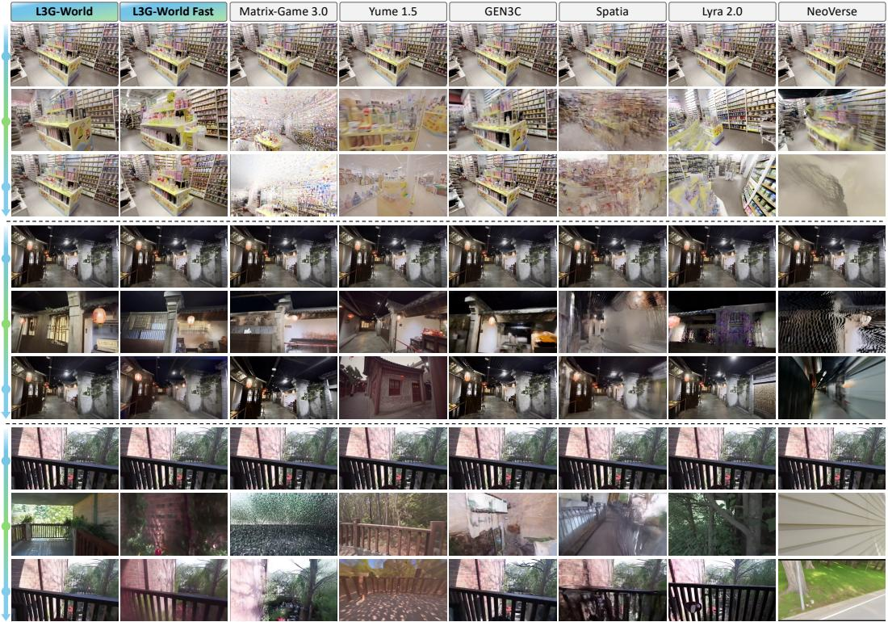  
Figure 6: Qualitative results of video generation on DL3DV and RealEstate10K. For each scene, all methods start from the same input view (top), explore unseen regions (middle), and return to the initial camera location (bottom). L3G-World preserves scene structure and appearance upon loop closure, whereas the baselines exhibit drift, blur, or rendering artifacts.

Table 3: Ablation study of L3G-Mem on DL3DV. We report RGB and VAE latent NVS quality and efficiency. Reconstruction FPS is computed from nine-frame update chunks. The best and second-best results are shown in bold and underline, respectively.
<table><tr><td>Variant</td><td>VAE MSE ↓</td><td>VAE Cosine ↑</td><td># Gaussians (K) ↓</td><td>Recon. FPS ↑</td><td>Render FPS (VAE) ↑</td><td>PSNR ↑</td><td>SSIM↑</td><td>LPIPS↓</td></tr><tr><td>w/o Adaptive Spawning</td><td>0.182</td><td>0.776</td><td>75</td><td>39.08</td><td>742.4</td><td>16.26</td><td>0.409</td><td>0.535</td></tr><tr><td>w/o Refinement</td><td>0.213</td><td>0.743</td><td>45</td><td>43.82</td><td>937.5</td><td>15.52</td><td>0.382</td><td>0.571</td></tr><tr><td>w/o Global Self-Attn.</td><td>0.184</td><td>0.775</td><td>41</td><td>40.99</td><td>938.5</td><td>16.36</td><td>0.397</td><td>0.535</td></tr><tr><td>w/o RGB Loss</td><td>0.251</td><td>0.696</td><td>74</td><td>39.55</td><td>1199.0</td><td>10.26</td><td>0.272</td><td>0.751</td></tr><tr><td>w/o VAE Lifting</td><td>0.570</td><td>0.467</td><td>=</td><td>一</td><td>2.97</td><td></td><td>I</td><td>=</td></tr><tr><td>L3G-Mem (Full)</td><td>0.177</td><td>0.782</td><td>41</td><td>40.03</td><td>943.6</td><td>16.52</td><td>0.406</td><td>0.534</td></tr></table>

## 4.4 ABLATION STUDY

L3G-Mem. Tab. 3 ablates the key components of L3G-Mem on novel view synthesis (NVS) on DL3DV, with all variants trained using a batch size of 2. We provide details of evaluation of L3G-Mem in Sec. D. Without adaptive spawning, by applying K-means to all geometry features, the model uses ∼1.8× more Gaussians while degrading both RGB and VAE NVS, showing that selective spawning reduces redundant primitives. Removing the refinement stream causes a mean ingful quality drop, demonstrating the importance of correcting existing Gaussians through residual updates. Removing global self-attention between the spawn and refine streams further degrades performance, highlighting the benefit of coordinating newly spawned and existing scene content. We also ablate RGB supervision by setting $\lambda _ { \mathrm { l p i p s } } ^ { k } { = } \lambda _ { \mathrm { r g b } } ^ { \overline { { k } } } { = } 0$ for all k. Although L3G-Gen is conditioned on directly rendered VAE features, RGB supervision remains important for learning accurate

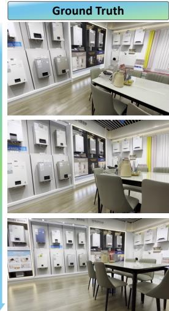

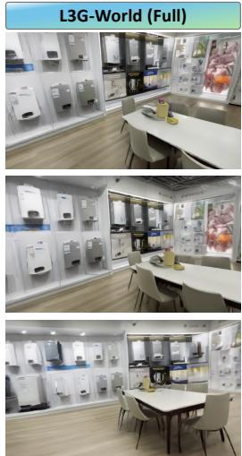

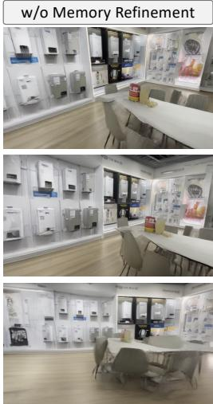

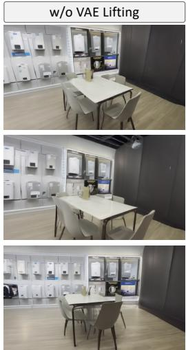  
Figure 7: Qualitative results of ablation study of L3G-World on DL3DV. Memory refinement can not fix geometric error in 3D memory, leading blurry video due to memory rendering artifacts.

Table 4: Ablation study of L3G-World on DL3DV. The best and second-best results are shown in bold and underline, respectively.
<table><tr><td></td><td colspan="3">Self-Consistency</td><td colspan="6">Generation Quality</td><td colspan="2">Pose Error</td><td>3D Consistency</td></tr><tr><td>Method</td><td>PSNR ↑</td><td>SSIM ↑</td><td>LPIPS ↓</td><td>LPIPS ↓</td><td>FID ↓</td><td>IQ↑</td><td>AQ↑</td><td>SC↑</td><td>BC↑</td><td>TransErr ↓</td><td>RotErr (°) ↓</td><td>MEt3R↓</td></tr><tr><td>w/o Memory Refinement</td><td>14.82</td><td>0.427</td><td>0.464</td><td>0.592</td><td>50.63</td><td>0.605</td><td>0.475</td><td>0.800</td><td>0.880</td><td>0.314</td><td>7.85</td><td>0.091</td></tr><tr><td>w/o VAE Lifting</td><td>15.41</td><td>0.480</td><td>0.461</td><td>0.611</td><td>51.84</td><td>0.570</td><td>0.478</td><td>0.808</td><td>0.885</td><td>0.407</td><td>5.21</td><td>0.075</td></tr><tr><td>L3G-World (Full)</td><td>15.11</td><td>0.431</td><td>0.435</td><td>0.583</td><td>48.09</td><td>0.619</td><td>0.486</td><td>0.814</td><td>0.888</td><td>0.278</td><td>5.22</td><td>0.081</td></tr></table>

3D geometry. Finally, encoding RGB renderings with the VAE instead of lifting VAE features not only substantially slows down rendering but also degrades the rendered latent quality. Overall, the full model achieves the strongest reconstruction quality across most RGB and VAE metrics while retaining a compact Gaussian memory and comparable reconstruction throughput.

L3G-World. We further evaluate whether adaptively refining latent 3D Gaussian memory, rather than simply accumulating primitives, improves long-horizon world generation. We disable residual refinement in L3G-Mem, such that 3D Gaussians remain fixed after being spawned and the memory evolves only through accumulation. As shown in Tab. 4, removing memory refinement degrades all evaluation metrics, particularly self-consistency, pose accuracy, and 3D consistency. This demonstrates that a persistent scene memory should not only preserve previously generated content but also progressively correct reconstruction error as the scene is revisited. By continually refining the persistent 3D memory, L3G-World mitigates errors propagated over autoregressive generation and provides more reliable spatial conditioning for consistent and controllable world generation.

We also ablate direct VAE latent rendering by replacing it with RGB rendering followed by VAE encoding. Direct latent rendering eliminates the additional encoding overhead and improves generation quality, highlighting its effectiveness for memory-conditioned video generation.

## 5 CONCLUSION

We presented L3G-World, a compact 3D Gaussian memory for real-time, spatially consistent world generation. Instead of accumulating dense primitives from every generated chunk, our feed-forward memory updater spawns new Gaussians only in regions insufficiently covered by the memory and refines existing ones in previously reconstructed regions, keeping the memory compact and fast to render. Each Gaussian further carries a VAE-space feature, so the memory can be rendered di rectly into the latent space of the DiT without VAE re-encoding, which makes memory conditioning efficient enough for real-time generation. Experiments show that L3G-World achieves state-of-theart generation quality in terms of long-horizon spatial consistency, while substantially reducing the cost of memory reconstruction, rendering, and storage. We believe that compact, latent-space 3D memories offer a practical foundation for scalable interactive world models.

## REFERENCES

Niket Agarwal, Arslan Ali, Jon Allen, Martin Antolini, Adeline Aubame, Alisson Azzolini, Junjie Bai, Maciej Bala, Yogesh Balaji, Josh Bapst, et al. Cosmos 3: Omnimodal world models for physical ai. arXiv preprint arXiv:2606.02800, 2026.

Arslan Ali, Junjie Bai, Maciej Bala, Yogesh Balaji, Aaron Blakeman, Tiffany Cai, Jiaxin Cao, Tianshi Cao, Elizabeth Cha, Yu-Wei Chao, et al. World simulation with video foundation models for physical ai. arXiv preprint arXiv:2511.00062, 2025.

Honggyu An, Jaewoo Jung, Mungyeom Kim, Sunghwan Hong, Chaehyun Kim, Kazumi Fukuda, Minkyeong Jeon, Jisang Han, Takuya Narihira, Hyuna Ko, et al. C3g: Learning compact 3d representations with 2k gaussians. arXiv preprint arXiv:2512.04021, 2025.

Mohammad Asim, Christopher Wewer, Thomas Wimmer, Bernt Schiele, and Jan Eric Lenssen. Met3r: Measuring multi-view consistency in generated images. In IEEE/CVF Computer Vision and Pattern Recognition (CVPR), 2025.

Aarti Basant, Amlan Kar, Despoina Paschalidou, Fangyin Wei, Francesco Ferroni, Guillermo Garcia Cobo, Haithem Turki, Huan Ling, Jaewoo Seo, James Lucas, et al. Nvidia omnidreams: Real-time generative world model for closed-loop autonomous vehicle simulation. arXiv preprint arXiv:2606.03159, 2026.

Andreas Blattmann, Robin Rombach, Huan Ling, Tim Dockhorn, Seung Wook Kim, Sanja Fidler, and Karsten Kreis. Align your latents: High-resolution video synthesis with latent diffusion models. In IEEE Conference on Computer Vision and Pattern Recognition (CVPR), 2023.

Nicholas M Boffi, Michael S Albergo, and Eric Vanden-Eijnden. Flow map matching with stochastic interpolants: A mathematical framework for consistency models. arXiv preprint arXiv:2406.07507, 2024.

Jake Bruce, Michael D Dennis, Ashley Edwards, Jack Parker-Holder, Yuge Shi, Edward Hughes, Matthew Lai, Aditi Mavalankar, Richie Steigerwald, Chris Apps, et al. Genie: Generative interactive environments. In Forty-first International Conference on Machine Learning, 2024.

David Charatan, Sizhe Lester Li, Andrea Tagliasacchi, and Vincent Sitzmann. pixelsplat: 3d gaussian splats from image pairs for scalable generalizable 3d reconstruction. In Proceedings of the IEEE/CVF Conference on Computer Vision and Pattern Recognition (CVPR), pp. 19457–19467, June 2024.

Ruiyang Chen, Feiran Li, Chu Zhou, Zonglin Li, Zhanyu Ma, and Heng Guo. Of3gs: On-thefly feed-forward 3d gaussian splatting from unposed images. arXiv preprint arXiv:2606.03254, 2026a.

Xingyu Chen, Yue Chen, Yuliang Xiu, Andreas Geiger, and Anpei Chen. Ttt3r: 3d reconstruction as test-time training. arXiv preprint arXiv:2509.26645, 2025.

Yuedong Chen, Haofei Xu, Chuanxia Zheng, Bohan Zhuang, Marc Pollefeys, Andreas Geiger, Tat-Jen Cham, and Jianfei Cai. Mvsplat: Efficient 3d gaussian splatting from sparse multi-view images. arXiv preprint arXiv:2403.14627, 2024.

Yuzhi Chen, Ronghan Chen, Dongjie Huo, Yandan Yang, Dekang Qi, Haoyun Liu, Tong Lin, Shuang Zeng, Junjin Xiao, Xinyuan Chang, et al. Abot-physworld: Interactive world foundation model for robotic manipulation with physics alignment. arXiv preprint arXiv:2603.23376, 2026b.

Freeman Cheng, Botao Ye, Xueting Li, Junqi You, Fangneng Zhan, and Ming-Hsuan Yang. Recosplat: Online feed-forward gaussian splatting via render-and-compare. arXiv preprint arXiv:2603.09968, 2026.

Riccardo De Lutio, Tobias Fischer, Yen-Yu Chang, Yuxuan Zhang, Zhangjie Wu, Xuanchi Ren, Tianchang Shen, Katar´ına Tothov´ a, Zan Gojcic, and Haithem Turki. Artifixer: Enhancing and´ extending 3d reconstruction with auto-regressive diffusion models. In Proceedings ofthe Special Interest Group on Computer Graphics and Interactive Techniques Conference Conference Papers, pp. 1–12, 2026.

Zelin Gao, Qiuyu Wang, Jiapeng Zhu, Jingye Chen, Zichen Liu, Qingyan Bai, Jiahao Wang, Yufeng Yuan, Hanlin Wang, Yichong Lu, et al. Infinite worlds with versatile interactions. arXiv preprint arXiv:2607.07534, 2026.

Yuchao Gu, Guian Fang, Yuxin Jiang, Weijia Mao, Song Han, Han Cai, and Mike Zheng Shou. Anyflow: Any-step video diffusion model with on-policy flow map distillation. arXiv preprint arXiv:2605.13724, 2026.

Yoav HaCohen, Benny Brazowski, Nisan Chiprut, Yaki Bitterman, Andrew Kvochko, Avishai Berkowitz, Daniel Shalem, Daphna Lifschitz, Dudu Moshe, Eitan Porat, et al. Ltx-2: Efficient joint audio-visual foundation model. arXiv preprint arXiv:2601.03233, 2026.

Martin Heusel, Hubert Ramsauer, Thomas Unterthiner, Bernhard Nessler, and Sepp Hochreiter. Gans trained by a two time-scale update rule converge to a local nash equilibrium. Advances in neural information processing systems, 30, 2017.

Jonathan Ho and Tim Salimans. Classifier-free diffusion guidance. arXiv preprint arXiv:2207.12598, 2022.

Edward J Hu, Yelong Shen, Phillip Wallis, Zeyuan Allen-Zhu, Yuanzhi Li, Shean Wang, Lu Wang, and Weizhu Chen. LoRA: Low-rank adaptation of large language models. In International Conference on Learning Representations, 2022. URL https://openreview.net/forum? id=nZeVKeeFYf9.

Xun Huang, Zhengqi Li, Guande He, Mingyuan Zhou, and Eli Shechtman. Self forcing: Bridging the train-test gap in autoregressive video diffusion. Advances in Neural Information Processing Systems, 38:167283–167308, 2026.

Ziqi Huang, Yinan He, Jiashuo Yu, Fan Zhang, Chenyang Si, Yuming Jiang, Yuanhan Zhang, Tianxing Wu, Qingyang Jin, Nattapol Chanpaisit, Yaohui Wang, Xinyuan Chen, Limin Wang, Dahua Lin, Yu Qiao, and Ziwei Liu. VBench: Comprehensive benchmark suite for video generative models. In Proceedings of the IEEE/CVF Conference on Computer Vision and Pattern Recognition, 2024.

Wooseok Jang, Seonghu Jeon, Jisang Han, Jinhyeok Choi, Minkyung Kwon, Seungryong Kim, Saining Xie, and Sainan Liu. Repurposing geometric foundation models for multi-view diffusion. In European Conference on Computer Vision (ECCV), 2026.

Bernhard Kerbl, Georgios Kopanas, Thomas Leimkuhler, and George Drettakis. 3d gaussian splat-¨ ting for real-time radiance field rendering. ACM Transactions on Graphics, 42(4), July 2023. URL https://repo-sam.inria.fr/fungraph/3d-gaussian-splatting/.

Minkyung Kwon, Jinhyeok Choi, Jiho Park, Seonghu Jeon, Jinhyuk Jang, Junyoung Seo, Minseop Kwak, Jin-Hwa Kim, and Seungryong Kim. Correspondence-attention alignment for multi-view diffusion models. In Proceedings of the IEEE/CVF Conference on Computer Vision and Pattern Recognition (CVPR), pp. 2316–2326, June 2026.

JoungBin Lee, Jaewoo Jung, Jisang Han, Takuya Narihira, Kazumi Fukuda, Junyoung Seo, Sunghwan Hong, Yuki Mitsufuji, and Seungryong Kim. 3d scene prompting for scene-consistent camera-controllable video generation. In International Conference on Learning Representations, volume 2026, pp. 73753–73777, 2026.

Zizun Li, Jianjun Zhou, Yifan Wang, Haoyu Guo, Wenzheng Chang, Yang Zhou, Haoyi Zhu, Junyi Chen, Chunhua Shen, and Tong He. Wint3r: Window-based streaming reconstruction with camera token pool, 2025. URL https://arxiv.org/abs/2509.05296.

Haotong Lin, Sili Chen, Jun Hao Liew, Donny Y. Chen, Zhenyu Li, Guang Shi, Jiashi Feng, and Bingyi Kang. Depth anything 3: recovering the visual space from any views. arXiv preprint arXiv:2511.10647, 2025.

Shanchuan Lin, Ceyuan Yang, Hao He, Jianwen Jiang, Yuxi Ren, Xin Xia, Yang Zhao, Xuefeng Xiao, and Lu Jiang. Autoregressive adversarial post-training for real-time interactive video generation. Advances in Neural Information Processing Systems, 38:41061–41086, 2026.

Lu Ling, Yichen Sheng, Zhi Tu, Wentian Zhao, Cheng Xin, Kun Wan, Lantao Yu, Qianyu Guo, Zixun Yu, Yawen Lu, et al. Dl3dv-10k: A large-scale scene dataset for deep learning-based 3d vision. In Proceedings ofthe IEEE/CVF Conference on Computer Vision and Pattern Recognition, pp. 22160–22169, 2024.

Yaron Lipman, Ricky TQ Chen, Heli Ben-Hamu, Maximilian Nickel, and Matt Le. Flow matching for generative modeling. arXiv preprint arXiv:2210.02747, 2022.

Ilya Loshchilov and Frank Hutter. Decoupled weight decay regularization. arXiv preprint arXiv:1711.05101, 2017.

Xiaofeng Mao, Zhen Li, Chuanhao Li, Xiaojie Xu, Kaining Ying, and Kaipeng Zhang. Yume1. 5: A text-controlled interactive world generation model. In Proceedings of the IEEE/CVF Conference on Computer Vision and Pattern Recognition, pp. 7752–7761, 2026.

Ben Mildenhall, Pratul P. Srinivasan, Matthew Tancik, Jonathan T. Barron, Ravi Ramamoorthi, and Ren Ng. Nerf: Representing scenes as neural radiance fields for view synthesis. In ECCV, 2020.

Jisu Nam, Yicong Hong, Chun-Hao Paul Huang, Feng Liu, JoungBin Lee, Jiyoung Kim, Siyoon Jin, Yunsung Lee, Jaeyoon Jung, Suhwan Choi, et al. Worldcam: Interactive autoregressive 3d gaming worlds with camera pose as a unifying geometric representation. arXiv preprint arXiv:2603.16871, 2026.

Weili Nie, Julius Berner, Nanye Ma, Chao Liu, Saining Xie, and Arash Vahdat. Transition matching distillation for fast video generation. arXiv preprint arXiv:2601.09881, 2026.

NVIDIA, Arslan Ali, Junjie Bai, Maciej Bala, Yogesh Balaji, Aaron Blakeman, Tiffany Cai, Jiaxin Cao, Tianshi Cao, Elizabeth Cha, Yu-Wei Chao, Prithvijit Chattopadhyay, Mike Chen, Yongxin Chen, Yu Chen, Shuai Cheng, Yin Cui, Jenna Diamond, Yifan Ding, Jiaojiao Fan, Linxi Fan, Liang Feng, Francesco Ferroni, Sanja Fidler, Xiao Fu, Ruiyuan Gao, Yunhao Ge, Jinwei Gu, Aryaman Gupta, Siddharth Gururani, Imad El Hanafi, Ali Hassani, Zekun Hao, Jacob Huffman, Joel Jang, Pooya Jannaty, Jan Kautz, Grace Lam, Xuan Li, Zhaoshuo Li, Maosheng Liao, Chen-Hsuan Lin, Tsung-Yi Lin, Yen-Chen Lin, Huan Ling, Ming-Yu Liu, Xian Liu, Yifan Lu, Alice Luo, Qianli Ma, Hanzi Mao, Kaichun Mo, Seungjun Nah, Yashraj Narang, Abhijeet Panaskar, Lindsey Pavao, Trung Pham, Morteza Ramezanali, Fitsum Reda, Scott Reed, Xuanchi Ren, Haonan Shao, Yue Shen, Stella Shi, Shuran Song, Bartosz Stefaniak, Shangkun Sun, Shitao Tang, Sameena Tasmeen, Lyne Tchapmi, Wei-Cheng Tseng, Jibin Varghese, Andrew Z. Wang, Hao Wang, Haoxiang Wang, Heng Wang, Ting-Chun Wang, Fangyin Wei, Jiashu Xu, Dinghao Yang, Xiaodong Yang, Haotian Ye, Seonghyeon Ye, Xiaohui Zeng, Jing Zhang, Qinsheng Zhang, Kaiwen Zheng, Andrew Zhu, and Yuke Zhu. World simulation with video foundation models for physical ai. arXiv preprint arXiv:2511.00062, 2025.

Jiawei Ren, Michal Tyszkiewicz, Jiahui Huang, and Zan Gojcic. Tokengs: Decoupling 3d gaussian prediction from pixels with learnable tokens. Proceedings of the IEEE/CVF Conference on Computer Vision and Pattern Recognition, 2026.

Xuanchi Ren, Tianchang Shen, Jiahui Huang, Huan Ling, Yifan Lu, Merlin Nimier-David, Thomas Muller, Alexander Keller, Sanja Fidler, and Jun Gao. Gen3c: 3d-informed world-consistent video¨ generation with precise camera control. In 2025 IEEE/CVF Conference on Computer Vision and Pattern Recognition (CVPR), pp. 6121–6132. IEEE, 2025.

Robin Rombach, Andreas Blattmann, Dominik Lorenz, Patrick Esser, and Bjorn Ommer. High-¨ resolution image synthesis with latent diffusion models, 2021.

Amirmojtaba Sabour, Sanja Fidler, and Karsten Kreis. Align your flow: Scaling continuous-time flow map distillation. Advances in Neural Information Processing Systems, 38:146459–146512, 2026.

Junyoung Seo, Hyunwook Choi, Minkyung Kwon, Jinhyeok Choi, Siyoon Jin, Gayoung Lee, Junho Kim, JoungBin Lee, Geonmo Gu, Dongyoon Han, Sangdoo Yun, Seungryong Kim, and Jin-Hwa Kim. Seoul World Model: Grounding World Simulation Models in a Real-World Metropolis. In European Conference on Computer Vision (ECCV), 2026.

Tianchang Shen, Sherwin Bahmani, Kai He, Sangeetha Grama Srinivasan, Tianshi Cao, Jiawei Ren, Ruilong Li, Zian Wang, Nicholas Sharp, Zan Gojcic, et al. Lyra 2.0: Explorable generative 3d worlds. arXiv preprint arXiv:2604.13036, 2026.

Jianlin Su, Yu Lu, Shengfeng Pan, Bo Wen, and Yunfeng Liu. Roformer: Enhanced transformer with rotary position embedding, 2021.

Wenqiang Sun, Haiyu Zhang, Haoyuan Wang, Junta Wu, Zehan Wang, Zhenwei Wang, Yunhong Wang, Jun Zhang, Tengfei Wang, and Chunchao Guo. Worldplay: Towards long-term geometric consistency for real-time interactive world modeling. arXiv preprint arXiv:2512.14614, 2025.

Robbyant Team, Zelin Gao, Qiuyu Wang, Yanhong Zeng, Jiapeng Zhu, Ka Leong Cheng, Yixuan Li, Hanlin Wang, Yinghao Xu, Shuailei Ma, Yihang Chen, Jie Liu, Yansong Cheng, Yao Yao, Jiayi Zhu, Yihao Meng, Kecheng Zheng, Qingyan Bai, Jingye Chen, Zehong Shen, Yue Yu, Xing Zhu, Yujun Shen, and Hao Ouyang. Advancing open-source world models, 2026. URL https://arxiv.org/abs/2601.20540.

Alexander Veicht, Sunghwan Hong, Daniel Barath, and Marc Pollefeys. Zipsplat: Fewer gaussians, better splats. arXiv preprint arXiv:2606.05102, 2026.

Team Wan, Ang Wang, Baole Ai, Bin Wen, Chaojie Mao, Chen-Wei Xie, Di Chen, Feiwu Yu, Haiming Zhao, Jianxiao Yang, et al. Wan: Open and advanced large-scale video generative models. arXiv preprint arXiv:2503.20314, 2025.

Jianyuan Wang, Minghao Chen, Nikita Karaev, Andrea Vedaldi, Christian Rupprecht, and David Novotny. Vggt: Visual geometry grounded transformer. In Proceedings of the IEEE/CVF Conference on Computer Vision and Pattern Recognition, 2025a.

Qianqian Wang, Yifei Zhang, Aleksander Holynski, Alexei A. Efros, and Angjoo Kanazawa. Continuous 3d perception model with persistent state. In Proceedings of the IEEE/CVF Conference on Computer Vision and Pattern Recognition (CVPR), 2025b.

Zile Wang, Zexiang Liu, Jiaxing Li, Kaichen Huang, Baixin Xu, Fei Kang, Mengyin An, Peiyu Wang, Biao Jiang, Yichen Wei, et al. Matrix-game 3.0: Real-time and streaming interactive world model with long-horizon memory. arXiv preprint arXiv:2604.08995, 2026.

Jay Zhangjie Wu, Yuxuan Zhang, Haithem Turki, Xuanchi Ren, Jun Gao, Mike Zheng Shou, Sanja Fidler, Zan Gojcic, and Huan Ling. Difix3d+: Improving 3d reconstructions with single-step diffusion models. In 2025 IEEE/CVF Conference on Computer Vision and Pattern Recognition (CVPR), pp. 26024–26035. IEEE, 2025.

Tong Wu, Shuai Yang, Ryan Po, Yinghao Xu, Ziwei Liu, Dahua Lin, and Gordon Wetzstein. Video world models with long-term spatial memory. Advances in Neural Information Processing Systems, 38:49371–49393, 2026a.

Yu Wu, Minsik Jeon, Jen-Hao Rick Chang, Oncel Tuzel, and Shubham Tulsiani. Rayrope: Projective ray positional encoding for multi-view attention. In European Conference on Computer Vision (ECCV), 2026b.

Haofei Xu, Songyou Peng, Fangjinhua Wang, Hermann Blum, Daniel Barath, Andreas Geiger, and Marc Pollefeys. Depthsplat: Connecting gaussian splatting and depth. In Proceedings of the IEEE/CVF Conference on Computer Vision and Pattern Recognition (CVPR), 2025.

Yuxue Yang, Lue Fan, Ziqi Shi, Junran Peng, Feng Wang, and Zhaoxiang Zhang. Neoverse: Enhancing 4d world model with in-the-wild monocular videos. arXiv preprint arXiv:2601.00393, 2026.

Zhuoyi Yang, Jiayan Teng, Wendi Zheng, Ming Ding, Shiyu Huang, Jiazheng Xu, Yuanming Yang, Wenyi Hong, Xiaohan Zhang, Guanyu Feng, et al. Cogvideox: Text-to-video diffusion models with an expert transformer. In International Conference on Learning Representations, volume 2025, pp. 83048–83077, 2025.

Jung Yi, Wooseok Jang, Paul Hyunbin Cho, Jisu Nam, Heeji Yoon, and Seungryong Kim. Deep forcing: Training-free long video generation with deep sink and participative compression. arXiv preprint arXiv:2512.05081, 2025.

Jung Yi, Minjae Kim, Paul Hyunbin Cho, Wooseok Jang, Sangdoo Yun, and Seungryong Kim. Worldkv: Efficient world memory with world retrieval and compression, 2026. URL https: //arxiv.org/abs/2605.22718.

Tianwei Yin, Qiang Zhang, Richard Zhang, William T Freeman, Fredo Durand, Eli Shechtman, and Xun Huang. From slow bidirectional to fast autoregressive video diffusion models. In CVPR, 2025.

Mijin Yoo, In Cho, Subin Jeon, Jiwoo Lee, Eunbyung Park, and Seon Joo Kim. Scenes as objects, not primitives: Instance-structured 3d tokenization from unposed views, 2026. URL https: //arxiv.org/abs/2606.29513.

Cheng Zhang, Boying Li, Meng Wei, Yan-Pei Cao, Camilo Gambardella, Dinh Phung, and Jianfei Cai. Unified camera positional encoding for controlled video generation. In Proceedings of the IEEE/CVF Conference on Computer Vision and Pattern Recognition, pp. 38027–38037, 2026.

Jinjing Zhao, Fangyun Wei, Zhening Liu, Hongyang Zhang, Chang Xu, and Yan Lu. Spatia: Video generation with updatable spatial memory. In Proceedings of the IEEE/cvf conference on computer vision and pattern recognition, 2026.

Tinghui Zhou, Richard Tucker, John Flynn, Graham Fyffe, and Noah Snavely. Stereo magnification: Learning view synthesis using multiplane images, 2018. URL https://arxiv.org/abs/ 1805.09817.

Dong Zhuo, Wenzhao Zheng, Jiahe Guo, Yuqi Wu, Jie Zhou, and Jiwen Lu. Streaming 4d visual geometry transformer. arXiv preprint arXiv:2507.11539, 2025.

## A PRELIMINARIES

## A.1 VIDEO DIFFUSION MODELS

Flow Map Formulation. Video diffusion models (Yang et al., 2025; Wan et al., 2025; Ali et al., 2025; Agarwal et al., 2026; HaCohen et al., 2026) estimate the latent space of pretrained 3D VAE from pure Gaussian noise. Given video $x \sim p _ { \mathrm { d a t a } } ,$ the 3D VAE encoder $\mathcal { E }$ and decoder D yield $z _ { 0 } = \mathcal { E } ( x )$ and $\hat { x } = \mathcal { D } ( z _ { 0 } )$ where $z _ { \mathrm { 0 } }$ is the clean latent of video sample and xˆ is decoded video. The latent state follows the probability-flow ODE $\frac { \mathrm { d } \boldsymbol { z } _ { t } } { \mathrm { d } t } = \mathbf { v } ( \boldsymbol { z } _ { t } , t )$ , whose flow map (Sabour et al., 2026) transports states from time t to r:

$$
\begin{array} { r l r } {  { \Phi _ { r  t } ( z _ { t } ) = z _ { t } - \int _ { r } ^ { t } \mathbf { v } ( z _ { \tau } , \tau ) \mathrm { d } \tau } } \\ & { } & { = z _ { t } - ( t - r ) \mathbf { u } ( z _ { t } , r , t ) , } \end{array}\tag{9}
$$

where $0 \leq r < t \leq 1$ and u denotes the average velocity. In the infinitesimal limit $r \  \ t .$ $u ( z _ { t } , r , t )  v ( z _ { t } , t )$ , recovering the instantaneous velocity modeled by flow matching. For training samples $z _ { t } = ( 1 - t ) z _ { 0 } + t \epsilon$ , with $\epsilon \sim \mathcal { N } ( 0 , I )$ and $t \sim \mathcal { U } ( 0 , 1 )$ , a velocity predictor $v _ { \theta }$ is trained using

$$
\mathcal { L } _ { \mathrm { F M } } = \mathbb { E } _ { x , \epsilon , t } \left[ \Vert \mathbf { v } _ { \theta } ( z _ { t } , t ) - ( \epsilon - z _ { 0 } ) \Vert _ { 2 } ^ { 2 } \right] .\tag{10}
$$

On-Policy Distillation. On-policy distillation (Gu et al., 2026) alleviates the train–test discrepancy by optimizing the student on samples generated from its own inference trajectory under the guidance of a pretrained teacher. Given Gaussian noise $z ,$ the student first generates $\hat { z } _ { 0 } ~ = ~ f _ { \theta } ( z )$ through its inference process. Following DMD-style reverse-KL optimization, the generated sample is renoised at $t \in [ 0 , T ] { \mathrm { ~ a s ~ } } z _ { t } = ( 1 - t ) { \hat { z } } _ { 0 } + t \epsilon$ , where $\epsilon \sim \mathcal { N } ( \bar { 0 } , I )$ , and the student is optimized using the discrepancy between the real and generated score functions:

$$
\nabla _ { \theta } \mathcal { L } _ { \mathrm { D M D } } = - \mathbb { E } _ { t , z } \left[ \left( s _ { \mathrm { r e a l } } ( z _ { t } , t ) - s _ { \mathrm { f a k e } } ( z _ { t } , t ) \right) \frac { \partial f _ { \theta } ( z ) } { \partial \theta } \right] .\tag{11}
$$

## A.2 3D GAUSSIAN SPLATTING

3D Gaussian Splatting (Kerbl et al., 2023) represents a scene as a collection of anisotropic 3D Gaussians $\mathcal { G } = \overline { { \{ ( \mu _ { i } , \bar { \Sigma } _ { i } , \alpha _ { i } , c _ { i } ) \} _ { i = 1 } ^ { N } } } ,$ , where $\mu _ { i } ^ { - } \in \mathbb { R } ^ { 3 }$ denotes the Gaussian center, $\Sigma _ { i } \in \mathbb { R } ^ { 3 \times 3 }$ its covariance, $\alpha _ { i }$ its opacity, and $c _ { i }$ its view-dependent color. The covariance is parameterized by a rotation and scale as $\Sigma _ { i } \stackrel { \cdot } { = } R _ { i } S _ { i } S _ { i } ^ { \top } R _ { i } ^ { \top }$ . Given a camera viewpoint, the 3D Gaussians are projected onto the image plane and rendered via depth-ordered alpha compositing. The resulting pixel color is computed as

$$
C = \sum _ { i = 1 } ^ { N } c _ { i } \alpha _ { i } \prod _ { j = 1 } ^ { i - 1 } ( 1 - \alpha _ { j } ) ,\tag{12}
$$

where $c _ { i }$ and $\alpha _ { i }$ denote the color and effective opacity of the i-th projected Gaussian at the corresponding pixel.

## B IMPLEMENTATION DETAILS

## B.1 GAUSSIAN MEMORY UPDATER

Architecture. At step k, the updater L3G-Mem consumes the current window ${ \mathcal { W } } _ { k } = \{ \mathbf { I } _ { k } , \mathbf { C } _ { k } , \mathbf { z } _ { k } \}$ and the persistent memory $\bar { \mathcal { M } } _ { k - 1 } ^ { \bar { } } = \{ \mathbf { G } _ { k - 1 } , \mathbf { T } _ { k - 1 } \}$ . We feed the frames and cameras to the geometry backbone (Lin et al., 2025) and extract 1,536-dimensional geometry features $\mathbf { F } _ { k } = \{ \bar { \mathbf { F } _ { k } ^ { l } } \} _ { l = 1 } ^ { L }$ from layers 39, 29, and $1 9 ( L = 3 ) $ ; the cross-attention layers attend to geometric tokens in this order. The backbone patch size is 14. In parallel, two convolutional encoders map the VAE latents $\mathbf { z } _ { k }$ to 128-dimensional VAE tokens.

K-means on the geometry feature $\mathbf { F } _ { k } ^ { 1 }$ selects the indices that initialize the spawn queries $\mathbf { Q } _ { k }$ and that gather the aligned queries from the remaining geometry layers, the RGB grid, and the VAE grid. The selected RGB and VAE queries additionally cross-attend to the complete RGB and VAE token sets.

Table 5: Training configuration of L3G-Mem, L3G-Gen, and L3G-Gen Distilled. For L3G-Gen Distilled, values separated by $" / "$ denote the flow-map and on-policy distillation stages, respectively.
<table><tr><td>Component</td><td>L3G-Mem</td><td> ${ \mathrm { L } } 3 { \mathrm { G } } { \mathrm { - G e n } }$ </td><td>L3G-Gen Fast</td></tr><tr><td>Optimizer</td><td> $\mathrm { A d a m W }$ </td><td> $\mathrm { A d a m W }$ </td><td> $\mathrm { A d a m W }$ </td></tr><tr><td>Learning rate</td><td> $1 \times 1 0 ^ { - 4 }$ </td><td> $1 \times 1 0 ^ { - 4 }$ </td><td> $5 \times 1 0 ^ { - 5 } / 2 \times 1 0 ^ { - 6 }$ </td></tr><tr><td>Optimizer betas</td><td>(0.9,0.95)</td><td></td><td> $( 0 . 9 , 0 . 9 5 ) / \left( 0 , 0 . 9 9 9 \right)$ </td></tr><tr><td>Weight decay</td><td>0.05</td><td>0.01</td><td></td></tr><tr><td>Batch size</td><td>8</td><td>16</td><td>16/8</td></tr><tr><td>EMA decay</td><td></td><td></td><td>0.999 / 0.99</td></tr><tr><td>Gradient clipping</td><td>1.0</td><td>1.0</td><td></td></tr><tr><td>Training steps</td><td>94K</td><td>3.3K</td><td> $1 . 0 \mathrm { K } / 4 . 6 \mathrm { K }$ </td></tr><tr><td>Total parameters</td><td>1.7B</td><td>2B</td><td>2B</td></tr><tr><td>Trainable parameters</td><td>1.6B</td><td>75.8M</td><td>210.3M</td></tr><tr><td>RGB Resolution  $( H \times W )$ </td><td> $2 1 0 \times 3 6 4$ </td><td> $4 8 0 \times 8 3 2$ </td><td> $4 8 0 \times 8 3 2$ </td></tr><tr><td>VAE latent resolution  $( H \times W )$ </td><td> $6 0 \times 1 0 4$ </td><td> $6 0 \times 1 0 4$ </td><td> $6 0 \times 1 0 4$ </td></tr></table>

The spawning stream and refinement stream each contain $L { = } 3$ blocks of cross-attention, selfattention, and global self-attention followed by a feed-forward network. The spawn Gaussian head decode each resulting memory token $\bar { \mathbf { T } } _ { k } ^ { \mathrm { s p } }$ into 32 Gaussians, following (Veicht et al., 2026). The refine Gaussian head decode each retrieved memory token $\bar { \mathbf { T } } _ { k } ^ { \mathrm { r f } }$ into residual parameters of 32 Gaus sians. Finally, the new memory tokens $\bar { \mathbf { T } } _ { k } ^ { \mathrm { s p } }$ are cached in the persistent memory set $\mathcal { M } _ { k }$ , while corresponding memory tokens and Gaussians are updated by $\bar { \mathbf { T } } _ { k } ^ { \mathrm { r f } }$

Spawn Mask. We compute the spawn mask $\mathbf { S } _ { k }$ of Sec. 3.2 on the patch grid of $\mathrm { F } _ { k } ^ { 1 }$ . For each spatial patch grid $p \in \{ 1 , \ldots , V h w \}$ , where h and w are the spatial resolution of $\mathrm { F } _ { k } ^ { 1 } ,$ , we average the accumulated opacity and the per-pixel RGB mean squared error (MSE) over its 14 × 14 pixels to obtain downsampled mask as:

$$
\mathbf { S } _ { k } ( p ) = \mathbb { 1 } \left( E _ { k } ( p ) > \tau _ { E } \lor A _ { k } ( p ) < \tau _ { \alpha } \right) ,\tag{13}
$$

where $E _ { k } ( p )$ and $A _ { k } ( p )$ is the MSE and accumulated alpha at grid p, respectively. Low-opacity patches thus propose Gaussians for uncovered regions, whereas high-error patches propose additional Gaussians in regions that are covered but poorly reproduced by the current memory. The number of spawning queries $N _ { \mathrm { q } } ,$ which serves as the number of clusters in K-means, is set in proportion to the fraction of masked patches in the current window, ranging linearly from $N _ { \mathrm { m i n } }$ when no patch is masked to $N _ { \mathrm { m a x } }$ when all patches are masked. Every query produces 32 Gaussians, and at $k = 1$ , where the memory is empty, we use $N _ { \mathrm { m a x } }$

Gaussian Retrieval. $\mathrm { A t } k > 1$ , we rasterize $\mathbf { G } _ { k - 1 }$ once from the current context cameras to obtain the rendered depth and projected footprint of each Gaussian. For each Gaussian ${ \mathcal { G } } _ { n }$ projected into view i, we probe pixels at its projected center and along the principal axes of its projected ellipse. A Gaussian is considered visible if at least one valid probe $u \in \{ 1 , \dots , V H W \}$ lies inside the image and satisfies

$$
d _ { n } \leq \hat { \mathbf { D } } ( u ) + \tau _ { d } , \qquad \alpha _ { n } ^ { \mathrm { l o c a l } } ( u ) \geq \tau _ { \alpha ^ { \mathrm { l o c a l } } } ,\tag{14}
$$

where $d _ { n }$ is the projected depth of Gaussian $\mathcal { G } _ { n } , \hat { \mathbf { D } } ( u )$ is the depth rendered from the current Gaussian memory at pixel $u , \alpha _ { n } ^ { \mathrm { l o c a l } } ( u )$ is the contribution of Gaussian $G _ { n }$ at pixel $u ,$ and $\tau _ { d }$ and $\tau _ { \alpha } \mathrm { l o c a l }$ denote the depth and opacity thresholds, respectively. The depth criterion removes Gaussians lying sufficiently behind the currently rendered surface, while the opacity criterion filters out Gaussians with negligible influence on rendering. We use $\tau _ { d } ~ = ~ 0 . 0 5$ and $\tau _ { \alpha ^ { \mathrm { l o c a l } } } ~ = ~ 1 / 2 5 5$ by default. We retrieve all memory tokens associated with at least one visible Gaussian and pass them to the refinement stream.

Residual Memory Update. For each retrieved Gaussian $\mathcal { G } _ { n } = ( \mu _ { n } , \Sigma _ { n } , \alpha _ { n } , c _ { n } , z _ { n } ) \in \mathbf { G } _ { k - 1 }$ , we perform a residual update of its parameters. We omit the Gaussian index n and window index k for clarity. The Gaussian covariance Σ is parameterized by a scale s and a quaternion q as

$$
\Sigma = R ( q ) \mathrm { d i a g } ( s ^ { 2 } ) R ( q ) ^ { \top } .\tag{15}
$$

Given the refine tokens $\bar { \mathbf { T } } _ { k } ^ { \mathrm { r f } }$ , the refine head predicts per-Gaussian residuals $( \delta _ { \mu } , \delta _ { s } , \delta _ { q } , \delta _ { \alpha } , \delta _ { c } , \delta _ { z } )$ for the retrieved Gaussians, along with two independent gates, $g$ and $g _ { z }$ , for the Gaussian parameters and VAE latent feature, respectively. We update the center, scale, quaternion, opacity, and color using residuals gated by $^ { g , }$ and the VAE latent feature using the residual gated by $g _ { z } .$ . The covariance is then reconstructed from the updated scale and quaternion.

Finally, we update the previous memory $\mathcal { M } _ { k - 1 } = ( \mathbf G _ { k - 1 } , \mathbf T _ { k - 1 } )$ by replacing the retrieved memory tokens with $\bar { \mathbf { T } } _ { k } ^ { \mathrm { r f } }$ and applying the predicted residual updates only to the retrieved Gaussians, while leaving the remaining tokens and Gaussians unchanged.

VAE Feature Lifting. Using a simple convolutional network, we embed 16-channel VAE latents $\mathbf { z } _ { k }$ into 128-dimensional tokens, resulting in features spatially aligned with the geometry features. The K-means representative indices from spawning query tokens initialize the VAE queries for newly spawned tokens. A single cross-attention layer lets the VAE queries attend to all current VAE tokens. The spawn Gaussian head $\mathrm { H e a d _ { s p } ( \cdot ) }$ therefore receives a concatenated token from spawn token and VAE token. For each token, the head predicts both the 32 Gaussians and a 16-dimensional VAE latent feature for each Gaussian. VAE features are rendered using the same geometry, opacity, and compositing as RGB. We detach Gaussian geometry in this feature rasterizer, so the VAE objective supervises the lifted features and shared token representation without moving Gaussian centers through the VAE render.

Training. We train L3G-Mem on $K { = } 5$ consecutive video chunks, without frame overlap, each containing $V \in \{ 1 , \ldots , 9 \}$ input images with cameras and VAE latents. Ground-truth cameras are provided to both the geometry backbone and renderer. We place every rollout in a single coordinate system whose origin and orientation are defined by the first context camera of chunk 1. A single scale, equal to the reciprocal of the maximum pairwise camera-center distance over the complete clip, is then applied to all camera translations and depths in every chunk. For depth supervision, we use depth maps predicted by Depth Anything 3 (Lin et al., 2025). We use $\tau _ { E } = 0 . 0 5 , \tau _ { \alpha } = 0 . 2 5$ $N _ { \mathrm { m i n } } = 1 , 0 2 4$ , and $N _ { \mathrm { m i n } } = 1 0 , 2 4 0$ , by default during training and inference.

We use frozen VAE latents (NVIDIA et al., 2025) as input, where every 4-th RGB frame of each VAE latent is used for input video frames. Training follows the online recurrence used at inference. After each chunk, to ensure temporal consistency, the keys and values in cross-attention and local self-attention layers of the spawning stream are cached and remain attached within the sampled rollout. At chunk k, the updated global memory is rendered into the target views of chunks $1 , \ldots , k .$

The reconstruction losses are defined as:

$$
\begin{array} { r l } & { \mathcal { L } _ { \mathrm { r g b } } = \mathrm { m e a n } ( \| \hat { \mathbf { I } } - \mathbf { I } ^ { \mathrm { t g t } } \| _ { 1 } ) , } \\ & { \mathcal { L } _ { \mathrm { l p i p s } } = \mathrm { L P I P S } ( \hat { \mathbf { I } } , \mathbf { I } ^ { \mathrm { t g t } } ) , } \\ & { \mathcal { L } _ { \mathrm { d e p t h } } = \mathrm { m e a n } ( \| \hat { \mathbf { D } } - \mathbf { D } ^ { \mathrm { t g t } } \| _ { 1 } ) , } \\ & { \mathcal { L } _ { \mathrm { v a e } } = \mathrm { m e a n } ( \| \hat { \mathbf { z } } - \mathbf { z } ^ { \mathrm { t g t } } \| _ { 2 } ^ { 2 } ) , } \end{array}\tag{16}
$$

where ˆI, $\hat { \bf D } ,$ and zˆ are the RGB, depth, and VAE feature renderings of the memory, and $\mathbf { I } ^ { \mathrm { t g t } } , \mathbf { D } ^ { \mathrm { t g t } }$ and $\mathbf { z } ^ { \mathrm { t g t } }$ are the corresponding target images, Depth Anything 3 depth maps, and VAE latents. Here, the mean is taken over the corresponding pixels or latent elements across target views, and LPIPS is averaged over target images. Following TokenGS (Ren et al., 2026), we additionally use a visibility loss $\bar { \mathcal { L } } _ { \mathrm { v i s } }$ that encourages each Gaussian to lie within at least one observed input-view frustum. We omit the window index from the loss terms for simplicity. At each rollout step, we evaluate the weighted objective in Eq. 5 and minimize its average over the K chunks. Although previous memory states are detached, supervision from earlier target views still constrains the current spawning and refinement outputs, encouraging consistency with previously reconstructed content.

We initialize our memory updater L3G-Mem from ZipSplat (Veicht et al., 2026), while the new refine stream, global self-attention, and convolutional network for VAE latent are trained from scratch. We train L3G-Mem end-to-end, including the geometric foundation model. When widening the Gaussian head for jointly decoding Gaussian primitives and VAE features, we copy all pretrained weights exactly and zero-initialize its new VAE-input columns.

## B.2 VIDEO DIFFUSION MODEL DETAILS

## B.2.1 TEACHER MODEL

Architecture. We build the teacher model on Cosmos-Predict2.5-2B (Ali et al., 2025). The pretrained DiT backbone is kept frozen, while LoRA adapters, the UCPE (Zhang et al., 2026) cameraconditioning branches, and the widened input projection are trained. For memory conditioning, the noisy video latent is channel-concatenated with the VAE feature rendered from the current latent 3D Gaussian memory, together with its validity mask and conditioning indicator. We additionally retrieve up to three previously observed latents according to camera-pose proximity and provide them as clean reference tokens.

Training. We train the teacher using rectified flow matching on DL3DV (Ling et al., 2024) and RealEstate10K (Zhou et al., 2018). The anchor frame is provided as a clean image latent and excluded from the denoising loss, while the remaining target latents are jointly denoised with full bidirectional attention. During training, we randomly drop text and reconstruction conditioning and vary the number of retrieved reference latents to improve robustness to different conditioning con figurations. The teacher is fine-tuned with rank-16 LoRA adapters (Hu et al., 2022) together with the UCPE modules and input projection.

Inference. At inference, the teacher generates one 81-frame clip at a time using 35 denoising steps with classifier-free guidance Ho & Salimans (2022). After each generated clip, the reconstructed scene memory is updated from the generated observations and rendered under the cameras of the next clip. Reference latents are retrieved only from the generated history, and the final generated frame is used to initialize the following clip.

## B.2.2 STUDENT MODEL

Architecture. The student retains the same backbone, reconstruction conditioning, reference conditioning, and UCPE camera modules (Zhang et al., 2026) as the teacher, but converts the bidirectional DiT into a chunk-causal autoregressive model. Each training clip is divided into short latent chunks, and the current chunk attends to compressed long-term history, retrieved reference latents, and the most recent full-resolution chunks. Older history is spatially compressed, while the two most recent chunks remain at the original latent resolution. At inference, the corresponding keys and values are cached independently for the standard self-attention and UCPE attention branches.

Flow-Map Distillation. We first initialize the student through flow-map distillation following AnyFlow (Gu et al., 2026). Unlike the teacher, which predicts the instantaneous denoising velocity at a single noise level, the student is conditioned on both the source and destination noise levels and learns transitions between arbitrary points along the denoising trajectory. Training combines standard diffusion, direct consistency, and intermediate flow-map transitions. We initialize the student from the teacher and increase the LoRA rank to 128, while preserving the teacher initialization for the shared camera and reconstruction-conditioning modules.

On-Policy Distillation and Inference. We further train the student with on-policy distribution matching using samples generated from its own autoregressive rollouts. A frozen teacher provides the real-data score, while a trainable copy of the teacher estimates the student distribution, and the flow-map objective (Boffi et al., 2024) is retained during this stage for stable optimization. At inference, the student generates three latent frames per autoregressive step using 4 denoising steps without classifier-free guidance. The generated latents are continuously added to the reference pool and periodically used to update the latent 3D Gaussian memory, which is then rendered to provide reconstruction guidance for subsequent chunks.

## B.3 BASELINES

Depth and Scale Alignment. Our evaluation considers a single-image-to-video setting, where the explicit 3D-memory baselines (Ren et al., 2025; Zhao et al., 2026; Wu et al., 2026a; Shen et al., 2026; Lee et al., 2026; Yang et al., 2026) must initialize their scene representation from a single input image. This introduces a scale ambiguity between the monocularly reconstructed 3D scene and the metric camera trajectory used for evaluation, which can lead to incorrectly rendered target views even when the reconstructed geometry is otherwise accurate. To ensure a consistent metric scale across methods, we use Depth Anything 3 GIANT-1.1-NESTED (Lin et al., 2025) as the depth esti mator for all explicit 3D-memory baselines. The predicted metric depth is used to place the reconstructed 3D representation at the same scale as the evaluation camera trajectory. For Gaussian-based methods, NeoVerse (Yang et al., 2026) and L3G-World, we additionally align the depth rendered from the initially predicted Gaussians with the metric depth estimated from the input image.

Baseline Implementations. The official implementations of SPMem (Wu et al., 2026a) and 3DScenePrompt (Lee et al., 2026) initialize their first generation chunk using multiple input views or video frames, from which they reconstruct a 3D point-cloud representation and render it under subsequent target cameras. Since our benchmark provides only a single input image, we modify their initialization stage to reconstruct the 3D representation from the first frame alone and render it to the target cameras of the first chunk. For subsequent autoregressive generation chunks, we retain the behavior of the official implementations.

NeoVerse (Yang et al., 2026) is designed for single-image world generation, but its released implementation does not provide the complete autoregressive generation pipeline required by our longhorizon evaluation. We therefore build an autoregressive inference pipeline on top of the official implementation, repeatedly reconstructing and updating its Gaussian representation from generated observations and rendering the resulting memory under the target cameras for subsequent generation.

Yume 1.5 (Mao et al., 2026) and Matrix-Game 3.0 (Wang et al., 2026) are action-conditioned world models that use discrete keyboard-style controls rather than continuous camera parameters. To evaluate them along the same camera trajectories as the other methods, we convert the provided camera motion into the corresponding sequence of discrete action inputs and use these actions for autoregressive generation.

## B.4 EVALUATION

Datasets. We evaluate L3G-World and all baselines on the test splits of DL3DV (Ling et al., 2024) and RealEstate10K (Zhou et al., 2018). To explicitly evaluate long-horizon consistency under revisitation, we construct 481-frame loop-closure trajectories. Starting from the input view, the camera first follows an exploration trajectory and subsequently retraces the same trajectory in reverse, eventually returning to the initial camera pose.

Self-Consistency. The loop-closure trajectory provides pairs of generated frames corresponding to the same camera pose but generated at different points in the autoregressive sequence. We pair each frame on the outgoing trajectory with its corresponding frame on the returning trajectory and compute PSNR, SSIM, and LPIPS between them. We report the average over all corresponding frame pairs as our self-consistency metrics. This evaluation directly measures whether scene appearance and structure are preserved after long-horizon generation and subsequent loop closure.

Camera Controllability. Following (Seo et al., 2026), we estimate the camera trajectory from each generated video using the feed-forward geometry estimator (Lin et al., 2025), and compare the estimated trajectory against the ground-truth camera trajectory used for generation. We report translation error (TransErr) after resolving the global scale ambiguity of the estimated trajectory, together with rotation error (RotErr) in degrees.

Efficiency. For explicit 3D-memory methods, we measure the number of stored 3D primitives and their memory footprint after long-horizon generation, together with memory reconstruction throughput in processed views per second. We further measure target-view rendering throughput in two settings: RGB rendering FPS and VAE-space conditioning FPS. For methods whose 3D memory stores only RGB appearance, VAE-space conditioning includes both target-view RGB rendering and subsequent VAE encoding. In contrast, L3G-World directly renders the stored VAE features into the target-view latent space without RGB rendering or re-encoding. Reconstruction FPS includes Gaussian retrieval, mask computation, the updater forward pass, and the residual update. All efficiency measurements in Tab. 2 are performed on a single NVIDIA A100 GPU.

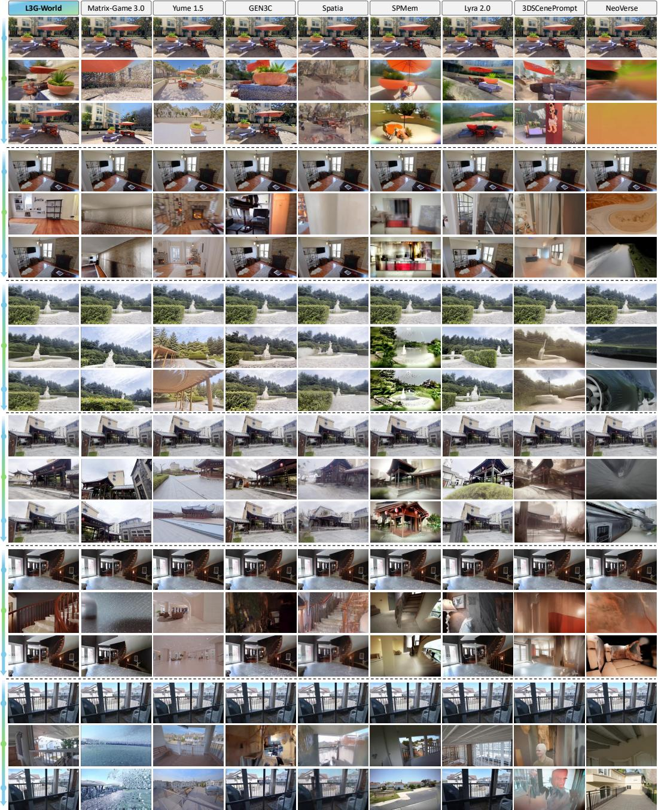  
Figure 8: Additional qualitative results of video generation on DL3DV and RealEstate10K. For each scene, all methods start from the same input view (top), explore unseen regions (middle), and return to the initial camera location (bottom). L3G-World preserves scene structure and appearance upon loop closure, whereas the baselines exhibit drift, blur, or rendering artifacts.

## C QUALITATIVE RESULTS

Fig. 8 extends the comparison in Fig. 6 to additional scenes from DL3DV and RealEstate10K under the same long-horizon loop-closure trajectories. Starting from the same input view, each method explores previously unseen regions and eventually returns to the initial camera location, so that the final frame directly reveals whether the generated world remains consistent after long-horizon exploration. The baselines exhibit distinct failure modes. Temporal-context-based methods, Yume 1.5 and Matrix-Game 3.0, generally follow the camera motion during exploration, but fail to preserve spatial consistency upon return: the final frame often shows a layout or appearance different from the input view, and in some cases even a different viewpoint, indicating that camera control also degrades over the long trajectory. Among explicit 3D memories, SPMem tends to hallucinate inconsistent content once the camera leaves the initially observed region, and NeoVerse progressively collapses into blurry textures over the long trajectory. Among the baselines that return to the starting scene more reliably, GEN3C recovers the input view quite well, but struggles to extrapolate plausible content in regions unseen in the input view, producing distorted or incomplete frames during exploration. Lyra 2.0 returns reasonably close to the input view, but its final frame is still not fully spatially aligned with it, indicating drift from the original scene. In contrast, L3G-World both generates plausible content in unseen regions and returns to a scene spatially aligned with the input view in both structure and appearance, as its latent 3D Gaussian memory anchors previously generated content while continually refining it throughout exploration.

## D COMPARISON WITH ONLINE 3DGS METHODS

Existing online 3D Gaussian Splatting methods Cheng et al. (2026); Chen et al. (2026a) provide strong feed-forward reconstruction and could, in principle, serve as an external 3D memory for world generation. However, these methods are primarily designed for high-fidelity reconstruction and novel-view synthesis (NVS), whereas a memory for real-time world generation must satisfy a different operating regime: it must be continuously updated throughout autoregressive generation, remain compact as exploration proceeds, and render the conditioning signal for every subsequent video chunk with very low latency. In particular, a dense representation that is effective for reconstruction can introduce substantial memory and rendering overhead when repeatedly queried by a video diffusion model. Our goal is therefore not to outperform dedicated online 3DGS methods as a standalone reconstruction system, but to construct a sufficiently faithful 3D memory that can be efficiently updated and directly consumed by L3G-Gen.

To characterize this trade-off quantitatively, we evaluate latent 3D Gaussian memory with online 3D Gaussian reconstruction models Cheng et al. (2026); Chen et al. (2026a) on DL3DV (Ling et al., 2024), and additionally on RealEstate10K (Zhou et al., 2018) for out-of-domain generalization. We process each sequence online in streaming chunks of nine frames. After each chunk processing, we render the current 3D Gaussians to four target viewpoints and evaluate both RGB- and VAEspace NVS. We report PSNR, SSIM, and LPIPS for RGB NVS, and mean squared error (MSE) and cosine similarity between the rendered and ground-truth VAE latents. We additionally measure the number of stored primitives, memory footprint, reconstruction FPS, and VAE rendering throughput to evaluate the efficiency required for repeated memory updates and queries during world generation.

As shown in Tab. 6, latent 3D Gaussian memory is substantially more efficient than dedicated online 3DGS methods (Cheng et al., 2026; Chen et al., 2026a). Compared with ReCoSplat (Cheng et al., 2026) at $4 8 0 \times 4 8 0$ , latent 3D Gaussian memory uses approximately 49–53× fewer primitives and 13–14× less memory across the two datasets, while updating the memory about 2.5–2.6× faster. Moreover, since these methods store only RGB Gaussians, conditioning a latent video generator requires rendering RGB images and re-encoding them with the VAE, whereas latent 3D Gaussian memory directly renders its stored VAE features, achieving 245–430× higher VAE rendering throughput. Despite this compact representation, latent 3D Gaussian memory retains meaningful reconstruction fidelity: at our target resolution of $4 8 0 \times 8 3 2$ , it substantially improves both RGBand VAE-space NVS over ReCoSplat on both datasets, and outperforms $\mathrm { O F ^ { 3 } \bar { G } S }$ (Chen et al., 2026a) while operating at a higher resolution. ReCoSplat at the lower 480 × 480 resolution achieves higher fidelity, which is expected from a method specifically optimized for high-quality NVS. We therefore view these reconstruction metrics not as a standalone reconstruction benchmark, but as an objective measure that latent 3D Gaussian memory preserves sufficiently accurate spatial and latent information while satisfying the much stricter memory and throughput requirements of real-time world generation.

More importantly, the utility of this reconstruction is determined by how the memory conditions subsequent video generation. Fig. 9 visualizes, for each target camera, the ground-truth view, the generated view, and the VAE condition directly rendered from latent 3D Gaussian memory. The rendered latent remains spatially aligned with the target camera and preserves the structure of previously observed regions. By directly conditioning L3G-Gen on these spatially anchored VAE features, the model can generate novel content while remaining consistent with the persistent scene memory. Thus, latent 3D Gaussian memory is not merely an efficient reconstruction module: it provides a compact, continuously updated, and directly renderable latent interface between the accumulated 3D scene and autoregressive video generation.

Table 6: Online NVS evaluation. We evaluate online reconstruction on DL3DV and on RealEstate10K, reporting RGB and VAE latent novel view synthesis quality together with memory size, reconstruction FPS, and VAE rendering FPS. Reconstruction FPS is computed from nineframe update chunks. The best and second-best results within each dataset are shown in bold and underline, respectively.
<table><tr><td>Method</td><td>Resolution (H × W)</td><td>VAE MSE↓</td><td>VAE Cosine Sim. ↑</td><td># Primitives (K) ↓</td><td>Memory (MiB)↓</td><td>Recon. FPS ↑</td><td>VAE Render FPS ↑</td><td>PSNR ↑</td><td>SSIM ↑</td><td>LPIPS↓</td></tr><tr><td colspan="10">DL3DV</td></tr><tr><td>ReCoSplat</td><td>480×480</td><td>0.118</td><td>0.858</td><td>2,085</td><td>198.88</td><td>11.12</td><td>3.0</td><td>21.53</td><td>0.707</td><td>0.318</td></tr><tr><td>ReCoSplat</td><td>480×832</td><td>0.664</td><td>0.344</td><td>11,550</td><td>1101.48</td><td>2.15</td><td>2.7</td><td>12.41</td><td>0.438</td><td>0.711</td></tr><tr><td>OF3GS</td><td>405×832</td><td>0.452</td><td>0.522</td><td>8,987</td><td>479.98</td><td>4.01</td><td>3.0</td><td>14.03</td><td>0.418</td><td>0.606</td></tr><tr><td>L3G-Mem</td><td>480×832</td><td>0.142</td><td>0.823</td><td>39</td><td>14.11</td><td>28.66</td><td>735.3</td><td>17.52</td><td>0.526</td><td>0.537</td></tr><tr><td colspan="10">RealEstate10K (Out-of-domain)</td></tr><tr><td>ReCoSplat</td><td>480×480</td><td>0.073</td><td>0.934</td><td>1,237</td><td>117.93</td><td>11.69</td><td>3.1</td><td>24.88</td><td>0.869</td><td>0.208</td></tr><tr><td>ReCoSplat</td><td>480×832</td><td>0.576</td><td>0.568</td><td>5,818</td><td>554.85</td><td>2.22</td><td>2.9</td><td>13.56</td><td>0.622</td><td>0.640</td></tr><tr><td>OF3GS</td><td>405×832</td><td>0.487</td><td>0.634</td><td>6,649</td><td>355.07</td><td>4.80</td><td>3.0</td><td>14.15</td><td>0.590</td><td>0.566</td></tr><tr><td>L3G-Mem</td><td>480×832</td><td>0.125</td><td>0.866</td><td>25</td><td>8.94</td><td>29.03</td><td>1333.3</td><td>19.68</td><td>0.706</td><td>0.428</td></tr></table>

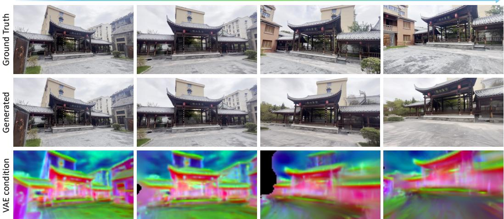  
Figure 9: Visualization of latent 3D Gaussian memory conditioning for video generation. We visualize the ground-truth and generated video, with target-view rendered VAE condition from the latent 3D Gaussian memory, illustrating that spatially aligned latent memory provides consistent conditioning for video generation.

## E LIMITATIONS AND FUTURE WORK

Despite its efficiency, L3G-World has several limitations that suggest directions for future work. First, latent 3D Gaussian memory is primarily designed for static scenes and does not explicitly model independently moving objects. Extending the persistent memory to disentangle dynamic content from static geometry would enable more general interactive environments. Second, although the memory grows with explored spatial extent rather than generation length, its size can still increase under extremely large-scale exploration; adaptive pruning or hierarchical memory representations could further improve scalability. Finally, while the refinement mechanism can progressively correct inaccurate Gaussians, errors introduced during long-horizon autoregressive generation may still propagate to subsequent memory updates.