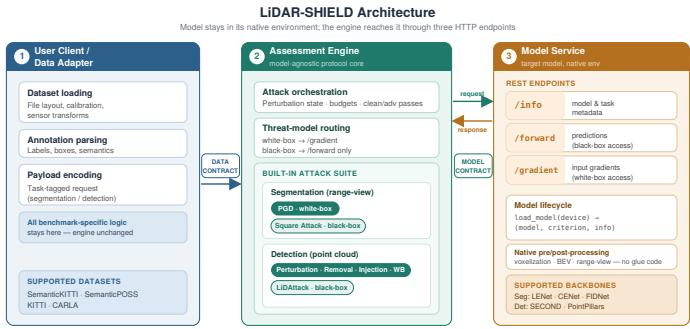

# LiDAR-SHIELD: A Fully Dockerized Adversarial Robustness Assessment Framework for LiDAR-Based 3D Perception Models

Alexandros Gkillas2, Ioulia Kapsali1, Christos Anagnostopoulos1, and Aris S. Lalos1

1Industrial Systems Institute, Athena Research Center, Patras Science Park, Greece

2AviSense.AI, Patras Science Park, Greece

Emails: {anagnostopoulos, gkillas}@avisense.ai, {ikapsali,lalos}@athenarc}.gr

Abstract—LiDAR-based 3D perception underpins autonomous driving and robotics, yet deploying these models safely requires stress-testing them against adversarial inputs before realworld use. Although state-of-the-art adversarial attacks exist, their implementations are often fragmented across individual repositories, each tied to a specific architecture or task and requiring manual environment reconstruction and model-specific integration code. We present LIDAR-SHIELD, a unified and fully Dockerized framework that reverses this workflow: rather than installing the target model inside the toolkit, LIDAR-SHIELD exposes any model through three lightweight HTTP endpoints, namely /info, /forward, and /gradient. As a result, connecting a new model or dataset requires only a single loader function or adapter. The framework supports both 3D semantic segmentation and 3D object detection through the same engine-service protocol, integrating a task-aware suite of state-of-the-art attacks, including PGD and Square Attack for segmentation, and point perturbation, point removal, point injection, and LiDAttack for detection. This enables systematic exposure of corner cases and vulnerabilities across heterogeneous LiDAR backbones. The LiDAR-Shield codebase is publicly available at https://github.com/alexandrosgk/LiDAR-shield. .

Index Terms—LiDAR perception, adversarial robustness, 3D semantic segmentation, 3D object detection, adversarial attacks, autonomous driving.

## I. INTRODUCTION

LiDAR is a primary sensing modality in autonomous driving and robotics, providing accurate metric geometry, longrange structure, and stable performance across illumination conditions that often challenge camera-only systems [1], [2]. Two perception tasks dominate this setting. 3D object detection localizes and classifies dynamic agents such as pedestrians, cyclists, and vehicles, providing the instance-level signals needed for prediction and collision avoidance [6]. 3D semantic segmentation assigns dense semantic labels to the sensed scene, enabling drivable-area reasoning, obstacle delineation, and map-aware scene understanding [7]–[9], [34]. However, the same differentiable pipelines that enable strong predictive performance also expose a broad adversarial surface, and before deployment these models must be stress-tested against adversarial inputs to identify corner cases and vulnerabilities that clean benchmarks do not expose.

Adversarial perturbations in LiDAR can suppress detections, distort box localization, or erase safety-critical semantics under imperceptible or physically plausible modifications to the input. LiDAR attacks span white-box methods that optimize perturbations using model gradients [13], black-box methods that rely only on model outputs [14], [15], and physical attacks that alter the sensed scene; perturbations may act in projected range-image space [18], [20], [33], directly on raw point clouds [21], [22], or at the sensor level. Because detection and segmentation share the same upstream LiDAR measurement, input-space perturbations can compromise both tasks simultaneously.

Yet robustness evaluation infrastructure has not kept pace with the attack literature. General adversarial toolkits such as ART [25], Foolbox [26], CleverHans [27], and secml [35] follow a library-centric integration model: evaluating a model requires installing it within the toolkit’s codebase, adapting its interface to the library’s abstractions, and resolving the resulting dependency conflicts. Beyond this integration barrier, none provides native support for LiDAR point cloud inputs or 3D perception outputs. At the LiDAR perception level, existing work either addresses a single task [31], targets natural corruptions rather than adversarial attacks [30], or releases attack code entangled with a specific architecture and software stack, requiring manual environment reconstruction and modelspecific glue code to reuse. As a result, a researcher wishing to stress-test a LiDAR backbone across both perception tasks still lacks a single systematic and reproducible tool.

We address this gap with LIDAR-SHIELD, a unified adversarial robustness assessment framework for LiDAR perception. Unlike library-centric toolkits, LIDAR-SHIELD adopts a service-oriented design: the model remains in its native environment and communicates with the assessment engine by simply sending data and receiving outputs or gradients through three lightweight HTTP endpoints. Connecting a new model or dataset requires only a single loader function or adapter, without any model code entering the framework or dependency conflicts arising. The architecture pushes two practical sources of heterogeneity to thin boundary components: a data adapter handles dataset variability (file layout, calibration, annotation structure), while a model service handles model variability (dependencies, preprocessing, loss definitions). The resulting system is fully Dockerized and supports both 3D semantic segmentation and 3D object detection within the same architectural abstraction. Our contributions are:

(1) We introduce a model-agnostic assessment architecture that decouples adversarial evaluation from the target model through a minimal REST interface, eliminating manual environment reconstruction and model-specific glue code.

(2) We present a unified workflow for both 3D semantic segmentation and 3D object detection, enabling direct robustness evaluation across the two dominant LiDAR perception tasks within a single framework.

(3) We implement a task-aware suite of state-of-the-art attacks capable of exposing corner cases and vulnerabilities across heterogeneous LiDAR backbones: PGD and Square Attack for segmentation, and point perturbation, point removal, point injection, and LiDAttack for detection.

(4) We provide a fully Dockerized deployment model that isolates data handling, model execution, and attack orchestration, reducing the engineering overhead of adversarial robustness testing to a plug-and-play systems component.

## II. RELATED WORK

Adversarial attacks on LiDAR perception. Prior work has established that LiDAR perception models are vulnerable under multiple threat models. White-box digital perturbations can suppress detections or induce localization errors in 3D detectors [19], and adversarial examples transfer across LiDAR architectures [18]. Recent work has further examined the vulnerability of LiDAR segmentation pipelines to digital perturbations [20], [33]. At the point-cloud level, point deletions suffice to fool 3D models [21], and transferable perturbations on raw 3D clouds have also been demonstrated [22]. More recently, Zhang et al. [31] provided a comprehensive study of adversarial attacks on LiDAR-based 3D detectors, and Chen et al. [29] proposed LiDAttack, a robust black-box attack targeting LiDAR-based object detection. However, these attack implementations do not provide a reusable evaluation infrastructure that spans both detection and segmentation.

LiDAR perception models. LiDAR perception has diversified into heterogeneous model families for both segmentation and detection. For segmentation, RangeNet++ [8], CENet [9], FIDNet [10], and LENet [11] represent distinct design points in efficient dense scene understanding. For detection, Point-Pillars [3], VoxelNet [5], SECOND [4], and CenterPoint [6] illustrate the diversity of pillar-based, voxel-based, and center based 3D detection pipelines. This heterogeneity motivates a service abstraction that can accommodate arbitrary backbones without modifying the assessment core.

Robustness toolkits and benchmarks. General adversarial toolkits such as ART [25], Foolbox [26], and CleverHans [27] and secml [35] require the target model to be embedded within their own codebase, coupling the evaluation pipeline to a specific framework and dependency stack. In the 3D domain, Ji et al. [32] benchmark adversarial robustness for point cloud recognition, but target object classification rather than the detection and segmentation tasks that underpin autonomous driving. At the LiDAR perception level, Zhang et al. [31] benchmark adversarial robustness across multiple 3D detectors, but their study is confined to detection and does not extend to segmentation. Robo3D [30] covers both 3D detectors and segmentors under a unified evaluation protocol, but focuses on natural corruptions rather than adversarial attacks. Beyond task and domain coverage, LiDAR attack implementations released alongside individual papers are each tied to a specific codebase, dependency stack, and model interface, making reuse costly: it requires reconstructing the original environment and writing model-specific glue code for every new target. Taken together, no existing tool provides unified, Dockerized adversarial evaluation spanning both LiDAR segmentation and detection, the gap that LIDAR-SHIELD is designed to fill.

## III. METHOD

The central design question behind LIDAR-SHIELD is how to evaluate adversarial robustness without inheriting the full software stack of each target model. The answer is to isolate the two dominant sources of variability, dataset variability and model variability, at the boundary of the system rather than absorbing them into the attack pipeline. LIDAR-SHIELD factors the robustness evaluation problem into three Dockerized components: a User Client / Data Adapter that owns dataset interaction, an Assessment Engine that owns the adversarial protocol, and a Model Service that owns network execution. This decomposition isolates dataset-specific assumptions from model-specific assumptions and leaves the engine with a single role: executing a task-aware but model-agnostic attack pipeline. The framework is defined by two contracts: a data contract that maps dataset samples into engine-consumable payloads, and a model contract that maps arbitrary LiDAR backbones into a common service interface, allowing new datasets and models to plug into the same engine without modifying the assessment core. Fig. 1 illustrates the resulting architecture.

## A. Architectural Overview

At a high level, LIDAR-SHIELD is organized as a left-toright execution pipeline. The User Client / Data Adapter converts dataset-native LiDAR samples into task-tagged requests. The Assessment Engine receives these requests, instantiates the selected attack, and manages the interaction loop with the target model. The Model Service wraps the network and exposes only the operations required by the engine. The assessment engine is therefore the protocol layer between two normalized boundaries: on the left, dataset-specific samples are mapped into a uniform payload format; on the right, backbone-specific execution is mapped into a fixed service API. LIDAR-SHIELD does not attempt to standardize how datasets are stored or how models are implemented; it standardizes only how data enters the engine and how the engine queries the model.

## B. Components

User Client / Data Adapter. The client/data-adapter is the ingestion boundary of the framework, responsible for loading

  
Fig. 1. LIDAR-SHIELD architecture. The target model stays in its native environment and is reached through three HTTP endpoints (/info, /forward /gradient). A data contract normalizes dataset samples on the left and a model contract normalizes backbone access on the right, leaving the engine to run a task-aware, model-agnostic attack pipeline. White-box attacks use /gradient; black-box attacks use /forward only.

LiDAR samples and their task annotations, arranging them into the model’s expected input structure, and packaging them into a transport-safe request. All benchmark-specific logic remains here, including file layout, sequence handling, calibration usage, and annotation parsing, so that connecting a new dataset does not require changing the engine. The connection mechanism is intentionally thin: to support a new dataset, one implements only this adapter layer so that dataset-native samples are emitted in the engine’s data contract. Assessment Engine. The assessment engine is the methodological core of LIDAR-SHIELD, implementing the adversarial protocol itself: selecting the attack, maintaining perturbation state, coordinating clean and adversarial passes, and executing the task-aware control logic associated with the chosen threat model. This ensures that attack behavior is implemented once and reused across heterogeneous LiDAR models, regardless of their underlying codebase. Model Service. The model service is the execution boundary around the target perception network, encapsulating model construction, checkpoint loading, task-loss definition, and model-specific preprocessing or postprocessing, so that the assessment engine never imports repository-local code. To connect a new backbone, the user implements a lightweight loader entry point, load\_model(device), returning (model, criterion, info, device), where criterion is the task loss and info is a metadata dictionary containing model identity, number of classes, input shape, and other task-level properties needed by the engine.

## C. Interface Contract

The architecture is governed by two narrow contracts. The data contract defines what the engine expects from the client/data-adapter: a task-tagged sample payload containing the encoded model input together with the supervision and metadata needed by the selected attack path. This contract is agnostic to the data source: once the payload is formed, the engine consumes it directly without parsing raw dataset artifacts. The model contract defines what the engine expects via three endpoints: /info returns model and task metadata; /forward returns task-native predictions; and /gradient returns the input gradient required by white-box attacks. This minimal contract suffices for both segmentation and detection: once a backbone answers these three calls, the engine can attack it without importing its native codebase.

## D. Engine Workflow

Once a payload reaches the assessment engine, the remainder of the procedure is uniform. The engine first queries /info once per model session to retrieve the metadata needed to instantiate the appropriate task-aware processing path. Given a sample $\displaystyle ( \mathbf { x } , \mathbf { y } )$ , it next obtains a clean reference prediction through the model service, instantiates the requested attack under the chosen threat model, and drives the interaction loop until an adversarial input $\mathbf { x } _ { \mathrm { a d v } }$ has been produced. The attacked sample is then executed through the same service boundary and the resulting task-native outputs are collected for downstream evaluation. Because the workflow is defined entirely over the two contracts, the same procedure applies regardless of which dataset adapter or backbone is in use. The distinction between black-box and white-box settings is handled entirely inside this workflow: in black-box mode the engine relies only on /forward outputs, while in white-box mode it additionally invokes /gradient. Crucially, the orchestration layer is unchanged in both cases, only the attack operator and the type of model access it requests differ, which is what allows LIDAR-SHIELD to support multiple threat models without duplicating the surrounding systems logic.

## E. Supported Perception Tasks

LIDAR-SHIELD supports both perception tasks through the same service protocol and attack orchestration logic. For segmentation, the service accepts the model’s native LiDAR input and returns dense predictions; for detection, it accepts the detector’s native input and returns structured object hypotheses. The attack layer is task-aware, but the engine-service interface is shared, this is what allows LIDAR-SHIELD to remain unified at the systems level while matching the geometry and failure modes of both tasks.

## IV. ADVERSARIAL ATTACKS

LIDAR-SHIELD instantiates attacks at the task level rather than enforcing a single perturbation primitive across all LiDAR

models. Throughout this section, a LiDAR scan is represented as a point cloud $P = \{ \mathbf { p } _ { i } \in \mathbb { R } ^ { 3 } \} _ { i = 1 } ^ { N }$

## A. Segmentation Attack Suite

For LiDAR semantic segmentation, LIDAR-SHIELD applies adversarial perturbations directly to the projected rangeview representation consumed by the segmentation backbone. Let $\mathbf { Y } \in \mathbb { R } ^ { H \times W }$ denote the clean range-view input tensor, where H is the number of vertical LiDAR beams and W is the horizontal angular resolution. Let Z denote the corresponding ground-truth semantic label map. The adversarial range-view input is obtained by adding a perturbation $\pmb { \Delta }$ to the clean input:

$$
\mathbf { Y } _ { \mathrm { a d v } } = \mathbf { Y } + \pmb { \Delta } , \qquad \| \pmb { \Delta } \| _ { p } \leq \epsilon ,\tag{1}
$$

where ϵ controls the perturbation budget. The attack objective is to degrade segmentation performance by maximizing the segmentation loss under the perturbation constraint:

$$
\operatorname* { m a x } _ { \| \Delta \| _ { p } \leq \epsilon } \mathcal { L } _ { \mathrm { s e g } } \left( f _ { \theta } ^ { \mathrm { s e g } } ( \mathbf { Y } + \Delta ) , \mathbf { Z } \right) ,\tag{2}
$$

where $f _ { \boldsymbol { \theta } } ^ { \mathrm { s e g } }$ is the target segmentation model and $\mathcal { L } _ { \mathrm { s e g } }$ denotes the segmentation loss.

a) White-box attack (PGD): We instantiate the above objective using Projected Gradient Descent (PGD) [13] via the /gradient endpoint. Starting from $\mathbf { Y } ^ { 0 } = \mathbf { Y }$ , each iteration is given by

$$
\mathbf { Y } ^ { t + 1 } = \Pi _ { \mathcal { B } _ { p } ( \mathbf { Y } , \epsilon ) } \left( \mathbf { Y } ^ { t } + \alpha \mathcal { N } _ { p } \left( \nabla _ { \mathbf { Y } ^ { t } } \mathcal { L } _ { \mathrm { s e g } } \left( f _ { \theta } ^ { \mathrm { s e g } } ( \mathbf { Y } ^ { t } ) , \mathbf { Z } \right) \right) \right)\tag{3}
$$

where α is the step size, $\Pi _ { B _ { p } ( \mathbf { Y } , \epsilon ) } ( \cdot )$ projects onto the $\ell _ { p }$ ball of radius ϵ and $\textstyle { \mathcal { N } } _ { p } ( \cdot )$ is the norm-specific gradient normalization for $p \in \{ 2 , \infty \}$

b) Black-box attack: To assess robustness when gradient access is unavailable, LIDAR-SHIELD additionally applies Square Attack [17] as a black-box baseline. Square Attack operates through /forward only, perturbing random squareshaped regions of the input tensor via query-efficient random search under an $\ell _ { \infty }$ constraint, without any gradient access.

## B. Detection Attack Suite

For 3D object detection, LIDAR-SHIELD adopts perturbation operators that are better aligned with sparse geometric evidence. The ground-truth object annotations are denoted by G. The objective is to construct an adversarial point cloud $P _ { \mathrm { a d v } }$ that increases the detection loss while preserving the geometric plausibility of the original scene

a) White-box attacks: Point perturbation displaces existing points by small coordinate offsets $\delta = \{ \delta _ { i } \} _ { i = 1 } ^ { N } \colon$

$$
P _ { \mathrm { a d v } } = \{ { \bf p } _ { i } + \delta _ { i } \} _ { i = 1 } ^ { N } ,\tag{4}
$$

under the constrained objective:

$$
\operatorname* { m a x } _ { \{ \delta _ { i } \} _ { i = 1 } ^ { N } } \mathcal { L } _ { \operatorname* { d e t } } \big ( f _ { \theta } ^ { \operatorname* { d e t } } ( P _ { \mathrm { a d v } } ) , G \big ) \ \mathrm { s . t . } \ \| \delta _ { i } \| _ { 2 } \leq \epsilon , \ \forall i ,\tag{5}
$$

where $f _ { \theta } ^ { \mathrm { d e t } }$ is the target detector, $\mathcal { L } _ { \mathrm { d e t } }$ denotes the detection loss, and ϵ controls the maximum allowable displacement per point. This objective is optimized iteratively via PGD [13], with gradients obtained through the /gradient endpoint. Point removal deletes informative returns $( P _ { \mathrm { a d v } } \subset P )$ in order of decreasing saliency, where each point is scored by the $\ell _ { 2 }$ norm of its detection loss gradient $\| \partial \mathcal { L } _ { \mathrm { d e t } } ( P , G ) / \partial \mathbf { p } _ { i } \| _ { 2 } .$ excluding already-removed points from subsequent gradient computations. Point injection inserts adversarial point set $Z = \{ \mathbf { z } _ { k } \in \mathbb { R } ^ { 3 } \} _ { k = 1 } ^ { K }$

TABLE I  
TASK-SPECIFIC ATTACK SUPPORT IN LIDAR-SHIELD.
<table><tr><td>Task</td><td>Attack</td><td>Access</td><td>Perturbation Space</td></tr><tr><td>3D segmentation</td><td>PGD</td><td>White-box</td><td>Range-view tensor</td></tr><tr><td>3D segmentation</td><td>Square Attack</td><td>Black-box</td><td>Range-view tensor</td></tr><tr><td>3D detection</td><td>Point perturbation, removal, injection</td><td>White-box</td><td>Point cloud</td></tr><tr><td>3D detection</td><td>LiDAttack</td><td>Black-box</td><td>Point cloud</td></tr></table>

$$
P _ { \mathrm { a d v } } = P \cup Z ,\tag{6}
$$

initialized at highest-saliency locations and optimized under a Chamfer distance constraint; only $Z$ is updated during optimization. These operators follow established point-manipulation literature [19], [21], [22].

b) Black-box attack: To assess robustness when gradient access is unavailable, LIDAR-SHIELD incorporates LiDAttack [29] as the black-box baseline for 3D object detection. LiDAttack operates through /forward only, using a genetic algorithm with simulated annealing to find adversarial pointcloud modifications without gradient access.

## C. Attack Comparison

Table I summarises the attack portfolio supported by LIDAR-SHIELD. Each task is covered by both a white-box and a black-box operator: white-box attacks establish an upper bound on adversarial risk under full model access, while black-box attacks probe robustness under the more realistic assumption that gradients are unavailable. Attack operators are chosen to match the input space of each task, range-view tensors for segmentation and raw point clouds for detection, allowing LIDAR-SHIELD to support both tasks through the same engine-service interface without sacrificing attack fidelity.

## V. EXPERIMENTAL EVALUATION

## A. Experimental Setup

1) 3D Object Detection: Datasets. We evaluate LIDAR-SHIELD on KITTI and a CARLA-based simulated dataset. KITTI provides real LiDAR point clouds from a 64-channel sensor with 3D object annotations from urban driving scenes; all results are reported at the moderate difficulty level. The CARLA dataset was collected in Town06 over 3,000 frames at 10 Hz using a 64-channel LiDAR sensor with multiple vehicles in the scene, providing raw point clouds, ground-truth poses, timestamps, and transformation matrices. Evaluated Detectors. We evaluate SECOND [4], a sparse convolutional voxel-based detector, and PointPillars [3], a pillar-based detector that encodes the point cloud into a pseudo-image representation.

2) 3D Semantic Segmentation: Datasets. We evaluate on SemanticKITTI [7], a large-scale urban driving dataset collected with a Velodyne HDL-64E sensor (range-view size 64×1024, sequences 00–04 train, 05 validation, 06–08 test), and Semantic-POSS [12], a campus-scale dataset acquired with a PANDORA 40-beam sensor (range-view size $4 0 \times 1 8 0 0$ , sequences 0,1,4,5 train, 3 validation, 2 test). Evaluated Segmentation Models. We evaluate three pretrained range-view models: LENet [11], a lightweight encoder–decoder with multi-scale convolutional attention; CENet [9], a projection-based model with largekernel convolutions and auxiliary heads; and FIDNet [10], a range-image model with a fully interpolation decoding module.

## B. Attack Configurations

1) 3D Object Detection: White-box attacks. For point perturbation, we apply an untargeted ℓ2-bounded PGD attack with $\epsilon \in \{ 5 , 7 , 1 0 \}$ cm, 40 iterations, step size $\alpha = \epsilon / 3 0$ and random initialization. For point removal, we use saliency driven greedy removal over 10 iterations at removal ratios $\{ 0 . 5 , 1 . 0 , 1 . 5 \} \%$ . For point injection, we inject 300 points initialized in salient regions and refined under $\ell _ { 2 }$ constraints, with displacement budget $\epsilon \in \{ 0 . 3 , 0 . 5 , 0 . 7 \}$ m. Black-box attack. We employ a LiDAttack-based [29] point injection attack using only forward passes: a genetic algorithm optimizes $K = 2 0$ adversarial points within a 0.5 m margin of the target bounding box, using at most 1000 forward queries per target, evaluated on SECOND on KITTI.

2) 3D Semantic Segmentation: White-box attacks. We apply PGD under both $\ell _ { 2 }$ and $\ell _ { \infty }$ constraints with $\epsilon \in \{ 3 , 6 , 9 \}$ and $\epsilon \in \{ 0 . 1 , 0 . 3 , 0 . 5 \}$ respectively, T = 40 iterations, and the step size $\alpha = \epsilon / T$ . Black-box attack. We employ Square Attack [17] under an $\ell _ { \infty }$ constraint with ϵ = 0.3, 1000 queries, one random restart, and an initial perturbation probability $p _ { \mathrm { i n i t } } = 0 . 4$ , evaluated on LENet on SemanticKITTI.

## C. Evaluation Metrics

Detection Metrics Attack effectiveness is measured using the absolute mAP and the mAP ratio $\mathrm { \left( m A P _ { a d v } / m A P _ { c l e a n } \right) \times 1 0 0 }$ where lower values indicate stronger degradation. Geometric perceptibility is measured by the symmetric Chamfer Distance (CD) between $P$ and $P _ { \mathrm { a d v } }$ , with lower CD indicating better geometric plausibility. Segmentation Metrics We report mean IoU (mIoU) averaged over all classes.

## D. Results and Discussion

1) 3D Object Detection Results: Table II reports mAP ratio and Chamfer Distance. Both detectors degrade under adversarial manipulation on KITTI and CARLA. Point perturbation produces the strongest degradation. The mAP ratio decreases consistently with the displacement budget on both datasets, and the effect is particularly pronounced for PointPillars, which drops to 10.59% on KITTI and 3.46% on CARLA at $\epsilon = 1 0 \mathrm { c m }$ . SECOND retains higher relative performance, suggesting that voxel-based sparse convolutional detectors are less sensitive to coordinate-level perturbations than pillar-based encodings. Point removal leads to more gradual degradation.

SECOND retains 67.98% on KITTI and 85.32% on CARLA, while PointPillars retains 57.40% and 80.02% at the highest removal ratio; the increasing Chamfer Distance reflects the larger structural change caused by removing more points. Point injection produces moderate degradation with lower Chamfer Distance values, as only a limited number of synthetic points are added to the original cloud. On KITTI, increasing the attachment radius does not always strengthen the attack: SECOND mAP ratio drops to 65.28% at $\epsilon = 0 . 5$ m but recovers to 71.12% at $\epsilon = 0 . 7 \mathrm { m } .$ , with similar behavior for PointPillars, suggesting that large budgets displace injected points from the most influential regions. The black-box LiDAttack reduces SECOND mAP from 70.43 to 52.51 on KITTI (Table IV), corresponding to a relative drop of approximately 25%.

2) 3D Semantic Segmentation Results: Table III reports LENet robustness under $\ell _ { 2 }$ and $\ell _ { \infty }$ attacks on SemanticKITTI and SemanticPOSS. Across both datasets, adversarial perturbations consistently reduce mIoU, with stronger degradation as the perturbation budget increases. On SemanticKITTI, mIoU drops from 64.7 to 41.7 under the strongest $\ell _ { 2 }$ attack and to 34.7 under the strongest $\ell _ { \infty }$ attack. Similar behavior is observed on SemanticPOSS, where mIoU decreases from 52.7 to 34.4 under $\ell _ { 2 }$ and to 28.8 under $\ell _ { \infty }$ . The black-box Square Attack further reduces SemanticKITTI mIoU from 64.7 to 19.5 (Table IV), confirming vulnerability even without gradient access. The backbone comparison in Table V further indicates that LENet, CENet, and FIDNet all degrade under attack.

## VI. CONCLUSION

We presented LIDAR-SHIELD, a unified and fully Dockerized framework for adversarial stress-testing of LiDARbased 3D perception models. Unlike library-centric toolkits, LIDAR-SHIELD decouples the assessment engine from the target model through a minimal REST interface, requiring no manual environment reconstruction or model-specific glue code. The framework supports both 3D semantic segmentation and 3D object detection through the same workflow, exposing a task-aware suite of state-of-the-art attacks: PGD and Square Attack for segmentation, and point perturbation, removal, injection, and LiDAttack for detection. Experimental results on SemanticKITTI, SemanticPOSS, KITTI, and CARLA confirm that the integrated attacks expose significant vulnerabilities across heterogeneous LiDAR backbones.

## REFERENCES

[1] A. Geiger, P. Lenz, and R. Urtasun, “Are we ready for autonomous driving? The KITTI vision benchmark suite,” in Proc. IEEE/CVF CVPR, 2012, pp. 3354–3361.

[2] Waymo Research, “Waymo open dataset: Scalability in perception for autonomous driving,” 2021. [Online]. Available: https://waymo.com/open/

[3] A. H. Lang, S. Vora, H. Caesar, L. Zhou, J. Yang, and O. Beijbom, “PointPillars: Fast encoders for object detection from point clouds,” in Proc. IEEE/CVF CVPR, 2019, pp. 12697–12705.

[4] Y. Yan, Y. Mao, and B. Li, “SECOND: Sparsely embedded convolutional detection,” Sensors, vol. 18, no. 10, p. 3337, 2018.

[5] Y. Zhou and O. Tuzel, “VoxelNet: End-to-end learning for point cloud based 3D object detection,” in Proc. IEEE/CVF CVPR, 2018, pp. 4490– 4499.

[6] T. Yin, X. Zhou, and P. Krahenbuhl, “Center-based 3D object detection and tracking,” in Proc. IEEE/CVF CVPR, 2021, pp. 11784–11793.

TABLE II  
ADVERSARIAL IMPACT ON 3D DETECTION ACROSS KITTI AND CARLA: MAP RATIO (%) AND CHAMFER DISTANCE (CD).
<table><tr><td rowspan="2"></td><td rowspan="2"></td><td colspan="6">Point Perturbation: e (cm)</td><td colspan="6">Point Removal: Drop Ratio (%)</td><td colspan="6">Point Injection: ε (m)</td></tr><tr><td colspan="3">5</td><td colspan="3"></td><td colspan="3">0.5</td><td colspan="3"></td><td colspan="3">0.3</td><td colspan="3"></td></tr><tr><td>Dataset</td><td>Detector</td><td>mAP Ratio</td><td>CD</td><td>mAP Ratio</td><td>CD</td><td>mAP Ratio</td><td>CD</td><td>mAP Ratio</td><td>CD</td><td>mAP Ratio</td><td>CD</td><td>mAP Ratio</td><td>CD</td><td>mAP Ratio</td><td>CD</td><td>mAP Ratio</td><td>CD</td><td>mAP Ratio</td><td>CD</td></tr><tr><td rowspan="2">KITTI</td><td>SECOND PointPillars</td><td>90.91</td><td>0.00403</td><td>83.10</td><td>0.00703</td><td>65.48</td><td>0.01247</td><td>83.15</td><td>0.00255</td><td>74.18</td><td>0.00649</td><td>67.98</td><td>0.01533</td><td>71.73</td><td>0.00083</td><td>65.28</td><td>0.00195</td><td>71.12</td><td>0.00703</td></tr><tr><td></td><td>33.02</td><td>0.00399</td><td>19.56</td><td>0.00703</td><td>10.59</td><td>0.01252</td><td>80.25</td><td>0.01247</td><td>62.07</td><td>0.03597</td><td>57.40</td><td>0.06159</td><td>87.85</td><td>0.00014</td><td>75.83</td><td>0.00032</td><td>76.76</td><td>0.00057</td></tr><tr><td rowspan="2">CARLA</td><td>SECOND PointPillars</td><td>89.06 22.82</td><td>0.00466 0.00452</td><td>82.80 13.87</td><td>0.00842 0.00823</td><td>73.21 3.46</td><td>0.01533 0.01500</td><td>95.28 89.97</td><td>0.02177</td><td>91.77 85.23</td><td>0.07035</td><td>85.32</td><td>0.19999</td><td>87.72</td><td>0.00054</td><td>78.46</td><td>0.00126</td><td>77.24</td><td>0.00226</td></tr><tr><td></td><td></td><td></td><td></td><td></td><td></td><td></td><td></td><td>0.01924</td><td></td><td>0.05876</td><td>80.02</td><td>0.11100</td><td>95.93</td><td>0.00011</td><td>93.90</td><td>0.00021</td><td>89.72</td><td>0.00037</td></tr></table>

TABLE III  
SEGMENTATION ROBUSTNESS ON SEMANTICKITTI AND SEMANTICPOSS.
<table><tr><td>Dataset</td><td>Method</td><td colspan="3">mIoU</td></tr><tr><td></td><td> $\ell _ { 2 }$  attack</td><td></td><td></td><td></td></tr><tr><td></td><td></td><td>€=3</td><td>€=6</td><td>e=9</td></tr><tr><td>SemanticKITTI</td><td>No Attack</td><td>64.7</td><td>64.7</td><td>64.7</td></tr><tr><td></td><td>Attack</td><td>50.1</td><td>46.9</td><td>41.7</td></tr><tr><td>SemanticPOSS</td><td>No Attack</td><td>52.7</td><td>52.7</td><td>52.7</td></tr><tr><td></td><td>Attack</td><td>39.8</td><td>36.5</td><td>34.4</td></tr><tr><td colspan="5"> $\ell _ { \infty }$  attack</td></tr><tr><td></td><td></td><td>€=0.1</td><td>€=0.3</td><td>€=0.5</td></tr><tr><td>SemanticKITTI</td><td>No Attack Attack</td><td>64.7</td><td>64.7</td><td>64.7</td></tr><tr><td></td><td></td><td>43.9</td><td>38.3</td><td>34.7</td></tr><tr><td>SemanticPOSS</td><td>No Attack Attack</td><td>52.7 35.5</td><td>52.7 29.1</td><td>52.7 28.8</td></tr></table>

TABLE IV  
BLACK-BOX ROBUSTNESS.
<table><tr><td></td><td colspan="2">Segmentation (SemanticKITTI)</td><td colspan="2">Detection (KITTI)</td></tr><tr><td></td><td>No Attack</td><td>Square Attack</td><td>No Attack</td><td>LiDAttack</td></tr><tr><td>mIoU / mAP</td><td>64.70</td><td>19.50</td><td>70.43</td><td>52.51</td></tr></table>

[7] J. Behley et al., “SemanticKITTI: A dataset for semantic scene understanding of LiDAR sequences,” in Proc. IEEE/CVF ICCV, 2019, pp. 9297–9307.

[8] A. Milioto, I. Vizzo, J. Behley, and C. Stachniss, “RangeNet++: Fast and accurate LiDAR semantic segmentation,” in Proc. IEEE/RSJ IROS, 2019, pp. 4213–4220.

[9] H. Cheng, L. Han, and G. Shao, “CENet: Toward concise and efficient LiDAR semantic segmentation for autonomous driving,” in Proc. IEEE ICME, 2022, pp. 1–6.

[10] J. Zhao et al., “FIDNet: LiDAR point cloud semantic segmentation with fully interpolation decoding,” in Proc. IEEE/RSJ IROS, 2021, pp. 4453– 4458.

[11] L. Feng et al., “LENet: Efficient LiDAR point cloud semantic segmenta tion based on local edge networks,” IEEE Trans. Geosci. Remote Sens., 2022.

[12] Y. Pan et al., “SemanticPOSS: A point cloud dataset with large quantity of dynamic instances,” in Proc. IEEE IV, 2020, pp. 687–693.

[13] A. Madry, A. Makelov, L. Schmidt, D. Tsipras, and A. Vladu, “Towards deep learning models resistant to adversarial attacks,” in Proc. ICLR, 2018.

TABLE V  
SEGMENTATION BACKBONE ROBUSTNESS, SEMANTICKITTI $( \ell _ { 2 } , \epsilon = 6 )$
<table><tr><td></td><td colspan="2">LENet [11]</td><td colspan="2">CENet [9]</td><td colspan="2">FIDNet [10]</td></tr><tr><td></td><td>Clean</td><td>Attack</td><td>Clean</td><td>Attack</td><td>Clean</td><td>Attack</td></tr><tr><td>SemanticKITTI, ∈ = 6</td><td>64.70</td><td>46.90</td><td>61.70</td><td>44.30</td><td>60.80</td><td>44.10</td></tr></table>

[14] W. Brendel, J. Rauber, and M. Bethge, “Decision-based adversarial attacks: Reliable attacks against black-box machine learning models,” in Proc. ICLR, 2018.

[15] J. Chen et al., “RayS: A ray searching method for hard-label adversarial attack,” in Proc. ACM KDD, 2020, pp. 1739–1747.

[16] A. Gkillas, I. Kapsali, N. Piperigkos, and A. S. Lalos, “Efficient modelbased purification against adversarial attacks for LiDAR segmentation,” Proc. IEEE Int. Conf. Image Process. Workshops (ICIPW), 2025, pp. 487– 492, doi: 10.1109/ICIPW68931.2025.11386247.

[17] M. Andriushchenko, F. Croce, N. Flammarion, and M. Hein, “Square attack: A query-efficient black-box adversarial attack via random search,” in Proc. ECCV, 2020, pp. 484–501. ibitemTu2020CVPR J. Tu et al., “Physically realizable adversarial examples for LiDAR object detection,” in Proc. IEEE/CVF CVPR, 2020, pp. 13716–13725.

[18] Z. Zhu et al., “Can we use arbitrary objects to attack LiDAR perception in autonomous driving?” in Proc. ACM CCS, 2021, pp. 1945–1960.

[19] H. Xie et al., “Adversarial examples for LiDAR based 3D object detection,” in Proc. IROS, 2020.

[20] Y. Liu et al., “Robust LiDAR-based vehicle detection against adversarial attack,” in Proc. CVPR Workshops, 2022.

[21] M. Wicker and M. Kwiatkowska, “Robustness of 3D deep learning in an adversarial setting,” in Proc. IEEE/CVF CVPR, 2019, pp. 11767–11775.

[22] C. Xiang et al., “AdvPC: Transferable adversarial perturbations on 3D point clouds,” in Proc. ECCV, 2020, pp. 1–18.

[23] L. Liu et al., “PointGuard: Provably robust 3D point cloud classification,” in Proc. IEEE/CVF CVPR, 2021, pp. 6186–6195.

[24] M. Berman, A. R. Triki, and M. B. Blaschko, “The Lovasz-Softmax´ loss: A tractable surrogate for the optimization of the intersection-overunion measure in neural networks,” in Proc. IEEE/CVF CVPR, 2018, pp. 4413–4421.

[25] M.-I. Nicolae et al., “Adversarial robustness toolbox v1.0.0,” arXiv preprint arXiv:1807.01069, 2018.

[26] J. Rauber, W. Brendel, and M. Bethge, “Foolbox: A python toolbox to benchmark the robustness of machine learning models,” in Proc. ICML Reliably Scaled ML Workshop, 2017.

[27] N. Papernot et al., “CleverHans v2.1.0: An adversarial machine learning library,” arXiv preprint arXiv:1610.00768, 2018.

[28] F. Croce et al., “RobustBench: A standardized adversarial robustness benchmark,” in Proc. NeurIPS Datasets and Benchmarks, 2021.

[29] J. Chen, D. Liao, Y. Yan, S. Xiang, and H. Zheng, “LiDAttack: Robust black-box attack on LiDAR-based object detection,” IEEE Trans. Intell. Transp. Syst., 2025.

[30] L. Kong, Y. Liu, X. Li, R. Chen, W. Zhang, J. Ren, L. Pan, K. Chen, and Z. Liu, “Robo3D: Towards robust and reliable 3D perception against corruptions,” in Proc. IEEE/CVF ICCV, 2023, pp. 19994–20006.

[31] Y. Zhang, J. Hou, and Y. Yuan, “A comprehensive study of the robustness for LiDAR-based 3D object detectors against adversarial attacks,” Int. J. Comput. Vis., vol. 132, no. 5, pp. 1592–1624, 2024.

[32] Q. Ji, L. Wang, C. Shi, S. Hu, Y. Chen, and L. Sun, “Benchmarking and analyzing robust point cloud recognition: Bag of tricks for defending adversarial examples,” in Proc. IEEE/CVF ICCV, 2023, pp. 4295–4304.

[33] A. Gkillas, I. Kapsali, N. Piperigkos, and A. S. Lalos, “Efficient modelbased purification against adversarial attacks for LiDAR segmentation,” in Proc. IEEE Int. Conf. Image Processing Workshops (ICIPW), 2025, pp. 487–492.

[34] A. Gkillas, N. Pipergikos, A. S. Lalos, and D.-V. Nguyen, “Conditional deep unrolling for LiDAR super-resolution and improved segmentation: An end-to-end solution,” IEEE Trans. Artif. Intell., 2026, pp. 1–15.

[35] M. Pintor, L. Demetrio, A. Sotgiu, M. Melis, A. Demontis, and B. Biggio, “secml: Secure and explainable machine learning in Python,” SoftwareX, vol. 18, p. 101095, 2022.