# LucidLyra: Feed-Forward Generative 3D Scene Reconstruction and Joint Understanding via Multi-Task Distillation

Oliver Hahn1,2 Rodrigo Marcuzzi1 Sangeetha Grama Srinivasan1

Alessandro Burzio1,3 Sherwin Bahmani† Jiahui Huang†

Stefan Roth2,4,5 Shengyu Huang1 Qunjie Zhou1 Laura Leal-Taixé1

1NVIDIA 2TU Darmstadt

3Università degli Studi di Modena e Reggio Emilia

4ELIZA 5hessian.AI †Work performed while at NVIDIA

https://research.nvidia.com/labs/sil/projects/lucidlyra

Single Image-to-3D Scene Generation  
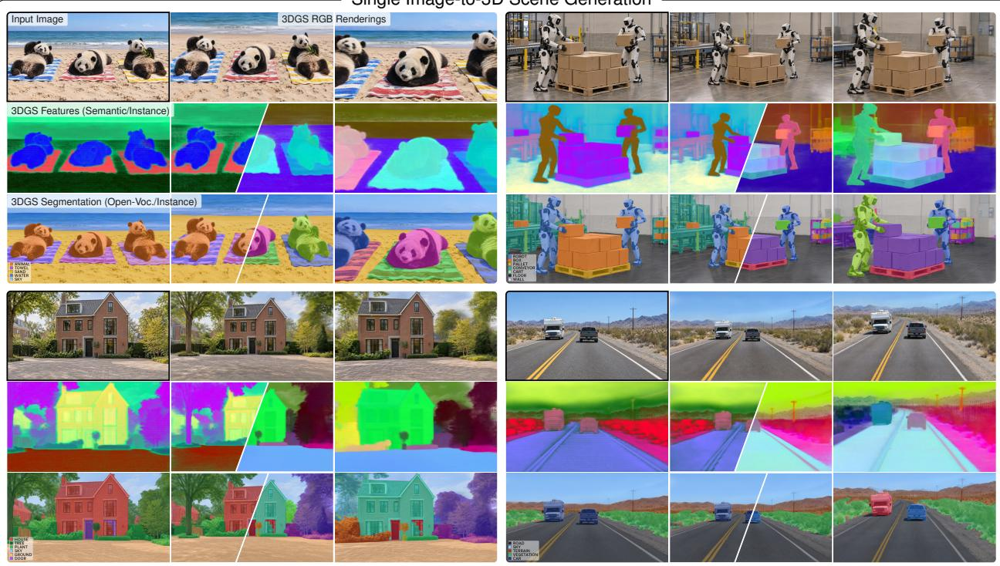

Towards Simulation-Ready Generative 3D Scenes  
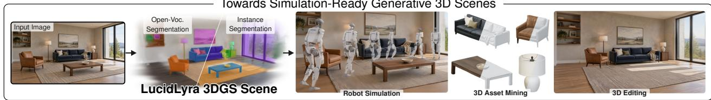  
Figure 1: Feed-forward semantic- and instance-aware image-to-3D scene generation. Top: LucidLyra infers a unified 3D Gaussian Splatting (3DGS) representation consisting of appearance, geometry, semantic, and instance features from a single image. The learned feature fields enable open-vocabulary semantic segmentation and instance segmentation. Bottom: LucidLyra enables downstream applications such as physical-AI simulation, editing, and 3D asset mining.

## Abstract

We present LucidLyra, a framework that makes generatively reconstructed 3D scenes directly queryable for semantics and instances in a feed-forward manner from video latents. While generative 3D reconstruction can synthesize virtual environments from a single image, downstream applications in robotics and physical AI require not only visual realism but also access to scene semantics and object identities. Existing 3D understanding approaches, however, require captured multi-view scenes, have limited generalization capabilities, or rely on expensive per-scene processing and optimization. To bridge this gap, our method distills complementary knowledge from a camera-controlled video difusion model and frozen 2D vision foundation models into a unified model to jointly infer 3D Gaussians encoding geometry, appearance, open-vocabulary semantics, and class-agnostic instance cues. The resulting scenes support novel-view rendering, open-vocabulary segmentation, and object grouping without per-scene optimization, while training requires neither manual 3D annotations nor captured multi-view data. Our method outperforms baselines combining state-of-the-art 3DGS segmentation approaches with generative 3D scene reconstruction on curated synthetic and real-image-conditioned benchmarks, while preserving reconstruction quality. Furthermore, our latent formulation naturally extends to monocular video, reconstructing structured dynamic 3D scenes across time. By turning renderable but unstructured outputs into queryable 3D worlds, LucidLyra enables downstream applications including 3D scene editing, 3D asset mining, and robotic simulation.

## 1. Introduction

Recent generative reconstruction methods can turn a single image into a renderable 3D environment. Building upon learned generative models, they can imagine content beyond the observed field of view and consolidate it into a scene that can be viewed from new perspectives [2, 14, 52, 72, 76, 85]. Generated 3D environments are promising for scalable content generation in interactive media, physical AI simulation, and industrial applications in engineering and manufacturing [16]. However, existing generated scene representations primarily capture geometry and appearance, while lacking an explicit understanding of their content. Downstream applications in embodied AI and physical simulation cannot interact with an collection of colored primitives; they require structured scene elements with semantic roles and discrete instance boundaries to support collision reasoning, physical manipulation, and interactive scene editing.

A natural solution might seem to generate an appearance-only scene first and recover semantic and instance representations post-hoc. However, this two-stage route breaks down in the single-view generative setting. Existing post-hoc methods either attach 2D foundation-model predictions to an existing reconstruction through per-scene optimization [67, 87, 100, 105], or jointly infer geometry and understanding from multiple captured views [26, 88, 117]. The former requires expensive scene-specific foundation model preprocessing and optimization. The latter relies on captured multi-view inputs and is constrained by the limited scale and domain diversity of multi-view training data. Neither route directly yields a structured 3D scene that has been generated from a single image.

Scaling these capabilities is not merely a matter of attaching a feature head to a reconstruction model. Generated regions lack paired ground-truth supervision, so estimated geometry, semantics, and object boundaries can drift and disagree across views. Predictions from 2D vision models compound this, as their semantics and masks are not guaranteed to be view-consistent. The central challenge is to turn complementary but imperfect generative and perceptual signals into a consistent 3D representation while balancing geometry, appearance, semantics, and instances without compromising generation quality. An integrated model should let semantic priors and geometry reinforce each other, rather than tagging an isolated reconstruction with semantic or object information.

We introduce LucidLyra, a framework that unifies feed-forward generative 3D reconstruction and scene understanding in an explicit Gaussian representation (Fig. 1). Our central insight is that a video generator provides a unified foundation for structured 3D scene generation, serving both as the shared backbone and as the source of training data. Building on Lyra’s latent-to-Gaussian formulation [2], LucidLyra learns a 3D scene representation from camera-controlled video latents through multi-task distillation. Given a single input image, we denoise the corresponding video latents across camera trajectories, and process them through two parallel branches. The teacher branch decodes the latent into an RGB video and applies frozen vision-language, segmentation, and tracking foundation models to obtain semantic and instance supervision. The student branch incorporates vision cues of the input view into the video latents and directly maps the shared latent into a 3D Gaussian scene. We consolidate the teacher predictions across the generated views and distill them into persistent semantic and instance fields on the Gaussian primitives, jointly with geometry and appearance. A single shared representation can therefore support novel-view rendering, open-vocabulary segmentation, and object grouping. As an initial exploration toward generative 4D scene understanding, we also extend the formulation to monocular video inputs and predict semantics- and instance-aware dynamic 3D scenes. For this novel task, we introduce an evaluation protocol with benchmarks covering static scenes, real-image domain transfer, and dynamic scenes.

On our static LucidLyra-SDG benchmark, LucidLyra improves semantic mIoU and class-agnostic instance mTrackPR over the strongest comparable baseline by 31.7 and 9.8 percentage points, while maintaining reconstruction fidelity, with a modest PSNR gain of 0.53 dB over Lyra. More broadly, this formulation turns pretrained video generation into a scalable source of supervision for structured 3D learning, opening a path from renderable but unstructured outputs to queryable 3D worlds that downstream systems can reason about and interact with. In summary, our contributions are:

• We introduce a unified generative 3D model that produces an explicit Gaussian scene representation with geometry, appearance, open-vocabulary semantic, and class-agnostic instance features from a single image in a feed-forward fashion.

• We develop a multi-task distillation strategy that transfers 2D generative, semantic, and object-level knowledge through aligned generated views into a consistent 3D representation. This enables task-specific training without captured multi-view data or manual 3D annotations, and avoids per-scene optimization at inference time.

• We jointly evaluate reconstruction and understanding on static and dynamic scenes. LucidLyra consistently outperforms two-stage baselines across optimization-based, mask-lifting, and feed-forward 3DGS segmentation methods, while maintaining novel-view reconstruction fidelity on static scenes with a small reconstruction trade-of on dynamic scenes. We further demonstrate downstream applications including robotic simulation, 3D scene editing, and 3D asset mining.

## 2. Related Work

From observed reconstruction to generative scene construction. Neural radiance fields [58] and 3D Gaussian splatting (3DGS) [28] fit per-scene representations, while feed-forward methods amortize reconstruction across scenes to predict 3D Gaussians for novel-view synthesis [6, 110] or estimate dense depth and camera parameters [4, 54, 93]. Dynamic formulations underwent a similar evolution from per-sequence fitting [103, 104] to feed-forward estimation [32, 53, 101], yet all remain bounded by observed multi-view coverage. Generative methods relax this constraint by synthesizing unobserved content. Early works distill difusion priors into per-scene optimizations or iterative view inpaintings [19, 64]. Multi-view generators synthesize dense video trajectories for downstream reconstruction [14, 74], with later extensions incorporating panoramic scafolds, geometric alignment, or long-horizon expansion [18, 54, 79, 89, 92, 94]. However, generation and 3D reconstruction remain decoupled into diferent stages.

A closer line to our setting couples generation directly with feed-forward 3D prediction. Recent methods decode video latents into Gaussians [52], embed Gaussian feature fields within video difusion [76], directly generate explicit 3D representations [77, 85], or align generative image, video, and 3D latent spaces [15, 21, 47]. Lyra [2] self-distills a feed-forward Gaussian decoder from a camera-controlled video foundation model [59, 72], using synthetic multi-view video trajectories as both the latent input and the supervision target for static and dynamic 3D synthesis. We build upon Lyra’s scalable, latent-to-Gaussian formulation, extending its feed-forward output from raw geometry and appearance to joint language-grounded semantics and class-agnostic instances.

From per-scene optimization to amortized 3D scene understanding. Early works predict semantics and instances from point clouds [9, 25, 65, 66], while subsequent methods lift open-vocabulary 2D foundation features onto reconstructed geometry [23, 63, 86] or embed language fields into neural representations [29, 36, 81, 113]. For 3DGS, several approaches optimize per-Gaussian language fields, aggregate 2D foundation features, or lift multi-view masks into object-aware representations [7, 31, 45, 67, 78, 87, 98, 99, 100, 105, 116]. Feed-forward methods amortize understanding across scenes, either by encoding pre-existing 3DGS reconstructions [50] or by jointly predicting geometry alongside semantic, panoptic, or instance structure from multi-view inputs [26, 35, 38, 40, 42, 43, 49, 56, 80, 84, 88, 107, 111, 117]. Generative understanding approaches synthesize observations for language-aware reconstruction, modular scene assembly, or drivingspecific world models [11, 22, 55, 106]. Yet, these formulations remain confined to domain-specific priors or assume multiple posed observations.

Existing approaches follow two main paradigms: augmenting a scene-specific reconstruction or jointly inferring geometry and segmentation from multi-view inputs. The former requires a pre-existing reconstruction, precluding single-view generation, while post-hoc lifting decouples semantics from geometry, leaving fusion vulnerable to cross-view inconsistencies. Crucially, both rely on an expensive preprocessing stage with a 2D vision foundation model. Feed-forward approaches jointly predict geometry and segmentation, but train on captured multi-view datasets with narrow domain coverage limiting generalization. LucidLyra instead unifies scene understanding with generative reconstruction. Conditioned on a single image, its amortized latent-to-Gaussian decoder jointly predicts geometry, appearance, language-aligned semantic features, and class-agnostic instance features in a single feed-forward pass, without prior 3D reconstructions, per-scene optimization, or post-hoc lifting. Distilling frozen foundation models on generated video eliminates the need for captured multi-view data or manual 3D annotations.

## 3. Semantic- and Instance-Aware Generative 3D Reconstruction

Given an input image ${ \bf \cal I } _ { 0 } ,$ LucidLyra generates a queryable 3D Gaussian Splatting (3DGS) [28] scene representation whose primitives jointly encode geometry, appearance, language-aligned semantics, and class-agnostic instance identity. Rather than supervising reconstruction alone as in Lyra [2], we use the multi-view outputs of a camera-controlled video generator to construct aligned 2D semantic and instance targets using frozen vision foundation models and distill them into an explicit 3D representation via an amortized feed-forward decoder (Fig. 2).

## 3.1. Preliminaries: Lyra Generative 3D Reconstruction

Lyra [2] amortizes 3D reconstruction by mapping camera-controlled video latents directly into 3D Gaussians. Given an image $\mathbf { I } _ { 0 }$ and � camera trajectories ${ \mathcal C } = ( { \mathcal C } ^ { ( 1 ) } , \dots , { \mathcal C } ^ { ( V ) } )$ , a video difusion model � generates multi-view latents ${ \bf Z } = ( { \bf Z } ^ { ( 1 ) } , \ldots , { \bf Z } ^ { ( V ) } )$ ), while camera rays are mapped to Plücker encodings $\mathbf { E } \equiv \mathbf { E } ( \mathcal { C } )$ . A feed-forward decoder $D _ { \mathrm { 3 D G S } } ^ { \mathrm { L y r a } }$ predicts a 3DGS scene representation from these inputs:

$$
\mathcal { G } = D _ { \mathrm { 3 D G S } } ^ { \mathrm { L y r a } } ( \mathbf { Z } , \mathbf { E } ) = \{ g _ { i } \} _ { i = 1 } ^ { N } , \qquad g _ { i } = ( \mu _ { i } , \mathbf { s } _ { i } , \mathbf { q } _ { i } , \alpha _ { i } , \mathbf { c } _ { i } ) ,\tag{1}
$$

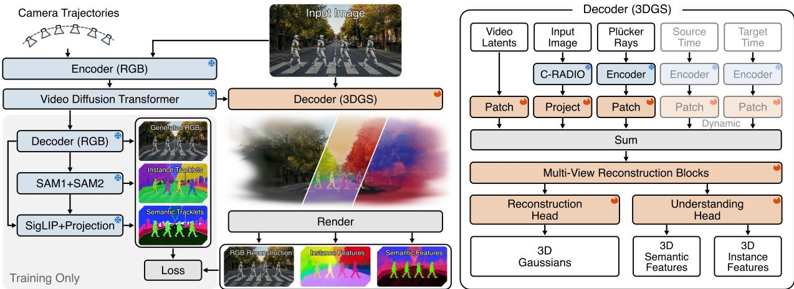  
Figure 2: LucidLyra framework. A frozen camera-controlled video generation model produces multi-view latents. Its RGB decoder and frozen 2D foundation models construct reconstruction, semantic, and instance targets. The targets supervise our Gaussian decoder which maps the latents, camera rays, and input image features to a shared queryable 3D scene. The right panel details our 3DGS decoder. Source- and target-time inputs (grayed out) are used only for the dynamic extension. Snowflakes and flames denote frozen and trainable components, respectively.

where each of � Gaussian primitives $g _ { i }$ parameterizes position $\pmb { \mu _ { i } }$ , scale $\mathbf { s } _ { i }$ , rotation quaternion $\mathbf { q } _ { i }$ , opacity $\alpha _ { i }$ and color $\mathbf { c } _ { i }$ , renderable via diferentiable splatting $\mathcal { R } .$ . The predicted Gaussians are aligned to the source-ray grid of the generated views across all trajectories.

To learn this mapping without 3D supervision, Lyra compares two decodings of $\mathbf { z } ;$ for target camera $\mathcal { C } _ { k }$ , a frozen VAE decoder outputs a teacher image $\mathbf { I } _ { k } = D _ { \mathrm { R G B } } ( \mathbf { Z } _ { k } )$ , supervising the rendered prediction $\hat { \mathbf { I } } _ { k } = \mathcal { R } ( \mathcal { G } , \mathcal { C } _ { k } )$ alongside depth targets. At inference time, sampled latents $\mathbf { Z }$ yield Gaussians encoding only geometry and appearance.

## 3.2. Semantic and Instance Gaussian Decoder

To equip Gaussians with semantic and instance awareness, we introduce additional conditioning using vision features of the input image and dedicated output heads. First, we supplement the video model latents Z with dense input image features ${ \bf F } _ { 0 }$ extracted with C-RADIOv3 [17, 69, 70]. We align $\mathbf { F } _ { 0 }$ with Z through a learned linear projection to the latent feature dimension. Spatial interpolation matches $\mathbf { F } _ { 0 }$ to the latent token grid, and broadcasting replicates it across trajectories and latent time. Each latent-time slice is then modulated by a learned scalar weight shared across channels and a learned global gate before being added to the video and ray tokens. Next, the 3DGS decoder’s shared trunk fuses the multi-view tokens into features $\mathbf { H } = \{ \mathbf { h } _ { i } \} _ { i = 1 } ^ { N } ,$ where each feature corresponds to a source ray on the multi-view video latent grid. Two parallel heads map these shared features to complementary Gaussian attributes: the reconstruction head $D _ { \mathrm { r e c } }$ predicts geometry and appearance parameters $g _ { i } ,$ while the understanding head $D _ { \mathrm { s e g } }$ jointly predicts a semantic descriptor $\mathbf { f } _ { i } ^ { \mathrm { s e m } } \in \mathbb { R } ^ { 1 2 8 }$ , an object-level instance embedding $\mathbf { e } _ { i } ^ { \mathrm { i n s t } } \in \mathbb { R } ^ { 1 2 }$ , and a part-level embedding $\mathbf { e } _ { i } ^ { \mathrm { p a r t } } \in \mathbb { R } ^ { 4 }$ :

$$
\widetilde { \mathcal { G } } = D _ { 3 \mathrm { D G S } } ( \mathbf { Z } , \mathbf { E } , \mathbf { F } _ { 0 } ) = \{ \widetilde { g } _ { i } \} _ { i = 1 } ^ { N } , \qquad \widetilde { g } _ { i } = [ D _ { \mathrm { r e c } } ( \mathbf { h } _ { i } ) \parallel D _ { \mathrm { s e g } } ( \mathbf { h } _ { i } ) ] .\tag{2}
$$

The shared 3DGS decoder trunk and each task-specific head consist of seven Mamba-2 [10] layers followed by one Transformer [91] layer. Operating synchronously on the shared token grid attaches understanding fields directly to the co-located Gaussian $g _ { i . }$ , bypassing post-hoc 2D-to-3D association. For camera $\mathcal { C } _ { k }$ , a diferentiable renderer $\mathcal { R } ( \widetilde { \mathcal { G } } , \mathcal { C } _ { k } )$ outputs rendered RGB $\hat { \bf I } _ { k } ,$ semantic maps $\hat { \mathbf { F } } _ { k } ^ { \mathrm { s e m } }$ , and instance maps $\hat { \mathbf { F } } _ { k } ^ { \mathrm { i n s t } }$ via volumetric �-blending, and depth $\hat { \bf D } _ { k }$ by accumulating primitive center depths.

## 3.3. Multi-Task 2D Feature Distillation

We supervise the understanding fields using decoded video frames $\mathbf { I } _ { k }$ and frozen 2D vision foundation models— class-agnostic segmentation, video tracking, and vision-language foundation models—generalizing RGB selfdistillation to multi-task 2D feature distillation without 3D labels. To resolve cross-view feature jitter and mask inconsistency across imagined views, we first establish cross-view object tracks to associate observations and pool coherent semantic targets.

Aligned instance targets. To associate objects across trajectories, we run SAM’s automatic mask generator on the shared first frame ${ \bf \cal I } _ { 0 } ,$ filter redundancies by coverage, and use the surviving masks to seed independent SAM2 propagations along each trajectory $[ 3 4 , 7 1 ]$ . The resulting class-agnostic instance tracklets $Y _ { k } ^ { \mathrm { i n s t } }$ preserve trajectory visibility while linking observations from the same initial object. Regions disoccluded late in a trajectory lacking a first-frame seed are excluded from instance supervision.

Track-consistent semantic targets. The instance tracklets also let us aggregate semantic evidence across views. We use RADSeg [1] to extract dense features aligned with the SigLIP2 [90] image–text space for every decoded frame $\mathbf { I } _ { k }$ . Storing its native 1 152-dimensional descriptor on every Gaussian is computationally prohibitive, therefore we compress this space with a projection network $P _ { \mathrm { V L } } : \mathbb { R } ^ { 1 1 5 2 } \to \mathbb { R } ^ { 1 2 8 }$ for both image and text embeddings. The projector is trained over frozen SigLIP2 image and text embeddings, using the vanilla SigLIP training objective [109] on the LAION-2B [75] dataset and remains frozen afterwards. Within each camera trajectory, we pool projected features over all pixels and frames belonging to each SAM track and assign the resulting centroid to every track pixel. This yields semantic targets $\mathbf { Y } _ { k } ^ { \mathrm { s e m } }$ , where track pooling suppresses view-dependent feature jitter.

Joint multi-task objective. We initialize the shared trunk and reconstruction head $D _ { \mathrm { r e c } }$ from pretrained Lyra and initialize $D _ { \mathrm { s e g } }$ from scratch, training the entire Gaussian decoder while keeping all 2D teacher models and $P _ { \mathrm { V L } }$ frozen. At target camera $\mathcal { C } _ { k }$ , rendered predictions $( \hat { \mathbf { I } } _ { k } , \hat { \mathbf { D } } _ { k } , \hat { \mathbf { F } } _ { k } ^ { \mathrm { s e m } } , \hat { \mathbf { F } } _ { k } ^ { \mathrm { i n s t } } )$ are supervised against targets $( \mathbf { I } _ { k } , \mathbf { D } _ { k } , \mathbf { Y } _ { k } ^ { \mathrm { s e m } } , Y _ { k } ^ { \mathrm { i n s t } } )$ via

$$
\begin{array} { r } { \mathcal { L } = \mathcal { L } _ { \mathrm { r e c } } + \mathcal { L } _ { \mathrm { s e m } } + \lambda _ { \mathrm { i n s t } } \mathcal { L } _ { \mathrm { i n s t } } . } \end{array}\tag{3}
$$

$\mathcal { L } _ { \mathrm { r e c } }$ mirrors Lyra, combining photometric $\ell _ { 2 } ,$ LPIPS [112], depth, and opacity losses to preserve geometry during feature grounding. Schedules and hyperparameters are detailed in Appendix $\mathrm { A }$

Instance distillation. We learn a class-agnostic instance representation via supervised contrastive learning [30] over tracked pixels across views. For a sample $u \in S$ at pixel $p _ { u }$ in view $k _ { u }$ with normalized embedding $\bar { \mathbf { e } } _ { u } =$ norm $1 _ { 2 } \big ( \hat { \mathbf { F } } _ { k _ { u } } ^ { \mathrm { i n s t } } ( p _ { u } ) \big )$ , we define positive matches sharing track ID as $\mathcal { P } ( u ) = \{ v \in \mathcal { S } \setminus \{ u \} \mid Y _ { k _ { v } } ^ { \mathrm { i n s t } } ( p _ { v } ) = Y _ { k _ { u } } ^ { \mathrm { i n s t } } ( p _ { u } ) \}$ . Over valid anchors $\mathcal { U } = \{ u \in \mathcal { S } | | \mathcal { P } ( u ) | > 0 \}$ , we optimize

$$
\mathcal { L } _ { \mathrm { i n s t } } = - \frac { 1 } { \left| \mathcal { U } \right| } \sum _ { u \in \mathcal { U } } \frac { 1 } { \left| \mathcal { P } ( u ) \right| } \sum _ { v \in \mathcal { P } ( u ) } \log \frac { \exp ( \bar { \mathbf { e } } _ { u } ^ { \top } \bar { \mathbf { e } } _ { v } / { \tau _ { \mathrm { i n s t } } } ) } { \sum _ { a \in \mathcal { S } \backslash \{ u \} } \exp ( \bar { \mathbf { e } } _ { u } ^ { \top } \bar { \mathbf { e } } _ { a } / { \tau _ { \mathrm { i n s t } } } ) } ,\tag{4}
$$

with temperature $\tau _ { \mathrm { i n s t } } > 0$ . This pulls rendered embeddings of the same tracked object together across views while repelling diferent objects, clustering the underlying 3D Gaussians into distinct instance fields. For part-level supervision, we apply the same objective in parallel to the part embeddings, defining positive and negative pairs from sub-object tracklet IDs within each object tracklet.

Semantic distillation. We supervise rendered semantic features with pooled teacher descriptors. For rendered feature $\hat { \mathbf { f } } \equiv \hat { \mathbf { F } } _ { k } ^ { \mathrm { s e m } } ( p )$ and target $\mathbf { y } \equiv \mathbf { Y } _ { k } ^ { \mathrm { s e m } } ( p )$ with $\ell _ { 2 }$ -normalized counterparts $\mathbf { \hat { f } }$ and ${ \bar { \mathbf { y } } } ,$ we define the pointwise loss

$$
\ell _ { \mathrm { s e m } } ( \hat { \mathbf { f } } , \mathbf { y } ) = - \frac { 1 } { 2 } \log \left( \frac { 1 + \bar { \hat { \mathbf { f } } } ^ { \top } \bar { \mathbf { y } } } { 2 } + \epsilon _ { \ell } \right) + \frac { 1 } { 2 d _ { \mathrm { s e m } } } \left\| \bar { \hat { \mathbf { f } } } - \bar { \mathbf { y } } \right\| _ { 1 } ,\tag{5}
$$

with $d _ { \mathrm { s e m } } = 1 2 8$ . The cosine term aligns predictions with the SigLIP2 image–text space, while the $\ell _ { 1 }$ term refines coordinate-level precision. Averaging over rendered pixels yields $ { \mathcal { L } } _ { \mathrm { s e m } } ^ { \mathrm { 2 D } }$ . Rendered feature losses constrain a blend

of several Gaussian features, rather than each primitive individually. We therefore additionally supervise each primitive directly: each Gaussian $\tilde { g } _ { i }$ originates from an input ray $( k _ { i } , p _ { i } )$ , allowing us to penalize discrepancy against teacher target $\mathbf { Y } _ { k _ { i } } ^ { \mathrm { s e m } } ( p _ { i } )$ as $\mathcal { L } _ { \mathrm { { s e m } } } ^ { \mathrm { { G } } } ,$ yielding the total semantic loss $\mathcal { L } _ { \mathrm { s e m } } = \lambda _ { \mathrm { s e m } } ^ { \mathrm { 2 D } } \mathcal { L } _ { \mathrm { s e m } } ^ { \mathrm { 2 D } } + \lambda _ { \mathrm { s e m } } ^ { \mathrm { G } } \mathcal { L } _ { \mathrm { s e m } } ^ { \mathrm { G } }$

## 3.4. Inference: Querying the Generated Scene

Given generated video latents, our Gaussian decoder predicts the scene $\widetilde { \mathcal G }$ in a single forward pass. Its per-Gaussian semantic and instance features enable open-vocabulary queries and object grouping directly in 3D, without using the distillation teachers or lifting predictions from 2D views.

Open-vocabulary semantics. Given categorical text queries ${ \mathcal { Q } } = \{ s _ { c } \} _ { c = 1 } ^ { C }$ , the frozen SigLIP2 text encoder $\Phi _ { \mathrm { T } }$ and projection network $P _ { \mathrm { V L } }$ yield normalized embeddings $\bar { \mathbf { t } } _ { c } = \mathrm { n o r m } _ { 2 } ( P _ { \mathrm { V L } } ( \Phi _ { \mathrm { T } } ( s _ { c } ) ) )$ . Each Gaussian $\tilde { g } _ { i }$ is assigned to the category $c ^ { * }$ that maximizes the cosine similarity with its primitive descriptor:

$$
c ^ { * } = \arg \operatorname* { m a x } _ { c \in \{ 1 , \dots , C \} } \mathrm { n o r m } _ { 2 } ( \mathbf { f } _ { i } ^ { \mathrm { s e m } } ) ^ { \top } \bar { \mathbf { t } } _ { c } .\tag{6}
$$

Querying new vocabularies needs only text–Gaussian dot products without regeneration.

Instance grouping. Within each predicted semantic class, we spatially smooth instance embeddings and cluster high-opacity Gaussians via HDBSCAN [5]. Unclustered Gaussians inherit instance IDs from their nearest neighbor in joint embedding and 3D space. For the part-level instance segmentation, we apply the same technique within each object cluster (cf. Appendix A.3).

LucidLyra+. Our optional semantic refinement leaves geometry and appearance unchanged. It uses a single RADSeg+ open-vocabulary prediction of $\mathbf { I } _ { 0 }$ as a 2D anchor, obtained at minimal overhead since RADSeg+ uses the same C-RADIO features. Our ray-aligned decoder grid links each anchor pixel to its corresponding Gaussian. For every well-supported anchor, we average the semantic features of its Gaussians into a prototype, and relabel any Gaussian whose feature is close enough to that prototype. All remaining Gaussians keep their original semantic labels. We then apply the same instance grouping.

## 3.5. Extension to Dynamic Scenes

For monocular video inputs, we extend LucidLyra to dynamic scenes by independently decoding a timeconditioned 3DGS state following Lyra’s bullet-time formulation [2, 53]. The same video model provides multi-view latents preserving input motion; the decoder predicts the full scene state at time $\tau ,$ conditioned on source/target time encodings and query-time C-RADIO input-frame features $\mathbf { F } _ { \tau }$ :

$$
\widetilde { \mathcal { G } } _ { \tau } = D _ { \mathrm { 3 D G S } } ^ { \mathrm { d y n } } ( \mathbf { Z } , \mathbf { E } , \mathbf { F } _ { \tau } , \mathbf { T } ^ { \mathrm { s r c } } , \mathbf { T } _ { \tau } ^ { \mathrm { t g t } } ) .\tag{7}
$$

Initialized from the static model, the dynamic decoder trains with the same multi-task losses on �-synchronized views. Dynamic scenes can only be supervised at the exact queried time, due to the changing scene. Following Bahmani et al. [2], we create six additional trajectories by processing the time-reversed input video and flipping it back. Each target frame is then paired with a same-time observation from a diferent viewpoint increasing multi-view supervision. Since each query time yields an independently decoded Gaussian state, we implement temporal instance tracking via an online prototype codebook inspired by IGGT4D [118]. At each query time, we represent each cluster by its normalized mean object embedding and greedily match cluster prototypes to codebook entries one-to-one above a cosine-similarity threshold. Matched clusters inherit persistent IDs and update the stored prototypes through averaging weighted by Gaussian count, while unmatched clusters initialize new IDs.

## 4. Experiments

We evaluate LucidLyra’s joint generative 3D reconstruction and scene understanding on synthetic and realimage-conditioned scenes, followed by an analysis of its key components. Dynamic experiments, additional quantitative and qualitative results, downstream applications, and implementation details are provided in the appendix.

## 4.1. Experimental Setup

Datasets. We augment Lyra-SDG [2] with semantic and instance teacher targets for training (Section 3.3) and annotations for evaluation. Lyra-SDG uses GEN3C [72] to expand images and videos generated from diverse text prompts into multiple camera trajectories per scene. Its 59 031 static and 7 378 dynamic scenes contain RGB videos, camera poses, depth maps, and video latents. We preprocess teacher targets for all 53 million frames. A single image admits multiple plausible 3D completions. We evaluate agreement with fixed generated trajectories and their annotations. Our three curated 25-scene benchmarks use propagated reference annotations with human review and refinement: LucidLyra-SDG and LucidLyra-SDG Dynamic cover static and dynamic generated scenes, while LucidLyra-ADE20K uses real ADE20K validation images [114] to condition generated completions. All data and benchmarks will be released.

For qualitative results, we generate input images with GPT Image or FLUX [3, 62]. For dynamic examples, we extend these to videos using Cosmos 3 [61]. We find that our method is agnostic to the choice of imagegeneration model.

Evaluation. Following Lyra [2], we report PSNR and LPIPS [112] for reconstruction. Following Li et al. [42, 45, 50], Xiong et al. [100], we evaluate semantic segmentation using mIoU and mAcc over ADE20K classes present in each reference scene. Building on IGGT and video instance segmentation [42, 102], we evaluate cross-view instance consistency using the mean track precision–recall product (mTrackPR) and TrackPR25 at IoU 0.25 within ground-truth thing regions (Appendix A.3).

Baselines. We benchmark against existing 3D understanding methods combined with Lyra’s generative pipeline. Per-scene optimization: LangSplatV2, SFS, and Unified-Lift [45, 100, 116] fit feature fields on frozen Lyra Gaussians. Feed-forward: Chorus [50] processes frozen Lyra Gaussians, while IGGT [42] reconstructs geometry and instances directly from generated RGB videos. References: Reconstruction-only Lyra, alongside a teacherlifting reference that directly assigns teacher features and instance IDs to frozen Lyra ray-aligned-Gaussians. The latter contextualizes the quality of our segmentation training signals.

## 4.2. Evaluating Generative 3D Reconstruction and Understanding

LucidLyra preserves reconstruction fidelity while adding understanding fields (Table 1). Relative to Lyra, PSNR improves by 0.53/0.13 dB and LPIPS improves by 0.025/0.018 across benchmarks, confirming that our multi-task training does not degrade novel-view rendering quality.

LucidLyra outperforms all two-stage baselines without per-scene optimization (Table 1) in semantics, achieving 64.1/49.8 mIoU with synthetic and real-image conditioning, respectively. Plain LucidLyra exceeds the 3D-lifted teacher reference on SDG (64.1 vs. 60.5) and performs comparably on ADE20K (49.8 vs. 50.1). LucidLyra+ input-image 3D anchoring further boosts mIoU to 67.9/53.7.

LucidLyra achieves 21.5/18.5 instance mTrackPR (Table 1), outperforming the compared segmentation baselines in separating individual objects across generated viewpoints. Compared to the lifted teacher reference, mTrackPR is lower on SDG (21.5 vs. 22.8) and higher on ADE20K (18.5 vs. 17.3). LucidLyra+ gives a small SDG mTrackPR gain. Qualitative multi-view segmentations and feature PCAs are visualized in Fig. 3.

Table 1: Static evaluation on LucidLyra-SDG and LucidLyra-ADE20K. We report PSNR (dB), LPIPS (–), and mIoU, mAcc, mTrackPR, and TrackPR (all in %). †: uses video model RGB output.
<table><tr><td rowspan="3">Method</td><td colspan="6">LucidLyra-SDG Static</td><td colspan="6">LucidLyra-ADE20K</td></tr><tr><td colspan="2">Reconstruction</td><td colspan="2">Semantics</td><td colspan="2">Instance</td><td colspan="2">Reconstruction</td><td colspan="2">Semantics</td><td colspan="2">Instance</td></tr><tr><td>PSNR↑</td><td>LPIPS↓</td><td>mIoU↑</td><td>mAcc↑</td><td>mTrack PR↑</td><td>Track PR25↑</td><td>PSNR↑</td><td>LPIPS↓</td><td>mIoU↑</td><td>mAcc↑</td><td>mTrack PR↑</td><td>Track PR25↑</td></tr><tr><td>Lyra + Lifted Teachers</td><td>24.49</td><td>0.211</td><td>60.5</td><td>75.3</td><td>22.8</td><td>33.2</td><td>24.59</td><td>0.217</td><td>50.1</td><td>64.5</td><td>17.3</td><td>26.8</td></tr><tr><td>Lyra</td><td>24.49</td><td>0.211</td><td>一</td><td>1</td><td>一</td><td>一</td><td>24.59</td><td>0.217</td><td>一</td><td>一</td><td>一</td><td>-</td></tr><tr><td>Lyra + LangSplatV2</td><td>24.49</td><td>0.211</td><td>32.4</td><td>52.7</td><td>一</td><td>一</td><td>24.59</td><td>0.217</td><td>37.1</td><td>53.7</td><td>1</td><td>一</td></tr><tr><td>Lyra + SFS</td><td>24.49</td><td>0.211</td><td>31.9</td><td>49.5</td><td></td><td>一</td><td>24.59</td><td>0.217</td><td>35.2</td><td>51.3</td><td>1</td><td>一</td></tr><tr><td>Lyra + Unified-Lift</td><td>24.49</td><td>0.211</td><td>一</td><td>一</td><td>11.7</td><td>17.0</td><td>24.59</td><td>0.217</td><td>一</td><td>一</td><td>7.5</td><td>11.5</td></tr><tr><td>Lyra + Chorus</td><td>24.49</td><td>0.211</td><td>11.5</td><td>19.3</td><td>一</td><td>一</td><td>24.59</td><td>0.217</td><td>9.3</td><td>16.1</td><td>一</td><td>一</td></tr><tr><td>Lyra† + IGGT</td><td>一</td><td>1</td><td>29.2</td><td>38.3</td><td>5.2</td><td>9.3</td><td>一</td><td>1</td><td>32.7</td><td>41.2</td><td>9.5</td><td>16.6</td></tr><tr><td>LucidLyra (Ours)</td><td>25.02</td><td>0.186</td><td>64.1</td><td>79.2</td><td>21.5</td><td>29.3</td><td>24.72</td><td>0.199</td><td>49.8</td><td>65.6</td><td>18.5</td><td>29.7</td></tr><tr><td>LucidLyra+ (Ours)</td><td>25.02</td><td>0.186</td><td>67.9</td><td>81.7</td><td>22.0</td><td>31.1</td><td>24.72</td><td>0.199</td><td>53.7</td><td>71.6</td><td>18.5</td><td>28.5</td></tr></table>

On a single NVIDIA A100 80 GB, teacher lifting, LangSplatV2, SFS, and Unified-Lift require 64, 697, 168, and 216 min to segment a single generated scene, respectively. This is dominated by foundation-model preprocessing. Feed-forward methods CHORUS and IGGT require 1.0 and 3.6 min, respectively, while LucidLyra and LucidLyra+ require 2.1 and 2.3 min. We measure wall-clock time from Lyra generated scenes (baselines) or video model latents (LucidLyra) to the final rgb, open-vocabulary semantic segmentation, and instance segmentation prediction.

## 4.3. LucidLyra Analysis

Losses and regularization. Removing C-RADIO [17] conditioning causes the largest drop in understanding: 7.2 mIoU and 6.6 mTrackPR points (Table 2). Direct Gaussian semantic supervision adds 0.7 mIoU and 2.7 mTrackPR points beyond rendered supervision. Reconstruction masking and opacity pruning add 1.3 and 2.1 mTrackPR points, respectively, with small changes in reconstruction quality. Part-level supervision slightly improves mIoU and enables a more fine-grained scene interaction. The full model also retains reconstruction quality, slightly improving PSNR (25.02 vs. 24.88) and

LPIPS (0.186 vs. 0.189) over the reconstructiononly control run. This control initializes from vanilla Lyra checkpoint and is trained identical to LucidLyra excluding our changes to the loss terms and architecture.

Feature dimensions. Reducing the semantic feature dimension from 128 to 64 lowers mIoU by 1.4 points and mTrackPR by 1.0 point. A 256-dimensional representation exceeds the GPU memory budget. The chosen 128D achieves the best accuracy–memory trade-of among the tested settings. The 12-dimensional object-level instance representation achieves the highest mTrackPR among the tested settings: 21.5, compared with 19.3 at 8 dimensions and 18.1 at 16 dimensions. Semantic mIoU is unchanged at 8 dimensions and 1.0 point lower at 16 dimensions.

Table 2: Ablations on LucidLyra-SDG. PSNR (dB), LPIPS (–), and mIoU, mAcc, mTrackPR, and TrackPR25 (all in %).
<table><tr><td rowspan="2">Method</td><td colspan="2">Reconstruction</td><td colspan="2">Semantics</td><td colspan="2">Instance</td></tr><tr><td>PSNR↑LPIPS↓mIoU↑mAcc ↑</td><td></td><td></td><td></td><td>PR↑</td><td>mTrack Track PR25↑</td></tr><tr><td>LucidLyra (Ours)</td><td>25.02</td><td>0.186</td><td>64.1</td><td>79.2</td><td>21.5</td><td>29.3</td></tr><tr><td>Loss</td><td></td><td></td><td></td><td></td><td></td><td></td></tr><tr><td>w/o 3D Loss</td><td>24.89</td><td>0.190</td><td>63.4</td><td>77.0</td><td>18.8</td><td>26.2</td></tr><tr><td>w/o C-RADIO</td><td>24.77</td><td>0.190</td><td>56.9</td><td>70.2</td><td>14.9</td><td>24.5</td></tr><tr><td>w/o part-level supervision</td><td>25.00</td><td>0.187</td><td>63.8</td><td>79.0</td><td>21.0</td><td>29.6</td></tr><tr><td>w/o opacity pruning</td><td>25.03</td><td>0.187</td><td>63.7</td><td>78.7</td><td>19.4</td><td>27.7</td></tr><tr><td>w/o ignore mask recon.</td><td>24.84</td><td>0.189</td><td>64.0</td><td>78.8</td><td>20.2</td><td>28.7</td></tr><tr><td>w/o LucidLyra</td><td>24.88</td><td>0.189</td><td>一</td><td>一</td><td>一</td><td>一</td></tr><tr><td>Semantic Feature Dim. 64</td><td>24.83</td><td>0.189</td><td>62.7</td><td>76.2</td><td>20.5</td><td>30.2</td></tr><tr><td>256</td><td></td><td></td><td>O0M</td><td></td><td></td><td></td></tr><tr><td>Instance Feature Dim. 8</td><td></td><td></td><td></td><td></td><td></td><td></td></tr><tr><td>16</td><td>24.88</td><td>0.188</td><td>64.1</td><td>78.6</td><td>19.3</td><td>28.7</td></tr><tr><td></td><td>24.98</td><td>0.187</td><td>63.1</td><td>77.6</td><td>18.1</td><td>27.0</td></tr><tr><td>Shared 3DGS Decoder Layers</td><td></td><td></td><td></td><td></td><td></td><td></td></tr><tr><td>4</td><td>25.03</td><td>0.184</td><td>64.3</td><td>79.1</td><td>21.0</td><td>29.8</td></tr><tr><td>12</td><td>24.83</td><td>0.189</td><td>63.6</td><td>78.2</td><td>18.6</td><td>27.9</td></tr></table>

3DGS RGB Renderings  
3DGS Feature PCA (Sem. / Inst.)  
3DGS Segmentation (Open-Voc. / Inst.)  
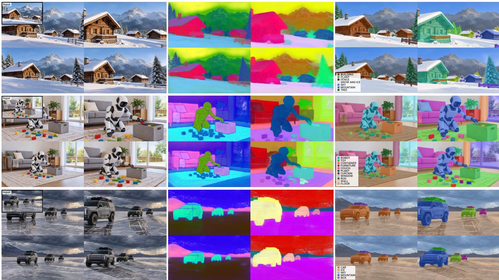  
Figure 3: LucidLyra qualitative results. We visualize input- and novel-view 3DGS [28] renderings across RGB, semantic/instance feature PCAs, and open-vocabulary/instance segmentation using generated input images.

Shared 3DGS decoder layers. Increasing the shared decoder depth from eight to twelve layers degrades reconstruction and understanding. Four shared layers remain competitive, while eight shared layers achieve the highest mTrackPR among the tested depths.

## 4.4. Downstream Applications

LucidLyra’s structured, queryable scenes directly enable downstream tasks including robotic simulation, 3D scene editing, and 3D asset mining (details and qualitative results in Appendix D).

## 5. Conclusion

We presented LucidLyra, which turns generated scenes into queryable 3D worlds by distilling generative and perceptual knowledge into a feed-forward Gaussian decoder. A camera-controlled video model supplies both latent representations and training data, enabling joint reconstruction and understanding without captured multi-view data, manual 3D annotations, or per-scene optimization. Experiments demonstrate improved semantic and instance understanding over the compared two-stage baselines while preserving Lyra’s reconstruction quality. Furthermore, we demonstrate initial results on dynamic scenes and applications in 3D scene editing, 3D asset mining, and physical-AI simulation. Future work could scale our approach by accelerated video generation [48] with larger-scale joint training for generation and scene understanding [13].

## Acknowledgements

We sincerely thank Tianchang Shen, Xuanchi Ren, and Zan Gojcic for their support. We also thank Riccardo de Lutio, Nicholas Sharp, and Benjamin Missaoui for insightful discussions, and Simon Kiefhaber and Jan-Martin Steitz for their assistance with the LAION dataset. Stefan Roth was partially supported by the ERC under the European Union’s Horizon 2020 research and innovation programme (grant agreement No. 866008) and the Deutsche Forschungsgemeinschaft (German Research Foundation, DFG) under Germany’s Excellence Strategy (EXC 3066/1 “The Adaptive Mind”, Project No. 533717223). Finally, we acknowledge the support of the European Laboratory for Learning and Intelligent Systems.

## References

[1] Omar Alama, Darshil Jariwala, Avigyan Bhattacharya, Seungchan Kim, Wenshan Wang, and Sebastian Scherer. RADSeg: Unleashing parameter and compute eficient zero-shot open-vocabulary segmentation using agglomerative models. In CVPRFindings, pages 9294–9304, 2026. 6, 18, 21

[2] Sherwin Bahmani, Tianchang Shen, Jiawei Ren, Jiahui Huang, Yifeng Jiang, Haithem Turki, Andrea Tagliasacchi, David B. Lindell, Zan Gojcic, Sanja Fidler, Huan Ling, Jun Gao, and Xuanchi Ren. Lyra: Generative 3D scene reconstruction via video difusion model self-distillation. In ICLR, 2026. 2, 3, 4, 7, 8, 20, 21, 26, 33

[3] Black Forest Labs. FLUX. https://github.com/black-forest-labs/flux, 2024. 8

[4] Alessandro Burzio, Tobias Fischer, Sven Elflein, Qunjie Zhou, Riccardo de Lutio, Jiawei Ren, Jiahui Huang, Shengyu Huang, Marc Pollefeys, Laura Leal-Taixé, Zan Gojcic, and Haithem Turki. Déjà View: Looping transformers for multi-view 3D reconstruction. In NeurIPS, 2026. 3

[5] Ricardo J. G. B. Campello, Davoud Moulavi, and Jörg Sander. Density-based clustering based on hierarchical density estimates. In PAKDD, pages 160–172, 2013. 7, 20

[6] David Charatan, Sizhe Lester Li, Andrea Tagliasacchi, and Vincent Sitzmann. pixelSplat: 3D Gaussian splats from image pairs for scalable generalizable 3D reconstruction. In CVPR, pages 19457–19467, 2024. 3

[7] Jiahuan Cheng, Jan-Nico Zaech, Luc Van Gool, and Danda Pani Paudel. Occam’s LGS: An eficient approach for language Gaussian splatting. In BMVC, 2025. 4

[8] Mehdi Cherti, Romain Beaumont, Ross Wightman, Mitchell Wortsman, Gabriel Ilharco, Cade Gordon, Christoph Schuhmann, Ludwig Schmidt, and Jenia Jitsev. Reproducible scaling laws for contrastive language-image learning. In CVPR, pages 2818–2829, 2023. 20

[9] Christopher Choy, JunYoung Gwak, and Silvio Savarese. 4D spatio-temporal ConvNets: Minkowski convolutional neural networks. In CVPR, pages 3075–3084, 2019. 4

[10] Tri Dao and Albert Gu. Transformers are SSMs: Generalized models and eficient algorithms through structured state space duality. In ICML, pages 10041–10071, 2024. 5

[11] Tianchen Deng, Xuefeng Chen, Yi Chen, Qu Chen, Yuyao Xu, Lijin Yang, Le Xu, Yu Zhang, Bo Zhang, Wuxiong Huang, and Hesheng Wang. GaussianDWM: 3D Gaussian driving world model for unified scene understanding and multi-modal generation. In CVPR, 2026. 4

[12] Gal Fiebelman, Tamir Cohen, Ayellet Morgenstern, Peter Hedman, and Hadar Averbuch-Elor. 4-LEGS: 4D language embedded Gaussian splatting. Comput.Graph.Forum, 44(2):e70085, 2025. 33

[13] Valentin Gabeur, Shangbang Long, Songyou Peng, Paul Voigtlaender, Shuyang Sun, Yanan Bao, Karen Truong, Zhicheng Wang, Wenlei Zhou, Jonathan T. Barron, Kyle Genova, Nithish Kannen, Sherry Ben, Yandong Li, Mandy Guo, Suhas Yogin, Yiming Gu, Huizhong Chen, Oliver Wang, Saining Xie, Howard Zhou, Kaiming He, Thomas Funkhouser, Jean-Baptiste Alayrac, and Radu Soricut. Image generators are generalist vision learners. arXiv:2604.20329 [cs.CV], 2026. 10

[14] Ruiqi Gao, Aleksander Hołyński, Philipp Henzler, Arthur Brussee, Ricardo Martin-Brualla, Pratul P. Srinivasan, Jonathan T. Barron, and Ben Poole. CAT3D: Create anything in 3D with multi-view difusion models. In NeurIPS, 2024. 2, 3

[15] Sensen Gao, Zhaoqing Wang, Qihang Cao, Dongdong Yu, Changhu Wang, and Jia-Wang Bian. PixWorld: Unifying 3D scene generation and reconstruction in pixel space. arXiv:2607.05373 [cs.CV], 2026. 4

[16] Shuting He, Peilin Ji, Yitong Yang, Changshuo Wang, Jiayi Ji, Yinglin Wang, and Henghui Ding. A survey on 3D Gaussian splatting applications: Segmentation, editing, and generation. IEEETrans.PatternAnal.Mach.Intell., 2026. 2

[17] Greg Heinrich, Mike Ranzinger, Hongxu Yin, Yao Lu, Jan Kautz, Andrew Tao, Bryan Catanzaro, and Pavlo Molchanov. RADIOv2.5: Improved baselines for agglomerative vision foundation models. In CVPR, 2025. 5, 9, 18

[18] Lukas Höllein and Matthias Nießner. World reconstruction from inconsistent views. In ECCV, 2026. 3

[19] Lukas Höllein, Ang Cao, Andrew Owens, Justin Johnson, and Matthias Nießner. Text2Room: Extracting textured 3D meshes from 2D text-to-image models. In ICCV, pages 7909–7920, 2023. 3

[20] Yongzhen Hu, Yihui Yang, Haotong Lin, Yifan Wang, Junting Dong, Yifu Deng, Xinyu Zhu, Fan Jia, Hujun Bao, Xiaowei Zhou, and Sida Peng. Split4D: Decomposed 4D scene reconstruction without video segmentation. ACMTrans.Graph., 44(6):215:1–215:15, 2025. 33

[21] Jiaxin Huang, Yuanbo Yang, Bangbang Yang, Lin Ma, Yuewen Ma, and Yiyi Liao. Gen3R: 3D scene generation meets feed-forward reconstruction. In CVPR, 2026. 4

[22] Rui Huang, Guangyao Zhai, Zuria Bauer, Marc Pollefeys, Federico Tombari, Leonidas [J.] Guibas, Gao Huang, and Francis Engelmann. Video perception models for 3D scene synthesis. In NeurIPS, 2025. 4

[23] Krishna Murthy Jatavallabhula, Alihusein Kuwajerwala, Qiao Gu, Mohd Omama, Ganesh Iyer, Soroush Saryazdi, Tao Chen, Alaa Maalouf, Shuang Li, Nikhil Varma Keetha, Ayush Tewari, Joshua Tenenbaum, Celso de Melo, Madhava Krishna, Liam Paull, Florian Shkurti, and Antonio Torralba. ConceptFusion: Open-set multimodal 3D mapping. In RSS, 2023. 4

[24] Shengxiang Ji, Guanjun Wu, Jiemin Fang, Jiazhong Cen, Taoran Yi, Wenyu Liu, Qi Tian, and Xinggang Wang. Segment any 4D Gaussians. arXiv:2407.04504 [cs.CV], 2024. 33

[25] Li Jiang, Hengshuang Zhao, Shaoshuai Shi, Shu Liu, Chi-Wing Fu, and Jiaya Jia. PointGroup: Dual-set point grouping for 3D instance segmentation. In CVPR, pages 4867–4876, 2020. 4

[26] Minchao Jiang, Xiaoxuan Ma, Shunyu Jia, Haoru Wang, Zhang Liang, and Wentao Zhu. InstanceSplat: Instanceaware feed-forward 3D Gaussian splatting for scene understanding. arXiv:2608.07144 [cs.CV], 2026. 2, 4

[27] Yuheng Jiang, Yiwen Cai, Zihao Wang, Yize Wu, Sicheng Li, Zhuo Su, Shaohui Jiao, and Lan Xu. Director: Instance-aware Gaussian splatting for dynamic scene modeling and understanding. In ECCV, 2026. 33

[28] Bernhard Kerbl, Georgios Kopanas, Thomas Leimkühler, and George Drettakis. 3D Gaussian splatting for real-time radiance field rendering. ACMTrans.Graph., 42(4):139:1–139:14, 2023. 3, 4, 10, 23, 30

[29] Justin Kerr, Chung Min Kim, Ken Goldberg, Angjoo Kanazawa, and Matthew Tancik. LERF: Language embedded radiance fields. In ICCV, pages 19729–19739, 2023. 4

[30] Prannay Khosla, Piotr Teterwak, Chen Wang, Aaron Sarna, Yonglong Tian, Phillip Isola, Aaron Maschinot, Ce Liu, and Dilip Krishnan. Supervised contrastive learning. In NeurIPS, pages 18661–18673, 2020. 6

[31] Jun-Seong Kim, GeonU Kim, Yu-Ji Kim, Yu-Chiang Frank Wang, Jaesung Choe, and Tae-Hyun Oh. Dr. Splat: Directly referring 3D Gaussian splatting via direct language embedding registration. In CVPR, pages 14137–14146, 2025. 4

[32] Mungyeom Kim, Minkyeong Jeon, Honggyu An, Jaewoo Jung, Hyuna Ko, Jisang Han, Hyeonseo Yu, Donghwan Shin, Sunghwan Hong, Takuya Narihira, Kazumi Fukuda, Yuki Mitsufuji, and Seungryong Kim. Learning global motion with compact Gaussians for feed-forward 4D reconstruction. arXiv:2605.31595 [cs.CV], 2026. 3

[33] Diederik P. Kingma and Jimmy Lei Ba. Adam: A method for stochastic optimization. In ICLR, 2015. 20

[34] Alexander Kirillov, Eric Mintun, Nikhila Ravi, Hanzi Mao, Chloé Rolland, Laura Gustafson, Tete Xiao, Spencer Whitehead, Alexander C. Berg, Wan-Yen Lo, Piotr Dollár, and Ross B. Girshick. Segment anything. In ICCV, pages 4015–4026, 2023. 6, 18, 33

[35] Sebastian Koch, Johanna Wald, Hidenobu Matsuki, Pedro Hermosilla, Timo Ropinski, and Federico Tombari. Unified semantic transformer for 3D scene understanding. Trans.Mach.Learn.Res., 2026. 4

[36] Abhijit Kundu, Kyle Genova, Xiaoqi Yin, Alireza Fathi, Caroline Pantofaru, Leonidas J. Guibas, Andrea Tagliasacchi, Frank Dellaert, and Thomas Funkhouser. Panoptic neural fields: A semantic object-aware neural scene representation. In CVPR, pages 12871–12881, 2022. 4

[37] Isaac Labe, Noam Issachar, Itai Lang, and Sagie Benaim. DGD: Dynamic 3D Gaussians distillation. In ECCV, pages 361–378, 2024. 33

[38] Seungjun Lee, Zihan Wang, Yunsong Wang, and Gim Hee Lee. EmbodiedSplat: Online feed-forward semantic 3DGS for open-vocabulary 3D scene understanding. In CVPR, pages 23774–23784, 2026. 4

[39] Boyi Li, Kilian Q. Weinberger, Serge Belongie, Vladlen Koltun, and René Ranftl. Language-driven semantic segmentation. In ICLR, 2022. 20, 28

[40] Changyang Li, Xueqing Huang, Shin-Fang Chng, Huangying Zhan, Qingan Yan, and Yi Xu. FAST3DIS: Feed-forward anchored scene transformer for 3D instance segmentation. arXiv:2603.25993 [cs.CV], 2026. 4

[41] Dong-Yang Li, Wang Zhao, Yuxin Chen, Wenbo Hu, Meng-Hao Guo, Fang-Lue Zhang, Ying Shan, and Shi-Min Hu. Pixal3D: Pixel-aligned 3D generation from images. In SIGGRAPH, 2026. 32

[42] Hao Li, Zhengyu Zou, Fangfu Liu, Xuanyang Zhang, Fangzhou Hong, Yukang Cao, Yushi Lan, Manyuan Zhang, Gang Yu, Dingwen Zhang, and Ziwei Liu. IGGT: Instance-grounded geometry transformer for semantic 3D reconstruction. In ICLR, 2026. 4, 8, 20, 22

[43] Qijing Li, Jingxiang Sun, Liang An, Zhaoqi Su, Hongwen Zhang, and Yebin Liu. SemanticSplat: Feed-forward 3D scene understanding with language-aware Gaussian fields. arXiv:2506.09565 [cs.CV], 2025. 4

[44] Ruining Li, Yuxin Yao, Chuanxia Zheng, Christian Rupprecht, Joan Lasenby, Shangzhe Wu, and Andrea Vedaldi. Particulate: Feed-forward 3D object articulation. In CVPR, pages 27708–27718, 2026. 32

[45] Wanhua Li, Yujie Zhao, Minghan Qin, Yang Liu, Yuanhao Cai, Chuang Gan, and Hanspeter Pfister. LangSplatV2: High-dimensional 3D language Gaussian splatting with 450+ FPS. In NeurIPS, 2025. 4, 8, 20, 22

[46] Wanhua Li, Renping Zhou, Jiawei Zhou, Yingwei Song, Johannes Herter, Minghan Qin, Gao Huang, and Hanspeter Pfister. 4D LangSplat: 4D language Gaussian splatting via multimodal large language models. In CVPR, pages 22001–22011, 2025. 20, 21, 22, 33

[47] Xinyang Li, Tengfei Wang, Zixiao Gu, Shengchuan Zhang, Chunchao Guo, and Liujuan Cao. FlashWorld: High-quality 3D scene generation within seconds. In ICLR, 2026. 4

[48] Yitong Li, Junsong Chen, Haopeng Li, Haozhe Liu, Jincheng Yu, Ligeng Zhu, Ping Luo, Song Han, and Enze Xie. Sol Video Inference Engine: Agent-native full-stack acceleration framework for eficient video generation. arXiv:2606.23743 [cs.CV], 2026. 10

[49] Yue Li, Qi Ma, Runyi Yang, Huapeng Li, Mengjiao Ma, Bin Ren, Nikola Popovic, Nicu Sebe, Ender Konukoglu, Theo Gevers, Luc Van Gool, Martin R. Oswald, and Danda Pani Paudel. SceneSplat: Gaussian splatting-based scene understanding with vision-language pretraining. In ICCV, pages 4961–4972, 2025. 4

[50] Yue Li, Qi Ma, Runyi Yang, Mengjiao Ma, Bin Ren, Nikola Popovic, Nicu Sebe, Theo Gevers, Luc Van Gool, Danda Pani Paudel, and Martin R. Oswald. Chorus: Multi-teacher pretraining for holistic 3D Gaussian scene encoding. In CVPR, pages 21431–21442, 2026. 4, 8, 20, 22

[51] Yun-Jin Li, Mariia Gladkova, Yan Xia, and Daniel Cremers. TRASE: Tracking-free 4D segmentation and editing. In 3DV, pages 1670–1679, 2026. 20, 21, 22, 33

[52] Hanwen Liang, Junli Cao, Vidit Goel, Guocheng Qian, Sergei Korolev, Demetri Terzopoulos, Konstantinos N. Plataniotis, Sergey Tulyakov, and Jian Ren. Wonderland: Navigating 3D scenes from a single image. In CVPR, pages 798–810, 2025. 2, 4

[53] Hanxue Liang, Jiawei Ren, Ashkan Mirzaei, Antonio Torralba, Ziwei Liu, Igor Gilitschenski, Sanja Fidler, Cengiz Öztireli, Huan Ling, Zan Gojcic, and Jiahui Huang. Feed-forward bullet-time reconstruction of dynamic scenes from monocular videos. In NeurIPS, 2025. 3, 7

[54] Haotong Lin, Sili Chen, Jun Hao Liew, Donny Y. Chen, Zhenyu Li, Yang Zhao, Sida Peng, Hengkai Guo, Xiaowei Zhou, Guang Shi, Jiashi Feng, and Bingyi Kang. Depth Anything 3: Recovering the visual space from any views. In ICLR, 2026. 3

[55] Fangfu Liu, Hao Li, Jiawei Chi, Hanyang Wang, Minghui Yang, Fudong Wang, and Yueqi Duan. LangScene-X: Reconstruct generalizable 3D language-embedded scenes with TriMap video difusion. In ICCV, 2025. 4

[56] Yilong Liu, Wanhua Li, Chen Zhu-Tian, and Hanspeter Pfister. LangFlash: Feed-forward 3D language Gaussian splatting from sparse unposed images. In CVPRFindings, 2026. 4

[57] Ilya Loshchilov and Frank Hutter. Decoupled weight decay regularization. In ICLR, 2019. 18

[58] Ben Mildenhall, Pratul P. Srinivasan, Matthew Tancik, Jonathan T. Barron, Ravi Ramamoorthi, and Ren Ng. NeRF: Representing scenes as neural radiance fields for view synthesis. In ECCV, pages 405–421, 2020. 3

[59] NVIDIA. Cosmos world foundation model platform for physical AI. arXiv:2501.03575 [cs.CV], 2025. 4

[60] NVIDIA. Isaac Sim. https://github.com/isaac-sim/IsaacSim, 2026. 30

[61] NVIDIA. Cosmos 3: Omnimodal world models for physical AI. arXiv:2606.02800 [cs.CV], 2026. 8

[62] OpenAI. ChatGPT Images 2.5 system card. https://deploymentsafety.openai.com/chatgpt-images-2-5, 2026. 8

[63] Songyou Peng, Kyle Genova, Chiyu Jiang, Andrea Tagliasacchi, Marc Pollefeys, and Thomas Funkhouser. OpenScene: 3D scene understanding with open vocabularies. In CVPR, pages 815–824, 2023. 4

[64] Ben Poole, Ajay Jain, Jonathan T. Barron, and Ben Mildenhall. DreamFusion: Text-to-3D using 2D difusion. In ICLR, 2023. 3

[65] Charles R. Qi, Hao Su, Kaichun Mo, and Leonidas J. Guibas. PointNet: Deep learning on point sets for 3D classification and segmentation. In CVPR, pages 652–660, 2017. 4

[66] Charles R. Qi, Li Yi, Hao Su, and Leonidas J. Guibas. PointNet++: Deep hierarchical feature learning on point sets in a metric space. In NeurIPS, 2017. 4

[67] Minghan Qin, Wanhua Li, Jiawei Zhou, Haoqian Wang, and Hanspeter Pfister. LangSplat: 3D language Gaussian splatting. In CVPR, pages 20051–20060, 2024. 2, 4

[68] Zhicheng Qiu, Jiarui Meng, Tong-an Luo, Yican Huang, Xuan Feng, Xuanfu Li, and Zhan Xu. SLARM: Streaming and language-aligned reconstruction model for dynamic scenes. In CVPR, pages 29023–29034, 2026. 33

[69] Mike Ranzinger, Greg Heinrich, Jan Kautz, and Pavlo Molchanov. AM-RADIO: Agglomerative vision foundation model reduce all domains into one. In CVPR, pages 12490–12500, 2024. 5

[70] Mike Ranzinger, Greg Heinrich, Pavlo Molchanov, Bryan Catanzaro, and Andrew Tao. FeatSharp: Your vision model features, sharper. In ICML, 2025. 5

[71] Nikhila Ravi, Valentin Gabeur, Yuan-Ting Hu, Ronghang Hu, Chaitanya Ryali, Tengyu Ma, Haitham Khedr, Roman Rädle, Chloé Rolland, Laura Gustafson, Eric Mintun, Junting Pan, Kalyan Vasudev Alwala, Nicolas Carion, Chao-Yuan Wu, Ross B. Girshick, Piotr Dollár, and Christoph Feichtenhofer. SAM 2: Segment anything in images and videos. In ICLR, 2025. 6, 18, 33

[72] Xuanchi Ren, Tianchang Shen, Jiahui Huang, Huan Ling, Yifan Lu, Merlin Nimier-David, Thomas Müller, Alexander Keller, Sanja Fidler, and Jun Gao. GEN3C: 3D-informed world-consistent video generation with precise camera control. In CVPR, pages 6121–6132, 2025. 2, 4, 8, 33

[73] Olga Russakovsky, Jia Deng, Hao Su, Jonathan Krause, Sanjeev Satheesh, Sean Ma, Zhiheng Huang, Andrej Karpathy, Aditya Khosla, Michael Bernstein, Alexander C. Berg, and Li Fei-Fei. ImageNet large scale visual recognition challenge. Int.J.Comput.Vis., 115(3):211–252, 2015. 21

[74] Manuel-Andreas Schneider, Lukas Höllein, and Matthias Nießner. WorldExplorer: Towards generating fully navigable 3D scenes. In SIGGRAPHAsia, 2025. 3

[75] Christoph Schuhmann, Romain Beaumont, Richard Vencu, Cade W. Gordon, Ross Wightman, Mehdi Cherti, Theo Coombes, Aarush Katta, Clayton Mullis, Mitchell Wortsman, Patrick Schramowski, Srivatsa R. Kundurthy, Katherine Crowson, Ludwig Schmidt, Robert Kaczmarczyk, and Jenia Jitsev. LAION-5B: An open large-scale dataset for training next generation image-text models. In NeurIPSDatasets&Benchmarks, 2022. $^ { 6 , }$ 18

[76] Katja Schwarz, Norman Müller, and Peter Kontschieder. Generative Gaussian splatting: Generating 3D scenes with video difusion priors. In ICCV, pages 27510–27520, 2025. 2, 4

[77] Ahan Shabanov, Peter Hedman, Ethan Weber, Zhengqin Li, Denis Rozumny, Gael Le Lan, Naina Dhingra, Lei Luo, Andrea Vedaldi, Christian Richardt, Andrea Tagliasacchi, Bo Zhu, and Numair Khan. Free-range Gaussians: Non-grid-aligned generative 3D Gaussian reconstruction. In ECCV, 2026. 4

[78] Qiuhong Shen, Xingyi Yang, and Xinchao Wang. FlashSplat: 2D to 3D Gaussian splatting segmentation solved optimally. In ECCV, pages 456–472, 2024. 4

[79] Tianchang Shen, Sherwin Bahmani, Kai He, Sangeetha Grama Srinivasan, Tianshi Cao, Jiawei Ren, Ruilong Li, Zian Wang, Nicholas Sharp, Zan Gojcic, Sanja Fidler, Jiahui Huang, Huan Ling, Jun Gao, and Xuanchi Ren. Lyra 2.0: Explorable generative 3D worlds. In SIGGRAPHAsia, 2026. 3

[80] Yu Sheng, Jiajun Deng, Xinran Zhang, Yu Zhang, Bei Hua, Yanyong Zhang, and Jianmin Ji. SpatialSplat: Eficient semantic 3D from sparse unposed images. In ICCV, pages 26404–26414, 2025. 4

[81] Yawar Siddiqui, Lorenzo Porzi, Samuel Rota Bulò, Norman Müller, Matthias Nießner, Angela Dai, and Peter Kontschieder. Panoptic lifting for 3D scene understanding with neural fields. In CVPR, pages 9043–9052, 2023. 4

[82] Karen Simonyan and Andrew Zisserman. Very deep convolutional networks for large-scale image recognition. In ICLR, 2015. 20

[83] Pei Sun, Henrik Kretzschmar, Xerxes Dotiwalla, Aurelien Chouard, Vijaysai Patnaik, Paul Tsui, James Guo, Yin Zhou, Yuning Chai, Benjamin Caine, Vijay Vasudevan, Wei Han, Jiquan Ngiam, Hang Zhao, Aleksei Timofeev, Scott Ettinger, Maxim Krivokon, Amy Gao, Aditya Joshi, Yu Zhang, Jonathon Shlens, Zhifeng Chen, and Dragomir Anguelov. Scalability in perception for autonomous driving: Waymo Open Dataset. In CVPR, pages 2446–2454, 2020. 22

[84] Xiangyu Sun, Haoyi Jiang, Liu Liu, Seungtae Nam, Gyeongjin Kang, Xinjie Wang, Wei Sui, Zhizhong Su, Wenyu Liu, Xinggang Wang, and Eunbyung Park. Uni3R: Unified 3D reconstruction and semantic understanding via generalizable Gaussian splatting from unposed multi-view images. In CVPR, pages 33280–33290, 2026. 4

[85] Stanislaw Szymanowicz, Jason Y. Zhang, Pratul [P.] Srinivasan, Ruiqi Gao, Arthur Brussee, Aleksander Hołyński, Ricardo Martin-Brualla, Jonathan T. Barron, and Philipp Henzler. Bolt3D: Generating 3D scenes in seconds. In ICCV, pages 24846–24857, 2025. 2, 4

[86] Ayca Takmaz, Elisabetta Fedele, Robert W. Sumner, Marc Pollefeys, Federico Tombari, and Francis Engelmann. OpenMask3D: Open-vocabulary 3D instance segmentation. In NeurIPS, 2023. 4

[87] Lei Tian, Xiaomin Li, Liqian Ma, Hao Yin, Zirui Zheng, Hefei Huang, Taiqing Li, Huchuan Lu, and Xu Jia. CCL-LGS: Contrastive codebook learning for 3D language Gaussian splatting. In ICCV, pages 9855–9864, 2025. 2, 4

[88] Qijian Tian, Zimeng Wu, Xuhong Wang, Lizhuang Ma, and Xin Tan. GroupForward: Building referable 3D scenes via instance-grouped feed-forward Gaussian splatting. arXiv:2608.17535 [cs.CV], 2026. 2, 4

[89] Zefan Tian, Yuteng Ye, Yiheng Zhang, Yuhang Yang, Xueqiang Lv, Shizhou Zhang, Le Liu, and Di Xu. SceneReGen: Generative reconstruction of 3D scenes from a single image. arXiv:2608.23930 [cs.CV], 2026. 3

[90] Michael Tschannen, Alexey A. Gritsenko, Xiao Wang, Muhammad Ferjad Naeem, Ibrahim Alabdulmohsin, Nikhil Parthasarathy, Talfan Evans, Lucas Beyer, Ye Xia, Basil Mustafa, Olivier J. Hénaf, Jeremiah Harmsen, Andreas Steiner, and Xiaohua Zhai. SigLIP 2: Multilingual vision-language encoders with improved semantic understanding, localization, and dense features. arXiv:2502.14786 [cs.CV], 2025. 6, 18, 21

[91] Ashish Vaswani, Noam Shazeer, Niki Parmar, Jakob Uszkoreit, Llion Jones, Aidan N. Gomez, Łukasz Kaiser, and Illia Polosukhin. Attention is all you need. In NeurIPS, pages 5998–6008, 2017. 5

[92] Hanyang Wang, Fangfu Liu, Jiawei Chi, and Yueqi Duan. VideoScene: Distilling video difusion model to generate 3D scenes in one step. In CVPR, 2025. 3

[93] Jianyuan Wang, Minghao Chen, Nikita Karaev, Andrea Vedaldi, Christian Rupprecht, and David Novotny. VGGT: Visual geometry grounded transformer. In CVPR, pages 5294–5306, 2025. 3

[94] Pengfei Wang, Liyi Chen, Zhiyuan Ma, Yanjun Guo, Guowen Zhang, and Lei Zhang. One2Scene: Geometric consistent explorable 3D scene generation from a single image. In ICLR, 2026. 3

[95] Zhou Wang, Alan Conrad Bovik, Hamid Rahim Sheikh, and Eero P. Simoncelli. Image quality assessment: From error visibility to structural similarity. IEEETrans.ImageProcess., 13(4):600–612, 2004. 20

[96] Junyi Wu, Van Nguyen Nguyen, Benjamin Planche, Jiachen Tao, Changchang Sun, Zhongpai Gao, Zhenghao Zhao, Anwesa Choudhuri, Gengyu Zhang, Meng Zheng, Feiran Wang, Terrence Chen, Yan Yan, and Ziyan Wu. Consistent instance field for dynamic scene understanding. In CVPR, pages 3783–3793, 2026. 33

[97] Xianfeng Wu, Yajing Bai, Minghan Li, Xianzu Wu, Xueqi Zhao, Zhongyuan Lai, Wenyu Liu, and Xinggang Wang. 4DLangVGGT: 4D language-visual geometry grounded transformer. arXiv:2512.05060 [cs.CV], 2025. 33

[98] Yanmin Wu, Jiarui Meng, Haijie Li, Chenming Wu, Yahao Shi, Xinhua Cheng, Chen Zhao, Haocheng Feng, Errui Ding, Jingdong Wang, and Jian Zhang. OpenGaussian: Towards point-level 3D Gaussian-based open vocabulary understanding. In NeurIPS, 2024. 4

[99] Yuxuan Xie, Xuan Yu, Changjian Jiang, Sitong Mao, Shunbo Zhou, Rui Fan, Rong Xiong, and Yue Wang. Panoptic-Splatting: End-to-end panoptic Gaussian splatting. In IROS, pages 4067–4074, 2025. 4

[100] Butian Xiong, Rong Liu, Kenneth Xu, Meida Chen, and Andrew Feng. Splat feature solver. In ICLR, 2026. 2, 4, 8, 20, 22

[101] Zhen Xu, Zhengqin Li, Zhao Dong, Xiaowei Zhou, Richard Newcombe, and Zhaoyang Lv. 4DGT: Learning a 4D Gaussian transformer using real-world monocular videos. In NeurIPS, 2025. 3

[102] Linjie Yang, Yuchen Fan, and Ning Xu. Video instance segmentation. In ICCV, pages 5188–5197, 2019. 8, 20

[103] Zeyu Yang, Hongye Yang, Zijie Pan, and Li Zhang. Real-time photorealistic dynamic scene representation and rendering with 4D Gaussian splatting. In ICLR, 2024. 3

[104] Ziyi Yang, Xinyu Gao, Wen Zhou, Shaohui Jiao, Yuqing Zhang, and Xiaogang Jin. Deformable 3D Gaussians for high-fidelity monocular dynamic scene reconstruction. In CVPR, pages 20331–20341, 2024. 3

[105] Mingqiao Ye, Martin Danelljan, Fisher Yu, and Lei Ke. Gaussian grouping: Segment and edit anything in 3D scenes. In ECCV, pages 162–179, 2024. 2, 4

[106] Yifan Yin, Zehao Wen, Suyu Ye, Jieneng Chen, Zehan Zheng, Nanru Dai, Haojun Shi, Aydan Huang, Zheyuan Zhang, Alan Yuille, Jianwen Xie, Ayush Tewari, and Tianmin Shu. 3D-Belief: Embodied belief inference via generative 3D world modeling. arXiv:2605.11367 [cs.CV], 2026. 4

[107] Mijin Yoo, In Cho, Subin Jeon, Jiwoo Lee, Eunbyung Park, and Seon Joo Kim. Scenes as objects, not primitives: Instance-structured 3D tokenization from unposed views. arXiv:2606.29513 [cs.CV], 2026. 4

[108] Yongsheng Yu, Ziyun Zeng, Haitian Zheng, and Jiebo Luo. OmniPaint: Mastering object-oriented editing via disentangled insertion-removal inpainting. In ICCV, pages 17324–17334, 2025. 30

[109] Xiaohua Zhai, Basil Mustafa, Alexander Kolesnikov, and Lucas Beyer. Sigmoid loss for language image pre-training. In ICCV, pages 11975–11986, 2023. 6, 18

[110] Kai Zhang, Sai Bi, Hao Tan, Yuanbo Xiangli, Nanxuan Zhao, Kalyan Sunkavalli, and Zexiang Xu. GS-LRM: Large reconstruction model for 3D Gaussian splatting. In ECCV, pages 1–19, 2024. 3

[111] Renhe Zhang, Yuyang Tan, Jingyu Gong, Zhizhong Zhang, Lizhuang Ma, Yuan Xie, and Xin Tan. S2GS: Streaming semantic Gaussian splatting for online scene understanding and reconstruction. In ICML, 2026. 4

[112] Richard Zhang, Phillip Isola, Alexei A. Efros, Eli Shechtman, and Oliver Wang. The unreasonable efectiveness of deep features as a perceptual metric. In CVPR, pages 586–595, 2018. 6, 8, 19, 21

[113] Shuaifeng Zhi, Tristan Laidlow, Stefan Leutenegger, and Andrew J. Davison. In-place scene labelling and understanding with implicit scene representation. In ICCV, pages 15838–15847, 2021. 4

[114] Bolei Zhou, Hang Zhao, Xavier Puig, Tete Xiao, Sanja Fidler, Adela Barriuso, and Antonio Torralba. Semantic understanding of scenes through the ADE20K dataset. Int.J.Comput.Vis., 127(3):302–321, 2019. 8, 20, 21, 33

[115] Shijie Zhou, Hui Ren, Yijia Weng, Shuwang Zhang, Zhen Wang, Dejia Xu, Zhiwen Fan, Suya You, Zhangyang Wang, Leonidas [J.] Guibas, and Achuta Kadambi. Feature4X: Bridging any monocular video to 4D agentic AI with versatile Gaussian feature fields. In CVPR, pages 14179–14190, 2025. 33

[116] Runsong Zhu, Shi Qiu, Zhengzhe Liu, Ka-Hei Hui, Qianyi Wu, Pheng-Ann Heng, and Chi-Wing Fu. Rethinking end-to-end 2D to 3D scene segmentation in Gaussian splatting. In CVPR, pages 3656–3665, 2025. 4, 8, 20, 22

[117] Runsong Zhu, Jiaxin Guo, Xiaoyang Guo, Zhengzhe Liu, Ka-Hei Hui, Wei Yin, Kai Chen, Wei Chen, Weiqiang Ren, Yunhui Liu, Pheng-Ann Heng, and Chi-Wing Fu. EPS3D: End-to-end feed-forward 3D panoptic segmentation. In ICML, 2026. 2, 4

[118] Zhengyu Zou, Hao Li, Kuixuan Jiao, Liu Liu, Tingyang Xiao, Xiaolin Zhou, Fangzhou Hong, Zhizhong Su, Dingwen Zhang, and Ziwei Liu. IGGT4D: Streaming 4D instance-grounded geometry transformer. arXiv:2607.19228 [cs.CV], 2026. 7, 20, 21, 22, 33

## Appendix

The appendix covers implementation details (Appendix A), additional experiments (Appendices B and C), application experiments (Appendix D), and datasets (Appendix E).

## A. Implementation Details

We report the hyperparameters and implementation choices that determine teacher-target construction, projector pretraining, LucidLyra training, and inference.

## A.1. Teacher Targets and Feature Compression

Instance supervision. We use SAM1 ViT-H [34] to initialize SAM2.1 Hiera-Base+ [71] on the shared conditioning frame 0, followed by independent propagation through each 121-frame trajectory. We use the SAM automatic mask generator with 32 points per side, predicted-IoU and stability thresholds of 0.84 and 0.86, one crop layer, a crop-grid downscaling factor of two, box and crop NMS thresholds of 0.7, and a minimum mask area of 100 pixels. We do not threshold SAM2 logits and merge redundant or nested tracks at a mask-coverage threshold of 0.5. Part-level targets retain SAM multimask candidates 0 and 1 and use the same propagation and consolidation procedure.

Semantic supervision. We build upon RADSeg [1] and C-RADIOv3-B [17] with its 1 152-dimensional SigLIP2 [90] adapter, a crop size of 336, stride 224, and SCRA and SCGA scales of 10. RADSeg class prediction and SAM refinement are not used. We project the dense tokens to 128 dimensions, normalize them, and resize them bilinearly. We pool all pixels and frames belonging to a track, which yields one pixel-weighted semantic centroid per track and trajectory. This is performed in the object-level instance tracks as well as the part-level tracks.

Constructing semantic and instance targets for the full corpus required an aggregate of 1 580 NVIDIA A100 80 GB GPU-days ofline. This is a one-time training-data preprocessing cost. We will make the preprocessed data available.

Vision-language feature dimensionality reduction. $P _ { \mathrm { V L } }$ sums a 1 152→128 linear projection and a 1 152→4 608→128 two-layer ReLU MLP. Image and text outputs share the same projection and are $\ell _ { 2 } \cdot$ -normalized afterward. We train the projector with frozen SigLIP2 SO400M/16 NaFlex features and the SigLIP alignment objective [109] on filtered LAION-2B [75]. During training, we use a global batch size of 16 384 across eight GPUs, AdamW [57] optimizer with learning rate $1 \times 1 0 ^ { - 3 } , \beta = ( 0 . 9 , 0 . 9 9 9 ) , \epsilon = 1 \times 1 0 ^ { - 8 }$ matrix-only weight decay 0.2, 10 000 warm-up steps followed by cosine decay, and gradient clipping at 1. The SigLIP2 logit bias remains frozen, its scale is capped at 100, and images use the native processor without additional augmentation. We train for 32 epochs and keep the projection network frozen afterward. Training takes 2 days using 8 NVIDIA A100 80 GB GPUs.

## A.2. LucidLyra Training

We use eight shared layers in the decoder, followed by eight separate layers for reconstruction and understanding each. We initialize the C-RADIO injection gate to 0.05, and its learnable latent-time weights as $w _ { \ell } = ( 1 - \ell / 1 5 ) ^ { 2 }$ We predict raw Gaussian parameters using the reconstruction head. Each static Gaussian additionally carries a 128-dimensional semantic feature, a 12-dimensional object-level instance feature, and a 4-dimensional part-level instance feature. We clamp semantic and instance outputs to [−10, 10], with object and part channels normalized separately. We initialize the shared trunk and reconstruction head $D _ { \mathrm { r e c } }$ from pretrained Lyra and initialize $D _ { \mathrm { s e g } }$ from scratch. We optimize all decoder parameters at 704 × 1 280 resolution using AdamW with $\beta = ( 0 . 9 , 0 . 9 9 9 ) , \epsilon = 1 \times 1 0 ^ { - 8 }$ , weight decay $1 \times 1 0 ^ { - 2 }$ , and gradient clipping at 1. We train on eight GPUs, processing one scene each, without gradient accumulation. We set the learning rates to $1 \times 1 0 ^ { - 5 }$ for the shared trunk and $1 \times 1 0 ^ { - 4 }$ for the understanding branch, heads, and conditioning modules. We keep the learning rate constant after 100 warm-up steps. Table 3 summarizes the training curriculum.

Table 3: LucidLyra training setup.
<table><tr><td>Stage</td><td> $\mathbf { H } \times \mathbf { W }$ </td><td>L</td><td>V</td><td>S</td><td>B</td><td>Steps</td></tr><tr><td>Static</td><td></td><td></td><td></td><td></td><td></td><td></td></tr><tr><td>1</td><td> $7 0 4 \times 1 2 8 0$ </td><td>121</td><td>1</td><td>9</td><td>1</td><td>10000</td></tr><tr><td>2</td><td> $7 0 4 \times 1 2 8 0$ </td><td>121</td><td>1</td><td>9</td><td>1</td><td>20 000</td></tr><tr><td>3</td><td> $7 0 4 \times 1 2 8 0$ </td><td>121</td><td>1</td><td>9</td><td>1</td><td>20 000</td></tr><tr><td>4</td><td> $7 0 4 \times 1 2 8 0$ </td><td>121</td><td>1-6</td><td>3V</td><td>1</td><td>10 000</td></tr><tr><td>Dynamic</td><td></td><td></td><td></td><td></td><td></td><td></td></tr><tr><td>5</td><td> $7 0 4 \times 1 2 8 0$ </td><td>121</td><td>1-6</td><td>12</td><td>1</td><td>10 000</td></tr></table>

Here, � is the number of source frames per trajectory, � is the number of input trajectories, � is the number of supervision views per scene, and � is the per-GPU batch size. The corresponding global batch size is eight. Stages 1–4 respectively denote auxiliary initialization, single-trajectory training with object targets, single-trajectory training with object- and part-level targets, and multi-trajectory training with object- and part-level targets. Opacity pruning is applied during the last 1 000 steps of Stage 4. Stage 5 initializes from stage 4 checkpoint before opacity pruning. For Stage 5, $S = 1 2$ for reconstruction, depth, and semantic supervision, whereas the instance loss uses a random six-trajectory (forward or backward) block at a time $( S = 6 )$ . The opacity pruning loss is applied for the last 1 000 steps.

We set the weights of the RGB, LPIPS [112], and depth losses to 1, 0.5, and 0.05. For the rendered and direct per-Gaussian semantic losses, we use weight 0.5 during stage 1 and 4 thereafter. We set the weights of the object and part contrastive losses to 0.05. For the static model, from multi-trajectory training onward, we restrict the reconstruction to valid object-track pixels, and gradients from rendered feature losses also update Gaussian geometry. We use the reconstruction mask to exclude untracked background via ignored SAM pixels. During the pruning stage, we retain the highest-opacity 20% of Gaussians for rendering and direct semantic supervision, and add an opacity regularizer equal to 0.1 times their mean activated opacity. For object and part losses independently, we sample at most 4 096 tracked pixels per scene across the target views, using replacement when subsampling, and use a temperature of 0.05. Anchors must have at least one positive, and part anchors must additionally have a negative from another part of the same object. We use $\epsilon = 1 \times 1 0 ^ { - 8 }$ for feature normalization, and $1 \times 1 0 ^ { - 6 }$ for logarithms.

For dynamic training, we zero-initialize the time-conditioning weights and sample one to six original source trajectories and a query time uniformly. All 12 original and time-reversed target trajectories provide reconstruction, depth, and semantic supervision. The instance loss uses one randomly selected six-trajectory block with consistent instance IDs (Section 3.5). Since the preprocessing of the reversed trajectories is seeded with the last frame of the original video, the instance IDs are diferent from those of the forward trajectories. C-RADIO conditioning uses the queried-time frame, and reconstruction uses valid object-track support. Temporal prototype matching uses a cosine-similarity threshold of 0.2. Training the static and dynamic Gaussian decoders takes 10 days using 8 NVIDIA A100 80 GB GPUs.

## A.3. Inference and Evaluation Protocol

Inference. We use batch size one and all six input trajectories. At inference, we prune the lowest-opacity 80% of Gaussians. LucidLyra+ uses the same checkpoint and retained Gaussians, changing only semantic readout and the resulting instance grouping. We ℓ -normalize Gaussian features and 128-D text embeddings obtained by projecting the SigLIP2 features from 1 152 dimensions. The learned instance embeddings are class-agnostic, but inference clusters them within predicted semantic classes. For each class, we select the ⌈0.5�⌉ highest-opacity Gaussians, and average each normalized object embedding with $k = 2 0$ . For all datasets, object clustering uses Euclidean HDBSCAN [5] with minimum cluster size 1 000, minimum samples $5 , \epsilon = 0 . 0 6$ , leaf selection, and a single cluster allowed. Unassigned Gaussians are assigned to the nearest neighbor. For part-level instance grouping, we cluster the final four instance channels using an opacity threshold of 0.1, Euclidean HDBSCAN, minimum cluster size 100, minimum samples 5, $\epsilon = 0 . 0 1$ , EOM selection, and allow for a single cluster. Static LucidLyra+ uses the RADSeg+ prediction of the input image; dynamic LucidLyra+ applies RADSeg+ anchoring to the input frame at each queried time. Labels are nearest-neighbor resized to the source-ray grid and gathered using the retained ray indices. For the prototype assignments, we use cosine similarity $\geq 0 . 9 5$ . For dynamic inference, we decode and cluster each queried state independently using the same object-clustering settings, a top-opacity ratio of 0.5, assignment � = 20, and a temporal similarity threshold of 0.2.

## Metrics and Comparison Protocol

We perform the static evaluation of all trajectories at frames {0, 20, 40, 60, 80, 100, 120}, and the dynamic evaluation of all six trajectories at queried times {0, 40, 80, 120}. We compute PSNR on RGB values clamped to [0, 1], SSIM [95] with an 11×11 Gaussian window, and VGG-LPIPS [82] with normalized inputs. Semantic evaluation reports mIoU and mAcc using the ADE20K [114] classes present in each reference scene. Instance evaluation clips predictions and references to annotated thing regions. These reference-conditioned scores measure classification within a known vocabulary and grouping within known foreground.

We evaluate instance consistency across views. We follow video instance segmentation [102] in representing identities as tubes and computing tube IoU as the ratio of summed intersections to summed unions across observations within each scene. At each threshold $\tau \in \mathcal { T } = \{ 0 . 2 5 , 0 . 3 0 , \dots , 0 . 7 5 \}$ , Hungarian assignment maximizes the number of one-to-one matches with tube IoU ≥ �. Matched pairs, unmatched predictions, and unmatched references define TP, FP, and FN, respectively. We pool these counts across scenes and define the track precision–recall product:

$$
\mathrm { T r a c k P R } _ { \tau } = \frac { \mathrm { T P } _ { \tau } } { \mathrm { T P } _ { \tau } + \mathrm { F P } _ { \tau } } \frac { \mathrm { T P } _ { \tau } } { \mathrm { T P } _ { \tau } + \mathrm { F N } _ { \tau } } , \qquad \mathrm { m T r a c k P R } = \frac { 1 } { 1 1 } \sum _ { \tau \in \mathcal { T } } \mathrm { T r a c k P R } _ { \tau } .\tag{8}
$$

We report mTrackPR and $\mathrm { T r a c k P R } _ { 2 5 }$ as percentages, defining zero-denominator ratios as zero. Our clustering produces masks without confidence scores. TrackPR therefore uses an unranked precision–recall product over tube-IoU matches. In contrast, IGGT [42] averages tracking mIoU and tracking success rate over reference objects, without directly penalizing unmatched predicted instances. TrackPR counts unmatched predicted tubes as false positives, penalizing over-segmentation within the evaluated thing regions.

Baseline implementations. LangSplatV2 [45], SFS [100], Unified-Lift [116], and Chorus [50] use a frozen Lyra [2] reconstruction. Our lifted-teacher reference changes only the feature fields, assigning our compressed SigLIP2 semantic features and deterministic 12-D Hamming codes to RGB-derived SAM tracks via the rayto-gaussian alignment. LangSplatV2 [45] independently optimizes three language levels for 10 000 steps using a 64-entry VQ codebook. SFS [100] lifts SAM ViT-H/OpenCLIP ViT-B/16 [8] features with Tikhonov coeficient 1.2 and temperature 100. Unified-Lift [116] trains a 16-D object field and 256-entry codebook for 30 000 steps with Adam [33] learning rates $2 . 5 \times 1 0 ^ { - 3 }$ and $5 \times 1 0 ^ { - 4 } ;$ and Chorus [50] uses its released language–DINO model. IGGT [42] reconstructs geometry from 11 calibrated 518×280 views and applies �=20 feature smoothing followed by HDBSCAN (�=0.01, minPts=100, MCS=500). Using more input views results in OOM errors and significantly increased inference time due to the HDBSCAN clustering while not improving the instance segmentation metrics. For dynamic baselines, 4D LangSplat [46] fits two 100-epoch autoencoders and four 24 000-step fields to all 726 observations; TRASE [51] trains a 32-D field for 30 000 steps. IGGT4D [118] streams all views through its fixed ViT-G/8-D model in rewrite mode, using 0.90/0.85 match/grow thresholds and LSeg [39] semantics.

Table 4: Dynamic reconstruction and understanding on LucidLyra-SDG Dynamic. We report PSNR (dB), LPIPS (–), and mIoU, mAcc, mTrackPR, and $\mathrm { T r a c k P R } _ { 2 5 }$ (all in %). † denotes using the video difusion model’s RGB output.
<table><tr><td rowspan="2">Method</td><td colspan="2">Reconstruction</td><td colspan="2">Semantics</td><td colspan="2">Instance</td></tr><tr><td>PSNR↑ LPIPS↓</td><td></td><td>mIoU↑</td><td>mAcc↑</td><td>mTrack Track PR↑</td><td> $\mathbf { P R _ { 2 5 } } \uparrow$ </td></tr><tr><td>Lyra + Lifted Teachers</td><td>22.16</td><td>0.248</td><td>53.2</td><td>69.4</td><td>12.1</td><td>15.1</td></tr><tr><td>Lyra</td><td>22.16</td><td>0.248</td><td>一</td><td>一</td><td>一</td><td>一</td></tr><tr><td>Lyra† + 4D LangSplat Lyra† + TRASE</td><td>23.03</td><td>0.354</td><td>30.3</td><td>47.8</td><td>一</td><td>一 12.5</td></tr><tr><td>Lyra† + IGGT 4D</td><td>22.77</td><td>0.309</td><td>1</td><td>46.0</td><td>7.7 7.8</td><td>12.9</td></tr><tr><td></td><td>一</td><td></td><td>36.1</td><td></td><td></td><td></td></tr><tr><td>LucidLyra (Ours)</td><td>21.88</td><td>0.252</td><td>53.2 62.6</td><td>69.3 79.3</td><td>11.7 12.3</td><td>19.7</td></tr><tr><td>LucidLyra+ (Ours)</td><td>21.88</td><td>0.252</td><td></td><td></td><td></td><td>20.4</td></tr></table>

Table 5: $P _ { \mathrm { V L } }$ projection quality. SigLIP2 ImageNet val zero-shot classification accuracy and RADSeg openvocabulary semantic segmentation on ADE20K eval mIoU. Both metrics in % ↑.
<table><tr><td rowspan="2">Method</td><td rowspan="2">Feature Dim.</td><td colspan="2">ImageNet</td><td colspan="3">RADSeg on ADE20K</td></tr><tr><td></td><td>Top-1↑ Top-5↑</td><td>Low↑</td><td>Mid↑</td><td>High↑</td></tr><tr><td>SigLIP2</td><td>1152</td><td>83.50</td><td>96.86</td><td>27.16</td><td>28.96</td><td>28.94</td></tr><tr><td>+ Projection  $P _ { \mathrm { V L } }$ </td><td>256</td><td>80.69</td><td>95.89</td><td>25.55</td><td>27.06</td><td>27.09</td></tr><tr><td>+ Projection  $P _ { \mathrm { V L } }$ </td><td>128</td><td>76.61</td><td>94.02</td><td>24.22</td><td>25.34</td><td>25.14</td></tr><tr><td>+ Projection  $P _ { \mathrm { V L } }$ </td><td>64</td><td>70.16</td><td>90.43</td><td>22.13</td><td>23.66</td><td>23.61</td></tr></table>

## B. Additional Results

## B.1. Dynamic Reconstruction and Understanding

Next, we demonstrate that our method can be extended to dynamic 3D scene generation from a monocular input video. Table 4 compares LucidLyra queried-time scene states with dynamic reconstruction and understanding baselines [2, 46, 51, 118] in the LucidLyra-SDG Dynamic evaluation dataset.

Semantic and instance understanding. LucidLyra achieves 53.2 mIoU and 69.3 mAcc; LucidLyra+ increases these to 62.6 and 79.3, respectively. Their mTrackPR scores are 11.7 and 12.3, with TrackPR scores of 19.7 and 20.4.

Reconstruction. LucidLyra obtains 21.88 dB PSNR and 0.252 LPIPS [112], compared with Lyra’s 22.16 dB and 0.248. This represents a minimal reconstruction trade-of for dynamic scene understanding.

Our dynamic extension represents an initial step toward structured 4D scene generation and understanding, with encouraging results that motivate further development in this direction.

## B.2. Compact Vision-Language Representation

Since the semantic feature dimension directly afects the cost of representing each Gaussian, we train a projection network inferring a lower-dimensional compressed version of the SigLIP2 [90] latent space. Next, we evaluate the projector independently of LucidLyra on two tasks: zero-shot ImageNet-1K [73] classification using SigLIP2 SO400M/16 NaFlex, and RADSeg [1] segmentation on the 2 000-image ADE20K [114] validation set. In both tasks, we project image and text descriptors into the same compact space. The segmentation analysis uses three inference resolutions following Alama et al. [1].

Table 5 shows the accuracy–capacity trade-of. The 256-dimensional projector reduces descriptor width by 4.5×, with a 2.81-point decrease in ImageNet top-1 accuracy and a 1.79-point decrease in ADE20K mIoU averaged over the three resolutions. Our selected 128-dimensional representation reduces width by 9× and achieves 76.61% top-1 accuracy and 24.90 mean mIoU, decreasing 6.89 and 3.45 points, respectively. Although 256 dimensions better preserve the native representation, that configuration exceeds the GPU budget when training on 80 GB GPUs. Further reducing the feature dimension to 64 substantially degrades classification and segmentation accuracy. Hence, we use 128 dimensional semantic representations.

## C. Qualitative Results

We show static and dynamic examples, compare baseline predictions, and examine object- and part-level instance fields. We further provide qualitative video results on out project website.

Figure 4 shows qualitative LucidLyra scene generation and understanding across diverse generated examples. The qualitative results in Figs. 4 and 5 show crisp reconstructions and coherent open-vocabulary and instance segmentation across diverse scenes and queried categories, while the feature PCA visualizations suggest clear separation of semantic concepts and object instances in the learned representation. Figure 5 shows dynamic qualitative LucidLyra results from generated inputs. Dynamic LucidLyra is able to reconstruct the motion and provides temporally consistent open-vocabulary and instance segmentation. Figure 6 shows qualitative transfer to driving scenes conditioned on real images from the Waymo Open Dataset [83]. LucidLyra generalizes well to the real-image conditioned driving scenes.

## C.1. Qualitative Baseline Comparison

Figures 7 and 8 compare semantic and instance predictions across both static benchmarks.

Open-vocabulary semantics. LangSplatV2 [45] and SFS [100] recover broad semantic structure but exhibit class confusion and label leakage across object boundaries, with LangSplatV2 additionally showing flickering artifacts as the viewpoint changes. The feed-forward baselines Chorus [50] and IGGT [42] exhibit incomplete category coverage and noisy boundaries, respectively. We hypothesize that their reduced performance partly reflects a domain shift from real-world and synthetic 3D training data to our generatively reconstructed scenes. LucidLyra preserves coherent semantic regions across viewpoints, approaching the lifted-teacher reference while correcting some of its assignment errors. LucidLyra+ further refines semantic assignments without changing geometry or appearance.

Instance segmentation. Unified-Lift [116] produces coherent instance regions but exhibits local label fragmentation and bleeding across object boundaries. IGGT shows blurred instance boundaries and a tendency to over-segment individual objects. Its reconstruction appears sensitive to cross-view inconsistencies in the generated videos, producing duplicated fine-scale structures that further blur segmentation predictions. Our methods preserve more coherent object-level partitions across viewpoints, while the lifted-teacher reference remains competitive. Since instance clustering is conditioned on predicted semantic classes, LucidLyra+ can modify instance partitions without changing the learned instance embeddings.

Dynamic scenes. In the dynamic setting, LucidLyra better separates foreground objects from background surfaces and preserves finer semantic regions than 4D LangSplat [46] and IGGT4D [118] (Fig. 9). The dynamic baselines require diferent scene representations and cannot be directly applied to our independently decoded 3D Gaussian states. We therefore evaluate their respective reconstructions and report reconstruction and understanding metrics separately (Table 4).

For instance segmentation, LucidLyra maintains coherent foreground masks across queried times, with fewer local gaps and cleaner boundaries than IGGT4D. TRASE [51] also recovers coherent foreground regions but produces coarser background partitions. The lifted-teacher reference remains competitive, particularly in separating smaller objects, while our method preserves complete foreground regions with less fragmentation.

3DGS RGB Renderings  
3DGS Feature PCA (Sem. / Inst.)  
3DGS Segmentation (Sem. / Inst.)  
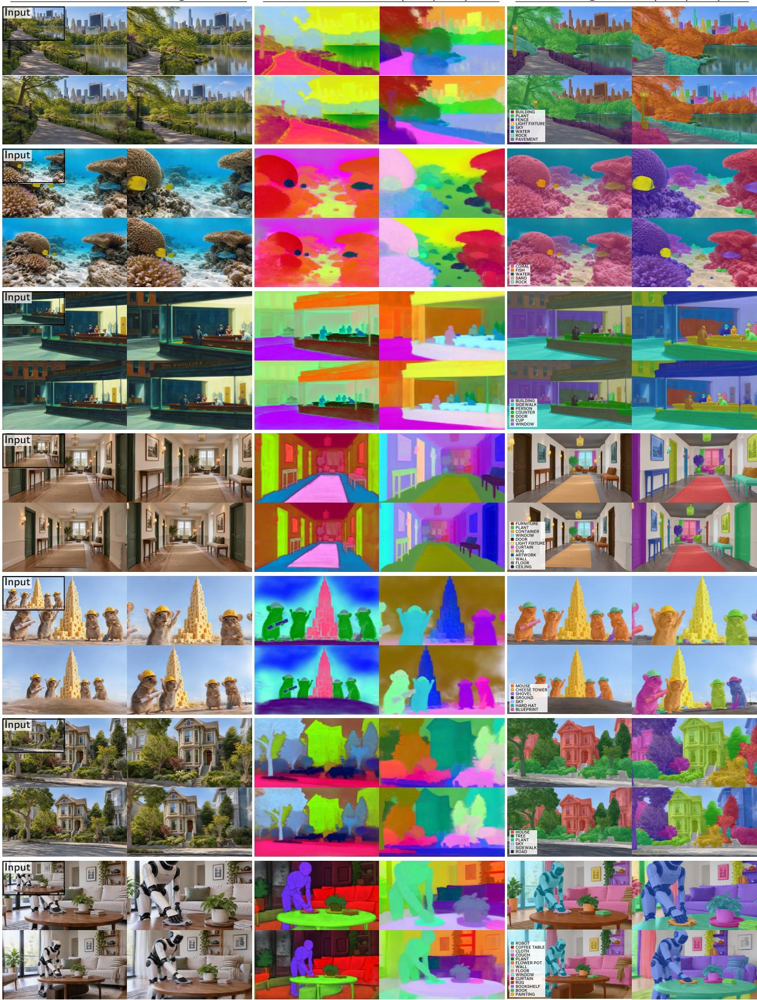  
Figure 4: LucidLyra qualitative results. We visualize input- and novel-view 3DGS [28] renderings across RGB, semantic/instance feature PCAs, and open-vocabulary/instance segmentation for generated input images.

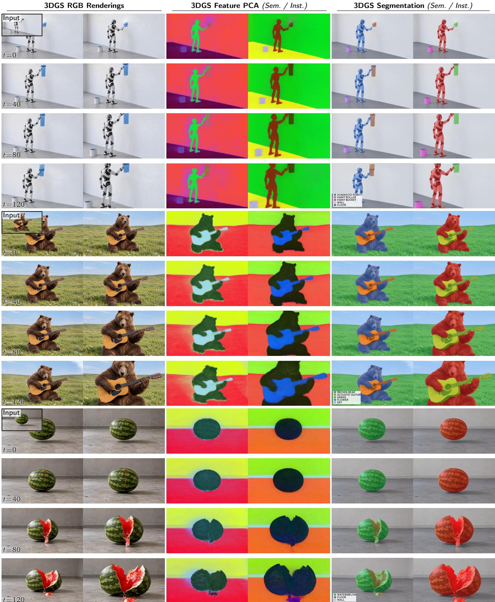  
Figure 5: Dynamic LucidLyra qualitative results. We visualize input- and novel-view 3DGS renderings across RGB, semantic/instance feature PCAs, and open-vocabulary/instance segmentation for generated input videos.

## C.2. Hierarchical Instance Segmentation

LucidLyra infers two levels of instance representations that we aim to analyze qualitatively in Fig. 10. The main object-level instance features group scene entities, while additional part-level features expose finer regions within the recovered objects. The qualitative results reveal a consistent feature hierarchy across all examples: object-level instance features remain similar over the spatial extent of an object, enabling clustering to recover a single instance mask, whereas part-level features preserve finer variations that distinguish individual object components. Because these representations form continuous feature fields, occasional grouping errors may still occur. While open-vocabulary querying and object-level instance segmentation provide the foundation for interacting with our generated scenes, part-level features ofer a lightweight extension that enables finer-grained control over individual object components.

3DGS RGB Renderings  
3DGS Feature PCA (Sem. / Inst.)  
3DGS Segmentation (Sem. / Inst.)  
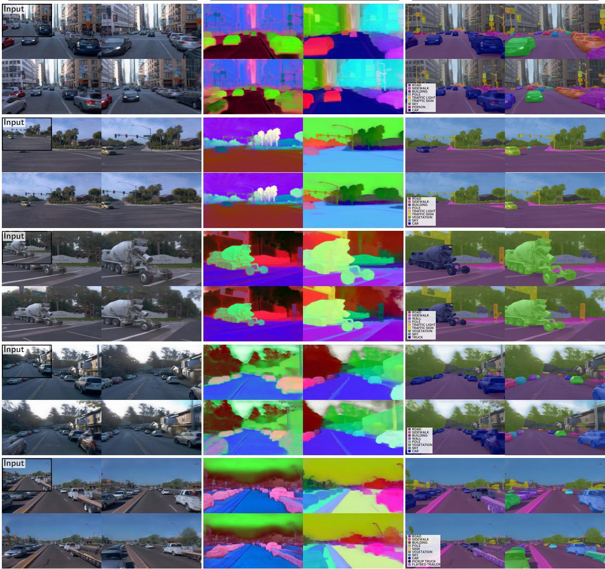  
Figure 6: Waymo qualitative examples. Each two-row block shows one scene from four viewpoints. Paired columns show RGB, semantic/instance feature PCA, and semantic/instance segmentation. Insets show the original input images.

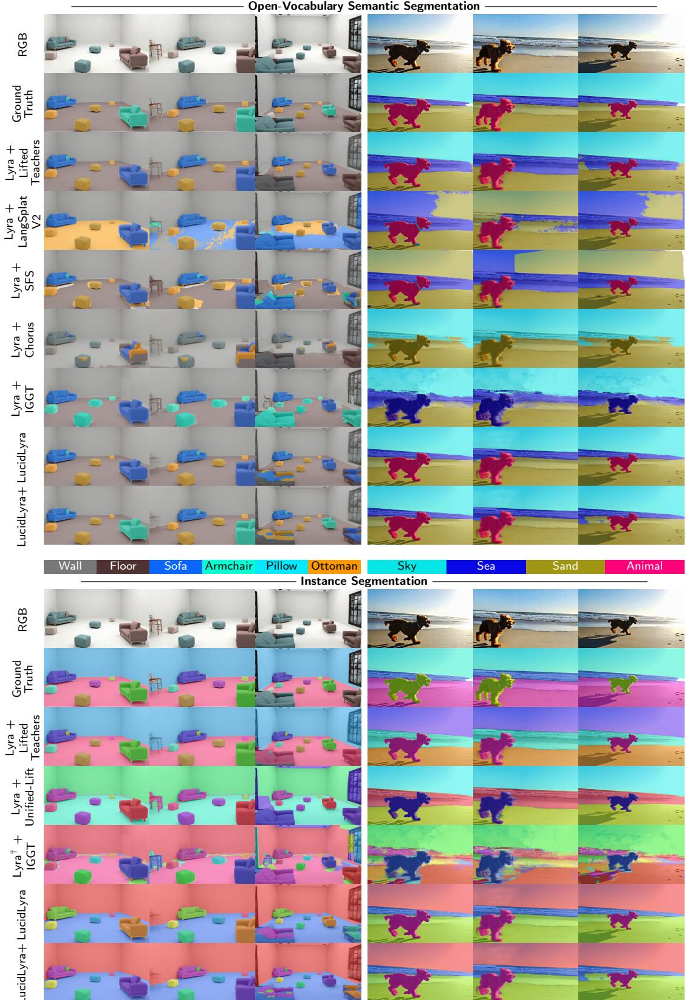  
Figure 7: Qualitative comparison on LucidLyra-SDG Static eval. We show three viewpoints per scene, with semantic predictions above and instance predictions below. † denotes directly using generated multi-view RGB [2].

Open-Vocabulary Semantic Segmentation  
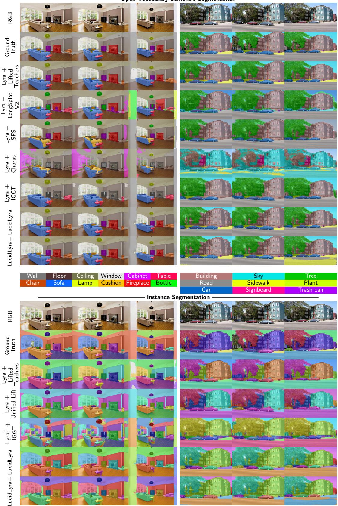  
Figure 8: Qualitative comparison on LucidLyra-ADE20K static eval. We show three viewpoints per scene, with semantic predictions above and instance predictions below. † denotes directly using generated multi-view RGB.

RGB Reconstruction  
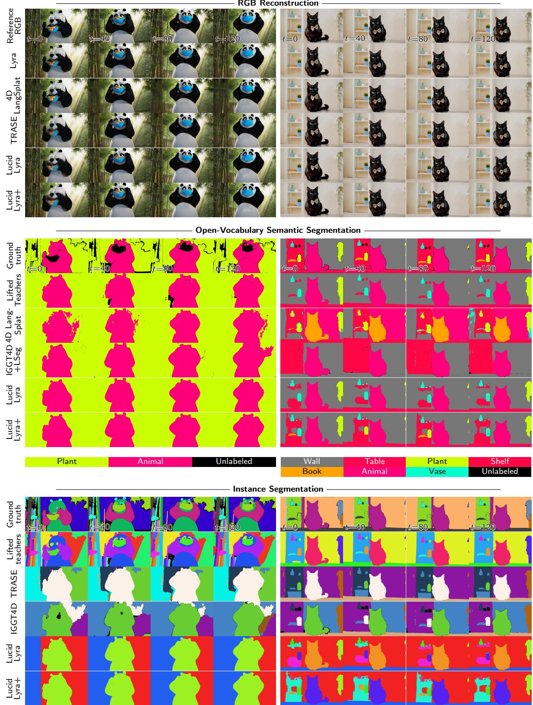  
Figure 9: Qualitative comparison on the dynamic evaluation set. We show times � = 0, 40, 80, 120 along an orbiting camera trajectory. Both scene time and camera pose change. From top to bottom: RGB reconstruction, semantic segmentation, and instance segmentation. IGGT4D uses LSeg [39] for semantic predictions. Dynamic Lyra supplies the reconstruction used by the lifted-teacher baseline. Instance ID colors are random per method.

3DGS RGB Render  
3DGS Instance Feature PCA (Object-/Part-Level)  
3DGS Instance Segmentation (Object-/Part-Level)  
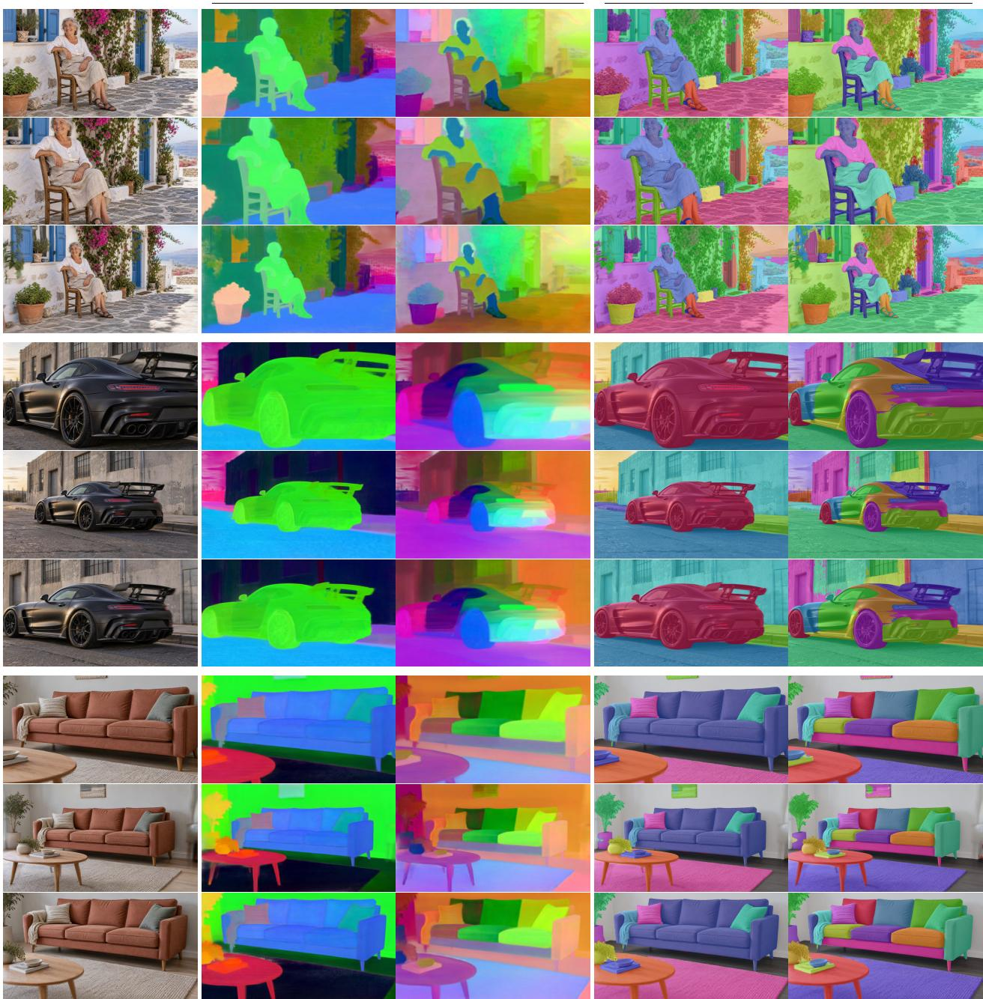  
Figure 10: Object- and part-level instance segmentation. We visualize 3 views per scene, showing 3DGS RGB render, object- and part-level 3DGS feature PCA, 3DGS object clusters, and within-object part clusters. Random colors denote cluster IDs.

## D. Downstream Applications

LucidLyra generates structured, queryable scenes that support diverse downstream applications. In the following section, we demonstrate this capability through examples of robotic simulation, 3D scene editing, and 3D asset mining. See our project website for video demos.

## D.1. Robot Simulation

We extract a mesh from the LucidLyra depth maps and camera parameters by computing a signed distance field on a hierarchy of sparse grids. We use the generated scene, extracted mesh and the semantic labels to set up a simulation in NVIDIA IsaacSim [60]. For navigation, the semantic labels partition the scene into free space and obstacles, over which we build an occupancy grid and plan a route to a semantically specified goal using a clearance-weighted Dijkstra search. A robot (Unitree G1 humanoid) then follows this route with a pure-pursuit controller while a learned rough-terrain locomotion policy drives its joints under full rigid-body physics. The humanoid also carries a box rigidly attached near its torso to demonstrate loco-manipulation. For manipulation, the LucidLyra semantic labeling localizes a kitchen counter and sink in a separate reconstruction, from which we derive a mount pose and reach-constrained pick-and-place targets for a stationary Franka robotic arm. The arm is simulated with full articulated-body dynamics and a friction-based parallel-jaw grasp under diferential inverse-kinematics control, picks a small synthetic object (a sphere) from the sink and places it on the counter. The extracted mesh serves as the collision proxy during simulation, while the original Gaussian-splat reconstruction [28] is rendered for visual fidelity. Figure 11 visualizes the simulation examples.

## D.2. 3D Scene Editing

We implement a simple browser-based editor. The user can select objects through text queries or clicks. Text selection intersects the predicted semantic class with an instance ID, thereby separating objects of the same category, while click selection retrieves the semantic–instance pair of the Gaussian center nearest the camera ray. Users can further refine the selection using separate similarity thresholds for Gaussian semantic and instance features relative to prototypes computed from the initial support.

Translation, rotation, scaling, duplication, and deletion operate directly on the selected Gaussian parameters. Transformations are applied around the selection centroid and update positions, anisotropic scales, and orientation quaternions, while color, opacity, and learned features remain attached to each primitive. Duplication appends a transformed copy, whereas deletion removes the selected primitives. Moving or deleting an object can expose unobserved regions. After the user commits all edits, OmniPaint [108] inpaints the original object support, and a subsequent LucidLyra forward pass reconstructs a clean background scene. We retain only reconstructed Gaussians near the edit whose projections fall within the exposed source support, excluding the transformed object’s footprint. Opacity tapering converts these Gaussians into a smoothly blended local background patch. Figure 12 visualizes our GUI as well as editing examples.

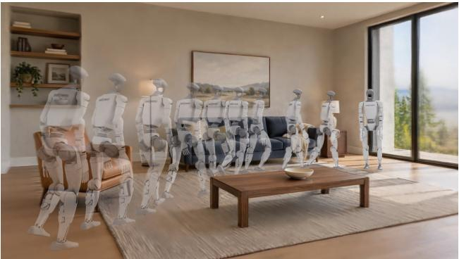

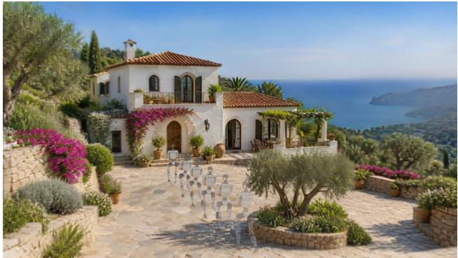

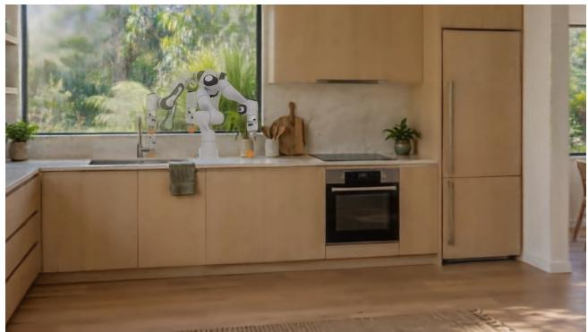  
Figure 11: Robot simulation in NVIDIA Isaac Sim using LucidLyra scenes. Four diferent robot-simulation scenarios built on LucidLyra reconstructions. Extracted geometry provides collision surfaces, semantic labels support task planning, and Gaussian-splat rendering preserves the scene appearance. Overlaid robot poses show motion over time, with increasing opacity indicating temporal progression.

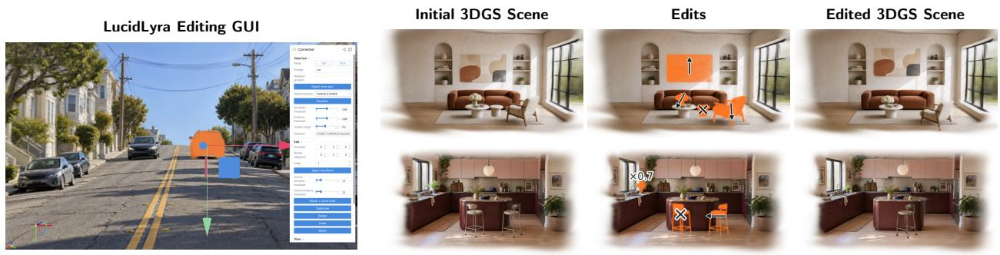  
Figure 12: LucidLyra 3DGS Scene Editing. Left: Our GUI provides an interface for natural interaction with the generated Gaussian scenes. Gaussians are selected via text prompts or via clicking and can then be manipulated interactively. Right: Editing examples showing the initial 3DGS scene, the applied edits and the final scene.

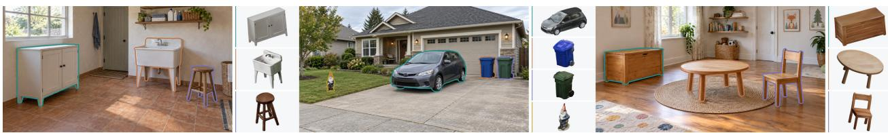  
(a) Asset selection and extraction.

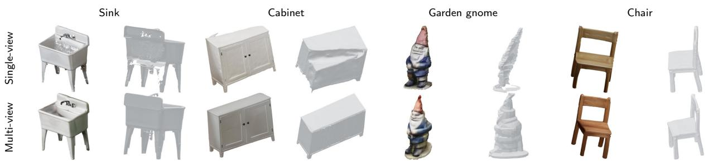  
(b) Single-view vs. multi-view reconstruction.

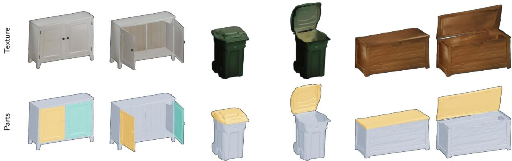  
(c) Estimated articulation of extracted assets.  
Figure 13: Asset extraction and articulation. (a) Selected instances alongside their textured reconstructions. Display scales are independent. (b) Selected single-view (top) and multi-view (bottom) Pixal3D results. Each result pairs a textured view with an alternate neutral-material view. (c) Articulated assets shown closed and open, with original textures and part segmentation color. Part boundaries and hinges are obtained through PARTICULATE [44] on the generated asset meshes. Doors open to 85∘ and lids to 75∘ for illustration, not as measured joint limits.

## D.3. 3D Asset Mining

Much like in 3D scene editing, we can make use of the generated appearance from multiple views, together with the instance and semantic segmentation masks, to mine high-quality 3D assets from the generated scenes.

For each selected object, we extract six segmented views, prioritizing viewpoint diversity and object coverage without occlusion. The segmented RGB observations together with the corresponding camera parameters are provided to the pretrained Pixal3D [41] multi-view reconstruction model to produce a textured mesh. Figure 13a presents assets extracted from LucidLyra scenes. Comparisons in Fig. 13b show that the incorporation of multi-view observations can substantially improve structural consistency compared to single-view reconstruction without LucidLyra.

Furthermore, the generated meshes can also be post-processed by mesh-to-articulation pipelines. In Fig. 13c, we employ PARTICULATE [44] to estimate moving parts and the corresponding articulation kinematic tree.

## E. Datasets and Annotations

We augment the PhysicalAI-SpatialIntelligence-Lyra-SDG [2] with semantic and instance targets. For evaluation, we introduce three benchmarks based on PhysicalAI-SpatialIntelligence-Lyra-SDG and ADE20K [114].

## E.1. Static Datasets

Training data. The static Lyra-SDG corpus comprises 59 031 image-conditioned scenes spanning highly diverse indoor and outdoor environments, people, animals, and various imaginative settings. Each scene provides six generated camera trajectories of 121 frames at 704×1 280, together with depth, camera parameters, and video latents. Figure 14 visualizes random training data samples.

Evaluation data. LucidLyra-SDG contains 25 manually curated diverse scenes held out from the training data. To obtain high-quality reference annotations, we use an ensembled version of our SAM [34]/SAM2 [71] instance preprocessing, combined with human review, refinement, and assignment of ADE20K semantic labels. The resulting labels and persistent identities provide references across all six generated trajectories. Figure 15 shows annotated examples.

LucidLyra-ADE20K uses 25 diverse ADE20K validation images [114], selected for scene-category diversity. Gen3C [72] expands each image into six 121-frame videos. We use a SAM2 ensemble to propagate the original semantic and instance ground-truth labels through all camera trajectories, followed by human review and refinement. Figure 16 shows example scenes.

## E.2. Dynamic Dataset

Training data. The dynamic Lyra-SDG corpus comprises 7 378 video-conditioned scenes. Generation from the original and temporally reversed input video provides two complementary six-trajectory batches, each containing 121 synchronized frames per trajectory. Targets are constructed within each batch, keeping their independently initialized track IDs separate. Figure 17 illustrates training scenes across viewpoints and time.

Evaluation data. LucidLyra-SDG Dynamic contains 25 diverse curated scenes excluded from the training set.   
Annotation follows the static setup. Figure 18 visualizes annotated examples.

## F. Related Work

Below, we discuss further related work not covered in the main paper.

## Dynamic representations

Dynamic semantic and instance representations have likewise focused on captured video, spanning per-sequence optimization and feed-forward reconstruction. 4D LangSplat [46] fits language features to deformable 4D Gaussians, whereas TRASE [51] learns an instance field from per-frame masks. Related methods distill foundation-model features or temporal cues into scene-specific dynamic representations [12, 20, 24, 27, 37, 96, 115]. Feed-forward approaches amortize language-aligned dynamic reconstruction [68, 97], while IGGT4D [118] jointly predicts streaming geometry and persistent instances.

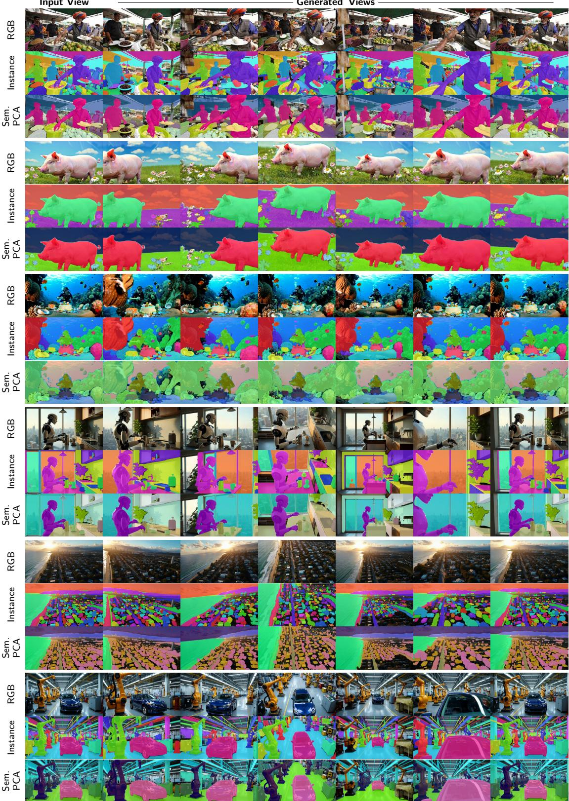  
Figure 14: LucidLyra-SDG static training data. RGB frames, instance tracks, and PCA visualizations of semantic teacher features across generated camera trajectories.

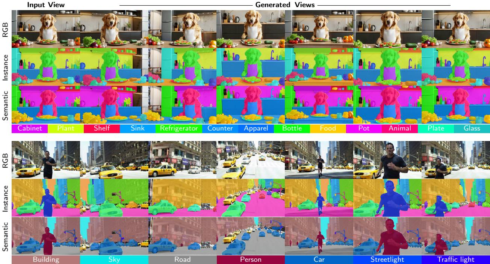  
Figure 15: LucidLyra-SDG static evaluation data. RGB frames and reference semantic and instance annotations for the conditioning view and generated viewpoints.

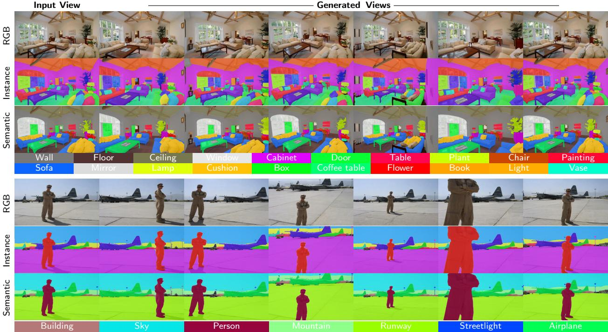  
Figure 16: LucidLyra-ADE20K evaluation data. Real conditioning images and generated viewpoints with semantic and instance annotations propagated from oficial ADE20K labels.

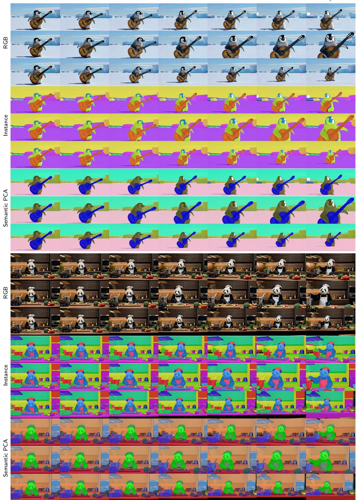  
Figure 17: LucidLyra-SDG dynamic training data. RGB frames, instance tracks, and PCA visualizations of semantic teacher features across viewpoints and time.

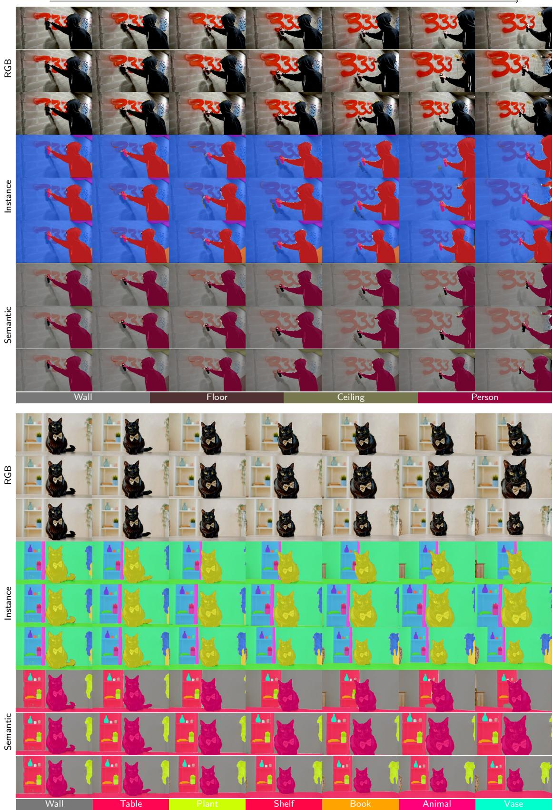  
Figure 18: LucidLyra-SDG dynamic evaluation data. RGB frames with reference semantic and instance annotations from dynamic evaluation scenes.