# MLLM-GS: Multimodal Large Language Model Prior-Guided Fast Novel View Synthesis in Extreme Environments

Zhiliang Wu1, Xinye Zheng2, Kun Li3\*, Fei Wang2\*, Hao Guo2, Yanyan Wei4, Guanghui Yue5, Beier Zhu6, Wei Zhou7, Xun Yang6

1Nanyang Technological University, Singapore, Singapore. Nanyang Technological University, Singapore, Singapore.

2Institute of Artificial Intelligence, Hefei Comprehensive National Science Center, Hefei, China. 3United Arab Emirates University, Abu Dhabi, United Arab Emirates. 4Hefei University of Technology, Hefei, China. 5Shenzhen University, Shenzhen, China. 6University of Science and Technology of China, Hefei, China. 7Cardif University, Cardif, United Kingdom.

\*Corresponding author(s). E-mail(s): kun.li@uaeu.ac.ae; jiafei127@gmail.com;

## Abstract

Novel view synthesis (NVS) in degraded scenes aims to reconstruct 3D scenes from multi-view observations afected by various degradations, and to generate clear and photorealistic images at unseen viewpoints. Despite recent advances, existing methods often rely on degradation-specific models, limiting their generalization across diverse extreme environments. Generative models provide rich visual priors, but their outputs often sufer from pixel misalignment and color deviations, which can propagate into the reconstructed 3D scene and compromise reconstruction quality. Furthermore, the high computational and memory costs of 3D reconstruction hinder the practical application of NVS in extreme environments. To this end, we propose MLLM-GS, a multimodal large language model (MLLM) prior-guided framework for fast NVS in extreme environments. MLLM-GS consists of two branches: MLLM prior-guided view enhancement and fast 3D scene reconstruction. The former leverages the rich visual priors of a frozen MLLM to enhance views under diferent severe degradations and introduces a lightweight correction network to reduce pixel shifts and color distortions in MLLM outputs. With supervision from only a few paired clean views, this branch produces reliable enhanced views for all degraded observations, providing pseudo-GT views for subsequent 3D reconstruction. The latter improves 3DGS eficiency by optimizing rasterization, Gaussian memory layout, and parameter updates, reducing redundant computation, memory-access overhead, and optimization costs. Extensive experiments on multiple degraded scenes demonstrate that MLLM-GS efectively handles various severe degradations and achieves high-quality NVS with significantly lower reconstruction time and memory consumption. Project Page: https://MLLM-GS.github.io.

Keywords: Novel view synthesis, Degraded scenes, 3D Gaussian Splatting, Multimodal large language model

## 1 Introduction

Novel view synthesis (NVS) (Yu et al. 2026b; Liu et al. 2026b; Li et al. 2025b) aims to model a 3D scene from existing multi-view observations and generate photorealistic images at unseen camera viewpoints. It requires not only accurate scene geometry and appearance, but also spatial consistency and high visual quality across diferent views (Bao et al. 2026; Guo et al. 2025). By enabling 3D scene modeling and free-viewpoint rendering, NVS supports a wide range of applications, including virtual reality (Yu et al. 2024), digital twins (Plizzari et al. 2024), robotic perception (Lei et al. 2025), autonomous driving (Zhou et al. 2026a), and digital content creation (Dai et al. 2025). With the rapid advancement of immersive visual applications and 3D intelligence, NVS has become an important topic in computer vision and computer graphics (Gao et al. 2026b; Yu et al. 2026b).

Early NVS methods synthesize novel views by image interpolation (Chen and Williams 1993), view reprojection (Seitz and Dyer 1996), and explicit geometric reconstruction (Debevec et al. 1996). Such pipelines often rely on accurate camera poses, cross-view correspondences, and scene geometry. As a result, they can produce noticeable rendering errors under large viewpoint variations, complex occlusions, or inaccurate geometry estimation. With the development of deep learning, researchers began to learn continuous scene representations with neural networks, reducing the dependence on explicit geometric reconstruction. Among these approaches, Neural Radiance Fields (NeRF) (Mildenhall et al. 2021) implicitly models the mapping from spatial positions and viewing directions to color and density, and uses volume rendering to synthesize high-quality novel views. NeRF significantly improves the representation capacity and rendering fidelity in complex scenes, and many follow-up methods (Chen et al. 2023; Liu et al. 2026c; Levy et al. 2023; Cui et al. 2024b) have been developed based on NeRF. However, NeRF requires dense sampling along camera rays and a large number of network evaluations, resulting in long optimization times and making real-time rendering dificult.

Recently, 3D Gaussian Splatting (3DGS) (Kerbl et al. 2023) has emerged as an important approach for NVS. Unlike NeRF-based methods that represent a scene with implicit neural networks, 3DGS models scene geometry and appearance using a set of explicit 3D Gaussian primitives and directly projects them onto the image plane through diferentiable rasterization. Benefiting from its explicit scene representation and eficient splatting-based rendering, 3DGS significantly reduces optimization and rendering costs while maintaining high rendering quality. Subsequent studies (Yang et al. 2025a; Hahlbohm et al.

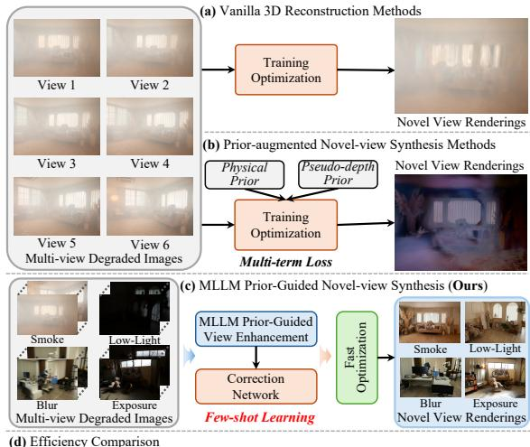

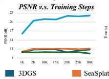

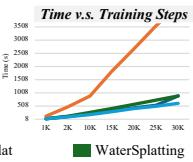

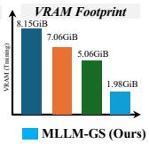  
Fig. 1: Illustration of three diferent pipelines for NVS under degraded conditions. (a) Vanilla reconstruction, (b) prior-augmented reconstruction, and (c) the proposed MLLM prior-guided pipeline. (d) Eficiency comparison with previous representative methods.

2026; Ren et al. 2026; Lee et al. 2026) have further improved 3DGS in terms of rendering quality, representation capability, and computational eficiency, establishing it as a practical paradigm for high-quality and eficient NVS.

Despite these advances, existing 3DGS-based methods still heavily rely on high-quality multiview observations (Li et al. 2025a; Cui et al. 2025). In extreme environments involving smoke, low light, motion blur, and exposure variations, image structure, texture, and color information can be severely degraded. Such degradations weaken the visual features required for accurate geometry estimation and appearance modeling, leading to structural errors, missing textures, and color distortions in reconstructed scenes. As illustrated in Fig. 1, existing NVS methods (Lin et al. 2025; Liu et al. 2025a; Lee et al. 2024; Liu et al. 2025b) for degraded scenes mainly address these problems by introducing physical priors into the reconstruction process. However, these methods typically rely on degradation-specific imaging models and assumptions. As diferent degradations follow distinct imaging mechanisms, such assumptions may not hold under unknown or mixed degradation conditions, limiting their generalization in extreme environments. Consequently, existing approaches struggle to achieve robust NVS across diverse extreme environments within a unified framework.

An intuitive solution is to restore degraded images before performing 3D reconstruction. However, conventional image restoration networks (Yue et al. 2025; Wang et al. 2026a; Wu et al. 2026b; Long et al. 2026) are typically trained on large-scale paired datasets and often specialize in particular degradation types. Therefore, their performance can be limited by variations in degradation distributions or the lack of suficient paired clean images. This problem is particularly challenging in real-world extreme environments, where acquiring clean observations corresponding to all degraded viewpoints is often dificult. Recent generative models (Wei et al. 2026; Li et al. 2026; Zhu et al. 2025; Jiang et al. 2026) ofer a promising alternative by leveraging rich visual priors learned from large-scale data to recover plausible scene structures and textures under diverse degradation conditions. Nevertheless, their generation processes generally lack strict pixel-level constraints and may introduce spatial misalignment, altered textures, and color deviations. Although the restored images may appear visually realistic, pixel misalignment and color deviations can make them inconsistent with the underlying scene geometry and appearance (Zhao et al. 2026; Yang et al. 2025b). When these images are used to supervise 3D reconstruction, such errors can propagate into the learned 3D representation, leading to structural distortions and appearance inconsistencies in novel-view renderings. Therefore, efective NVS in extreme environments requires not only recovering visually plausible content but also improving the pixel-level fidelity of restored images under limited clean-image supervision.

Beyond reconstruction quality, computational eficiency remains another important challenge for NVS in severely degraded scenes. Although view enhancement improves the quality of degraded observations, residual artifacts and cross-view inconsistencies can still disrupt Gaussian optimization and induce redundant densification (Lyu et al. 2026; Zhou et al. 2026b). The resulting increase in Gaussian primitives can further exacerbate the computational and memory overhead of standard 3DGS (Kerbl et al. 2023). First, its conservative screen-space bounding regions include many pixels receiving negligible Gaussian contributions, resulting in unnecessary rasterization operations. Second, its adaptive densification and pruning can scatter spatially neighboring Gaussians across memory, reducing memory-access eficiency. Third, updating diferent Gaussian attributes through separate optimization operations introduces additional kernel launches and global memory accesses. Although recent acceleration methods (Ren et al. 2026; Hahlbohm et al. 2026; Hanson et al. 2025a) have improved 3DGS eficiency, these strategies have mainly been developed and evaluated using high-quality observations. Their efectiveness in degraded scenes remains insuficiently explored. Therefore, achieving both high-quality reconstruction and low computational cost under diverse severe degradations remains challenging.

In this paper, we propose MLLM-GS, a multimodal large language model (MLLM) prior-guided framework for fast NVS in extreme environments. MLLM-GS consists of two branches: MLLM priorguided view enhancement and fast 3D scene reconstruction. The former leverages the visual priors of MLLMs to generate reliable pseudo-GT views from degraded observations, thereby alleviating the scarcity of reliable supervision for 3D reconstruction. Specifically, we employ a frozen MLLM to generate corresponding enhanced views from degraded observations under diverse degradation conditions. In this way, the framework exploits the rich visual priors of the MLLM to handle multiple degradations in a unified manner, avoiding the need for degradation-specific restoration models. Indeed, a similar prior-based enhancement strategy was also validated in the NTIRE 2026 3D Restoration and Reconstruction Challenge (Liu et al. 2026a), where our Smoke-GS (Zheng et al. 2026) solution achieved second place in Track 2. However, the MLLM generation process lacks strict pixel-level constraints and may introduce pixel shifts and color distortions. To address this issue, we further design a lightweight correction network. The network refines the MLLM-enhanced results in a color space that decouples luminance and chrominance, enabling more efective correction of pixel misalignment and color distortions. By leveraging the pretrained visual priors of a frozen MLLM and training only the lightweight correction network, the view enhancement branch can be efectively optimized using a few paired clean views. In this way, the view enhancement branch reduces structural and color distortions in the restored images, providing more reliable pseudo-GT supervision for subsequent 3DGS optimization.

After obtaining reliable pseudo-GT views, we further focus on reducing the computational and memory overhead of 3DGS during scene reconstruction. To this end, we design a fast 3D scene reconstruction branch and accelerate the optimization process from three aspects: rasterization, memory layout, and parameter updates. Specifically, we adopt opacity-aware axis-aligned rectangular bounding boxes to reduce unnecessary rasterization computations. We reorder active Gaussians using Morton codes to improve memoryaccess eficiency for spatially adjacent Gaussians, and fuse the Adam updates of diferent parameter groups into a single CUDA kernel to reduce kernel launches and global memory access. With these designs, MLLM-GS significantly improves the optimization eficiency of 3DGS while maintaining high reconstruction quality. Extensive experiments demonstrate that MLLM-GS consistently achieves high-quality NVS under diverse degradations. Compared with baselines trained for 30K iterations, MLLM-GS achieves superior reconstruction quality with only 5K iterations, reducing training time by approximately 9× while consuming substantially less GPU memory.

Our main contributions can be summarized as:

• We propose MLLM-GS, a unified framework for fast NVS in extreme environments. It combines MLLM prior-guided view enhancement with fast 3D reconstruction to enable high-quality NVS across diverse severe degradations using only a few paired clean views.

• We develop an MLLM prior-guided view enhancement branch that leverages the visual priors of a frozen MLLM to restore degraded views. A lightweight correction network reduces residual structural and color errors under few-shot supervision, providing reliable pseudo-GT views for 3D reconstruction.

• We design a fast 3D scene reconstruction branch that improves 3DGS eficiency by optimizing rasterization, memory layout, and parameter updates, enabling faster scene reconstruction in degraded scenes.

• We conduct extensive experiments across multiple severe degradation scenarios, including smoke, low light, motion blur, and exposure variations. Experimental results demonstrate that MLLM-GS achieves high-quality NVS while substantially reducing reconstruction time and GPU memory consumption compared with representative methods.

## 2 Related Work

## 2.1 NVS in Degraded Scenes

3DGS (Fei et al. 2025; Ren et al. 2026; Zhang et al. 2024; Sabour et al. 2025; Wang et al. 2025; Lee et al. 2026; Chen et al. 2025; Song et al. 2025; Wang et al. 2026c) has become an efective representation for 3D reconstruction and NVS, achieving high-quality rendering with relatively low computational cost. However, standard 3DGS (Kerbl et al. 2023) relies on reliable multi-view observations, and its performance can degrade substantially under severe imaging conditions, such as smoke, low light, and motion blur (Liu et al. 2026a; Guo et al. 2026). To address this limitation, recent studies (Yoon and Yoon 2026; Lin et al. 2025; Liu et al. 2025a; Lee et al. 2024; Yu et al. 2026b; Liu et al. 2025b; Yan et al. 2026) have introduced physical priors into 3DGS to improve reconstruction from degraded observations. For example, DehazeGS (Yu et al. 2026a) integrated an atmospheric scattering model into Gaussian primitives, and jointly estimated transmission and atmospheric light to recover clear scene appearances from hazy images. RestorGS (Qiao et al. 2025) decoupled scene appearance from degradation efects and introduced depth-guided selfsupervision to improve reconstruction quality. WaterSplatting (Li et al. 2025a) extended Gaussian representations with a volumetric medium field to model underwater backscattering efects.

Although these methods improve reconstruction under specific degradation conditions, they typically rely on degradation-specific imaging models and assumptions. Since diferent degradations arise from distinct imaging mechanisms, these assumptions may not hold under unknown or mixed degradations, limiting their generalization across diverse extreme environments. In contrast, our method leverages the general visual priors of a pretrained MLLM to enhance observations under diferent degradation conditions without requiring degradation-specific imaging models, thereby providing more reliable supervision for subsequent 3D reconstruction.

## 2.2 Generative Priors for Restoration and Reconstruction

Recent advances in generative modeling (Conde et al. 2024; Lin et al. 2024; Yılmaz et al. 2026; Fei et al. 2026; Gu et al. 2026; Wu et al. 2026a; Tang et al. 2026; Wang et al. 2026b) have opened new opportunities for image restoration. Unlike conventional restoration networks (Zhang et al. 2025; Gao et al. 2026a; Jiang et al. 2025; Zhang et al. 2026; Jin et al. 2025; Cui et al. 2026; Li et al. 2025c) that often specialize in specific degradation types, generative models leverage rich visual priors to handle diverse degradations. InstructIR (Conde et al. 2024) introduced instructionconditioned restoration for multiple degradation tasks. DifBIR (Lin et al. 2024) employed difusion priors to recover realistic image details, while Edit2Restore (Yılmaz et al. 2026) explored adapting image editing models to restoration tasks.

Recent studies (Wei et al. 2026; Li et al. 2026; Zhu et al. 2025; Jiang et al. 2026) further demonstrated the potential of general generative models for image restoration across diverse degradations. Such restoration strategies have also been explored for 3D reconstruction. For example, Smoke-GS (Zheng et al. 2026) leveraged generative visual priors to enhance degraded observations for subsequent reconstruction. GenSmoke-GS (Cao et al. 2026) and Dehaze-then-Splat (Chen and Wang 2026a) investigated restoration-assisted reconstruction in smoky scenes, while NAKA-GS (Zhu et al. 2026) addressed reconstruction under low-light conditions. However, generative restoration models may introduce pixel misalignment and color deviations (Sun et al. 2026; Zhao et al. 2026), which can propagate into 3D reconstruction and compromise geometry and appearance consistency (Liu et al. 2026a; Wang et al. 2026d). To address this limitation, our method combines the visual priors of a frozen MLLM with a lightweight correction network trained using only a few paired clean views, providing more reliable pseudo-GT supervision for 3D reconstruction.

## 2.3 Eficient 3DGS

Although 3DGS enables eficient rendering, its adaptive density control can introduce a large number of Gaussian primitives, resulting in substantial computational and memory overhead. To improve eficiency, existing studies (Chen and Wang 2026b; Jiao et al. 2026; Ren et al. 2026; Hahlbohm et al. 2026) have explored reducing redundant Gaussian growth, accelerating rasterization, and optimizing the training process. For instance, Mini-Splatting (Fang and Wang 2024) introduced spatially aware densification and Gaussian simplification to concentrate primitives in informative regions. Taming 3DGS (Mallick et al. 2024) combined gradient information with auxiliary signals to guide Gaussian growth and reduce redundant densification. LightGaussian (Fan et al. 2024) reduced the number of primitives through opacity- and volume-based pruning, while PUP-3DGS (Hanson et al. 2025b) employed sensitivity scores to identify and remove redundant components from pretrained representations. Beyond Gaussian reduction, Speedy-Splat (Hanson et al. 2025a) improved rasterization eficiency by tightening Gaussian tile coverage to avoid unnecessary computations. Faster-GS (Hahlbohm et al. 2026) further accelerated 3DGS optimization through eficient backward propagation, localitypreserving Gaussian reordering, and fused parameter updates. Other studies (Lan et al. 2025; Pehlivan et al. 2026; Ye et al. 2025) further explored eficient optimization and GPU implementations to reduce the computational cost of 3DGS.

Despite these advances, existing acceleration methods have primarily been developed and evaluated using high-quality observations. In degraded scenes, residual artifacts and cross-view inconsistencies may persist even after view enhancement, potentially disrupting Gaussian optimization and inducing redundant densification. This can further increase rasterization costs and memoryaccess overhead during reconstruction. However, the efectiveness of existing acceleration strategies under such conditions remains insuficiently explored. To address this challenge, we investigate eficient 3DGS optimization in degraded scenes by optimizing rasterization, memory layout, and parameter updates to reduce redundant computation and memory-access overhead.

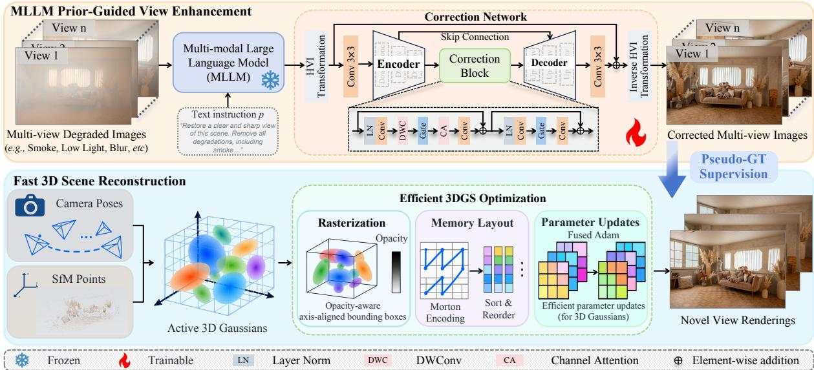  
Fig. 2: Overall pipeline of the proposed MLLM-GS framework. It consists of two branches: MLLM prior-guided view enhancement and fast 3D scene reconstruction. The former combines a frozen MLLM with a lightweight correction network trained using a few paired clean views to generate reliable pseudo-GT views for subsequent 3D reconstruction. The latter accelerates 3DGS optimization through eficient rasterization, memory layout, and parameter updates, enabling fast and high-quality NVS.

## 3 Methodology

## 3.1 Problem Formulation

Let $\begin{array} { r c l } { { \pmb X } } & { { = } } & { { \left\{ \pmb x _ { 1 } , \pmb x _ { 2 } , \dots , \pmb x _ { n } \right\} } } \end{array}$ denote degraded images $( e . g .$ , smoke, low light, defocus blur, motion blur, exposure variation) of a scene captured from n diferent views, where $\pmb { x } _ { i } \in \mathbb { R } ^ { h \times w \times 3 }$ The corresponding camera poses are denoted by $\textbf { \scriptsize H } = \{ \pi _ { 1 } , \pi _ { 2 } , . . . , \pi _ { n } \}$ . We assume that only a small subset of degraded views has corresponding clean images. Without loss of generality, we denote these paired clean images as $\textbf { \textit { C } } = \ \{ c _ { 1 } , c _ { 2 } , . . . , c _ { m } \}$ . They correspond to $\{ \pmb { x } _ { 1 } , \pmb { x } _ { 2 } , \dots , \pmb { x } _ { m } \}$ , where $m \ll n .$ Our goal is to learn a reliable 3D scene representation $\mathcal { G } _ { \theta }$ from the degraded observations $\pmb { X }$ using only a few paired clean images for supervision, and to synthesize a clean novel view at an unseen camera pose $\pi _ { t } \notin \Pi$

$$
\widehat { \pmb { y } } _ { t } = \mathcal { G } _ { \boldsymbol { \theta } } ( \pmb { \pi } _ { t } ) \in \mathbb { R } ^ { h \times w \times 3 } .\tag{1}
$$

The rendered view $\widehat { \mathbf { y } } _ { t }$ should be consistent with the corresponding clean ground truth image $\pmb { y } _ { t } \in \mathbb { R } ^ { h \times w \times 3 }$ . It should faithfully reflect the scene geometry and view-dependent appearance, and preserve realistic textures and colors.

To achieve this goal, we propose MLLM-GS, a framework for fast NVS in extreme environments. As illustrated in Fig. 2, MLLM-GS consists of two branches: MLLM prior-guided view enhancement (Section 3.2) and fast 3D scene reconstruction (Section 3.3). The former leverages the rich visual priors of a frozen MLLM to enhance degraded observations and employs a lightweight correction network to reduce pixel misalignment and color distortions under few-shot supervision. This branch generates reliable pseudo-GT views for all degraded observations, providing supervision for subsequent 3D reconstruction. The latter reconstructs the 3D scene using these pseudo-GT views and improves 3DGS optimization eficiency in terms of rasterization, memory layout, and parameter updates. By combining reliable view enhancement with eficient 3D reconstruction, MLLM-GS enables high-quality and fast NVS across diverse severe degradations.

## 3.2 MLLM Prior-Guided View Enhancement

Images captured in extreme environments often sufer from severe degradations, including smoke, low light, defocus blur, motion blur, and exposure variation. These degradations can damage both structural and color information. Directly using degraded views to supervise 3D reconstruction can introduce errors in both scene geometry and appearance, leading to suboptimal NVS results. An intuitive solution is to restore the views before reconstruction. However, existing restoration networks (Zhang et al. 2025; Jiang et al. 2025) typically require extensive paired training data and are often specialized for specific degradation types, limiting their applicability under diverse degradations. To address these limitations, we develop an MLLM prior-guided view enhancement branch that combines a frozen MLLM with a lightweight correction network. The MLLM leverages general visual priors to enhance observations under diverse degradations, while the correction network reduces residual structural and color distortions using only a few paired clean views. In this way, the branch extends limited clean supervision to all input views, providing reliable pseudo-GT images for subsequent 3D reconstruction.

Specifically, we first feed each degraded view $\mathbf { x } _ { i }$ and a text instruction p into a frozen MLLM $\mathcal { M } ( \cdot )$ to obtain an enhanced image $e _ { i } { : }$

$$
\begin{array} { r } { \pmb { e } _ { i } = \mathcal { M } ( \pmb { x } _ { i } , \pmb { p } ) . } \end{array}\tag{2}
$$

Although $e _ { i }$ recovers plausible scene structures and textures, it may still contain residual structural and color distortions. To reduce these errors, we further process $e _ { i }$ using the correction network illustrated in $\mathrm { F i g . ~ 2 }$ . The correction network first converts $e _ { i }$ into the Horizontal/Vertical-Intensity (HVI) color space (Yan et al. 2025). In RGB space, luminance and chrominance information are coupled, making it dificult to correct structural and color distortions separately. In contrast, the HVI color space separates luminance from chromatic information, allowing the network to model structural and color deviations more efectively. The transformation is formulated as

$$
\begin{array} { r } { \pmb { s } _ { i } = \pmb { \mathcal { T } } ( \pmb { e } _ { i } ) , } \end{array}\tag{3}
$$

where $\tau ( \cdot )$ denotes the HVI transform and $\mathbf { \boldsymbol { s } } _ { i }$ = $[ { \pmb h } _ { i } , { \pmb v } _ { i } , { \pmb d } _ { i } ] \in \mathbb { R } ^ { h \times w \times 3 }$ is the HVI representation of $e _ { i }$ $\mathbf { } _ { h _ { i } }$ and ${ \pmb v } _ { i }$ encode the chromatic information and di represents the luminance information.

Subsequently, the HVI representation $\mathbf { \boldsymbol { s } } _ { i }$ is projected into a high-dimensional feature space through a convolutional layer and processed by a U-Net to correct residual structural and color distortions. The encoder progressively extracts multi-scale features to capture both local details and contextual information. At the bottleneck, a correction block integrates depthwise convolution, a gating mechanism, and channel attention to further refine the encoded features. Depthwise convolution captures local spatial information, while the gating mechanism adaptively emphasizes features relevant to distortion correction. Channel attention further recalibrates feature responses across channels to improve the modeling of structural and color information. The decoder progressively restores the spatial resolution and integrates encoder features through skip connections to preserve fine-grained details. Finally, the corrected HVI representation $\widehat { \mathbf { s } } _ { i }$ is converted back to RGB space through the inverse HVI transformation, yielding the corrected view $\widehat { \pmb { c } } _ { i }$ :

$$
\widehat { \pmb { c } } _ { i } = T ^ { - 1 } ( \widehat { \pmb { s } } _ { i } ) .\tag{4}
$$

During training, the MLLM remains frozen, and only the lightweight correction network with approximately 4M parameters is optimized. By combining the pretrained visual priors of the frozen MLLM with few-shot supervised correction, the proposed branch can efectively refine the enhanced views using only a few paired clean images. The training objective combines a Charbonnier loss $\mathcal { L } _ { \mathrm { { C h a r } } } ( \cdot , \cdot )$ and a frequency-domain loss $\mathcal { L } _ { \mathrm { F r e q } } ( \cdot , \cdot )$ . The former minimizes pixel-level reconstruction errors, while the latter encourages the preservation of image details in the frequency domain. The overall loss is defined as

$$
\begin{array} { r } { \mathcal { L } _ { \mathrm { e n } } = \mathcal { L } _ { \mathrm { C h a r } } \big ( \widehat { \mathbf { c } } _ { i } , \mathbf { c } _ { i } \big ) + \lambda \mathcal { L } _ { \mathrm { F r e q } } \big ( \widehat { \mathbf { c } } _ { i } , \mathbf { c } _ { i } \big ) , } \end{array}\tag{5}
$$

where $\pmb { c } _ { i } \left( i \in \{ 1 , \cdots , m \} \right)$ denotes the corresponding clean ground-truth image and λ balances the two loss terms. After training, the enhancement branch is applied to all degraded observations to generate corrected views, which serve as pseudo-GT supervision for subsequent 3D reconstruction.

## 3.3 Fast 3D Scene Reconstruction

After view enhancement, the corrected views serve as pseudo-GT supervision for 3D scene reconstruction. However, residual artifacts and cross-view inconsistencies may still afect Gaussian optimization and induce redundant densification, increasing the computational and memory overhead of 3DGS. First, the conservative screen-space bounding boxes used in standard 3DGS include regions with negligible Gaussian contributions, resulting in unnecessary rasterization operations. Second, adaptive densification and pruning can scatter spatially neighboring Gaussians across memory, reducing memory-access eficiency. Third, updating diferent Gaussian attributes through separate optimization kernels introduces additional kernel launches and global memory accesses. Inspired by Faster-GS (Hahlbohm et al. 2026), we develop a fast 3D scene reconstruction branch that accelerates 3DGS optimization from three aspects: rasterization, memory layout, and parameter updates.

## 3.3.1 Rasterization

Standard 3DGS assigns a conservative square bounding box to each projected Gaussian, with its half-extent determined by the larger eigenvalue of the projected 2D covariance matrix. However, this bounding box can substantially overestimate the efective screen-space coverage, especially for anisotropic Gaussians. In degraded scenes, residual artifacts and cross-view inconsistencies in the enhanced views may induce redundant Gaussian densification, further increasing rasterization overhead. To reduce unnecessary computation, we adopt opacity-aware, axis-aligned rectangular bounding boxes that estimate the efective Gaussian extent along each screen axis separately.

Specifically, let o denote the opacity of a Gaussian primitive and $\Sigma _ { \mathrm { 2 D } }$ denote its projected 2D covariance matrix. Given an opacity truncation threshold $\tau _ { \alpha }$ , the half-extents along the horizontal and vertical directions are defined as

$$
\begin{array}{c} \begin{array} { r } { \left\{ r _ { x } = \sqrt { 2 \ln ( o / \tau _ { \alpha } ) \cdot \Sigma _ { \mathrm { 2 D } } ^ { ( 1 , 1 ) } } , \right.} \\ { r _ { y } = \sqrt { 2 \ln ( o / \tau _ { \alpha } ) \cdot \Sigma _ { \mathrm { 2 D } } ^ { ( 2 , 2 ) } } , } \end{array}   \end{array}\tag{6}
$$

where $\begin{array} { c c c } { { \tau _ { \alpha } } } & { { = } } & { { 1 / 2 5 5 . } } \end{array} \Sigma _ { 2 \mathrm { D } } ^ { ( 1 , 1 ) }$ and $\Sigma _ { \mathrm { 2 D } } ^ { ( 2 , 2 ) }$ represent the projected variances along the horizontal and vertical screen axes, respectively. Gaussians with $\textit { o } \ \leq \ \tau _ { \alpha }$ can be excluded because their maximum opacity contribution does not exceed the truncation threshold. By incorporating opacity into the extent estimation, the bounding region adapts to both the spatial distribution and opacity of each Gaussian. By excluding regions with negligible Gaussian contributions, this strategy reduces unnecessary Gaussian–tile intersections, sorting operations, and forward rasterization costs, thereby improving reconstruction eficiency.

Although the opacity-aware bounding boxes reduce redundant computations in the forward pass, gradient computation during backward propagation remains computationally expensive. In standard 3DGS, pixel threads accumulate Gaussian gradients through global-memory atomic operations, which can cause contention and repeated memory accesses when numerous Gaussians contribute to the same tiles. To reduce this overhead, we adopt a bucket-based backward propagation strategy. For a tile containing K sorted Gaussians, we partition them into buckets of size $B = 3 2$ . The accumulated color and transmittance at the boundary of bucket b are defined as

$$
\begin{array} { r } { \left\{ \begin{array} { l l } { \mathbf { Q } _ { b } ( p ) = \sum _ { k = 1 } ^ { b B } \alpha _ { k } ( p ) T _ { k - 1 } ( p ) \mathbf { f } _ { k } , } \\ { U _ { b } ( p ) = \prod _ { k = 1 } ^ { b B } ( 1 - \alpha _ { k } ( p ) ) , } \end{array} \right. } \end{array}\tag{7}
$$

where $p$ is a pixel, b indexes the buckets, $\alpha _ { k } ( p )$ is the opacity contribution of the k-th Gaussian at pixel $p _ { \mathrm { { i } } }$ and $f _ { k }$ is its color. The accumulated transmittance before the k-th Gaussian is $\begin{array} { l } { T _ { k - 1 } ( p ) \ = \ \prod _ { j = 1 } ^ { k - 1 } ( 1 - \alpha _ { j } ( p ) ) } \end{array}$ , with $T _ { 0 } ( p ) \ = \ 1$ These accumulated states provide the color and transmittance information at bucket boundaries. During backward propagation, each warp uses the corresponding boundary states to reconstruct the blending process within a bucket, avoiding repeated traversal of all preceding Gaussians. This strategy reduces redundant gradient computations and global-memory accesses, improving backward propagation eficiency while preserving the original blending formulation.

## 3.3.2 Memory Layout

The adaptive density-control mechanism in 3DGS periodically clones, splits, and prunes Gaussian primitives. Newly generated Gaussians are typically appended to parameter bufers, causing spatially neighboring Gaussians to become scattered across memory as optimization proceeds. Consequently, processing nearby Gaussians may require accessing distant memory locations, reducing cache eficiency and increasing memory-access overhead. To improve memory locality, we periodically reorder Gaussian primitives using Morton encoding, which maps three-dimensional positions into a one-dimensional Z-order sequence.

For each Gaussian mean $\mu ~ = ~ ( x , y , z )$ , we compute a Morton code as

$$
W ( \pmb { \mu } ) = \mathrm { O R } _ { k = 0 } ^ { 2 } \left( \phi \left( \left\lfloor 1 0 2 3 \cdot \frac { \mu _ { k } - \operatorname* { m i n } _ { k } } { \operatorname* { m a x } _ { k } - \operatorname* { m i n } _ { k } } \right\rfloor \right) \ll k \right)\tag{8}
$$

where $\mathrm { O R } _ { k = 0 } ^ { 2 }$ denotes the bitwise OR operation, and $\phi ( \cdot )$ represents bit expansion for Morton encoding, and $\ll$ denotes the bitwise left-shift operation. Each coordinate is normalized according to the scene bounds and quantized into a 10-bit integer. The bits of the three coordinates are then interleaved to generate a Morton code.

Morton encoding approximately preserves spatial locality by assigning nearby 3D positions to nearby locations in the one-dimensional ordering. We apply radix sorting to the Morton codes and reorder the corresponding Gaussian parameter tensors according to the sorted indices. This organization improves the spatial locality of Gaussian memory accesses, allowing neighboring threads to access more contiguous memory regions during optimization. To limit the additional sorting cost, reordering is performed only at densification intervals rather than at every training iteration.

## 3.3.3 Parameter Updates

Standard 3DGS (Kerbl et al. 2023) optimizes Gaussian attributes, including position, rotation, scale, opacity, and spherical harmonic coeficients, using Adam (Kingma and Ba 2014). These attributes are organized into separate parameter groups, and their updates typically involve multiple kernel launches and global-memory accesses. Each update requires reading gradients, optimizer states, and parameter values from memory and writing the updated results back. As the number of Gaussian primitives increases, these operations introduce considerable computational and memory-bandwidth overhead. Inspired by Faster-GS (Hahlbohm et al. 2026), we fuse the Adam updates of diferent parameter groups into a single CUDA kernel and use contiguous bufers for unified parameter updates, reducing the overhead.

Specifically, we fuse the Adam updates of diferent Gaussian parameter groups into a single CUDA kernel and organize the corresponding parameters and optimizer states in contiguous memory bufers. Each thread loads the parameter value, gradient, and moment estimates into registers, where the Adam moment updates, bias correction, and parameter update are performed using fused arithmetic operations. The updated parameters and optimizer states are then written back to global memory. By reducing kernel launches and redundant global-memory accesses, this strategy improves the eficiency of Gaussian parameter updates, particularly when optimizing a large number of Gaussian primitives.

For the fast 3D scene reconstruction branch, we use the enhanced views generated by the MLLM prior-guided view enhancement branch as pseudo-GT to supervise 3DGS. The training objective combines an $\ell _ { 1 }$ loss $\mathcal { L } _ { 1 } ( \cdot , \cdot )$ and a D-SSIM loss $\mathcal { L } _ { \mathrm { D - S S I M } } ( \cdot , \cdot )$ to constrain both pixel values and structural information:

$$
\mathcal { L } _ { 3 D } = ( 1 - \beta ) \mathcal { L } _ { 1 } ( \widehat { \pmb { y } } _ { i } , \widehat { \pmb { c } } _ { i } ) + \beta \mathcal { L } _ { \mathrm { D - S S I M } } ( \widehat { \pmb { y } } _ { i } , \widehat { \pmb { c } } _ { i } ) ,\tag{9}
$$

where $\widehat { \mathbf { y } } _ { i }$ denotes the rendered image at the i-th training viewpoint. $\widehat { \mathbf { c } } _ { i }$ represents the corresponding corrected pseudo-GT view, and $\beta$ is a balancing parameter.

## 4 Experiments

## 4.1 Experimental Setting

Implementation Details: For the MLLM priorguided view enhancement branch, we use Nano Banana Pro (Raisinghani 2025) as the default frozen MLLM. For the correction network, the MLLM-enhanced images are first converted into HVI color space using a learnable density parameter initialized to 0.2. The correction network then refines the HVI representations, which are converted back to RGB space to obtain the corrected images. We adopt the AdamW (Loshchilov and Hutter 2017) optimizer with an initial learning rate of $1 \times \mathrm { 1 0 ^ { - 4 } }$ , coupled with a cosine annealing schedule (Loshchilov and Hutter 2016) for dynamic learning rate adjustment, and train on randomly cropped 256 × 256 patches. The correction network is trained using only the first three pairs of degraded and corresponding clean images from each scene.

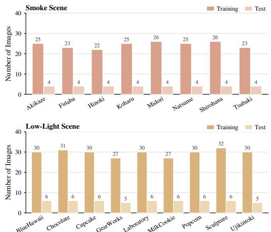  
Fig. 3: The view statistics of smoke and low-light scenes from the RealX3D benchmark.

For the fast 3D scene reconstruction branch, we build upon the 3D Gaussian Splatting framework (Kerbl et al. 2023) and implement it with the gsplat library (Ye et al. 2025). Each scene is optimized for 30, 000 iterations. The training objective combines a reconstruction loss $\mathcal { L } _ { 1 }$ and a D-SSIM loss ${ \mathcal { L } } _ { \mathrm { D - S S I M } }$ . The balance weight $\beta$ is set to 0.2. Optimization is carried out using the fused Adam optimizer with $\epsilon = 1 0 ^ { - 1 5 }$ . The learning rates for the Gaussian scales, rotations, and opacities are set to $5 \times 1 0 ^ { - 3 } , 1 \times 1 0 ^ { - 3 }$ , and $5 \times 1 0 ^ { - 2 }$ , respectively. For the spherical harmonics coeficients, the learning rate is $2 . 5 \times 1 0 ^ { - 3 }$ for the DC component and $1 . 2 5 \times 1 0 ^ { - 4 }$ for the higher-order components.

Benchmarks: We evaluate MLLM-GS on the RealX3D benchmark (Liu et al. 2026b), which provides real-world multi-view observations captured under challenging imaging conditions, including smoke, low light, and exposure variations. RealX3D provides degraded observations and their corresponding clean reference images, enabling quantitative evaluation of NVS quality under challenging imaging conditions. For each scene, the training and test views are disjoint. During training, only three paired degraded and clean views are used to supervise the correction network. The resulting enhancement branch generates pseudo-GT images for all training views, while the clean reference images at test viewpoints are used exclusively for evaluation. Fig. 3 presents the numbers of training and test views for the smoke and low-light scenes.

Evaluation Metrics: To evaluate rendering quality, we report Peak Signal-to-Noise Ratio (PSNR), Structural Similarity Index Measure (SSIM) (Wang et al. 2004), and Learned Perceptual Image Patch Similarity (LPIPS) (Zhang et al. 2018) for quantitative evaluation. Specifically, PSNR measures pixel-level reconstruction fidelity, while SSIM evaluates structural similarity between the rendered and reference images. Higher values (↑) of these two metrics indicate better reconstruction quality of the novel view. LPIPS measures the perceptual similarity between the rendered and reference images in a deep feature space. A lower value (↓) indicates better perceptual quality. In implementation, LPIPS is computed using the AlexNet (Krizhevsky et al. 2012) backbone following the oficial code (Zhang et al. 2018). Furthermore, to evaluate computational eficiency and representation complexity, we additionally report GPU memory consumption (VRAM), training time (Training), and the final number of Gaussian primitives (#Gs).

## 4.2 Results in Smoke Scenes

Quantitative Results: For smoke scenes, we evaluate all methods on eight scenes from the RealX3D (Liu et al. 2026b) benchmark. We compare our method with three categories of baselines: (1) classic 3D reconstruction methods, including 3DGS (Kerbl et al. 2023), Sea-Splat (Yang et al. 2025a), WaterSplatting (Li et al. 2025a), I2-NeRF (Liu et al. 2026c), and SeaThruNeRF (Levy et al. 2023); (2) restorationbased reconstruction pipelines that combine ConvIR-B (Cui et al. 2024a) or MB-TF-B V2 (Jin et al. 2025) with 3DGS or WaterSplatting; and (3) the top-three solutions from the NTIRE 2026 3D Restoration and Reconstruction Challenge, including GenSmoke-GS (Cao et al. 2026), Smoke-GS (Zheng et al. 2026), and Dehaze-then-Splat (Chen and Wang 2026a). For a fair comparison, all restoration-based reconstruction pipelines are trained under the same supervision setting as MLLM-GS. ConvIR-B (Cui et al. 2024a) and MB-TF-B V2 (Jin et al. 2025) are fine-tuned using the same three paired degraded and clean views per scene, and their restored images are subsequently used to train 3DGS or WaterSplatting. As shown in Table 1, classic 3D reconstruction methods generally achieve lower reconstruction quality under severe smoke degradation, indicating the dificulty of recovering clear scenes directly from degraded observations. Restoration-based reconstruction pipelines improve reconstruction quality by enhancing the input images before 3D reconstruction, achieving average PSNR values ranging from 15.74 dB to 17.58 dB. However, residual artifacts and color distortions in the enhanced views can propagate into the reconstruction process, limiting the final rendering quality. Challengebased methods achieve stronger performance, with average PSNR values ranging from 18.28 dB to 20.21 dB. In contrast, our method achieves the highest average PSNR of 22.27 dB and the lowest average LPIPS of 0.362. Notably, under identical supervision, MLLM-GS achieves an average PSNR improvement of 4.69 dB over the strongest restoration-based pipeline. This indicates that the performance gains arise from the efective integration of pretrained MLLM priors and few-shot correction rather than additional supervision. These results further demonstrate the efectiveness of MLLM-GS in providing reliable supervision for high-quality NVS.

Table 1: Quantitative evaluation of 3D reconstruction methods on the smoke scene of the RealX3D benchmark. Best results are highlighted in dark gray bold, and second-best in light gray.
<table><tr><td rowspan=1 colspan=1>Method</td><td rowspan=1 colspan=1>Metrics</td><td rowspan=1 colspan=4>Akikaze FutabaHinoki Koharu Midori NatsumeShirohanaTsubaki</td><td rowspan=1 colspan=1>Avg.</td></tr><tr><td rowspan=3 colspan=1>3DGS (Kerbl et al. 2023)</td><td rowspan=3 colspan=1>PSNR ↑SSIM ↑LPIPS ↓</td><td rowspan=1 colspan=4>10.80  13.48  7.47  11.87  13.84   9.74     8.91    15.41</td><td rowspan=1 colspan=1>11.44</td></tr><tr><td rowspan=1 colspan=4>0.548  0.695  0.315  0.611  0.700  0.604    0.419   0.739</td><td rowspan=1 colspan=1>0.579</td></tr><tr><td rowspan=1 colspan=4>0.659  0.619 0.683  0.573  0.548  0.633    0.749   0.583</td><td rowspan=1 colspan=1>0.631</td></tr><tr><td rowspan=3 colspan=1>SeaSplat (Yang et al. 2025a)</td><td rowspan=2 colspan=1>PSNR ↑SSIM ↑</td><td rowspan=1 colspan=4>11.21   8.11  13.23  9.98   5.04   8.49     9.21    8.95</td><td rowspan=1 colspan=1>9.28</td></tr><tr><td rowspan=1 colspan=4>0.497  0.497  0.422  0.500  0.330  0.463    0.347    0.507</td><td rowspan=1 colspan=1>0.445</td></tr><tr><td rowspan=1 colspan=1>LPIPS ↓</td><td rowspan=1 colspan=4>0.863  0.727  0.677  0.619  0.850  0.863    0.847    0.637</td><td rowspan=1 colspan=1>0.760</td></tr><tr><td rowspan=3 colspan=1>WaterSplatting (Li et al. 2025a)</td><td rowspan=3 colspan=1>PSNR ↑SSIM ↑LPIPS ↓</td><td rowspan=1 colspan=4>9.54   8.64  14.06  14.25  4.64   7.82     8.22    7.24</td><td rowspan=1 colspan=1>9.30</td></tr><tr><td rowspan=1 colspan=4>0.440  0.522 0.432  0.644  0.286  0.373    0.338    0.375</td><td rowspan=1 colspan=1>0.426</td></tr><tr><td rowspan=1 colspan=4>0.753  0.674  0.827  0.641  0.778  0.691    0.704   0.638</td><td rowspan=1 colspan=1>0.713</td></tr><tr><td rowspan=3 colspan=1>I2-NeRF (Liu et al. 2026c)</td><td rowspan=3 colspan=1>PSNR ↑SSIM ↑LPIPS ↓</td><td rowspan=1 colspan=4>7.19   5.46  13.35  9.62   3.52   6.13    5.70    6.14</td><td rowspan=1 colspan=1>7.14</td></tr><tr><td rowspan=1 colspan=4>0.252  0.252 0.405  0.402  0.150  0.216    0.138    0.227</td><td rowspan=1 colspan=1>0.255</td></tr><tr><td rowspan=1 colspan=4>0.740  0.696  0.657  0.640  0.745  0.706    0.750    0.697</td><td rowspan=1 colspan=1>0.704</td></tr><tr><td rowspan=3 colspan=1>SeaThruNeRF (Levy et al. 2023)</td><td rowspan=1 colspan=1>PSNR ↑</td><td rowspan=1 colspan=4>8.17   10.55  4.90   7.77  12.37   8.48    8.43    11.43</td><td rowspan=1 colspan=1>9.01</td></tr><tr><td rowspan=1 colspan=1>SSIM ↑</td><td rowspan=1 colspan=4>0.513  0.666  0.263  0.539  0.687  0.595    0.412    0.702</td><td rowspan=1 colspan=1>0.547</td></tr><tr><td rowspan=1 colspan=1>LPIPS↓</td><td rowspan=1 colspan=4>0.672  0.620  0.673  0.653  0.575  0.613    0.739   0.597</td><td rowspan=1 colspan=1>0.643</td></tr><tr><td rowspan=3 colspan=1>ConvIR-B (Cui et al. 2024a)+ 3DGS (Kerbl et al. 2023)</td><td rowspan=2 colspan=1>PSNR ↑SSIM ↑</td><td rowspan=1 colspan=4>15.00  16.61  15.15  16.97  15.83  13.52    15.55   17.31</td><td rowspan=1 colspan=1>15.74</td></tr><tr><td rowspan=1 colspan=4>0.616  0.732  0.489  0.652  0.716  0.669    0.522   0.776</td><td rowspan=1 colspan=1>0.647</td></tr><tr><td rowspan=1 colspan=1>LPIPS↓</td><td rowspan=1 colspan=4>0.846  0.682  0.895  0.625  0.614  0.795    0.767   0.671</td><td rowspan=1 colspan=1>0.737</td></tr><tr><td rowspan=3 colspan=1>MB-TF-B V2 (Jin et al. 2025)+ 3DGS (Kerbl et al. 2023)</td><td rowspan=1 colspan=1>PSNR ↑</td><td rowspan=1 colspan=4>18.68  13.42  16.75  18.28  17.90   14.87    16.39   18.01</td><td rowspan=1 colspan=1>16.79</td></tr><tr><td rowspan=2 colspan=1>SSIM ↑LPIPS↓</td><td rowspan=1 colspan=4>0.666  0.685  0.513  0.722  0.729  0.663    0.562   0.764</td><td rowspan=1 colspan=1>0.663</td></tr><tr><td rowspan=1 colspan=4>0.560  0.646  0.762  0.483  0.610  0.680    0.636    0.611</td><td rowspan=1 colspan=1>0.624</td></tr><tr><td rowspan=3 colspan=1>ConvIR-B (Cui et al. 2024a)+ WaterSplatting (Li et al. 2025a)</td><td rowspan=3 colspan=1>PSNR ↑SSIM ↑LPIPS↓</td><td rowspan=1 colspan=4>15.49  17.18  15.67  17.31  16.67   15.20    16.18    18.36</td><td rowspan=1 colspan=1>16.51</td></tr><tr><td rowspan=1 colspan=4>0.657  0.742  0.507  0.689  0.710  0.709    0.571    0.759</td><td rowspan=1 colspan=1>0.668</td></tr><tr><td rowspan=1 colspan=4>0.651  0.567  0.661  0.492  0.500  0.633    0.733   0.524</td><td rowspan=1 colspan=1>0.595</td></tr><tr><td rowspan=3 colspan=1>MB-TF-B V2 (Jin et al. 2025)+ WaterSplatting (Li et al. 2025a)</td><td rowspan=1 colspan=1>PSNR ↑</td><td rowspan=1 colspan=4>19.55  13.52  16.99  18.59  19.60   16.91    16.73   18.74</td><td rowspan=1 colspan=1>17.58</td></tr><tr><td rowspan=2 colspan=1>SSIM ↑LPIPS ↓</td><td rowspan=1 colspan=4>0.698  0.672  0.496  0.704  0.705  0.722    0.541    0.780</td><td rowspan=1 colspan=1>0.665</td></tr><tr><td rowspan=1 colspan=4>0.323  0.579  0.684  0.397  0.459  0.547    0.534   0.533</td><td rowspan=1 colspan=1>0.507</td></tr><tr><td rowspan=3 colspan=1>Dehaze-then-Splat (Chen and Wang 2026a)</td><td rowspan=1 colspan=1>PSNR ↑</td><td rowspan=1 colspan=4>20.98  18.05  18.20  18.67  18.12  15.09    15.43   21.66</td><td rowspan=1 colspan=1>18.28</td></tr><tr><td rowspan=1 colspan=1>SSIM ↑</td><td rowspan=1 colspan=4>0.683  0.705  0.507  0.624  0.711  0.634    0.448    0.699</td><td rowspan=1 colspan=1>0.626</td></tr><tr><td rowspan=1 colspan=1>LPIPS ↓</td><td rowspan=1 colspan=4>0.600  0.596  0.676  0.510  0.578  0.623    0.652   0.583</td><td rowspan=1 colspan=1>0.602</td></tr><tr><td rowspan=3 colspan=1>Smoke-GS (Zheng et al. 2026)</td><td rowspan=3 colspan=1>PSNR ↑SSIM ↑LPIPS ↓</td><td rowspan=1 colspan=4>16.30  17.01  17.57  19.12  20.59    17.59   22.48</td><td rowspan=1 colspan=1>18.67</td></tr><tr><td rowspan=1 colspan=4>0.721  0.485  0.685  0.723  0.716    0.579   0.785</td><td rowspan=1 colspan=1>0.670</td></tr><tr><td rowspan=1 colspan=2>0.460  0.579  0.438</td><td rowspan=1 colspan=2>0.321   0.446    0.544   0.361</td><td rowspan=1 colspan=1>0.449</td></tr><tr><td rowspan=3 colspan=1>GenSmoke-GS (Cao et al. 2026)</td><td rowspan=1 colspan=1>PSNR ↑</td><td rowspan=1 colspan=1>=</td><td rowspan=1 colspan=1>20.97  19.12  20.87</td><td rowspan=1 colspan=2>20.56   20.76    17.50   21.66</td><td rowspan=1 colspan=1>20.21</td></tr><tr><td rowspan=2 colspan=1>SSIM ↑LPIPS ↓</td><td rowspan=1 colspan=1>1</td><td rowspan=1 colspan=1>0.807 0.607  0.783</td><td rowspan=1 colspan=1>0.791   0.745    0.569</td><td rowspan=1 colspan=1>0.799</td><td rowspan=1 colspan=1>0.729</td></tr><tr><td rowspan=1 colspan=1></td><td rowspan=1 colspan=1>0.381  0.526  0.388</td><td rowspan=1 colspan=1>0.391   0.451    0.590</td><td rowspan=1 colspan=1>0.394</td><td rowspan=1 colspan=1>0.446</td></tr><tr><td rowspan=3 colspan=1>MLLM-GS (Ours)</td><td rowspan=3 colspan=1>PSNR ↑SSIM ↑LPIPS ↓</td><td rowspan=1 colspan=1>27.44</td><td rowspan=1 colspan=3>22.71 20.15 22.25  21.21  21.85    19.16   23.35</td><td rowspan=1 colspan=1>22.27</td></tr><tr><td rowspan=1 colspan=1>0.761</td><td rowspan=1 colspan=3>0.767  0.564  0.793 0.795  0.761   0.584   0.803</td><td rowspan=1 colspan=1>0.729</td></tr><tr><td rowspan=1 colspan=4>0.234  0.330 0.451  0.377 0.270  0.440   0.438   0.358</td><td rowspan=1 colspan=1>0.362</td></tr></table>

Qualitative Results: Fig. 4 presents qualitative comparisons of NVS results on two smoke scenes. SeaSplat (Yang et al. 2025a) produces renderings with substantial residual haze, low contrast, and blurred scene structures. Restorationbased reconstruction pipelines combining ConvIR-B (Cui et al. 2024a) or MB-TF-B V2 (Jin et al. 2025) with WaterSplatting (Li et al. 2025a) improve scene visibility but still exhibit color distortions and loss of fine-grained details. GenSmoke-GS (Cao et al. 2026) recovers clearer structures, although residual haze and color deviations remain visible in some regions. In contrast, our method substantially reduces residual haze while preserving scene structures, fine textures, and natural colors. The rendered results are visually closer to the ground-truth images, particularly in object boundaries and textured regions. These results demonstrate the efectiveness of MLLM-GS in generating visually faithful novel views under severe smoke degradation.

GenSmoke-GS  
GT  
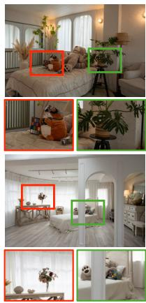

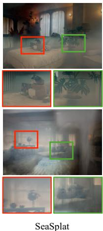

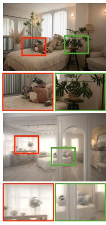

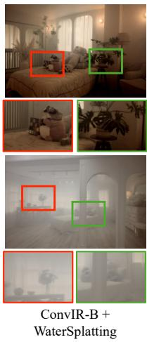  
Fig. 4: Qualitative comparison of NVS results under smoke scenes.

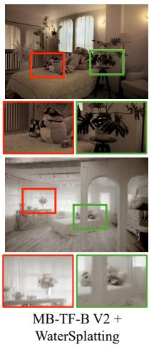

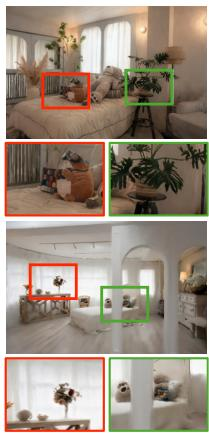

User Study: To further evaluate perceptual quality, we conduct a user study on the synthesized novel views. We randomly select ten novel viewpoints and invite 55 participants to evaluate the corresponding rendered images. For each viewpoint, the results from diferent methods are anonymized and presented in random order. Participants are asked to select the result with the highest perceived visual quality. As shown in Fig. 5(a), our method receives 80.72% of the total preferences, substantially outperforming the compared baselines. This result further supports the advantages of MLLM-GS in synthesizing visually realistic novel views under smoke degradation.

## 4.3 Results in Low-Light Scenes

Quantitative Results: We compare our method with nine competing methods, including five classic 3D reconstruction methods (3DGS (Kerbl et al. 2023), LITA-GS (Zhou et al. 2025), I2-NeRF (Liu et al. 2026c), Aleth-NeRF (Cui et al. 2024b), and Luminance-GS (Cui et al. 2025)), and four restoration-based reconstruction pipelines combining DarkIR-m (Feijoo et al. 2025) or Multinex (Brateanu et al. 2026) with 3DGS or LITA-GS. Similar to the smoke scenario, DarkIR-m (Feijoo et al. 2025) and Multinex (Brateanu et al. 2026) are fine-tuned using the same three paired degraded and clean views per scene. As shown in Table 2, classic 3D reconstruction methods generally achieve limited performance under severe low-light conditions, where insuficient illumination and image noise make accurate geometry and appearance estimation challenging. Restorationbased reconstruction pipelines improve reconstruction quality by enhancing degraded observations before 3D reconstruction, achieving average PSNR values ranging from 15.41 dB to 19.52 dB. However, residual noise, color distortions, and inconsistencies in the enhanced views may propagate into subsequent reconstruction, limiting the final rendering quality. In contrast, our method achieves the best average PSNR, SSIM, and LPIPS. Compared with the strongest baseline, our method improves PSNR and SSIM by 0.99 dB and 0.017, respectively, while reducing LPIPS by 0.027. These results demonstrate that

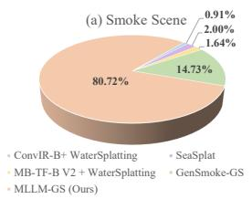  
Fig. 5: User study for smoke and low-light scenes.

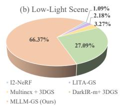

Table 2: Quantitative evaluation of 3D reconstruction methods on the low-light scene of the RealX3D benchmark. Best results are highlighted in dark gray bold, and second-best in light gray.
<table><tr><td>Method</td><td>Metrics</td><td colspan="9">[BlueHawaii Chocolate Cupcake GearWorks Laboratory MilkCookie Popcorn Sculpture Ujikintoki</td></tr><tr><td rowspan="2">3DGS (Kerbl et al. 2023)</td><td>PSNR ↑</td><td>7.49</td><td>7.89</td><td>4.42</td><td>6.90</td><td>7.59</td><td>6.15</td><td>7.46</td><td>5.85</td><td>6.23</td><td>6.66</td></tr><tr><td>SSIM ↑ LPIPS ↓</td><td>0.055</td><td>0.084 0.646</td><td>0.064 0.625</td><td>0.081 0.658</td><td>0.041 0.610</td><td>0.053</td><td>0.062</td><td>0.019 0.733</td><td>0.062</td><td>0.058</td></tr><tr><td rowspan="3">LITA-GS (Zhou et al. 2025)</td><td></td><td>0.671</td><td>17.94</td><td></td><td></td><td></td><td>0.653</td><td>0.650</td><td></td><td>0.683</td><td>0.659</td></tr><tr><td>PSNR ↑</td><td>17.30</td><td></td><td>13.07</td><td>10.90</td><td>17.56</td><td>12.74</td><td>18.97</td><td>12.84</td><td>18.82</td><td>15.57</td></tr><tr><td>SSIM ↑</td><td>0.624</td><td>0.541</td><td>0.643</td><td>0.344</td><td>0.597</td><td>0.573</td><td>0.557</td><td>0.211</td><td>0.656</td><td>0.527</td></tr><tr><td rowspan="3">I2-NeRF (Liu et al. 2026c)</td><td>LPIPS ↓</td><td>0.546</td><td>0.557</td><td>0.326</td><td>0.521</td><td>0.435</td><td>0.478</td><td>0.448</td><td>0.715</td><td>0.497</td><td>0.503</td></tr><tr><td>PSNR ↑</td><td>18.08</td><td>19.77</td><td>12.68</td><td>12.22</td><td>16.34</td><td>14.78</td><td>17.08</td><td>9.64</td><td>19.02</td><td>15.51</td></tr><tr><td>SSIM ↑</td><td>0.657</td><td>0.571</td><td>0.608</td><td>0.511</td><td>0.630</td><td>0.649</td><td>0.543</td><td>0.277</td><td>0.666</td><td>0.568</td></tr><tr><td rowspan="3">Aleth-NeRF (Cui et al. 2024b)</td><td>LPIPS ↓</td><td>0.546</td><td>0.561</td><td>0.493</td><td>0.543</td><td>0.486</td><td>0.544</td><td>0.488</td><td>0.649</td><td>0.474</td><td>0.532</td></tr><tr><td>PSNR ↑</td><td>15.84</td><td>11.53</td><td>13.49</td><td>8.82</td><td>14.14</td><td>13.49</td><td>13.25</td><td>12.22</td><td>14.12</td><td>12.99</td></tr><tr><td>SSIM ↑</td><td>0.572</td><td>0.406</td><td>0.552</td><td>0.217</td><td>0.484</td><td>0.567</td><td>0.452</td><td>0.208</td><td>0.544</td><td>0.445</td></tr><tr><td rowspan="3">Luminance-GS (Cui et al. 2025)</td><td>LPIPS↓</td><td>0.717</td><td>0.692</td><td>0.612</td><td>0.671</td><td>0.696</td><td>0.725</td><td>0.688</td><td>0.891</td><td>0.646</td><td>0.704</td></tr><tr><td>PSNR ↑</td><td>11.20</td><td>7.33</td><td>14.82</td><td>8.09</td><td>8.88</td><td>9.67</td><td>11.33</td><td>9.79</td><td>9.36</td><td>10.05</td></tr><tr><td>SSIM↑</td><td>0.465</td><td>0.362</td><td>0.536</td><td>0.411</td><td>0.372</td><td>0.532</td><td>0.462</td><td>0.293</td><td>0.463</td><td>0.433</td></tr><tr><td rowspan="3">DarkIR-m (Feijoo et al. 2025)</td><td>LPIPS ↓</td><td>0.779</td><td>0.779</td><td>0.534</td><td>0.737</td><td>0.614</td><td>0.766</td><td>0.625</td><td>0.655</td><td>0.882</td><td>0.708</td></tr><tr><td>PSNR ↑</td><td>15.22</td><td>12.03</td><td>18.00</td><td>13.48</td><td>12.99</td><td>14.82</td><td>17.69</td><td>13.47</td><td>20.97</td><td>15.41</td></tr><tr><td>SSIM ↑</td><td>0.622</td><td>0.404</td><td>0.726</td><td>0.564</td><td>0.468</td><td>0.283</td><td>0.608</td><td>0.299</td><td>0.720</td><td>0.522</td></tr><tr><td rowspan="3">+ 3DGS (Kerbl et al. 2023) Multinex (Brateanu et al. 2026)</td><td>LPIPS ↓</td><td>0.671</td><td>0.587</td><td>0.418</td><td>0.537</td><td>0.568</td><td>0.663</td><td>0.464</td><td>0.660</td><td>0.546</td><td>0.568</td></tr><tr><td>PSNR ↑</td><td>23.06</td><td>19.97</td><td>19.84</td><td>17.56</td><td>22.24</td><td>19.05</td><td>19.53</td><td>14.02</td><td>20.43</td><td>19.52</td></tr><tr><td>SSIM ↑</td><td>0.736</td><td>0.604</td><td>0.711</td><td>0.647</td><td>0.736</td><td>0.701</td><td>0.624</td><td>0.235</td><td>0.704</td><td>0.633</td></tr><tr><td rowspan="3">(Kerbl et al. 2023) + 3DGS DarkIR-m (Feijoo et al. 2025)</td><td>LPIPS ↓</td><td>0.417</td><td>0.452</td><td>0.460</td><td>0.468</td><td>0.398</td><td>0.364</td><td>0.345</td><td>0.662</td><td>0.414</td><td>0.442</td></tr><tr><td>PSNR ↑</td><td>16.59</td><td>14.90</td><td>15.67</td><td>18.85</td><td>16.43</td><td>19.90</td><td>17.10</td><td>14.10</td><td>21.09</td><td>17.18</td></tr><tr><td>SSIM ↑</td><td>0.687</td><td>0.524</td><td>0.698</td><td>0.671</td><td>0.697</td><td>0.698</td><td>0.667</td><td>0.287</td><td>0.713</td><td>0.627</td></tr><tr><td rowspan="3">+ LITA-GS (Zhou et al. 2025) Multinex (Brateanu et al. 2026)</td><td>LPIPS ↓</td><td>0.467</td><td>0.494</td><td>0.473</td><td>0.466</td><td>0.439</td><td>0.370</td><td>0.375</td><td>0.531</td><td>0.387</td><td>0.445</td></tr><tr><td>PSNR ↑</td><td>16.44</td><td>15.78</td><td>16.81</td><td>17.39</td><td>17.02</td><td>19.32</td><td>17.23</td><td>15.32</td><td>20.59</td><td>17.32</td></tr><tr><td>SSIM ↑</td><td>0.644</td><td>0.487</td><td>0.737</td><td>0.637</td><td>0.648</td><td>0.673</td><td>0.628</td><td>0.291</td><td>0.704</td><td>0.605</td></tr><tr><td rowspan="3"></td><td>LPIPS ↓</td><td>0.505</td><td>0.502</td><td>0.324</td><td>0.493</td><td>0.452</td><td>0.458</td><td>0.359</td><td>0.643</td><td>0.418</td><td>0.462</td></tr><tr><td>PSNR ↑</td><td>24.33</td><td>21.39</td><td>20.31</td><td>18.16</td><td>22.94</td><td>19.98</td><td>20.16</td><td>16.21</td><td></td><td>20.51</td></tr><tr><td></td><td>0.776</td><td>0.626</td><td></td><td></td><td></td><td></td><td></td><td></td><td>21.11 0.719</td><td></td></tr><tr><td rowspan="3">MLLM-GS (Ours)</td><td>SSIM ↑</td><td></td><td></td><td>0.740</td><td>0.649</td><td>0.673</td><td>0.703</td><td>0.670</td><td>0.294</td><td></td><td>[0.650]</td></tr><tr><td></td><td>0.379</td><td>0.417</td><td>0.306</td><td>0.462</td><td>0.393</td><td>0.359</td><td>0.337</td><td>0.670</td><td>0.410</td><td>0.415</td></tr><tr><td>LPIPS ↓</td><td></td><td></td><td></td><td></td><td></td><td></td><td></td><td></td><td></td><td></td></tr></table>

MLLM-GS achieves superior reconstruction quality under severe low-light conditions, particularly in terms of pixel-level fidelity.

Qualitative Results: Fig. 6 illustrates qualitative comparisons of NVS results in representative low-light scenes. Standard 3DGS (Kerbl et al. 2023) produces severely underexposed renderings with limited visible structures and textures. LITA-GS (Zhou et al. 2025) improves overall brightness but still exhibits noticeable noise and color distortions, particularly around object boundaries and textured regions. Restoration-based reconstruction pipelines combining DarkIR-m (Feijoo et al. 2025) or Multinex (Brateanu et al. 2026) with 3DGS further improve scene visibility, although uneven illumination, color inconsistencies, and loss of fine-grained details remain visible in some regions. In contrast, our method produces visually faithful renderings with clearer object structures, more consistent colors, and better-preserved local details. The reconstructed results more closely resemble the ground-truth images in the examples shown, particularly around object boundaries and textured regions. These observations demonstrate the efectiveness of MLLM-GS in recovering scene appearance and preserving visual details under severe low-light degradation.

User Study: To further evaluate perceptual quality, we conduct a user study in low-light scenes following the evaluation protocol described in Section 4.2. We randomly select ten novel views and invite 55 participants to assess the rendered results. As shown in Fig. 5(b), our method receives 66.37% of the total preferences, substantially outperforming the compared methods. These results indicate that the proposed MLLM-GS produces perceptually realistic novel views under severe low-light conditions.

## 4.4 Eficiency Analysis

In this section, we evaluate the reconstruction eficiency of MLLM-GS and competing methods on smoke and low-light scenes in terms of training time, Gaussian count, and GPU memory consumption. As shown in Table 3, MLLM-GS achieves high training eficiency under both degradation conditions. On the smoke scene, MLLM-GS completes 30K training iterations in 10m06s, achieving a 1.46× speedup over

BlueHawaii (Low-Light)  
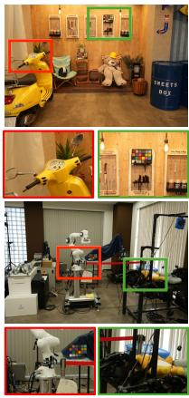  
GT

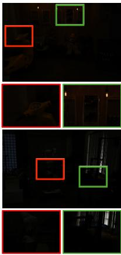  
3DGS

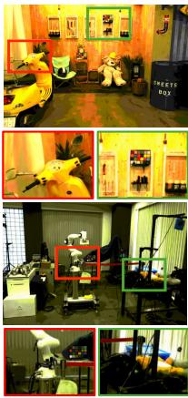  
LITA-GS

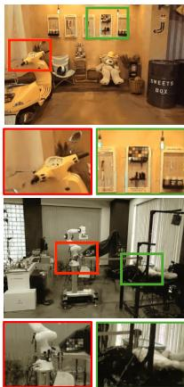  
DarkIR-m + 3DGS

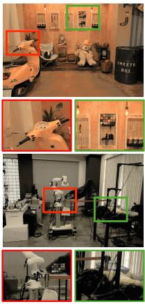  
Multinex + 3DGS

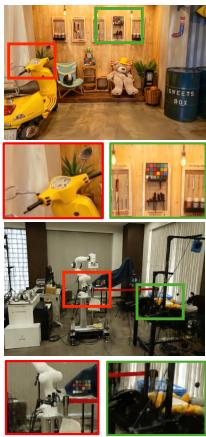  
Ours  
Fig. 6: Qualitative comparison of NVS results under low-light scenes.

Table 3: Eficiency comparison of 3D reconstruction methods. The training steps for all methods are 30,000. “N/A” indicates that the corresponding metric is not applicable to the method.
<table><tr><td rowspan=1 colspan=1>Method</td><td rowspan=1 colspan=3>Training ↓   #Gs ↓   VRAM ↓</td></tr><tr><td rowspan=1 colspan=1>Akikaze(Smoke)</td><td rowspan=1 colspan=3></td></tr><tr><td rowspan=6 colspan=1>3DGSSeaSplatWaterSplattingI2-NeRFSeaThruNeRFFaster-GS</td><td></td><td></td><td></td></tr><tr><td rowspan=1 colspan=1>71m59s</td><td rowspan=1 colspan=1>0.63M</td><td rowspan=1 colspan=1>7.06GiB</td></tr><tr><td rowspan=1 colspan=1>19m30s</td><td rowspan=1 colspan=1>0.03M</td><td rowspan=1 colspan=1>5.06GiB</td></tr><tr><td rowspan=2 colspan=1>64m05s90m59s</td><td rowspan=1 colspan=1>N/A</td><td rowspan=1 colspan=1>5.13GiB</td></tr><tr><td rowspan=1 colspan=1>N/A</td><td rowspan=1 colspan=1>30.77GiB</td></tr><tr><td rowspan=1 colspan=1>8m37s</td><td rowspan=1 colspan=1>0.06M</td><td rowspan=1 colspan=1>6.36GiB</td></tr><tr><td rowspan=1 colspan=1>MLLM-GS(Ours)</td><td rowspan=1 colspan=1>10m06s</td><td rowspan=1 colspan=1>0.46M</td><td rowspan=1 colspan=1>1.98GiB</td></tr><tr><td rowspan=1 colspan=1>BlueHawaii(Low-Ligh</td><td rowspan=1 colspan=1>t)</td><td rowspan=1 colspan=1></td><td rowspan=1 colspan=1></td></tr><tr><td rowspan=6 colspan=1>3DGSLITA-GSI2-NeRFAleth-NeRFLuminance-GSFaster-GS</td><td rowspan=5 colspan=2>15m35s234m53s121m27s    N/A39m35s     N/A88m32s    1.31M</td><td rowspan=1 colspan=1>3.29M</td></tr><tr><td rowspan=1 colspan=1>0.32M</td><td rowspan=1 colspan=1>36.11GiB</td></tr><tr><td rowspan=1 colspan=1>26.59GiB</td></tr><tr><td rowspan=1 colspan=1>18.69GiB</td></tr><tr><td rowspan=1 colspan=1>3.07GiB</td></tr><tr><td rowspan=1 colspan=2>9m19s    0.05M</td><td rowspan=1 colspan=1>6.79GiB</td></tr><tr><td rowspan=1 colspan=1>MLLM-GS (Ours)</td><td rowspan=1 colspan=2>9m38s     0.17M</td><td rowspan=1 colspan=1>2.40GiB</td></tr></table>

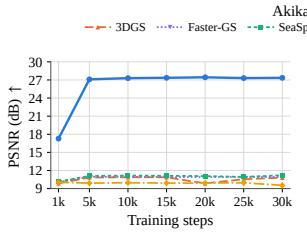

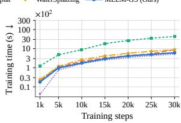

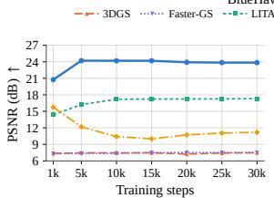

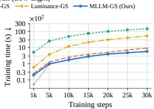  
Fig. 7: Eficiency analysis on a smoke scene (Akikaze) and a low-light scene (BlueHawaii).

3DGS (Kerbl et al. 2023) and a 9.0× speedup over SeaThruNeRF (Levy et al. 2023). On the low-light scene, it requires 9m38s, achieving a 1.62× speedup over 3DGS and a 24.4× speedup over LITA-GS (Zhou et al. 2025). Although Faster-GS (Hahlbohm et al. 2026) achieves slightly shorter training times, MLLM-GS provides substantially better reconstruction quality while maintaining comparable optimization eficiency. Moreover, compared with standard 3DGS, MLLM-GS reduces the Gaussian count by approximately 80% and 95% on the smoke and low-light scenes, respectively. It also achieves the lowest GPU memory consumption among all compared methods, requiring only 1.98 GiB and 2.40 GiB on the two scenes, respectively.

Fig. 7 further compares the convergence behavior and computational eficiency of diferent methods. After only 5K training iterations, MLLM-GS achieves approximately 27 dB PSNR on Akikaze and 24 dB on BlueHawaii, requiring around 100 s. These results surpass those achieved by all compared methods after 30K iterations, demonstrating that MLLM-GS achieves higher reconstruction quality with substantially fewer iterations. In contrast, Faster-GS (Hahlbohm et al. 2026) achieves only approximately 11 dB and 7 dB PSNR on the two scenes, respectively, even after 30K iterations. This indicates that accelerating Gaussian optimization alone cannot efectively address the reconstruction challenges caused by severe image degradations. By combining MLLM prior-guided view enhancement with eficient Gaussian optimization, MLLM-GS achieves a favorable balance between reconstruction quality and computational eficiency.

Table 4: Ablation of diferent MLLM priors on Akikaze under smoke degradation.
<table><tr><td>Method</td><td>PSNR ↑</td><td>SSIM ↑</td><td>LPIPS↓</td></tr><tr><td>Wan2.7-Image</td><td>22.13</td><td>0.714</td><td>0.381</td></tr><tr><td>Qwen-Image-3.0</td><td>22.29</td><td>0.713</td><td>0.431</td></tr><tr><td>Seedream-5.0-Lite</td><td>22.21</td><td>0.675</td><td>0.421</td></tr><tr><td>GPT-Image-2</td><td>19.06</td><td>0.644</td><td>0.482</td></tr><tr><td>Qwen-Image-Edit</td><td>18.09</td><td>0.621</td><td>0.630</td></tr><tr><td>Nano Banana Pro (Ours)</td><td>27.44</td><td>0.761</td><td>0.234</td></tr></table>

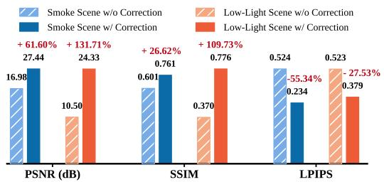  
Fig. 8: Ablation study on the correction network.

## 4.5 Ablation Studies

Efectiveness of MLLM Prior: To evaluate the efectiveness of MLLM prior-guided view enhancement, we compare our framework with standard 3DGS (Kerbl et al. 2023) and two-stage restoration-based reconstruction methods. Standard 3DGS (Kerbl et al. 2023) directly optimizes the scene representation from degraded observations without image enhancement. As shown in Tables 1 and 2, its average PSNR is below 12 dB on both smoke and low-light scenes, indicating its limited ability to reconstruct clean views from severely degraded images. In contrast, MLLM-GS improves the average PSNR by more than 10 dB on both scene types and achieves substantial improvements in SSIM and LPIPS. Furthermore, although two-stage methods improve reconstruction quality by restoring degraded images before 3D reconstruction, their performance remains inferior to that of MLLM-GS. This is mainly because degradation-specific restoration models may struggle to recover reliable structural and appearance information under complex imaging conditions. In contrast, our framework leverages the general visual priors of a pretrained MLLM to enhance degraded observations across diferent degradation types. The correction network further reduces residual spatial misalignment and color deviations, providing more reliable pseudo-GT supervision for subsequent 3D reconstruction. These results demonstrate the efectiveness of MLLM prior-guided view enhancement in improving NVS quality under severe degradations.

Table 5: Ablation of the proposed components on Akikaze under smoke degradation.
<table><tr><td>Method</td><td>Training ↓</td><td>#Gs↓</td><td>VRAM↓</td></tr><tr><td>3DGS</td><td>14m44s</td><td>2.26M</td><td>8.15GiB</td></tr><tr><td>+ Rasterization</td><td>11m27s</td><td>0.49M</td><td>2.57GiB</td></tr><tr><td>+ Memory Layout</td><td>10m42s</td><td>0.47M</td><td>2.12GiB</td></tr><tr><td>+ Parameter Updates</td><td>10m06s</td><td>0.46M</td><td>1.98GiB</td></tr></table>

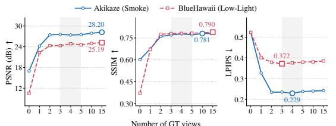  
Fig. 9: Ablation on the number of GT views.

Compatibility of MLLM Priors: This section evaluates the compatibility of our framework with diferent MLLM priors. Specifically, we replace the default Nano Banana Pro (Raisinghani 2025) with five alternative models, including Wan2.7-Image (Aliyun 2026), Qwen-Image-3.0 (Team 2026), Seedream-5.0-Lite (Seed 2026), GPT-Image-2 (OpenAI 2026), and Qwen-Image-Edit (Wu et al. 2025), and evaluate their performance on the Akikaze smoke scene. As shown in Table 4, all five alternatives can be integrated into our framework, achieving PSNR values ranging from 18.09 dB to 22.29 dB. However, their reconstruction performance varies, indicating that the quality of the underlying generative prior influences the final NVS results. The default model achieves the best performance across all three metrics, with a PSNR of 27.44 dB, an SSIM of 0.761, and an LPIPS of 0.234. These results demonstrate that our framework can accommodate diferent generative priors, while stronger priors can further improve reconstruction quality.

Necessity of the Correction: To evaluate the necessity of the correction network, we compare the full framework with a variant that directly uses MLLM-enhanced images for 3D reconstruction without correction. Fig. 8 presents the quantitative results on the Akikaze (smoke) and BlueHawaii (low-light) scenes. Introducing the correction network consistently improves all three metrics under both degradation conditions.

3DGS  
GT  
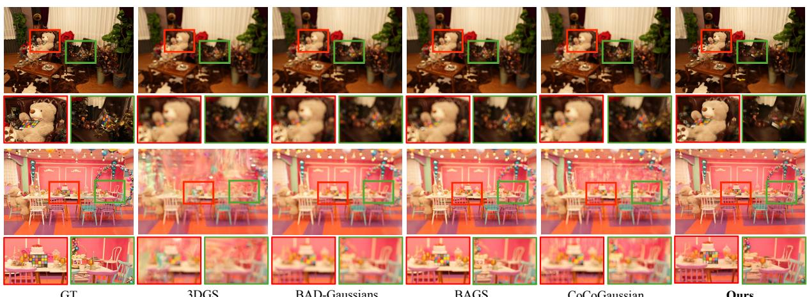  
Fig. 10: Qualitative comparison of NVS results under strong defocus blur scenes.

On the Akikaze scene, PSNR increases from 16.98 to 27.44 dB, SSIM improves from 0.601 to 0.761, and LPIPS decreases from 0.524 to 0.234. The improvements are more pronounced on the BlueHawaii scene, where PSNR increases from 10.50 to 24.33 dB, SSIM improves from 0.370 to 0.776, and LPIPS decreases from 0.523 to 0.379. These improvements indicate that MLLMenhanced images still contain residual spatial misalignment and color deviations that can afect subsequent 3D reconstruction. By reducing these errors, the correction network provides more accurate and consistent pseudo-GT supervision, leading to improved reconstruction quality.

Impact of the GT Views Number: This section investigates the impact of the number of paired clean GT views on reconstruction quality under smoke and low-light conditions. As shown in Fig. 9, introducing a small number of GT views substantially improves reconstruction performance, with the largest gains occurring between zero and three views. Specifically, increasing the number of GT views from zero to three improves PSNR by more than 13 dB on the low-light scene and approximately 10 dB on the smoke scene. Similar improvements are observed in SSIM and LPIPS. As more GT views are introduced, PSNR and SSIM continue to improve, but the gains become smaller. For example, the additional PSNR improvement beyond five GT views is less than 0.6 dB on the low-light scene. Meanwhile, LPIPS achieves its best performance with approximately four to five GT views and does not consistently improve as more views are added. These results indicate that a few paired clean views already provide efective supervision for the correction network. Increasing the number of GT views yields diminishing improvements in PSNR and SSIM, while perceptual quality does not necessarily benefit from additional supervision.

Efectiveness of Rasterization Optimization: To evaluate the efectiveness of rasterization optimization, we replace the standard 3DGS (Kerbl et al. 2023) rasterization pipeline while keeping all other settings unchanged. As shown in Table 5, the number of Gaussians decreases from 2.26M to 0.49M, GPU memory consumption drops from 8.15 GiB to 2.57 GiB, and training time is reduced by 22.3%. The opacity-aware rectangular bounding boxes reduce unnecessary Gaussian–tile intersections by excluding regions with negligible contributions, thereby lowering sorting and forward rasterization costs. Meanwhile, the bucket-based backward propagation strategy reconstructs the blending process using precomputed boundary states, reducing redundant gradient computations and memory accesses. In this way, these designs improve rasterization eficiency and reduce the computational overhead of 3D reconstruction.

Efectiveness of Memory Layout Optimization: To evaluate the efectiveness of memory layout optimization, we introduce Mortonbased Gaussian reordering on top of the rasterization optimization. As shown in Table 5, the number of Gaussians, memory footprint, and training time are all reduced, with reductions ranging from 4% to 18%. These improvements demonstrate the benefits of optimizing Gaussian memory organization. During adaptive densification, newly generated Gaussians are appended to parameter bufers, causing spatially neighboring Gaussians to become scattered across memory. Morton reordering organizes Gaussians according to their spatial positions, improving memory-access locality and reducing redundant memory accesses during optimization. By periodically reorganizing Gaussian parameters, this strategy further improves eficiency with limited reordering overhead.

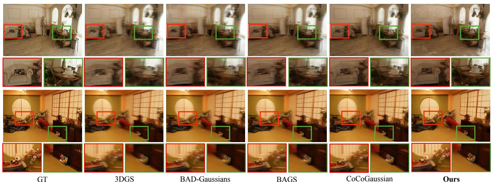  
Fig. 11: Qualitative comparison of NVS results under strong motion blur scenes.

Efectiveness of Parameter Update Optimization: We further evaluate the efectiveness of parameter update optimization on top of the rasterization and memory layout optimizations. As shown in Table 5, training time decreases from 10m42s to 10m06s, while GPU memory consumption is reduced from 2.12 GiB to 1.98 GiB. The number of Gaussians also decreases slightly from 0.47M to 0.46M. The training eficiency improvement is mainly attributed to the fused parameter update strategy, which combines the updates of diferent Gaussian parameter groups into a single CUDA kernel. This reduces kernel-launch overhead and redundant global-memory accesses while preserving the underlying Adam update rules. Overall, combining rasterization, memory layout, and parameter update optimizations reduces the number of Gaussians by approximately 80%, GPU memory consumption by 76%, and training time by 31% compared with standard 3DGS (Kerbl et al. 2023), demonstrating the efectiveness of the proposed fast reconstruction branch.

Efectiveness of fast 3D scene reconstruction branch: To evaluate the efectiveness of the proposed fast 3D reconstruction branch, we compare MLLM-GS with a variant that replaces this branch with Faster-GS (Hahlbohm et al. 2026) while keeping the view enhancement branch unchanged. Experiments are conducted on the Akikaze (Smoke) and BlueHawaii (Low-Light) scenes. As shown in Table 6, MLLM-GS consistently outperforms the Faster-GS variant across all three metrics in both scenes. These results demonstrate the efectiveness of the proposed fast reconstruction branch in supporting high-quality 3D scene reconstruction under challenging environmental conditions.

Table 6: Efectiveness of fast 3D scene reconstruction branch.
<table><tr><td>Method</td><td>PSNR ↑</td><td>SSIM ↑</td><td>LPIPS ↓</td></tr><tr><td colspan="4">Akikaze (Smoke)</td></tr><tr><td>+Faster-GS</td><td>24.85</td><td>0.710</td><td>0.340</td></tr><tr><td>MLLM-GS (Ours)</td><td>27.44</td><td>0.761</td><td>0.234</td></tr><tr><td colspan="4">BlueHawaii (Low-Light)</td></tr><tr><td>+Faster-GS</td><td>20.03</td><td>0.643</td><td>0.397</td></tr><tr><td>MLLM-GS (Ours)</td><td>24.33</td><td>0.776</td><td>0.379</td></tr></table>

## 4.6 Experimental Results for More Degradation Scenarios

To further evaluate the generalization capability of MLLM-GS across diverse degradation conditions, we conduct additional experiments under strong defocus blur, strong motion blur, and varying exposure. These scenarios introduce diferent types of structural and appearance distortions, providing a more comprehensive evaluation of the proposed framework.

Results of Strong Defocus Blur: As shown in Fig. 10, 3DGS (Kerbl et al. 2023) produces severely degraded renderings with noticeable color shifts, banding artifacts, and blurred scene structures. BAD-Gaussians (Zhao et al. 2024), BAGS (Peng et al. 2024), and CoCoGaussian (Lee et al. 2025) recover the overall scene structure, but their results still exhibit blurred object boundaries and missing fine details. For example, adjacent patches on the color chart become dificult to distinguish, while the fine textures of the toy are largely lost. In contrast, our method produces clearer scene structures and better-preserved textures. The color chart retains well-defined boundaries, and the toy exhibits more recognizable fur textures and facial details. These results demonstrate that MLLM-GS can efectively reconstruct scene structures and fine details from observations afected by strong defocus blur.

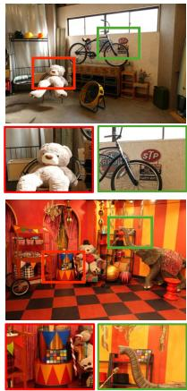  
GT

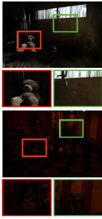  
3DGS

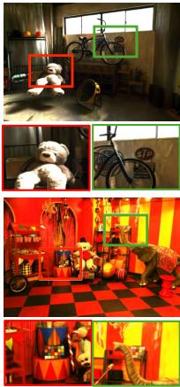  
LITA-GS

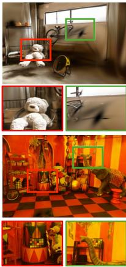  
DarkIR-m + 3DGS

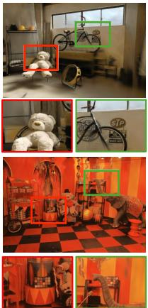  
Multinex + 3DGS

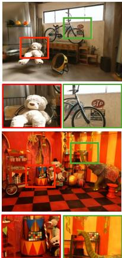  
Ours  
Fig. 12: Qualitative comparison of NVS results under varying exposure scenes.

Results of Strong Motion Blur: Fig. 11 presents qualitative comparisons of NVS results under strong motion blur. 3DGS (Kerbl et al. 2023) produces severe motion-related artifacts, resulting in distorted scene structures and blurred object boundaries. BAD-Gaussians (Zhao et al. 2024) and CoCoGaussian (Lee et al. 2025) recover the overall scene layout, but their results still suffer from blurred textures and missing fine details. BAGS (Peng et al. 2024) also recovers the scene structure but introduces noticeable stripe artifacts. In contrast, our method generates clearer novel views with more accurate object boundaries and better-preserved textures. In particular, the color chart retains distinguishable patches, while the fur textures of the toy and the structures of small objects remain clearly recognizable. These results demonstrate the efectiveness of MLLM-GS in preserving scene structures and fine details under strong motion blur.

Results of Varying Exposure: Fig. 12 presents qualitative comparisons of NVS results under varying exposure conditions. 3DGS (Kerbl et al. 2023) is sensitive to exposure variations, producing severely underexposed renderings with substantial detail loss. LITA-GS (Zhou et al. 2025) improves the overall brightness, but noticeable color and contrast deviations remain in some regions. DarkIR-m (Feijoo et al. 2025) + 3DGS and Multinex (Brateanu et al. 2026) + 3DGS further improve scene visibility, but their results still exhibit blurred textures and local color distortions. In contrast, our method produces novel views with more natural brightness, improved color fidelity, and clearer scene details. In particular, the structures and textures of objects such as the teddy bear, bicycle, and indoor furniture are better preserved. These results demonstrate that MLLM-GS can efectively handle exposure variations and generate high-quality novel views with more faithful scene appearance.

## 5 Conclusion

This paper proposes MLLM-GS, an MLLM priorguided framework for fast novel view synthesis in extreme environments. It consists of two branches: MLLM prior-guided view enhancement and fast 3D scene reconstruction. The former combines a frozen MLLM with a lightweight correction network to reduce pixel misalignment and color distortions, providing reliable pseudo-GT supervision using only a few paired clean views. The latter accelerates 3DGS optimization from three aspects: rasterization, memory layout, and parameter updates. Extensive experiments demonstrate that MLLM-GS achieves high-quality novel view synthesis across diverse severe degradations while substantially reducing reconstruction time and GPU memory consumption.

## Declarations

• Funding: This work was supported by the Yangtze River Delta Science and Technology Innovation Community Joint Research (Basic Research) Project (2025CSJZN01600) and the New Generation of Artificial Intelligence National Science and Technology Major Project (2025ZD0123303).

• Data availability: The datasets analyzed in this study are publicly available. The RealX3D dataset is available at https://huggingface.co/datasets/ToferFish/ RealX3D.

• Competing interests: The authors declare no competing interests.

## References

Aliyun (2026) Wan2.7-image. URL https://www. aliyun.com/benefit/scene/wan

Bao Y, Ding T, Huo J, et al (2026) Fisn: Finding spatial neighborhoods for generalizable novel view synthesis. IEEE Transactions on Visualization and Computer Graphics 32(7):5536–5550

Brateanu A, Mu T, Ancuti CO, et al (2026) Multinex: Lightweight low-light image enhancement via multi-prior retinex. In: IEEE/CVF Conference on Computer Vision and Pattern Recognition, pp 29887–29896

Cao Q, Hu X, Shi C, et al (2026) Gensmoke-gs: A multi-stage method for novel view synthesis from smoke-degraded images using a generative model. arXiv preprint arXiv:2604.03039

Chen B, Wang H (2026a) Dehaze-then-splat: Generative dehazing with physics-informed 3d gaussian splatting for smoke-free novel view synthesis. arXiv preprint arXiv:2604.13589

Chen G, Wang W (2026b) A survey on 3d gaussian splatting. ACM Computing Surveys 58(12):1– 39

Chen SE, Williams L (1993) View interpolation for image synthesis. In: Annual Conference on Computer Graphics and Interactive Techniques, p 279–288

Chen Y, Wu Q, Lin W, et al (2025) Hac++: Towards 100x compression of 3d gaussian splatting. IEEE Transactions on Pattern Analysis and Machine Intelligence 47(11):10210–10226

Chen Z, Wang C, Guo YC, et al (2023) Structnerf: Neural radiance fields for indoor scenes with structural hints. IEEE Transactions on Pattern Analysis and Machine Intelligence 45(12):15694–15705

Conde MV, Geigle G, Timofte R (2024) Instructir: High-quality image restoration following human instructions. In: European Conference on Computer Vision, pp 1–21

Cui Y, Ren W, Cao X, et al (2024a) Revitalizing convolutional network for image restoration. IEEE Transactions on Pattern Analysis and Machine Intelligence 46(12):9423–9438

Cui Y, Ren W, Shi B, et al (2026) Visual-invisual: A unified and eficient baseline for image restoration. IEEE Transactions on Pattern Analysis and Machine Intelligence 48(7):7981– 7999

Cui Z, Gu L, Sun X, et al (2024b) Aleth-nerf: Illumination adaptive nerf with concealing field assumption. In: AAAI Conference on Artificial Intelligence, pp 1435–1444

Cui Z, Chu X, Harada T (2025) Luminancegs: Adapting 3d gaussian splatting to challenging lighting conditions with view-adaptive curve adjustment. In: IEEE/CVF Conference on Computer Vision and Pattern Recognition, pp 26472–26482

Dai P, Tan F, Yu X, et al (2025) Go-nerf: Generating objects in neural radiance fields for virtual reality content creation. IEEE Transactions on Visualization and Computer Graphics 31(5):3087–3097

Debevec PE, Taylor CJ, Malik J (1996) Modeling and rendering architecture from photographs: a hybrid geometry- and image-based approach. In: Annual Conference on Computer Graphics and Interactive Techniques, p 11–20

Fan Z, Wang K, Wen K, et al (2024) Lightgaussian: Unbounded 3d gaussian compression with 15x reduction and 200+ fps. Advances in Neural Information Processing Systems 37:140138– 140158

Fang G, Wang B (2024) Mini-splatting: Representing scenes with a constrained number of gaussians. In: European Conference on Computer Vision, pp 165–181

Fei B, Xu J, Zhang R, et al (2025) 3d gaussian splatting as a new era: A survey. IEEE Transactions on Visualization and Computer Graphics 31(8):4429–4449

Fei B, Lyu Z, Pan L, et al (2026) Generative diffusion prior for unified image and video restoration & enhancement. International Journal of Computer Vision 134(6):269

Feijoo D, Benito JC, Garcia A, et al (2025) Darkir: Robust low-light image restoration. In: IEEE/CVF Conference on Computer Vision and Pattern Recognition, pp 10879–10889

Gao F, Gao C, Deng X, et al (2026a) Airpnet: Adaptive image restoration with privacy protection in steganographic domain. IEEE Transactions on Pattern Analysis and Machine Intelligence 48(7):8148–8165

Gao Y, Dai Y, Li H, et al (2026b) Cosurfgs: 3d surface gaussian splatting with collaborative distributed learning for large-scale scene reconstruction. International Journal of Computer Vision 134(5):195

Gu Y, Meng Y, Sun X, et al (2026) Boosting filter optimization and prompt-guided decoding for mixed degradation image restoration. International Journal of Computer Vision 134(6):280

Guo AY, Malik A, Tedla S, et al (2026) Dark3r: Learning structure from motion in the dark. In: IEEE/CVF Conference on Computer Vision

and Pattern Recognition, pp 34160–34170

Guo K, Wu Z, Wen X, et al (2025) Gan priorenhanced novel view synthesis from monocular degraded images. IEEE Transactions on Multimedia 27:5352–5362

Hahlbohm F, Franke L, Eisemann M, et al (2026) Faster-gs: Analyzing and improving gaussian splatting optimization. In: IEEE/CVF Conference on Computer Vision and Pattern Recognition, pp 18946–18957

Hanson A, Tu A, Lin G, et al (2025a) Speedysplat: Fast 3d gaussian splatting with sparse pixels and sparse primitives. In: IEEE/CVF Conference on Computer Vision and Pattern Recognition, pp 21537–21546

Hanson A, Tu A, Singla V, et al (2025b) Pup 3d-gs: Principled uncertainty pruning for 3d gaussian splatting. In: IEEE/CVF Conference on Computer Vision and Pattern Recognition, pp 5949–5958

Jiang J, Zuo Z, Wu G, et al (2025) A survey on all-in-one image restoration: Taxonomy, evaluation and future trends. IEEE Transactions on Pattern Analysis and Machine Intelligence 47(12):11892–11911

Jiang X, Li G, Chen B, et al (2026) Multiagent image restoration. International Journal of Computer Vision 134(5):205

Jiao H, Sun J, Zhao L, et al (2026) Fast and robust deformable 3d gaussian splatting. IEEE Transactions on Visualization and Computer Graphics 32(7):5858–5870

Jin Z, Qiu Y, Zhang K, et al (2025) Mbtaylorformer v2: Improved multi-branch linear transformer expanded by taylor formula for image restoration. IEEE Transactions on Pattern Analysis and Machine Intelligence 47(7):5990–6005

Kerbl B, Kopanas G, Leimk¨uhler T, et al (2023) 3d gaussian splatting for real-time radiance field rendering. ACM Transactions on Graphics 42(4):139–1

Kingma DP, Ba J (2014) Adam: A method for stochastic optimization. arXiv preprint arXiv:1412.6980

Krizhevsky A, Sutskever I, Hinton GE (2012) Imagenet classification with deep convolutional neural networks. Advances in Neural Information Processing Systems 25

Lan L, Shao T, Lu Z, et al (2025) 3dgs2: Near second-order converging 3d gaussian splatting. In: Proceedings of the Special Interest Group on Computer Graphics and Interactive Techniques Conference, pp 1–10

Lee B, Lee H, Sun X, et al (2024) Deblurring 3d gaussian splatting. In: European Conference on Computer Vision, pp 127–143

Lee J, Cho S, Kim T, et al (2025) Cocogaussian: Leveraging circle of confusion for gaussian splatting from defocused images. In: IEEE/CVF Conference on Computer Vision and Pattern Recognition, pp 16101–16110

Lee JC, Ko JH, Park E (2026) Optimized minimal 3d gaussian splatting. Advances in Neural Information Processing Systems 38:135864–135888

Lei X, Wang M, Zhou W, et al (2025) Gaussnav: Gaussian splatting for visual navigation. IEEE Transactions on Pattern Analysis and Machine Intelligence 47(5):4108–4121

Levy D, Peleg A, Pearl N, et al (2023) Seathrunerf: Neural radiance fields in scattering media. In: IEEE/CVF Conference on Computer Vision and Pattern Recognition, pp 56–65

Li B, Li X, Lu Y, et al (2026) Hybrid agents for image restoration. In: IEEE/CVF Conference on Computer Vision and Pattern Recognition, pp 22636–22647

Li H, Song W, Xu T, et al (2025a) Watersplatting: Fast underwater 3d scene reconstruction using gaussian splatting. In: International Conference on 3D Vision, pp 969–978

Li M, Zhai S, Zhao Z, et al (2025b) Wild3a: Novel view synthesis from any dynamic images in seconds. In: ACM International Conference

on Multimedia, pp 7472–7480

Li X, Ren Y, Jin X, et al (2025c) Difusion models for image restoration and enhancement: A comprehensive survey. International Journal of Computer Vision 133(11):8078–8108

Lin X, He J, Chen Z, et al (2024) Difbir: Toward blind image restoration with generative difusion prior. In: European Conference on Computer Vision, pp 430–448

Lin X, Luo S, Shan X, et al (2025) Hqgs: High-quality novel view synthesis with gaussian splatting in degraded scenes. In: International Conference on Learning Representations, pp 30169–30185

Liu S, Chen X, Chen H, et al (2025a) Deraings: Gaussian splatting for enhanced scene reconstruction in rainy environments. In: AAAI Conference on Artificial Intelligence, pp 5558–5566

Liu S, Gao N, Gu Z, et al (2025b) Spatiotemporal degradation-aware 3d gaussian splatting for realistic underwater scene reconstruction. In: ACM International Conference on Multimedia, pp 141–150

Liu S, Bao C, Cui Z, et al (2026a) Ntire 2026 3d restoration and reconstruction in adverse conditions: Realx3d challenge results. In: IEEE/CVF Conference on Computer Vision and Pattern Recognition, pp 2119–2136

Liu S, Bao C, Cui Z, et al (2026b) Realx3d: A physically-degraded 3d benchmark for multiview visual restoration and reconstruction. International Journal of Computer Vision 134(8):382

Liu S, Gu L, Cui Z, et al (2026c) I2-nerf: Learning neural radiance fields under physicallygrounded media interactions. Advances in Neural Information Processing Systems 38:83291– 83329

Long W, Zhang J, Zhou X, et al (2026) Progressive focused transformer for image restoration. International Journal of Computer Vision 134(10):458

Loshchilov I, Hutter F (2016) Sgdr: Stochastic gradient descent with warm restarts. arXiv preprint arXiv:1608.03983

Loshchilov I, Hutter F (2017) Decoupled weight decay regularization. arXiv preprint arXiv:1711.05101

Lyu L, Tewari A, Chen J, et al (2026) Faster 3d gaussian splatting convergence via structure-aware densification. arXiv preprint arXiv:2604.28016

Mallick SS, Goel R, et al (2024) Taming 3dgs: High-quality radiance fields with limited resources. In: SIGGRAPH Asia, pp 1–11

Mildenhall B, Srinivasan PP, Tancik M, et al (2021) Nerf: Representing scenes as neural radiance fields for view synthesis. Communications of the ACM 65(1):99–106

OpenAI (2026) GPT-image-2: Our most capable image generation model. URL https://openai. com/blog/gpt-image-2, accessed April 2026

Pehlivan H, Camiletto AB, Foo LG, et al (2026) Matrix-free second-order optimization of gaussian splats with residual sampling. In: International Conference on 3D Vision, pp 18–28

Peng C, Tang Y, Zhou Y, et al (2024) Bags: Blur agnostic gaussian splatting through multi-scale kernel modeling. In: European Conference on Computer Vision, pp 293–310

Plizzari C, Goletto G, Furnari A, et al (2024) An outlook into the future of egocentric vision. International Journal of Computer Vision 132(11):4880–4936

Qiao Y, Shao M, Meng L, et al (2025) Restorgs: Depth-aware gaussian splatting for eficient 3d scene restoration. In: IEEE/CVF Conference on Computer Vision and Pattern Recognition, pp 11177–11186

Raisinghani N (2025) Introducing nano banana pro. Google Blog, URL https://blog.google/ innovation-and-ai/products/nano-banana-pro/

Ren S, Wen T, Fang Y, et al (2026) Fastgs: Training 3d gaussian splatting in 100 seconds. In: IEEE/CVF Conference on Computer Vision and Pattern Recognition, pp 26094–26103

Sabour S, Goli L, Kopanas G, et al (2025) Spotlesssplats: Ignoring distractors in 3d gaussian splatting. ACM Transactions on Graphics 44(2):1–11

Seed B (2026) Seedream 5.0 lite. URL https://zhuanlan.zhihu.com/p/2005696181041374248

Seitz SM, Dyer CR (1996) View morphing. In: Annual Conference on Computer Graphics and Interactive Techniques, pp 21–30

Song H, Yang X, Zhang S, et al (2025) Uniquesplat: View-conditioned 3d gaussian splatting for generalizable 3d reconstruction. IEEE Transactions on Image Processing 34:8376–8389

Sun W, Yin X, Dong C (2026) Can nano banana 2 replace traditional image restoration models? an evaluation of its performance on image restoration tasks. In: IEEE/CVF Conference on Computer Vision and Pattern Recognition, pp 4581–4590

Tang X, He X, Xu J, et al (2026) Learning continuous wasserstein barycenter space for generalized all-in-one image restoration. IEEE Transactions on Pattern Analysis and Machine Intelligence 48(7):8395–8410

Team Q (2026) Qwen-image-3.0: Rich content, authentic details, deep knowledge. Qwen Blog, URL https://qwen.ai/blog?id=qwen-image-3.0

Wang C, Pan J, Wang L, et al (2026a) Neural discrimination-prompted transformers for eficient uhd image restoration and enhancement. International Journal of Computer Vision 134(3):84

Wang H, Zhang J, Chen H, et al (2026b) Residual difusion bridge model for image restoration. In: Proceedings of the IEEE/CVF Conference on Computer Vision and Pattern Recognition, pp 8375–8386

Wang W, Xiao J, Yang Y, et al (2026c) Physically plausible human–object rendering from sparse views via 3d gaussian splatting. IEEE Transactions on Image Processing 35:3938–3953

Wang X, Wang Z, Xie S, et al (2026d) Dualsplat: Robust 3d gaussian splatting via pseudo-mask bootstrapping from reconstruction failures. In: IEEE/CVF Conference on Computer Vision and Pattern Recognition, pp 4912–4921

Wang Y, Klasson M, Turkulainen M, et al (2025) Desplat: Decomposed gaussian splatting for distractor-free rendering. In: IEEE/CVF Conference on Computer Vision and Pattern Recognition, pp 722–732

Wang Z, Bovik AC, Sheikh HR, et al (2004) Image quality assessment: from error visibility to structural similarity. IEEE Transactions on Image Processing 13(4):600–612

Wei Y, Zhang Y, Zheng H, et al (2026) Iamagent: Toward an interactive and adaptive multi-agent system for image restoration. IEEE Transactions on Image Processing 35:3127–3140

Wu C, Li J, Zhou J, et al (2025) Qwen-Image technical report. URL https://arxiv.org/abs/2508. 02324, arXiv:2508.02324

Wu G, Jiang J, Jiang K, et al (2026a) Beyond degradation redundancy: Contrastive prompt learning for all-in-one image restoration. IEEE Transactions on Pattern Analysis and Machine Intelligence 48(4):4005–4022

Wu G, Jiang J, Jiang K, et al (2026b) Learning from history: Task-agnostic model contrastive learning for image restoration. International Journal of Computer Vision 134(1):31

Yan H, Chen Z, Liu Y, et al (2026) eretinexgs: Retinex modeling for low-light scene enhancement via event streams and 3d gaussian splatting. In: IEEE/CVF Conference on Computer Vision and Pattern Recognition, pp 8056–8066

Yan Q, Feng Y, Zhang C, et al (2025) Hvi: A new color space for low-light image enhancement. In: IEEE/CVF Conference on Computer Vision

and Pattern Recognition, pp 5678–5687

Yang D, Leonard JJ, Girdhar Y (2025a) Seasplat: Representing underwater scenes with 3d gaussian splatting and a physically grounded image formation model. In: IEEE International Conference on Robotics and Automation, pp 7632–7638

Yang H, Yang Y, Zhang R, et al (2025b) A preliminary study on gpt-image generation model for image restoration. arXiv preprint arXiv:2505.05621

Ye V, Li R, Kerr J, et al (2025) gsplat: An opensource library for gaussian splatting. Journal of Machine Learning Research 26(34):1–17

Yılmaz MA, Bilican A, Biner BC, et al (2026) Edit2restore: Few-shot image restoration via parameter-eficient adaptation of pre-trained editing models. arXiv preprint arXiv:2601.03391

Yoon Y, Yoon KJ (2026) Resplat: Degradationagnostic feed-forward gaussian splatting via self-guided residual difusion. In: International Conference on Learning Representations

Yu J, Wang Y, Jiang A, et al (2026a) Dehazegs: Seeing through fog with 3d gaussian splatting. In: AAAI Conference on Artificial Intelligence, pp 12153–12161

Yu K, Han M, Pan L, et al (2026b) Dcrr++: Unsupervised reflection removal and novel view synthesis via dual-pixel guided 3d gaussian splatting. International Journal of Computer Vision 134(6):284

Yu X, Wang H, Han Y, et al (2024) Immersivenerf: Hybrid radiance fields for unbounded immersive light field reconstruction. IEEE Transactions on Visualization and Computer Graphics 31(9):5395–5407

Yue G, Li W, Zhao C, et al (2025) Text-guided semantic alignment network with spatialfrequency interaction for infrared-visible image fusion under extreme illumination. IEEE Transactions on Image Processing 34:7943–7958

Zhang D, Wang C, Wang W, et al (2024) Gaussian in the wild: 3d gaussian splatting for unconstrained image collections. In: European Conference on Computer Vision, pp 341–359

Zhang R, Isola P, Efros AA, et al (2018) The unreasonable efectiveness of deep features as a perceptual metric. In: IEEE/CVF Conference on Computer Vision and Pattern Recognition, pp 586–595

Zhang X, Zhang H, Wang G, et al (2025) Uniuir: Considering underwater image restoration as an all-in-one learner. IEEE Transactions on Image Processing 34:6963–6977

Zhang X, Ma J, Wang G, et al (2026) Perceive-ir: Learning to perceive degradation better for allin-one image restoration. IEEE Transactions on Image Processing 35:2018–2033

Zhao L, Wang P, Liu P (2024) Bad-gaussians: Bundle adjusted deblur gaussian splatting. In: European Conference on Computer Vision, pp 233–250

Zhao L, et al (2026) Mitigating content shift and hallucination in genai image editing via structural refinement. arXiv preprint arXiv:2605.30437

Zheng X, Wang F, Nie Y, et al (2026) 3D smoke scene reconstruction guided by vision priors from multimodal large language models. arXiv preprint arXiv:2604.05687

Zhou H, Dong W, Chen J (2025) Lita-gs: Illumination-agnostic novel view synthesis via reference-free 3d gaussian splatting and physical priors. In: IEEE/CVF Conference on Computer Vision and Pattern Recognition, pp 21580– 21589

Zhou H, Lin L, Wang J, et al (2026a) Hugsim: A real-time, photo-realistic and closed-loop simulator for autonomous driving. IEEE Transactions on Pattern Analysis and Machine Intelligence 48(4):4673–4691

Zhou Z, Xiong YJ, Zhang JC, et al (2026b) Gradient-direction-aware density control for 3d gaussian splatting. In: International Conference on Learning Representations, pp 21415–21437

Zhu K, Gu J, You Z, et al (2025) An intelligent agentic system for complex image restoration problems. In: International Conference on Learning Representations, pp 57985–58013

Zhu R, Dong S, Zhang Z, et al (2026) Naka-gs: A bionics-inspired dual-branch naka correction and progressive point pruning for low-light 3dgs. arXiv preprint arXiv:2604.11142