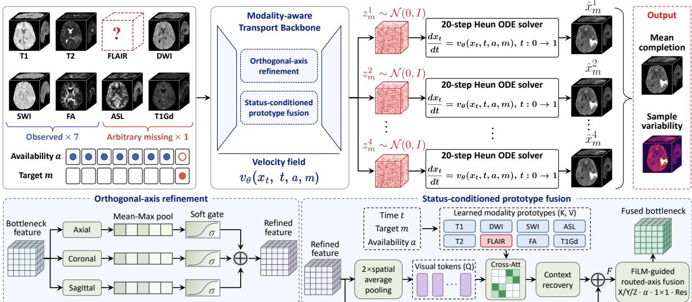
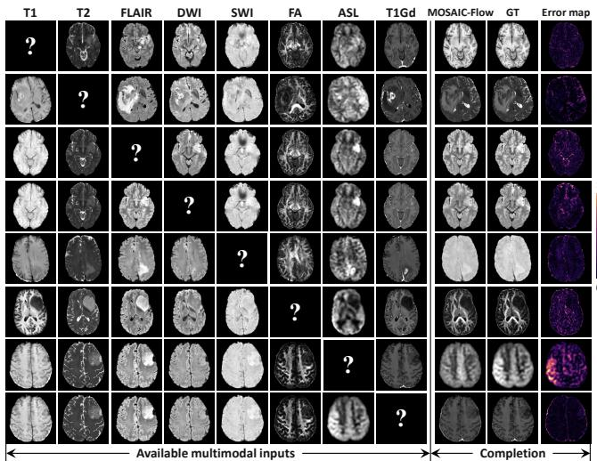
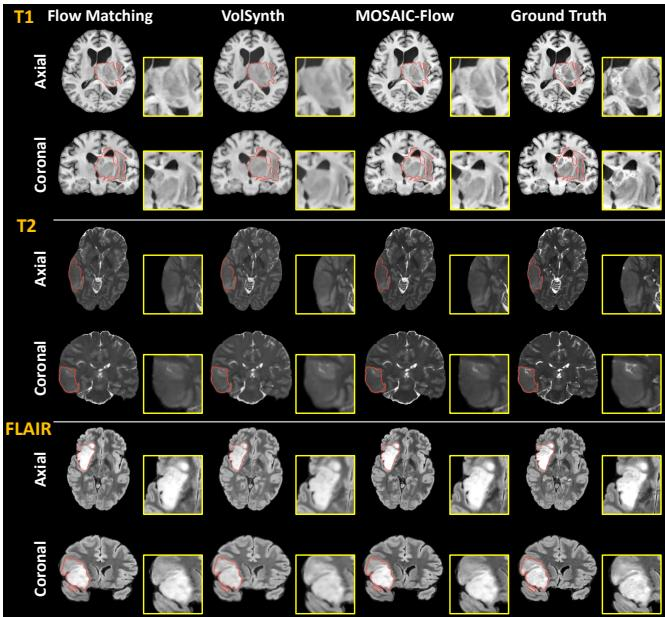
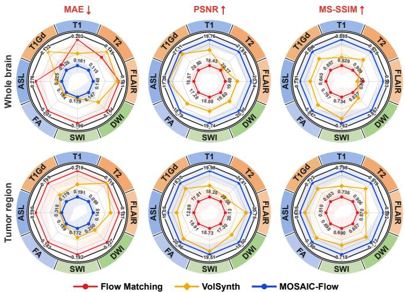

# MOSAIC-FLOW: ORTHOGONAL-AXIS AND STATUS-CONDITIONED FUSION FORMISSING-SEQUENCE COMPLETION IN BRAIN TUMOR MRI

Pengli Zhu Zhihao Peng Yixuan Yuan⋆

Department of Electronic Engineering, The Chinese University of Hong Kong, Hong Kong, China Corresponding author: Yixuan Yuan

## ABSTRACT

Missing-sequence completion is important for comprehensive brain tumor characterization, but cross-modal fusion can obscure sequence-specific contrast and lose fine-grained threedimensional tumor detail. To address this challenge, we introduce Modality-aware Orthogonal-axis Status-conditioned Attentive Integration for Completion (MOSAIC-Flow), a unified framework for missing-sequence completion that learns a target-conditioned velocity field while keeping the seven acquired volumes fixed throughout the transport. Specifically, modality-aware stems independently encode each sequence, and orthogonal-axis refinement captures axial, coronal, and sagittal dependencies while retaining the threedimensional representation. Status-conditioned prototype fusion uses compact modality and availability tokens to route and modulate pooled queries from the fused visual representation, enabling target-adaptive conditioning without dense voxel-to-voxel attention. A conditional flow matching objective transports target-channel noise toward the single missing sequence, while four Heun trajectories are averaged to produce the completion. Evaluation across structural, diffusion, and contrast-enhanced MRI in UCSF-PDGM demonstrates consistent whole-brain and tumor-region fidelity across all eight single-target completion tasks, with the strongest performance on structural sequences. Code is available at https://github.com/CUHK-AIM-Group/MOSAIC-FLOW.

Index Terms— Brain MRI Synthesis, Single-Missing-Sequence Completion, Conditional Flow Matching

## 1. INTRODUCTION

Multimodal magnetic resonance imaging (MRI) provides complementary information on brain anatomy, tissue microstructure, perfusion, susceptibility, and contrast enhancement, which is important for characterizing brain tumors clinically [1]. However, sequences may be unavailable because of scan time constraints, motion, safety considerations, or heterogeneous clinical protocols. Single missing sequence completion aims to recover the unavailable target from the co registered modalities while preserving modality specific contrast and subtle three dimensional tumor anatomy.

Missing MRI synthesis has been studied using adversarial generation, modality masking, shared representations, and latent generative models [2–6]. Diffusion based methods further enable flexible synthesis from incomplete multimodal inputs [7–11], with accelerated sampling strategies reducing inference cost [12, 13]. Recent volumetric approaches improve three dimensional synthesis through orientation aware refinement, efficient multimodal fusion, and structural constraints [14–16], while conditional flow matching provides an alternative continuous generative formulation for controllable MRI synthesis [17–19]. Despite these advances, unified completion of arbitrary missing sequences in heterogeneous brain tumor MRI remains challenging. First, a shared model must preserve modality-specific contrast and fine-grained 3D tumor anatomy while adapting to the target modality. Second, simple channel concatenation may obscure modality identity, whereas dense voxel-wise fusion incurs high computational costs. These challenges call for efficient, target-aware integration of complementary multimodal information.

To this end, we propose MOSAIC-Flow, a unified framework for single missing sequence completion in co-registered brain MRI. The model separates modality specific encoding from shared volumetric processing and learns a target conditioned velocity field for one missing sequence at a time. The acquired modalities remain fixed throughout transport, while the missing target is reconstructed using a shared generative model. The contributions are summarized as follows:

1. We propose MOSAIC-Flow for unified completion across eight MRI sequences. Modality aware stems preserve sequence identity, while target conditioned flow matching reconstructs the requested modality without modifying the seven acquired inputs during transport.

2. We introduce orthogonal axis refinement to capture axial, coronal, and sagittal dependencies through identity initialized soft gating while preserving the three dimensional representation at the bottleneck.

3. We develop status conditioned prototype fusion, which uses modality and acquisition status tokens to route and modulate pooled visual queries for target adaptive conditioning without dense voxel level attention. Comprehensive experiments and matched ablations demonstrate consistent improvements across all eight completion targets.

## 2. METHODOLOGY

## 2.1. Overview

Figure 1 illustrates MOSAIC-Flow, comprising modality aware encoding, a shared 3D transport backbone, orthogonal axis refinement, status conditioned prototype fusion, and a shared velocity decoder. The framework reconstructs one requested target modality from the other seven acquired sequences while keeping the observed volumes fixed throughout transport. Let $\bar { \boldsymbol X } \ = \ ( \boldsymbol x ^ { 1 } , \dots , \boldsymbol x ^ { M } ) \ \in \ \mathbb R ^ { M \times D \times H \times W }$ denote $M = 8$ co registered MRI volumes, where $D , H$ , and W are the spatial dimensions. A one hot vector $m \in \{ 0 , 1 \} ^ { M }$ identifies the missing target, and $a = { \bf 1 } - m$ denotes modality availability, so exactly seven sequences are observed. We define $X _ { \mathrm { o b s } } = a \odot X$ , where ⊙ denotes channel wise multiplication with vectors broadcast over space. For Gaussian noise $Z \sim \mathcal { N } ( 0 , I )$ and time $t \sim \mathcal { U } [ 0 , 1 ]$ , the conditional probability path and target velocity are:

$$
\begin{array} { r l } & { X _ { t } = X _ { \mathrm { o b s } } + m \odot \big ( ( 1 - t ) Z + t X \big ) , } \\ & { \quad U = m \odot ( X - Z ) , \qquad \widehat { U } _ { \theta } = v _ { \theta } ( X _ { t } , t , X _ { \mathrm { o b s } } , a , m ) , } \end{array}\tag{1}
$$

where the requested target is interpolated from noise at $t = 0$ to the acquired target at $t = 1$ , while all observed channels remain fixed at $X _ { \mathrm { o b s } }$ throughout the path.

## 2.2. Target Conditioned Flow Matching

To learn the transport of the requested target while preserving the acquired sequences, we estimate the conditional velocity U in Eq. (1) using a target restricted regression objective. Let wi denote the spatial weight at voxel i, and define $\| Y \| _ { w } ^ { 2 } =$ $( \sum _ { i } w _ { i } Y _ { i } ^ { 2 } ) / ( \sum _ { i } w _ { i } )$ . The flow matching objective [17] is

$$
\mathcal { L } _ { \mathrm { F M } } = \mathbb { E } _ { X , Z , t , m } \left[ \left. m \odot \left( \widehat { U } _ { \theta } - U \right) \right. _ { w } ^ { 2 } \right] ,\tag{2}
$$

where the expectation is taken over training volumes, target choices, noise samples, and interpolation times, and m restricts supervision to the requested target. During inference, the observed channels are reset to $X _ { \mathrm { o b s } }$ after each predictor and corrector update to prevent numerical drift.

## 2.3. Modality Aware Encoding

To preserve modality identity before shared volumetric processing, we augment the shared representation with modality specific residual branches. For modality k, a two layer 3D stem $f _ { k }$ processes the current path volume $\ v { x } _ { t } ^ { k }$ , the observed volume $x _ { \mathrm { o b s } } ^ { k } ,$ and the availability and target indicators $a _ { k }$ and $m _ { k }$ , which are broadcast over the spatial grid. Denoting channel concatenation by [·] and concatenation across modalities by ∥, the initial feature map is:

$$
\begin{array} { r l } & { F _ { 0 } = F _ { \mathrm { s h a r e d } } ( [ X _ { t } , X _ { \mathrm { o b s } } , a , m ] ) } \\ & { ~ + P _ { 0 } \binom { M } { k = 1 } \left. f _ { k } [ x _ { t } ^ { k } , x _ { \mathrm { o b s } } ^ { k } , a _ { k } , m _ { k } ] \right) , } \end{array}\tag{3}
$$

where $F _ { \mathrm { s h a r e d } }$ is the shared 3D stem and $P _ { 0 }$ is a $1 \times 1 \times 1$ projection. The projected modality specific features provide a residual correction to the shared representation. Sinusoidal time embeddings together with learned availability and target embeddings subsequently modulate the residual blocks of the four level 3D U-Net. Initializing $P _ { 0 }$ to zero preserves the shared stem mapping at the start of optimization while allowing modality specific corrections to be learned.

## 2.4. Orthogonal Axis Refinement

To capture complementary dependencies along the three anatomical orientations while preserving the 3D representation, we refine the bottleneck feature $F _ { b }$ along the depth, height, and width axes. For each orientation $p \in \{ D , H , W \}$ $\operatorname { A v g M a x } _ { p } ( \cdot )$ forms a two channel 2D descriptor by average and maximum pooling over the feature channels and axis $p ,$ thereby preserving the corresponding orthogonal plane. An orientation specific network $g _ { p }$ then predicts a soft gate:

$$
\begin{array} { c } { { G _ { p } = 2 \sigma \left( g _ { p } \left( \mathrm { A v g M a x } _ { p } ( F _ { b } ) \right) \right) , } } \\ { { F _ { \mathrm { a x i s } } = \displaystyle \frac { 1 } { 3 } \sum _ { p \in \{ D , H , W \} } F _ { b } \odot G _ { p } . } } \end{array}\tag{4}
$$

Each gate is broadcast to the size of $F _ { b }$ before element wise modulation. The final projection of each $g _ { p }$ is initialized to zero, yielding $G _ { p } = 1$ at initialization, so the refinement starts as an identity mapping. We subsequently apply axial self attention along the three spatial axes to $F _ { \mathrm { a x i s } } ,$ , producing $F _ { \mathrm { a t t } }$ with extended volumetric context before conditional fusion.

## 2.5. Status Conditioned Prototype Fusion

To adapt the refined visual representation to the requested target and acquisition status without dense spatial cross attention, we introduce status conditioned prototype fusion. We first apply factor two average pooling $P$ to $F _ { \mathrm { a t t } }$ and flatten the result into visual queries $Q .$ . For modality $k ,$ a condition token $C _ { k }$ combines a learned modality prototype $e _ { k } ^ { \mathrm { m o d } }$ , a binary status embedding $e _ { k } ^ { \mathrm { s t a t u s } }$ , and the projected global condition embedding $W _ { e } e ,$ where e encodes time, availability, and target information for conditional fusion:

$$
\begin{array} { r l } & { \quad Q = \mathrm { v e c } ( P ( F _ { \mathrm { a t t } } ) ) , } \\ & { \quad C _ { k } = e _ { k } ^ { \mathrm { m o d } } + e _ { k } ^ { \mathrm { s t a t u s } } + W _ { e } e , } \\ & { \quad C = [ C _ { 1 } ; \ldots ; C _ { M } ] , \qquad \widetilde { Q } = \mathrm { A t t n } ( Q , C , C ) . } \end{array}\tag{5}
$$

Here, $Q$ provides the query sequence, while $C$ provides both the key and value sequences for cross attention. The attended tokens are reshaped, interpolated to the bottleneck resolution, and injected into $F _ { \mathrm { a t t } }$ through a zero initialized projection, while their mean context generates channel wise affine modulation and per channel mixture weights for depth, height, and width convolutions. The weighted responses are then projected and added residually, enabling compact condition tokens to guide the visual representation according to modality identity, acquisition status, time, and target without introducing modality specific spatial features.

  
Fig. 1. Overview of MOSAIC-Flow. Seven acquired modalities, availability vector a, and target vector m condition the 3D transport backbone. Orthogonal axis refinement, axial self attention, and status conditioned prototype fusion operate at the bottleneck. Four independent noise samples are integrated using 20 step Heun trajectories and averaged for the final completion.

## 2.6. Objective and Inference

Let B and T denote the binary brain and tumor masks, and let ∂T denote the tumor boundary. We define the spatial weight as $w = 0 . 0 5 \substack { + 0 . 9 5 B + 3 T + 2 \partial T }$ to emphasize brain anatomy, tumor regions, and lesion boundaries. In addition to the flow matching loss, we estimate the target endpoint as $\widehat { X } = X _ { t } +$ $( 1 - t ) \hat { U } _ { \theta }$ and impose weighted intensity, gradient, and local 3D structural constraints. The complete objective is:

$$
\mathcal { L } = \mathcal { L } _ { \mathrm { F M } } + 0 . 2 0 \mathcal { L } _ { 1 } ^ { w } + 0 . 0 3 \mathcal { L } _ { \nabla } ^ { w } + 0 . 0 8 \mathcal { L } _ { \mathrm { S S I M 3 D } } ^ { w } ,\tag{6}
$$

where $\mathcal { L } _ { 1 } ^ { w } , \mathcal { L } _ { \nabla } ^ { w }$ , and $\mathcal { L } _ { \mathrm { S S I M 3 D } } ^ { w }$ constrain target intensity, first order spatial gradients, and local 3D structure, respectively. During inference, $K = 4$ independent noise volumes are integrated from $t = 0 \mathrm { ~ t o ~ } t = 1$ using a 20 step Heun solver, with the observed channels restored after each update. The final completion is the sample mean $\begin{array} { r } { x _ { m } = K ^ { - 1 } \sum _ { s = 1 } ^ { K } \widehat { x } _ { m } ^ { ( s ) } } \end{array}$ were clipped at the 0.5th–99.5th percentiles, and reversibly cropped to $1 9 2 \times 2 0 8 \times 1 5 2$ without excluding tumors.

## 2.7. Implementation

Dataset. We evaluated MOSAIC-Flow on UCSF-PDGM [20], comprising 501 scans from 495 subjects with T1, T2, FLAIR, DWI, SWI, HARDI derived FA, ASL, and T1Gd. Intensities

Optimization. MOSAIC-Flow used a base width of 32, channel multipliers (1, 2, 4, 8), two residual blocks per level, a 512 dimensional condition embedding, and eight attention heads. The model was trained on NVIDIA H200 GPUs using AdamW with a learning rate of $5 \times 1 0 ^ { - 5 }$ , weight decay of $1 0 ^ { - 5 }$ , effective batch size of four, BF16 and TF32 computation, and an EMA rate of 0.9999.

## 3. EXPERIMENTS

## 3.1. Completion Across All Target Modalities

We evaluated completion across all eight target modalities in UCSF-PDGM. Comparisons included Flow Matching [17] and VolSynth [21], with MAE, PSNR, and MS-SSIM evaluated in both brain and tumor regions. As shown in Fig. 2, MOSAIC-Flow reconstructs the distinct appearance of all eight target modalities while preserving overall brain anatomy in the representative case. The error maps further show target dependent residual patterns, with larger errors observed for ASL, likely reflecting its lower signal to noise ratio and greater physiological variability.

## 3.2. Anatomical Fidelity in Tumor Regions

To assess anatomical fidelity in tumor regions, Fig. 3 presents tumor-focused comparisons for T1, T2, and FLAIR using axial and coronal views. Across all targets, MOSAIC-Flow better preserves lesion boundaries and local contrast than Flow Matching and VolSynth, showing closer agreement with ground truth. This highlights its ability to preserve fine-grained tumor anatomy across structural contrasts.

  
Fig. 2. Completion across eight target modalities. Each row shows seven available inputs, the missing target, MOSAIC-Flow completion, ground truth, and absolute error.

  
Fig. 3. Tumor-focused qualitative comparison. Matched axial and coronal views are shown for Flow Matching, Vol-Synth, MOSAIC-Flow, and GT. Red contours mark the tumor region, and yellow boxes show magnified local anatomy.

## 3.3. Quantitative Performance Across MRI Sequences

To quantify completion performance across MRI sequences, Fig. 4 reports mean MAE, PSNR, and MS-SSIM across all eight targets for whole-brain and tumor regions, with shaded bands denoting standard deviation (SD). MOSAIC-Flow achieves the lowest MAE and highest PSNR and MS-SSIM for every target in both regions, consistently outperforming Flow Matching and VolSynth across all sequence types. These results demonstrate robust and consistent completion across the full eight-modality MRI protocol.

  
Fig. 4. Quantitative comparison across eight target modalities. Radar plots show mean performance with shaded Mean ± SD for whole-brain and tumor-region evaluation. Each spoke represents one target modality. Lower MAE and higher PSNR and MS-SSIM indicate better performance.

Table 1. Component ablation across all eight targets. Values are averaged over the same test split. Bold denotes the best value for each region and metric.
<table><tr><td>Region</td><td>Configuration</td><td>MAE↓</td><td>PSNR ↑</td><td>MS-SSIM ↑</td></tr><tr><td rowspan="4">Brain</td><td>w/o axis</td><td>0.2149</td><td>17.3891</td><td>0.7331</td></tr><tr><td>w/o fusion</td><td>0.2145</td><td>17.5029</td><td>0.7605</td></tr><tr><td>w/o both</td><td>0.2258</td><td>16.7493</td><td>0.7290</td></tr><tr><td>Full Model</td><td>0.1605</td><td>19.9275</td><td>0.8583</td></tr><tr><td rowspan="4">Tumor</td><td>w/o axis</td><td>0.2318</td><td>17.5129</td><td>0.6423</td></tr><tr><td>w/o fusion</td><td>0.2332</td><td>17.4701</td><td>0.6595</td></tr><tr><td>w/o both</td><td>0.2470</td><td>16.3239</td><td>0.6316</td></tr><tr><td>Full Model</td><td>0.1829</td><td>19.7456</td><td>0.7731</td></tr></table>

## 3.4. Ablation Studies

To evaluate each proposed module, we remove orthogonalaxis refinement, status-conditioned prototype fusion, or both under identical settings. Table 1 shows that removing either module degrades all metrics in both brain and tumor regions, while removing both yields the largest degradation, supporting the contribution of each module.

## 4. CONCLUSION

We present MOSAIC-Flow, a unified framework for singlemissing-sequence completion across eight brain MRI modalities. By combining modality-aware encoding, orthogonalaxis refinement, status-conditioned prototype fusion, and conditional flow matching, MOSAIC-Flow improves wholebrain and tumor-region reconstruction across heterogeneous MRI contrasts while preserving anatomical fidelity. Extension to multiple missing sequences remains future work.

## 5. COMPLIANCE WITH ETHICAL STANDARDS

This study used the publicly available, de-identified UCSF-PDGM dataset in accordance with its data-use terms. No additional human participant data were collected.

## 6. ACKNOWLEDGMENTS

This work was supported by NSFC/RGC Joint Research Scheme N\_CUHK4126/25 and Innovation and Technology Fund Mainland-Hong Kong Joint Funding Scheme MHP/173/24. The authors declare no conflicts of interest.

## 7. REFERENCES

[1] Y. Hao, M. Liu, J. Zhu, et al., “PANDA: Patch-based unsupervised deep learning for brain anomaly detection via age prediction in fetal MRI,” Imaging Neurosci., vol. 4, pp. IMAG.a.1293, 2026.

[2] J. Liu, S. Pasumarthi, B. Duffy, et al., “One model to synthesize them all: Multi-contrast multi-scale transformer for missing data imputation,” IEEE Trans. Med. Imag., vol. 42, no. 9, pp. 2577–2591, 2023.

[3] Y. Zhang, C. Peng, et al., “Unified multi-modal image synthesis for missing modality imputation,” IEEE Trans. Med. Imag., vol. 44, no. 1, pp. 4–18, 2025.

[4] X. Zhang, J. Liang, P. Cao, et al., “Structure-aware MRI translation: Multi-modal latent diffusion model with arbitrary missing modalities,” in Proc. MICCAI, 2025, pp. 508–518.

[5] L. Qi, Y. Liu, Y. Li, et al., “A unified missing modality imputation model with inter-modality contrastive and consistent learning,” in Proc. MICCAI, 2026, pp. 44–53.

[6] H. Pang, Y. Hao, and P. Zhu, “Task-adaptive 3D crossfield MRI translation via field-conditioned content-style pretraining,” in MICCAI 2026 Workshop on MRIx-Fields, 2026.

[7] P. Zhu, C. Liu, Y. Fu, et al., “Cycle-conditional diffusion model for noise correction of diffusion-weighted images using unpaired data,” Med. Image Anal., vol. 103, pp. 103579, 2025.

[8] P. Zhu, Y. Fu, N. Chen, et al., “Q-space guided multimodal translation network for diffusion-weighted image synthesis,” IEEE Trans. Med. Imag., vol. 45, no. 3, pp. 1167–1178, 2026.

[9] H. Pang, X. Hong, P. Zhang, et al., “Cascaded diffusion model and segment anything model for medical image synthesis,” Pattern Recognit., p. 114148, 2026.

[10] W. Zhong, C. Cong, Z. Wang, et al., “FMM-Diff: A feature mapping and merging diffusion model for MRI generation with missing modality,” in Proc. MICCAI, 2026, pp. 227–236.

[11] H. Pang, P. Zhu, S. Chen, et al., “nnDiffusion: A standardized 3D diffusion framework for medical image synthesis,” in 11th International Workshop on Simulation and Synthesis in Medical Imaging, 2026.

[12] A. Q. Nichol and P. Dhariwal, “Improved denoising diffusion probabilistic models,” in Proc. Int. Conf. Mach. Learn. (ICML), 2021, pp. 8162–8171.

[13] J. Song, C. Meng, and S. Ermon, “Denoising diffusion implicit models,” in Proc. Int. Conf. Learn. Represent. (ICLR), 2021.

[14] J. Wei, G. Yang, W. Wei, et al., “Refine then fusion: Robust 3D brain MRI synthesis via vision–language collaboration,” IEEE Trans. Med. Imag., vol. 45, no. 7, pp. 4091–4104, 2026.

[15] Z. Zhang, P. Jing, Z. Wang, et al., “Cyclic selfsupervised diffusion for ultra low-field to high-field MRI synthesis,” IEEE Trans. Med. Imag., vol. 45, no. 7, pp. 3766–3781, 2026.

[16] H. Pang, P. Zhang, X. Hong, et al., “D3M: Deformation-driven diffusion model for synthesis of contrast-enhanced MRI with brain tumors,” in Proc. MICCAI, 2026, pp. 151–160.

[17] Y. Lipman, R. T. Q. Chen, H. Ben-Hamu, et al., “Flow matching for generative modeling,” in Proc. Int. Conf. Learn. Represent. (ICLR), 2023.

[18] H. Chang, Y. Shang, H. Wang, et al., “Controllable flow matching for 3D contrast-enhanced brain MRI synthesis from non-contrast scans,” in Proc. MICCAI, 2025, pp. 119–128.

[19] M. Yazdani, Y. Medghalchi, P. Ashrafian, et al., “Flow matching for medical image synthesis: Bridging the gap between speed and quality,” in Proc. MICCAI, 2026, pp. 216–226.

[20] E. Calabrese, J. E. Villanueva-Meyer, J. D. Rudie, et al., “The university of california san francisco preoperative diffuse glioma MRI dataset,” Radiol. Artif. Intell., vol. 4, no. 6, pp. e220058, 2022.

[21] S. Bottani, E. Thibeau-Sutre, A. Maire, et al., “Contrastenhanced to non-contrast-enhanced image translation to exploit a clinical data warehouse of t1-weighted brain mri,” BMC Med. Imaging, vol. 24, pp. 67, 2024.