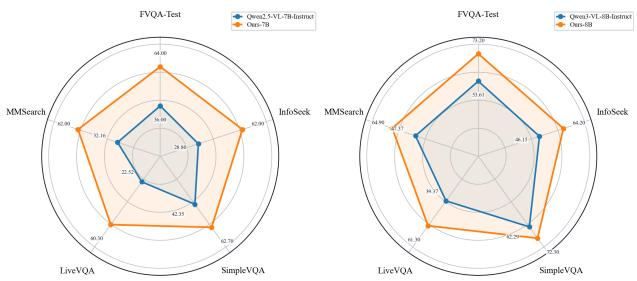
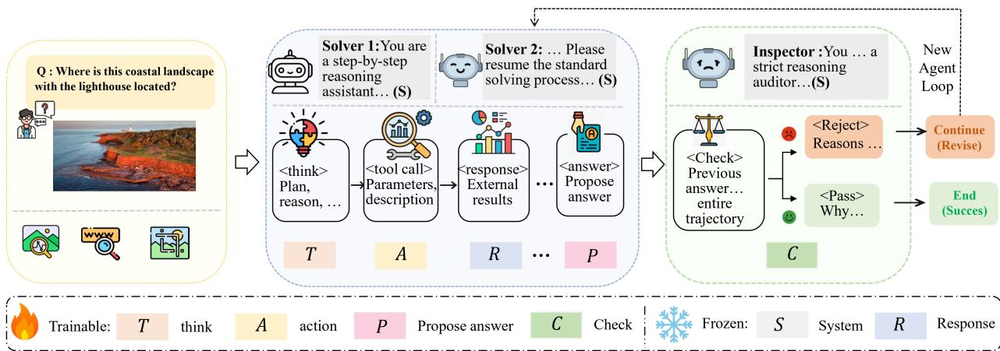
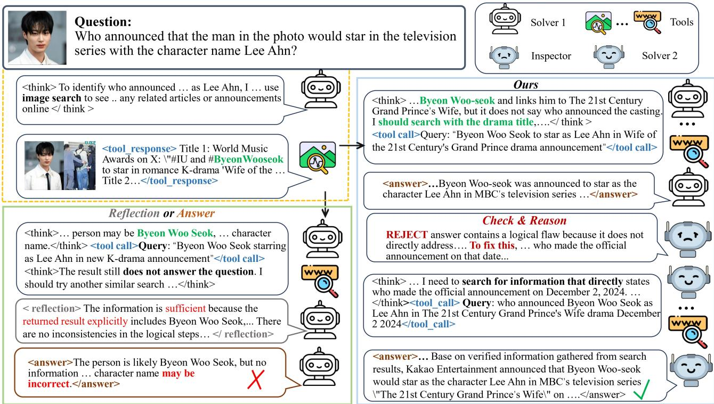
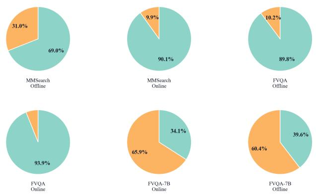
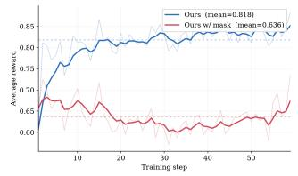
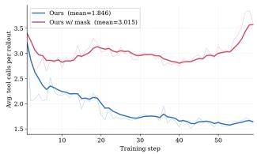
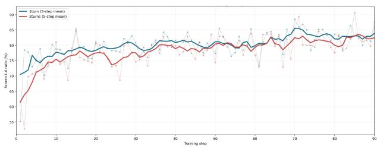

# MRC-MMAgent: Reinforcement Learning for Multi-Role Collaboration in Multimodal Tool-Using Agents

Shengqin Wang∗, Jie Jin∗, Xiaofan Li, Wentao Yan, Yu Cheng, Qingsong Hu Yihang Chen, Weilin Luo, Jingyu Gong, Xin Tan, Yuan Xie, Zhizhong Zhang

East China Normal University, Shanghai Innovation Institute, University College London, Huawei Noah’s Ark Lab

## Abstract

Multimodal tool-using agents augment vision-language mod- els with access to external information and capabilities, en- abling them to solve knowledge-intensive and visually com- plex tasks that cannot be addressed using visual context alone. However, existing reinforcement learning pipelines largely train single-role agents to search and answer using terminal rewards, overlooking how humans inspect retrieved evidence, reformulate queries, and revise conclusions during search. Consequently, they fail to optimize this self-corrective pro- cess over complete interaction trajectories. We propose MRC-MMAgent, a multi-role collaborative reinforcement learning framework that incorporates trajectory assessment and continuation directly into the executable agent loop. First, the framework establishes a multi-role collaborative loop that in- tegrates solving, inspection, and continuation, enabling the agent to acquire evidence through tools, evaluate the preced- ing trajectory, and resume problem solving when the cur-rent answer is insuficiently supported. Second, we intro- duce a role-coupled learning objective that combines task success, interaction validity, and successful correction with full-trajectory policy optimization across the decisions gen-erated by all roles. Extensive experiments show that, using only the original baseline training set without constructing additional datasets, our method consistently outperforms the corresponding base models and achieves leading or highly competitive performance across benchmarks.

## Introduction

Vision-Language Models (VLMs) (Liu et al. 2024; Chen et al. 2024a; Liu et al. 2023; Zhu et al. 2025; Zhang et al. 2024a) have rapidly improved on perception, recognition, and visual question answering, yet many user questions can- not be answered from images alone. Multimodal agents ad- dress this limitation by coupling a foundation model with tools such as reverse image search, text search, region zoom- ing, and retrieval (Chen et al. 2022, 2024b; Yu et al. 2024; Hu et al. 2023; Jiang et al. 2024; Zhang et al. 2024b). Systems such as MMSearch-R1, WebWatcher, DeepEyes2 optimize tool-augmented policies for multimodal search and visual question answering (Wu et al. 2025; Geng et al. 2025; Hong et al. 2025). SenseNova-MARS (Chng et al. 2025) further constructs high-resolution multimodal agent data and pro- poses BN-GSPO for training autonomous tool-using VLMs.

  
Figure 1: Performance comparison of agents across diferent scales. Each radar chart reports results on the same five eval- uation datasets.

These methods establish Reinforcement Learning (RL) as a foundation for developing agents’ core tool-use capabilities.

However, prevailing RL formulations train multimodal tool agents as single-role solvers under terminal-answer su- pervision, leaving a critical control process weakly super- vised. This formulation has two limitations: its single-role design lacks a dedicated mechanism for evidence assessment and continuation control, while terminal-only rewards fail to jointly optimize assessment, control, and revision across the full trajectory. First, as illustrated in Figure 3, a single agent loop may retrieve relevant snippets and still answer based on the wrong comparison basis, they lack an explicit, trainable mechanism that connects evidence assessment with trajectory control, making it dificult to identify under-supported answers and initiate targeted continuation. Second, as shown in the "reflection" part of Figure 3, where we insert the in- spection stage into the solver’s loop, the reflection merely repeats or rationalizes the initial reasoning. Mirroring hu- man information seeking, the agent assesses the preceding solution trajectory, finalizes the answer when it is suficiently supported, and otherwise resumes tool use to refine its rea- soning and revise the answer. This conditional assessment- and-continuation process closes the loop over the entire in- teraction, highlighting the importance of full-trajectory optimization for reliable reasoning.

To address these limitations, we propose a multi-role col- laborative reinforcement learnin framework for multimodal tool agents. First, we organize solving, inspection, and contin- uation as role-specific behaviors within a unified executable loop. The solver gathers external evidence and proposes a candidate answer, while the inspector assesses whether the accumulated visual–textual observations support it. If the evidence is suficient, the rollout terminates; otherwise, the Inspector returns control to the solver for targeted tool use and revision. This design turns evidence assessment into a trainable control decision and enables all roles to co-adapt within a shared policy. Second, we formulate a role-coupled learning objective. We define behavioral rewards tailored to solving, inspection, and continuation, and aggregate them into a trajectory-level reward. Full-trajectory GRPO applies the aggregated reward signal to all role decisions rather than confining each role-specific signal to its corresponding role, thereby coupling optimization across the complete trajectory. Theoretical analysis and controlled ablations validate both the reward and optimization designs. Using only the MMSearch-R1 training set, with no additional supervised fine-tuning (SFT) trajectories or RL data, our method im-proves upon the base model by 11.1 points. Extensive exper- iments show that, without constructing any extra datasets, our method consistently outperforms the corresponding base models and achieves leading or highly competitive perfor- mance across search-intensive and visually complex bench- marks. Our contributions are:

• We propose a multi-role collaborative reinforcement learning framework that organizes solving, trajectory in-spection, and continuation within a unified executable loop, enabling evidence-conditioned finalization and tar- geted recovery in multimodal tool use.

• We formulate a role-coupled learning objective that combines a trajectory reward for task success, interaction validity, calibrated finalization, and efective correction with full-trajectory over all generated role decisions.

• Across diverse multimodal benchmarks, our method delivers consistent gains over its base models and leading or competitive results among same-scale systems, without auxiliary SFT trajectories or additional training data.

## Related Work

## Multimodal Tool-Using Agents

Recent multimodal search and visual question answering agents (Wu et al. 2025; Chng et al. 2025; Hong et al. 2025; Wang et al. 2025a) continuously acquire problem-solving capabilities by training VLMs to use tools. However, most current agents rely on expensive SFT trajectories to regularize model behavior, while improving performance through terminal rewards alone. This fixed behavioral regime ne- glects efective evaluation of the model’s reasoning process and further limits the ability to perform meaningful revision.

## Multi-Agent and Multi-Module Tool-Use RL

Multi-agent frameworks optimize role decomposition among planners, workers, and specialized agents (Li et al. 2025; Mo et al. 2025; Park et al. 2025; Chen et al. 2026a), while other works improve process supervision and multimodal tool use (Tan et al. 2025; Zhang et al. 2026; Dong et al. 2025; Zhao et al. 2026; Hong et al. 2025). Reflection meth-ods such as Look-Back and ReGRPO revisit evidence or use teacher feedback to revise solutions (Yang et al. 2026; Klissarov et al. 2026; Zhang and Shou 2026), but do not jointly learn reference-free inspection and recovery within a multi- modal tool loop (see Supp. A for detailed comparisons). In contrast, MRC-MMAgent trains solver, inspector, and con- tinuation within one shared policy, without auxiliary SFT or teacher critiques, using a role-coupled reward and full- trajectory updates to jointly optimize calibrated finalization and successful correction.

## Method

## Overview

Figure 2 presents our multi-role collaborative reinforce- ment learning framework, which couples an executable solve–inspect–continue loop with trajectory-level learning. A shared policy πθ is conditioned by frozen prompts $S _ { 1 } , S _ { 3 } ,$ and $S _ { 2 }$ to act as the initial solver, inspector, and continuation solver, respectively. The solver gathers evidence and proposes an answer; without access to the reference answer, correct- ness labels, or future outcomes, the inspector determines whether the trajectory suficiently supports it and either fi-nalizes or requests targeted continuation. We train all roles with a role-coupled reward for task success, interaction valid- ity, and inspection-guided correction. Full-trajectory GRPO then propagates the group-relative signal to every model- generated decision, allowing the shared policy to co-adapt across the complete interaction.

## Multi-Role Agent Loop

Each example is a multimodal query $q = ( x , u )$ , where x denotes one or more images and u is a natural-language question. At loop index k, the solver generates a reasoning– action–answer segment:

$$
X _ { k } = ( T _ { k } , A _ { k } , R _ { k } , . . . , P _ { k } ) \sim \pi _ { \theta } ( \cdot \mid h _ { k } , S _ { r _ { k } } ) ,\tag{1}
$$

$$
S _ { r _ { k } } = \left\{ { { S _ { 1 } } , \atop { { \cal S } _ { 2 } , \quad k > 0 } } \right.\tag{2}
$$

where the environment executes actions in $A _ { k }$ and appends their observations to history. The inspector then generates:

$$
C _ { k } \sim \pi _ { \theta } ( \cdot \mid h _ { k } ^ { \prime } , S _ { 3 } ) ,\tag{3}
$$

where $h _ { k } ^ { \prime }$ contains the multimodal query, preceding solving trajectory, retrieved visual–textual observations, and candidate answer $P _ { k }$ , etc. In particular,

$$
( y ^ { \star } , \quad \mathrm { A c c } ( P _ { k } ) , \quad y _ { f } ) \notin h _ { k } ^ { \prime } ,\tag{4}
$$

where $y ^ { \star }$ denotes the reference answer. Thus, the inspec- tor must assess suficiency from the trajectory rather than compare $P _ { k }$ with a known answer. Its output $C _ { k }$ contains a rationale and decision $d _ { k } \in$ {finalize, continue}, verifying evidential support and identifying missing, conflicting, or in- adequately grounded evidence. Finalization returns $y _ { f } = P _ { k }$ continuation converts the identified gap into a frozen bridge message $B _ { k }$ and updates:

$$
h _ { k + 1 } = h _ { k } ^ { \prime } \oplus C _ { k } \oplus B _ { k } ,\tag{5}
$$

  
Figure 2: Overview of the proposed multi-role collaborative training framework for multimodal tasks. The Solver iteratively tackles the initial query, while the Inspector analyzes visual-textual trajectories to generate suggestions. Failed agent loops are re-executed based on historical trajectories to ensure convergence.

after which the solver resumes under $S _ { 2 }$ with the existing evidence, rejected candidate, and inspection feedback. The loop ends when the answer is accepted or after at most $N _ { m }$ continuations. We denote the initial candidate by $y _ { 0 } = P _ { 0 }$ and the returned answer by $y _ { f }$

A complete rollout can therefore be represented compactly as:

$$
\tau = { \left( q ; S _ { 1 } , X _ { 0 } ; [ S _ { 3 } , C _ { k } , S _ { 2 } , X _ { k } ] _ { k = 1 } ^ { K } \right) } ,\tag{6}
$$

where $K \leq N _ { m } , R _ { k }$ collects the frozen tool observations in loop k. The trainable events are:

$$
\mathcal { M } ( \tau ) = \bigcup _ { k = 0 } ^ { K } \{ T _ { k } , A _ { k } , P _ { k } , C _ { k } \} ,\tag{7}
$$

$$
\mathcal { E } ( \tau ) = \tau \setminus \mathcal { M } ( \tau ) .\tag{8}
$$

They decompose by role as:

$$
\mathcal { M } ( \tau ) = \mathcal { M } _ { S _ { 1 } } ( \tau ) \cup \mathcal { M } _ { I } ( \tau ) \cup \mathcal { M } _ { S _ { 2 } } ( \tau ) ,\tag{9}
$$

where the subsets contain initial-solver, inspector, and continuation-solver tokens. The context set $\bar { \mathcal { E } ( \tau ) }$ contains role prompts, tool observations, and bridge messages. These events condition subsequent generation but are not sampled from πθ. Assuming that the environment dynamics are independent of θ, the trajectory log-likelihood gradient is

$$
\nabla _ { \theta } \log p _ { \theta } ( \tau \mid q ) = \sum _ { t \in \mathcal { M } ( \tau ) } \nabla _ { \theta } \log \pi _ { \theta } ( a _ { t } \mid h _ { t } ) .\tag{10}
$$

Thus, all policy-generated decisions from solving, inspec- tion, and continuation contribute to the same trajectory-level update, providing the basis for full-trajectory credit assign-ment. Supplementary Material B gives the complete rollout algorithm.

## Role-Coupled Trajectory Reward

Each rollout receives a reward for final-answer accuracy $R _ { \mathrm { a c c } }$ , interaction validity $R _ { \mathrm { f m t } }$ , and inspection-guided cor- rection $R _ { \mathrm { c o r r } }$ . The task evaluator sets $\dot { R } _ { \mathrm { a c c } } \in \{ 0 , 1 \}$ from $y _ { f } .$ . The format term $R _ { \mathrm { f m t } } \in \{ 0 , 1 \}$ requires valid tool calls, a candidate answer before inspection, a coherent control de- cision, and well-formed continuation, preventing malformed interactions from being compensated by answer reward.

The correction reward couples the inspector’s evidence- conditioned decision with the solver trajectories before and after inspection. Let $I _ { \mathrm { c o n t } } ( \tau )$ indicate whether the first in- spection triggers continuation, and let $\operatorname { A c c } ( y ) \in \{ 0 , 1 \}$ be the environment’s post-hoc task evaluator. Neither the ref- erence answer nor the values of $\operatorname { A c c } ( y _ { 0 } )$ and $\operatorname { A c c } ( y _ { f } )$ are exposed to the inspector. The Inspector thus assesses eviden- tial suficiency without answer labels, while its finalization and continuation decisions are optimized from post-hoc tra- jectory outcomes. We define:

$$
R _ { \mathrm { c o r r } } ( \tau ) = \left\{ \begin{array} { l l } { 0 , } & { I _ { \mathrm { c o n t } } \wedge \mathrm { A c c } ( y _ { 0 } ) = 1 , } \\ { 1 , } & { I _ { \mathrm { c o n t } } \wedge \mathrm { A c c } ( y _ { 0 } ) = 0 \wedge \mathrm { A c c } ( y _ { f } ) = 1 , } \\ { 0 . 5 , } & { I _ { \mathrm { c o n t } } \wedge \mathrm { A c c } ( y _ { 0 } ) = 0 \wedge \mathrm { A c c } ( y _ { f } ) = 0 , } \\ { 1 , } & { - I _ { \mathrm { c o n t } } \wedge \mathrm { A c c } ( y _ { f } ) = 1 , } \\ { 0 , } & { - I _ { \mathrm { c o n t } } \wedge \mathrm { A c c } ( y _ { f } ) = 0 . } \end{array} \right.\tag{11}
$$

Full credit is assigned when the inspector correctly finalizes or when continuation corrects an initially wrong answer. If the inspector rejects an incorrect answer but continuation fails to correct it, partial credit separates the inspection de- cision from the continuation failure. Unnecessary rejection and premature finalization receive no credit. These outcomes score only the completed interaction and never condition the inspection decision in Eq. (4). For clarity, Eq. (11) presents the $N _ { m } = 1$ case; Ablation Study also evaluate $N _ { m } > 1$ where the same loop repeats and the reward is computed over the complete trajectory from y0 to $y _ { f }$

The overall reward is:

$$
R ( \tau ) = \lambda _ { \mathrm { a c c } } R _ { \mathrm { a c c } } ( \tau ) + \lambda _ { \mathrm { f m t } } R _ { \mathrm { f m t } } ( \tau ) + \lambda _ { \mathrm { c o r r } } R _ { \mathrm { c o r r } } ( \tau ) ,\tag{12}
$$

with $( \lambda _ { \mathrm { a c c } } , \lambda _ { \mathrm { f m t } } , \lambda _ { \mathrm { c o r r } } ) = ( 0 . 7 , 0 . 1 , 0 . 2 )$ , prioritizing cor- rectness while retaining pressure for valid interaction and

  
Figure 3: Case Study. The left panel shows a failure case where the current agent loop produces an incorrect answer. The right panel shows that after the inspector reviews the visual-textual trajectory, it detects the failure; the solver then resumes from the accumulated context and successfully corrects the answer.

useful revision. Because $R _ { \mathrm { c o r r } }$ jointly depends on the initial solution, inspection, and continuation outcome, the reward is a coupled function:

$$
R ( \tau ) = R ( \mathcal { M } _ { S _ { 1 } } ( \tau ) , \mathcal { M } _ { I } ( \tau ) , \mathcal { M } _ { S _ { 2 } } ( \tau ) ) ,\tag{13}
$$

rather than a collection of independent role-level objectives.

## Trajectory-Level Policy Optimization

The role-coupled reward defines the desired behaviors of all roles, while policy optimization determines how its credit is assigned. For each query $q _ { b } ,$ the old policy samples G complete rollouts and normalizes their aggregated rewards into group-relative trajectory advantages:

$$
\bar { A } _ { b , g } = \frac { R ( \tau _ { b , g } ) - \mathrm { m e a n } _ { g ^ { \prime } } R ( \tau _ { b , g ^ { \prime } } ) } { \mathrm { s t d } _ { g ^ { \prime } } R ( \tau _ { b , g ^ { \prime } } ) + \epsilon } .\tag{14}
$$

The component rewards are therefore combined before credit assignment rather than routed independently to individ- ual roles. Let $m _ { b , g , t }$ mark model-generated tokens, and let $c _ { b , g , t } \in \{ 0 , 1 \}$ specify which of these tokens receive trajectory credit. With $\begin{array} { r } { \dot { N _ { b , g } ^ { c } } ~ = ~ \sum _ { t } m _ { b , g , t } c _ { b , g , t } } \end{array}$ and im- portance ratio $\rho _ { b , g , t } ~ = ~ \pi _ { \theta } ( a _ { b , g , t } ~ \vert ~ h _ { b , g , t } ) / \pi _ { \theta _ { \mathrm { o l d } } } ( a _ { b , g , t } ~ \vert ~$ $h _ { b , g , t } )$ , the credit-assignment form of GRPO is Let $\rho _ { b , g , t } =$ $\begin{array} { r } { \frac { \pi _ { \theta } ( a _ { b , g , t } | h _ { b , g , t } ) } { \pi _ { \theta _ { \mathrm { o l d } } } ( a _ { b , g , t } | h _ { b , g , t } ) } , ~ \bar { \rho } _ { b , g , t } = \mathrm { c l i p } ( \rho _ { b , g , t } , 1 - \epsilon _ { c } , 1 + \epsilon _ { c } ) } \end{array}$ , and $L _ { b , g , t } ( \theta ) = \mathrm { m i n } ( \rho _ { b , g , t } \bar { A } _ { b , g } , \bar { \rho } _ { b , g , t } \bar { A } _ { b , g } ) - \beta D _ { \mathrm { K L } , b , g , t } ,$

$$
\mathcal { I } ( \theta ; c ) = \mathbb { E } _ { b , g } \left[ \frac { 1 } { N _ { b , g } ^ { c } } \sum _ { t } m _ { b , g , t } c _ { b , g , t } L _ { b , g , t } ( \theta ) \right] .\tag{15}
$$

Our full-trajectory assignment sets:

$$
\begin{array} { r } { c _ { b , g , t } ^ { \mathrm { f u l l } } = 1 , A _ { b , g , t } ^ { \mathrm { f u l l } } = m _ { b , g , t } \bar { A } _ { b , g } , \mathcal { J } _ { \mathrm { f u l l } } = \mathcal { J } ( \theta ; c ^ { \mathrm { f u l l } } ) . } \end{array}\tag{16}
$$

Consequently, the aggregated accuracy, validity, and correc- tion signal jointly trains every decision made by the initial solver, inspector, and continuation solver, preserving the complete likelihood in Eq. (10).

By contrast, role-selective credit assignment uses a trajectory-dependent mask:

$$
c _ { b , g , t } ^ { \mathrm { r o l e } } = z _ { b , g , t } ( \tau ) = f _ { t } ( y _ { 0 } , C , y _ { f } , \operatorname { A c c } ( y _ { 0 } ) , \operatorname { A c c } ( y _ { f } ) ) ,\tag{17}
$$

which assigns the advantage only to the role judged locally responsible, such as the inspector when it rejects a correct answer. This is a concrete credit-assignment rule rather than a neutral loss mask. Ignoring clipping and KL regularization, its diference from full-trajectory optimization is:

$$
g _ { \mathrm { r o l e } } - g _ { \mathrm { f u l l } } = \mathbb { E } _ { b , g } \left[ \bar { A } _ { b , g } \left( \bar { s } _ { b , g } ^ { \mathrm { r o l e } } - \bar { s } _ { b , g } ^ { \mathrm { f u l l } } \right) \right] ,\tag{18}
$$

where $\bar { s } ^ { \mathrm { r o l e } }$ and $\bar { s } ^ { \mathrm { f u l l } }$ average token score functions over selected-role and all trainable tokens. Because $z ( \tau )$ de- pends on policy-generated outcomes and the roles causally afect one another, this diference is generally nonzero. Role- selective assignment therefore changes the optimization tar- get and introduces a post-hoc attribution mismatch relative to the full-trajectory GRPO objective, whereas full-trajectory assignment preserves all decisions contributing to the cou- pled reward and enables joint role adaptation. Supplementary Material C provides a detailed theoretical derivation and comprehensive experimental comparisons, which col- lectively demonstrate the efectiveness of our method.

<table><tr><td>Method</td><td>Avg.</td><td>FVQA-Test</td><td>InfoSeek</td><td>SimpleVQA</td><td>LiveVQA</td><td>MMSearch</td></tr><tr><td colspan="7">Direct Answer</td></tr><tr><td>Qwen2.5-VL-7B-Instruct</td><td>26.7</td><td>26.3</td><td>32.0</td><td>47.9</td><td>19.6</td><td>7.6</td></tr><tr><td>Qwen3-VL-8B-Instruct</td><td>25.0</td><td>24.2</td><td>23.2</td><td>42.9</td><td>23.2</td><td>11.7</td></tr><tr><td>Qwen3-VL-32B-Instruct</td><td>31.1</td><td>32.2</td><td>29.0</td><td>45.9</td><td>31.6</td><td>17.0</td></tr><tr><td>GPT-5</td><td>50.0</td><td>54.4</td><td>54.2</td><td>61.7</td><td>44.4</td><td>35.1</td></tr><tr><td>Claude-4-Sonnet</td><td>40.1</td><td>35.3</td><td>57.3</td><td>50.9</td><td>38.5</td><td>18.7</td></tr><tr><td>Gemini-3-Flash</td><td>54.2</td><td>56.5</td><td>54.9</td><td>63.6</td><td>38.9</td><td>57.3</td></tr><tr><td>Gemini-3-Pro</td><td>56.5</td><td>59.2</td><td>56.3</td><td>64.1</td><td>40.1</td><td>62.6</td></tr><tr><td colspan="7">Agentic Model (zero-shot)</td></tr><tr><td>Qwen2.5-VL-7B-Instruct Qwen3-VL-8B-Instruct</td><td>32.4 49.8</td><td>36.0 53.6</td><td>28.8 46.2</td><td>42.4 62.3</td><td>22.5 39.4</td><td>32.2 47.4</td></tr><tr><td>Qwen2.5-VL-32B-Instruct</td><td>51.9</td><td>52.2</td><td>50.1</td><td>65.2</td><td>42.2</td><td>49.7</td></tr><tr><td>Qwen3-VL-32B-Instruct</td><td>52.1</td><td>54.3</td><td>49.9</td><td>64.2</td><td>42.9</td><td>49.1</td></tr><tr><td>GPT-40</td><td>55.8</td><td>66.3</td><td>59.6</td><td>63.7</td><td>40.1</td><td>49.1</td></tr><tr><td>Gemini-2.5-Flash</td><td>58.2</td><td>61.7</td><td>53.7</td><td>68.8</td><td>47.8</td><td>59.1</td></tr><tr><td>GPT-5</td><td>59.6</td><td>62.6</td><td>56.0</td><td>70.6</td><td>56.0</td><td>52.6</td></tr><tr><td>Gemini-3-Flash</td><td>60.9</td><td>64.9</td><td>61.1</td><td>67.9</td><td>48.1</td><td>62.6</td></tr><tr><td>Gemini-3-Pro</td><td>69.8</td><td>72.6</td><td>66.5</td><td>75.9</td><td>59.7</td><td></td></tr><tr><td></td><td></td><td></td><td></td><td></td><td></td><td>74.3</td></tr><tr><td colspan="7">Trained Multimodal Tool Agents</td></tr><tr><td>MMSearch-R1-7B</td><td>51.1</td><td>58.0</td><td></td><td></td><td></td><td></td></tr><tr><td>WebWatcher-7B</td><td></td><td></td><td>49.0</td><td>56.4</td><td>48.4</td><td>43.9</td></tr><tr><td></td><td></td><td>60.6</td><td>51.1</td><td>54.3</td><td>51.2</td><td>49.1</td></tr><tr><td>DeepEyes2-7B</td><td>60.8</td><td>61.9</td><td>58.7</td><td>59.4</td><td></td><td>63.7</td></tr><tr><td>MM-DeepResearch-7B MRC-MMAgent-7B</td><td>62.2</td><td>64.0</td><td>62.0</td><td>62.0</td><td>60.0</td><td>61.4</td></tr><tr><td></td><td>64.6</td><td></td><td></td><td>62.7</td><td>60.3</td><td>62.0</td></tr><tr><td>SenseNova-MARS-8B</td><td>67.5</td><td>67.1</td><td>61.7</td><td>70.2</td><td>56.2</td><td>67.8</td></tr><tr><td>OpenSearch-VL-8B</td><td></td><td>71.5</td><td>70.2</td><td>71.6</td><td>59.6</td><td>64.5</td></tr><tr><td>MRC-MMAgent-8B</td><td>68.1</td><td>74.2</td><td>65.6</td><td>74.3</td><td>61.3</td><td>64.9</td></tr></table>

Table 1: Accuracy comparison on five search-intensive benchmarks. Unlike competing trained agents that use additionally constructed training data, MRC-MMAgent is trained solely on the original baseline (MMSearch-R1) training set.

## Experiments

## Experimental Setup

Benchmarks. We evaluate on current knowledge-intensive and visually complex tasks. Knowledge-intensive multi- modal search and visual question answering, including FVQA-test (Wu et al. 2025), Infoseek (Chen et al. 2023), SimpleVQA (Cheng et al. 2025), MMsearch (Jiang et al. 2024), and LiveVQA (Fu et al. 2025). Visual grounding and high-resolution perception with V\* Bench (Wu and Xie 2024) and HR-Bench 4K/8K (Wang et al. 2025b), testing whether trajectory verification and continuation remain effective beyond search-heavy QA.

Training and Implementation. We experiment with Qwen2.5-VL-7B-Instruct (Bai et al. 2025) and Qwen3-VL-8B-Instruct (Yang et al. 2025) multimodal tool agents. Ex-periments are conducted on 9× NVIDIA H200 GPUs. For fair comparison, we use Qwen3-32B (Yang et al. 2025) as reference DeepEyes2 and SenseNova-MARS to evaluate the answers. We adopt the three tools: reverse image search, text search, and image zoom. We use a batch size of 128,

<table><tr><td>Model</td><td>V* Bench</td><td>4K</td><td>8K</td></tr><tr><td colspan="4">Direct Answer</td></tr><tr><td>Gemini-2.5-Pro GPT-40 LLaVA-onevision</td><td>83.8 67.5 75.4</td><td>87.3 65.0 63.0 78.9</td><td>85.4 59.6 59.8 74.6</td></tr><tr><td colspan="4">Qwen3-VL-8B-Instruct 86.4 Agentic Model</td></tr><tr><td>SEAL Monet Pixel-Reasoner DeepEyes Thyme DeepEyesV2</td><td>74.8 83.3 84.3 83.3 82.2 81.8</td><td>71.0 72.6 73.2 77.0 77.9</td><td>68.0 66.1 69.5 72.0 73.8</td></tr><tr><td>Mini o3 SenseNova-MARS-8B</td><td>88.2 92.2</td><td>77.5 83.1</td><td>73.3 78.4</td></tr><tr><td>MRC-MMAgent-8B ∆ (vs Qwen3-VL-8B-Instruct)</td><td>93.2 +6.8</td><td>82.1 +3.2</td><td>78.5 +3.9</td></tr></table>

Table 2: Accuracy on image reasoning benchmarks. 4K and 8K denote HR-Bench 4K and HR-Bench 8K.

LR 5e-6, 16K token length, rollout group 8, and 10-turn tool interactions per rollout. The training and test sets are strictly separated with no overlap. The detailed parameter configurations, tool specifications and prompts are listed in Supplementary Material G.

Baselines. We conduct extensive comparisons against a broad range of baselines, including open-source models (e.g., Qwen (Bai et al. 2025; Yang et al. 2025)), closed-source models (e.g., GPT-5 (OpenAI 2025)), and open-source multimodal agents (e.g., MMSearch-R1 (Wu et al. 2025)), among others (Gemini 2025; Anthropic 2025; Yao et al. 2026; Chng et al. 2025; Chen et al. 2026b; Wang et al. 2026; Zhang et al. 2025; Zheng et al. 2025).

## Main Results

Table 1 and Figure 1 reports the main multimodal search- intensive results. We compare our method with trained multimodal tool agents at the 7B and 8B scales. Our 7B agent surpasses the trained 7B multimodal frameworks on FVQA-Test, InfoSeek, SimpleVQA, and LiveVQA. At the 8B scale, our method remains highly competitive: compared to SenseNova-MARS-8B, we improve FVQA-Test from 67.1% to 74.2%, SimpleVQA from 70.2% to 74.3%, and LiveVQA from 56.2% to 61.3%. These results demonstrate that explicit trajectory verification and continuation ofer complementary advantages for RL-based tool-use training. Notably, the ab- sence of extra datasets for reinforcement training underscores the robustness of our framework. In addition, our method at- tains the best FVQA-Test and LiveVQA scores among the listed systems, while maintaining competitiveness on others.

Table 2 evaluates whether the proposed workflow also transfers to visual grounding and high-resolution perception. Our method achieves the best V\* Bench score and the best HR-Bench 8K score among the listed agentic models. The gains over Qwen3-VL-8B-Instruct are +6.8% on V\* Bench, +3.2% on HR-Bench 4K, and +3.9% on HR-Bench 8K. These results suggest that trajectory verification is also efective when the agent must decide whether visual observations are suficient before finalizing an answer, rather than only in web-style search tasks. Notably, Supplementary Material H presents a detailed cost comparison, showing that our method achieves leading accuracy with low cost and data eficiency.

## Ablation Study

Diferent Workflow Pipeline Performance. Table 3 presents a comparison of diferent reflection framework vari- ants. GRPO, which denotes the single-solver policy under with identical total tokens and tool-call configurations, per- forms far worse than the multi-role collaborative RL frame- work. ReflectAgent integrates reflection into the entire chain- of-thought but still performs single-role optimization. How- ever, its performance is comparable to GRPO, and empirical observations indicate that the reflection mechanism tends to degrade during training. The two-stage RL strategy first trains the solution trajectory and answer, followed by an inspection and update of the complete trajectory. Although this approach leads to certain improvements, it incurs substantially higher training time costs. Our framework efectively overcomes these limitations and achieves optimal performance. Further- more, when the role-coupled reward is removed, leaving only $R _ { \mathrm { a c c } }$ and the format reward, we observe a clear drop in model performance. This is because removing the role-coupled re- ward weakens the overall normative constraints of the multi- role framework, thereby hindering efective optimization of multi-role coordination. resulting in a performance decline on FVQA-Test (from 64.0% to 62.3%).

<table><tr><td>Method</td><td>FVQA-Test MMSearch</td></tr><tr><td>GRPO 58.3</td><td>50.9</td></tr><tr><td>ReflectAgent</td><td>58.6 52.3</td></tr><tr><td>Solver-Inspector(two-stage RL)</td><td>59.1 56.0</td></tr><tr><td>Ours w/o role-coupled reward</td><td>62.3 60.2</td></tr><tr><td>Ours</td><td>64.0 62.0</td></tr></table>

Table 3: The ablation of diferent inspect and solve workflow with 7B.

  
Figure 4: Pie chart visualizations comparing ablation results across model sizes, training approaches, and benchmarks. Orange indicates REJECT, and green indicates PASS.

Experiments on Framework Adaptability. Table 4 and Figure 4 present ablation studies under various data config- urations, training settings, and model scales. The inspection capability adapts across model sizes; the 8B model achieves a higher one-pass success rate, consistent with stronger models facing easier tasks. Online search outperforms ofline search, leading to improved one-pass accuracy. The framework gen- eralizes well across benchmarks of varying dificulty, and on V\*Bench, where most trajectories are finalized after the initial solve, full-trajectory credit assignment still reinforces the solver’s decisions, improving one-pass reasoning without relying on continuation-based correction.

The Ablation Implementation of Multi-Role Training Configuration. To further analyze the impact of individual role training on the overall performance, and to validate the efectiveness of our method, we conduct component-level ab- lation studies on the training states of the Solver and Inspec- tor. In Table 5, Config. 1 trains both solving and inspection roles, Config. 2 trains only the solving roles, Config. 3 trains only the inspection role, and Config. 4 trains neither compo- nent. Our framework consists of two solving stages, denoted as Solver1 and Solver2, and one inspection stage. The Solver1 metric measures the probability that the first solving stage an- swers correctly. The Solver2 metric measures the probability that the agent produces the correct answer after second-stage solving or revision. The inspection error metric measures the proportion of incorrect control decisions, where a lower value indicates more reliable trajectory assessment. Over-all accuracy reports the final task accuracy of the complete pipeline.

<table><tr><td>Dataset</td><td>Training</td><td>Finalize</td><td>Continue</td></tr><tr><td>MMSearch</td><td>Offline</td><td>69.0</td><td>31.0</td></tr><tr><td>MMSearch</td><td>Online</td><td>90.1</td><td>9.9</td></tr><tr><td>FVQA</td><td>Offline</td><td>89.8</td><td>10.2</td></tr><tr><td>FVQA</td><td>Online</td><td>93.9</td><td>6.1</td></tr><tr><td>FVQA-7B</td><td>Offline</td><td>34.1</td><td>65.9</td></tr><tr><td>FVQA-7B</td><td>Online</td><td>39.6</td><td>60.4</td></tr><tr><td>V* Bench</td><td>一</td><td>99.8</td><td>0.2</td></tr></table>

Table 4: Ablation studies on model scales, training meth- ods, and benchmarks. Finalize indicates that the inspection is passed and the task is completed. Continue indicates that issues exist in the current trajectory and further problem-solving is required. Ofline uses the local knowledge base Wiki25, while online search uses the more comprehensive Google Search.

<table><tr><td>Setting</td><td>Solver Inspector Solver1 Solver2 Err. Acc</td><td></td><td></td></tr><tr><td>Config. 1 √</td><td>√</td><td>57.2</td><td>72.6 5.3 64.0</td></tr><tr><td>Config. 2 V</td><td>×</td><td>54.3</td><td>72.3 10.4 62.2</td></tr><tr><td>Config. 3</td><td>× √</td><td>41.1</td><td>53.7 14.7 52.9</td></tr><tr><td>Config. 4</td><td>× X</td><td>18.4</td><td>52.9 22.6 51.1</td></tr></table>

Table 5: Functional ablation under diferent role-training set- tings with 7B. $\checkmark$ indicates that the corresponding role is trained, and × indicates that it is frozen.

From an overall perspective, even when neither the solv- ing nor inspection role is trained, the framework still performs better than direct inference, suggesting that the solve–inspect–continue process itself is beneficial. As more functional components are trained, performance improves steadily: overall accuracy increases from 51.1% to 52.9% and 62.2%, and reaches 64.0% when solving and inspection are jointly trained. This trend shows that the gain does not come from a single isolated module, but from the coordi- nated improvement of initial solving, trajectory assessment, and second-stage correction. Config. 4 also has weaker for- mat compliance, so we report accuracy on valid trajectories. The interaction between solving and inspection further sup- ports this conclusion. When only the solving roles are trained, Solver2 reaches 72.3%, indicating strong second-stage correction, but inspection error remains 10.4% due to untrained inspection, limiting final accuracy. When only the inspec- tion role is trained, inspection error drops significantly, but Solver1 and Solver2 remain weaker, showing that reliable assessment must be paired with a solver that can act on feed- back. When both are jointly trained, Solver1, Solver2, and inspection error all achieve the best or near-best results. This demonstrates that the role-coupled reward simultaneously improves first-attempt gathering, trajectory assessment, and post-inspection correction, leading to the best overall task accuracy.

Robustness and Efectiveness Analysis. We conduct extensive ablation studies, with all results reported over the first 100 training steps to mitigate the influence of conver- gence fluctuations. Supplementary Material D investigates the efect of the number of inspection-refinement loops. The accuracy curves for the single-loop $( N _ { m } = 1 )$ and two-loop $( N _ { m } = 2 )$ settings almost completely overlap, yielding accu- racies of 50.9% and 50.3%, respectively—indicating highly comparable performance. However, the two-loop setting in- creases the average output length from 1,717.5 to 2,751.7 tokens and the average number of tool calls from 2.5 to 2.9, incurring substantial computational overhead. This suggests that additional loops introduce contextual redundancy rather than performance gains; therefore, we adopt $N _ { m } = 1$ as the default configuration to maintain eficiency without sacrific- ing performance. Furthermore, compared with the baseline, our method achieves notable accuracy improvements with only a marginal increase in token and tool-call costs. This indicates that our approach does not introduce appreciable latency while delivering superior performance, and that it ef- fectively helps the model avoid redundant attempts. Supple- mentary Material E compares the Inspector with and without trainin . The untrained Ins ector marks nearl all trajectories as Continue (98.3% continue rate), leading to numerous unnecessar revisions and an accurac of onl 62.7%. In contrast, the trained Inspector reduces the continue rate to 60.4% and improves accuracy to 64.0%, demonstrating that our multi-role training framework endows the Inspec- tor with efective reasoning capability. Supplementary Ma- terial F presents ablations on the role-coupled reward $R _ { \mathrm { c o r r } } .$ Over the first 100 training steps, diferent weight configura- tions (0.1, 0.2, and 0.3) achieve accuracies of 63.1%, 64.7%, and 63.6%, respectively, all substantially outperforming the baseline of 57.3% with consistent convergence speed. This confirms that our method exhibits strong robustness across various reward settings and that the performance improve- ments do not depend on specific hyperparameter choices.

## Conclusion

We propose a multi-role collaborative reinforcement learn- ing framework that internalizes trajectory assessment and continuation decisions into the executable agent loop, en- abling multimodal tool agents to achieve leading or highly competitive performance across multiple benchmarks with- out requiring additional training data.

## References

Anthropic, T. 2025. System card: Claude opus 4 & claude sonnet 4. https://www-cdn.anthropic.com/ 6d8a8055020700718b0c49369f60816ba2a7c285. df.

Bai, S.; Chen, K.; Liu, X.; Wang, J.; Ge, W.; Song, S.; Dang,

K.; Wang, P.; Wang, S.; Tang, J.; et al. 2025. Qwen2. 5-vl technical report. arXiv preprint arXiv:2502.13923.

Chen, B.; Wang, Z.; Yue, Z.; Yan, K.; Yu, C.; Huang, Y.; Liu, Z.; Wen, Y.; Chen, X.; Liu, Y.; et al. 2026a. Videochat- m1: Collaborative policy planning for video understanding via multi-agent reinforcement learning. In Proceedings of the IEEE/CVF Conference on Computer Vision and Pattern Recognition, 33772–33783.

Chen, S.; Feng, K.; Chen, H.; Huang, W.; Dai, D.; Shou, Q.; Lin, Y.; Yue, X.; Gao, S.; and Pang, T. 2026b. Opensearch-vl: An open recipe for frontier multimodal search agents. arXiv preprint arXiv:2605.05185.

Chen, W.; Hu, H.; Chen, X.; Verga, P.; and Cohen, W. 2022. Murag: Multimodal retrieval-augmented generator for open question answering over images and text. In Proceedings of the 2022 Conference on Empirical Methods in Natural Language Processing, 5558–5570.

Chen, Y.; Hu, H.; Luan, Y.; Sun, H.; Changpinyo, S.; Ritter, A.; and Chang, M.-W. 2023. Can pre-trained vision and lan- guage models answer visual information-seeking questions? arXiv preprint arXiv:2302.11713.

Chen, Z.; Wu, J.; Wang, W.; Su, W.; Chen, G.; Xing, S.; Zhong, M.; Zhang, Q.; Zhu, X.; Lu, L.; et al. 2024a. Internvl: Scaling up vision foundation models and aligning for generic visual-linguistic tasks. In Proceedings ofthe IEEE/CVF conference on computer vision and pattern recognition, 24185– 24198.

Chen, Z.; Xu, C.; Qi, Y.; and Guo, J. 2024b. Mllm is a strong reranker: Advancing multimodal retrieval-augmented gener- ation via knowledge-enhanced reranking and noise-injected training. arXiv preprint arXiv:2407.21439.

Cheng, X.; Zhang, W.; Zhang, S.; Yang, J.; Guan, X.; Wu, X.; Li, X.; Zhang, G.; Liu, J.; Mai, Y.; et al. 2025. Simplevqa: Multimodal factuality evaluation for multimodal large lan- guage models. In Proceedings of the IEEE/CVF International Conference on Computer Vision, 4637–4646.

Chng, Y. X.; Hu, T.; Tong, W.; Li, X.; Chen, J.; Yu, H.; Lu, J.; Guo, H.; Deng, H.; Xie, C.; et al. 2025. SenseNova-MARS: Empowering Multimodal Agentic Reasoning and Search via Reinforcement Learning. arXiv preprint arXiv:2512.24330.

Dong, G.; Chen, Y.; Li, X.; Jin, J.; Qian, H.; Zhu, Y.; Mao, H.; Zhou, G.; Dou, Z.; and Wen, J.-R. 2025. Tool-star: Em- powering llm-brained multi-tool reasoner via reinforcement learning. arXiv preprint arXiv:2505.16410.

Fu, M.; Peng, Y.; Liu, B.; Wan, Y.; and Chen, D. 2025. LiveVQA: Live Visual Knowledge Seeking. arXiv preprint arXiv:2504.05288.

Gemini. 2025. Gemini-3-pro. https://storage.googleapis. com/deepmind-media/Model-Cards/Gemini-3-Pro-Model- Card.pdf.

Geng, X.; Xia, P.; Zhang, Z.; Wang, X.; Wang, Q.; Ding, R.; Wang, C.; Wu, J.; Zhao, Y.; Li, K.; et al. 2025. Web- watcher: Breaking new frontier of vision-language deep re- search agent. arXiv preprint arXiv:2508.05748.

Hong, J.; Zhao, C.; Zhu, C.; Lu, W.; Xu, G.; and Yu, X. 2025. DeepEyesV2: Toward Agentic Multimodal Model. arXiv preprint arXiv:2511.05271.

Hu, Z.; Iscen, A.; Sun, C.; Chang, K.-W.; Sun, Y.; Ross, D.; Schmid, C.; and Fathi, A. 2023. Avis: Autonomous visual information seeking with large language model agent. Advances in Neural Information Processing Systems, 36: 867– 878.

Jiang, D.; Zhang, R.; Guo, Z.; Wu, Y.; Lei, J.; Qiu, P.; Lu, P.; Chen, Z.; Fu, C.; Song, G.; et al. 2024. Mmsearch: Bench- marking the potential of large models as multi-modal search engines. arXiv preprint arXiv:2409.12959.

Klissarov, M.; Cook, J.; Antognini, D.; Sun, H.; Li, J.; Jaques, N.; Musat, C.; and Grefenstette, E. 2026. Improving Interac- tive In-Context Learning from Natural Language Feedback. arXiv preprint arXiv:2602.16066.

Li, Z.; Zhang, H.; Han, S.; Liu, S.; Xie, J.; Zhang, Y.; Choi, Y.; Zou, J.; and Lu, P. 2025. In-the-flow agentic system opti- mization for efective planning and tool use. arXiv preprint arXiv:2510.05592.

Liu, H.; Li, C.; Li, Y.; and Lee, Y. J. 2024. Improved base- lines with visual instruction tuning. In Proceedings of the IEEE/CVF conference on computer vision and pattern recognition, 26296–26306.

Liu, H.; Li, C.; Wu, Q.; and Lee, Y. J. 2023. Visual instruction tuning. Advances in neural information processing systems, 36: 34892–34916.

Mo, Z.; Li, X.; Chen, Y.; and Bing, L. 2025. Multi- Agent Tool-Integrated Policy Optimization. arXiv preprint arXiv:2510.04678.

OpenAI. 2025. Introducing gpt-5. https://openai.com/zh- Hans-CN/index/introducing-gpt-5/.

Park, C.; Han, S.; Guo, X.; Ozdaglar, A. E.; Zhang, K.; and Kim, J.-K. 2025. Maporl: Multi-agent post-co-training for collaborative large language models with reinforcement learning. In Proceedings of the 63rd Annual Meeting of the Association for Computational Linguistics (Volume 1: Long Papers), 30215–30248.

Tan, W.; Qu, X.; Tu, M.; Ge, M.; Liu, A. T.; Koehn, P.; and Lu, L. 2025. Process-Supervised Reinforcement Learning for Interactive Multimodal Tool-Use Agents. arXiv preprint arXiv:2509.14480.

Wang, H.; Su, A.; Ren, W.; Lin, F.; and Chen, W. 2025a. Pixel reasoner: Incentivizing pixel-space reasoning with curiosity-driven reinforcement learning. arXiv preprint arXiv:2505.15966.

Wang, Q.; Shi, Y.; Wang, Y.; Zhang, Y.; Wan, P.; Gai, K.; Ying, X.; and Wang, Y. 2026. Monet: Reasoning in Latent Visual Space Beyond Image and Language. In Proceedings of the IEEE/CVF Conference on Computer Vision and Pattern Recognition, 12030–12040.

Wang, W.; Ding, L.; Zeng, M.; Zhou, X.; Shen, L.; Luo, Y.; Yu, W.; and Tao, D. 2025b. Divide, conquer and combine: A training-free framework for high-resolution image percep- tion in multimodal large language models. In Proceedings of the AAAI Conference on Artificial Intelligence, volume 39, 7907–7915.

Wu, J.; Deng, Z.; Li, W.; Liu, Y.; You, B.; Li, B.; Ma, Z.; and Liu, Z. 2025. MMSearch-R1: Incentivizing LMMs to Search. arXiv preprint arXiv:2506.20670.

Wu, P.; and Xie, S. 2024. V?: Guided visual search as a core mechanism in multimodal llms. In Proceedings of the IEEE/CVF Conference on Computer Vision and Pattern Recognition, 13084–13094.

Yang, A.; Li, A.; Yang, B.; Zhang, B.; Hui, B.; Zheng, B.; Yu, B.; Gao, C.; Huang, C.; Lv, C.; et al. 2025. Qwen3 technical report. arXiv preprint arXiv:2505.09388.

Yang, S.; Niu, Y.; Liu, Y.; Ye, Y.; Lin, B.; and Yuan, L. 2026. Look-back: Implicit visual re-focusing in mllm rea- soning. In Proceedings ofthe AAAI Conference on Artificial Intelligence, volume 40, 11694–11702.

Yao, H.; Yin, Q.; Yang, M.; Zhao, Z.; Wang, Y.; Luo, H.; Zhang, J.; and Huang, J. 2026. Mm-deepresearch: A sim- ple and efective multimodal agentic search baseline. arXiv preprint arXiv:2603.01050.

Yu, Y.; Ping, W.; Liu, Z.; Wang, B.; You, J.; Zhang, C.; Shoeybi, M.; and Catanzaro, B. 2024. Rankrag: Unify- ing context ranking with retrieval-augmented generation in llms. Advances in Neural Information Processing Systems, 37: 121156–121184.

Zhang, B.; and Shou, M. Z. 2026. ReGRPO: Reflection- Augmented Policy Optimization for Tool-Using Agents. arXiv preprint arXiv:2606.31392.

Zhang, R.; Jiang, D.; Zhang, Y.; Lin, H.; Guo, Z.; Qiu, P.; Zhou, A.; Lu, P.; Chang, K.-W.; Qiao, Y.; et al. 2024a. Math-verse: Does your multi-modal llm truly see the diagrams in visual math problems? In European Conference on Computer Vision, 169–186. Springer.

Zhang, R.; Sun, Q.; Song, C.; Qi, Y.; and Zheng, Z. 2026. VSearcher: Long-horizon multimodal search agent via rein- forcement learning. arXiv preprint arXiv:2603.02795.

Zhang, Y.-F.; Lu, X.; Yin, S.; Fu, C.; Chen, W.; Hu, X.; Wen, B.; Jiang, K.; Liu, C.; Zhang, T.; et al. 2025. Thyme: Think beyond images. arXiv preprint arXiv:2508.11630.

Zhang, Z.; Zhang, Y.; Ding, X.; and Yue, X. 2024b. Vision search assistant: Empower vision-language models as multi- modal search engines. arXiv preprint arXiv:2410.21220.

Zhao, S.; Lin, S.; Li, M.; Zhang, H.; Peng, W.; Zhang, K.; and Wei, C. 2026. PyVision-RL: Forging open agentic vision models via RL. arXiv preprint arXiv:2602.20739.

Zheng, Z.; Yang, M.; Hong, J.; Zhao, C.; Xu, G.; Yang, L.; Shen, C.; and Yu, X. 2025. Deepeyes: Incentivizing" thinking with images" via reinforcement learning. arXiv preprint arXiv:2505.14362.

Zhu, J.; Wang, W.; Chen, Z.; Liu, Z.; Ye, S.; Gu, L.; Tian, H.; Duan, Y.; Su, W.; Shao, J.; et al. 2025. Internvl3: Explor- ing advanced training and test-time recipes for open-source multimodal models. arXiv preprint arXiv:2504.10479.

## A.Structural Comparison with Representative Reflective and Tool-use RL Methods.

As summarized in Table 6, our method is clearly distinct from current approaches. Specifically, we train multiple mul- timodal roles simultaneously in a synchronized manner. The Inspector operates in an unsupervised fashion, which aligns closely with real-world application scenarios. Moreover, our approach achieves highly competitive performance without requiring any additional data.

## B. Pseudo algorithm for Multi Role Tool Agent Rollout

Algorithm 1 illustrates how multiple roles collaborate to en- sure the successful completion of multimodal agent tasks.

## C. Why Full-Trajectory GRPO Is Preferable to Role-Selective Masking

This explains why full-trajectory GRPO is better aligned with our multi-role agent loop than role-selective masking. The derivation follows the likelihood-ratio policy-gradient view of REINFORCE, the clipped surrogate of PPO, and the group-relative advantage construction of GRPO. The core issue is that the solver, inspector, and continuation solver are not independent modules with separable rewards. They are prompt-conditioned behaviors of the same policy, and the final reward is a coupled function of all role decisions.

## Full-Trajectory Objective

For a query $q _ { b } ,$ GRPO samples a group of G trajectories from the old policy:

$$
\{ \tau _ { b , g } \} _ { g = 1 } ^ { G } \sim \pi _ { \theta _ { \mathrm { o l d } } } ( \cdot \mid q _ { b } ) .\tag{19}
$$

The trainable model tokens in a trajectory are

$$
\mathcal { M } ( \tau ) = \mathcal { M } _ { S _ { 1 } } ( \tau ) \cup \mathcal { M } _ { I } ( \tau ) \cup \mathcal { M } _ { S _ { 2 } } ( \tau ) ,\tag{20}
$$

where $\mathcal { M } _ { S _ { 1 } } , \mathcal { M } _ { I } ,$ , and $\mathcal { M } _ { S _ { 2 } }$ denote the first solver, inspector, and continuation solver tokens. System prompts, tool obser- vations, and bridge messages are conditioning context and receive no likelihood loss.

The role-coupled trajectory reward is

$$
R ( \tau ) = \lambda _ { \mathrm { a c c } } R _ { \mathrm { a c c } } ( \tau ) + \lambda _ { \mathrm { f m t } } R _ { \mathrm { f m t } } ( \tau ) + \lambda _ { \mathrm { c o r r } } R _ { \mathrm { c o r r } } ( \tau ) ,\tag{21}
$$

where $R _ { \mathrm { a c c } }$ evaluates final answer correctness, $R _ { \mathrm { f m t } }$ eval- uates interaction validity, and $R _ { \mathrm { c o r r } }$ evaluates whether inspection-triggered continuation is useful.

Following GRPO, we compute a group-relative advantage:

$$
A _ { b , g } = \frac { R ( \tau _ { b , g } ) - \frac { 1 } { G } \sum _ { g ^ { \prime } = 1 } ^ { G } R ( \tau _ { b , g ^ { \prime } } ) } { \mathrm { S t d } _ { g ^ { \prime } } [ R ( \tau _ { b , g ^ { \prime } } ) ] + \epsilon } .\tag{22}
$$

Under outcome supervision, GRPO assigns the normalized outcome reward to all sampled output tokens. Analogously, we assign the scalar trajectory advantage to all trainable model tokens:

$$
{ A _ { b , g , t } } = { A _ { b , g } } { m _ { b , g , t } } ,\tag{23}
$$

where $m _ { b , g , t } = 1$ for trainable model-generated tokens and $m _ { b , g , t } = 0$ for non-trainable context or padding tokens.

<table><tr><td>Method</td><td>No extra SFT trajectories</td><td>Trainable control inspector</td><td>Reference-free inspection</td><td>Inspection-triggered continuation</td><td>Full-trajectory coupled update</td></tr><tr><td>Look-Back</td><td>X</td><td>X</td><td>X</td><td>X</td><td>X</td></tr><tr><td>Klissarov et al.(Google)</td><td>X</td><td>△</td><td>X</td><td>V</td><td>X</td></tr><tr><td>VSearcher</td><td>X</td><td>X</td><td>X</td><td>X</td><td>X</td></tr><tr><td>PyVision-RL</td><td>△</td><td>X</td><td>X</td><td>X</td><td>X</td></tr><tr><td>Tool-Star</td><td>X</td><td>△</td><td>△</td><td>X</td><td>X</td></tr><tr><td>VideoChat-M1</td><td>△</td><td>X</td><td>X</td><td>X</td><td>△</td></tr><tr><td>ReGRPO</td><td>X</td><td>X</td><td>X</td><td>X</td><td>√</td></tr><tr><td>MRC-MMAgent (ours)</td><td>√</td><td>√</td><td>√</td><td>√</td><td>√</td></tr></table>

Table 6: Structural comparison with representative reflective, multimodal tool-use, and multi-role RL methods. $\checkmark :$ explicit support; $\triangle \colon$ partial or indirect support; ×: absent or not a primary training objective. Reference-free inspection means that the inspection decision does not use a teacher critique or ground-truth answer. Full-trajectory coupled update means that one trajectory reward updates all policy-generated role tokens without post-hoc role-selective masking.

Ignoring clipping and KL regularization for clarity, the full-trajectory update has the form

$$
g _ { \mathrm { f u l l } } = \mathbb { E } _ { b , g } \left[ \frac { A _ { b , g } } { N _ { b , g } } \sum _ { t } m _ { b , g , t } \nabla _ { \theta } \log \pi _ { \theta } ( a _ { b , g , t } \mid h _ { b , g , t } ) \right] ,\tag{24}
$$

where

$$
N _ { b , g } = \sum _ { t } m _ { b , g , t } .\tag{25}
$$

With PPO-style clipping and KL regularization, the corre- sponding GRPO surrogate can be written as

$$
\mathcal { T } _ { \mathrm { f u l l } } ( \theta ) = \mathbb { E } _ { b , g } \left[ \frac { 1 } { N _ { b , g } } \sum _ { t } m _ { b , g , t } \left( \ell _ { b , g , t } ^ { \mathrm { c l i p } } ( \theta ) - \beta D _ { \mathrm { K L } , b , g , t } \right) \right]\tag{26}
$$

where $\ell _ { b , g , t } ^ { \mathrm { c l i p } } ( \theta )$ denotes the PPO-style clipped surrogate ob- jective:

$$
\ell _ { b , g , t } ^ { \mathrm { c l i p } } ( \theta ) = \operatorname* { m i n } \left( \rho _ { b , g , t } A _ { b , g } , \bar { \rho } _ { b , g , t } A _ { b , g } \right) ,\tag{27}
$$

where the clipped importance ratio is defined as

$$
\bar { \rho } _ { b , g , t } = \mathrm { c l i p } \left( \rho _ { b , g , t } , 1 - \epsilon _ { c } , 1 + \epsilon _ { c } \right) .\tag{28}
$$

This matches the reward structure: because $R ( \tau )$ scores the complete solve–inspect–continue process, all model de- cisions contributing to the outcome receive the same group- relative signal.

## Role-Selective Masking Objective

A role-selective masking variant introduces an additional binary mask $z _ { b , g , t }$ based on post-hoc role-level correctness, e.g., updating only inspector tokens when the first solver is correct but the inspector rejects, or updating only solver tokens when the inspector is locally correct but the final correction fails.

This changes the GRPO surrogate to

$$
\mathcal { I } _ { \mathrm { m a s k } } ( \theta ) = \mathbb { E } _ { b , g } \left[ \frac { 1 } { N _ { b , g } ^ { z } } \sum _ { t } m _ { b , g , t } z _ { b , g , t } \widetilde { \ell } _ { b , g , t } ( \theta ) \right] .\tag{29}
$$

where $\widetilde { \ell } _ { b , g , t } ( \theta )$ denotes the KL-regularized clipped surro- gate:

$$
\begin{array} { r } { \widetilde { \ell } _ { b , g , t } ( \theta ) = \ell _ { b , g , t } ^ { \mathrm { { c l i p } } } ( \theta ) - \beta D _ { \mathrm { { K L } } , b , g , t } . } \end{array}\tag{30}
$$

where

$$
N _ { b , g } ^ { z } = \sum _ { t } m _ { b , g , t } z _ { b , g , t } .\tag{31}
$$

This matches our mask implementation: the role mask di- rectly modifies the token-level loss mask, i.e., the efective loss mask is $m _ { b , g , t } z _ { b , g , t }$ . The corresponding unclipped gra- dient form is

$$
g _ { \mathrm { m a s k } } = \mathbb { E } _ { b , g } \left[ \frac { A _ { b , g } } { N _ { b , g } ^ { z } } \sum _ { t } { m _ { b , g , t } } _ { { z } _ { b , g , t } } { s _ { b , g , t } } ( \theta ) \right] .\tag{32}
$$

where $s _ { b , g , t } ( \theta )$ denotes the token-level score function:

$$
s _ { b , g , t } ( \theta ) = \nabla _ { \theta } \log \pi _ { \theta } \left( a _ { b , g , t } \mid h _ { b , g , t } \right) .\tag{33}
$$

Why Masking Introduces Role-Attribution Bias The diference between the masked and full updates is

$$
g _ { \mathrm { m a s k } } - g _ { \mathrm { f u l l } } = \mathbb { E } _ { b , g } \left[ A _ { b , g } \left( \bar { s } _ { b , g } ^ { \mathrm { m a s k } } - \bar { s } _ { b , g } ^ { \mathrm { f u l l } } \right) \right] .\tag{34}
$$

where $\bar { s } _ { b , g } ^ { \mathrm { m a s k } }$ is the masked average score function:

$$
\bar { s } _ { b , g } ^ { \mathrm { m a s k } } = \frac { 1 } { N _ { b , g } ^ { z } } \sum _ { t } m _ { b , g , t } z _ { b , g , t } s _ { b , g , t } ( \theta ) ,\tag{35}
$$

and $\bar { s } _ { b , g } ^ { \mathrm { f u l l } }$ is the corresponding full-trajectory average:

$$
\bar { s } _ { b , g } ^ { \mathrm { f u l l } } = \frac { 1 } { N _ { b , g } } \sum _ { t } m _ { b , g , t } s _ { b , g , t } ( \theta ) .\tag{36}
$$

In general, this term is nonzero. Thus, masking is not a lower-variance version of the full objective; it changes the optimization target.

To see this more directly, ignore the normalization dif- ference between $N _ { b , g } ^ { z }$ and $N _ { b , g }$ . Then the masking bias is approximately

$$
\mathrm { B i a s } _ { \mathrm { m a s k } } \approx - \mathbb { E } _ { b , g } \left[ A _ { b , g } \sum _ { t } m _ { b , g , t } ( 1 - z _ { b , g , t } ) s _ { b , g , t } ( \theta ) \right] .\tag{37}
$$

This bias vanishes only if the removed tokens are uncor- related with the trajectory advantage:

$$
\mathbb { E } _ { b , g } \left[ A _ { b , g } \sum _ { \substack { t : z _ { b , g , t } = 0 } } \nabla _ { \theta } \log \pi _ { \theta } ( a _ { b , g , t } \mid h _ { b , g , t } ) \right] = 0 .\tag{38}
$$

This condition does not hold in our setting: first-solver evi- dence afects inspection, inspector feedback afects continu- ation, and continuation success determines whether rejection was useful. Hence masked tokens can still have causal and statistical influence on the final reward.

## Masking Is Not a Baseline

The unbiasedness of a standard policy-gradient baseline re- lies on the fact that the baseline does not depend on the sampled action:

$$
\mathbb { E } _ { \tau } \left[ b ( q ) \nabla _ { \theta } \log p _ { \theta } ( \tau \mid q ) \right] = b ( q ) \nabla _ { \theta } \sum _ { \tau } p _ { \theta } ( \tau \mid q ) = 0 .\tag{39}
$$

Thus subtracting an action-independent baseline can reduce variance without changing the expected gradient.

Role-selective masking is diferent. The mask is a post-hoc function of the sampled trajectory:

$$
z _ { b , g , t } = f ( y _ { 0 } , C , y _ { f } , A ( y _ { 0 } ) , A ( y _ { f } ) ) ,\tag{40}
$$

where y is the initial answer, C is the inspector decision, and $y _ { f }$ is the final answer. These quantities are generated by the policy itself, so $z _ { b , g , t }$ is action-dependent. It cannot be treated as variance-reducing baseline; it removes likelihood- gradient terms and changes the expected update.

This is consistent with standard baseline theory: action- independent or state-dependent baselines can reduce vari- ance without changing the expected policy gradient, while action-dependent control variates require a correction term to remain unbiased Role-selective masking has no such cor- rection.

## Failure Modes of Role-Selective Masking

Correct initial answers may still need solver-side credit. If the first solver answers correctly but the inspector incor- rectly rejects, masking may update only the inspector. Yet the solver may have produced weak or ambiguous evidence, making the answer hard to verify. Full-trajectory GRPO can reinforce both better inspection and more verifiable solver trajectories.

Correct rejection does not imply useful feedback. If the first solver is wrong, the inspector correctly rejects, but continuation fails, masking the inspector assumes the inspector is not responsible. However, the rejection reason may be uninformative. Full-trajectory optimization encourages feedback that helps downstream correction, not merely a locally cor- rect label.

Relative advantages can reinforce the wrong local component. GRPO advantages are group-relative. A trajectory with an imperfect local decision can still receive positive ad- vantage if it outperforms other samples. Masking may pre- serve only selected role tokens and assign them this advan- tage, even when the selected local action was not the source of improvement.

  
Figure 5: Comparison of rewards and tool calls for our method and mask-based variant for role-selective optimiza- tion.

Tool-use credit is weakened. Tool calls are primarily solver tokens. If useful tool use is followed by an inspector error, masking may remove solver tokens and erase positive tool-use credit. Failed trajectories may still keep solver tokens with negative advantage, reducing tool invocation frequency.

Conclusion The full trajectory likelihood decomposes as

$$
\log \pi _ { \boldsymbol { \theta } } ( \tau ) = \sum _ { X \in \{ S _ { 1 } , I , S _ { 2 } \} } \sum _ { t \in \mathcal { M } _ { X } } \log \pi _ { \boldsymbol { \theta } } ( a _ { t } \mid h _ { t } ) .\tag{41}
$$

Since the reward is also a coupled function of these roles,

$$
R ( \tau ) = R ( \mathcal { M } _ { S _ { 1 } } , \mathcal { M } _ { I } , \mathcal { M } _ { S _ { 2 } } ) ,\tag{42}
$$

the optimization objective should preserve the full likelihood term. Full-trajectory GRPO assigns the group-relative trajectory advantage to all model-generated tokens. Role-selective masking instead optimizes

$$
\log \pi _ { \theta } ^ { \mathrm { m a s k } } ( \tau ) = \sum _ { t \in \mathcal { M } ( \tau ) } z _ { t } ( \tau ) \log \pi _ { \theta } ( a _ { t } \mid h _ { t } ) ,\tag{43}
$$

which introduces post-hoc role-attribution bias and breaks the alignment between the coupled reward and the optimized likelihood. This explains why full-trajectory joint optimization is more efective in our multi-role agent framework.

## The Efectiveness of Objective Optimization.

To support the efectiveness of our objective optimization method, we conduct a comparative analysis with an ideal mask-based optimization training variant. In this variant, we apply selective gradient updates based on the correctness of the Solver and the Inspector: when the Solver makes an er- ror and the Inspector correctly detects it, only the solution trajectory is optimized; when the Solver is correct but the Inspector misjudges it, only the inspection capability is opti-mized, and so forth. As illustrated in Figure 5, the mask-based optimization leads to a substantial drop in training rewards and a reduction in tool invocation counts. These results sug- gest that our full-trajectory joint training is more conducive to optimizing model performance from a global perspective, further demonstrating the high compatibility between our overall framework and the joint reward design.

## D. Ablation on the Number of Continuation Loops

To study whether multiple inspection-refinement loops are necessary, we compare our default single-continuation set- ting with a two-continuation variant. In our framework, the model first produces an initial answer, then the inspector checks whether the current response contains remaining is- sues. If the response passes the inspection, the process ter- minates; otherwise, the model continues solving the problem and produces a revised answer. This forms one continuation loop. The two-continuation variant repeats this inspection- refinement process once more.

Algorithm 1: Multi-Role Tool-Agent Rollout   
1: Init h with query $\boldsymbol { q } = ( x , u )$ , tool schemas, solver prompt   
$S _ { 1 }$   
2: $j  1 , n _ { \mathrm { c o n t } }  0 .$   
3: while budget remains do   
4: Sample action $a \sim \pi _ { \theta } ( \cdot \mid h )$   
5: if action is tool call then   
6: Execute tool, append observation to $h .$   
7: else if action is candidate answer then   
8: Append inspector prompt $S _ { 3 }$ $h .$   
9: Sample $c \sim \pi _ { \theta } ( \cdot \mid h )$   
10: if c finalizes then   
11: terminate.   
12: else if c requests cont. and $n _ { \mathrm { c o n t } } < = N _ { m }$ then   
13: $n _ { \mathrm { c o n t } }  n _ { \mathrm { c o n t } } + 1 , j  j + 1$   
14: Append bridge feedback and $S _ { 2 }$ to h.   
15: else   
16: terminate.   
17: end if   
18: end if   
19: end while

<table><tr><td> $N _ { m }$ </td><td>Accuracy</td><td>Avg. Tokens</td><td>Avg. Tool Calls</td></tr><tr><td>1</td><td>50.9</td><td>1717.5</td><td>2.5</td></tr><tr><td>2</td><td>50.3</td><td>2751.7</td><td>2.9</td></tr><tr><td>Baseline</td><td>45.6</td><td>1643.4</td><td>2.3</td></tr></table>

Table 7: Ablation study on the number of continuation loops with 8B in ofline.

As shown in Figure 7 and Table 7, the single-continuation and multi-continuation settings achieve broadly compara- ble performance, with two turns performing slightly worse while incurring substantially longer context and more tool calls. Specifically, the average output length increases from 1,717.50 to 2,751.66 tokens, and the average number of tool calls rises from 2.53 to 2.90. These results suggest that the ad- ditional context from more turns may introduce redundancy and potentially increase hallucination. A single inspection turn is suficient to achieve optimal performance while signif- icantly reducing computational cost, further demonstrating the efectiveness and robustness of our method.

We attribute this phenomenon to the non-monotonic na- ture of model-based inspection and refinement. Since the inspector is also implemented by the model, it may occa- sionally reject an already correct or suficiently reliable an-swer. Additional continuation loops can amplify such false rejections, causing the model to perform unnecessary search, reasoning, or rewriting. This may introduce answer drift and accumulate tool-use noise. Moreover, later refinement states are generated from already-modified intermediate responses, which are more likely to deviate from the training distribution and thus become less stable.

  
Figure 6: Mean Acc on the number of continuation loops.

This ablation demonstrates an important advantage of our design: the proposed framework does not rely on repeat- edly applying expensive self-correction loops. Instead, a sin- gle targeted inspection-refinement step is suficient to cap- ture most correctable errors while avoiding over-correction. Therefore, our single-continuation design provides a better accuracy-cost trade-of and improves inference eficiency.

## E. Trained vs. Untrained Inspection.

Table 8 compares the behavioral capabilities of the Inspec- tor. The untrained variant without reasoning capabilities al- most consistently marks every trajectory as fail, which introduces numerous unnecessary modifications and conse- quently degrades performance. In contrast, the trained frame- work achieves the best accuracy while maintaining a more se- lective continuation profile. This demonstrates that through our multi-role training framework, the Inspector acquires robust reasoning capabilities, resulting in significantly im- proved performance.

<table><tr><td>Method</td><td>Acc</td><td>Finalize</td><td>Continue</td></tr><tr><td>Config. 2 w/ think</td><td>62.2</td><td>31.5</td><td>68.5</td></tr><tr><td>Config. 2 w/o think</td><td>62.7</td><td>1.7</td><td>98.3</td></tr><tr><td>Ours</td><td>64.0</td><td>39.6</td><td>60.4</td></tr></table>

Table 8: The abation of inspector’s action on FVQA-Test.

## F. Ablation Study on Role-coupled Reward.

Table 9 presents the ablation study on our multi-role reward. It can be observed that regardless of the reward ablation, the model consistently and substantially outperforms the base- line, demonstrating the strong robustness of our method.

## G. Detailed experimental parameter settings.

After experimental verification, we set $N _ { m }$ to 1. Following our training script, we use a training batch size of 128, valida- tion batch size of 512, learning rate $\mathrm { 5 \times 1 0 ^ { - 6 } }$ , PPO mini-batch size 128, and micro-batch size 2 per GPU. The maximum prompt and response lengths are both 16K tokens, the roll- out group size is 8, and each multi-turn rollout allows up to 10 assistant turns with a maximum tool-response length of

<table><tr><td>Setting</td><td>Acc</td><td>Step</td></tr><tr><td>0.2</td><td>64.7</td><td>100</td></tr><tr><td>0.3</td><td>63.6</td><td>100</td></tr><tr><td>0.1</td><td>63.1</td><td>100</td></tr><tr><td>Baseline</td><td>57.3</td><td>100</td></tr></table>

Table 9: The abation of inspector’s action on FVQA-Test with 8B in ofline.

8192 tokens. We use bfloat16 FSDP training, gradient check- pointing, tensor parallel size 2 for rollout, Ulysses sequence parallel size 2, and asynchronous SGLang rollout. During validation, we report task accuracy using the answer evalua- tor without process reward terms. For image search, we cache results from Google Search, each returning five images with their corresponding titles. For text search during training, we build a local knowledge base by chunking and indexing the Wiki 2025 corpus; during testing, we use the online Google Search API, which incurs low usage cost. For training, we only use the original training sets from MMSearch-R1 and DeepEyes2, without introducing any additional training data, and ensure that training and test sets are strictly separated. All ablation studies and baseline comparisons are conducted under identical configurations. Specific prompts can refer to Supplementary Material I.

## H. Cost-Performance Analysis

Taking the average accuracy on search-intensive tasks as an example, Table 10 presents a cost-performance compar- ison between our method and current multimodal agent ap- proaches. It can be observed that our method achieves highly competitive performance at significantly lower cost. For in- stance, our method incurs lower cost than MMSearch-R1 while outperforming it by 11.1% in accuracy.

I. Prompt Templates for the Multi-Role Agent Loop Solver 1 Prompt. This prompt is used as the initial solver system prompt.

Listing 1: Solver 1 system prompt.   
#Role   
You are a step-by-step reasoning   
assistant. Your task is to solve the   
problem \*\*one substep at a time\*\* by   
analyzing provided information and   
using available tools.   
## Guiding Principles   
1. Thought-First: All outputs MUST   
begin with a thought enclosed in <   
thinking> </thinking> tags. Explain   
your current reasoning, what   
information is missing, and what to   
do next. Do not output the previous   
reasoning chain.   
2. \*\*One Action per Turn:\*\* At each turn   
, you must EITHER:   
- Issue \*\*one specific tool call\*\*   
enclosed in <tool\_call> </tool\_call>

tags,   
- OR provide the \*\*final answer\*\*   
enclosed in <answer> </answer> tags.   
3. \*\*Adaptive Reasoning:\*\*   
- Base your logic strictly on tool   
outputs and provided context.   
- If a previous attempt or search   
fails, you MUST analyze the failure   
and use a fundamentally different   
approach or keywords.   
- Never repeat the exact same tool   
call or parameters.   
4. \*\*Self-Correction & Reflection Loop   
:\*\* After you propose an <answer>, a   
"System Reflection Prompt" will ask   
you to evaluate it.   
- Output <PASS> and a reason if the   
answer is fully verified.   
- Output <REJECT> and a reason if the   
answer is flawed, inconsistent, or   
lacks evidence.   
- \*\*Continuous Solving:\*\* If you   
output <REJECT>, you must immediately   
resume the standard solving process.   
Your very next response must start   
with <thinking> to analyze the   
rejection reason and execute a new   
tool call to explore a better   
solution. Continue this "Think-Act-  
Reflect" cycle until a verified   
answer is produced.   
## Output Format (strict):   
Always start with <thinking>. Then,   
depending on the case, output one of   
the following:   
1. If reasoning continues:   
<thinking> Identify what is known and   
what is missing. Explain why the   
following tool call is the most   
effective next step to resolve the   
query. </thinking>   
<tool\_call> {"name": "...", "arguments":   
{...}} </tool\_call>   
2. If ready to conclude:   
<thinking> Summarize the key evidence   
gathered through your reasoning   
process and derive the answer clearly   
. </thinking>   
<answer> Final answer </answer>

Inspector 1 Prompt. This prompt is inserted after Solver 1 proposes an answer.

Listing 2: Inspector 1 reflection prompt.

System Reflection Prompt: System   
Reflection: You must act as a strict   
reasoning auditor.   
Examine your previous ‘<answer>‘ and the   
entire search trajectory. Does the   
answer perfectly and factually   
address the user’s original question   
based ONLY on the gathered evidence?

<table><tr><td>Method</td><td>SFT</td><td>New Training Dataset</td><td>Base Dataset</td><td>Train-time Web Search</td><td>Test-time Web Search</td><td>ACC</td></tr><tr><td>MMSearch-R1</td><td>X</td><td>X</td><td>√</td><td>√</td><td>√</td><td>51.1</td></tr><tr><td>DeepEyes2-7B</td><td>√</td><td>√</td><td>√</td><td>√</td><td>√</td><td></td></tr><tr><td>MM-DeepResearch-7B</td><td>√</td><td>√</td><td>√</td><td>X</td><td>√</td><td>60.8</td></tr><tr><td>MRC-MMAgent-7B (ours)</td><td>×</td><td>×</td><td>√</td><td>×</td><td>√</td><td>62.2</td></tr><tr><td>SenseNova-MARS-8B</td><td>√</td><td>√</td><td>√</td><td>X</td><td>√</td><td>64.6</td></tr><tr><td>OpenSearch-VL-8B</td><td>√</td><td>√</td><td>√</td><td>X</td><td>√</td><td>67.5</td></tr><tr><td>MRC-MMAgent-8B (ours)</td><td>×</td><td>×</td><td>√</td><td>×</td><td>√</td><td>68.1</td></tr></table>

Table 10: Comparison of training data, web-search usage, and accuracy among representative methods. ✓: used; △: partially used; ×: not used. ACC denotes the average accuracy across the evaluated benchmarks.

If YES: Output ‘<PASS>‘ followed by a   
brief reason explaining why the   
evidence supports it.   
If NO: Output ‘<REJECT>‘ followed by a   
brief reason explaining the exact   
logical flaw, missing evidence, or   
hallucination.   
Do NOT plan the next steps here; just   
provide the label and the reason (For   
example, using tool call).  
Solver 2 Prompt. This bridge prompt is inserted when Inspector 1 rejects the previous answer and control returns to the solver.

You have rejected the previous answer.   
Please resume the standard solving   
process. Start with <thinking> to   
analyze your rejection reason and   
explore a new tool call to find the   
correct answer.