# Micro-Edits: Computational Support for Fine-Scale Edits in Film

Nhan Tran∗   
Cornell University   
Ithaca, New York, USA   
nhan@cs.cornell.edu

Hijung Valentina Shin Adobe Research Cambridge, Massachusetts, USA vshin@adobe.com

Abe Davis   
Cornell University   
Ithaca, New York, USA   
abedavis@cornell.edu

Mackenzie Leake Adobe Research San Francisco, California, USA leake@adobe.com

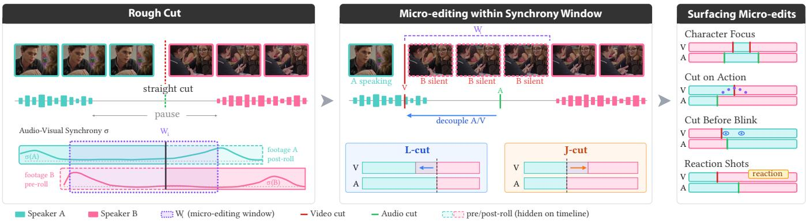  
Figure 1: After a rough cut via macro-level clip selections yielding straight cuts with coupled audio-video (left), editors refine cuts through micro-edits (center): rhythm edits adjust timing (e.g., pauses), while view edits redirect visual attention. We formalize micro-edits as continuous optimization within audio-visual synchrony-constrained windows, where audio-video can be safely decoupled. Our interactive tools leverage optimization and AI to support diferent creative objectives (right): automatically balancing character focus, and surfacing perceptual cues for cut-on-action, cut-before-blink, and reaction shots. All video frames shown in this paper are copyrighted and belong to EditStock. Project page: https://microedits.github.io

## Abstract

In film editing, every frame matters. While macro, content-level edits shape the high-level narrative of a film, small local edits often control timing and direct visual attention. For example, editors can adjust the precise timing of clips to control the length of a meaningful silence, or cut to shots that highlight a specific character’s reactions to important moments. These small, detailed edits are slow and tedious to make in standard editing tools because users have to map high-level narrative goals to low-level frame-by-frame adjustments. At the same time, these fine-scale adjustments, which we call micro-edits, can be nuanced and expressive, with diferent choices serving diferent creative goals. In this work, we start by conducting a formative study with professional editors to understand the structure of micro-edits and how they are used. We then derive a mathematical formalization for this structure to develop tools that leverage AI and optimization to make exploring microedits simpler and more eficient for users. Finally, we validate our tools in multiple user studies and a wide range of video examples.

## CCS Concepts

• Human-centered computing → Interactive systems and tools.

## Keywords

Video editing, interactive authoring tools, dialogue editing, microediting

## ACM Reference Format:

Nhan Tran, Hijung Valentina Shin, Abe Davis, and Mackenzie Leake. 2026. Micro-Edits: Computational Support for Fine-Scale Edits in Film. In The 39th Annual ACM Symposium on User Interface Software and Technology (UIST ’26), November 02–05, 2026, Detroit, MI, USA. ACM, New York, NY, USA, 17 pages. https://doi.org/10.1145/3830398.3830545

## 1 Introduction

Video editing happens at multiple temporal scales, and editors tend to work in a coarse-to-fine manner. At the coarse scale, they begin with what we call macro-edits, which determine the selection and ordering of video clips. Macro-edits establish a basic timeline to create what is commonly referred to as a rough cut [32]. While novice filmmakers and AI-based editing tools often limit editing to rough cuts, skilled filmmakers typically make additional fine-scale edits by decoupling audio and visual transitions and shifting them along a given timeline to control pacing and direct audience attention. These fine-scale edits, which we call micro-edits, ofer significant expressive control over a scene’s narrative [8, 28]. However, they require expertise to execute well and remain tedious even for skilled editors [14]. In this work, we address these challenges by developing new interactive tools to make micro-edits easier to explore and apply, focusing on dialogue scenes, which are especially common in narrative film [11]. Our work comprises four parts:

• First, we examine how and why expert filmmakers use microedits through a formative user study, detailed in Section 3. We found that experts use micro-edits in two distinct ways: to manipulate the timing of a narrative (rhythm edits), and to direct visual attention (view edits).

• Next, we formalize the space of possible micro-edits for a given scene in Section 4, and use our formulation to describe diferent editing constraints and objectives. This allows us to address micro-editing as an optimization problem and incorporate analyses provided by vision-language models (VLMs), when available.

• Then, building on our formalization, we design novel interactive tools that leverage optimization and AI to eficiently explore micro-edits through interactions that map more clearly and con sistently to common creative goals.

• Finally, we validate our tools in Section 6 through a crowdsourced study and two evaluations with 16 experienced editors, showing that they reduce mechanical efort and support broader exploration of micro-edits.

Our work combines user-centered design with the development of novel technical tools. The design contributions in our work deal with understanding how micro-edits are used so we can build better editing tools, while our technical contributions address challenges that emerge when applying computation to that understanding. Our formative findings translate into two design goals: eficient exploration and useful suggestions (Section 3.5). We use these goals to motivate and evaluate our tools.

## 2 Related Work

While our work is, to our knowledge, the first to address interactive tools for micro-editing, prior work in vision, graphics, and HCI has looked at related problems, including rough cut assembly.

## 2.1 Macro-Level Editing and Assembly

Computational tools for video editing primarily target content selection and rough-cut assembly. Systems for scripted dialogue encode cinematographic idioms to decide which clips appear and in what order [20, 21]. Transcript-based interfaces [7, 36, 51] enable textdriven manipulation, while keyword analysis recommends B-roll insertion points [18]. More recent LLM-powered systems infer editorial intent from natural language [54], combine language with sketch-based control [50], and support human–AI co-creation for generating rough-cuts [19, 42]. Recent work on automated montage assembly learns shot selection, trimming, and cut placement from professionally edited films, but does not provide explicit editor control over micro-edits, including decoupled audio and video transitions [41]. These systems operate at word- or shot-level granularity, which is efective for structuring a scene, but they stop short of the frame-level refinement where professional editors shape timing and attention.

## 2.2 Automated Cut Placement and Pacing

Commercial tools provide filler-word removal and silence compression to streamline rough cuts [6, 12, 31]. Adobe Premiere plugins like AutoCut [2025] and FireCut [2025] extend this by ofering configurable ofsets within silence-removal workflows, where audio is cut earlier than video by a fixed amount to smooth transitions (split edits). These workflows treat pacing as uniform temporal compression and treat split edits as mechanical timing ofsets. Such behavior is well-suited to high-volume social and podcast workflows with strict duration constraints and tolerance for jump-cut rhythm, but misaligned with dramatic editing where silence is expressive and overlap is applied selectively to anticipate or extend specific beats. Our work formalizes these micro-editing operations and introduces an interactive tool for selective, frame-level refinement of rhythm and visual emphasis after rough-cut assembly. Rather than applying uniform pacing or fixed ofsets, our system surfaces alternatives and perceptual cues tied to narrative beats and viewer attention.

The closest prior work at comparable granularity is Berthouzoz et al. [4], who analyze audio-visual features in single-speaker interview footage to locate frames where the subject is quiet and still, enabling hidden transitions via graph-based frame selection. Our work difers in three respects: (1) we address multi-clip dialogue with multiple speakers and camera angles; (2) we support audio–video decoupling through split edits rather than solely audioaligned straight cuts; and (3) we provide interactive exploration of alternatives rather than optimizing for a single global solution.

## 2.3 Micro-Temporal Signals for Editing

Editors time cuts to perceptual events that guide attention and maintain continuity [46, 47]. Conventions such as cutting midaction [14], decoupling picture and sound cut points, and avoiding cuts on blinks exploit motion continuity, dialogue structure, and audio-visual synchrony [28, 40]. Galvane et al. [17] encode some continuity constraints over screen position, gaze, and motion, and optimize shot sequences accordingly in virtual environments where scene state is available. In practice, these constraints often compete, and their relative importance depends on narrative context.

In real footage, these cues can be inferred from audio-visual signals, including gaze and blink via facial landmark tracking [23] and audio-visual synchrony [33, 49]. Prior work aligns or matches video using appearance similarity [55], motion trajectories or optical flow for action synchronization [1, 3, 9], and learned features for continuity scoring and transition classification [34, 35].

Semantics can further indicate which alignments are editorially salient. Recent VLMs, when supplied with numbered-frame inputs [56] and short, densely sampled clips [37], can identify such moments (e.g., a door slam, a character’s turn). We build on these semantic and audio-visual cues to surface micro-edit opportunities within an interactive workflow.

## 3 Background and Formative Study

We conducted a formative study with six experienced editors (5–15 years experience) to understand how and why they adjust rough cuts. Full details of our study are included as supplemental material, and we summarize our findings below.

## 3.1 Background

Our study design incorporates additional background related to how editors often discuss cuts, which represent transitions on a timeline (video, audio, or both) from one piece of source media to another. Note that the term “cut” has two meanings in editing: it can refer to a transition point between clips, or to a version of the edit (as in “rough cut” or “final cut”). Here we discuss cuts as transition points. Editors classify most cuts into one of three categories:

• Straight cuts happen when video and audio transition together.

• L-cuts happen when video transitions before audio.

• J-cuts happen when audio transitions before video.

Additionally, the term “split cut” is sometimes used to describe any cut that is not a straight cut. Implicit in these categories is an assumption that both audio and video transition between corresponding source media. While not always true, this describes most cuts found outside specific genres like music videos.

Macro-editing is often limited to straight cuts, and previous computational tools have made this an explicit assumption when formulating rough cut assembly [19, 20, 51]. This points to L- and J-cuts as ofering some insight into how editors think about microediting, which we leverage in our formative study design.

## 3.2 Study Design

Each participant was given rough cuts of two scripted scenes (each approximately one-minute long) and tasked with editing each scene in an NLE of their choice under four conditions. In one condition, participants were unrestricted. For each of the remaining three conditions, we asked participants to limit edits to diferent cut types: straight cuts, L-cuts, or J-cuts. Participants were recorded and asked to explain their reasoning aloud while editing, and after completing their tasks, each participant filled out a survey.

## 3.3 Formative Findings

F1) Every Frame Matters: Our study reinforced the common claim that skilled editors often make decisions at the scale of individual frames [14, 27]. While making micro-edits, participants described “going frame by frame, removing one frame here, adding a few there” (P5) or “adding 3 or 4 more frames” (P1) to get transitions to feel just right. This process also involved repeatedly re-watching parts of video to compare the feel of diferent choices.

F2) Contextual Information is Important: Editing decisions often depend on local context. For example, editors generally place audio cuts in silent parts of a clip. On the other hand, they often adjust visual cuts based on narrative goals (e.g., cutting to see a particular character’s reaction during a dramatic moment), or following the “cut on action” principle [8, 14], where visuals before and after a cut should show the continuity of some visible action (e.g., a gesture, blink, or gaze turn). This type of higher-level reasoning helps editors narrow their choice of edit.

F3) Control Over Rhythm & Pacing: Editors often start with edits meant to control the precise rhythm or pacing of a scene— usually by inserting or removing time at the ends of adjacent clips. We call this type of adjustment a rhythm edit. Rhythm edits change how events are distributed on the timeline; for example, in dialogueheavy scenes, they can be used to control the length of pauses in conversation. Half of our participants described focusing exclusively on the timing of dialogue while making such edits, with one (P6) describing this process as starting with a “radio edit”, and another (P4) saying “I’m going to close my eyes and listen ... this lets me really focus on the flow and not be interrupted by some video breaks.” Rhythm edits require shifting a clip along the output timeline, often in addition to adjusting the duration of a clip.

F4) Control Over Visual Attention: Later edits often focus on controlling visual attention. We can think of these edits, which we call view edits, as controlling the viewpoint of the audience without changing the timeline of events that are happening. View edits are where participants tended to make L-cuts and J-cuts. More specifically, L-cuts were mostly used to make visual transitions happen sooner, while J-cuts were used to make them happen later. In both cases, this was usually done without changing the audio track. To quote one participant (P1), “I already changed the timing ofthe audio... so I don’t wanna, like, mess with that.”

F5) Inserting New Cuts For Reactions & Cutaways: In our study, most edits involved adjusting existing cuts. The main exception to this happened when editors wanted to add a reaction or cutaway shot, where visuals transition away from the speaker or current source of audio. Two reasons were given for such edits: first, to direct visual attention; and second, to mask jump cuts (created when trimming pauses within dialogue). Also, editors often repurpose visuals from other parts of a scene to create reaction shots. This points to conditions where reordering clips in a scene is acceptable.

## 3.4 Design Insights

F1 and F2 reflect that micro-editing does not have a unique solution, and precise user control is important, though evaluating contextual and semantic information may help automate some decisions.

F3 and F4 suggest that editors treat rhythm and views separately; thus, controls for these aspects should be independent. This separation reflects how editors exploit audio-visual synchrony, as one participant (P1) articulated: “What you hear and what you see are two diferent systems... ifyou introduce the hearing as one sense and then introduce the sight, it’s a diferent feeling than ifyou introduce both at the same time.” Our tools are designed to help users focus on each type of control separately. F5 suggests that showing only speakers means audiences miss half of the story—character reactions—so editors spend significant time scrubbing through takes to find them. A tool that surfaces candidates would help.

## 3.5 Design Goals

Diferent micro-edits may accomplish diferent creative goals, which can be highly context-dependent. This lack of a single correct solution complicates automation, but there is still a great deal that optimization and AI can ofer to improve existing workflows. Microedits are not random, and the space of all possible edits is much larger than the set that meet likely creative goals. With this in mind, we focus on two overarching design goals in this work:

DG1) More Eficient Exploration: Our findings (F1) illustrate that much of the challenge in making micro-edits comes from a “gulf of execution” [29] between changes users want to make and the steps those changes require in existing non-linear editors (NLEs). Our tools should make micro-edits easier to execute when possible, letting users explore the same edit space more eficiently.

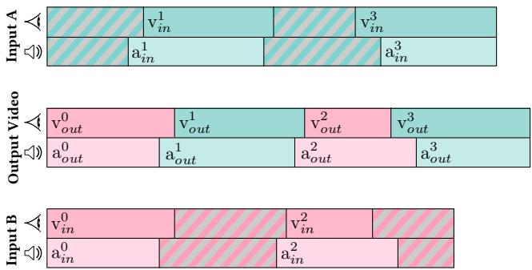  
Figure 2: Edit structure showing how an edited video combines segments from two source media across video and audio tracks. Each cut $X _ { i }$ is defined by its output time $( x _ { o u t } ^ { i } )$ , source media $( x _ { m } ^ { i } ) _ { : }$ and source time $( x _ { i n } ^ { i } )$ . Striped regions indicate unused footage. Colors indicate source origin.

DG2) Useful Defaults & Suggestions: As we discuss in Section 4, this space is continuous, but editors often reason about microedits in ways that give rise to more discrete sets of likely editing decisions. Our tool should help identify such decisions and present them to users as defaults or suggestions.

These design goals reflect a need to balance automation with expressive control: our findings identify the types of control that editors want, and our tools focus on automating the work that makes this control less eficient. Meeting these goals requires describing this space precisely, which we do in the next section.

## 4 Problem Formulation

We describe editing as a two-stage process, starting with macroedits, followed by micro-edits. We use this framing to distinguish two types of editing decisions, not to claim that editing proceeds strictly in this order in practice. The input to this process is a set of source media and optional narrative description. Source media is given as a set $\mathbf { M } = \{ M _ { \emptyset } , M _ { 1 } , \dots \}$ of clips, where $M _ { \emptyset }$ represents the empty clip (i.e., what is displayed if part of a timeline is left empty). The narrative, if provided $( \mathrm { e . g . }$ , in the form of a script or storyboard), is represented with a sequence of narrative elements ${ \bf S } = [ s _ { 1 } , s _ { 2 } , . . . ]$ where each $s _ { i }$ describes a diferent part of the narrative. We use $s _ { i } \subset$ $M _ { j }$ to indicate that $s _ { i }$ is portrayed in source media $M _ { j }$ , and $M _ { j } ( s _ { i } )$ to denote the part of $M _ { j }$ that depicts $s _ { i } .$ . We leave the definition of narrative elements $[ s _ { 1 } , s _ { 2 } , . . . ]$ intentionally loose, as their primary role is to segment source media and express partial orderings during macro-editing. We will introduce more precise notation later for discussing narrative events in micro-edits.

## 4.1 Rough Cuts & Macro-Editing

The goal of macro-editing is to produce a rough cut R, given as an ordered sequence of source clips. When a narrative is provided, R is determined by a mapping r from each $s _ { i }$ ∈ S to a corresponding

clip $M _ { \mathbf { r } ( i ) } ( s _ { i } )$ taken from source media $M _ { \mathbf { r } ( i ) } { \mathrm { : } }$

$$
\mathbf { R } = [ M _ { \mathbf { r } ( 1 ) } ( s _ { 1 } ) , M _ { \mathbf { r } ( 2 ) } ( s _ { 2 } ) , \dots , M _ { \mathbf { r } ( | \mathbf { S } | ) } ( s _ { | \mathbf { S } | } ) ]\tag{1}
$$

What makes this “rough” is twofold: clip boundaries are left inexact, and cuts are restricted to straight cuts. From the editor’s perspective, micro-editing refines the former and relaxes the latter. Mathematically, a rough cut makes the set of potential clips discrete and finite. In this case, as r maps from one discrete finite set to another, the space of possible rough cuts becomes discrete and finite. We can represent each R in this space as a path through the directed graph of possible clips, where edges encode the ordering constraints given by narrative S. If S is not provided, this graph is fully connected, and we need to limit the maximum number of clips to keep the space of rough cuts finite.

## 4.2 Representing Micro-Edits

In a sense, the purpose of micro-edits is to address assumptions from rough-cut assembly. The input to our micro-editing tools is a rough cut R (Equation 1), whether assembled manually or by automatic methods [20, 42]. From this, micro-editing refines imprecise clip boundaries and relaxes audio-video coupling. To do this, we need more precise notation. Our output will be a pair {V, A} of edited tracks representing output video and audio, respectively (Figure 2):

$$
\begin{array} { l l } { { { \bf V } = [ V _ { 1 } , \ldots , V _ { N } ] , ~ \mathrm { w h e r e } ~ V _ { i } = \{ { \bf v } _ { o u t } ^ { i } , { \bf v } _ { m } ^ { i } , { \bf v } _ { i n } ^ { i } \} } } \\ { { { \bf A } = [ A _ { 1 } , \ldots , A _ { N } ] , ~ \mathrm { w h e r e } ~ A _ { i } = \{ { \bf a } _ { o u t } ^ { i } , { \bf a } _ { m } ^ { i } , { \bf a } _ { i n } ^ { i } \} } } \end{array}\tag{2}
$$

More generally, each track X (where $\mathbf { X } \in \{ \mathbf { V } , \mathbf { A } \} )$ is a sequence of cuts, where cut $X _ { i }$ denotes a transition between discontiguous parts of source media. Each cut is described as a triplet $X _ { i } =$ $\{ { x _ { o u t } ^ { i } } , { x _ { m } ^ { i } } , { x _ { i n } ^ { i } } \}$ , where $x _ { o u t } ^ { i }$ denotes when the cut occurs in the output timeline, $\boldsymbol { x } _ { m } ^ { i } \in \mathbf { M }$ identifies the source media being cut to, and $x _ { i n } ^ { i }$ gives the corresponding source time. For convenience, we use $x _ { T } ^ { i } = ( x _ { o u t } ^ { i + 1 } - x _ { o u t } ^ { i } )$ as shorthand for the duration of $x _ { m } ^ { i }$ on track X.

4.2.1 Initial Rough Cuts. In initial rough cuts, audio and video cuts are coupled, meaning $V _ { i } = A _ { i }$ for all cuts. The source media for each cut is defined by $\mathbf { v } _ { m } ^ { i } = \mathbf { a } _ { m } ^ { i } = M _ { \mathbf { r } ( i ) }$ . The output time $\mathrm { v } _ { o u t } ^ { i } = \mathrm { a } _ { o u t } ^ { i }$ is set to where clip $M _ { \mathbf { r } ( i ) } ( s _ { i } )$ begins on the output timeline, and input time $x _ { i n } ^ { i }$ to where it begins in source media $M _ { \mathbf { r } ( i ) }$

4.2.2 The Space of Micro-Edits. Starting from a rough cut ensures that most micro-edits are limited to adjustments of the continuous $x _ { o u t } ^ { i }$ and $x _ { i n } ^ { i }$ parameters of existing cuts, leaving the ordered sequence of source clips $\boldsymbol { x } _ { m } ^ { i }$ unchanged. We will start by focusing on such adjustments, and consider the addition of new cuts such as reaction shots later. As $x _ { o u t } ^ { i }$ and $x _ { i n } ^ { i }$ represent continuous time ofsets, the space of possible micro-edits is continuous.

## 4.3 Micro-Editing Constraints & Context

We identify two types of constraints that impact micro-editing:

• Synchrony constraints ensure that visible sound sources are heard (e.g., we hear a character who is visibly speaking). This constraint is one-directional: hearing of-screen sound is acceptable, which enables L- and J-cuts. We quantify this via synchrony [13, 39, 52]: audio and video should stay coupled in high-synchrony regions.

• Continuity constraints maintain consistency across cuts. For example, when cutting to diferent viewpoints of the same scene, the poses and appearance of characters should remain largely unchanged. Similarly, when cutting to diferent audio ofthe same scene, one should avoid cutting in the middle of salient sound, as this can create audible discontinuities.

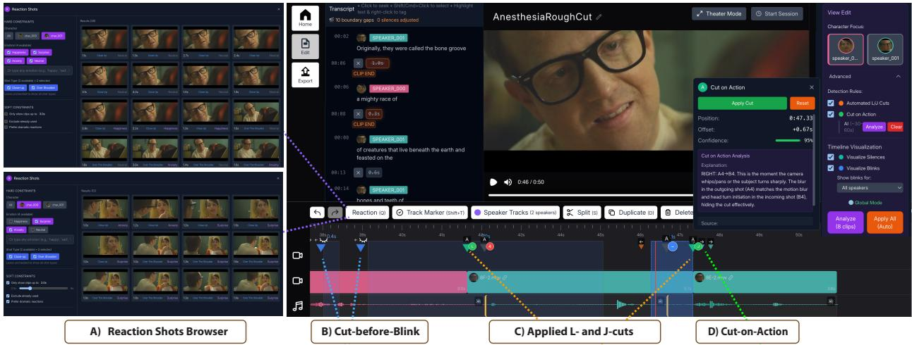  
Figure 3: Our web-based editor provides standard NLE controls alongside specialized micro-editing tools. Track colors correspond to characters, and blue overlays mark silence regions for rhythm edits, which editors adjust with pre-roll and trim/extend hotkeys during playback. For view edits, the Character Focus panel (right) automates L/J-cut placement to emphasize a selected character’s screen time, and applied ofsets appear on the timeline (C). Markers at each cut surface perceptual-cue suggestions: cut-before-blink candidates (B) and cut-on-action candidates (D). Hovering over a marker reveals an AI-generated explanation; clicking applies or resets the suggested ofset. The Reaction Shot Browser (A) retrieves non-speaking moments, filterable by character, emotion, and shot type; editors insert reactions by selecting transcript text or a timeline position. Video frames © EditStock.

Both of these types deal with some types of consistency: between audio and video, or across cuts. Strictly speaking, there are no editing patterns that these constraints prevent in all scenarios; each depends on the context of a particular scene. To help reason about this, we need a way to represent context in source media. Unlike the coarse narrative elements S used for macro-editing, micro-editing requires fine-grained events—blinks, action onsets, reactions, word boundaries. We denote these $\mathrm { \bf E } = \left[ e _ { 1 } , e _ { 2 } , \ldots \right]$ , with $M _ { j } ( e _ { i } )$ denoting the time in � � where $e _ { i }$ occurs. The key context function is synchrony $\sigma ( M _ { j } , t )$ , representing audio-visual alignment at time �. The next section describes how our system uses these constraints and context to support micro-editing tools.

## 5 System Design

Our system provides tools for rhythm edits (Section 5.2), view edits (Section 5.3), and reaction shots (Section 5.4). Figure 4 presents our end-to-end architecture. Given source media M and a rough cut R, the backend runs analysis and candidate generation in parallel, and the Interactive UI supports human-in-the-loop refinement via rhythm and view edits. Following Section 4.2, rhythm and view edits operate on continuous parameters $( \boldsymbol { x } _ { o u t } ^ { i } , \boldsymbol { x } _ { i n } ^ { i } )$ while leaving $\boldsymbol { x } _ { m } ^ { i }$ unchanged, and reaction shots insert additional clips on an overlay track. Our system separates analysis from interaction: an ofline pipeline annotates source clips, while the editing interactions are implemented directly from our formalization (Section 5.5).

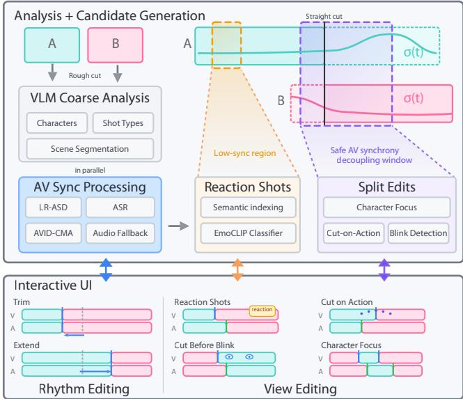  
Figure 4: System overview: From a rough cut, our backend performs analysis (VLM, AV synchrony, reaction-shot indexing, cuton-action, blinks) and surface cut suggestions on UI.

## 5.1 Editing Windows

At each cut $X _ { i } ,$ we transition from an outgoing clip $x _ { m } ^ { i - 1 }$ to an incoming clip $\boldsymbol { x } _ { m } ^ { i }$ . Each clip’s source footage usually extends beyond what is currently visible: the outgoing clip has unused post-roll, and the incoming clip has unused pre-roll. Adjusting a cut reveals footage from these regions. We define an editing window $W =$ $[ - \Delta ^ { - } , ~ + \Delta ^ { + } ]$ (Figure 1, bottom left), where negative values reveal incoming pre-roll and positive values reveal outgoing post-roll:

• Rhythm edits use $W _ { \mathrm { r } } { : }$ : adjustments refine pacing while keeping spoken content unchanged. $\Delta ^ { - }$ extends until the incoming clip’s pre-roll would reveal additional speech; $\Delta ^ { + }$ extends until the outgoing clip’s post-roll would reveal additional speech.

• View edits use $W _ { \mathrm { v } } { : } \Delta ^ { + }$ extends to the first frame where � $\ ( x _ { m } ^ { i - 1 } , t ) =$ 1 in post-roll; $\Delta ^ { - }$ extends to where $\sigma ( x _ { m } ^ { i } , t ) = 1$ in pre-roll.

For dialogue scenes, these constraints often align: speakers are silent between turns, and silent speakers have low synchrony. However, the distinction matters when lips continue moving after the last word, or when non-speech sounds create synchrony without words.

## 5.2 Rhythm Edits

Rhythm edits adjust cut timing while maintaining track coupling $( V _ { i } = A _ { i } )$ . Repositioning a cut changes both $x _ { o u t } ^ { i }$ and $x _ { i n } ^ { i } ,$ pulling dialogue earlier (time-contracting) or pushing it later (time-expanding) without cutting into speech. As noted in F3, editors often focus on temporal flow when adjusting rhythm, yet existing NLEs require spatial manipulation of timeline elements. To address this, we provide two hotkey interactions: (1) pre-roll hotkey rewinds before the current cut to provide conversational context. (2) A trim/extend hotkey repositions the cut so that the first word of the incoming clip (following $X _ { i + 1 } )$ lands at the current playhead position $\mathcal { P } \cdot$ If $\boldsymbol { p } < \mathbf { x } _ { o u t } ^ { i + 1 }$ , the system advances the cut (time-contracting, closing the silence gap). If $\mathbf { \omega } _ { p } > \mathbf { x } _ { o u t } ^ { i + 1 }$ , the system delays the cut (time-expanding, revealing silence). This enables marking timing by feel: Murch [27] describes marking a shot’s cut point in real time and treating his ability to consistently “hit the same frame” as confirmation that the timing is right, adjusting until he can [28].

## 5.3 View Edits

View edits decouple video from audio, shifting the video cut by ofset $\delta _ { i }$ relative to audio: $\mathrm { v } _ { o u t } ^ { i } = \mathrm { a } _ { o u t } ^ { i } + \delta _ { i }$ and $\mathbf { v } _ { i n } ^ { i } = \mathbf { a } _ { i n } ^ { i } + \delta _ { i }$ . An ofset $\delta _ { i } < 0$ produces an L-cut; $\delta _ { i } > 0$ produces a J-cut. The constraint $\delta _ { i } \in W _ { \cdot }$ ensures ofsets stay in low-synchrony regions.

Rather than requiring editors to manually search for optimal ofsets within $W _ { \mathrm { v } } ,$ we surface favorable candidates according to established editing patterns in three modes:

Character Focus: This optimizes $\delta _ { i }$ across cuts to emphasize a selected character’s screen time. Let $d _ { i } \in \{ - 1 , + 1 \}$ } encode whether to favor the outgoing $( d _ { i } = + 1 )$ or incoming $( d _ { i } = - 1 )$ speaker at $X _ { i }$

$$
\delta _ { i } ^ { * } = \arg \operatorname* { m i n } _ { \delta \in W _ { \mathrm { v } } } \Bigl ( - d _ { i } \delta + \lambda _ { \mathrm { s y n c } } C _ { \mathrm { s y n c } } ( \delta ) + \lambda _ { \mathrm { d u r } } C _ { \mathrm { d u r } } ( \delta ) \Bigr ) ,
$$

where $C _ { \mathrm { s y n c } } ( \delta ) = \sigma ( M _ { j } , t _ { \mathrm { c u t } } )$ (the synchrony at the video cut frame), and $C _ { \mathrm { d u r } } ( \delta )$ penalizes ofsets that would trim an adjacent clip too short. We set $\lambda _ { \mathrm { s y n c } } = 0 . 7$ , biasing ofsets away from high-synchrony frames at the cut, and $\lambda _ { \mathrm { d u r } } = 1 0 0$ , heavily penalizing transitions that would yield flash frames or uncomfortably short clips. This provides a starting point that editors can refine (DG2).

Cut-on-Action: This mode surfaces candidates where motion continues smoothly across the cut (Figure 3D). Since VLMs struggle with micro-temporal reasoning [37], we densely sample frames from the handles (outgoing post-roll and incoming pre-roll) and assemble them into numbered mosaics (Figure 6). Explicit frame indices improve temporal grounding [56]. The VLM identifies frame pairs with salient motion continuity (e.g., matching gesture trajectory, gaze direction), and indices are converted to ofsets $\delta _ { i }$ within $W ,$ v. Restricting candidates to � v means the VLM reasons over a few synchrony-safe frames rather than the full footage.

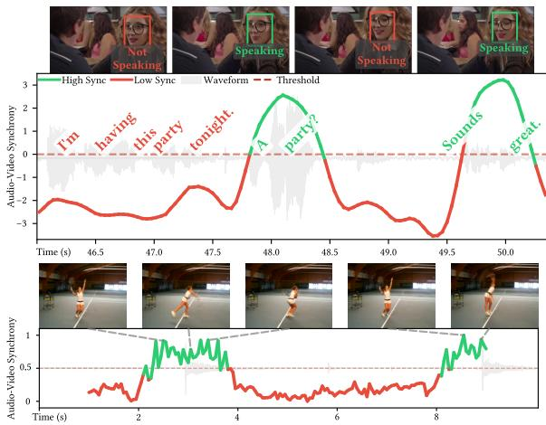  
Figure 5: Proxy for audio-visual synchrony (�). Top: active speaker detection for dialogue scenes—high synchrony (green) when speaking, low (red) when silent/of-screen. Bottom: general synchrony network for non-dialogue content (tennis). Both guide safe decoupling for L/J-cuts and reaction shots. Video frames © EditStock.

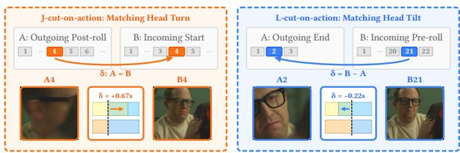  
Figure 6: Numbered frame mosaics for VLM-based cut-on-action alignment. J-cut $( \mathrm { v } _ { o u t } ^ { i } > \mathrm { a } _ { o u t } ^ { i } ) { : \mathrm { A } }$ (unused post-roll) and B (visible start) extend forward from the straight cut. Equal indices = same moment, so $\mathrm { A 4  B 4 } \implies + 0 . 6 7 s$ . L-cut $( \mathbf { v } _ { o u t } ^ { i } < \mathsf { a } _ { o u t } ^ { i } ) : \boldsymbol { t }$ A (visible end) and B (unused pre-roll) extend backward from the straight cut. A has 3 frames (short clip), B has 22 (longer footage), so matching aligns by counting backward: ${ \mathrm { B } } 2 1 {  } { \mathrm { A } } 2 { \Rightarrow } - 0 .$ .22s. Video frames © EditStock.

## Blink Detection:

MediaPipe [23] estimates eye aspect ratio (EAR) per frame from face mesh landmarks. Blink onsets occur when EAR falls below threshold for consecutive frames. As shown in Figure 3B, we surface candidates �� that place the video cut just before detected blink onsets, constrained to $W _ { \nu }$

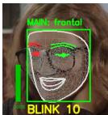

## 5.4 Reaction Shots

Unlike rhythm and view edits, which adjust existing cuts, reaction shots add new visual material on an overlay track (B-roll) without altering the primary audio timeline (F5). We identify candidate segments where $\sigma ( M _ { j } , t ) = 0$ (subject visible but not speaking), the target subject is detected in at least 80% of frames, and the segment is adjacent to spoken material. To support browsing, candidates are indexed by subject identity and emotion using EmoCLIP [16]. The interface groups results by character and emotion (Figure 3A). This supports both expressive goals (showing a character’s reaction) and practical needs (masking jump cuts from rhythm tightening).

## 5.5 Implementation

We implemented MicroEditor as a web-based editor forked from ClipJS [25], extending it with multi-track timeline support, rolling edits, and the tools described above. An ofline pipeline preprocesses each source clip to extract word-level timestamps (via ASR [38]), per-frame synchrony scores, and subject identity. For synchrony, we use active speaker detection [22] for dialogue scenes and an audio-visual alignment network [26] for non-dialogue content. We threshold the continuous signal to obtain $\sigma ( M _ { j } , t ) \in \{ 0 , 1 \}$ , where $\sigma = 1$ indicates salient audio-visual alignment (e.g., an on-screen face visibly speaking in dialogue scenes) and $\sigma = 0$ otherwise (Figure 5); see Appendix B for VLM prompts and more details. All VLM queries use Gemini 3.0 Flash. VLMs are used to annotate source clips during preprocessing (e.g., subject identity and shot type) and to search for cut-on-action candidates, where our formalization bounds the search to the editing window � (Section 5.3).

## 6 Evaluation

We first validated our synchrony analysis through a crowdsourced study, and then evaluated MicroEditor in two comparative studies with experienced editors, focusing on our design goals: whether our tools enable more eficient exploration of the micro-edit space (DG1), and whether our defaults and suggestions help editors identify desirable edits (DG2). Study 1 (N = 6) evaluated the initial system and validated tools for rhythm and view editing. Based on feedback, we refined the interface and added a Reaction Shot Browser. Study 2 (N = 10) evaluated this expanded system with an additional focus on reaction shot selection and perceived improvements in scene pacing and visual flow. Because micro-editing has no single correct solution and desirable edits depend on creative goals (Section 3.5), our evaluation emphasizes workflow support, decision support, and exploration rather than correctness against a fixed ground truth. Full study protocols and other evaluation details can be found in our supplemental materials.

## 6.1 Synchrony Evaluation

To validate our method for decoupling audio and video, we conducted a Prolific study (� = 47; 4 excluded for failing attention checks). Participants viewed 12 randomized clips (∼5 s each) across three conditions: Optimized (cut inside �), Boundary (cut on the window edge), and Out-of-Window (fixed ofset outside the window). For each clip, participants reported whether they noticed any distracting lip-sync errors or AV mismatches and rated how natural or smooth the cut felt on a 7-point scale (1 = very jarring, 7 = very smooth). Results show a significant main efect of condition on naturalness $(  p < . 0 0 1$ , Friedman test). Post-hoc tests confirmed Optimized cuts were rated significantly more natural than both Boundary $( p = . 0 0 1 )$ and Out-of-Window $( p \textless . 0 0 1 )$ conditions. In aggregate, Optimized clips achieved the lowest violation rate (32.4%) and highest naturalness $( M = 5 . 2 7 )$ , vs. Out-of-Window (85.1%, � = 3.10) (Figure 7). Notably, excluding the Soup Spoon scene where upstream face-tracking errors produced an unreliable synchrony window, the Optimized violation rate drops to 19.9% $( M = 5 . 6 7 )$ . We note that our method’s performance is inherently bounded by the capabilities of the underlying AV-sync model.

Table 1: Median (min–max) ratings (1–7 scale) for Rhythm, Character Focus, Cut-on-Action, Blink, Reaction. Creativity Support: Exploration, Expression, Efort, Immersion, Enjoyment, Eficiency [10].
<table><tr><td></td><td colspan="5">Features</td><td colspan="5">Creativity Support</td></tr><tr><td></td><td>Rhy. Char. Act. Blk. Rct.</td><td></td><td></td><td></td><td></td><td>Expl. Expr. Effort Imm. Enj. Effi.</td><td></td><td></td><td></td><td></td></tr><tr><td>Study 1 6.0</td><td></td><td>7.0</td><td>7.0</td><td>5.5</td><td>一</td><td>6.0</td><td>6.0 6.0</td><td>5.5</td><td>7.0</td><td>7.0</td></tr><tr><td></td><td>6-7</td><td>6-7</td><td>5-7</td><td>4-7</td><td>一</td><td>5-7 5-6</td><td>4-6</td><td>5-7</td><td>6-7</td><td>5-7</td></tr><tr><td>Study 2 6.0</td><td></td><td>6.0</td><td>6.5</td><td>4.5</td><td>7.0</td><td>6.0 5.0</td><td>6.0</td><td>5.5</td><td>7.0</td><td>7.0</td></tr><tr><td></td><td>5-7</td><td>5-7</td><td>4-7</td><td>1-5</td><td>6-7</td><td>5-7</td><td>4-7 4-7</td><td>3-7</td><td>5-7</td><td>5-7</td></tr></table>

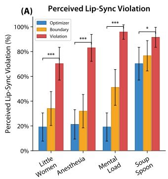

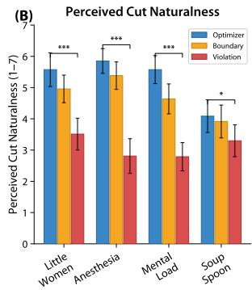  
Figure 7: Perceived synchrony (� = 47) across four scenes. (A) Perceived lip-sync violation rate (% responses reporting violation), and (B) perceived cut naturalness (1–7). Error bars show 95% CI. Brackets indicate Optimized vs. Out-of-Window comparisons within each scene $( ^ { \star } p < . 0 5 , ^ { { \star } { \star } { \star } } p < . 0 0 1 )$ ).

## 6.2 User Studies

We recruited 6 professional video editors for Study 1 (3 female, 3 male, aged 18–27) with 5–15 years of experience, all primarily using Adobe Premiere Pro, and 10 video editors for Study 2 (6 female, 4 male, aged 19–28, 1–10 years of experience) working across narrative films, commercial content, documentaries, and YouTube. Both studies followed the same protocol: each participant edited two one-minute dialogue scenes (“Pumpkin Princess” and “Anesthesia”) under a manual condition (all features disabled) and an assisted condition (all features enabled), in counterbalanced order. Sessions lasted 60 minutes. Participants rated feature usefulness and creativity support on 7-point Likert scales (Table 1). Study 2 additionally collected ratings on pacing and visual flow, and logged all interactions with millisecond timestamps; one participant’s (P9) log was not recorded due to a logging error, so quantitative analyses cover the remaining nine participants (� = 9). Full demographics and per-participant ratings appear in Appendices C and D; participant IDs below refer to each study separately.

Rhythm Editing: In Study 1, editors found the pre-roll and trim/ extend hotkeys useful (median 6.0/7) and eficient (median 7.0/7; DG1). Pre-roll enabled the repeated listening behavior essential for rhythm editing (F3). P3 emphasized repetition: “As an editor I like to hear and see the cut at least 10 times and it was easy to replay it using the pre-roll key.” P6 articulated why context matters: “I think the R [pre-roll] feature is something that I really like to just quickly go back... you kind ofhave to get a little bit ofcontext further, just to get into the flow ofthat, and then you can watch the cut again.”

Character Focus: Participants valued the automated L/J cuts as a starting point that ofloaded mechanical work for creative decisions. P3 appreciated the cognitive ofloading: “You always know in a scene which character is the main one... it was nice to get [character focus] done straight away so I can focus on other things.” P2 said: “I used one pass to emphasize speaker and was blown away with how accurately it created the spacefor the character.” P1 confirmed: “There weren’t many specific edits I needed to keep making based ofofthose automatic cuts, and those cuts would have taken a while manually.” Character Focus was rated 7.0/7 (median), validating F4 and DG2. In Study 2, P3 similarly noted that the automated cuts “tended to feel natural and would be similar to what I would do as an editor without these tools.”

Cut-on-Action: Cut-on-Action markers (median 7.0/7) transformed the tedious frame-level search into discrete choices (F2). P5 noted: “Cut on Action suggestions took the painstaking process ofhaving to find each moment oflarge action and match it with another clip and made it extremely simple, with very strong accuracy.” P1 described the reduction in decision fatigue: “Just having the markers to choose from helped prevent decision fatigue. When you have so many frames versus just the three options, it helps you narrow it down.” In Study 2, P4 described using markers for narrative construction: “I used this feature to help inform my overall approach to the video narrative for each scene. Ifthere was a particular narrative goal I wanted to achieve, I used the Cut-on-Action as a framework to build it.” P3 noted how unexpected suggestions expanded creative thinking: “Some of the options were a bit out of the blue even, as those made me realize the amount offlexibility I had in editing, when I would only usually consider an L/J cut diference ofonly a second.” Editing is inherently creative, and there is no fixed ground truth. Still, we observed that when cut-on-action is a strong cue, timelines often show close alignment between manual and MicroEditor workflows. For example, the final cut in the Anesthesia scene resulted in nearly identical ofsets across both methods. Appendix A provides a visual comparison of these timelines alongside the system’s internal synchrony analysis.

Blink Markers: Blink markers were rated 5.5/7 in Study 1 and 4.5/7 in Study 2 (medians); they were the only feature to receive a rating below 3 (one editor), and no other feature was rated below 4, as only 4 of 16 editors across both studies reported using cut-before-blink in their regular workflow. P3 explained when they matter: “When everything is technically right, but it doesn’tfeel like the cut is right... I use the blink.” P5 found them useful for pacing: “Using [blink] I was able to keep track of the rhythm of blinking... very helpful in terms ofpacing.” Across the remaining tools, Study 2 ratings were consistent with Study 1, confirming these findings with a larger and more diverse participant pool (Table 1).

Exploration and Iteration: Participants rated exploration highly (median 6.0/7) and agreed the system encouraged trying diferent cuts (median 6.5/7). P5 noted that suggestions led to discoveries: “Suggestions came up; I began to think about diferent edits and ended up choosing several ofthem.” P2 added: “Seeing those options does help... Otherwise I would be too rooted in my own interpretation.”

Participants also requested better support for finding and inserting reaction shots, which required tedious scrubbing through footage (F5). Based on this feedback, we added a Reaction Shot Browser for Study 2.

Reaction Shots: The Reaction Shot Browser was the highest-rated feature (median 7.0/7; 9/10 rated 7/7; DG2). Editors described it as “Emotionally satisfying” (P7), perspective-expanding (P4: “I never really used reaction shots as often as I could have, however, this system opened up a perspective”), and helpful for “break[ing] the homogeneity oflong dialogues” (P5). Editors used reactions both for masking jump cuts from rhythm tightening (P3, P4, P8, P9) and for directing attention toward the listener’s emotional response. P7 discovered unexpected narrative possibilities: “Some ofthe reaction shots created new meanings (for example, one character’s body language slumping in a chair) which influenced the choice of what shot to end the scene with” (DG1). The system supports two complementary insertion methods: highlighting a phrase in the interactive transcript to select semantically meaningful moments, or navigating the playhead for frame-level precision. P2 noted that “the dialogue highlighting feature was also helpful in finding the right time to add a clip.”

Perceived Efort and Output: Across both studies, participants strongly agreed that MicroEditor improved their eficiency (median 7.0/7) and enjoyment (median 7.0/7). Editors also felt the assisted workflow was worth the efort and produced satisfying edits (median 6.0/7 for both). Participants reported better decision support (median 6.0/7 in both studies) and, in Study 2, higher confidence in their editing choices (median 6.0/7 vs. 5.0/7 in Study 1). In Study 2, participants felt the assisted edits improved the video output over the rough cut (median 6.0/7). P5 noted “the pacing with [MicroEditor] resulted in a much more flowing sequence,” and P7 found “pacing andflow are better and easier, and save time to iterate and adjust.” An interactive gallery of video outputs across diverse scenes, including direct comparisons to the initial rough cuts, is available on our project page.

Quantitative Analysis: To complement the qualitative findings, we analyzed the interaction logs from Study 2 (� = 9; see above) to understand how the assisted tools changed editing behavior. Table 2 summarizes the key interaction metrics across conditions.

We logged all timeline operations, distinguishing between manual operations (direct clip trims, drags, repositioning) and assisted operations (rhythm edits, applying cut ofset suggestions, and inserting reaction shots). Reaction shot selection uses a modal gallery interface with its own filtering and preview controls, so we report time in this interface separately (RS in Table 2).

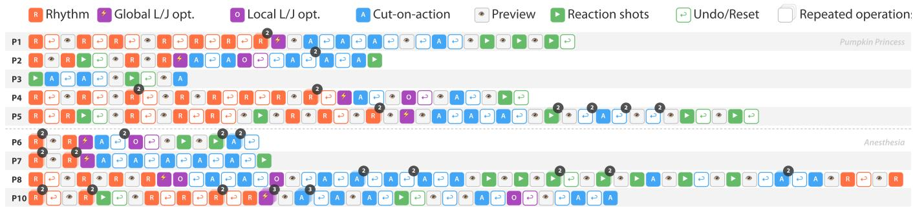  
Figure 8: Operation sequences for all nine participants in Study 2. Each icon represents a timeline operation (rhythm edit, marker apply/reset, reaction shot insert, undo, or preview). Stacked icons indicate consecutive repeated operations. The top group (P1–P5) edited Pumpkin Princess with MicroEditor; the bottom group (P6–P8, P10) edited Anesthesia with MicroEditor (P9’s log was not recorded due to a logging error).

Table 2: Per-participant interaction metrics in Study 2 (� = 9, counterbalanced). RS = time in the reaction shot browser. Bold Ops/min indicates the lower value per participant.
<table><tr><td rowspan="2">PID</td><td colspan="2">Baseline (manual)</td><td colspan="5">MicroEditor (assisted)</td></tr><tr><td>Ops</td><td>Ops/ min↓</td><td>Total (min) Ops</td><td>Ops/ min↓</td><td>Edit (min)</td><td>RS (min)</td><td>Total (min)</td></tr><tr><td>P1</td><td>39</td><td>4.4</td><td>8.8 18</td><td>1.3</td><td>9.2</td><td>4.7</td><td>13.9</td></tr><tr><td>P2</td><td>21</td><td>2.4</td><td>8.6 17</td><td>1.6</td><td>8.5</td><td>2.3</td><td>10.9</td></tr><tr><td>P3</td><td>37</td><td>5.0</td><td>7.4 5</td><td>1.1</td><td>3.5</td><td>1.1</td><td>4.6</td></tr><tr><td>P4</td><td>69</td><td>4.2</td><td>16.4 14</td><td>0.9</td><td>12.5</td><td>3.4</td><td>15.9</td></tr><tr><td>P5</td><td>60</td><td>10.0</td><td>6.0</td><td>25 1.5</td><td>12.7</td><td>4.4</td><td>17.1</td></tr><tr><td>P6</td><td>51</td><td>5.3</td><td>9.5</td><td>12 1.2</td><td>6.0</td><td>3.5</td><td>9.6</td></tr><tr><td>P7</td><td>48</td><td>5.3</td><td>9.0</td><td>15 1.6</td><td>7.3</td><td>1.4</td><td>9.5</td></tr><tr><td>P8</td><td>67</td><td>3.1</td><td>21.4</td><td>40 1.9</td><td>12.4</td><td>8.2</td><td>20.6</td></tr><tr><td>P10</td><td>64</td><td>4.1</td><td>15.8</td><td>23 1.5</td><td>12.1</td><td>3.5</td><td>15.6</td></tr><tr><td>Mean</td><td>50.7</td><td>4.9</td><td>11.4</td><td>18.8 1.4</td><td>9.4</td><td>3.6</td><td>13.1</td></tr><tr><td>Median</td><td>51.0</td><td>4.4</td><td>9.0 17.0</td><td>1.5</td><td>9.2</td><td>3.5</td><td>13.9</td></tr></table>

Our formative study found that micro-editing involves tedious frame-by-frame work (F1). With MicroEditor, all nine participants shifted from low-level timeline manipulation to structured tool interactions, with fewer total operations needed to achieve their edits (Table 2). All nine showed a lower operation rate (mean 1.4 vs. 4.9 Ops/min, sign test � = 0.004, Cohen’s � = −1.57), suggesting that the tools compressed what would otherwise require many fine-grained manual adjustments into fewer, higher-level actions. Although participants perceived the tools as reducing efort (P9: “IfI were to manually edit, I would be using fewer cuts for awkward silences just because of the manual labor that went into each cut”, P3: “T replaces a lot ofclunky movement selecting clips and moving them”), MicroEditor sessions were not shorter on average (13.1 vs. 11.4 min). Editors appear to have reinvested the reduced mechanical efort into exploring more alternatives, including an average of 3.6 minutes browsing the reaction shot gallery, a modality that does not exist in the baseline condition. Because this additional exploration time makes raw duration comparisons between conditions dificult to interpret, we report operation rates (Ops/min) as the primary measure of mechanical efort. In the baseline condition, participants were given freeform editing instructions with no requirement to add reaction shots. Despite this, three participants (P6, P7, P8) chose to manually create reaction shots by extending portions of neighboring clips and moving them to the B-roll track. With MicroEditor, the Reaction Shot Browser replaced this manual search entirely. Baseline session times therefore likely undercount the efort needed to search through all available footage for ideal reaction shots. As P2 reflected, without the tools “it took a lot of time and I couldn’t easily add additional reaction clips.” Under time pressure, editors resort to nearby clips instead. P6 noted, “Usually I would grab a reaction right before and after ifI’m in a time crunch.”

Exploration Patterns: Beyond aggregate counts, the interaction logs reveal how participants used the assisted tools. Following prior analyses of creative tool usage patterns [24], Figure 8 illustrates the full operation sequence for each participant. Eight of nine participants began their sessions with rhythm edits (F3), adjusting pacing by feel before moving to cut ofset suggestions (F4) and reaction shots (F5). This ordering is consistent with our formative study, where editors described addressing rhythm before visual attention. P3 was the sole exception, skipping rhythm edits entirely, likely because the rough cut’s existing pacing already suited their creative intent. Seven of nine participants also exhibited iterative refinement at individual cut points, applying a cut ofset suggestion, previewing the result in context, resetting, and trying a diferent suggestion before committing. Three participants (P1, P2, P8) compared across rule types at the same cut, for example applying a cut-on-action suggestion, resetting, then trying a character-focus suggestion, evaluating how diferent editorial rationales felt in practice. Usage patterns varied widely. P3 completed the entire session with only 5 assisted operations (3 cut ofset suggestions applied, 2 reaction shots inserted), relying entirely on the system’s defaults. P8, the most active explorer, touched every cut point, compared multiple rule types, and inserted 9 reaction shots across 40 total operations. Similar iterative apply-preview-reset patterns have been observed across other creative domains [45].

## 7 Discussion

Our evaluations focused on how well MicroEditor supports our design goals. In this section, we discuss transferable insights from our design (Section 7.1), how our tools changed the way editors explored (Section 7.2), and limitations and future work (Section 7.3).

## 7.1 Discretizing Continuous Creative Spaces

The space of possible micro-edits is continuous: audio and video cuts can be decoupled by any ofset within � . It is also multidimensional, since each cut involves competing objectives like rhythm, character emphasis, and action continuity. Editors reason about this space through discrete heuristics instead: cut-on-action, cut before-blink, favor a character’s screen time. Our core contribution is turning these heuristics into navigable structures built on audiovisual synchrony windows, which serve two purposes at once. For the editor, they guarantee perceptual safety: any ofset within � � preserves audiovisual flow, so the editor can focus on creative intent instead of watching for lip-sync errors. For the system, they shrink the AI’s search space, limiting the frames a VLM must reason about to a region where every candidate is already valid. Recent work calls this kind of shared structure a compositional substrate [5]. It makes both the human’s and the AI’s work interpretable to each other. Our system goes further by populating these windows with categorized alternatives, so they become a structure for composition, not a boundary that excludes bad options. The same idea applies to reaction shots, where low-synchrony regions become candidates the system indexes by emotion and shot size for browsing (F5).

More broadly, this suggests three design principles for creativity support in continuous perceptual parameter spaces, such as photo and video color grading or character animation:

• Formalize domain constraints to compute boundaries within which any choice is perceptually safe.

• Within those boundaries, surface alternatives categorized by domain-specific rationale rather than ranked by a single score.

• A single computed constraint can serve more than one purpose: the same boundary that defines when one operation is safe can also define candidates for a complementary operation.

We demonstrate these principles in film micro-editing, but they should apply more broadly. In AI-assisted photo color grading, for instance, perceptual constraints (skin tones stay natural, highlights do not clip) could define safe boundaries within which generated alternatives are grouped by aesthetic intent rather than ranked by a single quality score. In character animation, the same skeletal rig that keeps a motion perceptually plausible also lets an animator reuse it, like walking, across many diferent characters. Applying a motion template like this, instead of tuning each joint’s rotation knobs one by one, turns a continuous space of poses into multiple, easy-to-navigate discrete choices.

## 7.2 Lowering the Cost of Exploration

Because any point within � is perceptually safe, the system can surface multiple discrete suggestions at each cut, categorized by editorial rationale, and populate a reaction shot browser from lowsynchrony regions in the source footage. This categorization is a deliberate design choice. A single “best” AI output often induces design fixation [53], and when AI auto-fills an entire structure, the perceived cost ofrevision stifles exploration [5]. To avoid premature convergence, our approach explicitly extracts dimensions (editorial rationales) across which users can explore alternatives, making the continuous design space legible rather than merely navigable [48].

The interaction logs suggest this strategy worked: participants compared suggestions drawn from diferent rationales at the same cut point before committing (Figure 8), a rapid comparison that depends on alternatives being computationally and interactively cheap [19]. By never auto-applying suggestions, our system lets editors try with one click and revert with another (DG2).

The quantitative logs tell the same story at a broader scale. All nine logged participants showed a lower operation rate with MicroEditor than in the baseline (Table 2), a shift from frame-level adjustments to higher-level creative evaluations. Lowering the cost per attempt did not make sessions shorter. Instead, editors spent the saved mechanical efort on trying more alternatives, an instance of what Olsen [30] calls expressive leverage. When a tool is efective, it does more than speed up standard tasks. It changes what creators choose to do [44]. P6 explained: “when you’re on a time crunch, you don’t care that much... you just go with the first thing you see that works. But here... the cost oftrying is a lot lower” (DG1).

The tedious part of micro-editing is finding viable candidates, not choosing between them. Dmytryk et al. [14] makes the same distinction: editors settle for simpler cuts when better ones take “more time and greater efort,” yet the cut itself depends on a sense of timing that defines exceptional editors. We see the same pattern here: once search became cheap, editors used techniques they already knew more often, but still made every timing decision themselves. This points to where automation belongs in creative tools: the search that comes before a decision. Automating the search while preserving the choice respects the expertise that editors bring to every cut.

## 7.3 Limitations and Future Work

Model Dependencies: Our system relies on of-the-shelf models for synchrony estimation (LR-ASD, AVID-CMA), blink detection (MediaPipe), and a VLM (Gemini 3.0 Flash) for coarse scene analysis and cut-on-action suggestions via numbered mosaics, and is bounded by their current capabilities. Current VLMs lack finegrained temporal understanding [37]. Synchrony models can also struggle with multiple simultaneous speakers or overlapping dialogue, and we assume a single mixed audio track. These models are pluggable components in our formalization rather than contributions of their own, so improvements to any of them would improve the system directly, without changing the interaction design.

Scope and Generalization: Our implementation and evaluation focus on dialogue scenes. Scene types where synchrony plays a smaller role (voiceovers, music-driven scenes, or action scenes without dialogue) would require new definitions of synchrony and rhythm, which we leave to future work. The value of micro-editing also depends on the starting rough cut, and there is no single groundtruth final cut: editing styles varied widely even among our participants (Figure 8, Table 2). Finally, our formalization treats each micro-edit as a local decision, but editors may want consistency across cuts, such as cutting consistently early or late on speaker changes. Conditioning suggestions on an editor’s prior decisions is another direction for future work.

Informing Agentic and Generative Video Tools: Current generative video models produce tightly synchronized audio-video outputs with no mechanism for the audiovisual decoupling that professional editors rely on to control pacing and attention. Our formalization of the micro-edit space provides a structure for future AI systems. By applying these synchrony bounds, both agentic editing tools and video models could produce outputs with explicit rhythm and view control, bridging micro-editing and macro-editing.

## 8 Conclusion

While rough cuts establish a film’s narrative, the transition to a polished fine cut requires navigating a continuous, multidimensional space of micro-edits that has previously remained informal and manual. Our work formalizes this stage by decoupling audio and video through synchrony windows, transforming a tedious, frame-by-frame process into a structured computational space. By surfacing specific micro-edit types, from rhythm control to viewer attention (cut-on-action, cut-before-blink, and reaction-shot alternatives), we provide a representation that bridges the gap between raw timeline operations and the editor’s intent. Editors in our studies reported that this structure reduced mechanical efort and allowed them to reinvest their focus into higher-level creative goals. More broadly, this work demonstrates that computational assistance in creative workflows is most efective when it operates at this intermediate granularity: providing the structure to navigate complex decision spaces without automating the creative outcome.

## Acknowledgments

We thank Mira Dontcheva and Fabian Caba Heilbron at Adobe Research for valuable discussions during the course ofthis work. We are especially grateful to the professional editors who participated in our formative study and user studies for generously sharing their time, candor, and insight into their craft.

## References

[1] Ido Arev, Hyun Soo Park, Yaser Sheikh, Jessica Hodgins, and Ariel Shamir. 2014. Automatic editing of footage from multiple social cameras. ACM Transactions on Graphics (TOG) 33, 4 (2014), 1–11.

[2] AutoCut. 2025. AutoCut: AI-Powered Video Editing Plugin for Adobe Premiere Pro and DaVinci Resolve. Accessed: 2025-12-22. https://www.autocut.com/en/

[3] Jean-Charles Bazin and Alexander Sorkine-Hornung. 2016. Actionsnapping: Motion-based video synchronization. In European Conference on Computer Vision. Springer, 155–169.

[4] Floraine Berthouzoz, Wilmot Li, and Maneesh Agrawala. 2012. Tools for placing cuts and transitions in interview video. ACM Transactions on Graphics (TOG) 31, 4 (2012), 1–8.

[5] Yining Cao, Yiyi Huang, Anh Truong, Hijung Valentina Shin, and Haijun Xia. 2025. Compositional Structures as Substrates for Human-AI Co-creation Environment: A Design Approach and A Case Study. In Proceedings ofthe 2025 CHI Conference on Human Factors in Computing Systems (CHI ’25). Association for Computing Machinery, New York, NY, USA, Article 188, 25 pages. doi:10.1145/3706598. 3713401

[6] CapCut. 2025. CapCut. https://www.capcut.com/. Bytedance Pte. Ltd..

[7] Juan Casares, A Chris Long, Brad A Myers, Rishi Bhatnagar, Scott M Stevens, Laura Dabbish, Dan Yocum, and Albert Corbett. 2002. Simplifying video editing using metadata. In Proceedings of the 4th conference on Designing interactive systems: processes, practices, methods, and techniques. 157–166.

[8] Gael Chandler. 2012. Cut by Cut: Editing Your Film or Video (second edition, revised ed.). Michael Wiese Productions, Studio City, CA. 400 pages.

[9] Boris Chen, Amir Ziai, Rebecca S Tucker, and Yuchen Xie. 2023. Match cutting: Finding cuts with smooth visual transitions. In Proceedings ofthe IEEE/CVF winter conference on applications of computer vision. 2115–2125.

[10] Erin Cherry and Celine Latulipe. 2014. Quantifying the creativity support of digital tools through the creativity support index. ACM Transactions on Computer-Human Interaction (TOCHI) 21, 4 (2014), 1–25.

[11] James E Cutting. 2021. Movies on our minds: The evolution of cinematic engagement. Oxford University Press.

[12] Descript. 2025. Descript. https://www.descript.com/. Descript, Inc..

[13] Norman F Dixon and Lydia Spitz. 1980. The Detection of Auditory Visual Desynchrony. Perception 9, 6 (1980), 719–721. PMID: 7220244. arXiv:https://doi.org/10.1068/p090719 doi:10.1068/p090719

[14] Edward Dmytryk, Andrew Lund, and Mick Hurbis-Cherrier. 2018. On film editing: An introduction to the art offilm construction. Routledge.

[15] FireCut. 2025. FireCut: AI Editing Tools for Adobe Premiere Pro. Accessed: 2025-12-22. https://learn.firecut.ai/

[16] Niki Maria Foteinopoulou and Ioannis Patras. 2024. Emoclip: A vision-language method for zero-shot video facial expression recognition. In 2024 IEEE 18th International Conference on Automatic Face and Gesture Recognition (FG). IEEE, 1–10.

[17] Quentin Galvane, Rémi Ronfard, Christophe Lino, and Marc Christie. 2015. Continuity editing for 3d animation. In Proceedings ofthe AAAI Conference on Artificial Intelligence, Vol. 29.

[18] Bernd Huber, Hijung Valentina Shin, Bryan Russell, Oliver Wang, and Gautham J Mysore. 2019. B-script: Transcript-based b-roll video editing with recommendations. In Proceedings of the 2019 CHI Conference on Human Factors in Computing Systems. 1–11.

[19] Mina Huh, Ding Li, Kim Pimmel, Hijung Valentina Shin, Amy Pavel, and Mira Dontcheva. 2025. VideoDif: Human-AI Video Co-Creation with Alternatives. In Proceedings of the 2025 CHI Conference on Human Factors in Computing Systems. 1–19.

[20] Mackenzie Leake, Abe Davis, Anh Truong, and Maneesh Agrawala. 2017. Computational video editing for dialogue-driven scenes. ACM Trans. Graph. 36, 4 (2017), 130–1.

[21] Mackenzie Leake and Wilmot Li. 2024. ChunkyEdit: Text-first video interview editing via chunking. In Proceedings ofthe 2024 CHI Conference on Human Factors in Computing Systems. 1–16.

[22] Junhua Liao, Haihan Duan, Kanghui Feng, Wanbing Zhao, Yanbing Yang, Liangyin Chen, and Yanru Chen. 2025. Lr-asd: Lightweight and robust network for active speaker detection. International Journal of Computer Vision 133, 7 (2025), 4749– 4769.

[23] Camillo Lugaresi, Jiuqiang Tang, Hadon Nash, Chris McClanahan, Esha Uboweja, Michael Hays, Fan Zhang, Chuo-Ling Chang, Ming Yong, Juhyun Lee, et al. 2019. Mediapipe: A framework for perceiving and processing reality. In Third workshop on computer vision for AR/VR at IEEE computer vision and pattern recognition (CVPR), Vol. 2019.

[24] Damien Masson, Young-Ho Kim, and Fanny Chevalier. 2025. Textoshop: Interactions Inspired by Drawing Software to Facilitate Text Editing. In Proceedings of the 2025 CHI Conference on Human Factors in Computing Systems (CHI ’25). Asso ciation for Computing Machinery, New York, NY, USA, Article 1087, 14 pages. doi:10.1145/3706598.3713862

[25] Mohyware. 2024. ClipJS: A Web-Based Video Editor. Open-source video editing framework built with Next.js and Remotion. https://github.com/mohyware/clipjs

[26] Pedro Morgado, Nuno Vasconcelos, and Ishan Misra. 2021. Audio-visual instance discrimination with cross-modal agreement. In Proceedings ofthe IEEE/CVF conference on computer vision and pattern recognition. 12475–12486.

[27] Walter Murch. 2001. In the Blink ofan Eye. Vol. 995. Silman-James Press Los Angeles.

[28] Walter Murch. 2025. Suddenly Something Clicked: The Languages ofFilm Editing and Sound Design. Faber & Faber.

[29] Donald A. Norman. 2002. The Design ofEveryday Things. Basic Books, Inc., USA

[30] Dan R. Olsen. 2007. Evaluating user interface systems research. In Proceedings of the 20th Annual ACM Symposium on User Interface Software and Technology (Newport, Rhode Island, USA) (UIST ’07). Association for Computing Machinery, New York, NY, USA, 251–258. doi:10.1145/1294211.1294256

[31] OpusClip. 2025. OpusClip: AI video clipping and editing tool. https://www.opus. pro/. OpusClip, Inc..

[32] B. O’Steen. 2009. The Invisible Cut: How Editors Make Movie Magic. Michael Wiese Productions. https://books.google.com/books?id=OLa2mAEACAAJ

[33] Andrew Owens and Alexei A Efros. 2018. Audio-visual scene analysis with self-supervised multisensory features. In Proceedings of the European conference on computer vision (ECCV). 631–648.

[34] Alejandro Pardo, Fabian Caba, Juan León Alcázar, Ali K Thabet, and Bernard Ghanem. 2021. Learning to cut by watching movies. In Proceedings of the IEEE/CVF International Conference on Computer Vision. 6858–6868.

[35] Alejandro Pardo, Fabian Caba Heilbron, Juan León Alcázar, Ali Thabet, and Bernard Ghanem. 2022. Moviecuts: A new dataset and benchmark for cut type recognition. In European Conference on Computer Vision. Springer, 668–685.

[36] Amy Pavel, Dan B Goldman, Björn Hartmann, and Maneesh Agrawala. 2015. Sceneskim: Searching and browsing movies using synchronized captions, scripts and plot summaries. In Proceedings of the 28th Annual ACM Symposium on User Interface Software & Technology. 181–190.

[37] Tianyuan Qu, Longxiang Tang, Bohao Peng, Senqiao Yang, Bei Yu, and Jiaya Jia. 2025. Does Your Vision-Language Model Get Lost in the Long Video Sampling Dilemma? arXiv preprint arXiv:2503.12496 (2025).

[38] Alec Radford, Jong Wook Kim, Tao Xu, Greg Brockman, Christine McLeavey, and Ilya Sutskever. 2023. Robust speech recognition via large-scale weak supervision. In International conference on machine learning. PMLR, 28492–28518

[39] Warrick Roseboom, Shin’ya Nishida, and Derek H Arnold. 2009. The sliding window of audio–visual simultaneity. Journal ofvision 9, 12 (2009), 4–4.

[40] Barry Salt. 2011. Reaction time: how to edit movies. New Review ofFilm and Television Studies 9, 3 (2011), 341–357.

[41] Marcelo Sandoval-Castañeda, Fabian Caba Heilbron, Shiry Ginosar, Bryan Russell, Josef Sivic, Alexei A. Efros, and Gregory Shakhnarovich. 2026. Autoregressive Modeling of Film with Applications in Video Montage. In Proceedings of the Special Interest Group on Computer Graphics and Interactive Techniques Conference (SIGGRAPH).

[44] Ben Shneiderman, Gerhard Fischer, Mary Czerwinski, Mitch Resnick, Brad Myers, Linda Candy, Ernest Edmonds, Mike Eisenberg, Elisa Giaccardi, Tom Hewett, Pamela Jennings, Bill Kules, Kumiyo Nakakoji, Jay Nunamaker, Randy Pausch, Ted Selker, Elisabeth Sylvan, and Michael Terry. 2006. Creativity Support Tools: Report From a U.S. National Science Foundation Sponsored Workshop. International Journal ofHuman–Computer Interaction 20, 2 (2006), 61–77. arXiv:https://doi.org/10.1207/s15327590ijhc2002\_1 doi:10.1207/ s15327590ijhc2002\_1

[42] Marcelo Sandoval-Castaneda, Bryan Russell, Josef Sivic, Gregory Shakhnarovich, and Fabian Caba Heilbron. 2025. EditDuet: A Multi-Agent System for Video Non-Linear Editing. In Proceedings ofthe Special Interest Group on Computer Graphics and Interactive Techniques Conference Conference Papers. 1–11.

[43] Monica Sekoyan, Nithin Rao Koluguri, Nune Tadevosyan, Piotr Zelasko, Travis Bartley, Nikolay Karpov, Jagadeesh Balam, and Boris Ginsburg. 2025. Canary-1b v2 & parakeet-tdt-0.6 b-v3: Eficient and high-performance models for multilingual asr and ast. arXiv preprint arXiv:2509.14128 (2025).

[45] Amy Smith, Barrett R Anderson, Jasmine Tan Otto, Isaac Karth, Yuqian Sun, John Joon Young Chung, Melissa Roemmele, and Max Kreminski. 2025. Fuzzy Linkography: Automatic Graphical Summarization of Creative Activity Traces. In Proceedings of the 2025 Conference on Creativity and Cognition (C&C ’25). Association for Computing Machinery, New York, NY, USA, 637–650. doi:10. 1145/3698061.3726915

[46] Tim J Smith. 2012. The attentional theory of cinematic continuity. Projections 6, 1 (2012), 1–27.

[47] Tim J Smith and Parag K Mital. 2013. Attentional synchrony and the influence of viewing task on gaze behavior in static and dynamic scenes. Journal of vision 13, 8 (2013), 16–16.

[48] Sangho Suh, Meng Chen, Bryan Min, Toby Jia-Jun Li, and Haijun Xia. 2024. Luminate: Structured Generation and Exploration of Design Space with Large Language Models for Human-AI Co-Creation. In Proceedings ofthe 2024 CHI Conference on Human Factors in Computing Systems (Honolulu, HI, USA) (CHI ’24). Association for Computing Machinery, New York, NY, USA, Article 644, 26 pages. doi:10.1145/3613904.3642400

[49] Jiatian Sun, Longxiulin Deng, Triantafyllos Afouras, Andrew Owens, and Abe Davis. 2023. Eventfulness for interactive video alignment. ACM Transactions on Graphics (TOG) 42, 4 (2023), 1–10.

[50] Bekzat Tilekbay, Saelyne Yang, Michal Adam Lewkowicz, Alex Suryapranata, and Juho Kim. 2024. Expressedit: Video editing with natural language and sketching. In Proceedings ofthe 29th International Conference on Intelligent User Interfaces. 515–536.

[51] Anh Truong, Floraine Berthouzoz, Wilmot Li, and Maneesh Agrawala. 2016. Quickcut: An interactive tool for editing narrated video. In Proceedings ofthe 29th Annual Symposium on User Interface Software and Technology. 497–507.

[52] Argiro Vatakis and Charles Spence. 2006. Audiovisual synchrony perception for music, speech, and object actions. Brain research 1111, 1 (2006), 134–142.

[56] Yongliang Wu, Xinting Hu, Yuyang Sun, Yizhou Zhou, Wenbo Zhu, Fengyun Rao, Bernt Schiele, and Xu Yang. 2025. Number it: Temporal grounding videos like flipping manga. In Proceedings of the Computer Vision and Pattern Recognition Conference. 13754–13765.

[53] Samangi Wadinambiarachchi, Ryan M. Kelly, Saumya Pareek, Qiushi Zhou, and Eduardo Velloso. 2024. The Efects of Generative AI on Design Fixation and Divergent Thinking. In Proceedings ofthe 2024 CHI Conference on Human Factors in Computing Systems (Honolulu, HI, USA) (CHI ’24). Association for Computing Machinery, New York, NY, USA, Article 380, 18 pages. doi:10.1145/3613904. 3642919

[54] Bryan Wang, Yuliang Li, Zhaoyang Lv, Haijun Xia, Yan Xu, and Raj Sodhi. 2024. Lave: Llm-powered agent assistance and language augmentation for video editing. In Proceedings of the 29th International Conference on Intelligent User Interfaces. 699–714.

[55] Oliver Wang, Christopher Schroers, Henning Zimmer, Markus Gross, and Alexander Sorkine-Hornung. 2014. Videosnapping: Interactive synchronization of multiple videos. ACM Transactions on Graphics (TOG) 33, 4 (2014), 1–10.

## A Qualitative Timeline Comparisons

This appendix visualizes the final timelines for the Anesthesia scene to compare the baseline manual workflow (P1) with MicroEditor (P6). As noted in Section 6.2, micro-editing is subjective. Overall pacing and reaction shot placements naturally vary based on individual editing styles. However, when perceptual cues are strong, we observe similar timing outcomes. Figure 9 shows both participants arriving at a comparable J-cut ofset (0.9s vs. 1.1s) near the end of the scene, driven by a cut-on-action. To illustrate the underlying method that generates these suggestions, Figure 10 provides a de tailed view of the system’s internal synchrony model for the same Anesthesia scene. It visualizes the word-level ASR alignments, the continuous audio-visual synchrony curves (�), and the resulting calculated bounds that constrain the suggestions surfaced in UI.

Similar timeline visualizations and synchrony analyses for other scenes can be found in the interactive gallery on our project page.

## B Preprocessing Pipeline

This section details the ofline preprocessing that extracts the signals used by the interactive tools described in Section 5. Given source footage M and a rough cut R, preprocessing runs in three stages before the editing session begins (Figure 4).

## B.1 System Implementation and Prompt Details

Since VLMs excel at coarse scene understanding but struggle with micro-temporal reasoning due to their inherent sparse sampling [37], we use VLMs for semantic analysis (character identification, shot classification) while relying on traditional computer vision for frame-level signals (synchrony proxy, blink detection).

Stage 1: VLM Coarse Analysis (2–5 min): A VLM (Gemini) analyzes all source footage sampled at 1 FPS to within 1 API call to cross-associate semantic information and produce a global character map. For each source clip � � ∈ M, the VLM identifies distinct characters, shot types, and non-usable regions. We use 480p proxy files to reduce token cost while preserving suficient detail for character recognition. The prompt structure:

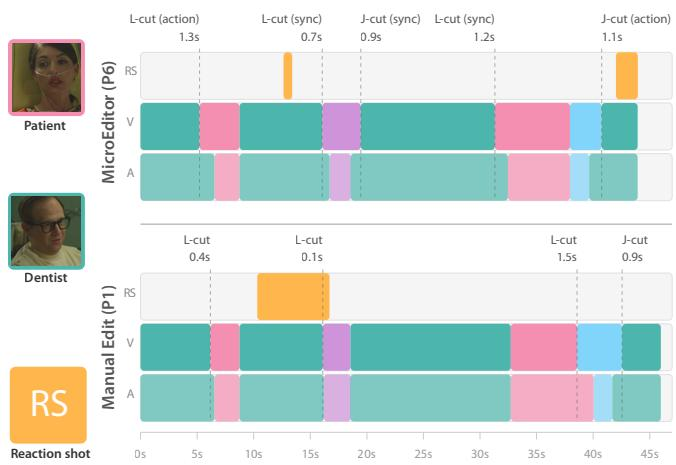  
Figure 9: Two participants editing the same scene Anesthesia: P6 with MicroEditor (top) and P1 editing manually (bottom). The MicroEditor row labels cut types per user’s decisions (e.g., optimization based on AV synchrony, cut-on-action). When cut-on-action is a strong cue, manual and assisted edits sometimes converge on simi lar cut timing (0.9 vs 1.1s J-cut ofset). Video frames © EditStock.

Analyze ALL footage files together to identify characters and shot types.

CHARACTER IDENTIFICATION: Identify all distinct people and objects of interest across all footage files (Figure 11). The same person in diferentfootage = same character\_id. Look for: hair, clothing, glasses, facial features, body type. A closeup in one footage and wide shot in another can be the same person.

SHOT TYPE CLASSIFICATION: Classify each segment as: extreme\_close\_up, close\_up, medium\_close\_up, medium, medium\_wide, wide, over\_the\_shoulder, two\_shot, or group\_shot. OVER-THE-SHOULDER RULE: In OTS shots, assign character\_id to the person whose face is visible (not the person shown from behind). This ensures visible faces for reaction shot extraction.

NON-USABLE SEGMENTS: Mark slates, crew visible, camera movement, and empty frames as no\_character.

TEMPORAL COVERAGE: Cover the entire duration ofeach footage file with no gaps. Approximate timing (±1–2 seconds) is acceptable.

Stage 2: AV Sync Processing (2–5 min): In parallel, we extract frame-level signals locally:

• Word boundaries: ASR (Parakeet-TDT [43] or Whisper [38]) provides word-level timestamps, defining bounds for rhythm editing windows.

• Synchrony function: For dialogue scenes, active speaker detection (LR-ASD [22]) computes per-frame lip-audio correlation for each face track. For non-dialogue content (e.g., sports, music), we use an audio-visual alignment network (AVID-CMA [26]). We threshold the continuous signal to obtain �(� �, �) ∈ {0, 1}.

• Blink onsets: MediaPipe [23] estimates eye aspect ratio per frame; blink onset occurs when EAR falls below threshold.

Stage 3: VLM-ASD Correspondence (instant): We link VLM character identities to ASD face tracks by extracting representative face crops from each track and querying Gemini to match them against VLM-generated character thumbnails. When matching is ambiguous, we fall back to DeepFace embeddings (Facenet512) with cosine similarity. This enables per-character queries of � and supports the character focus optimization (Section 5.3).

## B.2 Cut-on-Action Detection

Current state of VLMs cannot reliably reason about frame-level motion continuity [37]. We address this by converting the temporal reasoning problem into a spatial matching task. The model is prompted with the 2×2 grid layout (sample from the left and right bounds of � ) and temporal alignment rules:

You are a professional film editor with expertise in cut-onaction techniques.

GRID LAYOUT: Top row shows earlier cut opportunities (outgoing end, incoming preroll). Bottom row shows later cut opportunities (outgoing post-roll, incoming start).

Synchrony Analysis - AnesthesiaRoughCut\_MIXED  
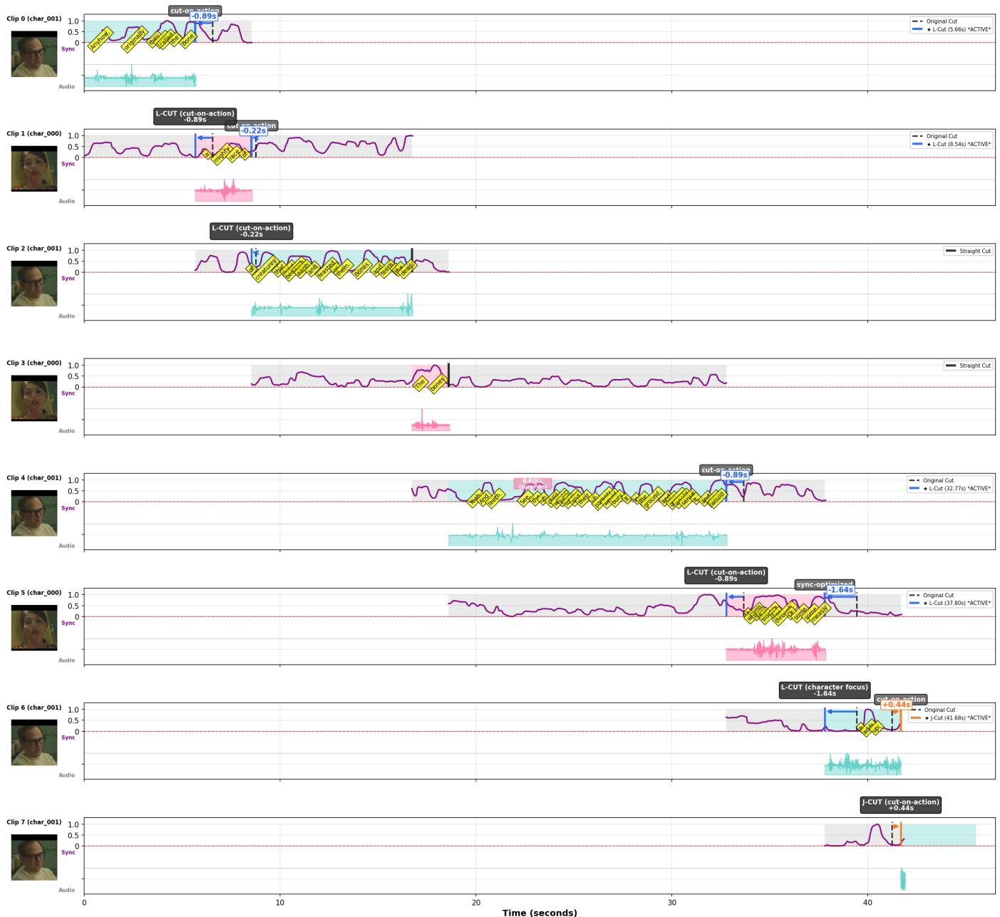  
Figure 10: System-level synchrony analysis for an edit of Anesthesia scene. The visualization shows the continuous synchrony signal (�, purple line), word-level timing (yellow boxes), and the calculated safe decoupling windows used to generate the L/J-cut and Cut-on-Action suggestions surfaced to the user. Video frames © EditStock.

## TEMPORAL ALIGNMENT RULES:

• For later cuts (J-cut): Match frames with equal numbers $( A { = } B ) ,$ since frame 1 = cut pointfor both grids.

• For earlier cuts (L-cut): Match frames by distance from last frame, maintaining consistent ofset (B−A).

FOCUS ON: Motion trajectory, direction continuity, body alignment (head angle, shoulder rotation, limb positions), and temporal alignment.

The temporal alignment rules encode the key insight that frames are sampled at the same rate (4.5 fps), so valid cut points must match frames representing the same moment relative to the cut boundary.

Motion Matching: The VLM identifies frame pairs where motion trajectory, body position, or gaze continues smoothly across the cut boundary. Each pair $( n _ { \mathrm { o u t } } , n _ { \mathrm { i n } } )$ converts to a timeline ofset:

$$
\delta = ( n _ { \mathrm { f r a m e } } - 1 ) / \mathrm { f p s } _ { \mathrm { m o s a i c } }
$$

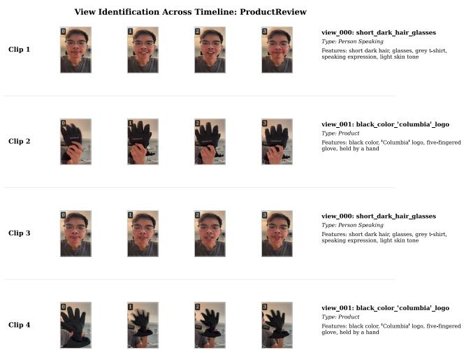  
Figure 11: View identification using vision-language model analysis, shown on a product review scene captured by the authors. The VLM distinguishes the human presenter from product demonstration shots and extracts distinctive features for each view, enabling the Character Focus feature to redistribute screen time through automated L/J cut suggestions.

Top-row matches yield L-cuts $( \delta < 0 )$ . Bottom-row matches yield J-cuts (� > 0).

## B.3 Reaction Shot Indexing

Low-sync segments provide source material for reaction shots. A segment from $M _ { j }$ qualifies as a candidate if:

$\sigma ( M _ { j } , t ) = 0$ throughout (character visible but not speaking)

• The target character is detected in ≥80% of frames

• The segment is adjacent to spoken material (filtering irrelevant silent stretches)

We index candidates by character identity and emotion embeddings (EmoCLIP [16]), enabling the semantic search interface described in Section 5.4.

## B.4 Processing Performance

Table 3 shows typical times for a one-minute dialogue scene with 4 source clips (∼5 minutes raw footage).

Stages 1 and 2 run in parallel; VLM API calls are the primary bottleneck. All signals are computed in source time and remain stable across timeline changes, so preprocessing runs once per project.

## C User Study 1 Details

Building on the insights identified in our formative study (Section 3), we evaluated how MicroEditor supports (1) rhythm (temporal flow) and (2) view (visual continuity and narrative focus) while reducing cognitive load and encouraging creative iteration.

## C.1 Participants

We recruited 6 professional video editors (3 women, 3 men, aged 18-27) with 5-15 years of editing experience (Table 4). One edits daily (P3), three edit weekly or multiple times per week (P1, P6 edit weekly; P3 daily), two edit monthly (P2, P5), and one edits yearly (P4). Participants work across narrative films (5 editors), documentaries (3 editors), YouTube content (2 editors), and social media content (2 editors). All primarily use Adobe Premiere Pro in their professional work.

Table 3: Preprocessing time breakdown (1-minute scene, 4 source clips, MacBook Pro M2)
<table><tr><td rowspan=1 colspan=1>Stage / Component</td><td rowspan=1 colspan=1>Time</td></tr><tr><td rowspan=1 colspan=1>Stage 1: VLM Coarse AnalysisProxy generation (480p)VLM footage analysis (Gemini)</td><td rowspan=1 colspan=1>30s90s</td></tr><tr><td rowspan=1 colspan=1>Stage 2: AV Sync ProcessingASR transcriptionActive speaker detection (LR-ASD)Blink detection (MediaPipe)</td><td rowspan=1 colspan=1>45s60s15s</td></tr><tr><td rowspan=1 colspan=1>Stage 3: VLM-ASD MatchingFace embedding + matching</td><td rowspan=1 colspan=1>20s</td></tr><tr><td rowspan=1 colspan=1>Per-Cut ProcessingCut-on-action mosaics + VLM</td><td rowspan=1 colspan=1>60s</td></tr><tr><td rowspan=1 colspan=1>Total</td><td rowspan=1 colspan=1>~5 min</td></tr></table>

## C.2 Study Format

All participants completed a 60-minute in-person session. After a tutorial on MicroEditor terminology and features, participants edited two 1-minute dialogue scenes using our interface: “Pumpkin Princess” (awkward romantic interaction between a nerdy outcast and her crush) and “Anesthesia” (suspenseful 1950s scene where a housewife suspects her dentist). Participants completed both conditions in counterbalanced order: manual editing (all features disabled) and assisted editing (features enabled). We encouraged think-aloud protocol throughout. Following each edit, participants rated features on 7-point Likert scales and completed creativity support metrics adapted from the Creativity Support Index (Table 5).

## D Full User Study 2 Details

Building on User Study 1 (Sec C), we conducted a second evaluation to assess the newly added Reaction Shot Selection feature with emotion filtering, while continuing to evaluate the core rhythm and view pass capabilities with a larger participant pool.

## D.1 Participants

We recruited 10 video editors (6 women, 4 men, aged 19-28) with 1-10 years of editing experience (Table 6). Participants edit at varying frequencies: two edit weekly (P2, P8), three edit monthly (P4, P7, P9), four edit every few weeks to monthly (P1, P3, P5, P6), and one edits a few times per year (P10). Participants work across narrative films (7 editors), commercial/social media content (5 editors), documentaries (3 editors), and YouTube/digital content (3 editors). Most primarily use Adobe Premiere Pro, with some using DaVinci Resolve or Final Cut Pro.

Table 4: Participant demographics and feature ratings from the MicroEditor user study
<table><tr><td rowspan=2 colspan=1>ID</td><td rowspan=1 colspan=4>Demographics</td><td rowspan=1 colspan=4>MicroEditor Feature Ratings</td></tr><tr><td rowspan=1 colspan=1>Age</td><td rowspan=1 colspan=1>Gender</td><td rowspan=1 colspan=1>Experience</td><td rowspan=1 colspan=1>Content Types</td><td rowspan=1 colspan=1>Rhythm</td><td rowspan=1 colspan=1>Character Focus</td><td rowspan=1 colspan=1>Action</td><td rowspan=1 colspan=1>Blink</td></tr><tr><td rowspan=1 colspan=1>P1</td><td rowspan=1 colspan=1>22</td><td rowspan=1 colspan=1>F</td><td rowspan=1 colspan=1>7+ years, Premiere</td><td rowspan=1 colspan=1>Narrative, YouTube, TikTok</td><td rowspan=1 colspan=1>6</td><td rowspan=1 colspan=1>7</td><td rowspan=1 colspan=1>5</td><td rowspan=1 colspan=1>7</td></tr><tr><td rowspan=1 colspan=1>P2</td><td rowspan=1 colspan=1>27</td><td rowspan=1 colspan=1>M</td><td rowspan=1 colspan=1>15 years</td><td rowspan=1 colspan=1>Narrative, Documentary</td><td rowspan=1 colspan=1>6</td><td rowspan=1 colspan=1>6</td><td rowspan=1 colspan=1>7</td><td rowspan=1 colspan=1>5</td></tr><tr><td rowspan=1 colspan=1>P3</td><td rowspan=1 colspan=1>26</td><td rowspan=1 colspan=1>F</td><td rowspan=1 colspan=1>7 years, Premiere</td><td rowspan=1 colspan=1>Narrative, Documentary</td><td rowspan=1 colspan=1>7</td><td rowspan=1 colspan=1>7</td><td rowspan=1 colspan=1>6</td><td rowspan=1 colspan=1>4</td></tr><tr><td rowspan=1 colspan=1>P4</td><td rowspan=1 colspan=1>26</td><td rowspan=1 colspan=1>F</td><td rowspan=1 colspan=1>5 years</td><td rowspan=1 colspan=1>Narrative, YouTube</td><td rowspan=1 colspan=1>6</td><td rowspan=1 colspan=1>7</td><td rowspan=1 colspan=1>7</td><td rowspan=1 colspan=1>4</td></tr><tr><td rowspan=1 colspan=1>P5</td><td rowspan=1 colspan=1>18</td><td rowspan=1 colspan=1>M</td><td rowspan=1 colspan=1>6 years</td><td rowspan=1 colspan=1>Narrative, Digital Media</td><td rowspan=1 colspan=1>6</td><td rowspan=1 colspan=1>7</td><td rowspan=1 colspan=1>7</td><td rowspan=1 colspan=1>6</td></tr><tr><td rowspan=1 colspan=1>P6</td><td rowspan=1 colspan=1>19</td><td rowspan=1 colspan=1>M</td><td rowspan=1 colspan=1>8 years</td><td rowspan=1 colspan=1>Narrative, Documentary</td><td rowspan=1 colspan=1>6</td><td rowspan=1 colspan=1>6</td><td rowspan=1 colspan=1>7</td><td rowspan=1 colspan=1>7</td></tr></table>

Note: Participants completed two editing tasks using the MicroEditor interface in counterbalanced order: manual editing (all features disabled) and assisted editing (features enabled). Scene assignment (Pumpkin Princess/Anesthesia) and condition order were counterbalanced. Feature ratings on 1-7 scale where 7 = Extremely Useful. Rhythm = Pre-roll & Trim, Character Focus = Emphasize Speaker (automatic L/J cuts), Action = Cut-on-action suggestions, Blink = Blink detection markers.

Table 5: Creativity support and user experience metrics. Participants rated agreement on a 7-point scale (1=Strongly Disagree, 7=Strongly Agree) with statements adapted from the Creativity Support Index and task-specific measures.
<table><tr><td rowspan=1 colspan=1>Metric</td><td rowspan=1 colspan=1>P1</td><td rowspan=1 colspan=1>P2</td><td rowspan=1 colspan=1>P3</td><td rowspan=1 colspan=1>P4</td><td rowspan=1 colspan=1>P5</td><td rowspan=1 colspan=1>P6</td><td rowspan=1 colspan=1>Median</td></tr><tr><td rowspan=1 colspan=8>Creativity Support Dimensions</td></tr><tr><td rowspan=1 colspan=1>Exploration: Helped explore possibilities</td><td rowspan=1 colspan=1>6</td><td rowspan=1 colspan=1>7</td><td rowspan=1 colspan=1>6</td><td rowspan=1 colspan=1>6</td><td rowspan=1 colspan=1>6</td><td rowspan=1 colspan=1>5</td><td rowspan=1 colspan=1>6.0</td></tr><tr><td rowspan=1 colspan=1>Exploration: Encouraged different cuts</td><td rowspan=1 colspan=1>7</td><td rowspan=1 colspan=1>7</td><td rowspan=1 colspan=1>7</td><td rowspan=1 colspan=1>6</td><td rowspan=1 colspan=1>6</td><td rowspan=1 colspan=1>4</td><td rowspan=1 colspan=1>6.5</td></tr><tr><td rowspan=1 colspan=1>Expressiveness: Achieved creative vision</td><td rowspan=1 colspan=1>5</td><td rowspan=1 colspan=1>5</td><td rowspan=1 colspan=1>6</td><td rowspan=1 colspan=1>6</td><td rowspan=1 colspan=1>6</td><td rowspan=1 colspan=1>6</td><td rowspan=1 colspan=1>6.0</td></tr><tr><td rowspan=1 colspan=1>Expressiveness: Achieved editing style</td><td rowspan=1 colspan=1>6</td><td rowspan=1 colspan=1>5</td><td rowspan=1 colspan=1>6</td><td rowspan=1 colspan=1>6</td><td rowspan=1 colspan=1>5</td><td rowspan=1 colspan=1>5</td><td rowspan=1 colspan=1>5.5</td></tr><tr><td rowspan=1 colspan=1>Effort/Reward: Quality worth effort</td><td rowspan=1 colspan=1>6</td><td rowspan=1 colspan=1>6</td><td rowspan=1 colspan=1>6</td><td rowspan=1 colspan=1>6</td><td rowspan=1 colspan=1>6</td><td rowspan=1 colspan=1>4</td><td rowspan=1 colspan=1>6.0</td></tr><tr><td rowspan=1 colspan=1>Results Worth Effort: Satisfied with output</td><td rowspan=1 colspan=1>5</td><td rowspan=1 colspan=1>5</td><td rowspan=1 colspan=1>6</td><td rowspan=1 colspan=1>6</td><td rowspan=1 colspan=1>6</td><td rowspan=1 colspan=1>7</td><td rowspan=1 colspan=1>6.0</td></tr><tr><td rowspan=1 colspan=1>Immersion: Attention on task not tool</td><td rowspan=1 colspan=1>5</td><td rowspan=1 colspan=1>5</td><td rowspan=1 colspan=1>6</td><td rowspan=1 colspan=1>5</td><td rowspan=1 colspan=1>7</td><td rowspan=1 colspan=1>6</td><td rowspan=1 colspan=1>5.5</td></tr><tr><td rowspan=1 colspan=1>Enjoyment: Enjoyed using system</td><td rowspan=1 colspan=1>6</td><td rowspan=1 colspan=1>7</td><td rowspan=1 colspan=1>7</td><td rowspan=1 colspan=1>7</td><td rowspan=1 colspan=1>7</td><td rowspan=1 colspan=1>6</td><td rowspan=1 colspan=1>7.0</td></tr><tr><td rowspan=1 colspan=8>Task-Specific Efficiency</td></tr><tr><td rowspan=1 colspan=1>Decision Support: Better editing decisions</td><td rowspan=1 colspan=1>6</td><td rowspan=1 colspan=1>7</td><td rowspan=1 colspan=1>7</td><td rowspan=1 colspan=1>6</td><td rowspan=1 colspan=1>6</td><td rowspan=1 colspan=1>5</td><td rowspan=1 colspan=1>6.0</td></tr><tr><td rowspan=1 colspan=1>Confidence: More confident in choices</td><td rowspan=1 colspan=1>6</td><td rowspan=1 colspan=1>5</td><td rowspan=1 colspan=1>5</td><td rowspan=1 colspan=1>6</td><td rowspan=1 colspan=1>5</td><td rowspan=1 colspan=1>4</td><td rowspan=1 colspan=1>5.0</td></tr><tr><td rowspan=1 colspan=1>Efficiency: Saved time</td><td rowspan=1 colspan=1>5</td><td rowspan=1 colspan=1>7</td><td rowspan=1 colspan=1>7</td><td rowspan=1 colspan=1>7</td><td rowspan=1 colspan=1>7</td><td rowspan=1 colspan=1>6</td><td rowspan=1 colspan=1>7.0</td></tr></table>

Table 6: Participant demographics and feature ratings from User Study 2 (with Reaction Shot Retrieval)
<table><tr><td rowspan=2 colspan=1>ID</td><td rowspan=1 colspan=4>Demographics</td><td rowspan=1 colspan=5>MicroEditor Feature Ratings</td></tr><tr><td rowspan=1 colspan=1>Age</td><td rowspan=1 colspan=1>Gender</td><td rowspan=1 colspan=1>Experience</td><td rowspan=1 colspan=1>Content Types</td><td rowspan=1 colspan=1>Rhythm</td><td rowspan=1 colspan=1>Char. Focus</td><td rowspan=1 colspan=1>Action</td><td rowspan=1 colspan=1>Blink</td><td rowspan=1 colspan=1>Reaction</td></tr><tr><td rowspan=1 colspan=1>P1</td><td rowspan=1 colspan=1>20</td><td rowspan=1 colspan=1>F</td><td rowspan=1 colspan=1>10+ years</td><td rowspan=1 colspan=1>Narrative, Animation</td><td rowspan=1 colspan=1>6</td><td rowspan=1 colspan=1>6</td><td rowspan=1 colspan=1>7</td><td rowspan=1 colspan=1>4</td><td rowspan=1 colspan=1>6</td></tr><tr><td rowspan=1 colspan=1>P2</td><td rowspan=1 colspan=1>20</td><td rowspan=1 colspan=1>F</td><td rowspan=1 colspan=1>3 years</td><td rowspan=1 colspan=1>Dance, Trailers</td><td rowspan=1 colspan=1>6</td><td rowspan=1 colspan=1>7</td><td rowspan=1 colspan=1>6</td><td rowspan=1 colspan=1>5</td><td rowspan=1 colspan=1>7</td></tr><tr><td rowspan=1 colspan=1>P3</td><td rowspan=1 colspan=1>20</td><td rowspan=1 colspan=1>M</td><td rowspan=1 colspan=1>3-4 years</td><td rowspan=1 colspan=1>Reels, Product Videos</td><td rowspan=1 colspan=1>5</td><td rowspan=1 colspan=1>6</td><td rowspan=1 colspan=1>4</td><td rowspan=1 colspan=1>1</td><td rowspan=1 colspan=1>7</td></tr><tr><td rowspan=1 colspan=1>P4</td><td rowspan=1 colspan=1>24</td><td rowspan=1 colspan=1>M</td><td rowspan=1 colspan=1>7 years</td><td rowspan=1 colspan=1>Narrative, News</td><td rowspan=1 colspan=1>7</td><td rowspan=1 colspan=1>6</td><td rowspan=1 colspan=1>7</td><td rowspan=1 colspan=1>5</td><td rowspan=1 colspan=1>7</td></tr><tr><td rowspan=1 colspan=1>P5</td><td rowspan=1 colspan=1>19</td><td rowspan=1 colspan=1>F</td><td rowspan=1 colspan=1>4 years</td><td rowspan=1 colspan=1>Narrative, Commercial</td><td rowspan=1 colspan=1>6</td><td rowspan=1 colspan=1>7</td><td rowspan=1 colspan=1>6</td><td rowspan=1 colspan=1>3</td><td rowspan=1 colspan=1>7</td></tr><tr><td rowspan=1 colspan=1>P6</td><td rowspan=1 colspan=1>27</td><td rowspan=1 colspan=1>F</td><td rowspan=1 colspan=1>3+ years</td><td rowspan=1 colspan=1>Narrative, Architectural</td><td rowspan=1 colspan=1>7</td><td rowspan=1 colspan=1>6</td><td rowspan=1 colspan=1>7</td><td rowspan=1 colspan=1>5</td><td rowspan=1 colspan=1>7</td></tr><tr><td rowspan=1 colspan=1>P7</td><td rowspan=1 colspan=1>27</td><td rowspan=1 colspan=1>M</td><td rowspan=1 colspan=1>10 years</td><td rowspan=1 colspan=1>Narrative</td><td rowspan=1 colspan=1>6</td><td rowspan=1 colspan=1>5</td><td rowspan=1 colspan=1>6</td><td rowspan=1 colspan=1>5</td><td rowspan=1 colspan=1>7</td></tr><tr><td rowspan=1 colspan=1>P8</td><td rowspan=1 colspan=1>24</td><td rowspan=1 colspan=1>F</td><td rowspan=1 colspan=1>1 year</td><td rowspan=1 colspan=1>Short Reels/TikTok</td><td rowspan=1 colspan=1>7</td><td rowspan=1 colspan=1>7</td><td rowspan=1 colspan=1>7</td><td rowspan=1 colspan=1>4</td><td rowspan=1 colspan=1>7</td></tr><tr><td rowspan=1 colspan=1>P9</td><td rowspan=1 colspan=1>25</td><td rowspan=1 colspan=1>F</td><td rowspan=1 colspan=1>3 years</td><td rowspan=1 colspan=1>Music Videos, Interviews</td><td rowspan=1 colspan=1>5</td><td rowspan=1 colspan=1>6</td><td rowspan=1 colspan=1>5</td><td rowspan=1 colspan=1>5</td><td rowspan=1 colspan=1>7</td></tr><tr><td rowspan=1 colspan=1>P10</td><td rowspan=1 colspan=1>28</td><td rowspan=1 colspan=1>M</td><td rowspan=1 colspan=1>10 years</td><td rowspan=1 colspan=1>Narrative, Documentary</td><td rowspan=1 colspan=1>6</td><td rowspan=1 colspan=1>6</td><td rowspan=1 colspan=1>7</td><td rowspan=1 colspan=1>4</td><td rowspan=1 colspan=1>7</td></tr></table>

Note: Feature ratings on 1-7 scale where 7 = Extremely Useful. Rhythm = Pacing Control via Trim/Extend, Char. Focus = Character Focus with automated L/J cuts, Action = Cut-on-action suggestions, Blink = Blink detection markers, Reaction = Reaction Shot Selection with Emotion Filtering.

## D.2 Study Format

All participants completed a 60-minute in-person session following the same protocol as User Study 1. After a tutorial covering MicroEditor features including the new Reaction Shot Selection tool, participants edited two 1-minute dialogue scenes (“Pumpkin Princess” and “Anesthesia”) in counterbalanced order across manual and assisted conditions. Following each edit, participants rated features on 7-point Likert scales and completed creativity support metrics (Table 7). Additionally, participants rated the degree to which pacing and visual flow improved over the original rough assembly.

## E Synchrony Study Details

For each of the 12 video clips, participants on Prolific.com were shown the embedded video player and asked the following two questions. The questions were repeated identically for every clip.

Table 7: Creativity support and user experience metrics for User Study 2. Participants rated agreement on a 7-point scale (1=Strongly Disagree, 7=Strongly Agree).
<table><tr><td rowspan=1 colspan=1>Metric</td><td rowspan=1 colspan=1>P1</td><td rowspan=1 colspan=1>P2</td><td rowspan=1 colspan=1>P3</td><td rowspan=1 colspan=1>P4</td><td rowspan=1 colspan=1>P5</td><td rowspan=1 colspan=1>P6</td><td rowspan=1 colspan=1>P7</td><td rowspan=1 colspan=1>P8</td><td rowspan=1 colspan=1>P9</td><td rowspan=1 colspan=1>P10</td><td rowspan=1 colspan=1>Med.</td></tr><tr><td rowspan=1 colspan=12>Creativity Support Dimensions</td></tr><tr><td rowspan=1 colspan=1>Exploration: Helped explore possibilities</td><td rowspan=1 colspan=1>6</td><td rowspan=1 colspan=1>6</td><td rowspan=1 colspan=1>5</td><td rowspan=1 colspan=1>7</td><td rowspan=1 colspan=1>7</td><td rowspan=1 colspan=1>7</td><td rowspan=1 colspan=1>6</td><td rowspan=1 colspan=1>6</td><td rowspan=1 colspan=1>6</td><td rowspan=1 colspan=1>6</td><td rowspan=1 colspan=1>6.0</td></tr><tr><td rowspan=1 colspan=1>Exploration: Encouraged different cuts</td><td rowspan=1 colspan=1>7</td><td rowspan=1 colspan=1>5</td><td rowspan=1 colspan=1>6</td><td rowspan=1 colspan=1>6</td><td rowspan=1 colspan=1>7</td><td rowspan=1 colspan=1>7</td><td rowspan=1 colspan=1>6</td><td rowspan=1 colspan=1>6</td><td rowspan=1 colspan=1>6</td><td rowspan=1 colspan=1>6</td><td rowspan=1 colspan=1>6.0</td></tr><tr><td rowspan=1 colspan=1>Expressiveness: Achieved creative vision</td><td rowspan=1 colspan=1>5</td><td rowspan=1 colspan=1>5</td><td rowspan=1 colspan=1>6</td><td rowspan=1 colspan=1>4</td><td rowspan=1 colspan=1>5</td><td rowspan=1 colspan=1>7</td><td rowspan=1 colspan=1>5</td><td rowspan=1 colspan=1>6</td><td rowspan=1 colspan=1>5</td><td rowspan=1 colspan=1>6</td><td rowspan=1 colspan=1>5.0</td></tr><tr><td rowspan=1 colspan=1>Expressiveness: Achieved editing style</td><td rowspan=1 colspan=1>5</td><td rowspan=1 colspan=1>6</td><td rowspan=1 colspan=1>6</td><td rowspan=1 colspan=1>5</td><td rowspan=1 colspan=1>6</td><td rowspan=1 colspan=1>7</td><td rowspan=1 colspan=1>6</td><td rowspan=1 colspan=1>6</td><td rowspan=1 colspan=1>5</td><td rowspan=1 colspan=1>6</td><td rowspan=1 colspan=1>6.0</td></tr><tr><td rowspan=1 colspan=1>Effort/Reward: Quality worth effort</td><td rowspan=1 colspan=1>6</td><td rowspan=1 colspan=1>6</td><td rowspan=1 colspan=1>5</td><td rowspan=1 colspan=1>4</td><td rowspan=1 colspan=1>7</td><td rowspan=1 colspan=1>7</td><td rowspan=1 colspan=1>6</td><td rowspan=1 colspan=1>6</td><td rowspan=1 colspan=1>5</td><td rowspan=1 colspan=1>7</td><td rowspan=1 colspan=1>6.0</td></tr><tr><td rowspan=1 colspan=1>Results Worth Effort: Satisfied with output</td><td rowspan=1 colspan=1>6</td><td rowspan=1 colspan=1>7</td><td rowspan=1 colspan=1>6</td><td rowspan=1 colspan=1>6</td><td rowspan=1 colspan=1>7</td><td rowspan=1 colspan=1>7</td><td rowspan=1 colspan=1>6</td><td rowspan=1 colspan=1>6</td><td rowspan=1 colspan=1>4</td><td rowspan=1 colspan=1>7</td><td rowspan=1 colspan=1>6.0</td></tr><tr><td rowspan=1 colspan=1>Immersion: Attention on task not tool</td><td rowspan=1 colspan=1>5</td><td rowspan=1 colspan=1>6</td><td rowspan=1 colspan=1>4</td><td rowspan=1 colspan=1>7</td><td rowspan=1 colspan=1>5</td><td rowspan=1 colspan=1>6</td><td rowspan=1 colspan=1>7</td><td rowspan=1 colspan=1>6</td><td rowspan=1 colspan=1>3</td><td rowspan=1 colspan=1>5</td><td rowspan=1 colspan=1>5.5</td></tr><tr><td rowspan=1 colspan=1>Enjoyment: Enjoyed using system</td><td rowspan=1 colspan=1>6</td><td rowspan=1 colspan=1>7</td><td rowspan=1 colspan=1>5</td><td rowspan=1 colspan=1>7</td><td rowspan=1 colspan=1>7</td><td rowspan=1 colspan=1>7</td><td rowspan=1 colspan=1>6</td><td rowspan=1 colspan=1>7</td><td rowspan=1 colspan=1>5</td><td rowspan=1 colspan=1>7</td><td rowspan=1 colspan=1>7.0</td></tr><tr><td rowspan=1 colspan=12>Task-Specific Efficiency</td></tr><tr><td rowspan=1 colspan=1>Decision Support: Better editing decisions</td><td rowspan=1 colspan=1>6</td><td rowspan=1 colspan=1>6</td><td rowspan=1 colspan=1>6</td><td rowspan=1 colspan=1>6</td><td rowspan=1 colspan=1>7</td><td rowspan=1 colspan=1>7</td><td rowspan=1 colspan=1>6</td><td rowspan=1 colspan=1>7</td><td rowspan=1 colspan=1>4</td><td rowspan=1 colspan=1>6</td><td rowspan=1 colspan=1>6.0</td></tr><tr><td rowspan=1 colspan=1>Confidence: More confident in choices</td><td rowspan=1 colspan=1>5</td><td rowspan=1 colspan=1>7</td><td rowspan=1 colspan=1>6</td><td rowspan=1 colspan=1>5</td><td rowspan=1 colspan=1>7</td><td rowspan=1 colspan=1>7</td><td rowspan=1 colspan=1>5</td><td rowspan=1 colspan=1>6</td><td rowspan=1 colspan=1>5</td><td rowspan=1 colspan=1>6</td><td rowspan=1 colspan=1>6.0</td></tr><tr><td rowspan=1 colspan=1>Efficiency: Saved time</td><td rowspan=1 colspan=1>7</td><td rowspan=1 colspan=1>7</td><td rowspan=1 colspan=1>6</td><td rowspan=1 colspan=1>7</td><td rowspan=1 colspan=1>7</td><td rowspan=1 colspan=1>7</td><td rowspan=1 colspan=1>7</td><td rowspan=1 colspan=1>7</td><td rowspan=1 colspan=1>5</td><td rowspan=1 colspan=1>7</td><td rowspan=1 colspan=1>7.0</td></tr><tr><td rowspan=1 colspan=7>Additional Rating</td><td rowspan=1 colspan=5></td></tr><tr><td rowspan=1 colspan=1>Pacing/Flow: Improved over rough assembly</td><td rowspan=1 colspan=1>7</td><td rowspan=1 colspan=1>6</td><td rowspan=1 colspan=1>6</td><td rowspan=1 colspan=1>6</td><td rowspan=1 colspan=1>6</td><td rowspan=1 colspan=1>7</td><td rowspan=1 colspan=1>6</td><td rowspan=1 colspan=1>6</td><td rowspan=1 colspan=1>5</td><td rowspan=1 colspan=1>7</td><td rowspan=1 colspan=1>6.0</td></tr></table>

Q1: Did you notice any distracting audio-visual mismatches

or lip-sync errors in this clip?

Q2: Overall, how natural did the flow of this clip feel?

◦ 1 - Very jarring / distracting