# MorphSIG: Subject-Driven Image Generation via Decoupled Anchoring and Feature Transport

Hailong Yan1∗ Yongrui Zhang1 Xiangtao Zhang1 Le Zhang2,1†

1 UESTC 2 Hohai University

yanhailong@std.uestc.edu.cn, lezhang@uestc.edu.cn

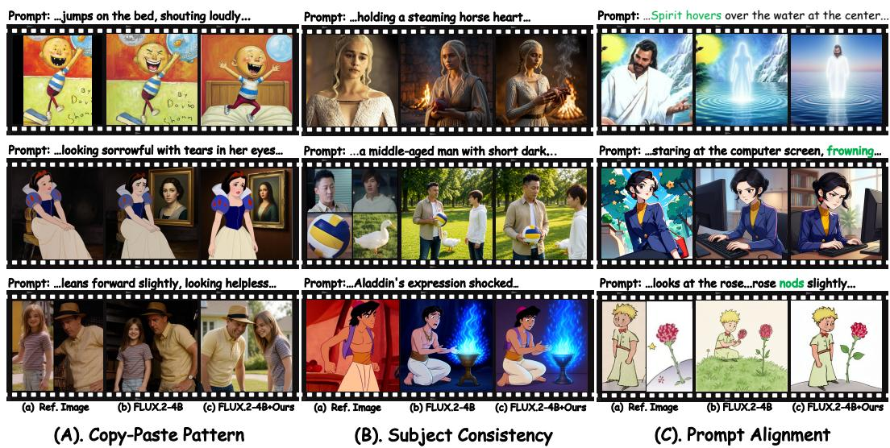  
Figure 1: Qualitative comparison between MorphSIG and the baseline.

## Abstract

We propose MorphSIG, a training-free framework that reformulates subject-driven image generation (SIG) as pseudo-video feature transport. MorphSIG contains two core modules: Progressive Decoupled Anchoring, which uses frequency-domain decoupling and structural scrambling during early denoising to break structural locking and enable a gradual transition from free composition to identity alignment; and Pseudo-flow Guided Feature Transport, which constructs a latent-space pseudoflow field to mimic Image-to-Video temporal coherence and transport subject semantics precisely. To address stylistic homogeneity and the lack of ground truth in existing benchmarks, we further introduce a benchmark with diverse stylized subjects. Extensive experiments show that MorphSIG significantly improves pose diversity and subject fidelity over baselines without additional training. Overall, MorphSIG bridges static generation and dynamic propagation, providing a costeffective paradigm for high-fidelity subject consistency. The Code and benchmark will be available here.

## 1 Introduction

Subject-driven image generation (SIG) aims to synthesize images that follow text prompts while preserving the details of reference subjects [27, 38, 16, 54, 12]. By enabling user-defined customization, SIG has broad applications in film production [60] and advertising [20].

In practical applications, SIG faces two major challenges: ❶ the "copy-paste pattern," where generated results inherit the reference pose and lack compositional freedom; and ❷ "subject inconsistency," where subject features degrade during diffusion, reducing identity stability.

As illustrated in Fig. 2, existing training-based SIG methods anchor identity through large-scale paired datasets [38, 15, 57, 54, 12] or the introduction of auxiliary encoding networks [62, 32, 49], yet these incur significant computational costs and are prone to overfitting. Training-free approaches [64, 31, 17, 7] typically inject subject features via attention-sharing mechanisms after inverting the reference image; however, they struggle to preserve identity due to the lack of consistency constraints. Another research [60, 52, 30, 66, 46, 10] attempts to leverage the dynamic priors of video models for image-level SIG, but suffers from low efficiency due to the generation of redundant transition frames.

To address these challenges, we analyze the underlying feature representations and inference paradigms. The "copy-paste pattern" arises from a pronounced "high-frequency shortcut effect" in Text&Imageto-Image (T&I2I) models, where high-frequency components from the reference image dominate early denoising and prematurely lock pose evolution. Meanwhile, the superior consistency of video models comes from temporally coherent feature transport, characterized by displacement mapping and semantic propagation across adjacent frames.

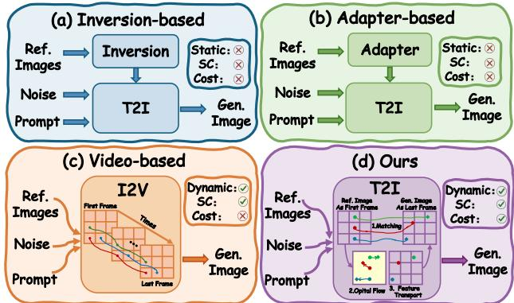  
Figure 2: Comparison of different SIG paradigms. SC (Subject Consistency), and Cost (computational complexity).

To balance fidelity and diversity, we propose MorphSIG, a training-free SIG framework. First, to alleviate the "copy-paste" pattern, we introduce Progressive Decoupled Anchoring. By applying low-pass filtering and high-frequency structural permutation to reference Keys in joint self-attention, it removes global geometric bias while preserving essential feature statistics. Combined with timedependent anchoring strength, this strategy unlocks compositional flexibility during early diffusion. Second, to improve consistency, we reformulate T&I2I as a "two-frame video generation" paradigm, treating the reference and target images as pseudo-first and pseudo-last frames. Based on this view, we propose Pseudo-flow Guided Warped Feature Transport, which simulates temporal coherence by warping reference features with pseudo-flow. Combining low-frequency Spherical Linear Interpolation and high-frequency Winner-Take-All enables effective transport of warped reference features, improving detail generation while preserving structural consistency.

We further introduce a benchmark with diverse styles and high-quality Ground Truth, enabling rigorous evaluation of fidelity and diversity in SIG. Our contributions are summarized as follows.

• We identify the "high-frequency shortcut" as the main cause of the "copy-paste" pattern in T&I2I, and redefine T&I2I as a "pseudo-video" task to simulate I2V temporal coherence without redundant computation.

• We propose Progressive Decoupled Anchoring to mitigate high-frequency shortcuts, and Pseudo-flow Guided Feature Transport to preserve subject consistency.

• We introduce a new SIG benchmark with diverse styles and high-quality Ground Truth, addressing the lack of objective metrics and stylistic diversity in existing datasets.

• As a training-free framework, MorphSIG achieves superior fidelity-diversity balance on both public and our proposed benchmarks.

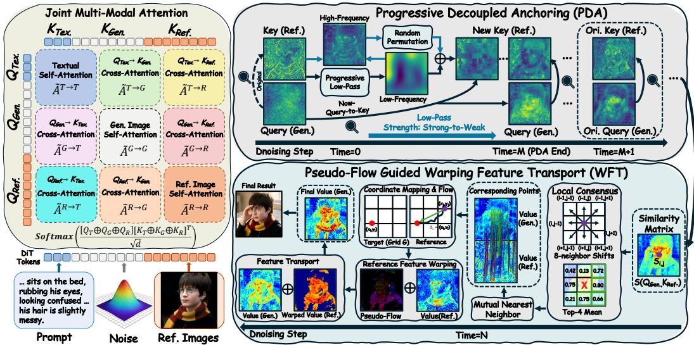  
Figure 3: Overview of the proposed framework. MorphSIG consists of two modules: Progressive Decoupled Anchoring (PDA) and Warping Feature Transport (WFT). PDA suppresses structural shortcut copying by decoupling and progressively restoring reference anchors during denoising, enabling flexible composition. WFT estimates pseudo-flow to warp and transport reference features into the generation space, improving identity consistency under large pose and geometry variations.

## 2 Related Work

Consistent Text-to-Image Generation. While fine-tune approaches [38, 27, 22, 48, 43, 2] are capable of capturing visual details, they suffer from high computational overhead. To balance efficiency and performance, lightweight adapters [32, 65, 62, 59, 58, 61] inject external guidance into frozen backbone; however, these often lack sufficient representation capacity. In contrast, trainingfree methods [16, 45, 31, 47, 28, 35, 36] leverage in-context learning for "plug-and-play" flexibility, but struggle with complex instructions, often failing to maintain textual consistency under large-scale pose variations.

Subject-driven Image Generation synthesizes reference images to precisely preserve subject identities [54, 12, 55]. For instance, DreamO [33] and USO [53] integrate reference images to generate outputs that mirror both input identity and aesthetics. While frameworks like OmniGen [56, 51] and others [25, 39, 13, 42] enhance identity decoupling, they often necessitate large-scale retraining, which limits their scalability. Conversely, training-free methods [64, 24, 11, 26] utilize optimized attention mechanisms to inject subject features across frames during inference.

Image Generation and Video. Recent video models [4, 5, 9, 23] have inspired using video priors for image tasks [37, 60, 66, 52]. Specifically, UniReal [10] and iMontage [19] treat image generation as video tasks to leverage world dynamics, while RealGeneral [30] unifies tasks via conditional frame prediction. To handle complexity, PLACID [44] uses spatio-temporal trajectories for feature constancy, and CoF-T2I [46] employs "Chain-of-Frames" for progressive refinement. Despite these gains, video-based models suffer from high overhead and latency. Conversely, we propose achieving high-quality generation by endowing static diffusion models with dynamic evolutionary capabilities.

## 3 Method

## 3.1 Preliminaries

Joint Multi-Modal Attention in T2I. Modern diffusion transformers like FLUX.2 utilizes a Joint Multi-Modal Attention mechanism that unifies text, latent noise, and reference images into a single 1D sequence. The model serializes the text prompt into $X _ { \mathrm { t x t } }$ , the target noise into $X _ { \mathrm { g e n } }$ , and N reference images into a concatenated stream $X _ { \mathrm { r e f } } = [ X _ { \mathrm { r e f } } ^ { ( 1 ) } ; \ldots ; X _ { \mathrm { r e f } } ^ { ( N ) } ]$ . To distinguish these "canvases," 4D coordinate IDs are assigned to every token, using discrete temporal offsets (T) for each reference image to preserve instance integrity within the unified vector. In the core Single-Stream Blocks, these modalities are fused into a global sequence $X _ { \mathrm { a l l } } = [ X _ { \mathrm { t x t } } ; X _ { \mathrm { g e n } } ; X _ { \mathrm { r e f } } ]$ , where attention is computed as:

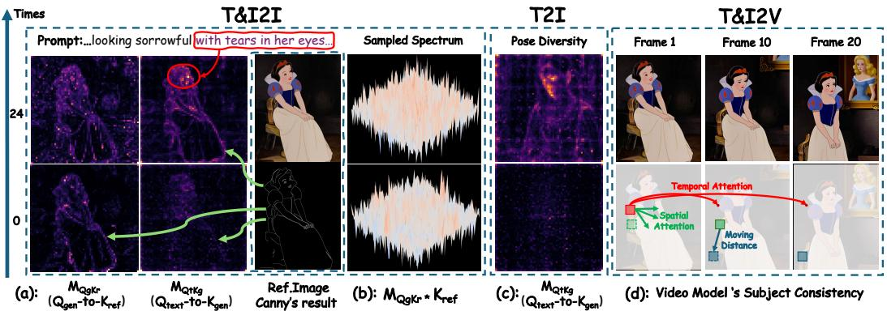  
Figure 4: Analysis of High-frequency Shortcut in T&I2I and Temporal Feature Transport in I2V.

$$
\mathrm { O u t p u t } = \mathrm { S o f t m a x } \left( { \frac { Q K ^ { \top } } { \sqrt { d _ { h } } } } \right) V , \quad \{ Q , K , V \} = \mathrm { L i n e a r } ( X _ { \mathrm { a l l } } ) .\tag{1}
$$

By treating references as tokens rather than external conditions, the joint attention matrix implicitly facilitates simultaneous self-attention, text-guidance, and multi-source reference injection.

3D Attention in I2V. Video DiT extend static DiTs by processing 4D video tensors $\boldsymbol { \mathcal { V } } \in \mathbb { R } ^ { f \times c \times h }$ ×w to capture spatiotemporal dynamics. In each layer l, video tokens ${ \mathcal { Z } } _ { \mathrm { v i d e o } }$ and text tokens ${ \mathit { z } } _ { \mathrm { t e x t } }$ are concatenated into an augmented sequence. The queries $\mathbf { Q } _ { t , l }$ are formed by merging projections from all f frames and the text prompt: $\mathbf { Q } t , l = \operatorname { C o n c a t } ( \mathbf { Q } t , l ^ { 1 } , \ldots , \mathbf { Q } t , l ^ { f } , \mathbf { Q } t , l ^ { \mathrm { t e x t } } )$ . The resulting global 3D attention matrix $\mathbf { A } _ { t , l } = \mathrm { S o f t m a x } ( \mathbf { Q } _ { t , l } \mathbf { K } _ { t , l } ^ { \top } / \sqrt { d } )$ facilitates four key interactions: selfframe attention $( \mathbf { A } _ { t , l } ^ { i , i } )$ for 2D spatial correlations, cross-frame attention $( \mathbf { A } _ { t , l } ^ { i , j } )$ for inter-frame pixel relevance $\mathrm { A t t n } ( I _ { i } ( p )  I _ { j } ( q ) )$ , and text-frame/self-text attention for semantic guidance. VDTs leverage inherent "world knowledge" to understand complex motion and temporal consistency [34].

## 3.2 Problems and Analysis

We analyze two key observations in T&I2I models, as shown in Fig.1: Observation ❶: Copy-Paste Pattern. Generated images rigidly inherit the reference pose. Observation ❷: Subject Inconsistency. Subject identity or features gradually degrade during generation. We first analyze and formally explain these issues, then propose targeted optimizations to balance fidelity and diversity.

## Analysis for ❶: The consistency gain in T&I2I comes at the expense of generation freedom.

As shown in Fig. $1 ( \mathrm { A } ) ,$ T&I2I models often directly replicate reference features, reducing diversity [21, 29, 57, 15]. We attribute this to a high-frequency shortcut effect: although diffusion models generally follow a coarse-to-fine generation process [63], T&I2I models capture high-frequency reference features too early to preserve identity consistency. This excessive coupling prematurely locks generation. Specifically, Fig.4(a) shows that $Q _ { g e n }$ strongly activates edge contours in $K _ { r e f }$ during early sampling. The spectrum in Fig.4(b) further shows that these high-frequency "anchors" constrain macro-scale pose evolution. As a result, the control ability of the text query $Q _ { t }$ is significantly weakened by the high-frequency shortcut, as illustrated in Fig.4(c).

## Analysis for ❷: The temporal consistency via first-frame feature transport.

In I2V modeling, the attention for the latent sequence $\mathbf { z } _ { v i d e o }$ explicitly constructs cross-frame attention by facilitating direct interaction between the query vectors $\mathbf { Q } _ { t , l } ^ { i }$ of subsequent frames and the key vector ${ \bf K } _ { t , l } ^ { 1 }$ of the first frame, as illustrated in Fig.4(d). This architectural design establishes robust temporal correspondences, ensuring that visual priors from the initial frame are accurately propagated to subsequent frames, thereby maintaining identity stability while modeling temporal motion [41, 60]. Inspired by this, recent image-level methods [30, 10] adopt a "non-contiguous" frame generation architecture. By treating input and output images as a "pseudo-frame" sequence, they leverage the video model’s inherent capacity for maintaining structural and feature consistency.

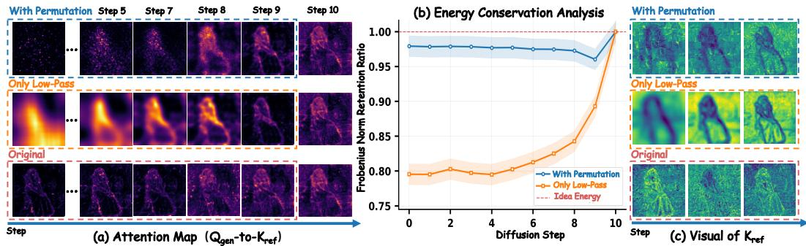  
Figure 5: Synergistic Analysis of Spectral Decoupling and Structural Permutation.

## 3.3 Progressive Decoupled Anchoring (PDA)

Motivation. While T2I offer high compositional flexibility through noise synthesis, they struggle with subject consistency. Conversely, T&I2I anchor identity but often fall into "high-frequency shortcuts." Current solutions typically rely on computationally expensive paradigms, such as large-scale paired data augmentation [15, 57] or complex feedback optimization [12, 21]. We hope that an ideal T&I2I should balance the creative freedom of T2I with the robust consistency of T&I2I.

Spectral Decoupling (SD). In joint multi-modal attention, $K _ { r e f }$ acts as a semantic anchor. Its high-frequency components often produce sharp attention peaks that lock generation to the reference geometry. To alleviate this pose-locking effect, we reshape the reference latent $\mathcal { M } _ { r e f } \in \mathbb { R } ^ { H \times W \times D }$ and apply frequency decoupling: $\mathcal { M } _ { l o w } = \mathcal { G } ( M _ { r e f } , \sigma ) , \quad \mathcal { M } _ { h i g h } = \mathcal { M } _ { r e f } - \mathcal { M } _ { l o w } .$

Where G denotes a Gaussian low-pass filter with a kernel scale σ. While $\mathcal { M } _ { l o w }$ effectively circumvents high-frequency structural shortcuts, it also incurs a notable loss of feature energy. As illustrated in Fig. 5(b), an approximately 20% loss in Frobenius Norm significantly degrades the feature intensity of the pre-trained model, consequently compromising the fidelity of subject reconstruction.

Structural Permutation (SP). To compensate for information loss from filtering while eliminating geometric bias, we apply a block-level permutation P to the high-frequency residual $\mathcal { M } _ { h i g h }$

$$
\hat { \mathcal { M } } _ { r e f } = \mathcal { M } _ { l o w } + \mathcal { P } ( \mathcal { M } _ { h i g h } , p ) ,\tag{2}
$$

where p denotes the patch size. As visualized in Fig. 5(c), SP redistributes high-frequency features as "disassembled components" rather than merely erasing details. By disrupting global pose correlations while preserving original statistical properties and local details, SP avoids the identity blurring and feature collapse inherent in only low-pass schemes (which retain only 0.8 of the energy).

From the perspective of attention dynamics (Fig. 5(a)), the smooth distribution of only low-pass features (Fig. 5(c)) triggers attention diffusion, which impairs precise alignment. In contrast, while SP perturbs spatial coordinates, its block structures retain local gradient transitions. his high-contrast distribution (Fig. 5(a)) allows the model to bypass compositional constraints while accurately extracting critical details from the "feature pool," ensuring high-fidelity reconstruction.

Progressive Anchoring (PA). Leveraging the coarse-to-fine nature of diffusion denoising, we introduce a time-dependent coefficient $t \in ( 1  0 )$ to dynamically modulate anchoring intensity:

$$
K _ { r e f } = \mathrm { F l a t t e n } \left( \mathcal { G } ( \mathcal { M } _ { r e f } , \sigma ( t ) ) + \mathcal { P } ( \mathcal { M } _ { r e f } - \mathcal { G } ( \mathcal { M } _ { r e f } , \sigma ( t ) ) , p ) \right)\tag{3}
$$

Macro-Evolution $( t \approx 1 )$ : Low-pass filter suppresses high-frequency spatial anchors, forcing the model to synthesize global motion structures from the prompt Q within the "spectral blind zone."

Micro-Alignment (t → 0): As the global manifold stabilizes, structural signals are reintroduced as local guides for identity reconstruction without disrupting the established pose.

## 3.4 Pseudo-Flow Guided Warping Feature Transport (WFT)

Motivation. The superior consistency of I2V stems from feature transport under temporal coherence [60, 6]. Existing methods [37, 66, 60] reformulate T2I as “video frame prediction” to inherit this property, but require generating redundant intermediate frames. We instead ask: “Can T&I2I directly simulate the ‘I2V generation logic’ within T2I to enhance subject consistency?”

Formulation: Consider a video sequence $( f _ { 0 } , f _ { 1 } , \ldots , f _ { n } )$ as a continuous function in 2D space, where each frame $f _ { j }$ evolves from its predecessor $f _ { j - 1 }$ via a mapping $T _ { j }$ . The feature vector $\Phi _ { j } ( x )$ at coordinate x in the j-th frame is defined by the selective transport of prior features $\Phi _ { j - 1 } \colon$

$$
\Phi _ { j } ( x ) = \mathcal { R } \left( \Phi _ { j - 1 } ( T _ { j } ^ { - 1 } ( x ) ) , \Delta \phi _ { j } \right) ,\tag{4}
$$

where $T _ { j }$ denotes the mapping function, and R represents the transport operator. It propagates semantic information from the reference frame to the current frame according to the spatial mapping, with $\Delta \phi _ { j }$ accounting for frame-specific residual updates. This formulation reveals that temporal coherence fundamentally arises from the combination of spatial feature transport and local updates.

In I2V, The 3D attention implicitly realizes the above process through Query-Key matching [34]: $A ( x , y ) \propto \langle Q _ { j } ( x ) , K _ { j - 1 } ( y ) \rangle$ ⟩ which can be interpreted as a soft correspondence distribution enabling cross-frame non-rigid alignment. Functionally, it resembles a probabilistic flow field [14, 41].

Motivated by this observation, we reinterpret T&I2I architectures (e.g., FLUX.2) as a degenerate two-frame I2V process, where the reference and target images correspond to pseudo-first frame $f _ { 0 }$ and pseudo-final frame $f _ { 1 }$ . We then construct a pseudo-flow mapping $T$ within T&I2I to model semantic correspondence: $\Phi _ { 1 } ( x ) = \mathcal { R } ( \Phi _ { 0 } ( T ^ { - 1 } ( x ) ) , \Delta \phi ( x ) )$ , where pseudo-flow performs semantic transport and the residual term injects text-conditioned novel semantics.

Method. Unlike methods that rely on external models to establish correspondences $[ 3 ] ,$ , we compute the global pairwise similarity $S \doteq \mathbb { R } ^ { L _ { g e n } \times L _ { r e f } }$ between object $Q _ { g e n }$ and reference $K _ { r e f } \colon$

$$
S _ { i , j } = \frac { \langle Q _ { g e n , i } , K _ { r e f , j } \rangle } { \lVert Q _ { g e n , i } \rVert \lVert K _ { r e f , j } \rVert } .\tag{5}
$$

To suppress redundant matches and enforce spatial coherence, we introduce a two-stage constraint:

❶ Local Consensus (LC). To suppress semantic mismatches caused by repetitive textures, we introduce a neighborhood continuity assumption, i.e., correctly matched points should exhibit consistent local motion patterns. Specifically, we apply 8-neighbor shifts to $S _ { i , j }$ and compute the mean of the Top-4 neighborhood responses as the local weight $\bar { W } _ { l o c a l }$

$$
W _ { l o c a l } = \mathrm { T o p - } { \bf K } _ { m e a n } \left( \left\{ S ( x + \Delta x , y + \Delta y ) ~ | ~ ( \Delta x , \Delta y ) \in \mathrm { S h i f t s } \right\} , k = 4 \right)\tag{6}
$$

Using Top-4 restricts responses to valid regions near boundaries and occlusions. The refined matrix $\hat { S } = S \odot W _ { l o c a l }$ effectively suppresses isolated mismatches.

❷ Mutual Nearest Neighbor (MNN). To further improve matching robustness, we impose a bidirectional Top-K constraint. A correspondence is considered valid only when target position i and reference position j are mutual Top-K matches: $M _ { v a l i d } = M _ { g  r } ( K ) \stackrel { \cdot } { \cap } M _ { r  g } ( \stackrel { \cdot } { K } )$ . The optimal correspondence is then selected as $\boldsymbol { j } ^ { * } = \arg \operatorname* { m a x } _ { \boldsymbol { j } } ( \hat { S } _ { i , j } \cdot M _ { v a l i d } )$ , which is mapped back to 2D coordinates. The offset relative to the sampling grid G yields the pseudo-flow field: $\mathbf { \bar { \mathcal { F } } } \in \mathbb { R } ^ { 2 \times H \times W }$

Reference Feature Warping. Given ${ \mathcal { F } } ,$ , the reference value $V _ { r e f }$ are aligned to the object feature space. Specifically, the sampling coordinates are defined as $\mathcal { G } _ { s a m p l e } = \mathcal { G } + \bar { \mathcal { F } }$ . and bilinear resampling is performed in the normalized coordinate space $[ - 1 , 1 ]$ , with out-of-bound regions zero-padded to avoid boundary stretching artifacts. Meanwhile, the final constraint mask is constructed from

$M _ { v a l i d }$ and $\hat { S }$ to filter mismatched and occluded regions: $V _ { w a r p } = \mathrm { S a m p l e } ( V _ { r e f } , \mathcal { G } _ { s a m p l e } ) \odot M _ { f i n a l }$

Warped Feature Transport. Directly injecting warped reference features $V _ { w a r p }$ into $V _ { g e n }$ causes distribution mismatch. Although $V _ { w a r p }$ preserves reference semantics, non-rigid deformation and interpolation introduce deviations from the $V _ { g e n }$ in local details and feature statistics. Thus, we formulate the transport process as $\mathcal { R } ( V _ { g e n } , V _ { w a r p } )$ , where R is a spatial frequencydecoupled operator that separately models structural consistency and detail fidelity.

❶ Low-Frequency SLERP. Low-frequency components encode global structures such as contours and color distribution. We transport $V _ { w a r p } ^ { l o w } \mathrm { t o } V _ { q e n } ^ { l o w }$ using spherical linear interpolation (SLERP) [1]. ❷ High-Frequency Winner-Takes-All. High-frequency contain texture

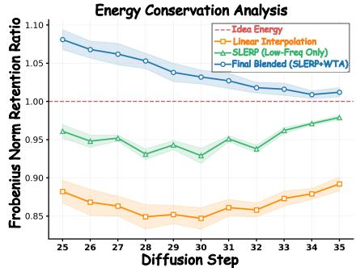

Figure 6: Feature Energy Analysis.

Table 1: Quantitative Results of Various SIG Methods on ViStoryBench [67]. CI: Character Interaction, IA: Individual Action; The first second , and third values are highlighted.
<table><tr><td rowspan="2">Methods</td><td rowspan="2">Venue</td><td colspan="2">CSD↑</td><td colspan="2">CIDS↑</td><td colspan="5">PA↑</td><td rowspan="2">AES↑</td><td rowspan="2">CP↓</td><td rowspan="2">INC↑</td></tr><tr><td>Cross</td><td>Self</td><td>Cross</td><td>Self</td><td>Scene</td><td>Shot</td><td>CI</td><td>TA Avg.</td><td></td></tr><tr><td>DreamO [33]</td><td>SIGGA&#x27;25</td><td>0.489</td><td>0.584</td><td>0.542</td><td>0.643</td><td>2.99</td><td>2.21</td><td>1.72</td><td>1.65</td><td>2.14</td><td>5.31</td><td>0.533</td><td>9.21</td></tr><tr><td>DiptychP [40]</td><td>CVPR&#x27;25</td><td>0.394</td><td>0.462</td><td>0.417</td><td>0.536</td><td>2.73</td><td>2.04</td><td>1.61</td><td>1.50</td><td>1.97</td><td>4.60</td><td>0.524</td><td>13.18</td></tr><tr><td>XVerse [8]</td><td>NIPS&#x27;25</td><td>0.229</td><td>0.461</td><td>0.342</td><td>0.531</td><td>2.96</td><td>2.37</td><td>1.89</td><td>1.73</td><td>2.23</td><td>4.92</td><td>0.519</td><td>13.67</td></tr><tr><td>UNO [54]</td><td>ICCV&#x27;25</td><td>0.513</td><td>0.576</td><td>0.528</td><td>0.632</td><td>3.08</td><td>2.52</td><td>2.07</td><td>1.91</td><td>2.39</td><td>4.94</td><td>0.542</td><td>8.27</td></tr><tr><td>OmniGen2 [51]</td><td>arXiv&#x27;25</td><td>0.446</td><td>0.546</td><td>0.460</td><td>0.587</td><td>3.12</td><td>2.46</td><td>1.80</td><td>1.64</td><td>2.27</td><td>5.19</td><td>0.531</td><td>9.87</td></tr><tr><td>Scone [50]</td><td>CVPR&#x27;26</td><td>0.511</td><td>0.539</td><td>0.501</td><td>0.585</td><td>3.11</td><td>2.40</td><td>2.18</td><td>1.69</td><td>2.35</td><td>5.22</td><td>0.517</td><td>10.60</td></tr><tr><td>UMO [12]</td><td>CVPR&#x27;26</td><td>0.514</td><td>0.635</td><td>0.555</td><td>0.648</td><td>3.25</td><td>2.65</td><td>2.13</td><td>1.93</td><td>2.49</td><td>5.05</td><td>0.536</td><td>10.35</td></tr><tr><td>MOSAIC [39]</td><td>ICLR&#x27;26</td><td>0.268</td><td>0.463</td><td>0.377</td><td>0.531</td><td>3.14</td><td>2.43</td><td>2.31</td><td>1.96</td><td>2.46</td><td>5.36</td><td>0.548</td><td>13.56</td></tr><tr><td>FLUX.2-4B</td><td></td><td>0.489</td><td>0.531</td><td>0.576</td><td>0.637</td><td>3.27</td><td>2.54</td><td>2.27</td><td>1.99</td><td>2.52</td><td>5.42</td><td>0.537</td><td>10.97</td></tr><tr><td>Ours(FLUX.2-4B)</td><td></td><td>0.521</td><td>0.598</td><td>0.605</td><td>0.653</td><td>3.32</td><td>2.58</td><td>2.35</td><td>2.08</td><td>2.58</td><td>5.39</td><td>0.516</td><td>13.88</td></tr></table>

details and are sensitive to alignment errors. Direct transport may introduce ghosting or blur artifacts. Therefore, we adopt a Winner-Takes-All (WTA) strategy. The final generated value is computed $\mathrm { a s } \colon V _ { g e n } = \mathrm { S L E R P } \bigl ( V _ { g e n } ^ { l o w } , V _ { w a r p } ^ { l o w } \bigr ) + \mathrm { a r g m a x } _ { V \in \{ V _ { w a r p } ^ { h i g h } , V _ { g e n } ^ { h i g h } \} } \| V \|$

❸Discuss. As shown in Fig. 6, we analyze energy evolution using the Frobenius-norm retention ratio. Compared with linear interpolation, SLERP substantially mitigates energy attenuation, thereby better preserving the low-frequency information established in early denoising stages. Moreover, the synergy of SLERP and WTA yields a final feature energy slightly above the ideal expectation (ratio > 1.0), providing additional support for reconstructing high-frequency details in the mid-to-late denoising stages.

## 4 Experiments

Implementation Details. We implement our method on FLUX.2-Klein-4B, a mainstream T&I2I framework with a DiT-based joint self-attention architecture. Progressive spectral decoupling is applied in the first 20% of denoising steps, while pseudo-flow-guided feature transport is injected during the intermediate phase, i.e., 50%–70% of steps, when semantic structures are stabilized but fine-grained identity details are still refined. All experiments are conducted at 1024 × 1024 resolution on NVIDIA A100 40GB GPUs. Unless otherwise specified, hyperparameters are fixed across benchmarks and prompts. Detailed hyperparameters are provided in the Appendix.

Baselines. We compare our method with recent SOTA SIG approaches covering both training-based and training-free paradigms: Scone [50], UMO [12], UNO [54], MOSAIC [39], OmniGen2 [51], DreamO [33], DiptychP [40], and XVerse [8]. These methods improve subject consistency through large-scale paired training, preference optimization, explicit identity supervision, or inference-time attention/latent feature manipulation without finetuning. For fair comparison, all baselines use official checkpoints and default hyperparameters.

Evaluation Metrics. We evaluate our framework on the public VistoryBench [67] and our proposed SIGBench. VistoryBench includes 1,317 cases and 344 characters. VistoryBench measures subject consistency using Character Identification Similarity (CIDS) and Character Style Similarity (CSD), prompt alignment using a multimodal large language model, aesthetic quality (AES) using Aesthetic Predictor V2.5, and diversity using Inception Score (INC) and Copy-Paste (CP) Detection metrics. On SIGBench, we use CLIP-I and DreamSim [18] for subject consistency, the proposed Comprehensive Diversity Score (CDS) for diversity, CLIP-T and PA for prompt alignment, and Aesthetic Predictor V2.5 for aesthetic quality. More details are provided in the Appendix.

Quantitative Results. Table 1 shows that our method achieves the excellent overall performance on VistoryBench. It ranks first on CSD-Cross, CIDS-Cross, CIDS-Self, and average PA, demonstrating stronger subject consistency and prompt alignment. Compared with baseline, it improves CIDS-Cross from 0.576 to 0.605 and average PA from 2.52 to 2.58, indicating that WFT improves identitypreserving feature reuse while PDA reduces reference-induced structural shortcuts. It also achieves the lowest Copy-Paste score of 0.516 and the highest Inception Score of 13.88, showing greater diversity and less reference copying.

Table 2 reports results on SIGBench, where our method ranks first on DreamSim-GT, PA-Avg., CLIP-I, and CDS. Compared with FLUX.2-4B, it improves PA-Avg. from 3.06 to 3.22, CLIP-I from 0.847 to 0.854, and CDS from 0.412 to 0.429, showing better prompt alignment, subject consistency, and diversity. These results support our design: PDA reduces pose copying and enhances compositional flexibility, while WFT transports identity features via pseudo-flow alignment. With only minor VRAM overhead over FLUX.2-4B, our method remains more efficient than most training-based baselines and achieves superior overall performance.

Table 2: Quantitative Results of Various SIG Methods on SIGBench. VRAM: Using GPU memory during inference. The first , second , and third values are highlighted.
<table><tr><td rowspan="2">Methods</td><td rowspan="2">Venue</td><td colspan="2">DreamSim↓</td><td colspan="4">PA↑</td><td rowspan="2">CLIP-T↑</td><td rowspan="2">CLIP-I↑</td><td rowspan="2">CDS↑</td><td rowspan="2">AES↑</td><td rowspan="2">VRAM↓</td></tr><tr><td>GT</td><td>Ref</td><td>Scene</td><td>CI</td><td>TA</td><td>Avg.</td></tr><tr><td>DreamO [33]</td><td>SIGGA&#x27;25</td><td>0.273</td><td>0.596</td><td>3.04</td><td>2.43</td><td>2.07</td><td>2.51</td><td>0.361</td><td>0.834</td><td>0.373</td><td>6.00</td><td>9.09</td></tr><tr><td>DiptychP [40]</td><td>CVPR&#x27;25</td><td>0.459</td><td>0.651</td><td>2.72</td><td>2.16</td><td>2.45</td><td>2.44</td><td>0.332</td><td>0.696</td><td>0.339</td><td>5.24</td><td>30.01</td></tr><tr><td>XVerse [8]</td><td>NIPS&#x27;25</td><td>0.339</td><td>0.660</td><td>2.95</td><td>2.53</td><td>2.12</td><td>2.53</td><td>0.358</td><td>0.767</td><td>0.366</td><td>6.09</td><td>37.39</td></tr><tr><td>UNO [54]</td><td>ICCV&#x27;25</td><td>0.315</td><td>0.604</td><td>3.21</td><td>2.59</td><td>2.28</td><td>2.69</td><td>0.345</td><td>0.802</td><td>0.366</td><td>5.64</td><td>35.09</td></tr><tr><td>OmniGen2 [51]</td><td>arXiv&#x27;25</td><td>0.287</td><td>0.607</td><td>3.28</td><td>2.67</td><td>2.41</td><td>2.78</td><td>0.363</td><td>0.822</td><td>0.380</td><td>5.47</td><td>9.92</td></tr><tr><td>Scone [50]</td><td>CVPR&#x27;26</td><td>0.261</td><td>0.601</td><td>3.51</td><td>2.88</td><td>2.57</td><td>2.98</td><td>0.362</td><td>0.838</td><td>0.383</td><td>5.83</td><td>30.43</td></tr><tr><td>UMO [12]</td><td>CVPR&#x27;26</td><td>0.296</td><td>0.602</td><td>3.38</td><td>3.01</td><td>2.44</td><td>2.94</td><td>0.348</td><td>0.815</td><td>0.375</td><td>5.97</td><td>33.78</td></tr><tr><td>MOSAIC [39]</td><td>ICLR&#x27;26</td><td>0.281</td><td>0.621</td><td>3.43</td><td>2.70</td><td>2.56</td><td>2.89</td><td>0.354</td><td>0.824</td><td>0.401</td><td>5.82</td><td>35.79</td></tr><tr><td>FLUX.2-4B</td><td></td><td>0.225</td><td>0.643</td><td>3.40</td><td>3.15</td><td>2.63</td><td>3.06</td><td>0.354</td><td>0.847</td><td>0.412</td><td>6.33</td><td>12.21</td></tr><tr><td>Ours (FLUX.2-4B)</td><td></td><td>0.221</td><td>0.625</td><td>3.47</td><td>3.34</td><td>2.86</td><td>3.22</td><td>0.362</td><td>0.854</td><td>0.429</td><td>6.32</td><td>13.44</td></tr></table>

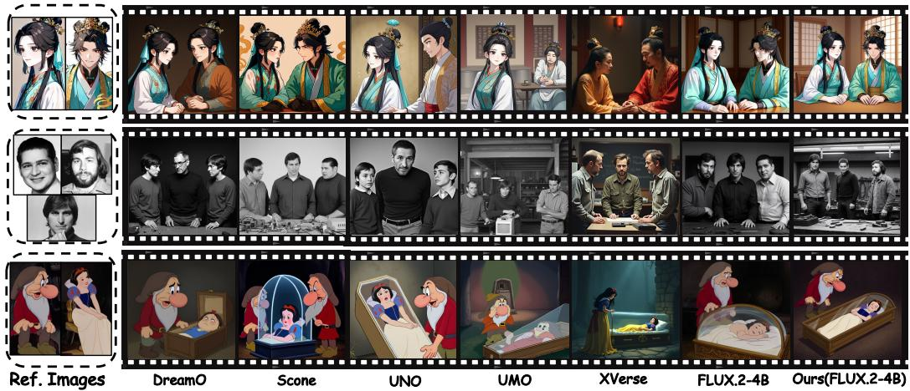  
Figure 7: Qualitative Comparison on ViStoryBench Across Diverse Characters and Styles.

Qualitative Results. Fig. 7 and 8 show qualitative comparisons on ViStoryBench. Existing methods often exhibit identity drift, missing subjects, style inconsistency, or direct copying of the reference pose. In contrast, our method better preserves character identity and visual style while allowing prompt-driven changes in pose, interaction, and scene composition.

In multi-character cases, our method maintains more stable identities for different subjects and produces more coherent interactions. These results indicate that PDA reduces reference-structure shortcuts, while WFT restores identity-related details through feature transport.

Fig. 9 shows qualitative comparisons on SIGBench, where each case provides reference subjects and a ground-truth target image. Compared with existing methods, our method better preserves subject identity and fine-grained attributes while matching the target composition more closely. Baselines often miss objects, alter subject appearance, or over-copy the reference layout, especially in multi-subject and large-pose-change scenarios. Our results show more accurate subject-object relationships, more stable appearance preservation, and better alignment with the GT scene structure.

Table 3: Human preference comparison among different methods.
<table><tr><td>Method</td><td>DreamO</td><td>DiptychP</td><td>XVerse</td><td>UNO</td><td>OmniGen2</td><td>Scone</td><td>UMO</td><td>MOSAIC</td><td>FLUX.2-4B</td><td>Ours</td></tr><tr><td>Percent (%)↑</td><td>2.79</td><td>1.41</td><td>0.62</td><td>10.19</td><td>3.03</td><td>12.84</td><td>15.95</td><td>4.48</td><td>22.75</td><td>26.31</td></tr></table>

User Study. To complement automatic metrics, we conduct a human evaluation on 50 randomly sampled cases from the two benchmarks. For each case, all competing methods generate corresponding image sequences. We invite 20 participants, each evaluating 20 randomly selected results with the reference images and prompts. They are asked to select the preferred sequence based on subject consistency, pose diversity, and overall image quality. As shown in Table 3, our method achieves the highest preference rate. The results further demonstrate that MorphSIG produces more consistent and visually appealing generations while maintaining stronger structural diversity. Details of the protocol and interface are provided in the Appendix.

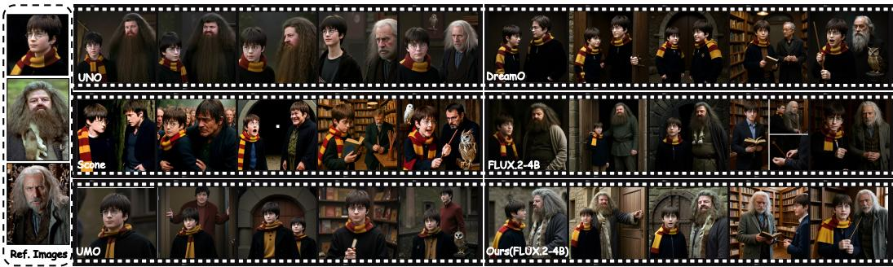  
Figure 8: Qualitative Comparison on Multi-Character Story Generation in ViStoryBench.

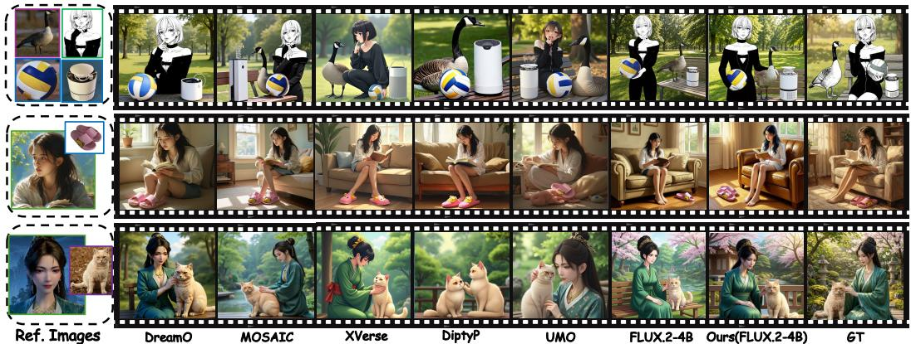  
Figure 9: Qualitative Comparison on SIGBench with Ground Truth.

Ablation Study. Tables 4 and 5 report the ablation results of PDA and WFT. Removing PDA degrades CIDS, INC, and PA, indicating excessive reliance on reference structures and reduced flexibility in text-driven pose and layout generation. Specifically, removing SP weakens identity-preserving details, while removing SD reduces pose diversity, demonstrating their respective roles in identity retention and structural decoupling. Removing WFT causes a significant drop in CIDS, highlighting the importance of pseudo-flow-guided feature transport for maintaining subject consistency under large structural variations. Further removing MNN, LF-SLERP, or HF-WTA consistently lowers performance, showing that bidirectional matching, low-frequency fusion, and high-frequency detail selection jointly improve structural stability and texture fidelity.

Table 4: The ablation study of PDA.
<table><tr><td>CIDS↑ INC↑ PA↑ AES↑</td></tr><tr><td>w/o PDA 0.614 13.41 2.37 5.30 w/o SP 0.556 13.64 2.72 5.33</td></tr><tr><td>w/o SD 0.618 13.57 2.39 5.36</td></tr><tr><td>High-pass only 0.485 12.81 1.92 5.05 Full PDA 0.629 13.88 2.58 5.39</td></tr></table>

Fig. 10 illustrates the visual differences under various ablation settings. Without PDA, the generated results tend to replicate the original pose, limiting the controllability of text-driven generation. Removing SP or SD further causes identity-detail degradation and insufficient structural disentanglement, respectively. For WFT-related ablations, removing WFT or MNN introduces local misalignment and identity drift, while removing LF-SLERP or HF-WTA results in unstable structures or blurred textures. In contrast, the full model better preserves subject consistency while generating novel poses and scenes aligned with the text prompt, demonstrating the complementary effects of PDA and WFT in harmonizing identity retention with generative diversity.

Table 5: The ablation study of WFT.
<table><tr><td>CIDS↑ INC↑ PA↑ AES↑</td></tr><tr><td>w/o WFT 0.541 13.472.64 5.25 w/o MNN 0.578 13.32 2.47 5.18</td></tr><tr><td>w/o HF-WTA 0.601 13.65 2.52 5.14 w/o LF-SLERP 0.584 13.30 2.34 5.19 ADD 0.561 12.93 2.16 5.05</td></tr><tr><td>Full WFT 0.629 13.88 2.58 5.39</td></tr></table>

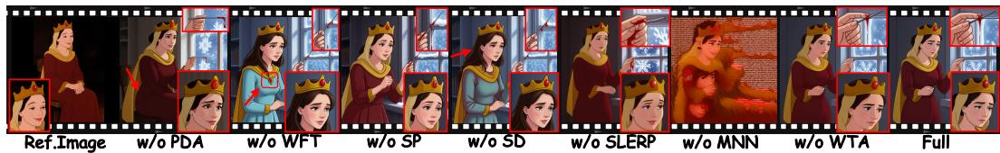  
Figure 10: Qualitative Comparison of Ablation Study.

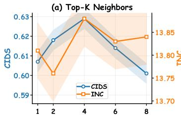

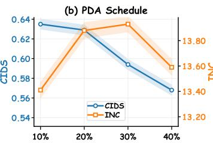

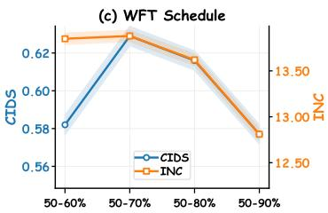  
Figure 11: Ablation analysis. (a) Effect of neighborhood size K in Local Consensus. (b, c) Sensitivity of PDA and WFT scheduling ranges.

Local Consensus Analysis. As shown in Fig. 11(a), selecting K = 4 in Local Consensus achieves the best balance between identity fidelity (CIDS) and diversity (INC). A smaller K admits spurious matches from texture ambiguity, whereas a larger K over-suppresses valid correspondences by incorporating noisy boundary neighbors.

Scheduling Sensitivity Analysis. As shown in Fig. 11(b, c), our default schedule achieves the optimal balance between identity fidelity and generation diversity. Terminating PDA prematurely (10%) locks macro-composition via high-frequency shortcuts, whereas prolonging it (>20%) impairs finegrained detail alignment. Similarly, WFT requires sufficient propagation without over-intervention: truncating it early (<70%) hinders detail consistency, while extending it into late denoising (>80%) introduces distribution mismatch and artifacts. Thus, our setting (PDA: 20%, WFT: 50%–70%) reliably optimizes performance.

Table 6: Comparison of computational cost on a single NVIDIA A100 GPU.
<table><tr><td>Method</td><td>DreamO</td><td>DiptychP</td><td>XVerse</td><td>UNO</td><td>OmniGen2</td><td>Scone</td><td>UMO</td><td>MOSAIC</td><td>FLUX.2-4B</td><td>Ours</td></tr><tr><td>Training-free</td><td>X</td><td>√</td><td>X</td><td>X</td><td>X</td><td>X</td><td>X</td><td>X</td><td></td><td>√</td></tr><tr><td>Latency (s)</td><td>76.9</td><td>169.4</td><td>126.2</td><td>82.6</td><td>171.7</td><td>98.5</td><td>84.3</td><td>154.7</td><td>115.6</td><td>130.1</td></tr><tr><td>VRAM (GB)</td><td>9.09</td><td>30.01</td><td>37.39</td><td>35.09</td><td>9.92</td><td>30.43</td><td>33.78</td><td>35.79</td><td>12.21</td><td>13.44</td></tr></table>

Computational Cost. As shown in Table 6, MorphSIG is training-free method, incurring zero training cost. Compared to the native FLUX.2-4B (115.6s / 12.21GB), it introduces only marginal overhead in inference latency (130.1s, +12.5%) and peak VRAM (13.44GB, +10.1%), while remaining substantially lighter than training-based baselines exceeding 30GB (e.g., XVerse and MOSAIC).

## 5 Conclusion

We presented MorphSIG, a training-free framework for subject-driven image generation. By identifying high-frequency reference shortcuts as a major cause of copy-paste artifacts, we proposed Progressive Decoupled Anchoring to relax structural locking while preserving identity-related statis tics. We further reformulated T&I2I as pseudo-video generation and introduced Pseudo-flow Guided Feature Transport to improve subject consistency through latent-space feature transport without generating intermediate frames. In addition, we built a new SIG benchmark with diverse styles and high-quality ground truth. Experiments on public and proposed benchmarks show that MorphSIG achieves a strong balance between identity fidelity and generation diversity. These results demonstrate the effectiveness of frequency-decoupled conditioning and pseudo-flow-guided transport for controllable and consistent subject-driven generation.

## References

[1] Amirhossein Alimohammadi, Aryan Mikaeili, Sauradip Nag, Negar Hassanpour, Andrea Tagliasacchi, and Ali Mahdavi-Amiri. Cora: Correspondence-aware image editing using few step diffusion. In Proceedings ofthe Special Interest Group on Computer Graphics and Interactive Techniques Conference Conference Papers, pages 1–11, 2025.

[2] Guangrui Bai, Hailong Yan, Wenhai Liu, Yahui Deng, and Erbao Dong. Towards lightest low-light image enhancement architecture for mobile devices. Expert Systems with Applications, 296:129125, 2026.

[3] Qingyan Bai, Hao Ouyang, Yinghao Xu, Qiuyu Wang, Ceyuan Yang, Ka Leong Cheng, Yujun Shen, and Qifeng Chen. Edicho: Consistent image editing in the wild. In Proceedings ofthe IEEE/CVF International Conference on Computer Vision, pages 15277–15287, 2025.

[4] Andreas Blattmann, Tim Dockhorn, Sumith Kulal, Daniel Mendelevitch, Maciej Kilian, Dominik Lorenz, Yam Levi, Zion English, Vikram Voleti, Adam Letts, et al. Stable video diffusion: Scaling latent video diffusion models to large datasets. arXiv preprint arXiv:2311.15127, 2023.

[5] Andreas Blattmann, Robin Rombach, Huan Ling, Tim Dockhorn, Seung Wook Kim, Sanja Fidler, and Karsten Kreis. Align your latents: High-resolution video synthesis with latent diffusion models. In Proceedings ofthe IEEE/CVF Conference on Computer Vision and Pattern Recognition, pages 22563– 22575, 2023.

[6] Ryan Burgert, Yuancheng Xu, Wenqi Xian, Oliver Pilarski, Pascal Clausen, Mingming He, Li Ma, Yitong Deng, Lingxiao Li, Mohsen Mousavi, et al. Go-with-the-flow: Motion-controllable video diffusion models using real-time warped noise. In Proceedings of the Computer Vision and Pattern Recognition Conference, pages 13–23, 2025.

[7] Kelvin CK Chan, Yang Zhao, Xuhui Jia, Ming-Hsuan Yang, and Huisheng Wang. Improving subject-driven image synthesis with subject-agnostic guidance. In Proceedings of the IEEE/CVF Conference on Computer Vision and Pattern Recognition, pages 6733–6742, 2024.

[8] Bowen Chen, Mengyi Zhao, Haomiao Sun, Li Chen, Xu Wang, Kang Du, and Xinglong Wu. Xverse: Consistent multi-subject control of identity and semantic attributes via dit modulation. arXiv preprint arXiv:2506.21416, 2025.

[9] Haoxin Chen, Menghan Xia, Yingqing He, Yong Zhang, Xiaodong Cun, Shaoshu Yang, Jinbo Xing, Yaofang Liu, Qifeng Chen, Xintao Wang, et al. Videocrafter1: Open diffusion models for high-quality video generation. arXiv preprint arXiv:2310.19512, 2023.

[10] Xi Chen, Zhifei Zhang, He Zhang, Yuqian Zhou, Soo Ye Kim, Qing Liu, Yijun Li, Jianming Zhang, Nanxuan Zhao, Yilin Wang, et al. Unireal: Universal image generation and editing via learning real-world dynamics. In Proceedings of the IEEE/CVF Conference on Computer Vision and Pattern Recognition, pages 12501–12511, 2025.

[11] Yuzhuo Chen, Zehua Ma, Jianhua Wang, Kai Kang, Shunyu Yao, and Weiming Zhang. Lamic: Layoutaware multi-image composition via scalability of multimodal diffusion transformer. In Proceedings ofthe AAAI Conference on Artificial Intelligence, volume 40, pages 3174–3182, 2026.

[12] Yufeng Cheng, Wenxu Wu, Shaojin Wu, Mengqi Huang, Fei Ding, and Qian He. Umo: Scaling multiidentity consistency for image customization via matching reward. arXiv preprint arXiv:2509.06818, 2025.

[13] Yusuf Dalva, Hidir Yesiltepe, and Pinar Yanardag. Lorashop: Training-free multi-concept image generation and editing with rectified flow transformers. arXiv preprint arXiv:2505.23758, 2025.

[14] Giannis Daras, Weili Nie, Karsten Kreis, Alexandros G Dimakis, Morteza Mardani, Nikola B Kovachki, and Arash Vahdat. Warped diffusion: Solving video inverse problems with image diffusion models. Advances in Neural Information Processing Systems, 37:101116–101143, 2024.

[15] Yufan Deng, Yuanyang Yin, Xun Guo, Yizhi Wang, Jacob Zhiyuan Fang, Shenghai Yuan, Yiding Yang, Angtian Wang, Bo Liu, Haibin Huang, et al. Magref: Masked guidance for any-reference video generation with subject disentanglement. arXiv preprint arXiv:2505.23742, 2025.

[16] Ganggui Ding, Canyu Zhao, Wen Wang, Zhen Yang, Zide Liu, Hao Chen, and Chunhua Shen. Freecustom: Tuning-free customized image generation for multi-concept composition. In Proceedings ofthe IEEE/CVF Conference on Computer Vision and Pattern Recognition, pages 9089–9098, 2024.

[17] Haoran Feng, Zehuan Huang, Lin Li, and Lu Sheng. Personalize anything for free with diffusion transformer. In Proceedings ofthe AAAI Conference on Artificial Intelligence, volume 40, pages 3921–3929, 2026.

[18] Stephanie Fu, Netanel Tamir, Shobhita Sundaram, Lucy Chai, Richard Zhang, Tali Dekel, and Phillip Isola. Dreamsim: Learning new dimensions of human visual similarity using synthetic data. arXiv preprint arXiv:2306.09344, 2023.

[19] Zhoujie Fu, Xianfang Zeng, Jinghong Lan, Xinyao Liao, Cheng Chen, Junyi Chen, Jiacheng Wei, Wei Cheng, Shiyu Liu, Yunuo Chen, et al. imontage: Unified, versatile, highly dynamic many-to-many image generation. arXiv preprint arXiv:2511.20635, 2025.

[20] Yifan Gao, Zihang Lin, Chuanbin Liu, Min Zhou, Tiezheng Ge, Bo Zheng, and Hongtao Xie. Postermaker: Towards high-quality product poster generation with accurate text rendering. In Proceedings of the Computer Vision and Pattern Recognition Conference, pages 8083–8093, 2025.

[21] Anujraaj Argo Goyal, Guocheng Gordon Qian, Huseyin Coskun, Aarush Gupta, Himmy Tam, Daniil Ostashev, Ju Hu, Dhritiman Sagar, Sergey Tulyakov, Kfir Aberman, et al. Preventing shortcuts in adapter training via providing the shortcuts. arXiv preprint arXiv:2510.20887, 2025.

[22] Yuchao Gu, Xintao Wang, Jay Zhangjie Wu, Yujun Shi, Yunpeng Chen, Zihan Fan, Wuyou Xiao, Rui Zhao, Shuning Chang, Weijia Wu, et al. Mix-of-show: Decentralized low-rank adaptation for multi-concept customization of diffusion models. Advances in Neural Information Processing Systems, 36:15890–15902, 2023.

[23] Yuwei Guo, Ceyuan Yang, Anyi Rao, Zhengyang Liang, Yaohui Wang, Yu Qiao, Maneesh Agrawala, Dahua Lin, and Bo Dai. Animatediff: Animate your personalized text-to-image diffusion models without specific tuning. arXiv preprint arXiv:2307.04725, 2023.

[24] Jinghao Hu, Yuhe Zhang, GuoHua Geng, Kang Li, and Han Zhang. Storytailor: A zero-shot pipeline for action-rich multi-subject visual narratives. arXiv preprint arXiv:2602.21273, 2026.

[25] Xirui Hu, Jiahao Wang, Hao Chen, Weizhan Zhang, Benqi Wang, Yikun Li, and Haishun Nan. Dynamicid: Zero-shot multi-id image personalization with flexible facial editability. In Proceedings ofthe IEEE/CVF International Conference on Computer Vision, pages 10549–10559, 2025.

[26] Hao Kang, Stathi Fotiadis, Liming Jiang, Qing Yan, Yumin Jia, Zichuan Liu, Min Jin Chong, and Xin Lu. Flux already knows–activating subject-driven image generation without training. arXiv preprint arXiv:2504.11478, 2025.

[27] Nupur Kumari, Bingliang Zhang, Richard Zhang, Eli Shechtman, and Jun-Yan Zhu. Multi-concept customization of text-to-image diffusion. In Proceedings of the IEEE/CVF Conference on Computer Vision and Pattern Recognition, pages 1931–1941, 2023.

[28] Mingxiao Li, Mang Ning, and Marie-Francine Moens. Consistent story generation: Unlocking the potential of zigzag sampling. In The Thirty-ninth Annual Conference on Neural Information Processing Systems, 2025.

[29] Shuang Li, Chao Deng, Hang Chen, Liqun Liu, Zhenyu Hu, Te Cao, Mengge Xue, Yuan Chen, Peng Shu, Huan Yu, et al. Disentangling to re-couple: Resolving the similarity-controllability paradox in subject-driven text-to-image generation. arXiv preprint arXiv:2604.00849, 2026.

[30] Yijing Lin, Mengqi Huang, Shuhan Zhuang, and Zhendong Mao. Realgeneral: Unifying visual generation via temporal in-context learning with video models. In Proceedings of the IEEE/CVF International Conference on Computer Vision, pages 14994–15004, 2025.

[31] Yohai Mazuz, Janna Bruner, and Lior Wolf. Consistyle: Style diversity in training-free consistent t2i generation. ACM Transactions on Graphics (TOG), 44(6):1–16, 2025.

[32] Chong Mou, Xintao Wang, Liangbin Xie, Yanze Wu, Jian Zhang, Zhongang Qi, and Ying Shan. T2iadapter: Learning adapters to dig out more controllable ability for text-to-image diffusion models. In Proceedings ofthe AAAI conference on artificial intelligence, volume 38, pages 4296–4304, 2024.

[33] Chong Mou, Yanze Wu, Wenxu Wu, Zinan Guo, Pengze Zhang, Yufeng Cheng, Yiming Luo, Fei Ding, Shiwen Zhang, Xinghui Li, et al. Dreamo: A unified framework for image customization. In Proceedings of the SIGGRAPH Asia 2025 Conference Papers, pages 1–12, 2025.

[34] Jisu Nam, Soowon Son, Dahyun Chung, Jiyoung Kim, Siyoon Jin, Junhwa Hur, and Seungryong Kim. Emergent temporal correspondences from video diffusion transformers. arXiv preprint arXiv:2506.17220, 2025.

[35] Xinyu Pu, Hongsong Wang, Jie Gui, and Pan Zhou. Drag as evidence: Motion-grounded latent recomposition for drag-based editing. arXiv preprint arXiv:2609.36755, 2026.

[36] Xinyu Pu, Hongsong Wang, Jie Gui, and Pan Zhou. Dragging with geometry: From pixels to geometryguided image editing. In International Conference on Learning Representations, volume 2026, pages 151958–151984, 2026.

[37] Noam Rotstein, Gal Yona, Daniel Silver, Roy Velich, David Bensaïd, and Ron Kimmel. Pathways on the image manifold: Image editing via video generation. In Proceedings of the IEEE/CVF Conference on Computer Vision and Pattern Recognition, pages 7857–7866, 2025.

[38] Nataniel Ruiz, Yuanzhen Li, Varun Jampani, Yael Pritch, Michael Rubinstein, and Kfir Aberman. Dream booth: Fine tuning text-to-image diffusion models for subject-driven generation. In Proceedings of the IEEE/CVF Conference on Computer Vision and Pattern Recognition, pages 22500–22510, 2023.

[39] Dong She, Siming Fu, Mushui Liu, Qiaoqiao Jin, Hualiang Wang, Mu Liu, and Jidong Jiang. Mosaic: Multi-subject personalized generation via correspondence-aware alignment and disentanglement. arXiv preprint arXiv:2509.01977, 2025.

[40] Chaehun Shin, Jooyoung Choi, Heeseung Kim, and Sungroh Yoon. Large-scale text-to-image model with inpainting is a zero-shot subject-driven image generator. In Proceedings of the Computer Vision and Pattern Recognition Conference, pages 7986–7996, 2025.

[41] Yeji Song, Wonsik Shin, Junsoo Lee, Jeesoo Kim, and Nojun Kwak. Save: Protagonist diversification with s tructure a gnostic v ideo e diting. In European Conference on Computer Vision, pages 41–57. Springer, 2024.

[42] Zhenxiong Tan, Songhua Liu, Xingyi Yang, Qiaochu Xue, and Xinchao Wang. Ominicontrol: Minimal and universal control for diffusion transformer. In Proceedings ofthe IEEE/CVF International Conference on Computer Vision, pages 14940–14950, 2025.

[43] Bowen Tang, Tao Wang, Miao Zhang, Xin Yu, Jinwei Chen, Bo Li, and Kaihao Zhang. Evolutionary multiagent collaboration for real-world video face restoration. In Proceedings ofthe IEEE/CVF Conference on Computer Vision and Pattern Recognition, pages 8175–8184, 2026.

[44] Gemma Canet Tarrés, Manel Baradad, Francesc Moreno-Noguer, and Yumeng Li. Placid: Identitypreserving multi-object compositing via video diffusion with synthetic trajectories. arXiv preprint arXiv:2602.00267, 2026.

[45] Yoad Tewel, Omri Kaduri, Rinon Gal, Yoni Kasten, Lior Wolf, Gal Chechik, and Yuval Atzmon. Trainingfree consistent text-to-image generation. ACM Transactions on Graphics (TOG), 43(4):1–18, 2024.

[46] Chengzhuo Tong, Mingkun Chang, Shenglong Zhang, Yuran Wang, Cheng Liang, Zhizheng Zhao, Ruichuan An, Bohan Zeng, Yang Shi, Yifan Dai, et al. Cof-t2i: Video models as pure visual reasoners for text-to-image generation. arXiv preprint arXiv:2601.10061, 2026.

[47] Mengyu Wang, Henghui Ding, Jianing Peng, Yao Zhao, Yunpeng Chen, and Yunchao Wei. Characonsist: Fine-grained consistent character generation. In Proceedings of the IEEE/CVF International Conference on Computer Vision, pages 16058–16067, 2025.

[48] Tao Wang, Peiwen Xia, Bowen Tang, Jinwei Chen, Kaihao Zhang, and Bi Li. Fair and faithful: A diffusion enhanced dataset and hybrid state-space mamba for face super-resolution. In European Conference on Computer Vision, pages 281–300, 2026.

[49] Xierui Wang, Siming Fu, Qihan Huang, Wanggui He, and Hao Jiang. Ms-diffusion: Multi-subject zero-shot image personalization with layout guidance. arXiv preprint arXiv:2406.07209, 2024.

[50] Yuran Wang, Bohan Zeng, Chengzhuo Tong, Wenxuan Liu, Yang Shi, Xiaochen Ma, Hao Liang, Yuanxing Zhang, and Wentao Zhang. Scone: Bridging composition and distinction in subject-driven image generation via unified understanding-generation modeling. arXiv preprint arXiv:2512.12675, 2025.

[51] Chenyuan Wu, Pengfei Zheng, Ruiran Yan, Shitao Xiao, Xin Luo, Yueze Wang, Wanli Li, Xiyan Jiang, Yexin Liu, Junjie Zhou, et al. Omnigen2: Exploration to advanced multimodal generation. arXiv preprint arXiv:2506.18871, 2025.

[52] Jay Zhangjie Wu, Xuanchi Ren, Tianchang Shen, Tianshi Cao, Kai He, Yifan Lu, Ruiyuan Gao, Enze Xie, Shiyi Lan, Jose M Alvarez, et al. Chronoedit: Towards temporal reasoning for image editing and world simulation. arXiv preprint arXiv:2510.04290, 2025.

[53] Shaojin Wu, Mengqi Huang, Yufeng Cheng, Wenxu Wu, Jiahe Tian, Yiming Luo, Fei Ding, and Qian He. Uso: Unified style and subject-driven generation via disentangled and reward learning. arXiv preprint arXiv:2508.18966, 2025.

[54] Shaojin Wu, Mengqi Huang, Wenxu Wu, Yufeng Cheng, Fei Ding, and Qian He. Less-to-more generalization: Unlocking more controllability by in-context generation. In Proceedings of the IEEE/CVF International Conference on Computer Vision, pages 18682–18692, 2025.

[55] Tao Wu, Yibo Jiang, Yehao Lu, Zhizhong Wang, Zeyi Huang, Zequn Qin, and Xi Li. Multicrafter: Highfidelity multi-subject generation via disentangled attention and identity-aware preference alignment. arXiv preprint arXiv:2509.21953, 2025.

[56] Shitao Xiao, Yueze Wang, Junjie Zhou, Huaying Yuan, Xingrun Xing, Ruiran Yan, Chaofan Li, Shuting Wang, Tiejun Huang, and Zheng Liu. Omnigen: Unified image generation. In Proceedings ofthe IEEE/CVF Conference on Computer Vision and Pattern Recognition, pages 13294–13304, 2025.

[57] Hengyuan Xu, Wei Cheng, Peng Xing, Yixiao Fang, Shuhan Wu, Rui Wang, Xianfang Zeng, Daxin Jiang, Gang Yu, Xingjun Ma, et al. Withanyone: Towards controllable and id consistent image generation. arXiv preprint arXiv:2510.14975, 2025.

[58] Hailong Yan, Junjian Huang, and Tingwen Huang. Igdnet: Zero-shot robust underexposed image enhancement via illumination-guided and denoising. IEEE Transactions on Artificial Intelligence, 2025.

[59] Hailong Yan, Ao Li, Xiangtao Zhang, Zhe Liu, Zenglin Shi, Ce Zhu, and Le Zhang. Mobileie: An extremely lightweight and effective convnet for real-time image enhancement on mobile devices. In 2025 IEEE/CVF International Conference on Computer Vision (ICCV), pages 21949–21960. IEEE, 2025.

[60] Hailong Yan, Shice Liu, Tao Wang, Xiangtao Zhang, Yijie Zhong, Jinwei Chen, Le Zhang, and Bo Li. Animeagent: Is the multi-agent via image-to-video models a good disney storytelling artist? arXiv preprint arXiv:2602.20664, 2026.

[61] Hailong Yan, Shice Liu, Xiangtao Zhang, Lujian Yao, Fengxiang Yang, Jinwei Chen, and Bo Li. Revisiting lightweight low-light image enhancement: From a yuv color space perspective. arXiv preprint arXiv:2601.17349, 2026.

[62] Hu Ye, Jun Zhang, Sibo Liu, Xiao Han, and Wei Yang. Ip-adapter: Text compatible image prompt adapter for text-to-image diffusion models. arXiv preprint arXiv:2308.06721, 2023.

[63] Mingyang Yi, Aoxue Li, Yi Xin, and Zhenguo Li. Towards understanding the working mechanism of text-to-image diffusion model. Advances in Neural Information Processing Systems, 37:55342–55369, 2024.

[64] Yanbing Zhang, Zhe Wang, Qin Zhou, and Mengping Yang. Freecus: Free lunch subject-driven customization in diffusion transformers. In Proceedings of the IEEE/CVF International Conference on Computer Vision, pages 15521–15531, 2025.

[65] Yuxin Zhang, Minyan Luo, Weiming Dong, Xiao Yang, Haibin Huang, Chongyang Ma, Oliver Deussen, Tong-Yee Lee, and Changsheng Xu. Ip-prompter: Training-free theme-specific image generation via dynamic visual prompting. In Proceedings of the Special Interest Group on Computer Graphics and Interactive Techniques Conference Conference Papers, pages 1–12, 2025.

[66] Zechuan Zhang, Zhenyuan Chen, Zongxin Yang, and Yi Yang. Are image-to-video models good zero-shot image editors? arXiv preprint arXiv:2511.19435, 2025.

[67] Cailin Zhuang, Ailin Huang, Yaoqi Hu, Jingwei Wu, Wei Cheng, Jiaqi Liao, Hongyuan Wang, Xinyao Liao, Weiwei Cai, Hengyuan Xu, et al. Vistorybench: Comprehensive benchmark suite for story visualization. arXiv preprint arXiv:2505.24862, 2025.