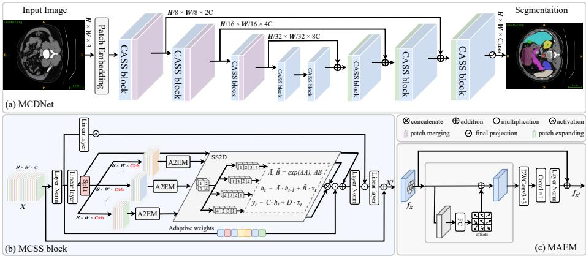

# Morphology-Aware Channel-Decoupled Mamba Network for Medical Image Segmentation

Chenchen Wang1 and You Zhou2B

1School of Computer Science and Informatics, Cardif University, Cardif, UK 2Department of Infection and Immunity, School of Medicine, Cardif University, Cardif, UK

zhouy58@cardiff.ac.uk

Abstract. Accurate multi-organ segmentation in computed tomography (CT) is essential for computer-aided diagnosis, treatment planning, and disease monitoring. However, substantial variations in organ shape and size, together with low tissue contrast and ambiguous boundaries, complicate the modeling of heterogeneous anatomical structures. To address these challenges, we propose a Morphology-Aware Channel-Decouple Mamba Network (MCDNet), which integrates adaptive local structural enhancement with channel-decoupled long-range modeling. Specifically, we introduce a Morphology-Aware Channel-Decoupled State-Space (MCSS block that divides feature channels into separate processing groups, allowing diferentiated structural representations to be learned within an eficient state-space framework. Within each group, a Morphology-Aware Enhancement Module (MAEM) combines deformable convolutions with channel attention to adapt local feature extraction to anatomical shape variations. Group-wise state-space modeling then captures long-range spatial dependencies, and channel gating adaptively integrates the resulting features. Experiments on the Synapse abdominal CT dataset demonstrate the efectiveness of MCDNet, achieving an average Dice Similarity Coeficient of 81.61% for multi-organ segmentation.

Keywords: Medical image segmentation · Morphology awareness · Channel decoupling · State space models.

## 1 Introduction

Medical image segmentation plays a vital role in clinical workflows by enabling automated delineation of organs and pathological regions to support diagnosis, treatment planning, and disease monitoring. In abdominal computed tomography (CT), substantial variations in organ shape and size, low soft-tissue contrast, and similar intensity distributions between adjacent organs obscure anatomical boundaries and complicate structure identification. These challenges require segmentation methods to capture both the global spatial context of multiple organs and the local morphological details of individual structures.

Existing approaches to medical image segmentation rely predominantly on deep learning. Convolutional neural networks with U-shaped encoder–decoder architectures, such as UNet[9], nnUNet[6], and UNet++[17], extract fine-grained features through multi-level skip connections and have become the backbone of many systems. More recently, Transformer-based models, such as Swin-Unet[3], TransUNet[4], and nnFormer[16], apply self-attention mechanisms to capture long-range dependencies and global context. However, the quadratic computational complexity of self-attention with respect to the number of image tokens imposes a significant processing burden. State space models[5] address this challenge by enabling eficient long-range modeling with linear complexity, motivating a series of segmentation methods[13,18], including VM-UNet[10] and Swin-UMamba[8].

Despite these advances, eficient long-range modeling alone does not explicitly account for the morphological diversity of abdominal organs. Structures with diferent shapes and spatial extents require diferent local representations, while subtle contours between adjacent organs are dificult to resolve using global context alone. Processing all feature channels through a shared state-space transformation may also limit the capacity to represent these heterogeneous structural patterns separately. These observations motivate a joint design that adapts local feature extraction to organ morphology and decouples channel processing to support diferentiated structural representations.

To address these challenges, we introduce MCDNet, which integrates morphologyaware enhancement and channel-decoupled state-space modeling within a Ushaped encoder–decoder. Our Morphology-Aware Channel-Decoupled State-Space (MCSS) block divides feature channels into separate processing groups. In each group, a Morphology-Aware Enhancement Module (MAEM) adjusts convolutional sampling locations and reweights channel responses to capture local shape variations, followed by a State-Space 2D (SS2D) unit for long-range spatial modeling. An adaptive channel gate integrates the group outputs. This design connects local morphological adaptation with eficient global context modeling while allowing diferent channel groups to learn complementary structural features. Our contributions are as follows:

• We propose MCDNet, which integrates morphology-aware local enhancement with channel-decoupled state-space modeling for medical image segmentation.

• We design an MCSS block that processes channel groups separately and adaptively integrates their outputs, together with an MAEM that uses deformable sampling and channel attention to capture diverse anatomical morphologies.

• Experiments on the Synapse abdominal CT dataset demonstrate the efectiveness of MCDNet, which achieves the highest average DSC among the compared methods.

  
Fig. 1: Overview of MCDNet. (a) The U-shaped encoder–decoder is built from Morphology-Aware Channel-Decoupled State-Space (MCSS) blocks. (b) Each MCSS block combines group-wise morphology-aware enhancement, SS2D-based long-range modeling, and adaptive channel gating. The Morphology-Aware Enhancement Module (MAEM) integrates deformable convolutions, depthwise– pointwise convolutions, and channel attention.

## 2 Method

## 2.1 Overview

As illustrated in Figure 1-(a), MCDNet first embeds the input CT slice into patches and processes the resulting features through a U-shaped encoder–decoder built from MCSS blocks. Each block combines morphology-aware local enhancement with channel-decoupled long-range modeling. A final class projection produces a segmentation tensor of size $H \times W \times C$ , where C denotes the number of anatomical classes.

## 2.2 Morphology-Aware Channel-Decoupled State-Space Block

The MCSS block couples adaptive local feature extraction with separate statespace processing of channel groups. As shown in Figure 1-(b), it incorporates an MAEM into each group before SS2D-based spatial modeling, allowing local shape information and long-range context to be modeled within the same processing stream. Given an input feature map $X \in \mathbb { R } ^ { H \times W \times C }$ , where C denotes the feature-channel dimension in this block, we first apply LayerNorm and a linear projection, and then split the channels into N groups. The group count is set to the number of segmentation classes, providing an anatomical basis for the channel decomposition. The resulting groups provide separate feature streams in which diferentiated structural representations are learned end to end through segmentation supervision. For equal group widths, the split is written as

$$
\begin{array} { r } { F ^ { ( i ) } = S p l i t ( X ) , F ^ { ( i ) } \in \mathbb { R } ^ { H \times W \times \frac { C } { N } } , \quad i = 1 , \dots , N . } \end{array}\tag{1}
$$

When C is not divisible by $N _ { \ast }$ , the remaining channels are assigned to the last group. The channel partition is fixed, while the feature transformations and fusion weights are learned. Each group is first refined by an MAEM to adapt its local responses to morphological variation, and then independently processed by an SS2D unit to capture long-range spatial dependencies. Let $x _ { t }$ denote a feature at spatial position $t ;$ learnable increments $\varDelta A , \varDelta B \in \mathbb { R } ^ { d \times d }$ generate transition matrices for the state-space recurrence:

$$
\begin{array} { c c } { { \bar { A } = \exp ( \varDelta A ) , ~ } } & { { ~ \bar { B } = \varDelta B , } } \end{array}\tag{2}
$$

$$
h _ { t } = \bar { A } h _ { t - 1 } + \bar { B } x _ { t } , \qquad y _ { t } = C h _ { t } + D x _ { t } ,\tag{3}
$$

To adaptively integrate the group-wise outputs, we compute a gate for each channel using channel attention. Denote the residual input as Xres ∈ RB×H×W×d. We normalize with LayerNorm and aggregate by global average pooling:

$$
Z _ { c } = \frac { 1 } { H W } \sum _ { h = 1 } ^ { H } \sum _ { w = 1 } ^ { W } \operatorname { L a y e r N o r m } ( X _ { r e s } ) , \quad Z _ { c } \in \mathbb { R } ^ { B \times d } .\tag{4}
$$

A two-layer MLP with reduction ratio r and ReLU, followed by Sigmoid, produces gating weights:

$$
G = \sigma \big ( W _ { 2 } \mathrm { R e L U } ( W _ { 1 } Z _ { c } ) \big ) , \quad G \in \mathbb { R } ^ { B \times d } .\tag{5}
$$

We reshape G to $G ^ { \prime } \in \mathbb { R } ^ { B \times 1 \times 1 \times d }$ , spatially broadcast ${ \mathrm { i t } } ,$ and concatenate the SS2D outputs along the channel dimension. The concatenated features are weighted by $G ^ { \prime }$ , allowing the block to adjust the contributions of diferent channel responses. LayerNorm and a linear projection then restore $\widetilde { F } \in \mathbb { R } ^ { H \times W \times C }$ , and a residual addition with X yields the block output. Stacking MCSS blocks in the encoder–decoder connects morphology-aware local enhancement with channeldecoupled long-range modeling throughout MCDNet.

## 2.3 Morphology-Aware Enhancement Module

To explicitly model local morphological variation, we introduce an MAEM within each channel group. Organs vary in shape, scale, and boundary geometry, making a fixed sampling pattern potentially insuficient for their local representation. MAEM predicts deformable convolutional ofsets from the input features to adapt sampling locations to local image structure. Depthwise–pointwise convolutions then refine the sampled responses, and channel attention selectively weights the resulting features. These operations are combined within a residual framework to preserve the input representation. Given an input feature map $X \in \mathbb { R } ^ { B \times C \times H \times \mathbf { \bar { W } } }$ , the local feature transformation is defined as:

$$
\varDelta = \mathrm { C o n v _ { o f f s e t } } ( X ) , Y _ { \mathrm { d c n } } = \mathrm { D C N } ( X , \varDelta )\tag{6}
$$

$$
Y _ { \mathrm { d w } } = \mathrm { P W } \big ( \mathrm { D W } ( Y _ { \mathrm { d c n } } ) \big ) , \widehat { Y } = \mathrm { S i L U } \big ( \mathrm { B N } ( Y _ { \mathrm { d w } } ) \big )\tag{7}
$$

where $\varDelta \in \mathbb { R } ^ { B \times 2 K ^ { 2 } \times H \times W }$ denotes the learned ofsets for a deformable convolution with a $K \times K$ sampling grid. DCN(·) is the deformable convolution, $\mathrm { D W } ( \cdot )$ and $\mathrm { P W } ( \cdot )$ denote depthwise and pointwise convolutions, respectively, BN denotes batch normalization, and SiLU is the activation. Next, MAEM applies lightweight channel attention to reweight the enhanced features:

$$
z = \mathrm { G A P } ( \widehat { Y } ) \in \mathbb { R } ^ { B \times C \times 1 \times 1 } ,\tag{8}
$$

$$
s = \sigma ( W _ { 2 } ( \mathrm { R e L U } ( W _ { 1 } ( z ) ) ) ) , Y ^ { \prime } = s \odot \widehat { Y } ,\tag{9}
$$

where GAP is global average pooling, $W _ { 1 } \in \mathbb { R } ^ { \frac { C } { r } \times C }$ and $W _ { 2 } \in \mathbb { R } ^ { C \times { \frac { C } { r } } }$ are pointwise conv layers with reduction ratio $r , \sigma$ is the sigmoid, and ⊙ denotes channel-wise multiplication. Finally, a residual connection adds the enhanced features to the input representation.

Deformable sampling provides spatial adaptation to local shape variation, while channel attention adjusts the importance of the extracted responses. Within an MCSS block, MAEM therefore provides morphology-aware local features for the subsequent group-wise state-space transformation, complementing its longrange spatial modeling.

## 2.4 End-to-End Learning

We train the entire network in an end-to-end manner using the Dice loss. Given a predicted segmentation mask $\hat { Y }$ and the ground-truth mask Y , we minimize

$$
\mathcal { L } _ { \mathrm { D i c e } } = 1 - \frac { 2 \sum _ { i } \hat { Y } _ { i } Y _ { i } + \epsilon } { \sum _ { i } \hat { Y } _ { i } + \sum _ { i } Y _ { i } + \epsilon } ,
$$

where the summations run over all pixel locations and ϵ is a small constant for numerical stability.

## 3 Experiments

## 3.1 Dataset

We evaluate our approach on the Synapse Multi-Organ Segmentation dataset[7], a publicly available collection of 30 abdominal CT cases comprising 3,779 axial CT slices. We report segmentation performance for eight anatomical structures: the aorta, gallbladder, left kidney, right kidney, liver, pancreas, spleen, and stomach.

## 3.2 Evaluation Metrics

We evaluate segmentation performance using the Dice Similarity Coeficient (DSC) and the 95% Hausdorf Distance (HD95). DSC measures the overlap between predicted and ground-truth segmentations, while HD95 assesses boundary discrepancy. Higher DSC and lower HD95 indicate better performance.

Table 1: Comparison with state-of-the-art methods on the Synapse[7] dataset. Average DSC (%), HD95, and per-organ DSC (%) are reported.
<table><tr><td>Model</td><td colspan="11">|DSC↑HD95↓| Aorta Gallbladder Kidney(L) Kidney(R) Liver Pancreas Spleen Stomach</td></tr><tr><td>MedSAM[14]</td><td>73.99</td><td>23.68</td><td>67.15</td><td>60.99</td><td>67.68</td><td>66.79</td><td>88.92</td><td>70.72</td><td>87.20</td><td>82.48</td><td></td></tr><tr><td>U-Net[9]</td><td>76.85</td><td>39.70</td><td>89.07</td><td>69.72</td><td>77.77</td><td>68.60</td><td>93.43</td><td>53.98</td><td></td><td>86.67</td><td>75.58</td></tr><tr><td>Att-UNet[12]</td><td>77.77</td><td>36.02</td><td>89.55</td><td>68.88</td><td>77.98</td><td>71.11</td><td>93.57</td><td>58.04</td><td></td><td>87.30</td><td>75.75</td></tr><tr><td>TransUNet[4]</td><td>77.48</td><td>31.69</td><td>87.23</td><td>63.13</td><td>81.87</td><td>77.02</td><td>94.08</td><td>55.86</td><td></td><td>85.08</td><td>75.62</td></tr><tr><td>TransDeepLab[1]</td><td>80.16</td><td>21.25</td><td>86.04</td><td>69.16</td><td>84.08</td><td>79.88</td><td>93.53</td><td>61.19</td><td></td><td>89.00</td><td>78.40</td></tr><tr><td>MEW-UNet[11]</td><td>78.92</td><td>16.44</td><td>86.68</td><td>65.32</td><td>82.87</td><td>80.02</td><td>93.63</td><td>58.36</td><td></td><td>90.19</td><td>74.26</td></tr><tr><td>SAM3D[2]</td><td>79.56</td><td>17.87</td><td>85.64</td><td>86.31</td><td>84.29</td><td>49.81</td><td>76.11</td><td>69.32</td><td></td><td>89.57</td><td>95.42</td></tr><tr><td>MedMamba[15]</td><td>80.67</td><td>28.15</td><td>88.23</td><td>69.53</td><td>82.22</td><td>79.49</td><td>96.89</td><td>58.57</td><td></td><td>92.29</td><td>79.12</td></tr><tr><td>VM-UNet[10]</td><td>81.08</td><td>19.21</td><td>86.40</td><td>69.41</td><td>86.16</td><td>82.76</td><td>94.17</td><td>58.80</td><td></td><td>89.51</td><td>81.40</td></tr><tr><td>MCDNet (ours)|81.61</td><td></td><td>23.72</td><td>86.99</td><td>69.70</td><td>85.48</td><td>82.45</td><td>94.39</td><td></td><td>63.57</td><td>90.90</td><td>79.39</td></tr></table>

## 3.3 Implementation Details

We trained our model on a GeForce RTX 4090 GPU for 300 epochs. CT slices were resized to 224 × 224, with a batch size of 22 and an initial learning rate of $1 \times 1 0 ^ { - 3 }$

## 3.4 Comparison with State-of-the-Art Methods

We compare MCDNet with recent state-of-the-art medical image segmentation methods on the Synapse abdominal CT dataset. Quantitative results are reported in Table 1. MCDNet achieves the highest average DSC of 81.61% among the compared methods, improving upon VM-UNet and MedMamba by 0.53 and 0.94 percentage points, respectively. Compared with VM-UNet, MCDNet increases the DSC for the pancreas from 58.80% to 63.57% and for the spleen from 89.51% to 90.90%. These results demonstrate the performance of MCDNet across organs with diverse morphologies. Its design combines local morphological adaptation with channel-decoupled long-range modeling. MCDNet achieves an HD95 of 23.72, although several compared methods obtain lower HD95 values.

## 4 Conclusion

We propose MCDNet, a Morphology-Aware Channel-Decoupled Mamba Network for medical image segmentation. Its MCSS block processes channel groups separately to learn diferentiated structural representations and captures longrange spatial context through SS2D. Within each group, MAEM uses deformable sampling and channel attention to adapt local feature extraction to anatomical shape variations. Adaptive channel gating integrates the group outputs, connecting morphology-aware enhancement with channel-decoupled state-space modeling. Experiments on the Synapse abdominal CT dataset demonstrate improved average segmentation accuracy over the compared methods, achieving an average DSC of 81.61%.

## References

1. Azad, R., Heidari, M., Shariatnia, M., Aghdam, E.K., Karimijafarbigloo, S., Adeli, E., Merhof, D.: Transdeeplab: Convolution-free transformer-based deeplab v3+ for medical image segmentation. In: International Workshop on PRedictive Intelligence In MEdicine. pp. 91–102. Springer (2022)

2. Bui, N.T., Hoang, D.H., Tran, M.T., Doretto, G., Adjeroh, D., Patel, B., Choudhary, A., Le, N.: Sam3d: Segment anything model in volumetric medical images. In: 2024 IEEE International Symposium on Biomedical Imaging (ISBI). pp. 1–4. IEEE (2024)

3. Cao, H., Wang, Y., Chen, J., Jiang, D., Zhang, X., Tian, Q., Wang, M.: Swin - unet: Unet - like pure transformer for medical image segmentation. In: arXiv preprint arXiv:2105.05537 (2021)

4. Chen, J., Lu, Y., Yu, Q., Luo, X., Adeli, E., Wang, Y., Lu, L., Yuille, A.L., Zhou, Y.: Transunet: Transformers make strong encoders for medical image segmentation. In: arXiv preprint arXiv:2102.04306 (2021)

5. Gu, A., Dao, T.: Mamba: Linear - time sequence modeling with selective state spaces. In: arXiv:2312.00752 (2024)

6. Isensee, F., Jaeger, P.F., Kohl, S.A.A., Petersen, J., Maier Hein, K.H.: nnu - net: a self - configuring method for deep learning - based biomedical image segmentation. In: Nature Methods. vol. 18, pp. 203–211. Nature Publishing Group (2021)

7. Landman, B., Xu, Z., Igelsias, J., Styner, M., Langerak, T., Klein, A.: Miccai multi-atlas labeling beyond the cranial vault–workshop and challenge. In: Proc. MICCAI multi-atlas labeling beyond cranial vault—workshop challenge. vol. 5, p. 12. Munich, Germany (2015)

8. Liu, J., Yang, H., Zhou, H.Y., Xi, Y., Yu, L., Li, C., Liang, Y., Shi, G., Yu, Y., Zhang, S., et al.: Swin-umamba: Mamba-based unet with imagenet-based pretraining. In: International conference on medical image computing and computerassisted intervention. pp. 615–625. Springer (2024)

9. Ronneberger, O., Fischer, P., Brox, T.: U - net: Convolutional networks for biomedical image segmentation. In: Medical image computing and computer - assisted intervention–MICCAI 2015: 18th international conference, Munich, Germany, October 5 - 9, 2015, proceedings, part III 18. pp. 234–241. Springer (2015)

10. Ruan, J., Li, J., Xiang, S.: Vm-unet: Vision mamba unet for medical image segmentation (2025). https://doi.org/10.1145/3767748, https://doi.org/10.1145/3767748

11. Ruan, J., Xie, M., Xiang, S., Liu, T., Fu, Y.: Mew-unet: Multi-axis representation learning in frequency domain for medical image segmentation. arXiv preprint arXiv:2210.14007 (2022)

12. Vaswani, A., Shazeer, N., Parmar, N., Uszkoreit, J., Jones, L., Gomez, A.N., Kaiser, Ł., Polosukhin, I.: Attention is all you need. In: Advances in Neural Information Processing Systems. vol. 30 (2017)

13. Wang, Z., Li, C., Xu, H., Zhu, X., Huang, X., Li, H.: Mambainst: Lightweight state space model for real-time instance segmentation. In: ICASSP 2025 - 2025 IEEE International Conference on Acoustics, Speech and Signal Processing (ICASSP). pp. 1–5 (2025). https://doi.org/10.1109/ICASSP49660.2025.10888610

14. Wu, J., Ji, W., Liu, Y., Fu, H., Xu, M., Xu, Y., Jin, Y.: Medical sam adapter: Adapting segment anything model for medical image segmentation. arXiv preprint arXiv:2304.12620 (2023)

15. Yue, Y., Li, Z.: Medmamba: Vision mamba for medical image classification. arXiv preprint arXiv:2403.03849 (2024)

16. Zhou, H.Y., Guo, J., Zhang, Y., Han, X., Yu, L., Wang, L., Yu, Y.: nnformer: Volumetric medical image segmentation via a 3d transformer. IEEE transactions on image processing 32, 4036–4045 (2023)

17. Zhou, Z., Siddiquee, M.M.R., Tajbakhsh, N., Liang, J.: Unet++: Redesigning skip connections to exploit multiscale features in image segmentation. In: IEEE Transactions on Medical Imaging. IEEE (2019)

18. Zou, S., Zhang, Z., Gao, G.: Octamamba: A state-space model approach for precision octa vasculature segmentation. In: ICASSP 2025 - 2025 IEEE International Conference on Acoustics, Speech and Signal Processing (ICASSP). pp. 1–5 (2025). https://doi.org/10.1109/ICASSP49660.2025.10888820