# NIF: Normal-Intersection Fields for Geometrically Consistent Oriented Box Refinement

Shaokai Zheng\*

Shanghai Zhongchao Automation Engineering Co., Ltd.

Shanghai, China

zsk@zc-sh.net

## Abstract

Accurate oriented detection requires a box tofollow object boundaries, yet a standard regression headpredicts its center, size, and anglefrom a pooled region representation. Small errors in these coupled parameters can displace long boundaries even when the object is correctly classified. We propose NIF, a refinement module that replaces an additional box regressor with normal-intersectionfields. Given a coarse oriented box, the module observes localfeatures at 20 boundary anchors and predicts signed distances along their outward normals. These observations admit an exact affine representation infive geometric variables. A differentiable, reliabilityweighted least-squares fit projects the predictedfield onto this representation and analytically recovers a refined rectangle. Tangential pooling preserves the normal position profile, while shared projection limits the added network to 0.132M parameters. On DOTA-v1.0, NIF reaches 78.00%, 79.11%, and 79.02% mAP with Oriented R-CNN, LSKNet-S, and Strip R-CNN, respectively, achieving the highest single-scale SOTA result in Table 1. It reaches 68.19% on DIOR-R, improves matched FAIR1M/DIOR-R baselines by 0.30/0.68%, and raises HRSC mean IoUfrom 0.867 to 0.888 while reducingfield error by 24.5%. Acrossfour different detector frameworks with the detectorsfrozen, relative AP75 improves by 1.57–4.18% and COCO-style mAP by 0.42–3.74%, without detector retraining. Code is available at https://github. com/zsk466991125-collab/Normal-Intersection-Fields.

## 1 Introduction

A ship can be recognized correctly while its predicted rectangle still cuts across the bow or extends into the water. For a long object, a small angular error moves the end of a boundary substantially; for a narrow object, a small normal displacement can remove a considerable fraction of the overlap. Such errors matter in aerial imagery, where ships, vehicles, bridges, and aircraft occur at arbitrary orientations and widely varying aspect ratios [4, 10, 25, 31, 42, 46, 65]. Benchmarks such as DOTA, DIOR-R, and FAIR1M reflect dense scenes, small instances, and fine-grained categories [7, 25, 42, 46]. Improving recognition alone does not ensure that the four sides form an accurate enclosure. In two-stage detectors built on region-based pipelines [40], this motivates a question: can an oriented detector correct its final box by observing the boundaries that the box is intended to represent?

Recent oriented detectors improve the features used for localization in several ways. RoI Transformer [9] and Oriented R-CNN [47] align region features to candidate orientation. ReDet [16], ARC [39], and GRA [44] incorporate rotation into feature extraction. LSKNet [28], PKINet [1, 2], and Strip R-CNN [62] model the context and anisotropy of aerial objects. Fourier Angle Alignment (FAA) [15] estimates dominant directions in the frequency domain to align features in the neck and head. These advances provide stronger representations, but a final box is still typically obtained from a compact region descriptor. The connection between individual boundary evidence and the joint center, scale, and angle correction remains implicit.

An additional regression stage is one way to improve localization. It also asks another learned mapping to infer the same coupled parameters. A more direct approach would observe displacements at several points on the four sides and fit the corrected geometry. This raises two difficulties. First, the observations must remain meaningful when a coarse corner lies beyond a target side or when the target and coarse box use different but equivalent width–height conventions. Second, independently predicted displacements need not agree on a rectangle: two sides may imply different rotations, or a noisy observation may dominate an otherwise consistent correction.

We address these difficulties with normal-intersection fields (NIF). Starting from the detector’s final coarse rectangle, we place five anchors on each side and predict a signed displacement along the outward normal. The target is the intersection with the corresponding target supporting line, which remains defined beyond the finite side. After aligning equivalent target axes, the resulting 20-dimensional field is exactly affine in five geometric variables. Opposite-side means encode translation and scale, while their coordinated slopes encode rotation. Thus, rectangle compatibility can be enforced through an explicit five-variable fit rather than learned from arbitrary output coordinates. Figure 1 summarizes the prediction-and-refinement pipeline.

The local predictor is designed for this measurement task. Pooling an entire sampling strip discards where a boundary response occurs along its normal. Instead, we pool only along the tangent, retaining an ordered normal profile. Each descriptor predicts a displacement and a bounded reliability. The latter weights both field supervision and the geometric fit, with detached, per-RoI normalized weights in the observation loss. One shared projection is reused across boxes on each active pyramid level. This 0.132M-parameter plug-in reuses FPN features and coarse boxes while preserving the carrier’s backbone, proposal generator, and RoI heads.

We evaluate NIF on DOTA-v1.0, FAIR1M-v1.0, DIOR-R, and HRSC2016. On DOTA, NIF reaches 78.00%, 79.11%, and 79.02% mAP with Oriented R-CNN, LSKNet-S, and Strip R-CNN, respectively, with the LSKNet-S result being the highest single-scale SOTA result in Table 1. It also reaches 68.19% DIOR-R mAP. Matched gains are 0.91/0.33% for PKINet-v2/Strip R-CNN on DOTA and 0.30% for Strip R-CNN on FAIR1M. HRSC gains persist at $\mathsf { A P } _ { 7 5 }$ and multi-IoU mAP. With four frozen detectors, training only NIF yields relative gains of 1.57–4.18% in $\mathsf { A P } _ { 7 5 }$ and 0.42–3.74% in COCO-style mAP; paired analysis links these gains to lower field error and better geometric fits.

Our contributions are threefold:

• We formulate oriented box refinement as a normalintersection field and derive its exact five-variable affine representation, linking distributed boundary measurements to a compatible rectangle.

• We develop a local, normal-position-aware predictor and a differentiable reliability-weighted fit, implemented as a lightweight branch after the carrier’s final coarse box regression.

• We establish strong SOTA comparisons on DOTA and DIOR-R, demonstrate rapid transfer across four different detector frameworks, and connect field and compatibility errors to the observed detection gains.

## 2 Related Work

Oriented representations and regression. Rotated proposals and aligned RoI features extend region-based detection to arbitrary orientations [9, 23, 35, 40, 47]. Later encodings use boundary-aware vectors, midlines, gliding vertices, or adaptive points [26, 45, 49, 59]. Circular and dense angle labels address periodicity, while overlap losses compare box geometry through differentiable surrogates or Gaussian distributions [5, 19, 41, 50, 52, 54, 55, 58]. These methods change the box representation or its objective. NIF instead supervises signed normal intersections around a coarse box and fits them to a compatible rectangle. Weakly supervised methods such as H2RBox, H2RBox-v2, PointOBB, and Point2RBox infer orientation from weaker annotations [34, 57, 60, 61]; NIF assumes oriented boxes and derives side measurements from each matched annotation. Work on small, cluttered objects targets instance denoising and robust detection [43, 51, 56]; NIF focuses on side consistency after a candidate has been detected.

Alignment, refinement, and features. RoI Transformer, S2A-Net, R3Det, Cascade R-CNN, DRN, AOPG, and dynamic anchor learning improve feature alignment, proposal quality, or staged localization [3, 7, 9, 17, 36, 38, 53]. Oriented R-CNN provides an efficient two-stage carrier [47], while FAA addresses directional inconsistency in feature fusion and head representations [15]. Rotation-aware feature extractors include RIFD, ReDet, ARC, GRA, and ReDiffDet [6, 16, 39, 44, 66]; LSKNet, PKINet, and Strip R-CNN model large or anisotropic context [1, 2, 28, 62], building on large-kernel CNN designs [11, 12, 32]. General warping modules such as spatial transformers and deformable convolution also align features [8, 21]. Unlike these feature and proposal changes, NIF samples features in each predicted side’s normal frame and maps them to a joint geometric correction. Prior localization-quality estimators rank boxes for NMS [22, 27, 64]; NIF reliability weights local boundary observations in the geometric fit while retaining class scores.

## 3 Methods

Given a detector’s final coarse oriented box, NIF predicts signed normal displacements and reliabilities at 20 side anchors. A reliability-weighted fit projects these observations onto the five-dimensional family of valid rectangles, and an analytic decoder returns the refined box. We first derive the field geometry and compatible fit, then describe the local feature branch, its supervision, and its integration with the detector.

## 3.1 From Box Parameters to Boundary Measurements

Let $P = ( { \bf c } , 2 a , 2 b , \theta )$ be a coarse oriented box, where $\mathbf { c } \in \mathbb { R } ^ { 2 }$ is its image-plane center, $a , b > 0$ are the half-width and half-height, and θ is its width-axis angle in radians. Its unit axes are $\mathbf { u } = ( \cos \theta , \sin \theta ) ^ { \top }$ and $\mathbf { v } = ( - \sin \theta , \cos \theta ) ^ { \top }$ We use the image-coordinate rotation convention of the carrier and normalize distances by the half-diagonal $\ell =$ $\sqrt { a ^ { 2 } + b ^ { 2 } }$ . On each side, $m = 5$ equally spaced positions $s _ { j } \in [ - 0 . 7 5 , 0 . 7 5 ]$ define anchors

From coarse boxes to refined detection  
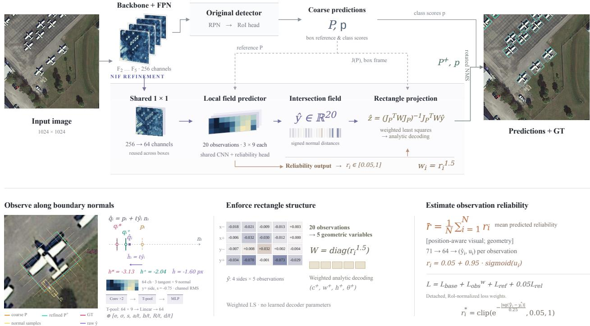  
Figure 1: Overview of NIF. The carrier predicts coarse boxes $P$ and class scores $p .$ Shared projection reduces FPN features to 64 channels; twenty 3×9 strips predict normal observations and reliabilities. Weighted fitting and analytic decoding refine boxes before rotated NMS. The DOTA example shows raw intersections $\hat { \mathbf { q } } _ { i }$ and compatible intersections ${ \bf q } _ { i } ^ { + }$ , with signed normal distances in pixels. GT supplies supervision and visualization. Here, $J _ { P } = J ( P ) , N = 4 m = 2 0$ , and r¯ is mean observation reliability. $\mathcal { L } _ { \mathrm { o b s } } ^ { w }$ denotes the weighted loss in Eq. 11. In the decoder tuple, $w ^ { + } = 2 a ^ { + }$ and $h ^ { + } = 2 b ^ { + }$ are full refined box dimensions.

$$
\begin{array} { r } { \mathbf { p } _ { x , \sigma , j } = \mathbf { c } + \sigma a \mathbf { u } + s _ { j } b \mathbf { v } , } \\ { \mathbf { p } _ { y , \sigma , j } = \mathbf { c } + s _ { j } a \mathbf { u } + \sigma b \mathbf { v } , } \end{array}\tag{1}
$$

where $j = 1 , \ldots , m$ indexes positions along a side, $s _ { j }$ is the dimensionless tangential position, and $\sigma \in \{ - 1 , + 1 \}$ selects opposite sides. Subscripts x and $y$ identify sides normal to u and v, respectively; p is an anchor’s image coordinate. The outward unit normals are $\mathbf { n } _ { x , \sigma } = \sigma \mathbf { u }$ and $\mathbf { n } _ { y , \sigma } = \sigma \mathbf { v } .$

For a matched ground-truth rectangle G, let $\begin{array} { r l } { i } & { { } = } \end{array}$ $1 , \ldots$ , 4m enumerate all 4m = 20 side–position pairs and $L _ { i } ( G )$ denote the corresponding target supporting line. Its signed normal intersection satisfies

$$
\mathbf { q } _ { i } ^ { * } = \mathbf { p } _ { i } + h _ { i } ^ { * } \mathbf { n } _ { i } \in L _ { i } ( G ) , \qquad y _ { i } ^ { * } = h _ { i } ^ { * } / \ell .\tag{2}
$$

Here, $\mathbf { p } _ { i }$ and $\mathbf { n } _ { i }$ are the anchor and its outward normal, $\mathbf { q } _ { i } ^ { * }$ is the intersection, $h _ { i } ^ { * }$ is its signed distance in pixels, and $y _ { i } ^ { * }$ is the normalized target observation. Positive $h _ { i } ^ { * }$ indicates an outward correction. A star marks a target; hats and tildes mark predictions and compatible projections, respectively. Supporting lines extend finite target edges, so intersections remain defined beyond their endpoints. All targets follow from oriented box annotations.

The target rectangle has equivalent width–height assignments. We choose the assignment whose relative angle $\phi = \theta _ { G } - \theta$ lies in $[ - \pi / 4 , \pi / 4 )$ , swapping target half-sizes when needed. This preserves the rectangle and ensures that cos ϕ is nonzero. In the coarse frame, let $\boldsymbol { \tau } _ { x } = ( \mathbf { c } _ { G } - \mathbf { c } ) ^ { \top } \mathbf { u }$ 1 and $\tau _ { y } = ( \mathbf { c } _ { G } - \mathbf { c } ) ^ { \top } \mathbf { v }$ be the center offset, where $\mathbf { c } _ { G } , a _ { G } , b _ { G } ,$ and $\theta _ { G }$ are the center, half-sizes, and orientation of the aligned target. Define

$$
\begin{array} { r } { t = \tan \phi , \quad T _ { x } = \tau _ { x } + t \tau _ { y } , \quad T _ { y } = \tau _ { y } - t \tau _ { x } , } \\ { { D } _ { a } = a _ { G } \sec \phi - a , \qquad { D } _ { b } = b _ { G } \sec \phi - b . } \end{array}\tag{3}
$$

Here, t encodes relative rotation; $T _ { x } , T _ { y }$ mix translation and rotation, while $D _ { a } , D _ { b }$ encode half-size changes after angular compensation. The operator sec $\phi = 1 /$ cos ϕ. Intersecting the anchor-normal lines with target supporting lines

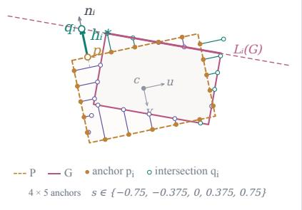  
(a) Normal intersections

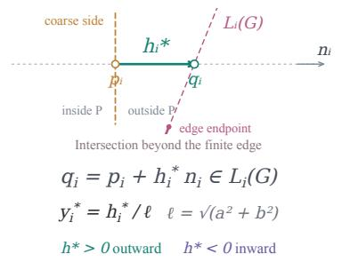  
(b) Signed normal distance

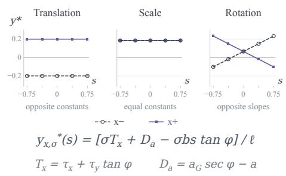  
(c) Geometric field signatures  
Figure 2: Geometry of the normal-intersection field. (a) Anchors and outward normals are attached to the coarse rectangle. (b) The signed displacement ends at a corresponding target supporting line, including intersections beyond finite edges. (c) Translation, scale, and rotation induce different, coordinated constant and slope patterns. These patterns motivate an exact five-dimensional compatible field. Intersection labels $\mathbf { q } _ { i }$ denote target points $\mathbf { q } _ { i } ^ { * } ; \mathbf { c } , \mathbf { u } , \mathbf { v }$ define the coarse-box frame.

gives

$$
\begin{array} { r } { y _ { x , \sigma } ^ { * } ( s ) = ( \sigma T _ { x } + D _ { a } - \sigma b s t ) / \ell , } \\ { y _ { y , \sigma } ^ { * } ( s ) = ( \sigma T _ { y } + D _ { b } + \sigma a s t ) / \ell . } \end{array}\tag{4}
$$

Here, s is a normalized tangential coordinate, evaluated at $s = s _ { j }$ for the sampled field. This expression is exact on the selected axis branch, without a small-angle approximation. The constants and slopes in Fig. 2 explicitly couple the four sides. Learning 20 local observations can therefore be separated from enforcing the five degrees of freedom of a rectangle.

## 3.2 A Five-Variable Compatible Field

Let $\begin{array} { r } { \kappa = \sqrt { m ^ { - 1 } \sum _ { j = 1 } ^ { m } s _ { j } ^ { 2 } } } \end{array}$ be the root-mean-square anchor position. Introduce the normalized variables

$$
\mathbf { z } = \left( T _ { x } / \ell , T _ { y } / \ell , D _ { a } / \ell , D _ { b } / \ell , \kappa t \right) ^ { \top } .\tag{5}
$$

The vector $\textbf { z } \in \ \mathbb { R } ^ { 5 }$ contains two translation, two size, and one rotation variable. Stacking observations in $x - , x + , y - , y +$ order gives $\mathbf { y } ^ { \ast } \in \mathbb { R } ^ { 4 m }$ and $\mathbf { y } ^ { * } = J ( P ) \mathbf { z } .$ where $J ( P ) \in \mathbb { R } ^ { 4 m \times 5 }$ is the geometry-dependent design matrix with rows

$$
\begin{array} { r l } & { J _ { x , \sigma , j } = \big ( \sigma , 0 , 1 , 0 , - \sigma b s _ { j } / ( \ell \kappa ) \big ) , } \\ & { J _ { y , \sigma , j } = \big ( 0 , \sigma , 0 , 1 , \sigma a s _ { j } / ( \ell \kappa ) \big ) . } \end{array}\tag{6}
$$

Each row maps z to one observation indexed by side and position. We write $J = J ( P )$ below. Rectangle fields occupy its five-dimensional column space. Symmetric sampling gives $J ^ { \top } J = 2 m I _ { 5 }$ , where $I _ { 5 }$ is the 5×5 identity: odd crossmoments cancel and $a ^ { 2 } + b ^ { 2 } = \ell ^ { 2 }$ normalizes the rotational column. The design is full rank for positive box sizes and at least two distinct sample positions. This also clarifies why scale normalization matters: the five fitted variables have comparable units before observation weighting.

The network predicts normalized observations $\hat { \mathbf { y } } \in \mathbb { R } ^ { 4 m }$ and reliabilities $r _ { i } \in ( 0 . 0 5 , 1 )$ . We fit

$$
\begin{array} { r l } & { \hat { \mathbf { z } } = \arg \operatorname* { m i n } _ { \mathbf { z } } \displaystyle \sum _ { i = 1 } ^ { 4 m } w _ { i } \big ( ( J \mathbf { z } ) _ { i } - \hat { y } _ { i } \big ) ^ { 2 } , } \\ & { \quad = ( J ^ { \top } W J ) ^ { - 1 } J ^ { \top } W \hat { \mathbf { y } } , \quad W = \mathrm { d i a g } ( w _ { 1 } , \dots , w _ { 4 m } ) . } \end{array}\tag{7}
$$

Here, $w _ { i } = r _ { i } ^ { \gamma }$ weights observation $i , \gamma = 1 . 5$ controls reliability emphasis, and diag forms the diagonal matrix $W \in \mathbb { R } ^ { 4 \bar { m } \times { 4 m } }$ . The fitted vector is $\hat { \mathbf { z } } \in \mathbb { R } ^ { 5 }$ . A differentiable linear solve is applied to the $5 \times 5$ normal system. We normalize weights to mean one within each RoI, which leaves the minimizer unchanged. Positive reliabilities retain full rank. The result $\tilde { \mathbf { y } } = J \hat { \mathbf { z } }$ is the weighted projection onto a rectangle-compatible supporting-line field. This fit minimizes the algebraic normal-displacement residual, rather than the perpendicular distance to a rotated line or a rotated IoU loss.

Analytic rectangle decoding. Write $\begin{array} { r l r l } { \hat { \mathbf { z } } } & { { } } & { = } & { { } } \end{array}$ $( z _ { x } , z _ { y } , z _ { a } , z _ { b } , z _ { t } ) ^ { \top }$ , where the first two entries encode translation, the next two encode size, and z encodes rotation. Let $\hat { t } = z _ { t } / \kappa$ be the fitted angle tangent. The refined local center offset is

$$
\Delta \mathbf { c } _ { \mathrm { l o c a l } } = \frac { \boldsymbol { \ell } } { 1 + \hat { t } ^ { 2 } } \left( \begin{array} { l } { z _ { x } - \hat { t } z _ { y } } \\ { \hat { t } z _ { x } + z _ { y } } \end{array} \right) ,\tag{8}
$$

Its components $( \Delta c _ { x } , \Delta c _ { y } )$ are translations in pixels along u and v. The refined box is obtained by

$$
\begin{array} { r l r } & { } & { { \bf c } ^ { + } = { \bf c } + \Delta c _ { x } { \bf u } + \Delta c _ { y } { \bf v } , } \\ & { } & { ( a ^ { + } , b ^ { + } ) = ( a + \ell z _ { a } , b + \ell z _ { b } ) / \sqrt { 1 + \hat { t } ^ { 2 } } , } \\ & { } & { \theta ^ { + } = \theta + \arctan \hat { t } . \quad \quad } \end{array}\tag{9}
$$

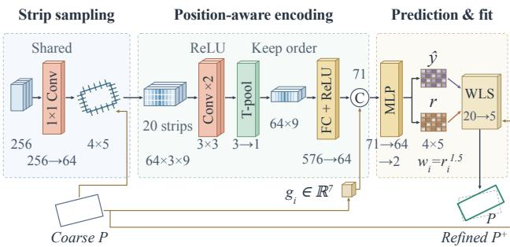  
Figure 3: Local observation network. Tensor sizes are per observation. T-pool averages along the tangent while preserving nine normal positions; C concatenates visual and geometric descriptors. The shared predictor outputs 20 field values and reliabilities per box. WLS fits five geometric variables for analytic rectangle decoding.

Here, $P ^ { + } = ( { \bf c } ^ { + } , 2 a ^ { + } , 2 b ^ { + } , \theta ^ { + } )$ is the refined rectangle; superscript + denotes its updated center, half-sizes, and angle. We clamp decoded full sizes to at least $1 0 ^ { - 3 }$ pixels and canonicalize the output to the carrier’s long-edge convention. The clamp is a numerical safeguard for unconstrained predictions, not a constrained least-squares optimizer. With a zero field, the update is exactly the identity. With noise-free target observations, the selected target geometry is recovered by the affine fit and inverse mapping.

## 3.3 Local Observation Network

Shared projection and normal strips. Figure 3 details the local branch. A shared 1×1 convolution reduces 256-channel FPN maps to 64 channels, reusing each projected map across its assigned boxes. At anchor $\mathbf { p } _ { i }$ , bilinear sampling forms a $3 \times 9$ tangent–normal grid: nine equally spaced normal offsets span $[ - R _ { i } , R _ { i } ]$ , and three tangent offsets are $- d , 0 , d .$ Here, $d$ is the assigned FPN level’s stride in image pixels; the tangent is v on x-sides and u on y-sides. The normal radius is $R _ { i } = \operatorname* { m a x } ( a / 2 , 2 d )$ or $\operatorname* { m a x } ( b / 2 , 2 d )$ , respectively. Sampling follows the carrier’s half-pixel alignment and does not bound the predicted displacement.

Preserving the normal profile. The strip encoder in Fig. 3 applies two 3×3 Conv–ReLU layers, averages only along the tangent, and maps the ordered 64 × 9 profile to a 64-dimensional visual descriptor. This preserves normalposition cues lost by full spatial pooling. We concatenate $\bar { \bf g } _ { i } \in \mathbb { R } ^ { 7 }$ , containing the side type $( x = 0 , y = 1 )$ , side sign $\sigma _ { i }$ , position $s _ { i }$ , and four quantities $a , b , R _ { i }$ , d normalized by ℓ. The shared MLP predicts the field value $\hat { y } _ { i }$ and reliability logit $u _ { i }$ . We set $r _ { i } = r _ { \operatorname* { m i n } } + ( 1 - r _ { \operatorname* { m i n } } )$ sigmoid(ui), where $r _ { \mathrm { m i n } } = 0 . 0 5$ bounds reliability away from zero and sigmoid maps a logit to (0, 1). All sides, anchors, pyramid levels, and classes share the predictor. Zero-initialized field outputs and initial reliability 0.8 make the initial box update the identity.

## 3.4 Supervision and Detector Integration

NIF is a plug-in branch after coarse-box regression: it reuses pyramid features and box coordinates while preserving the carrier’s backbone, RPN, RoI heads, and proposal assignment. For each foreground RoI, we detach the coarse-box coordinates and construct $\mathbf { y } ^ { * }$ from its matched GT. Original detector losses remain active. NIF adds

$$
\mathcal { L } = \mathcal { L } _ { \mathrm { b a s e } } + \mathcal { L } _ { \mathrm { o b s } } + \mathcal { L } _ { \mathrm { r e f } } + \lambda _ { \mathrm { r e l } } \mathcal { L } _ { \mathrm { r e l } } .\tag{10}
$$

Here, $\mathcal { L } _ { \mathrm { b a s e } }$ sums the carrier’s original RPN and RoI classification and regression losses. $\mathcal { L } _ { \mathrm { o b s } } , \mathcal { L } _ { \mathrm { r e f } } ,$ , and $\mathcal { L } _ { \mathrm { r e l } }$ supervise the field, refined box, and reliability, respectively. Their weights are 1, 1, and $\lambda _ { \mathrm { r e l } } = 0 . 0 5$ . Define

$$
\begin{array} { r l } & { \mathcal { L } _ { \mathrm { o b s } } = \mathbb { E } _ { P } \Bigg [ \cfrac { 1 } { 4 m } \displaystyle \sum _ { i = 1 } ^ { 4 m } \bar { w } _ { i } ( \hat { y } _ { i } - y _ { i } ^ { * } ) ^ { 2 } \Bigg ] , } \\ & { \bar { w } _ { i } = \cfrac { \mathrm { s g } ( r _ { i } ^ { \gamma } ) } { \cfrac { 1 } { 4 m } \sum _ { i ^ { \prime } = 1 } ^ { 4 m } \mathrm { s g } ( r _ { i ^ { \prime } } ^ { \gamma } ) } , } \\ & { \mathcal { L } _ { \mathrm { r e f } } = \mathbb { E } _ { P , G } [ 1 - \mathrm { r I o U } ( P ^ { + } , G ) ] . } \end{array}\tag{11}
$$

(12)

Here, $\mathbb { E } _ { P }$ and $\mathbb { E } _ { P , G }$ denote empirical means over selected RoIs and their matched GT pairs. The scalar $\bar { w } _ { i }$ is the per-RoI normalized observation weight; $i ^ { \prime }$ enumerates all observations in its denominator. sg is stop-gradient: it preserves a value in the forward pass and blocks its backward derivative. The operator $\mathrm { r I o U } ( P ^ { + } , G )$ is intersection area divided by union area for the two rotated rectangles. Detached weights prevent the observation loss from directly lowering reliability; per-RoI normalization removes uniform weight scaling. The fit remains differentiable in both outputs. We use exact polygon-based rotated IoU with piecewise differentiable intersection geometry.

Reliability is supervised by the current detached observation error:

$$
r _ { i } ^ { * } = \mathrm { c l i p } \left( \exp \left[ - \frac { \vert \operatorname { s g } ( \hat { y } _ { i } ) - y _ { i } ^ { * } \vert } { \tau _ { r } } \right] , r _ { \mathrm { m i n } } , 1 \right) ,\tag{13}
$$

$$
\mathcal { L } _ { \mathrm { r e l } } = \mathbb { E } _ { P } \left[ \frac { 1 } { 4 m } \sum _ { i = 1 } ^ { 4 m } \mathrm { S m o o t h L 1 } _ { \beta _ { r } } \big ( r _ { i } - r _ { i } ^ { * } \big ) \right] .\tag{14}
$$

Here, $r _ { i } ^ { * }$ is the error-derived reliability target and $\tau _ { r } =$ 0.25 sets its decay scale in normalized displacement units. $\mathrm { c l i p } ( x , L , U ) = \operatorname* { m i n } ( \operatorname* { m a x } ( x , L ) , U )$ clips input x between lower bound L and upper bound $U$ , here $r _ { \mathrm { m i n } }$ and 1. For residual $e = r _ { i } - r _ { i } ^ { * }$ , SmoothL1β (e) equals $e ^ { 2 } / ( 2 \beta _ { r } )$ when $| e | < \beta _ { r }$ and $| e | - \beta _ { r } / 2$ otherwise, with transition $\beta _ { r } = 0 . 1$ We use up to 128 detector positives per image, excluding GTinjected proposals when other positives are available. NIF uses no quality-only negatives or synthetic perturbation supervision. Detaching reference boxes isolates the sampling geometry, while the local network and shared backbone/FPN still receive NIF gradients.

At inference, NIF corrects candidates after the carrier’s score filtering and cap, before rotated NMS; class scores remain unchanged. It adds no proposal stage or iterative loop. We use FP32 field prediction and fitting, process RoIs in chunks, and reuse the projected feature map.

## 4 Experiments

## 4.1 Experimental Settings

Datasets and metrics. DOTA-v1.0 [10] contains 2,806 aerial images and 15 categories, with 1,411/458/937 images in train/val/test. We train on trainval and report the official test-set mAP at IoU 0.5. Images are cropped into 1024×1024 patches with a 200-pixel overlap and a single scale factor of 1.0. Patch predictions are mapped back and merged for submission. HRSC2016 [31] uses the standard 617 trainval and 444 test images. We report $\mathrm { \bf A P } _ { 5 0 } , \mathrm { \bf A P } _ { 7 5 }$ , and COCOstyle mAP using 11-point VOC 2007 and all-points VOC 2012 interpolation [14]. FAIR1M-v1.0 [42] contains 37 aerial object categories. We use its official training and test splits and report the official mAP over 34 fine-grained categories. Following Strip R-CNN [62], images are rescaled by {0.5, 1.0, 1.5} and cropped into 1024×1024 patches with a 500-pixel overlap for both training and testing. Predictions from all scales are mapped back and merged before submission. DIOR-R [7] adds oriented annotations to 20 categories in DIOR. We use the native 800×800 images, train on trainval, and evaluate on test with the native rotated-IoU 0.5 VOC 2007 eleven-point mAP protocol.

Implementation. All experiments are implemented with the MMRotate toolbox [67]. The experiments use 256- channel FPN features [29], ImageNet-pretrained backbones, including ResNet [18], and the original carrier heads; NIF is appended after the final coarse box regression. Following FAA [15], inputs are 1024×1024 for DOTA-v1.0 and 800×800 for HRSC2016 and DIOR-R. Training uses AdamW [33] with an initial learning rate of $1 0 ^ { - 4 }$ , weight decay 0.05, and $( \beta _ { 1 } , \beta _ { 2 } ) = ( 0 . 9 , 0 . 9 9 9 )$ . The batch size is two per GPU on four GPUs without learning-rate scaling. For DOTA-v1.0 and HRSC2016, we train for 36 epochs, reduce the learning rate by a factor of ten at epochs 24 and 33, and use a 500-iteration linear warm-up with an initial ratio of $1 / 3$ . DIOR-R and FAIR1M use 12 epochs with learning-rate reductions at epochs 8 and 11. All datasets use trainval for training and the corresponding official test split for evaluation. NIF hyperparameters follow Sec. 3.

## 4.2 Detection Results

DOTA-v1.0. Table 1 combines FAA comparison results [15] with our official evaluations. NIF reaches 78.00, 79.11, 78.18, and 79.02% mAP with Oriented R-CNN, LSKNet-S, PKINet-v2-S, and Strip R-CNN; matched gains are 0.91% for PKINet-v2 and 0.33% for Strip R-CNN. For PKINet-v2, bridge, ground-track-field, and helicopter AP increase by 3.87%, 3.40%, and 5.20%; Strip R-CNN gains 7.98% AP on swimming-pool. These categories span elongated structures, large spatial extents, and compact objects.

HRSC2016. Table 2 compares four locally reproduced carriers with their NIF counterparts under matched settings. Following FAA [15], we report $\mathrm { { A P } _ { 5 0 } }$ $\mathsf { A P } _ { 7 5 }$ , and COCOstyle mAP under VOC 2007 and VOC 2012 interpolation. NIF raises COCO-style mAP for all four carriers by 2.82– 4.97% under VOC 2007 and 4.32–6.66% under VOC 2012. $\mathsf { A P } _ { 5 0 }$ changes by less than 0.5%, while $\mathsf { A P } _ { 7 5 }$ improves for every carrier, indicating that the gains concentrate at stricter localization thresholds across both conventional and Strip heads.

Table 2 also reports the computational cost. NIF adds 0.132M parameters, only 0.29–0.43% of the baseline models. With a common 1024×1024 reference input, 1,000 baseline proposals, and the measured mean NIF cost at 200.64 refined RoIs, NIF adds 9.05 GFLOPs, an increase of 4.14–5.21% across the four carriers. These supported-module forward counts show that NIF improves localization with a small parameter and computation overhead.

FAIR1M-v1.0. Table 3 reports 46.36, 48.13, and 48.22% mAP for O-RCNN, LSKNet-S, and Strip R-CNN with NIF. The reproduced Strip R-CNN improves from 47.92 to 48.22%, a 0.30% gain; O-RCNN rises from 45.60 to 46.36% and LSKNet-S from 47.87 to 48.13%, giving gains of 0.76% and 0.26%. Scores use the 34 fine-grained FAIR1M categories (the three other categories are excluded) and the multi-scale crop-and-merge protocol described above. NIF only refines proposals and leaves each carrier’s classification and regression paths unchanged. Therefore, consistent gains across diverse carriers indicate that its normal-intersection observations remain effective under fine-grained labels and multi-scale inference.

DIOR-R. Table 4 includes prior methods and NIF results. NIF reaches 66.06%, 68.19%, and 67.43% with O-RCNN, LSKNet-S, and Strip R-CNN, respectively. Against our local Strip R-CNN baseline of 66.75%, the matched gain is 0.68%. Relative to the tabulated O-RCNN and LSKNet-S results, the NIF entries are higher by 1.76% and 2.29%, respectively. LSKNet-S + NIF gives the strongest result among the three

<table><tr><td>Method</td><td>PL</td><td>BD</td><td>BR</td><td>GTF</td><td>SV</td><td>LV</td><td>SH</td><td>TC</td><td>BC</td><td>ST</td><td>SBF</td><td>RA</td><td>HA</td><td>SP</td><td>HC</td><td>mAP</td></tr><tr><td>R. Faster R-CNN [40]</td><td>89.40</td><td>81.81</td><td>47.28</td><td>67.44</td><td>73.96</td><td>73.12</td><td>85.03</td><td>90.90</td><td>85.15</td><td>84.90</td><td>56.60</td><td>64.77</td><td>64.70</td><td>70.28</td><td>62.22</td><td>73.17</td></tr><tr><td>R³Det [53]</td><td>89.50</td><td>81.20</td><td>50.50</td><td>66.10</td><td>70.90</td><td>78.70</td><td>78.20</td><td>90.80</td><td>85.30</td><td>84.20</td><td>61.80</td><td>63.80</td><td>68.20</td><td>69.80</td><td>67.20</td><td>73.70</td></tr><tr><td>R³Det-GWD [54]</td><td>88.82</td><td>82.94</td><td>55.63</td><td>72.75</td><td>78.52</td><td>83.10</td><td>87.46</td><td>90.21</td><td>86.36</td><td>85.44</td><td>64.70</td><td>61.41</td><td>73.46</td><td>76.94</td><td>57.38</td><td>76.34</td></tr><tr><td>R³Det-KLD [55]</td><td>88.90</td><td>84.17</td><td>55.80</td><td>69.35</td><td>78.72</td><td>84.08</td><td>87.00</td><td>89.75</td><td>84.32</td><td>85.73</td><td>64.74</td><td>61.80</td><td>76.62</td><td>78.49</td><td>70.89</td><td>77.36</td></tr><tr><td>S²A-Net [17]</td><td>89.11</td><td>82.84</td><td>48.37</td><td>71.11</td><td>78.11</td><td>78.39</td><td>87.25</td><td>90.83</td><td>84.90</td><td>85.64</td><td>60.36</td><td>62.60</td><td>65.26</td><td>69.13</td><td>57.94</td><td>74.12</td></tr><tr><td>RoI Transformer [9]</td><td>89.01</td><td>77.48</td><td>51.64</td><td>72.07</td><td>74.43</td><td>77.55</td><td>87.76</td><td>90.81</td><td>79.71</td><td>85.27</td><td>58.36</td><td>64.11</td><td>76.50</td><td>71.99</td><td>54.06</td><td>74.05</td></tr><tr><td>ReDet [16]</td><td>88.79</td><td>82.64</td><td>53.97</td><td>74.00</td><td>78.13</td><td>84.06</td><td>88.04</td><td>90.89</td><td>87.78</td><td>85.75</td><td>61.76</td><td>60.39</td><td>75.96</td><td>68.07</td><td>63.59</td><td>76.25</td></tr><tr><td>O-RCNN [47]</td><td>89.46</td><td>82.12</td><td>54.78</td><td>70.86</td><td>78.93</td><td>83.00</td><td>88.20</td><td>90.90</td><td>87.50</td><td>84.68</td><td>63.97</td><td>67.69</td><td>74.94</td><td>68.84</td><td>52.28</td><td>75.87</td></tr><tr><td>ARC [39] GRA [44]</td><td>89.40</td><td>82.48</td><td>55.33</td><td>73.88</td><td>79.37</td><td>84.05</td><td>88.06</td><td>90.90</td><td>86.44</td><td>84.83</td><td>63.63</td><td>70.32</td><td>74.29</td><td>71.91</td><td>65.43</td><td>77.35</td></tr><tr><td>LSKNet [28]</td><td>89.66</td><td>85.52</td><td>57.72</td><td>75.70</td><td></td><td>78.69</td><td></td><td></td><td>86.79</td><td></td><td></td><td></td><td></td><td></td><td></td><td>77.63 77.49</td></tr><tr><td>MutDet [20]</td><td>87.30</td><td>78.70</td><td>51.30</td><td>68.50</td><td>74.95 78.90</td><td>81.60</td><td>88.24 88.10</td><td>90.88 90.70</td><td>79.90</td><td>86.38 83.70</td><td>66.92 58.00</td><td>63.77 61.80</td><td>77.77 76.50</td><td>74.47 72.10</td><td>64.82 60.80</td><td>74.50</td></tr><tr><td>PKINet [1]</td><td>89.72</td><td>84.20</td><td>55.81</td><td>77.63</td><td>80.25</td><td>84.45</td><td>88.12</td><td>90.88</td><td>87.57</td><td>86.07</td><td>66.86</td><td>70.23</td><td>77.47</td><td>73.62</td><td>62.94</td><td>78.39</td></tr><tr><td>PKINet-v2-S [2]</td><td>89.79</td><td>83.87</td><td>55.18</td><td>73.52</td><td>74.88</td><td>84.26</td><td>88.47</td><td>90.87</td><td>87.45</td><td>86.49</td><td>66.22</td><td>62.00</td><td>78.32</td><td>69.55</td><td>68.01</td><td>77.26</td></tr><tr><td>ReDiffDet (R50) [66]</td><td>85.45</td><td>77.84</td><td>50.39</td><td>71.63</td><td>80.90</td><td>84.85</td><td>88.77</td><td>90.88</td><td>87.00</td><td>86.08</td><td>63.30</td><td>63.43</td><td>76.01</td><td>76.03</td><td>60.16</td><td>76.18</td></tr><tr><td>ReDiffDet (Swin-T) [66]</td><td>82.89</td><td>82.90</td><td>52.47</td><td>70.80</td><td>80.48</td><td>85.41</td><td>88.97</td><td>90.90</td><td>86.97</td><td>87.35</td><td>60.24</td><td>65.01</td><td>76.61</td><td>74.28</td><td>64.07</td><td>76.62</td></tr><tr><td>Strip R-CNN [62]</td><td>89.68</td><td>85.62</td><td>56.32</td><td>75.42</td><td>75.85</td><td>85.40</td><td>88.59</td><td>90.90</td><td>87.25</td><td>87.09</td><td>69.33</td><td>62.49</td><td>78.23</td><td>74.87</td><td>73.33</td><td>78.69</td></tr><tr><td>O-RCNN + FAA [15]</td><td>89.40</td><td>84.15</td><td>54.66</td><td>72.23</td><td>78.42</td><td>82.89</td><td>87.86</td><td>90.89</td><td>86.26</td><td>85.24</td><td>63.95</td><td>65.58</td><td>75.30</td><td>70.44</td><td>61.06</td><td>76.55</td></tr><tr><td>LSKNet + FAA [15]</td><td>89.85</td><td>85.07</td><td>55.39</td><td>77.77</td><td>79.30</td><td>84.72</td><td>88.56</td><td>90.90</td><td>87.74</td><td>86.29</td><td>68.37</td><td>67.74</td><td>77.19</td><td>74.14</td><td>64.30</td><td>78.49</td></tr><tr><td>Strip R-CNN + FAA [15]</td><td>89.81</td><td>83.27</td><td>52.93</td><td>77.06</td><td>79.57</td><td>84.90</td><td>88.31</td><td>90.89</td><td>87.10</td><td>86.43</td><td>66.43</td><td>68.04</td><td>75.54</td><td>79.03</td><td>71.48</td><td>78.72</td></tr><tr><td>O-RCNN + NIF</td><td>89.15</td><td>83.75</td><td>56.53</td><td>74.15</td><td>75.36</td><td>84.69</td><td>88.31</td><td>90.80</td><td>86.73</td><td>85.78</td><td>68.79</td><td>66.10</td><td>78.36</td><td>79.93</td><td>61.62</td><td>78.00</td></tr><tr><td>PKINet-v2-S + NIF</td><td>89.77</td><td>85.55</td><td>59.05</td><td>76.92</td><td>73.81</td><td>84.60</td><td>88.38</td><td>90.89</td><td>87.46</td><td>86.48</td><td>65.65</td><td>61.97</td><td>78.59</td><td>70.31</td><td>73.21</td><td>78.18</td></tr><tr><td>Strip R-CNN + NIF</td><td>89.57</td><td>85.08</td><td>55.17</td><td>73.55</td><td>75.42</td><td>85.69</td><td>88.67</td><td>90.90</td><td>87.75</td><td>87.13</td><td>68.47</td><td>63.29</td><td>78.62</td><td>82.85</td><td>73.13</td><td>79.02</td></tr><tr><td>LSKNet-S + NIF</td><td>89.62</td><td>85.81</td><td>57.77</td><td>73.73</td><td>81.15</td><td>85.32</td><td>88.53</td><td>90.90</td><td>87.52</td><td>86.15</td><td>66.19</td><td>63.24</td><td>78.51</td><td>81.05</td><td>71.18</td><td>79.11</td></tr></table>

Table 1: Comparisons with SOTA methods on the DOTA-v1.0 dataset (AP in percent). PL, BD, BR, GTF, SV, LV, SH, TC, BC, ST, SBF, RA, HA, SP, and HC follow the standard DOTA category abbreviations.

carriers, while gains across all three architectures support the applicability of geometric refinement to DIOR-R.
<table><tr><td colspan="3">Method Params (M) GFLOPs mAP (%)</td></tr><tr><td>RetinaNet-O [30]</td><td></td><td>57.55</td></tr><tr><td>Faster R-CNN-O [40]</td><td>41.10</td><td>198.00 59.54</td></tr><tr><td>TIOE-Det [37]</td><td>41.10 198.00</td><td>61.98</td></tr><tr><td>O-RCNN [47]</td><td>41.37</td><td>211.43 64.30</td></tr><tr><td>ARS-DETR [63]</td><td>41.10</td><td>198.00 66.12</td></tr><tr><td>O-RepPoints [26]</td><td>36.60</td><td>66.71</td></tr><tr><td>DCFL [48]</td><td></td><td>66.80</td></tr><tr><td>LSKNet-S [28]</td><td>30.98 173.68</td><td>65.90</td></tr><tr><td>PKINet-S [1]</td><td>30.80</td><td>190.00 67.03</td></tr><tr><td>Strip R-CNN [62]</td><td>45.14</td><td>218.71 66.75</td></tr><tr><td>O-RCNN + NIF</td><td>41.50 220.48</td><td>66.06</td></tr><tr><td>LSKNet-S + NIF</td><td>31.11</td><td>182.72 68.19</td></tr><tr><td>Strip R-CNN + NIF</td><td>45.27 227.76</td><td>67.43</td></tr></table>

Table 4: Comparisons with SOTA methods on the DIOR-R dataset. Literature complexity follows Strip R-CNN [62] where reported. O-RCNN, LSKNet-S, Strip R-CNN, and their NIF counterparts use the standardized estimates in Table 2: $1 0 2 4 \times 1 0 2 4$ input, 1,000 baseline proposals, and the common mean NIF cost.

Cross-framework transfer. We attach NIF to four DOTA-v1.0 carriers: Ultralytics YOLO26 OBB [24], O2- RTDETR [13], LSKNet-S + FAA, and PKINet-v2-S. Each starts from an official single-scale checkpoint; all detector parameters are frozen and only NIF is optimized. YOLO26- L OBB uses Ultralytics’ official settings, while the others

follow Table 1. Table 5 shows $\mathsf { A P } _ { 7 5 }$ gains of 0.93%, 1.77%, 2.17%, and 1.59% and mAP gains of 0.23%, 1.01%, 1.81%, and 1.24%, respectively, showing that NIF reuses coarse boxes without detector changes or retraining and delivers gains in the high-AP regime.
<table><tr><td>Carrier</td><td>Frozen carrier Carrier + NIF  $\mathrm { A P _ { 7 5 } }$ </td><td> $\mathrm { m A P }$ </td><td> $\mathrm { A P _ { 7 5 } }$ </td><td> $\mathrm { m A P }$ </td></tr><tr><td>YOLO26-L OBB [24]</td><td>59.19</td><td>54.18</td><td>60.12</td><td>54.41</td></tr><tr><td>O2-RTDETR [13]</td><td>54.28</td><td>51.09</td><td>56.05</td><td>52.10</td></tr><tr><td>LSKNet-S + FAA [15, 28] 51.88</td><td></td><td>48.35</td><td>54.05</td><td>50.16</td></tr><tr><td>PKINet-v2-S [2]</td><td>54.58</td><td>50.83 56.17</td><td></td><td>52.07</td></tr></table>

Table 5: Cross-framework transfer on DOTA-v1.0. Each carrier is initialized from its official single-scale checkpoint, with all detector parameters frozen and only NIF optimized. $\mathsf { A P } _ { 7 5 }$ is evaluated at IoU 0.75; mAP is the COCO-style mean AP averaged over IoU thresholds from 0.50 to 0.95. “LSKNet-S + FAA” denotes the FAA Head carrier.

## 4.3 Does the Field Correct Geometry?

A fixed candidate cohort. To inspect geometry separately from confidence ranking and NMS, we evaluate a separate Oriented R-CNN NIF checkpoint on all 444 HRSC test images. Before final NMS, we retain candidates with score at least 0.5 and maximum coarse-box IoU at least 0.3. Each is assigned to its maximum-IoU GT, and the highest-scoring candidate is retained per assigned GT, with candidate index breaking ties. Refined IoU, gain, and NMS survival do not affect selection. This produces 1,212 pairs for 1,228 loaded GT boxes; unmatched GTs receive no synthetic prediction.

<table><tr><td rowspan=1 colspan=1>Method            Params (M) GFLOPs AP50 AP75 mAP</td></tr><tr><td rowspan=1 colspan=1>PASCAL VOC 2007</td></tr><tr><td rowspan=1 colspan=1>O-RCNN [47]            41.37  211.43 90.40 88.60 70.66O-RCNN + NIF          41.50  220.4890.5089.7074.33LSKNet-S [28]           30.98  173.68 90.50 88.20 69.80LSKNet-S + NIF         31.11  182.7290.3089.4074.55PKINet-v2-S [2]         30.73  173.68 90.3088.4069.53PKINet-v2-S + NIF      30.86  182.72 90.3089.3074.49</td></tr><tr><td rowspan=1 colspan=1>Strip R-CNN [62]        45.14  218.71 90.5088.9071.01Strip R-CNN + NIF      45.27  227.7690.4089.5073.83</td></tr><tr><td rowspan=1 colspan=1>PASCAL VOC 2012</td></tr><tr><td rowspan=1 colspan=1>O-RCNN [47]            41.37  211.4397.8089.2072.64O-RCNN + NIF          41.50  220.4898.30 92.2078.09LSKNet-S [28]           30.98  173.6898.1088.5071.77LSKNet-S + NIF         31.11  182.7298.0091.8078.44PKINet-v2-S [2]          30.73  173.6898.0088.9072.26PKINet-v2-S + NIF      30.86  182.72 98.2092.1078.47Strip R-CNN [62]        45.14  218.71 98.3089.60 74.22Strip R-CNN + NIF      45.27  227.7698.2091.9078.54</td></tr></table>

Table 2: Comparisons with SOTA methods on the HRSC2016 dataset (AP in %). All models are trained locally on trainval and evaluated on test with the final 36- epoch checkpoint. Complexity uses 1024×1024 reference inputs and the common mean NIF cost described in the text. AP uses VOC 2007/2012 interpolation; mAP follows the COCO-style metric.

Figure 4 is built from this fixed cohort. Fig. 4(a) shows one candidate: the upper row overlays its 20 predicted normal observations, coarse box, refined box, and GT, while the lower row shows Grad-CAM for the normalized cornerdisplacement energy of the final update. Fig. 4(b) compares zero, raw, and projected normal fields, and Fig. 4(c) reports paired refined-minus-coarse IoU gains in coarse-IoU bins. Error bars and the reported confidence intervals use 2,000 image-cluster bootstrap resamples.

Fig. 4(a) shows a clear geometric correction: the distributed normal observations move several box sides together, increasing the example IoU from 0.880 to 0.948. The corresponding Grad-CAM response is strongest near ship boundaries where the coarse box disagrees with the target. In Fig. 4(b), normalized field MAE decreases from 0.02917 for zero displacement to 0.02565 for the raw predictions and 0.02203 after compatibility projection, a 24.5% reduction relative to zero displacement. This indicates that NIF both predicts useful boundary displacements and makes them more consistent before decoding. In Fig. 4(c), the mean candidate IoU increases from 0.8669 to 0.8884, a gain of 2.148 points (95% CI [1.968, 2.322]), and 75.3% of pairs improve at a $1 0 ^ { - 4 }$ tolerance. Gains are positive across most coarse-IoU ranges; only the nearly solved highest-IoU bin shows a small average decrease.

Coarse Predicted normals Refined GT  
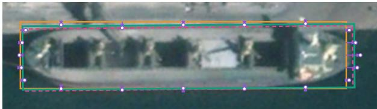  
IoU 0.880 → 0.948

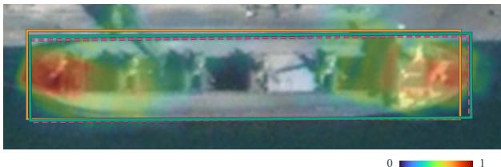  
(a) Normal observations and refinement Grad-CAM

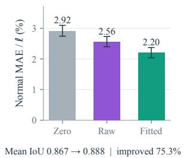

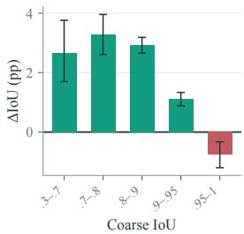  
(b) Normal-field error  
(c) Paired localization gain  
Figure 4: Geometric refinement evidence on HRSC2016. (a) Normal observations, box refinement, and Grad-CAM for the final update. (b) Normal-field error. (c) Paired IoU gain by coarse IoU.

The comparison in Fig. 4(b) is to the target supporting-line field in Eq. 2, not to image segmentation edges.

Reliability intervention. Replacing predicted fitting weights by uniform weights gives a 2.134-point mean IoU gain, versus 2.148 points with learned weights (difference 0.014, 95% interval [0.009, 0.020]), with all parameters fixed.

## 5 Conclusion

In this paper, we present NIF, a plug-and-play normalintersection field for oriented-box refinement. It samples features in a coarse box’s normal frames to predict signed boundary intersections and reliabilities, then fits a compatible rectangle with five degrees of freedom. Tangential pooling preserves normal-position structure, and a shared projection keeps the branch lightweight without changing the carrier. Across DOTA-v1.0, FAIR1M-v1.0, DIOR-R, and

<table><tr><td>Method</td><td>G. V. [49]</td><td> $\mathrm { R e t i n a N e t } ^ { \ast }$   $[ 3 0 ]$ </td><td>C-RCNN [3]</td><td>F-RCNN* [40]</td><td>RoI Trans.* [9]</td><td>O-RCNN [47]</td><td>LSKNet-S [28]</td><td>Strip R-CNN [62]</td><td>O-RCNN +NIF</td><td>LSKNet-S + NIF</td><td>Strip R-CNN + NIF</td></tr><tr><td>mAP (%)</td><td>29.92</td><td>30.67</td><td>31.18</td><td>32.12</td><td>35.29</td><td>45.60</td><td>47.87</td><td>47.92</td><td>46.36</td><td>48.13</td><td>48.22</td></tr></table>

Table 3: Comparisons with SOTA methods on the FAIR1M-v1.0 dataset. \*: Results are referenced from the FAIR1M paper [42].

HRSC2016, NIF consistently improves localization with diverse detectors, particularly at high IoU. These gains point to a geometric error shared across carriers. Frozen-detector experiments show that NIF reuses existing coarse boxes without detector retraining; field-error and candidate-IoU analyses support its correction mechanism and cross-framework transfer.

## Acknowledgments

We thank Shanghai Zhongchao Automation Engineering Co., Ltd. for providing the computational resources that supported this work.

## References

[1] Xinhao Cai, Qiuxia Lai, Yuwei Wang, Wenguan Wang, Zeren Sun, and Yazhou Yao. Poly kernel inception network for remote sensing detection. In Proceedings ofthe IEEE/CVF Conference on Computer Vision and Pattern Recognition, pages 27706–27716, 2024.

[2] Xinhao Cai, Liulei Li, Gensheng Pei, Zeren Sun, Yazhou Yao, and Wenguan Wang. PKINet-v2: Towards powerful and efficient poly-kernel remote sensing object detection. In Computer Vision – ECCV 2026, pages 394–415. Springer Nature Switzerland, 2026.

[3] Zhaowei Cai and Nuno Vasconcelos. Cascade R-CNN: Delving into high quality object detection. In Proceedings of the IEEE/CVF Conference on Computer Vision and Pattern Recognition, pages 6154–6162, 2018.

[4] Guang Chen, Haitao Wang, Kai Chen, Zhijun Li, Zida Song, Yinlong Liu, Wenkai Chen, and Alois Knoll. A survey of the four pillars for small object detection: Multiscale representation, contextual information, super-resolution, and region proposal. IEEE Transactions on Systems, Man, and Cybernetics: Systems, 52(2):936–953, 2022.

[5] Zhiming Chen, Kean Chen, Weiyao Lin, John See, Hui Yu, Yan Ke, and Cong Yang. PIoU loss: Towards accurate oriented object detection in complex environments. In Computer Vision – ECCV 2020, pages 195–211. Springer, 2020.

[6] Gong Cheng, Peicheng Zhou, and Junwei Han. RIFD-CNN: Rotation-invariant and fisher discriminative convolutional neural networks for object detection. In Proceedings ofthe

IEEE Conference on Computer Vision and Pattern Recognition, pages 2884–2893, 2016.

[7] Gong Cheng, Jiabao Wang, Ke Li, Xingxing Xie, Chunbo Lang, Yanqing Yao, and Junwei Han. Anchor-free oriented proposal generator for object detection. IEEE Transactions on Geoscience and Remote Sensing, 60:1–11, 2022.

[8] Jifeng Dai, Haozhi Qi, Yuwen Xiong, Yi Li, Guodong Zhang, Han Hu, and Yichen Wei. Deformable convolutional networks. In Proceedings ofthe IEEE International Conference on Computer Vision, pages 764–773, 2017.

[9] Jian Ding, Nan Xue, Yang Long, Gui-Song Xia, and Qikai Lu. Learning RoI transformer for oriented object detection in aerial images. In Proceedings of the IEEE/CVF Conference on Computer Vision and Pattern Recognition, pages 2844– 2853, 2019.

[10] Jian Ding, Nan Xue, Gui-Song Xia, Xiang Bai, Wen Yang, Michael Ying Yang, Serge Belongie, Jiebo Luo, Mihai Datcu, Marcello Pelillo, and Liangpei Zhang. Object detection in aerial images: A large-scale benchmark and challenges. IEEE Transactions on Pattern Analysis and Machine Intelligence, 44(11):7778–7796, 2022.

[11] Xiaohan Ding, Xiangyu Zhang, Jungong Han, and Guiguang Ding. Scaling up your kernels to 31x31: Revisiting large kernel design in CNNs. In Proceedings of the IEEE/CVF Conference on Computer Vision and Pattern Recognition, pages 11953–11965, 2022.

[12] Xiaohan Ding, Yiyuan Zhang, Yixiao Ge, Sijie Zhao, Lin Song, Xiangyu Yue, and Ying Shan. UniRepLKNet: A universal perception large-kernel convnet for audio, video, point cloud, time-series and image recognition. In Proceedings of the IEEE/CVF Conference on Computer Vision and Pattern Recognition, pages 5513–5524, 2024.

[13] Zeyu Ding, Yong Zhou, Jiaqi Zhao, Wen-Liang Du, Xixi Li, Rui Yao, and Abdulmotaleb El Saddik. Real-time oriented object detection transformer in remote sensing images. IEEE Transactions on Geoscience and Remote Sensing, 64:1–14, 2026.

[14] Mark Everingham, Luc Van Gool, Christopher K. I. Williams, John Winn, and Andrew Zisserman. The PASCAL visual object classes (VOC) challenge. International Journal of Computer Vision, 88(2):303–338, 2010.

[15] Changyu Gu, Linwei Chen, Lin Gu, and Ying Fu. Fourier angle alignment for oriented object detection in remote sensing. In Proceedings of the IEEE/CVF Conference on Computer Vision and Pattern Recognition, pages 42225–42235, 2026.

[16] Jiaming Han, Jian Ding, Nan Xue, and Gui-Song Xia. ReDet: A rotation-equivariant detector for aerial object detection. In Proceedings of the IEEE/CVF Conference on Computer Vision and Pattern Recognition, pages 2785–2794, 2021.

[17] Jiaming Han, Jian Ding, Jian Li, and Gui-Song Xia. Align deep features for oriented object detection. IEEE Transactions on Geoscience and Remote Sensing, 60:1–11, 2022.

[18] Kaiming He, Xiangyu Zhang, Shaoqing Ren, and Jian Sun. Deep residual learning for image recognition. In Proceedings of the IEEE Conference on Computer Vision and Pattern Recognition, pages 770–778, 2016.

[19] Liping Hou, Ke Lu, Xue Yang, Yuqiu Li, and Jian Xue. G-Rep: Gaussian representation for arbitrary-oriented object detection. Remote Sensing, 15(3):757, 2023.

[20] Ziyue Huang, Yongchao Feng, Qingjie Liu, and Yunhong Wang. MutDet: Mutually optimizing pre-training for remote sensing object detection. In Computer Vision – ECCV 2024, pages 1–17. Springer, 2024.

[21] Max Jaderberg, Karen Simonyan, Andrew Zisserman, and Koray Kavukcuoglu. Spatial transformer networks. In Advances in Neural Information Processing Systems, pages 2017–2025, 2015.

[22] Borui Jiang, Ruixuan Luo, Jiayuan Mao, Tete Xiao, and Yuning Jiang. Acquisition of localization confidence for accurate object detection. In Computer Vision – ECCV 2018, pages 816–832. Springer, 2018.

[23] Yingying Jiang, Xiangyu Zhu, Xiaobing Wang, Shuli Yang, Wei Li, Hua Wang, Pei Fu, and Zhenbo Luo. R2CNN: Rotational region cnn for arbitrarily-oriented scene text detection. In Proceedings of the 24th International Conference on Pattern Recognition, pages 3610–3615, 2018.

[24] Glenn Jocher, Jing Qiu, Mengyu Liu, Shuai Lyu, Fatih Cagatay Akyon, and Muhammet Esat Kalfaoglu. Ultralytics YOLO26: Unified real-time end-to-end vision models, 2026.

[25] Ke Li, Gang Wan, Gong Cheng, Liqiu Meng, and Junwei Han. Object detection in optical remote sensing images: A survey and a new benchmark. ISPRS Journal of Photogrammetry and Remote Sensing, 159:296–307, 2020.

[26] Wentong Li, Yijie Chen, Kaixuan Hu, and Jianke Zhu. Oriented RepPoints for aerial object detection. In Proceedings of the IEEE/CVF Conference on Computer Vision and Pattern Recognition, pages 1819–1828, 2022.

[27] Xiang Li, Wenhai Wang, Lijun Wu, Shuo Chen, Xiaolin Hu, Jun Li, Jinhui Tang, and Jian Yang. Generalized focal loss: Learning qualified and distributed bounding boxes for dense object detection. In Advances in Neural Information Processing Systems, pages 21002–21012, 2020.

[28] Yuxuan Li, Qibin Hou, Zhaohui Zheng, Ming-Ming Cheng, Jian Yang, and Xiang Li. Large selective kernel network for remote sensing object detection. In Proceedings of the

IEEE/CVF International Conference on Computer Vision, pages 16748–16759, 2023.

[29] Tsung-Yi Lin, Piotr Dollar, Ross Girshick, Kaiming He,´ Bharath Hariharan, and Serge Belongie. Feature pyramid networks for object detection. In Proceedings of the IEEE Conference on Computer Vision and Pattern Recognition, pages 936–944, 2017.

[30] Tsung-Yi Lin, Priya Goyal, Ross Girshick, Kaiming He, and Piotr Dollar. Focal loss for dense object detection. In ´ Proceedings of the IEEE International Conference on Computer Vision, pages 2980–2988, 2017.

[31] Zikun Liu, Liu Yuan, Lubin Weng, and Yiping Yang. A high resolution optical satellite image dataset for ship recognition and some new baselines. In Proceedings ofthe International Conference on Pattern Recognition Applications and Methods, pages 324–331, 2017.

[32] Zhuang Liu, Hanzi Mao, Chao-Yuan Wu, Christoph Feichtenhofer, Trevor Darrell, and Saining Xie. A convnet for the 2020s. In Proceedings ofthe IEEE/CVF Conference on Computer Vision and Pattern Recognition, pages 11966–11976, 2022.

[33] Ilya Loshchilov and Frank Hutter. Decoupled weight decay regularization. In Proceedings of the International Conference on Learning Representations, 2019.

[34] Junwei Luo, Xue Yang, Yi Yu, Qingyun Li, Junchi Yan, and Yansheng Li. PointOBB: Learning oriented object detection via single point supervision. In Proceedings of the IEEE/CVF Conference on Computer Vision and Pattern Recognition, pages 16730–16740, 2024.

[35] Jianqi Ma, Weiyuan Shao, Hao Ye, Li Wang, Hong Wang, Yingbin Zheng, and Xiangyang Xue. Arbitrary-oriented scene text detection via rotation proposals. IEEE Transactions on Multimedia, 20(11):3111–3122, 2018.

[36] Qi Ming, Zhiqiang Zhou, Lingjuan Miao, Hongwei Zhang, and Linhao Li. Dynamic anchor learning for arbitraryoriented object detection. In Proceedings ofthe AAAI Conference on Artificial Intelligence, pages 2355–2363, 2021.

[37] Qi Ming, Lingjuan Miao, Zhiqiang Zhou, Junjie Song, Yunpeng Dong, and Xue Yang. Task interleaving and orientation estimation for high-precision oriented object detection in aerial images. ISPRS Journal ofPhotogrammetry and Remote Sensing, 196:241–255, 2023.

[38] Xingjia Pan, Yuqiang Ren, Kekai Sheng, Weiming Dong, Haolei Yuan, Xiaowei Guo, Chongyang Ma, and Changsheng Xu. Dynamic refinement network for oriented and densely packed object detection. In Proceedings of the IEEE/CVF Conference on Computer Vision and Pattern Recognition, pages 11204–11213, 2020.

[39] Yifan Pu, Yiru Wang, Zhuofan Xia, Yizeng Han, Yulin Wang, Weihao Gan, Zidong Wang, Shiji Song, and Gao Huang.

Adaptive rotated convolution for rotated object detection. In Proceedings of the IEEE/CVF International Conference on Computer Vision, pages 6566–6577, 2023.

[40] Shaoqing Ren, Kaiming He, Ross Girshick, and Jian Sun. Faster R-CNN: Towards real-time object detection with region proposal networks. IEEE Transactions on Pattern Analysis and Machine Intelligence, 39(6):1137–1149, 2017.

[41] Hamid Rezatofighi, Nathan Tsoi, JunYoung Gwak, Amir Sadeghian, Ian Reid, and Silvio Savarese. Generalized intersection over union: A metric and a loss for bounding box regression. In Proceedings ofthe IEEE/CVF Conference on Computer Vision and Pattern Recognition, pages 658–666, 2019.

[42] Xian Sun, Peijin Wang, Zhiyuan Yan, Feng Xu, Ruiping Wang, Wenhui Diao, Jin Chen, Jihao Li, Yingchao Feng, Tao Xu, Martin Weinmann, Stefan Hinz, Cheng Wang, and Kun Fu. FAIR1M: A benchmark dataset for fine-grained object recognition in high-resolution remote sensing imagery. ISPRS Journal ofPhotogrammetry and Remote Sensing, 184: 116–130, 2022.

[43] Jinwang Wang, Jian Ding, Haowen Guo, Wensheng Cheng, Ting Pan, and Wen Yang. Mask OBB: A semantic attentionbased mask oriented bounding box representation for multicategory object detection in aerial images. Remote Sensing, 11(24):2930, 2019.

[44] Jiangshan Wang, Yifan Pu, Yizeng Han, Jiayi Guo, Yiru Wang, Xiu Li, and Gao Huang. GRA: Detecting oriented objects through group-wise rotating and attention. In Proceedings of the European Conference on Computer Vision, pages 298–315, 2024.

[45] Haoran Wei, Yue Zhang, Zhonghan Chang, Hao Li, Hongqi Wang, and Xian Sun. Oriented objects as pairs of middle lines. ISPRS Journal of Photogrammetry and Remote Sensing, 169: 268–279, 2020.

[46] Gui-Song Xia, Xiang Bai, Jian Ding, Zhen Zhu, Serge Belongie, Jiebo Luo, Mihai Datcu, Marcello Pelillo, and Liangpei Zhang. DOTA: A large-scale dataset for object detection in aerial images. In Proceedings of the IEEE Conference on Computer Vision and Pattern Recognition, pages 3974–3983, 2018.

[47] Xingxing Xie, Gong Cheng, Jiabao Wang, Xiwen Yao, and Junwei Han. Oriented R-CNN for object detection. In Proceedings ofthe IEEE/CVF International Conference on Computer Vision, pages 3500–3509, 2021.

[48] Chang Xu, Jian Ding, Jinwang Wang, Wen Yang, Huai Yu, Lei Yu, and Gui-Song Xia. Dynamic coarse-to-fine learning for oriented tiny object detection. In Proceedings of the IEEE/CVF Conference on Computer Vision and Pattern Recognition, pages 7318–7328, 2023.

[49] Yongchao Xu, Mingtao Fu, Qimeng Wang, Yukang Wang, Kai Chen, Gui-Song Xia, and Xiang Bai. Gliding vertex on

the horizontal bounding box for multi-oriented object detection. IEEE Transactions on Pattern Analysis and Machine Intelligence, 43(4):1452–1459, 2021.

[50] Xue Yang and Junchi Yan. Arbitrary-oriented object detection with circular smooth label. In Computer Vision – ECCV 2020, pages 677–694. Springer, 2020.

[51] Xue Yang, Jirui Yang, Junchi Yan, Yue Zhang, Tengfei Zhang, Zhi Guo, Xian Sun, and Kun Fu. SCRDet: Towards more robust detection for small, cluttered and rotated objects. In Proceedings of the IEEE/CVF International Conference on Computer Vision, pages 8231–8240, 2019.

[52] Xue Yang, Liping Hou, Yue Zhou, Wentao Wang, and Junchi Yan. Dense label encoding for boundary discontinuity free rotation detection. In Proceedings of the IEEE/CVF Conference on Computer Vision and Pattern Recognition, pages 15814–15824, 2021.

[53] Xue Yang, Junchi Yan, Ziming Feng, and Tao He. R3Det: Refined single-stage detector with feature refinement for rotating object. In Proceedings ofthe AAAI Conference on Artificial Intelligence, pages 3163–3171, 2021.

[54] Xue Yang, Junchi Yan, Ming Qi, Wentao Wang, Xiaopeng Zhang, and Qi Tian. Rethinking rotated object detection with gaussian wasserstein distance loss. In Proceedings of the International Conference on Machine Learning, pages 11830–11841. PMLR, 2021.

[55] Xue Yang, Xiaojiang Yang, Jirui Yang, Qi Ming, Wentao Wang, Qi Tian, and Junchi Yan. Learning high-precision bounding box for rotated object detection via Kullback– Leibler divergence. In Advances in Neural Information Processing Systems, pages 18381–18394, 2021.

[56] Xue Yang, Junchi Yan, Wenlong Liao, Xiaokang Yang, Jin Tang, and Tao He. SCRDet++: Detecting small, cluttered and rotated objects via instance-level feature denoising and rotation loss smoothing. IEEE Transactions on Pattern Analysis and Machine Intelligence, 45(2):2384–2399, 2023.

[57] Xue Yang, Gefan Zhang, Wentong Li, Yue Zhou, Xuehui Wang, and Junchi Yan. H2RBox: Horizontal box annotation is all you need for oriented object detection. In International Conference on Learning Representations, 2023.

[58] Xue Yang, Yue Zhou, Gefan Zhang, Jirui Yang, Wentao Wang, Junchi Yan, Xiaopeng Zhang, and Qi Tian. The KFIoU loss for rotated object detection. In International Conference on Learning Representations, 2023.

[59] Jingru Yi, Pengxiang Wu, Bo Liu, Qiaoying Huang, Hui Qu, and Dimitris Metaxas. Oriented object detection in aerial images with box boundary-aware vectors. In 2021 IEEE Winter Conference on Applications ofComputer Vision, pages 2149–2158, 2021.

[60] Yi Yu, Xue Yang, Qingyun Li, Yue Zhou, Gefan Zhang, Feipeng Da, and Junchi Yan. H2RBox-v2: Incorporating

symmetry for boosting horizontal box supervised oriented object detection. In Advances in Neural Information Processing Systems, pages 59137–59150, 2023.

[61] Yi Yu, Xue Yang, Qingyun Li, Feipeng Da, Jifeng Dai, Yu Qiao, and Junchi Yan. Point2RBox: Combine knowledge from synthetic visual patterns for end-to-end oriented object detection with single point supervision. In Proceedings of the IEEE/CVF Conference on Computer Vision and Pattern Recognition, pages 16783–16793, 2024.

[62] Xinbin Yuan, Zhaohui Zheng, Yuxuan Li, Xialei Liu, Li Liu, Xiang Li, Qibin Hou, and Ming-Ming Cheng. Strip R-CNN: Large strip convolution for remote sensing object detection. In Proceedings of the AAAI Conference on Artificial Intelligence, pages 12259–12267, 2026.

[63] Ying Zeng, Yushi Chen, Xue Yang, Qingyun Li, and Junchi Yan. ARS-DETR: Aspect ratio-sensitive detection transformer for aerial oriented object detection. IEEE Transactions on Geoscience and Remote Sensing, 62:1–15, 2024.

[64] Haoyang Zhang, Ying Wang, Feras Dayoub, and Niko Sunderhauf. VarifocalNet: An IoU-aware dense object detector. In Proceedings of the IEEE/CVF Conference on Computer Vision and Pattern Recognition, pages 8510–8519, 2021.

[65] Xiangrong Zhang, Tianyang Zhang, Guanchun Wang, Peng Zhu, Xu Tang, Xiuping Jia, and Licheng Jiao. Remote sensing object detection meets deep learning: A meta-review of challenges and advances. IEEE Geoscience and Remote Sensing Magazine, 11(4):8–44, 2023.

[66] Jiaqi Zhao, Zeyu Ding, Yong Zhou, Hancheng Zhu, Wenliang Du, and Rui Yao. ReDiffDet: Rotation-equivariant diffusion model for oriented object detection. In Proceedings of the IEEE/CVF Conference on Computer Vision and Pattern Recognition, pages 24429–24439, 2025.

[67] Yue Zhou, Xue Yang, Gefan Zhang, Jiabao Wang, Yanyi Liu, Liping Hou, Xue Jiang, Xingzhao Liu, Junchi Yan, Chengqi Lyu, Wenwei Zhang, and Kai Chen. MMRotate: A rotated object detection benchmark using PyTorch. In Proceedings of the 30th ACM International Conference on Multimedia, pages 7331–7334, 2022.

## Supplementary Material

## 6 NIF Implementation

## 6.1 Geometry and local observations

For a coarse oriented box $\hat { B } = ( \hat { x } , \hat { y } , \hat { w } , \hat { h } , \hat { \theta } )$ , NIF places five sample positions along each of its four supporting sides. Thus each RoI produces $4 \times 5 = 2 0$ observations. At each position, a $3 \times 9$ strip is sampled from an FPN feature map: three samples lie along the side tangent and nine lie along the local normal. The strip extent is 0.75 of the corresponding box-frame scale. Sampling uses the same aligned image-tofeature coordinate convention as the RoI extractor and zero padding outside the feature map.

The FPN levels share a 1 × 1 projection from 256 to 64 channels. Two $3 \times 3$ convolutions operate on the projected strip features. Features are averaged only along the tangent direction, preserving the ordered nine normal positions. A small multilayer perceptron combines this visual descriptor with seven normalized geometric quantities: edge type, side sign, tangential position, the two normalized half-sizes, the normalized strip radius, and the normalized sampling stride. It predicts one normal displacement and, in the reliabilityaware setting, one reliability value for each observation.

The predicted observations are converted to a five-degreeof-freedom box by a differentiable supporting-line leastsquares fit. Let $\mathbf { A } ( { \hat { B } } )$ denote the linear system induced by the four sides and let $\mathbf { y }$ be the predicted normal offsets. The fitted update is

$$
\Delta \mathbf { b } = \arg \operatorname* { m i n } _ { \Delta \mathbf { b } } \left\| \mathbf { W } ^ { 1 / 2 } \big ( \mathbf { A } \Delta \mathbf { b } - \mathbf { y } \big ) \right\| _ { 2 } ^ { 2 } ,\tag{15}
$$

where W is diagonal and contains the reliability weights. In the reliability-aware fit, $w _ { i } = r _ { i } ^ { 1 . 5 }$ and $r _ { i }$ is clipped to [0.05, 1]. The fit is solved in FP32, including when mixedprecision training is enabled.

## 6.2 Losses and reliability targets

For each sampled positive RoI, the observation target is the signed normal displacement from the coarse supporting line to the matched ground-truth supporting line. We use an observation loss and a box-level refinement loss:

$$
\mathcal { L } _ { \mathrm { N I F } } = \mathcal { L } _ { \mathrm { o b s } } + \mathcal { L } _ { \mathrm { r e f } } + 0 . 0 5 \mathcal { L } _ { \mathrm { r e l } } .\tag{16}
$$

The first term averages the squared error over the 20 observations; the second compares the fitted box with the groundtruth box using the detector’s rotated-box regression loss. The reliability target is computed from a detached observation error,

$$
r _ { i } ^ { * } = \mathrm { c l i p } \Bigg ( \mathrm { e x p } \Bigg [ { - \frac { \vert \mathrm { s g } ( \hat { y } _ { i } - y _ { i } ^ { * } ) \vert } { 0 . 2 5 } } \Bigg ] , 0 . 0 5 , 1 \Bigg ) ,\tag{17}
$$

and is optimized with a smooth- $. L _ { 1 }$ loss. The stop-gradient prevents the reliability target from changing the displacement predictor through this auxiliary term. The reliability prior is 0.8, so the freshly initialized branch starts with a useful nonzero weight for every observation.

## 6.3 Proposal sampling

NIF reads the detector’s sampled positive proposals and leaves the detector’s original classification and regression path unchanged. At most 128 proposals per image are used for NIF supervision. For the reported low-IoU-aware protocol, proposals are assigned to the intervals [0.30, 0.45), [0.45, 0.60), [0.60, 0.75), [0.75, 0.90), and [0.90, 1.01) before the budget is applied. Ground-truth-injected proposals are excluded whenever ordinary positives are available; a ground-truth fallback keeps the branch connected on images without eligible ordinary positives. Inference applies NIF after coarse box regression and before the detector’s final rotated NMS. The NIF branch is therefore a plug-in refinement step: it adds parameters and local computation but does not replace the carrier’s prediction head.

## 7 MMRotate Training Details

All two-stage experiments use the MMRotate implementation and AdamW. Unless stated otherwise in the main paper, the learning rate is $1 0 ^ { - 4 }$ , weight decay is 0.05, and AdamW uses $( \beta _ { 1 } , \beta _ { 2 } ) = ( 0 . 9 , 0 . 9 9 9 )$ . Four-GPU runs use two images per GPU; the learning rate is kept at $1 0 ^ { - 4 }$ rather than linearly scaled with the number of GPUs. The random seed is 0. Checkpoints are written every epoch and the final test protocol uses the specified final checkpoint or the datasetspecific selection rule described in the main paper.

For DOTA-v1.0, trainval images are split into 1024×1024 patches with 200-pixel overlap and the official test images are processed with the same patching convention. The 36- epoch schedule uses warm-up for 500 iterations (warm-up ratio $1 / 3 )$ and learning-rate drops at epochs 24 and 33. HRSC2016 uses the standard 617-image trainval split and 444-image test split; the longer image side is resized to 800 pixels while preserving aspect ratio, with the same 36-epoch schedule and drops at epochs 24 and 33. These details describe the protocol only; no additional DOTA or HRSC result table is introduced here.

DIOR-R uses 800 × 800 inputs, 12 epochs, learning-rate drops at epochs 8 and 11, horizontal/vertical/diagonal flips with ratio 0.25, and PolyRandomRotate with ratio 0.5 and angle range 180◦. The native DIORDataset evaluation uses rotated IoU 0.5 and the VOC2007 eleven-point AP protocol.

FAIR1M-v1.0 contains 37 labels: 34 fine-grained scored classes and three “other” classes. We use the native multiscale preprocessing: image rates {0.5, 1.0, 1.5}, 1024×1024 patches, and 500-pixel overlap. Training uses the same 36- epoch schedule as DOTA, with the native FAIR augmentation and class policy. The three “other” classes are retained by the detector but are not included in the reported finegrained mAP.

## 8 Ultralytics YOLO26-OBB Training

The end-to-end cross-framework experiment uses the Ultralytics YOLO26-OBB implementation. The carrier is initialized from the official yolo26l-obb.pt checkpoint and frozen with freeze=1000; only the NIF branch is optimized. The four-GPU run uses a global batch size of 32 (8 images per GPU), 1024-pixel images, 50 epochs, AdamW, initial learning rate 0.001, final learning-rate fraction 0.01, weight decay $5 \times 1 0 ^ { - 4 }$ , three warm-up epochs, and seed 0. Validation uses the DOTA validation split every epoch and max det=700; the carrier’s detector weights remain unchanged throughout training and validation.

The Ultralytics augmentation settings are mosaic 1.0, mixup 0.15, and mosaic closure during the last five epochs. AMP is enabled for the detector, while the NIF weighted least-squares solve is promoted to FP32. This separation avoids a half-precision solver failure without disabling mixed-precision feature extraction. The experiment is designed to test reuse of an existing detector: NIF receives its coarse OBBs and feature maps and learns only the local correction branch.

## 9 DIOR-R Per-Class Results

Table 6 reports the native DIOR-R test measurements from the four available local runs. Values are AP at rotated IoU 0.5 in percent; the final row is the arithmetic mean over the 20 categories. The table is intentionally per-class so that changes in the overall score can be traced to individual object types.

The LSKNet-S carrier gives the highest score among the listed DIOR-R runs, while the Strip R-CNN refinement changes the result from 66.75 to 67.43. Class-level variation is expected because DIOR-R contains both large structured regions (courts and fields) and small or cluttered categories (airports, dams, and harbors); NIF only changes the geometric localization stage and does not alter class scores.

## 10 DIOR-R Refinement Qualitative Results

Figure 5 shows six DIOR-R test examples processed by LSKNet-S+NIF at epoch 12. Each panel keeps one final-NMS-surviving candidate fixed while overlaying its matched ground-truth box, coarse detector box, and NIF-refined box. The white dashed, orange dashed, and green solid outlines denote GT, coarse, and refined boxes, respectively. The displayed IoU values increase from 0.73 to 0.85 (airplane), 0.66 to 0.87 (ship), 0.65 to 0.79 (vehicle), 0.66 to 0.83 (storage tank), 0.71 to 0.86 (tennis court), and 0.86 to 0.94 (bridge). The examples cover different object scales and orientations and provide a direct visual check of the localization correction measured by the per-class results above.

## 11 FAIR1M-v1.0 Fine-Grained Results

Table 7 reproduces the complete fine-grained category table from the LSKNet FAIR1M benchmark. The first eight method columns are transcribed from that source. The fou rightmost columns are reserved for Strip R-CNN and NIF evaluations and are deliberately left as “–” until the final local measurements are entered. FAIR1M mAP is the mean of the 34 fine-grained categories.

## 12 FAIR1M-v1.0 Test-set Qualitative Results

Figure 6 shows six representative predictions from the FAIR1M-v1.0 test set. We use the LSKNet-S+NIF checkpoint from epoch 12 and the native multiscale test pipeline: each original image is tiled, predicted independently, and merged back to the original image coordinates. The examples cover aircraft, ships, vehicles, courts, and roads. These are test-set predictions without ground-truth overlays and are included as qualitative evidence of the detector’s behavior under fine-grained labels and multiscale inference.

vehicle  
Table 6: DIOR-R per-class AP (%). Native DIORDataset evaluation at rotated IoU 0.5 with VOC2007 eleven-point AP.
<table><tr><td>Class</td><td>Strip R-CNN</td><td>O-RCNN+NIF</td><td>LSKNet-S+NIF</td><td>Strip R-CNN+NIF</td></tr><tr><td>Airplane</td><td>71.90</td><td>71.59</td><td>80.84</td><td>71.88</td></tr><tr><td>Airport</td><td>35.66</td><td>40.80</td><td>44.48</td><td>41.55</td></tr><tr><td>Baseball field</td><td>80.23</td><td>72.00</td><td>80.24</td><td>79.95</td></tr><tr><td>Basketball court</td><td>88.69</td><td>89.29</td><td>89.62</td><td>89.57</td></tr><tr><td>Bridge</td><td>44.89</td><td>43.43</td><td>45.18</td><td>45.19</td></tr><tr><td>Chimney</td><td>78.23</td><td>77.41</td><td>78.30</td><td>78.73</td></tr><tr><td>Dam</td><td>34.46</td><td>31.45</td><td>34.38</td><td>33.91</td></tr><tr><td>Expressway-service area</td><td>79.92</td><td>83.56</td><td>85.07</td><td>79.25</td></tr><tr><td>Expressway-toll station</td><td>70.00</td><td>68.31</td><td>70.16</td><td>69.64</td></tr><tr><td>Golf field</td><td>74.87</td><td>75.60</td><td>75.30</td><td>76.80</td></tr><tr><td>Ground track field</td><td>84.13</td><td>83.11</td><td>83.71</td><td>83.85</td></tr><tr><td>Harbor</td><td>44.59</td><td>43.13</td><td>44.84</td><td>44.08</td></tr><tr><td>Overpass</td><td>57.96</td><td>58.23</td><td>57.40</td><td>58.78</td></tr><tr><td>Ship</td><td>81.13</td><td>81.23</td><td>81.11</td><td>81.09</td></tr><tr><td>Stadium</td><td>80.22</td><td>77.58</td><td>78.78</td><td>80.54</td></tr><tr><td>Storage tank</td><td>70.64</td><td>70.42</td><td>69.86</td><td>70.93</td></tr><tr><td>Tennis court</td><td>88.70</td><td>81.40</td><td>89.23</td><td>89.25</td></tr><tr><td>Train station</td><td>53.43</td><td>58.41</td><td>58.82</td><td>58.00</td></tr><tr><td>Vehicle</td><td>49.33</td><td>48.24</td><td>49.43</td><td>49.12</td></tr><tr><td>Windmill</td><td>66.04</td><td>65.96</td><td>66.97</td><td>66.54</td></tr><tr><td>mAP</td><td>66.75</td><td>66.06</td><td>68.19</td><td>67.43</td></tr></table>

airplane IoU 0.73 0.85 (+0.12)  
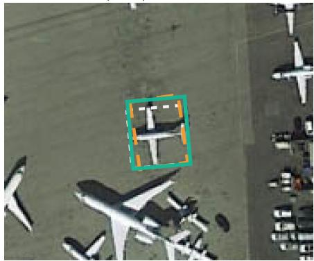

IoU 0.66 0.87 (+0.21)  
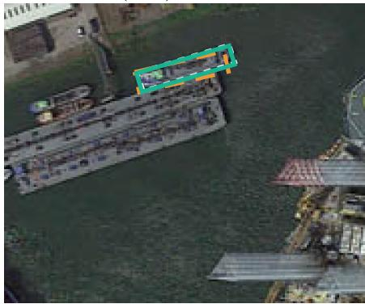

IoU 0.65 0.79 (+0.13)  
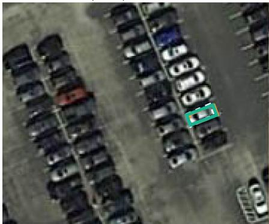

storagetank IoU 0.66 0.83 (+0.17)  
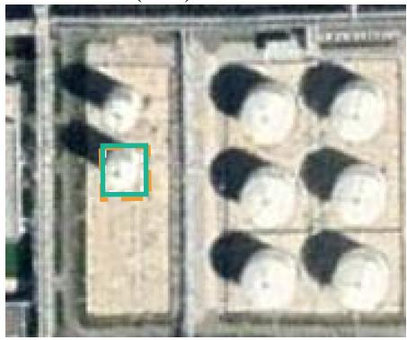

tenniscourt IoU 0.71 0.86 (+0.14)  
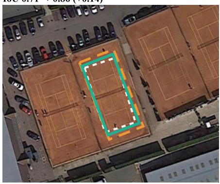  
GT Coarse Refined

bridge IoU 0.86 0.94 (+0.08)  
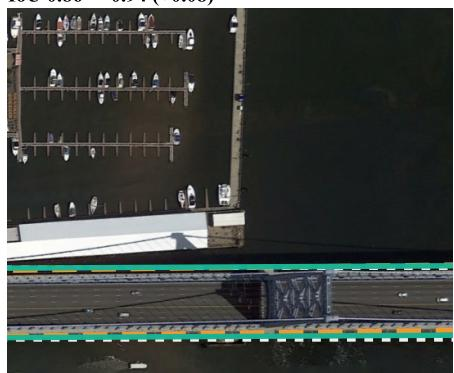  
Figure 5: Qualitative DIOR-R test-set refinements from LSKNet-S+NIF (epoch 12). White dashed, orange dashed, and green solid outlines represent the matched ground truth, the coarse detector box, and the NIF-refined box. Each panel reports the rotated IoU before and after refinement for the same candidate

Table 7: FAIR1M-v1.0 fine-grained AP (%).
<table><tr><td>Coarse</td><td>Fine class</td><td colspan="10">GV* Retina* Cascade* Faster* ROI Trans.* O-RCNN LSKNet-T LSKNet-S Strip R-CNN O-RCNN+NIF LSKNet-S+NIF Strip R-CNN+NIF</td></tr><tr><td rowspan="10"></td><td>Boeing737 Boeing747</td><td>35.43 38.46 47.88</td><td></td><td>40.42 36.43</td><td>39.58</td><td>42.84</td><td>45.12</td><td>39.84</td><td>40.08</td><td>44.58</td><td>40.96</td><td>43.75</td></tr><tr><td></td><td>55.36</td><td>52.86 29.07</td><td>50.68 22.50</td><td>73.56 18.32</td><td>87.61 18.83</td><td>84.97 20.16</td><td>86.63 24.21</td><td>85.82 18.73</td><td>85.94 19.57</td><td>85.58 22.18</td><td>86.29</td></tr><tr><td>Boeing777</td><td>15.67 24.75 51.81</td><td></td><td></td><td></td><td></td><td></td><td></td><td>54.97</td><td>60.36</td><td>54.70</td><td>22.80 61.51</td></tr><tr><td>Boeing787</td><td>48.32</td><td>52.47 0.00</td><td>51.86 0.01</td><td>56.43 0.00</td><td>62.92</td><td>56.00</td><td>56.48</td><td>23.12</td><td>20.99</td><td>28.07</td><td>27.32</td></tr><tr><td>C919</td><td>0.01 40.11</td><td>0.81</td><td></td><td></td><td>22.17</td><td>25.77</td><td>24.17</td><td></td><td></td><td></td><td></td></tr><tr><td>A220</td><td>40.50</td><td>44.37</td><td>47.81</td><td>47.67</td><td>47.87</td><td>50.05</td><td>52.20</td><td>49.04</td><td>48.59</td><td>51.16</td><td>50.62</td></tr><tr><td>A321</td><td>39.31 41.06</td><td>38.35</td><td>43.83</td><td>49.91 27.64</td><td>70.25</td><td>71.63</td><td>73.31</td><td>73.00</td><td>71.08</td><td>74.08</td><td>72.86</td></tr><tr><td>A330</td><td>16.54</td><td>18.02</td><td>26.55 17.66</td><td>31.79</td><td>73.34</td><td>67.94</td><td>72.82</td><td>72.57</td><td>69.20</td><td>72.07</td><td>71.95</td></tr><tr><td>A350</td><td>16.56</td><td>19.94</td><td>17.54 19.95 0.13</td><td></td><td>77.19</td><td>74.04 40.24</td><td>75.83 46.39</td><td>77.43 43.75</td><td>75.12</td><td>78.48</td><td>76.34 38.62</td></tr><tr><td>ARJ21</td><td>0.01 9.12</td><td>1.70 9.57</td><td>0.00</td><td></td><td>0.00</td><td>32.49</td><td></td><td></td><td></td><td>40.19</td><td>46.17</td></tr><tr><td rowspan="9">Ship</td><td>Passenger Ship</td><td></td><td></td><td>12.10 9.81</td><td>14.31</td><td>20.21</td><td>19.23</td><td>20.43</td><td>19.98</td><td>17.97</td><td>18.77</td><td>21.20</td></tr><tr><td>Motorboat</td><td>23.34 22.55</td><td>28.84</td><td>28.78</td><td>28.07</td><td>72.13</td><td>71.08</td><td>71.38</td><td>72.74</td><td>69.11</td><td>74.61</td><td>74.81</td></tr><tr><td>Fishing Boat</td><td>1.23 1.33 16.37</td><td>0.71 15.35</td><td>1.77</td><td>1.03 14.32</td><td>13.53</td><td>14.70</td><td>15.81</td><td>16.46</td><td>12.84</td><td>15.78</td><td>17.80 35.59</td></tr><tr><td>Tugboat</td><td>15.67 15.43 19.11</td><td></td><td>17.65</td><td></td><td>35.50</td><td>37.09</td><td>32.84</td><td>43.43</td><td>37.95</td><td>39.87</td><td></td></tr><tr><td>Engineering Ship</td><td>15.32 14.26</td><td>18.53 14.63</td><td>16.47 16.19</td><td>15.97 18.04</td><td>16.23</td><td>16.60</td><td>14.79</td><td>17.98</td><td>17.85</td><td>16.72</td><td>17.58</td></tr><tr><td>Liquid Cargo Ship Dry Cargo Ship</td><td>25.43 24.70</td><td>25.15</td><td>27.06</td><td>26.02</td><td>26.49 38.43</td><td>24.74 40.57</td><td>25.37 41.29</td><td>25.85 39.20</td><td>27.92 39.60</td><td>26.05 39.93</td><td>26.37 40.05</td></tr><tr><td>Warship</td><td>13.56 15.37</td><td></td><td>14.53 13.16</td><td></td><td>34.74</td><td>38.70</td><td>36.20</td><td>39.76</td><td>32.54</td><td>40.97</td><td>40.48</td></tr><tr><td></td><td></td><td></td><td></td><td></td><td>12.97</td><td></td><td></td><td></td><td></td><td></td><td>76.09</td></tr><tr><td>Small Car Bus</td><td>66.23 23.43</td><td>65.20 22.42</td><td>68.19 28.25</td><td>68.42</td><td>68.80 37.41</td><td>74.25</td><td>75.73</td><td>76.34</td><td>76.15</td><td>75.24</td><td>76.28</td></tr><tr><td rowspan="9">Vehicle</td><td></td><td></td><td></td><td>28.37</td><td></td><td>47.02</td><td>46.27</td><td>55.54</td><td>53.66</td><td>53.76</td><td>55.54</td><td>54.23</td></tr><tr><td>Cargo Truck</td><td>46.78 44.17</td><td>48.62</td><td>51.24</td><td>53.96</td><td>50.22</td><td>54.06</td><td>55.84</td><td>55.02</td><td>52.55</td><td>55.51</td><td>54.71</td></tr><tr><td>Dump Truck</td><td>36.56 35.37</td><td>40.40</td><td>43.60</td><td>45.68</td><td>57.56</td><td>59.52</td><td>61.57</td><td>60.28</td><td>58.80</td><td>61.05</td><td>60.27</td></tr><tr><td>Van</td><td>53.78 52.44</td><td>58.00</td><td>57.51</td><td>58.39</td><td>75.22</td><td>75.57</td><td>76.71</td><td>76.01</td><td>75.84</td><td>76.35</td><td>75.76</td></tr><tr><td>Trailer</td><td>14.32 19.17</td><td>13.66</td><td>15.03</td><td>16.22</td><td>20.91</td><td>19.30</td><td>21.46</td><td>21.30</td><td>21.05</td><td>21.38</td><td>22.76</td></tr><tr><td>Tractor</td><td>16.39</td><td>1.28</td><td>0.91 3.04</td><td>5.13 22.17</td><td>2.99</td><td>3.68</td><td>7.19</td><td>3.77</td><td>4.32</td><td>4.67</td><td>5.65</td></tr><tr><td>Excavator</td><td>16.92</td><td>17.03</td><td>16.45 17.99</td><td></td><td>19.95 1.77</td><td>28.40 5.66</td><td>25.73</td><td>26.57</td><td>28.25</td><td>27.04</td><td>29.93</td></tr><tr><td>Truck Tractor</td><td>28.91</td><td>28.98</td><td>30.27 29.36</td><td></td><td>46.71</td><td></td><td>4.74</td><td>8.31</td><td>5.87</td><td>3.61</td><td>7.16</td></tr><tr><td>Basketball Court</td><td>48.41</td><td>50.58</td><td>38.81</td><td>58.26</td><td>54.84</td><td>55.35</td><td>59.74</td><td>61.78</td><td></td><td>57.22</td><td></td></tr><tr><td rowspan="3">Court</td><td>Tennis Court</td><td>80.31 81.09</td><td>80.29</td><td>82.67</td><td>80.35</td><td>82.96</td><td>87.07</td><td>81.06</td><td>85.84</td><td>82.05</td><td>84.48</td><td>59.61 84.26</td></tr><tr><td>Football Field</td><td>53.46</td><td>52.50</td><td>48.21 54.50</td><td></td><td>56.68 64.62</td><td>69.67</td><td>70.39</td><td>71.41</td><td>69.23</td><td>68.98</td><td>68.64</td></tr><tr><td>Baseball Field</td><td>66.93 66.76</td><td>67.90</td><td>71.71</td><td>69.07</td><td>90.36</td><td>90.03</td><td>89.94</td><td>90.90</td><td>89.23</td><td>89.09</td><td>89.55</td></tr><tr><td rowspan="3">Road</td><td></td><td>59.41 60.13</td><td>55.67</td><td>59.86</td><td>58.44</td><td>60.82</td><td>60.58</td><td>62.90</td><td>61.87</td><td>61.70</td><td>61.48</td><td>60.76</td></tr><tr><td>Intersection Roundabout</td><td>16.25</td><td>17.41</td><td>20.35</td><td>16.92</td><td>18.58</td><td>20.47</td><td>23.20 27.00 39.51</td><td>23.21 40.91</td><td>22.00</td><td>24.37 27.67 40.47</td><td>23.62</td></tr><tr><td>Bridge</td><td>10.39</td><td>12.58</td><td>12.62 11.87</td><td>31.81</td><td>33.40</td><td>38.57</td></table>

Aircraft  
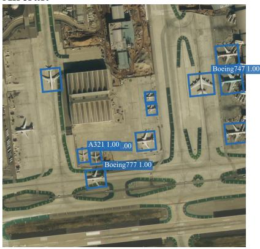

Aircraft  
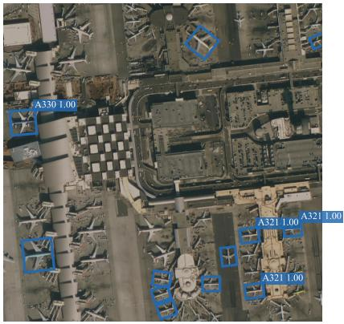

Ships  
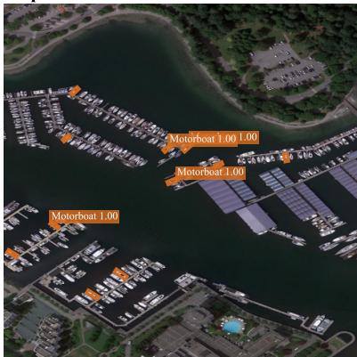

Vehicles  
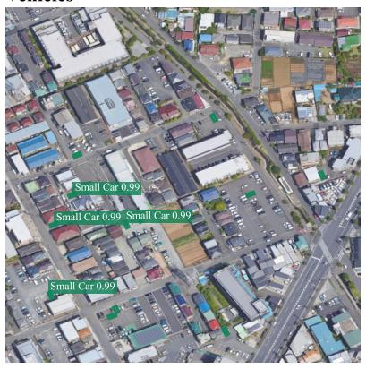

Courts  
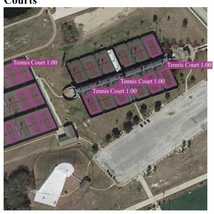

Roads  
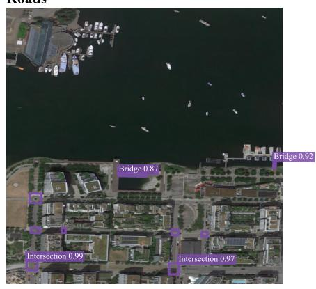  
Figure 6: Qualitative FAIR1M-v1.0 test-set predictions from LSKNet-S+NIF (epoch 12).