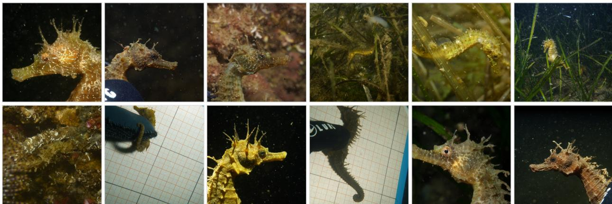
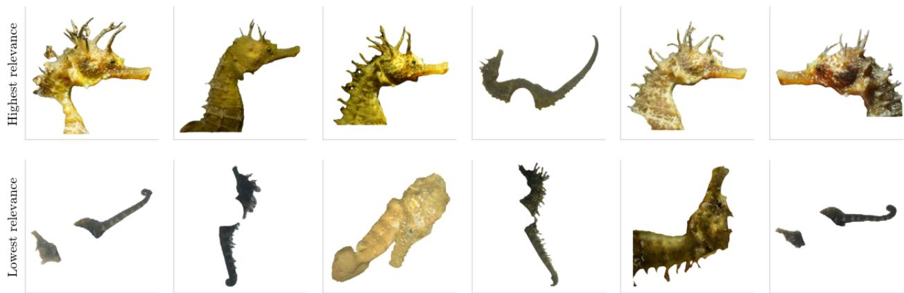
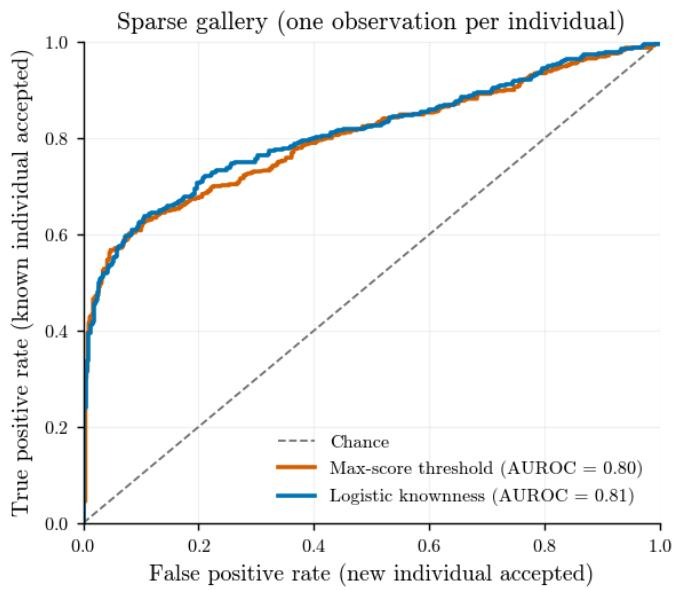
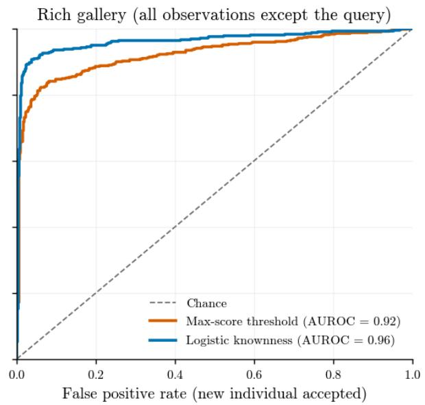

# OPEN-SET MULTI-VIEW SEAHORSE RE-IDENTIFICATION FROM UNDERWATER PHOTOGRAPH SEQUENCES

Tristan Fauvel ∗ Baysic Labs 37 rue Sommeiller, 74000 Annecy, France

Sylvie Louisy Association Peau-Bleue 46 Rue des Escais, 34300 Agde, France

Patrick Louisy Association Peau-Bleue 46 Rue des Escais, 34300 Agde, France UMR BOREA (MNHN, CNRS, Sorbonne Université, IRD, UniCaen, UGA), Station marine de Dinard, CRESCO 38 rue du Port Blanc, 35800 Dinard, France

Thomas Fauvel   
Parc Naturel Marin du Bassin d’Arcachon, 4 Rue Copernic, 33470 Le Teich, France Office Français de la Biodiversité,   
12 Cours Lumière, 94300 Vincennes, France

October 30, 2026

## ABSTRACT

Automated animal re-identification from photograph sequences can facilitate minimally invasive Capture-Mark-Recapture studies at scale. Yet, photographs taken during an observation session can vary greatly in quality, not always providing the necessary information for accurate re-identification. In this paper, we present new methods for taxonomic classification, sex determination, and open-set re-identification from image sequences. We train and evaluate our models on a dataset of 35,914 photographs of 474 individual seahorses observed in the wild. We demonstrate that our approach, by combining information from multiple photographs, yields state-of-the-art performance.

## 1 Introduction

## 1.1 Animal re-identification from photographs

Animal re-identification involves assigning an identity to an individual based on distinctive characteristics such as body patterns or other morphological traits. Animal re-identification from photographs taken in the wild has emerged as a powerful non-invasive Capture-Mark-Recapture (CMR) tool with several practical advantages over artificial markers (Glennie et al., 2021), including reduced costs, reduced harm or stress, potential for public participation in photo-based CMR programs (Gould et al., 2023), and large-scale use of camera traps (Schneider, Taylor, Linquist, et al., 2019; Alexander and Craighead, 2022). However, manual photo cataloging by experts is time-consuming and hinders its large-scale deployment (Connor, 2001; Irvine et al., 1982). Therefore, automated animal re-identification through computer vision has emerged as a promising solution (Bolger et al., 2012; Schneider, Taylor, Linquist, et al., 2019; Renò et al., 2019). In particular, recent advances in deep learning have shown that models can achieve high performance in re-identifying individuals across various species (Vidal et al., 2021; Beyan et al., 2026), sometimes exceeding human observer capability (Schneider, Taylor, and Kremer, 2020). In practice, during a single encounter with an animal, an observer or a camera trap will typically capture a sequence of photographs, which may provide different viewing angles, distances, or lighting, and together can provide more information about the animal’s identity than photographs taken in isolation. In this work, we develop methods for automated taxonomic classification, sex determination, and animal re-identification from camera sequences, leveraging the complementary information from multiple photographs while accounting for the variable informativeness of different photographs in a sequence relative to the animal characteristics and identity. We apply this approach to an expert-curated dataset of seahorses from two species, the long-snouted seahorse (Hippocampus guttulatus) and the short-snouted seahorse (Hippocampus hippocampus) from the Thau lagoon, on the French Mediterranean coast. This unpublished dataset contains expert-reidentified sequences of underwater photographs of seahorses in the wild.

## 1.2 Re-identification methods for seahorses

Seahorse populations are experiencing a marked decline worldwide, which may be linked to fishing pressure due to illegal trade, habitat loss and warming waters (Harasti, 2016; Pierri et al., 2021; Correia, 2022; Vivas et al., 2024). The last global assessment of seahorses, conducted in 2016 by Project Seahorse with the International Union for Conservation of Nature Species Survival Commission Seahorse, Pipefish and Seadragon Specialist Group, established that at least one-third of the 42 species then recognized were threatened. Specifically, Mediterranean Hippocampus guttulatus and Hippocampus hippocampus populations showed sharp density declines (Caldwell and Vincent, 2012b; Pierri et al., 2021; Correia, 2022; Vivas et al., 2024). However, the population dynamics of many seahorse species remain poorly understood. Project Seahorse highlights that 17 seahorse species are data-deficient, so that their conservation status could not be assessed. Reliably estimating seahorse demographic parameters remains difficult due to the limitations of traditional CMR or transect methods which are complex to implement for these cryptic, low-density fish with camouflage behavior (Curtis and Vincent, 2006). The most common artificial tagging method in seahorses is the application of visible implant fluorescent elastomer (VIFE) tags, which involves injecting seahorses with long-lasting colorants, allowing for individual recognition upon recapture (Woods and Martin-Smith, 2004; Monteiro et al., 2005; Curtis, 2006; Sogabe et al., 2007; Harasti, 2021). However, they require trained professionals and do not readily scale to citizen-science programs.

## 1.3 Contributions

In this paper, we present the following contributions. First, we develop multi-view seahorse taxonomic classification and sex determination models that leverage multiple photographs of a single seahorse observation to outperform approaches based on single images. Second, we present a new method for animal re-identification that:

• Uses a Bayes-optimal decision rule for open-set re-identification.

• Combines a fine-tuned foundation model trained on large multi-species corpora for the extraction of global descriptors, coupled with a local pattern matching module.

• Leverages an arbitrary number of photographs to enable reliable animal re-identification, weighting their relevance based on estimated image informativeness.

We demonstrate that this approach yields high performance in seahorse re-identification.

## 1.4 Related work

Modern photo re-ID techniques based on deep learning can be broadly categorized into two approaches. The first one relies on deep neural networks trained to produce image embeddings (also called global embeddings), the second relies on the extraction and matching of local features. The global features approach is typically framed as a metric learning problem. A deep neural network is trained to minimize a triplet loss or an ArcFace loss (Deng et al., 2019). At inference time, the cosine similarity between the embeddings of each query image and gallery image is computed, and a similarity threshold is used to decide whether the image belongs to an individual already observed or not. In the former case, a ranked list of candidate matches is produced. Recently, foundation models trained on many datasets from different species have shown strong performance in re-identification, both in zero-shot learning and after fine-tuning on a specific dataset (Cermák et al., 2024; Otarashvili et al., 2024). Local features are extracted by deep neural networks such asˇ ALIKED (Zhao et al., 2023), DISK (Tyszkiewicz et al., 2020) or SuperPoint (DeTone et al., 2018) and are matched using a deep neural network specialized for feature matching, LightGlue (Lindenberger et al., 2023). This approach is usually more accurate than global feature matching, but since it performs pairwise comparison between the query and the gallery images, it becomes computationally impractical as the dataset grows. In order to get the most out of the slow but accurate local features approach and the fast but less accurate global features, Adam, Papafitsoros, Kováˇr, et al. (2025) introduced WildFusion, which uses global feature similarity to create a list of the most likely matching candidates from the gallery, on which local feature matching is applied. The scores are then calibrated using isotonic regression and combined using a weighted average. Yesharim et al. (2026) used a related approach to achieve very high re-ID performance on the Hula painted frog. They noticed that the local feature extractor ALIKED, combined with the LightGlue matcher, led to near-perfect closed-set retrieval performance. However, it is computationally expensive. Therefore, they first fine-tuned the MiewID foundation model (Otarashvili et al., 2024) on their dataset, and used the resulting cosine similarities to shortlist the most likely matches, then applied ALIKED/LightGlue on the shortlist to produce a final ranking.

H. guttulatus and H. hippocampus can be distinguished based on head, snout, and trunk shape (Lourie et al., 2004). Hippocampus guttulatus has a distinct mark pattern composed of white spots scattered throughout the entire body surface, allowing for photo-identification by human experts with manual labeling of spots and image comparisons (Correia, Palma, et al., 2014). Moreover, Correia, Antunes, et al. (2021) demonstrated that it is possible to re-identify H. hippocampus from photographs taken in captivity based on crown characteristics.

Spoto et al. (2024) developed two models for taxonomic classification of H. hippocampus and H. guttulatus on a dataset of seahorse photographs from the Mar Piccolo of Taranto, at the northern end of the Gulf of Taranto (Ionian Sea). Their dataset contained 2227 images of H. guttulatus and 1667 images of H. hippocampus. They found that a VGG16 architecture achieved an AUPRC (Area Under the Precision-Recall Curve) of about 0.97. However, despite the dataset containing multiple images of the same individuals, sometimes extracted from a video which likely creates near-duplicate images of the same individual, the authors do not mention any data leakage mitigation strategy. They reported a standard 5-fold cross-validation approach, which implies that photographs from the same individual, and even the same image sequence, may be present in both the training and test sets. The reported performance may therefore be inflated.

Aloui and Renoult (2022) reported promising preliminary results in the automated re-identification of Hippocampus guttulatus using a dataset related to ours. They trained EfficientNet variants (Tan and Le, 2020) using triplet loss (Schroff et al., 2015). However, they only evaluated their approach in a closed-set setting, where the query images correspond to individuals always present in the gallery. In this setting, they reported top-1 accuracy of up to 76% on manually curated images where the head is clearly visible.

Bergamini et al. (2018) proposed a multi-view re-identification method for cattle re-identification, which uses a front and a side image of the head which are fed to two different networks. The resulting embeddings are then combined and fed to another network that fuses the representations. However, this hybrid fusion approach does not accomodate more than two images, and requires manual annotation of front and side images.

## 2 Methods

## 2.1 Data

Photographs from H. hippocampus and H. guttulatus were taken underwater by marine biologists between March 2022 and October 2025. Species, sex and identity were determined by SL. The dataset contains photographs of 461 H. guttulatus and 13 H. hippocampus individuals (see Table 1). The median time between consecutive observations of the same individual was 13 days for H. guttulatus and 7 days for H. hippocampus (Table 2).

The data were not specifically collected for training machine learning models, and therefore reflect standard field experiment conditions, where the seahorse photographs were taken from different distances, viewing angles, lighting conditions, and backgrounds. Photographs attempted to capture both fine-grained details of the head and the overall environment. Some photographs also contain juvenile individuals. We did not manually curate the data to better capture the performance of the models in a field deployment setting, in contexts such as citizen science programs. Moreover, the extreme class imbalance (98% of observations correspond to H. guttulatus) reflects natural species observation imbalance.

## 2.2 Image preprocessing

Seahorses were detected and segmented in images using the Segment Anything Model 3 (Carion et al., 2025), which requires no manual annotation of the data (prompt: "seahorse", threshold value of 0.7 for detection, and 0.6 for the segmentation mask confidence). Crops corresponded to detection boxes with a 5% padding. The segmentation masks were used to set the background to white. The cropped and segmented images were white-padded to be square and resized to the models’ input dimensions.

  
Figure 1: Illustrative examples of photographs from the dataset. As this dataset was not specifically collected for the purpose of automated re-identification, images vary greatly in quality. Some images focus on the seahorse’s head, while others show the individual in its environment, with potential occlusion. Some images were taken for the purpose of measuring the animal’s length.

<table><tr><td>Species</td><td>Sex</td><td>N</td><td>FU med/max (d)</td><td>Obs/ind. (IQR)</td><td>Photos/obs (IQR)</td></tr><tr><td>H. guttulatus</td><td>Male</td><td>213</td><td>40/1015</td><td>3 (1-7)</td><td>13 (10–17)</td></tr><tr><td>H. guttulatus</td><td>Female</td><td>185</td><td>40/1094</td><td>2 (1–8)</td><td>13 (10–16)</td></tr><tr><td>H. guttulatus</td><td>Unknown</td><td>63</td><td>0/41</td><td>1 (1–1)</td><td>15 (12–20)</td></tr><tr><td>H. hippocampus</td><td>Male</td><td>8</td><td>2/87</td><td>2 (1–2)</td><td>16 (13–41)</td></tr><tr><td>H. hippocampus</td><td>Female</td><td>5</td><td>39/108</td><td>5 (5–7)</td><td>13 (10–32)</td></tr></table>

Table 1: Summary statistics by species and sex. FU: follow-up time in days. Obs/ind.: number of observations per individual. Photos/obs: number of photos per observation. IQR: interquartile range.

## 2.3 Data splits for species and sex classification

To evaluate taxonomic classification and sex determination models, we used a stratified 5-fold cross-validation approach. To make sure that images of an individual are not present in both the training, validation, and test sets, stratification was performed at the individual level, balancing class proportions across folds by individual count. Evaluation metrics were computed on pooled out-of-fold predictions, that is, predictions from all folds are aggregated into a single score.

Hyperparameters were tuned on a held-out calibration split nested within each of the 5 cross-validation folds. Concretely, we split the training observations in each fold into an 80% core part and a 20% held-out part, and the identity-balanced accuracy was evaluated on the held-out part. The selected hyperparameters were then used to refit the full training fold.

## 2.4 Taxonomic and sex classification models

We start by formalizing the multi-view binary classification problem. Let the class label be Y, an observation is a set of photographs: $\boldsymbol { X } _ { 1 : m } = \stackrel { \cdot } { ( } X _ { 1 } , \cdot \cdot \cdot , X _ { m } )$ . The binary cross-entropy loss is minimized by the posterior predictive class probability $P ( Y = 1 | X _ { 1 : m } , \mathcal { D } )$ , where D is the labelled dataset. A typical approach would be to aggregate the image embeddings using a learned fusion rule that can accommodate a variable number of views m. Given the extreme species imbalance in our dataset and the limited effective sample size, we restricted our choice to a score fusion system, which first maps each image embedding to a score: $S _ { i } = f ( { \bar { X } } _ { i } )$ , then combines the scores into an observation-level posterior distribution of the class label $P ( \breve { Y } | S _ { 1 : m } )$

<table><tr><td>Species</td><td>n gaps</td><td>Min (d)</td><td>P25 (d)</td><td>Median (d)</td><td>P75 (d)</td><td>Max (d)</td><td> $\mathbf { M e a n } \pm \mathbf { S D }$ </td></tr><tr><td>H. guttulatus</td><td>1983</td><td>1</td><td>7</td><td>13</td><td>31</td><td>609</td><td> $3 3 \pm 5 8$ </td></tr><tr><td>H. hippocampus</td><td>36</td><td>1</td><td>1</td><td>7</td><td>14</td><td>77</td><td> $1 2 \pm 1 7$ </td></tr></table>

Table 2: Inter-observation gap statistics by species. SD: standard deviation. P25: 25th percentile. P75: 75th percentile.

If we assume that the views are conditionally independent given the label, the likelihood is given by:

$$
p ( X _ { 1 : m } | Y ) = \prod _ { i = 1 } ^ { m } p ( X _ { i } | Y )\tag{1}
$$

This assumption means that, conditional on the class label, observing one view gives no additional information about any other view.

Then, the posterior predictive class probability is given by:

$$
p ( Y = 1 | X _ { 1 : m } , \mathcal { D } ) \propto P ( Y = 1 | \mathcal { D } ) \prod _ { i = 1 } ^ { m } p ( X _ { i } | Y = 1 , \mathcal { D } )\tag{2}
$$

$$
\propto p ( Y = 1 | \mathcal { D } ) \prod _ { i = 1 } ^ { m } \frac { P ( Y = 1 | X _ { i } , \mathcal { D } ) } { P ( Y = 1 | \mathcal { D } ) }\tag{3}
$$

Let $S _ { 1 : m }$ be the posterior log odds (or logit) $\begin{array} { r } { S _ { 1 : m } = \log \frac { P ( Y = 1 | X _ { 1 : m } , \mathcal { D } ) } { P ( Y = 0 | X _ { 1 : m } , \mathcal { D } ) } } \end{array}$ . We get:

$$
S _ { 1 : m } = \mathrm { l o g i t } ( \pi ) + \sum _ { i = 1 } ^ { m } \left[ \mathrm { l o g i t } ( p _ { i } ) - \mathrm { l o g i t } ( \pi ) \right]\tag{4}
$$

with the positive class marginal posterior probability $\pi = P ( \boldsymbol { Y } = 1 | \mathcal { D } )$ and the posterior predictive probability for the positive class $p _ { i } = P ( Y = \bar { 1 } | X _ { i } , \bar { D } )$ .

Assuming that the class frequency is the same across the negative and positive classes, we get, under the conditional independence assumption:

$$
P ( Y = 1 | S _ { 1 : m } ) = \sigma ( S _ { 1 : m } ) = \sigma \left( \sum _ { i = 1 } ^ { m } S _ { i } \right)\tag{5}
$$

with $S _ { i } = \log \mathrm { i t } ( p _ { i } )$ , and $\sigma$ is the sigmoid function.

The assumption of conditional independence of the views is, of course, optimistic, as after conditioning on the class label, images from the same observation may remain dependent through shared observation conditions such as turbidity, lighting, or background.

At the opposite extreme, one may consider the limiting case of complete redundancy, in which any single view contains all the class-relevant information available in the entire set of views. This assumption can be expressed as:

$$
P ( Y = 1 \mid X _ { 1 : m } , { \mathcal { D } } ) = P ( Y = 1 \mid X _ { i } , { \mathcal { D } } ) .\tag{6}
$$

Requiring this relation to hold for every i is a strong assumption: it implies that each individual view contains the same class-relevant information as the complete set.

Under this assumption, we obtain the average-logit fusion rule:

$$
P ( Y = 1 | S _ { 1 : m } , \mathcal { D } ) = \sigma \left( \frac { 1 } { m } \sum _ { i = 1 } ^ { m } S _ { i } \right)\tag{7}
$$

Note that, in particular, adding duplicate or nearly duplicate images does not mechanically increase the magnitude of the fused logit and therefore does not produce a more confident posterior.

Therefore, in practice, one may want to correct for redundancy across images to prevent an overconfident posterior, by simply using:

$$
P ( Y = 1 | S _ { 1 : m } , { \mathcal { D } } ) = \sigma \left( \alpha \sum _ { i = 1 } ^ { m } S _ { i } \right)\tag{8}
$$

where $0 < \alpha < 1$ . Note that this scaling factor does not affect the decision boundary, hence the predicted classes. The average logits fusion rule corresponds to a conservative choice of $\alpha = m ^ { - 1 }$

In our experiments, we evaluated image-level classification performance, average logits fusion, and logit-sum fusion. Additionally, we also considered majority vote, in which each image in an observation votes for a class label, and the class probability is the fraction of images voting for that class. Therefore, observation-level prediction corresponds to the class with the most votes. For sex classification, we excluded the 63 individuals of unknown sex.

Given the extreme species imbalance in our dataset and the small effective sample size, we decided to focus our investigation on linear probing of vision foundation models.

Therefore, for image-level taxonomic and sex classification, we trained logistic regression models on the embeddings obtained from two different vision foundation models: either BioCLIP 2.5 (Gu et al., 2025) or DINOv3 ViT-L/16 CLS (Siméoni et al., 2025). Images fed to BioCLIP 2.5 were normalized using OpenAI CLIP statistics, whereas images fed to DINOv3 were normalized using ImageNet statistics. We applied L2 regularization and tuned the inverse regularization strength coefficient using a grid search over 25 log-spaced values in [0.01, 10].

DINOv3 is a vision foundation model trained using self-supervision on a curated set of 1,689 million images. By contrast, BioCLIP is a variant of CLIP (Radford et al., 2021) further pre-trained on TreeOfLife-10M, a large and diverse dataset of biology images, using a hierarchical variant of contrastive learning specifically designed to enable high performance in taxonomic classification (Stevens et al., 2024). BioCLIP 2 is a scaled version trained on the larger and more diverse TreeOfLife-200M dataset, with a larger vision transformer (ViT-L/14 pre-trained on LAION-2B). We used the BioCLIP 2.5 variant, which uses the larger ViT-H/14 backbone and was trained on an updated version of TreeOfLife-200M that adds 19 million more images to the original version. For both models, images were resized to 224×224 pixels.

## 2.5 Re-identification model

## 2.5.1 Problem formalization

Let G denote the set of identities in the gallery. Let Q denote the set of individuals in the query. For individual $q \in \mathcal { Q }$ $\mathcal { O } _ { q }$ is the set of observations of this individual in the query and in the gallery.

Animal re-identification (or re-ID) corresponds to determining, for a query observation composed of a sequence of images $X _ { 1 : m }$ of individual $q \in \mathcal { Q } , \mathrm { i f } q \in \bar { \mathcal { G } } \left( \mathrm { i . e . } \mathcal { G } \right.$ belongs to the gallery), and if so, to match q to an individual in the gallery. Animal re-identification is therefore an open-set recognition task, in the sense that the individuals in the queries at inference time are not necessarily present in the training set, and in the sense that they are not necessarily present in the gallery either.

The Bayes-optimal decision rule is to return, for a query observation $X _ { 1 : m }$ and given training data ${ \mathcal { D } } ,$ a predicted identity qˆ defined as:

$$
\hat { q } = \underset { q \in { \mathcal G } \cup \{ \mathrm { n e w } \} } { \mathrm { a r g m a x } } P ( Y = q | X _ { 1 : m } , \mathcal D ) ,\tag{9}
$$

where new corresponds to the case where it is predicted that the corresponding individual does not belong to the gallery. We have:

$$
\operatorname* { m a x } _ { q \in \mathcal { G } \cup \{ \mathfrak { n e w } \} } P ( Y = q | X _ { 1 : m } , \mathcal { D } ) = \operatorname* { m a x } \left[ \operatorname* { m a x } _ { q \in \mathcal { G } } P ( Y = q | X _ { 1 : m } , \mathcal { D } ) , P ( Y = \mathfrak { n e w } | X _ { 1 : m } , \mathcal { D } ) \right]\tag{10}
$$

Let $K = \mathbb { 1 } \{ q \in \mathcal { G } \}$ denote the binary variable that indicates whether the individual in the query belongs to the gallery (K = 1) or not $( K = 0 )$ . The probability that an observation corresponds to individual q in the gallery is given by:

$$
\begin{array} { r } { P ( \boldsymbol { Y } = q | X _ { 1 : m } , \mathcal { D } ) = P ( K = 1 | X _ { 1 : m } , \mathcal { D } ) P ( \boldsymbol { Y } = q | X _ { 1 : m } , K = 1 , \mathcal { D } ) } \\ { = p _ { \mathrm { k n o w n } } s _ { q } , \qquad } \end{array}\tag{11}
$$

where $s _ { q }$ is the closed-set re-ID probability, and $p _ { \mathrm { k n o w n } }$ is the probability that the query individual belongs to the gallery. Moreover, we have:

$$
\begin{array} { r } { P ( Y = \multimap ) X _ { 1 : m } , \mathcal D ) = P ( K = 0 | X _ { 1 : m } , \mathcal D ) } \\ { = 1 - p _ { \mathrm { k n o w n } } \qquad } \end{array}\tag{12}
$$

So that:

$$
\operatorname* { m a x } _ { q \in \mathcal { G } \cup \{ \mathfrak { n e w } \} } P ( Y = q | X _ { 1 : m } , \mathcal { D } ) = \operatorname* { m a x } \left[ 1 - p _ { \mathrm { k n o w n } } , p _ { \mathrm { k n o w n } } \operatorname* { m a x } _ { q \in \mathcal { G } } s _ { q } \right]\tag{13}
$$

The prediction is therefore:

$$
\begin{array} { r l } & { \hat { q } = \underset { q \in \mathcal { G } \cup \{ \mathrm { n e w } \} } { \mathrm { a r g m a x } } P ( Y = q | X _ { 1 : m } , \mathcal { D } ) } \\ & { = \left\{ \begin{array} { l l } { \underset { q \in \mathcal { G } } { \mathrm { a r g m a x } } s _ { q } \quad } & { \mathrm { i f } \frac { 1 } { \operatorname* { m a x } _ { q \in \mathcal { G } } s _ { q } + 1 } < p _ { \mathrm { k n o w n } } , } \\ { \mathrm { n e w } , \mathrm { o t h e r w i s e } . } \end{array} \right. } \end{array}\tag{14}
$$

An observation is therefore more likely to be considered as from a new individual as $\operatorname* { m a x } _ { q \in \mathcal { G } } s _ { q }$ decreases. There is no fixed threshold τ such that the decision rule systematically assigns an individual in the gallery if $p _ { \mathrm { k n o w n } } > \tau$ or if $\operatorname* { m a x } _ { q \in { \mathcal { G } } } s _ { q } > \tau$ . Note that $\begin{array} { r } { \frac { 1 } { 2 } < \frac { 1 } { \operatorname* { m a x } _ { q \in \mathcal { G } } s _ { q } + 1 } < 1 } \end{array}$ and the decision rule can assign the query observation to an individual in the gallery only $\mathrm { i f } \ p _ { \mathrm { k n o w n } } > \frac { 1 } { 2 }$

Therefore, for each observation, we need to estimate two quantities: the probability that the observation corresponds   
to a known individual, $p _ { \mathrm { k n o w n } } = P ( K = 1 | X _ { 1 : m } , \mathcal { D } )$ , and the closed-set re-identification probability $s _ { q } = P ( Y =$   
$q | X _ { 1 : m } , K = 1 , \mathcal { D } )$ . The closed-set re-identification decision is denoted $\hat { z } = \underset { \mathcal { \sim } \mathcal { C } } { \mathrm { a r g m a x } } P ( Y = \overset { \cdot } { q } | X _ { 1 : m } , \overset { \cdot } { K } = 1 , \mathcal { D } )$ . The q∈G   
knownness decision is given by:

$$
\begin{array} { c } { { \hat { \gamma } = { \bf 1 } \left\{ \frac { 1 } { \operatorname* { m a x } _ { q \in { \mathcal { G } } } s _ { q } + 1 } < p _ { \mathrm { k n o w n } } \right\} } } \\ { { { } = { \bf 1 } \left\{ \frac { 1 } { s _ { \hat { z } } + 1 } < p _ { \mathrm { k n o w n } } \right\} } } \end{array}\tag{15}
$$

So that:

$$
\hat { q } = \left\{ \begin{array} { l l } { \hat { z } , } & { \mathrm { i f } \ \hat { \gamma } = 1 , } \\ { \mathrm { n e w } , } & { \mathrm { i f } \ \hat { \gamma } = 0 . } \end{array} \right.\tag{16}
$$

## 2.5.2 Evaluation metrics

Standard top-k accuracy can be misleading due to the fact that some individuals are over-represented among observations (see Table 1). Therefore, Adam, Cermák, et al. (2025) recommend using balanced accuracy metrics to evaluateˇ performance (Mendes Júnior et al., 2017):

We define the Balanced Re-identification Accuracy as:

$$
\begin{array} { r l } & { \displaystyle \mathrm { B R A } = \frac { 1 } { | \mathcal { Q } | } \sum _ { q \in \mathcal { Q } } \frac { 1 } { | \mathcal { O } _ { q } | } \sum _ { i \in \mathcal { O } _ { q } } \left[ \mathbb { 1 } \left( \hat { z } _ { i } = q , \hat { \gamma } _ { i } = 1 , q \in \mathcal { G } \right) + \mathbb { 1 } \left( \hat { \gamma } _ { i } = 0 , q \notin \mathcal { G } \right) \right] } \\ & { \displaystyle = \frac { \rho } { | \mathcal { G } \cap \mathcal { Q } | } \sum _ { q \in \mathcal { Q } \cap \mathcal { Q } } \frac { 1 } { | \mathcal { O } _ { q } | } \sum _ { i \in \mathcal { O } _ { q } } \mathbb { 1 } \left( \hat { q } _ { i } = q \right) + \frac { 1 - \rho } { | \bar { \mathcal { G } } \cap \mathcal { Q } | } \sum _ { q \in \bar { \mathcal { G } } \cap \mathcal { Q } } \frac { 1 } { | \mathcal { O } _ { q } | } \sum _ { i \in \mathcal { O } _ { q } } \mathbb { 1 } \left( \hat { q } _ { i } = \mathrm { n e w } \right) } \\ & { \displaystyle = \rho \mathrm { B A K S } + ( 1 - \rho ) \mathrm { B A U S } } \end{array}\tag{17}
$$

Where $\begin{array} { r } { \rho = \frac { | \mathcal { G } \cap \mathcal { Q } | } { | \mathcal { Q } | } } \end{array}$ is the fraction of query individuals corresponding to individuals in the gallery.

BAUS is the Balanced Accuracy on Unknown Samples (Adam, Cermák, et al., 2025), defined as: ˇ

$$
\mathrm { B A U S } = \frac { 1 } { \left| \bar { \mathcal { G } } \cap \mathcal { Q } \right| } \sum _ { q \in \bar { \mathcal { G } } \cap \mathcal { Q } } \frac { 1 } { \left| \mathcal { O } _ { q } \right| } \sum _ { i \in \mathcal { O } _ { q } } \mathbb { 1 } \left( \hat { q } _ { i } = \mathrm { n e w } \right)\tag{18}
$$

BAKS is the Balanced Accuracy on Known Samples (Adam, Cermák, et al., 2025):ˇ

$$
\mathrm { B A K S } = \frac { 1 } { \left| \mathcal { G } \cap \mathcal { Q } \right| } \sum _ { q \in \mathcal { G } \cap \mathcal { Q } } \frac { 1 } { \left| \mathcal { O } _ { q } \right| } \sum _ { i \in \mathcal { O } _ { q } } \mathbb { 1 } \left( \hat { q } _ { i } = q \right)\tag{19}
$$

BAKS answers the question: "for a known animal, did the full open-set system both accept it as known and choose the right top-1 identity?".

A system that classifies every query as a new individual would get a BAUS of 1, and a BRA of $1 - \rho .$ Therefore, it is useful to consider the normalized accuracy, which is the geometric mean of BAKS and BAUS (Adam, Cermák, et al.,ˇ 2025):

$$
\mathrm { N o r m a l i z e d \ A c c u r a c y = \sqrt { B A K S \cdot B A U S } }\tag{20}
$$

## 2.5.3 Data splits for re-identification

For re-identification, given the computational cost of CNN fine-tuning, we used a single identity-disjoint split (70% train / 10% val / 20% test). Identities were stratified by their number of observations so that each split receives a comparable mix of sparse and well-sampled individuals.

Within the validation and test sets, an observation can be either in the query or in the gallery. More precisely, it can have four distinct roles: known query (an observation among the query batch, corresponding to an individual in the gallery), unknown query, gallery-only distractor (an observation corresponding to an individual not present in the query batch), and gallery member (observations in the gallery from individuals that are also represented in the query). Therefore, we perform an additional five-fold role rotation, corresponding to an additional identity-level split within the validation and test sets. Again, these splits are stratified by observation count. In each fold, observations corresponding to a given identity can either correspond to an unknown query, a known query (therefore also in the gallery), or a distractor in the gallery. Within each fold, identities with only a single observation are excluded from the known query role and remain in the gallery as distractors.

Re-identification metrics are computed on the test set and averaged across the folds.

## 2.5.4 Gallery masking policy for evaluation

We consider two evaluation policies: in the first one, we consider a situation where the gallery is composed of all observations from all individuals in the test set, except the unknown-query identities and the observation in the query. We call this setting the "rich gallery" setting. To consider a more challenging scenario where less data are available, we also considered a "sparse gallery" situation where each individual in the gallery only has one observation, by randomly selecting one observation for each individual in the gallery. Under the sparse gallery policy, we repeat the evaluation 5 times for each query, by redrawing selected observations in the gallery uniformly at random among each gallery individual’s observation.

## 2.5.5 Modelling approaches

MiewID with zero-shot learning We first evaluated the performance of MiewID in a zero-shot setting, that is, without fine-tuning on our seahorse dataset. For a query observation $X _ { 1 : m }$ and a gallery individual g with images $X _ { 1 : n } ^ { ( g ) }$ we computed the cosine similarity between the image embeddings $S _ { C } ( X _ { i } , X _ { j } ^ { ( g ) } )$ for any query image/gallery image pair. For each query image, we then applied max-pooling on the gallery images, resulting in a vector with entries defined as max $S _ { C } ( X _ { i } , X _ { j } ^ { ( g ) } )$ . This corresponds to selecting, for each query image/gallery identity pair, the gallery j   
image most similar to the query image.

After this gallery-side pooling step, similarity scores are averaged over query images, resulting in query observation/gallery identity similarity scores:

$$
S ( X _ { 1 : m } , g ) = \frac { 1 } { m } \sum _ { i = 1 } ^ { m } \operatorname* { m a x } _ { j } S _ { C } ( X _ { i } , X _ { j } ^ { ( g ) } )\tag{21}
$$

A common approach to open-set animal re-identification is to define a decision threshold τ that determines whether a query is assigned to an existing individual in the gallery, or considered a new individual (Liao et al., 2014; Pakhomov et al., 2025; Kabuga et al., 2024; Adam, Cermák, et al., 2025). That is:ˇ

$$
\hat { q } = \left\{ \begin{array} { l l } { \underset { g \in \mathcal { G } } { \operatorname { a r g m a x } } P ( Y = g | X _ { 1 : m } , \mathcal { D } ) , } & { \mathrm { i f } \underset { g \in \mathcal { G } } { \operatorname { m a x } } P ( Y = g | X _ { 1 : m } , \mathcal { D } ) \geq \tau , } \\ { \mathrm { n e w ~ i n d i v i d u a l , } } & { \mathrm { o t h e r w i s e . } } \end{array} \right.\tag{22}
$$

We evaluated this approach by applying the rule:

$$
\boldsymbol { \hat { q } } = \left\{ \begin{array} { l l } { \underset { g \in \mathcal { G } } { \operatorname { a r g m a x } } S ( X _ { 1 : m } , g ) , } & { \mathrm { i f } \underset { g \in \mathcal { G } } { \operatorname { m a x } } S ( X _ { 1 : m } , g ) \geq \tau , } \\ { \hfill \mathrm { n e w } \mathrm { i n d i v i d u a l } , } & { \mathrm { o t h e r w i s e } . } \end{array} \right.\tag{23}
$$

We calibrated τ by maximizing normalized accuracy on a scoring fraction (35%) of the validation split using grid search. The grid is built as 51 evenly spaced quantiles of the scores distribution in the validation set. We selected τ based on the normalized accuracy rather than BRA as normalized accuracy has no dependence on the known/unknown ratio in the queries, which would make it more robust in case of differences in this ratio between the validation set and the test set.

MiewID fine-tuning MiewID was trained on a wide diversity of species, but not on seahorses (Otarashvili et al., 2024). We therefore fine-tuned the pretrained MiewID-msv3 backbone (2152-dimensional embeddings, 440×440 input, Otarashvili et al. (2024)) on our dataset following the method described in Yesharim et al. (2026), using a sub-center ArcFace head (Deng et al., 2019) with 3 sub-centers, a scale of 64, and a margin of 0.5 rad. We used an identity-disjoint split (70% train / 10% val / 20% test). The backbone’s final layer was frozen, and all BatchNorm modules were kept frozen throughout training. We used the AdamW optimizer with differential learning rates (backbone: 2e-5, ArcFace head: 1e-3, weight decay 1e-4), and a cosine annealing learning rate scheduler over 100 epochs down to a minimum learning rate of 1e-6. Moreover, we applied data augmentation, including random resized crops (scale 0.75–1.0), color jittering (p=0.8), random grayscale conversion (p=0.2), and Gaussian blur (p=0.5). We used a batch size of 24, comprising four images from each of six identities.

Performance was evaluated every 5 epochs using a 5-fold gallery/known-query/unknown-query rotation. The best checkpoint was selected based on the value of mAP@R.

Relevance weighting Query image quality varies greatly within an observation (Figure 1). We therefore explored the use of a new approach to weight the contribution from each query image based on its relevance to re-identification, by generalizing the approach described in equation 21. Observation-level similarity scores are computed by assigning query-image weights:

$$
S ( X _ { 1 : m } , g ) = \sum _ { i = 1 } ^ { m } w ( X _ { i } ) \underset { j } { \operatorname* { m a x } } S _ { C } ( X _ { i } , Y _ { j } ^ { ( g ) } ) ,\tag{24}
$$

with $\textstyle \sum _ { i = 1 } ^ { m } w ( X _ { i } ) = 1$

We hypothesized that DINOv3 embeddings contained information regarding the usefulness of a given image for re-identification. Therefore, we trained a logistic regression classifier on a fitting fraction (65% of observations) of the validation split to predict whether image-level closed-set rank-1 re-identification from the fine-tuned MiewID was correct or not, with standardized DINOv3 CLS embeddings as input. We called the output probabilities of this model image relevance scores. We then weighted the MiewID-derived similarities by the predicted image relevance scores, floored at 0.02 so that no image is discarded, then normalized to sum to 1, and computed the weighted average similarity score.

ALIKED/LightGlue reranking Inspired by the approach presented in Yesharim et al. (2026), we adopted a retrievethen-rerank strategy in which a shortlist of candidate gallery identities, retrieved with the global fine-tuned MiewID descriptor, is re-ordered for each query observation using local feature matching.

For each query observation, we ranked the gallery identities by the relevance-weighted similarity score of equation 24 and retained the K = 10 highest-scoring identities. For each retained candidate identity, we selected the $L = 1 0$ query-image/gallery-image pairs with the highest MiewID cosine similarity, giving at most $K \times L = 1 0 0$ candidate pairs per query observation. This choice was made to reduce the computational cost of running local feature extraction and matching. Local features were extracted from each image with ALIKED (Zhao et al., 2023) (up to 256 keypoints per image, each image resized so that its longer side does not exceed 512 pixels) and matched with LightGlue (Lindenberger et al., 2023). The score of a pair is the number of established correspondences. Each shortlisted candidate identity was then scored by the mean of its five highest pairwise correspondence counts. This scoring approach was used to avoid reliance on a single spuriously matched pair and dilution by uninformative images. Within the shortlist, candidates were re-ranked by this pooled score, the MiewID similarity being retained only as a tie-break.

Known/unknown probability model The threshold-based known/unknown decision heuristic defined in equation 22 differs from the theoretical decision rule we derived in equation 14. Therefore, we investigated another approach for the detection of new individuals, based on explicit modelling of the probability of the query corresponding to a known individual in the gallery. Intuitively, the model would benefit from using as features a measure of the match strength between a query and an identity, and a measure of the best match decisiveness. Therefore, we trained a logistic regression model to predict whether the individual in a query is present in the gallery, taking as input the following features:

• Local features matching confidence gap between the best and second-best identities, measured as the gap between the best and second-best identity’s pooled ALIKED/LightGlue correspondence count. A large margin means one identity is clearly matched; a small margin means the query resembles no gallery individual decisively (typical of a genuinely new animal).

• Fraction of the photographs in an observation whose own image-level MiewID top-1 identity agrees with the observation’s best matching identity. Concretely, query image/gallery identity similarity score is computed by max-pooling, and the top-1 match for each query image i, argmax max $S _ { C } ( X _ { i } , Y _ { j } ^ { ( g ) } )$ , is returned. The g j fraction of image-level top-1 matches corresponding to the observation-level top-1 match measures the within-observation consistency.

• Mean similarity to the winning identity, computed as the average image-level cosine similarity derived from the fine-tuned MiewID from the query observation’s photographs to the best matching identity’s photographs determined by local feature matching $\hat { g } , \frac { 1 } { m } \sum _ { i = 1 } ^ { m }$ max $S _ { C } ( X _ { i } , X _ { j } ^ { ( \hat { g } ) } )$ . This gives a measure of how strongly, j on average, the MiewID embeddings support the best match.

• Standard deviation of the similarity to the winning identity, computed as the standard deviation of the imagelevel cosine similarity derived from the fine-tuned MiewID from the query observation’s photographs to the best matching identity’s photographs determined by local feature matching, $s t d _ { i = 1 : m } \left[ \operatorname* { m a x } _ { j } S _ { C } ( X _ { i } , X _ { j } ^ { ( \hat { g } ) } ) \right]$

• Binary variable corresponding to the agreement between the ALIKED/LightGlue rerank and the fine-tuned MiewID top match. Intuitively, when two independent matchers (global embedding vs. local descriptors) agree, the "known" decision is more trustworthy.

A logistic regression on these features, standardized and identity-balanced (so a heavily photographed individual does not dominate), is fitted on the validation split. In a first approach, we keep the threshold-based rule of equation 22 but replace the quantity being thresholded: the output of the logistic regression model $p _ { { \mathrm { k n o w n } } }$ is used instead of $\boldsymbol { s } _ { \hat { \boldsymbol { z } } }$ to determine if the observation corresponds to a new individual or not.

Maximum a posteriori open-set decision rule The decision rule of equation 14 returns the mode of the posterior distribution $\tilde { P ( \boldsymbol { Y } | \boldsymbol { X } _ { 1 : m } , \mathcal { D } ) }$ over the extended label set ${ \mathcal { G } } \cup \{ { \mathrm { n e w } } \}$ (Maximum A Posteriori, MAP), and is therefore Bayes-optimal under 0-1 loss. It requires two calibrated quantities: the knownness probability $p _ { \mathrm { k n o w n } }$ and the closed-set re-ID distribution $P ( Y = k | X _ { 1 : m } , \mathbf { \bar { K } } { = } 1 )$

We obtain the latter in two steps. First, we Platt-scale the local-feature matching scores into pairwise matching probabilities, by fitting a one-dimensional logistic regression on $\log ( 1 + c )$ , where c is the LightGlue match count of a (query observation, gallery observation) pair, over all shortlisted pairs from the fitting portion of the validation split (65% of the observations, drawn within each identity), labelled by whether the two observations belong to the same individual. Writing $P _ { \mathrm { p a i r } } ( X _ { 1 : m } , o )$ for the resulting probability that the query observation $X _ { 1 : m }$ and gallery observation o show the same individual, we aggregate to identity level by max-pooling:

$$
P _ { \mathrm { m a t c h } } ( X _ { 1 : m } , k ) = \operatorname* { m a x } _ { o \in \mathcal { O } _ { k } } P _ { \mathrm { p a i r } } ( X _ { 1 : m } , o ) .\tag{25}
$$

Non-shortlisted identities receive $P _ { \mathrm { m a t c h } } = 0$ . This is a simplifying approximation that we hypothesize will have little impact, given the relatively large shortlist. To obtain the closed-set re-ID probability distribution from these matching probabilities, we then normalize over the gallery identities:

$$
P ( Y = k \mid X _ { 1 : m } , K = 1 ) = \frac { P _ { \mathrm { m a t c h } } ( X _ { 1 : m } , k ) } { \sum _ { g \in { \mathcal G } } P _ { \mathrm { m a t c h } } ( X _ { 1 : m } , g ) } .\tag{26}
$$

$P _ { \mathrm { p a i r } }$ is a calibrated probability, but $s _ { \mathrm { t o p } } \ = \ \operatorname* { m a x } _ { k \in \mathcal G } P ( Y \ = \ k \ | \ X _ { 1 : m } , K { = } 1 )$ is not. We therefore apply Platt recalibration on this quantity against top-1 match correctness on the held-out portion of the validation split, disjoint from the data used to fit the models above.

The second probability in the MAP open-set decision rule, $p _ { \mathrm { k n o w n } } ,$ also needs recalibration as it is the result of a logistic regression fitted with balanced known/unknown weights and identity weights. We therefore Platt-recalibrate it against gallery membership. Note that both recalibrations are monotone and act on scalar scores, so they leave the ranking unchanged. Compared to the threshold-based open-set decision, this rule requires no decision threshold τ tuned on held-out data: the held-out split is used to calibrate the two inputs instead. The knownness cutoff $1 / ( 1 + s _ { \mathrm { t o p } } )$ then moves with the top-candidate confidence, so a query whose top candidate clearly dominates the shortlist is accepted at a lower knownness probability than one whose candidates are tied.

## 3 Results

## 3.1 Species and sex classification

Individuals contribute very unequal numbers of images and observations, so all reported classification metrics, and the classifier fit itself, are identity-balanced. In order to determine uncertainty related to performance metrics for a fixed trained model, we used percentile bootstrap over individuals with 1,000 draws.

We found that DINOv3 linear probing led to better performance than BioCLIP 2.5 in terms of balanced accuracy and macro F1 (Table 3), both at the image level and at the observation level when applying average-logit fusion. Focusing more specifically on DINOv3, we then compared the performance of the different multi-view fusion methods for species classification (Table 4) and sex determination (Table 5), and found that leveraging all images from an observation led to higher prediction accuracy and better calibration than when considering single images. As expected, since logit sum and logit average do not change the classification decision, they lead to the same balanced accuracy and macro F1 There was no significant difference with majority vote, and all methods leveraging multiple photos resulted in very good classification performance with macro F1 and balanced accuracy above 0.9. However, when comparing calibration metrics, we found that majority vote was poorly calibrated for species classification compared to average logit or logit sum fusion, which resulted in lower Maximum Calibration Error (MCE), Expected Calibration Error (ECE) and Brier score.

<table><tr><td>Method</td><td>Balanced acc. ↑</td><td>Macro F1 ↑</td></tr><tr><td>DINOv3 ViT-L/16 CLS (image)</td><td>0.88 [0.84, 0.91]</td><td>0.87 [0.81, 0.90]</td></tr><tr><td>DINOv3 ViT-L/16 CLS (observation)</td><td>0.94 [0.85, 1.00]</td><td>0.97 [0.91, 1.00]</td></tr><tr><td>BioCLIP 2.5 (image)</td><td>0.82 [0.75, 0.88]</td><td>0.74 [0.66, 0.78]</td></tr><tr><td>BioCLIP 2.5 (observation)</td><td>0.90 [0.80, 0.98]</td><td>0.94 [0.87, 0.98]</td></tr></table>

Table 3: Backbone comparison at the image and observation levels (observation = mean-logit fusion) for species classification. All metrics are identity-balanced, with 95% individual-level bootstrap intervals over the 13 H. hippocampus and 461 H. guttulatus individuals.

<table><tr><td>Method</td><td>Balanced acc. ↑</td><td>Macro F1 ↑</td><td>Brier ↓</td><td>ECE↓</td><td>MCE↓</td></tr><tr><td>Image (LR)</td><td>0.88 [0.84, 0.91]</td><td>0.87 [0.81, 0.90]</td><td>0.01 [0.01, 0.02]</td><td>0.01 [0.01, 0.01]</td><td>0.42 [0.29, 0.69]</td></tr><tr><td>Mean logit</td><td>0.94 [0.85, 1.00]</td><td>0.97 [0.91, 1.00]</td><td>1.30 [0.02, 3.63] × 10−3</td><td>2.20 [0.21, 6.17] × 10−3</td><td>0.58 [0.22, 0.59]</td></tr><tr><td>Logit sum</td><td>0.94 [0.85, 1.00]</td><td>0.97 [0.91, 1.00]</td><td> $2 . 9 3 [ 0 . 0 0 , 8 . 8 0 ] \times 1 0 ^ { - 3 }$ </td><td>3.04 [0.00, 9.12] × 10−3</td><td>0.75 [0.00, 0.75]</td></tr><tr><td>Majority vote</td><td>0.99 [0.97, 1.00]</td><td>1.00 [0.99, 1.00]</td><td> $3 . 1 2 [ 1 . 7 4 , 5 . 1 0 ] \times 1 0 ^ { - 3 }$ </td><td>0.01 [0.01, 0.02]</td><td>0.60 [0.44, 0.60]</td></tr></table>

Table 4: Comparison of image fusion methods with DINOv3 CLS, with the per-image logistic regression as a baseline, in species classification. All metrics are identity-balanced, with 95% individual-level bootstrap intervals. ECE: Expected Calibration Error. MCE: Maximum Calibration Error.

## 3.2 Re-identification

Tables 6 and 7 report the re-identification performance in the sparse and rich gallery settings, respectively. We observed that MiewID fine-tuning brought substantial closed-set re-identification improvements. Relevance weighting provided little benefit with one observation per individual in the gallery, but led to substantial improvements in BAUS (and therefore BRA and NA) in the rich gallery setting. Visual inspection (Figure 2) shows that high relevance images are usually side view images of the head with good illumination, whereas low relevance images are whole body images with little detail.

At this stage, we considered that our focus should be on maximizing closed-set accuracy, as we could later improve the knownness detection module. In the case where all observations were included in the gallery except the query, relevance

<table><tr><td>Method</td><td>Balanced acc. ↑</td><td>Macro F1 ↑</td><td>Brier ↓</td><td>ECE↓</td><td>MCE↓</td></tr><tr><td>Image (LR)</td><td>0.79 [0.77, 0.81]</td><td>0.79 [0.77, 0.80]</td><td>0.15 [0.14, 0.16]</td><td>0.06 [0.04, 0.07]</td><td>0.11 [0.08, 0.17]</td></tr><tr><td>Mean logit</td><td>0.89 [0.87, 0.92]</td><td></td><td>0.89 [0.87, 0.92] 0.08 [0.07, 0.10]</td><td>0.07 [0.05, 0.09]</td><td>0.13 [0.12, 0.30]</td></tr><tr><td>Logit sum</td><td>0.89 [0.87, 0.92]</td><td>0.89 [0.87, 0.92] 0.10 [0.08, 0.12]</td><td></td><td>0.10 [0.08, 0.12]</td><td>0.67 [0.50, 0.79]</td></tr><tr><td>Majority vote</td><td>0.87 [0.85, 0.90]</td><td>0.87 [0.84, 0.90]0.10 [0.08, 0.11]</td><td></td><td>0.05 [0.04, 0.08]</td><td>0.16 [0.13, 0.27]</td></tr></table>

Table 5: Comparison of image fusion methods with DINOv3 CLS, with the per-image logistic regression as a baseline, in sex classification. All metrics are identity-balanced, with 95% individual-level bootstrap intervals. ECE: Expected Calibration Error. MCE: Maximum Calibration Error.

weighting brought improvement in unknown detection, resulting in improved BAUS, BRA and NA. Reranking a shortlist of candidates using ALIKED/LightGlue provided performance improvements on all performance metrics in the sparse gallery setting, but only improved BAKS in the rich gallery scenario. Adding the logistic knownness detection module then very slightly impacted NA in the sparse gallery setting, but substantially improved all performance metric in the rich gallery case. This is explained by the much better performance of this model, compared to max-score thresholding, in distinguishing new individuals in the rich gallery case (Figure 3).
<table><tr><td>Method</td><td>BAKS ↑</td><td>BAUS ↑</td><td>BRA↑</td><td>NA↑</td></tr><tr><td>1. MiewID zero-shot</td><td>0.22 [0.16, 0.28] (-)</td><td>0.62 [0.57, 0.68] (-)</td><td>0.47 [0.42, 0.53] (-)</td><td>0.33 [0.26, 0.38] (-)</td></tr><tr><td>2. + MiewID fine-tuning</td><td>0.61 [0.54, 0.68] (+0.40)</td><td>0.65 [0.59, 0.71] (+0.02)</td><td>0.64 [0.59, 0.68] (+0.16)</td><td>0.61 [0.56, 0.66] (+0.29)</td></tr><tr><td>3. + relevance weighting</td><td>0.59 [0.52, 0.65] (-0.02)</td><td>0.66 [0.61, 0.71] (+0.01)</td><td>0.64 [0.59, 0.68] (-0.00)</td><td>0.60 [0.55, 0.65] (-0.01)</td></tr><tr><td>4. + ALIKED/LightGlue rerank</td><td>0.62 [0.53, 0.70] (+0.03)</td><td>0.86 [0.81, 0.91] (+0.20)</td><td>0.77 [0.73, 0.81] (+0.14)</td><td>0.72 [0.65, 0.77] (+0.12)</td></tr><tr><td>5. + logistic knownness</td><td>0.67 [0.60, 0.74] (+0.05)</td><td>0.78 [0.74, 0.82] (-0.08)</td><td>0.74 [0.69, 0.78] (-0.04)</td><td>0.71 [0.65, 0.75] (-0.01)</td></tr><tr><td>6. + MAP open-set decision</td><td>0.63 [0.56, 0.70] (-0.04)</td><td>0.87 [0.83, 0.90] (+0.09)</td><td>0.78 [0.73, 0.82] (+0.04)</td><td>0.72 [0.66, 0.76] (+0.01)</td></tr></table>

Table 6: Seahorse re-ID with a sparse gallery. Cells are means over 5 query/gallery role rotations within the test split, with 95% bootstrap intervals over test individuals in brackets and the change from the row above in parentheses.

<table><tr><td>Method</td><td>BAKS ↑</td><td>BAUS ↑</td><td>BRA↑</td><td>NA↑</td></tr><tr><td>1. MiewID zero-shot</td><td>0.34 [0.25, 0.42] (-)</td><td>0.58 [0.50, 0.65] (-)</td><td>0.49 [0.42, 0.56] (-)</td><td>0.40 [0.32, 0.47] (-)</td></tr><tr><td>2. + MiewID fine-tuning</td><td>0.68 [0.58, 0.77] (+0.34)</td><td>0.71 [0.64, 0.78] (+0.13)</td><td>0.70 [0.64, 0.76] (+0.20)</td><td>0.67 [0.60, 0.73] (+0.27)</td></tr><tr><td>3. + relevance weighting</td><td>0.70 [0.61, 0.79] (+0.02)</td><td>0.86 [0.81, 0.91] (+0.15)</td><td>0.80 [0.76, 0.84] (+0.11)</td><td>0.77 [0.71, 0.81] (+0.09)</td></tr><tr><td>4. + ALIKED/LightGlue rerank</td><td>0.78 [0.69, 0.86] (+0.08)</td><td>0.71 [0.65, 0.77] (-0.15)</td><td>0.74 [0.68, 0.79] (-0.07)</td><td>0.71 [0.64, 0.76] (-0.05)</td></tr><tr><td>5. + logistic knownness</td><td>0.84 [0.75, 0.91] (+0.06)</td><td>0.93 [0.89, 0.97] (+0.22)</td><td>0.90 [0.85, 0.93] (+0.16)</td><td>0.88 [0.82, 0.92] (+0.17)</td></tr><tr><td>6. + MAP open-set decision</td><td>0.82 [0.73, 0.89] (-0.02)</td><td>0.94 [0.90, 0.97] (+0.01)</td><td>0.90 [0.85, 0.93] (-0.00)</td><td>0.87 [0.82, 0.92] (-0.01)</td></tr></table>

Table 7: Seahorse re-ID with a rich gallery. Cells are means over 5 query/gallery role rotations within the test split, with 95% bootstrap intervals over test individuals in brackets and the change from the row above in parentheses.

## 4 Discussion

## 4.1 Performance evaluation

Due to the significant computational cost of fine-tuning MiewID on our seahorse dataset, we were unable to evaluate how performance varied with changes in the training set. Instead, we focused on estimating the uncertainty associated with the performance of our trained and calibrated system. We note that it is common practice in the re-ID literature not to report uncertainty estimates for test set performance metrics, which unfortunately limits the generalizability of method-comparison results (see, e.g., Cermak et al. (2024), Otarashvili et al. (2024), Yesharim et al. (2026), and Adam, Papafitsoros, Jean, et al. (2025) for recent examples).

For a meaningful performance evaluation, the test set should be representative of real-world deployment scenarios. To mimic either the continuation of the re-identification program from which the dataset originated or, by contrast, the deployment of the re-identification system in a new population, we evaluated the re-ID models in rich- and sparse-gallery settings, respectively. Our results show that method performance can vary greatly depending on gallery composition. Note, however, that to fully mimic the conditions of a continuing re-identification program, we could have evaluated performance using the combined training, validation, and test sets. Indeed, in a real-world deployment, it may be possible to train the re-ID model on individuals from the current population, which is expected to substantially improve performance. The reported performance in the rich-gallery setting therefore represents a lower bound on real-world deployment performance.

  
Figure 2: Example images of high relevance (upper row) versus low-relevance (lower row) images. Images automatically classified as high relevance images are usually side view images of the head with good illumination, whereas low relevance images are whole body images with little visible details.

  
Figure 3: True positive rate as a function of the false positive rate for determining whether the query corresponds to a new individual or an individual in the gallery, for the maximum-score thresholding method (orange curve) or for the logistic knownness detection model (blue curve). The left plot corresponds to the sparse gallery setting, whereas the right plot corresponds to the rich gallery case.

## 4.2 Seahorse re-identification

In this paper, we demonstrated the feasibility of high-performance automated seahorse taxonomic classification, sex determination and individual re-identification from underwater photograph sequences in the wild. These are especially challenging tasks given that, in these conditions, image quality varies widely, and that European seahorses are cryptic animals with subtle patterns.

We demonstrated that leveraging multiple photographs from underwater observations led to improved performance across these tasks. For re-identification, we extended the WildFusion framework to include evidence from multiple views, and demonstrated that this greatly improves re-identification performance. Consistent with previous reports (Yesharim et al., 2026), we found that fine-tuning of a re-identification foundation model led to substantial performance gains. Moreover, we found that applying ALIKED/LightGlue reranking on a set of MiewID-shortlisted gallery observations clearly improved closed-set ranking. We found that a separate "knownness detection" module used within a Bayesoptimal open-set re-identification rule led to improved open-set performance compared to standard thresholding of the best match score in the case of a rich gallery, where each individual can be represented by many observations. MiewID fine-tuning was the most important step for performance improvement. While ALIKED/LightGlue reranking improved closed-set performance, it impacted the detection of new individuals not present in the gallery in the rich gallery case. Therefore, in the rich gallery setting, the second best improvement was obtained by using the Bayes-optimal decision rule with an explicit model of the knownness probability.

Although a previous preliminary study had reported promising performance in the automatic closed-set re-identification of H. guttulatus from images (Aloui and Renoult, 2022), it was unclear how computer vision systems would perform in an open-set setting. Moreover, Aloui and Renoult (2022) reported top-1 closed-set accuracy of up to 76% on manually curated data. By contrast, our approach yields better performance on raw data (BAKS of 82% in a similar evaluation setting), although the studies are not directly comparable.

For species classification, given the extreme class imbalance (98% H. guttulatus), the number of photographs of H. hippocampus was very limited, making it difficult to train a neural network classifier from scratch. In preliminary experiments, we found that a standard approach based on training a convolutional neural network (Spoto et al., 2024) did not work well. By contrast, simply applying a logistic regression classifier on DINOv3 was sufficient to reach very good performance, although more H. hippocampus observations would be needed to better estimate the classification performance. To our knowledge, this is also the first demonstration of the feasibility of using computer vision for seahorse sex determination.

## 4.3 Limitations & future work

Re-identification of H. hippocampus The very small number of H. hippocampus individuals in our dataset prevented us from evaluating the re-identification performance on this species specifically. In future work, we aim to gather more H. hippocampus observation data to provide meaningful performance estimates for each species.

Re-identification of juveniles and young adults Correia, Antunes, et al. (2021) reported that re-identification is more prone to errors for young adults, suggesting that the system’s performance may not be consistent across all age categories in the seahorse population. Our dataset contained a small fraction of re-identified juveniles, making it impractical to precisely estimate re-ID performance across life stages.

Transfer to other locations Significant morphological differences exist between populations of the same seahorse species (Woodall et al., 2017; Oruç, 2024). Therefore, it is not clear how well the performance of our trained model will transfer to sites other than the Thau lagoon. It is likely that site-specific fine-tuning may be needed to reach performances similar to those reported in this paper.

Transfer to citizen science programs Our dataset is composed of photographs taken by marine biologists who are expert divers and marine photographers in conditions that are ideal for seahorse re-identification. The photographs were taken at night, using flashes, and in some cases with seahorse manipulation. These conditions may not be as favorable in citizen science projects where recreational divers are involved, and it is not clear at this stage how performance would transfer.

Leveraging photograph metadata Given that seahorses are mostly sedentary and display strong site fidelity (Caldwell and Vincent, 2012a; Boehm et al., 2013; Siqueira et al., 2017), photo location and date could be used as additional inputs to the re-identification model, which could improve performance.

## Funding

This work was supported by the Parc Naturel Marin du Bassin d’Arcachon and Baysic Labs.

## Declaration of competing interest

The authors declare that they have no known competing financial interests or personal relationships that could have appeared to influence the work reported in this paper.

## CRediT Authorship contribution statement

Tristan Fauvel: Conceptualization, Methodology, Software, Validation, Formal analysis, Visualization, Project administration, Funding acquisition, Writing – original draft, Writing – review & editing. Sylvie Louisy: Investigation, Resources, Data curation, Writing – review & editing. Patrick Louisy: Investigation, Resources, Writing – review & editing. Thomas Fauvel: Conceptualization, Project administration, Funding acquisition, Writing – review & editing.

## Declaration of generative AI and AI-assisted technologies in the manuscript preparation process

During the preparation of this work, the authors used Claude Code for code writing and ideation assistance, and ChatGPT for proofreading. After using these tools, the authors reviewed and edited the content as needed and take full responsibility for the content of the published article.

## References

Adam, L., V. Cermák, K. Papafitsoros, and L. Picek (2025).ˇ WildlifeReID-10k: Wildlife Re-Identification Dataset with 10k Individual Animals. URL: http://arxiv.org/abs/2406.09211 (visited on 12/08/2025). Pre-published.

Adam, L., K. Papafitsoros, C. Jean, A. F. Rees, and V. Cermák (2025). “Exploiting Facial Side Similarities to Improveˇ AI-driven Sea Turtle Photo-Identification Systems”. In: Ecological Informatics 89, p. 103158.

Adam, L., K. Papafitsoros, R. Kováˇr, V. Cermák, and L. Picek (2025). ˇ Overview of AnimalCLEF 2025: Recognizing Individual Animals in Images.

Alexander, P. D. and D. J. Craighead (2022). “A Novel Camera Trapping Method for Individually Identifying Pumas by Facial Features”. In: Ecology and Evolution 12.1, e8536.

Aloui, M. and J. Renoult (2022). Individual Photo-Identification of Seahorses Based on Artificial Intelligence.

Bergamini, L., A. Porrello, A. C. Dondona, E. D. Negro, M. Mattioli, N. D’Alterio, and S. Calderara (2018). “Multi-Views Embedding for Cattle Re-identification”. In: 14th International Conference on Signal-Image Technology & Internet-Based Systems (SITIS).

Beyan, C., A. Osman Tur, and E. Karimi (2026). “From Species-Specific Models to Universal Re-ID: A Survey of Animal Re-Identification”. In: Information Fusion 133, p. 104323.

Boehm, J., L. Woodall, P. Teske, S. Lourie, C. Baldwin, J. Waldman, and M. Hickerson (2013). “Marine Dispersal and Barriers Drive Atlantic Seahorse Diversification”. In: Journal of Biogeography 40, pp. 1839–1849.

Bolger, D. T., T. A. Morrison, B. Vance, D. Lee, and H. Farid (2012). “A Computer-Assisted System for Photographic Mark–Recapture Analysis”. In: Methods in Ecology and Evolution 3.5, pp. 813–822.

Caldwell, I. and A. Vincent (2012a). “A Sedentary Fish on the Move: Effects of Displacement on Long-Snouted Seahorse (Hippocampus Guttulatus Cuvier) Movement and Habitat Use”. In: Environmental Biology ofFishes 96.

– (2012b). “Revisiting Two Sympatric European Seahorse Species: Apparent Decline in the Absence of Exploitation”. In: Aquatic Conservation: Marine and Freshwater Ecosystems 22.4, pp. 427–435.

Carion, N., L. Gustafson, Y.-T. Hu, S. Debnath, R. Hu, D. Suris, C. Ryali, K. V. Alwala, H. Khedr, A. Huang, J. Lei, T. Ma, B. Guo, A. Kalla, M. Marks, J. Greer, M. Wang, P. Sun, R. Rädle, T. Afouras, E. Mavroudi, K. Xu, T.-H. Wu, Y. Zhou, L. Momeni, R. Hazra, S. Ding, S. Vaze, F. Porcher, F. Li, S. Li, A. Kamath, H. K. Cheng, P. Dollár, N. Ravi, K. Saenko, P. Zhang, and C. Feichtenhofer (2025). SAM 3: Segment Anything with Concepts. Version 2. URL: https://arxiv.org/abs/2511.16719 (visited on 07/22/2026). Pre-published.

Cermak, V., L. Picek, L. Adam, L. Neumann, and J. Matas (2024). WildFusion: Individual Animal Identification with Calibrated Similarity Fusion. URL: http://arxiv.org/abs/2408.12934 (visited on 02/18/2026). Pre-published.

Cermák, V., L. Picek, L. Adam, and K. Papafitsoros (2024). “WildlifeDatasets: An Open-Source Toolkit for Animal Re-ˇ Identification”. In: 2024 IEEE/CVF Winter Conference on Applications ofComputer Vision (WACV). 2024 IEEE/CVF Winter Conference on Applications of Computer Vision (WACV). Waikoloa, HI, USA: IEEE, pp. 5941–5951.

Connor, R. (2001). “Individual Foraging Specializations in Marine Mammals: Culture and Ecology”. In: Behavioral and Brain Sciences 24, pp. 329–330.

Correia, M., J. Palma, H. Koldewey, and J. P. Andrade (2014). “The Use of a Non-Invasive Tool for Capture-Recapture Studies on a Seahorse Hippocampus Guttulatus Population”. In: Journal ofFish Biology 84.4, pp. 872–884.

Correia, M. (2022). “Monitoring of Seahorse Populations, in the Ria Formosa Lagoon (Portugal), Reveals Steep Fluctuations: Potential Causes and Future Mitigations”. In: Proceedings ofthe Zoological Society 75.2, pp. 190–199.

Correia, M., D. Antunes, J. P. Andrade, and J. Palma (2021). “A Crown for Each Monarch: A Distinguishable Pattern Using Photo-identification”. In: Environmental Biology ofFishes 104.2, pp. 195–201.

Curtis, J. M. R. and A. C. J. Vincent (2006). “Life History of an Unusual Marine Fish: Survival, Growth and Movement Patterns of Hippocampus Guttulatus Cuvier 1829”. In: Journal ofFish Biology 68.3, pp. 707–733.

Curtis, J. M. R. (2006). “Visible Implant Elastomer Color Determination, Tag Visibility, and Tag Loss: Potential Sources of Error for Mark–Recapture Studies”. In: North American Journal ofFisheries Management 26.2, pp. 327–337.

Deng, J., J. Guo, N. Xue, and S. Zafeiriou (2019). “ArcFace: Additive Angular Margin Loss for Deep Face Recognition”. In.

DeTone, D., T. Malisiewicz, and A. Rabinovich (2018). SuperPoint: Self-Supervised Interest Point Detection and Description. URL: http://arxiv.org/abs/1712.07629 (visited on 05/05/2026). Pre-published.

Glennie, R., L. Thomas, T. Speakman, L. Garrison, R. Takeshita, and L. Schwacke (2021). Estimating Spatially-Varying Density and Time-Varying Demographics with Open Population Spatial Capture-Recapture: A Photo-ID Case Study on Bottlenose Dolphins in Barataria Bay, Louisana, USA. Pre-published.

Gould, J., C. Beranek, and G. Madani (2023). “Dragon Detectives: Citizen Science Confirms Photo-ID as an Effective Tool for Monitoring an Endangered Reptile”. In: Wildlife Research 51.1.

Gu, J., S. Stevens, E. G. Campolongo, M. J. Thompson, N. Zhang, J. Wu, A. Kopanev, Z. Mai, A. E. White, J. Balhoff, W. Dahdul, D. Rubenstein, H. Lapp, T. Berger-Wolf, W.-L. Chao, and Y. Su (2025). BioCLIP 2: Emergent Propertiesfrom Scaling Hierarchical Contrastive Learning. URL: http://arxiv.org/abs/2505.23883 (visited on 05/05/2026). Pre-published.

Harasti, D. (2016). “Declining Seahorse Populations Linked to Loss of Essential Marine Habitats”. In: Marine Ecology Progress Series 546, pp. 173–181.

Harasti, D. (2021). “Getting Old: An Endangered Seahorse (Hippocampus Whitei) Lives for up to 7 Years in the Wild”. In: Journal of Fish Biology 99.5, pp. 1752–1754.

Irvine, A. B., R. S. Wells, and M. D. Scott (1982). “An Evaluation of Techniques for Tagging Small Odontocete Cetaceans”. In: Fishery Bulletin 80.1.

Kabuga, E., I. Langley, M. Arso Civil, J. Measey, B. Bah, and I. Durbach (2024). “Similarity Learning Networks Uniquely Identify Individuals of Four Marine and Terrestrial Species”. In: Ecosphere 15.10, e70012.

Liao, S., Z. Mo, J. Zhu, Y. Hu, and S. Z. Li (2014). Open-Set Person Re-identification. URL: http://arxiv.org/ abs/1408.0872 (visited on 07/23/2026). Pre-published.

Lindenberger, P., P.-E. Sarlin, and M. Pollefeys (2023). “LightGlue: Local Feature Matching at Light Speed”. In: arXiv.

Lourie, S. A., S. J. Foster, E. W. T. Cooper, and A. C. J. Vincent (2004). A Guide to the Identification of Seahorses. Project Seahorse and TRAFFIC North America.

Mendes Júnior, P. R., R. M. de Souza, R. d. O. Werneck, B. V. Stein, D. V. Pazinato, W. R. de Almeida, O. A. B. Penatti, R. d. S. Torres, and A. Rocha (2017). “Nearest Neighbors Distance Ratio Open-Set Classifier”. In: Machine Learning 106.3, pp. 359–386.

Monteiro, N. M., M. Da Natividade Vieira, and V. Almada (2005). “Homing Behaviour and Individual Identification of the Pipefish Nerophis Lumbriciformis (Pisces; Syngnathidae): A True Intertidal Resident?” In: Homing behaviour and individual identification ofthe pipefish Nerophis lumbriciformis (Pisces; Syngnathidae): a true intertidal resident? 63.1–2, pp. 93–99.

Oruç, A. Ç. (2024). “Morphological Comparison of Long-snouted Seahorse (Hippocampus Guttulatus Cuvier, 1829) Populations in the Black Sea and the Aegean Sea”. In: Journal ofAnatolian Environmental and Animal Sciences 9.3, pp. 390–396.

Otarashvili, L., T. Subramanian, J. Holmberg, J. J. Levenson, and C. V. Stewart (2024). Multispecies Animal Re-ID Using a Large Community-Curated Dataset. URL: http://arxiv.org/abs/2412.05602 (visited on 02/17/2026). Pre-published.

Pakhomov, R., G. Demidov, K. Bogdan, S. Lanskikh, D. Dinmuhametov, and A. Khlopotnykh (2025). Notebook for the LifeCLEF Lab at CLEF 2025.

Pierri, C., F. Cardone, G. Corriero, T. Lazic, F. Quattrocchi, G. Alabiso, and M. Gristina (2021). “Density Decline in a Mediterranean Seahorse Population: Natural Fluctuations or New Emerging Threats?” In: Frontiers in Marine Science 8.

Radford, A., J. W. Kim, C. Hallacy, A. Ramesh, G. Goh, S. Agarwal, G. Sastry, A. Askell, P. Mishkin, J. Clark, G. Krueger, and I. Sutskever (2021). “Learning Transferable Visual Models From Natural Language Supervision”. In: Proceedings of the 38 Th International Conference on Machine Learning. PMLR.

Renò, V., G. Dimauro, G. Labate, E. Stella, C. Fanizza, G. Cipriano, R. Carlucci, and R. Maglietta (2019). “A SIFT-based Software System for the Photo-Identification of the Risso’s Dolphin”. In: Ecological Informatics 50.

Schneider, S., G. W. Taylor, and S. C. Kremer (2020). “Similarity Learning Networks for Animal Individual Re-Identification - Beyond the Capabilities of a Human Observer”. In: 2020 IEEE Winter Applications of Computer Vision Workshops (WACVW). 2020 IEEE Winter Applications of Computer Vision Workshops (WACVW). Snowmass, CO, USA: IEEE, pp. 44–52.

Schneider, S., G. W. Taylor, S. Linquist, and S. C. Kremer (2019). “Past, Present and Future Approaches Using Computer Vision for Animal Re-Identification from Camera Trap Data”. In: Methods in Ecology and Evolution 10.4, pp. 461–470.

Schroff, F., D. Kalenichenko, and J. Philbin (2015). “FaceNet: A Unified Embedding for Face Recognition and Clustering”. In: 2015 IEEE Conference on Computer Vision and Pattern Recognition (CVPR). 2015 IEEE Conference on Computer Vision and Pattern Recognition (CVPR). Boston, MA, USA: IEEE, pp. 815–823.

Siméoni, O., H. V. Vo, M. Seitzer, F. Baldassarre, M. Oquab, C. Jose, V. Khalidov, M. Szafraniec, S. Yi, M. Ramamonjisoa, F. Massa, D. Haziza, L. Wehrstedt, J. Wang, T. Darcet, T. Moutakanni, L. Sentana, C. Roberts, A. Vedaldi, J. Tolan, J. Brandt, C. Couprie, J. Mairal, H. Jégou, P. Labatut, and P. Bojanowski (2025). DINOv3. URL: http://arxiv.org/abs/2508.10104 (visited on 05/05/2026). Pre-published.

Siqueira, A., J. P. Quimbayo, M. Cantor, R. Silveira, and F. Daura-Jorge (2017). “Estimating Population Parameters of Longsnout Seahorses, Hippocampus Reidi (Teleostei: Syngnathidae) through Mark-Recapture”. In: Neotropical Ichthyology 15.

Sogabe, A., K. Matsumoto, and Y. Yanagisawa (2007). “Mate Change Reduces the Reproductive Rate of Males in a Monogamous Pipefish Corythoichthys Haematopterus: The Benefit of Long-Term Pair Bonding”. In: Ethology 113.8, pp. 764–771.

Spoto, M., D. Lagomarsino-Oneto, M. Gristina, S. Marini, C. Pierri, A. Rinaldi, and M. Cavaiola (2024). “Taxonomic Identification of European Seahorse H. Guttulatus and H. Hippocampus Based on Machine Learning Techniques”. In: 2024 IEEE International Workshop on Metrology for the Sea; Learning to Measure Sea Health Parameters (MetroSea). 2024 IEEE International Workshop on Metrology for the Sea; Learning to Measure Sea Health Parameters (MetroSea), pp. 438–443.

Stevens, S., J. Wu, M. J. Thompson, E. G. Campolongo, C. H. Song, D. E. Carlyn, L. Dong, W. M. Dahdul, C. Stewart, T. Berger-Wolf, W.-L. Chao, and Y. Su (2024). BioCLIP: A Vision Foundation Model for the Tree of Life. URL: http://arxiv.org/abs/2311.18803 (visited on 04/12/2026). Pre-published.

Tan, M. and Q. V. Le (2020). EfficientNet: Rethinking Model Scaling for Convolutional Neural Networks. URL: http://arxiv.org/abs/1905.11946 (visited on 05/06/2026). Pre-published.

Tyszkiewicz, M., P. Fua, and E. Trulls (2020). “DISK: Learning Local Features with Policy Gradient”. In: Advances in Neural Information Processing Systems. Vol. 33. Curran Associates, Inc., pp. 14254–14265.

Vidal, M., N. Wolf, B. Rosenberg, B. P. Harris, and A. Mathis (2021). “Perspectives on Individual Animal Identification from Biology and Computer Vision”. In: Integrative and Comparative Biology 61.3, pp. 900–916.

Vivas, M., J. Peñalver, J. A. Oliver, J. D. López Giraldo, and C. Mena (2024). “Population Dynamics of the Long-Snouted Seahorse (Hippocampus Guttulatus Cuvier, 1829) in the Mar Menor Coastal Lagoon”. In: Journal of Fish Biology 104.1, pp. 163–170.

Woodall, L. C., F. Otero-Ferrer, M. Correia, J. M. R. Curtis, N. Garrick-Maidment, P. W. Shaw, and H. J. Koldewey (2017). “A Synthesis of European Seahorse Taxonomy, Population Structure, and Habitat Use as a Basis for Assessment, Monitoring and Conservation”. In: Marine Biology 165.1, p. 19.

Woods, C. M. C. and K. M. Martin-Smith (2004). “Visible Implant Fluorescent Elastomer Tagging of the Big-Bellied Seahorse, Hippocampus Abdominalis”. In: Fisheries Research 66.2, pp. 363–371.

Yesharim, M., R. G. B. Perl, U. Roll, S. Gafny, E. Geffen, and Y. Ram (2026). Near-Perfect Photo-ID of the Hula Painted Frog with Zero-Shot Deep Local-Feature Matching. URL: http://arxiv.org/abs/2601.08798 (visited on 07/13/2026). Pre-published.

Zhao, X., X. Wu, W. Chen, P. C. Y. Chen, Q. Xu, and Z. Li (2023). ALIKED: A Lighter Keypoint and Descriptor Extraction Network via Deformable Transformation. URL: http://arxiv.org/abs/2304.03608 (visited on 02/18/2026). Pre-published.