# PROBING LOCAL CONDITIONAL FIT FOR DIFFUSION MODEL MEMBERSHIP INFERENCE

ByungHee Cha Sony Group Corporation KAIST

Naoki Murata Sony Group Corporation

Yuhta Takida Sony Group Corporation

Jong Chul Ye† KAIST

Yuki Mitsufuji† Sony Group Corporation

## ABSTRACT

Membership inference determines whether a candidate example was used to train a text-to-image diffusion model and is an important tool for auditing trainingdata use. We identify a directional membership signal in conditional prediction shifts, the changes in predicted noise under alternative text conditions at a fixed noisy input: whether movement toward the alternative prediction initially lowers or raises the denoising loss from its value under the original caption. Members exhibit less room for such local improvement. To quantify this response, we propose LoFIT (Local Conditional Fit), which measures the initial response of the denoising loss along normalized prediction shifts and aggregates it across multiple text conditions and diffusion states. LoFIT requires no target-model gradients and can be computed using only forward queries to the denoiser. Evaluations on four datasets show improved membership discrimination across fine-tuned and pretrained models. LoFIT distinguishes members early in fine-tuning, while the naive denoising-loss baseline remains near chance. Controlled comparisons show that the membership signal is concentrated in the first-order response, with little discrimination from prediction-shift magnitude alone.

## 1 INTRODUCTION

Text-to-image diffusion models are trained on large collections of paired images and captions (Rombach et al., 2022) and can memorize and reproduce training images (Carlini et al., 2023; Somepalli et al., 2023b; Hong et al., 2024). Because these collections may contain private, copyrighted, or otherwise unauthorized material, determining whether a candidate example was used in training is important for auditing data provenance and training-data use. Membership inference attacks (MIAs) determine whether a queried example participated in training (Shokri et al., 2017) and can provide such audits for text-to-image diffusion models (Zhai et al., 2024; Qi et al., 2026). We study a graybox setting in which an auditor can query the noise predictor at chosen noisy inputs, timesteps and text conditions, but cannot inspect model weights or obtain target-model gradients. This access enables direct evaluation of conditional denoising fit without differentiating through the target model.

Several diffusion-model MIAs use denoising or reconstruction errors as their primary membership signals (Duan et al., 2023; Kong et al., 2024; Tang et al., 2023). Denoising loss is a natural starting point not only because it is the training objective but also because it is connected to likelihood through the variational bound (Ho et al., 2020). Generalization allows diffusion models to denoise unseen images accurately, making absolute denoising error alone an incomplete indicator of membership (Zhai et al., 2024). CLiD (Zhai et al., 2024) extends this view to the relationship between an image and its text condition. Motivated by conditional overfitting, it compares losses under the original caption and modified conditions. Its results suggest that membership information can reside in the learned image-text relationship, beyond denoising accuracy under a single condition.

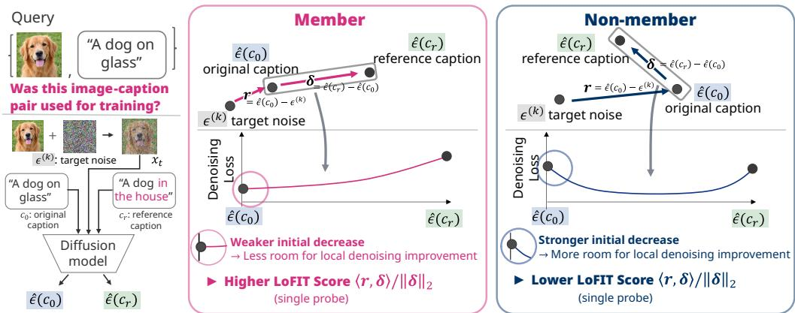  
Figure 1: Illustration of LoFIT for a queried image-caption pair. At a fixed noisy input, r denotes the original-caption prediction error relative to the target noise, and δ the prediction shift toward a reference-caption prediction. LoFIT measures the initial denoising-loss response along this shift through the normalized alignment $\langle r , \delta \rangle / \lVert \delta \rVert _ { 2 }$ . Members exhibit a weaker initial loss decrease than non-members, indicating less room for local denoising improvement and yielding a higher score. The curves are conceptual; measured class distributions appear in Figure 6.

Condition-dependent evidence also appears in a model's response to changes in the text condition. SD-MIA studies pre-training membership under black-box access by perturbing the original textual instruction and measuring the relevance of generated images to the queried image (Qi et al., 2026). The success of its method on a pretrained model provides a useful insight that membership evidence also resides in the local behavior across text conditions.

CLiD and SD-MIA provide complementary motivations. CLiD shows that membership information can lie in the image-text relationship, while SD-MIA shows that changing the text condition can expose it. These findings motivate us to ask how a change in text condition affects the denoising fit for the same image. With access to the noise predictor, we examine this question by comparing predictions across conditions while holding the noisy input and target noise fixed.

Since training minimizes denoising loss on observed image-caption pairs, we hypothesize that predictions for members have less potential for further reduction in denoising loss through conditional adjustments than those for non-members. Based on this hypothesis, we introduce LoFIT (Local Conditional Fit), a membership score that measures the local denoising-loss response to conditional adjustments. LoFIT uses predictions under alternative captions to probe whether the original prediction can be locally improved. For each alternative, it measures the initial change in denoising loss per unit movement toward that prediction, then averages these responses across reference captions and diffusion states. Higher scores indicate less scope for local improvement on average and provide evidence of membership. LoFIT computes this score using only forward predictions, without access to model gradients.

We evaluate LoFIT on four datasets spanning fine-tuned and pretrained diffusion models. It outperforms the evaluated baselines, including CLiD (Zhai et al., 2024) and PFAMI (Fu et al., 2024), in AUROC, reaching 0.935, 0.954, and 0.896 on fine-tuned SD v1.4 and 0.602 on pretrained SD v1.5 (Section 4.2). Across training checkpoints, its discrimination strengthens as fixed image-caption pairs are used for training, while absolute denoising loss remains a weak discriminator (Section 5.1). On identical predictions, controlled decompositions locate membership separation in the first-order alignment response (Section 5.3). Matched-budget comparisons show LoFIT's advantage at equal query cost (Section 4.2).

Our contributions are:

• We identify a membership signal in the local denoising-loss response to conditional prediction adjustments: members exhibit less potential for loss reduction than non-members.

• We introduce LoFIT, which measures this response per unit prediction change and aggregates it across reference captions and diffusion states using only forward queries.

• We evaluate LoFIT on four evaluation sets and use controlled comparisons to identify the contribution of its first-order response.

## 2 BACKGROUND AND RELATED WORK

## 2.1 RELATED WORK

Denoising-based membership inference. SecMI uses deterministic reconstruction errors at intermediate steps (Duan et al., 2023). PIA uses the noise predicted at $t = 0$ to perturb the image, then measures how accurately the denoiser recovers that noise at a later timestep (Kong et al., 2024). SimA uses the norm of the predicted score as its membership statistic (Rao et al., 2025). Quantile regression learns image-specific reconstruction-loss thresholds from non-member data and identifies members whose loss falls below the predicted threshold (Tang et al., 2023). Our method also uses denoising predictions, but probes how their error changes along normalized prediction shifts on a shared noisy input.

Conditional comparisons. Text conditioning influences training-image replication (Somepalli et al., 2023a), and the magnitude of text-conditional predictions can identify memorized prompts (Wen et al., 2024). CLiD compares denoising losses under the original caption and alternative conditions to probe the learned image-caption relationship (Zhai et al., 2024). MoFit addresses missing training captions by optimizing a surrogate image and conditioning embedding, then measuring conditional versus unconditional loss discrepancy (Jeon et al., 2026). Its gradient-based optimization requires stronger model access than our forward-only interface. We use the supplied caption and probe local conditional fit without such optimization. Appendix B relates our score to conditional loss gaps.

Generated-image signals. Black-box attacks infer membership from generated images without accessing model weights or intermediate denoising predictions (Li et al., 2025). Noise as a Probe injects image semantics into the initial noise (Lian et al., 2026). SD-MIA perturbs textual instructions and measures how the generated images remain related to the target image (Qi et al., 2026).

## 2.2 FROM CONDITIONAL MEMBERSHIP SIGNALS TO LOCAL CONDITIONAL FIT

We examine CLiD and SD-MIA more closely because they connect membership evidence to two aspects of conditioning: how well the original caption fits the image and how model behavior changes when the condition changes.

CLiD: conditional likelihood discrepancy. CLiD (Zhai et al., 2024) asks how much the supplied caption increases the likelihood of an image:

$$
I _ { \theta } ( x _ { 0 } , c _ { 0 } ) = \log p _ { \theta } ( x _ { 0 } | c _ { 0 } ) - \log p _ { \theta } ( x _ { 0 } ) .\tag{1}
$$

This is the pointwise mutual information under the model's joint distribution; its expectation gives mutual information. Under CLiD's conditional-overfitting assumption, this discrepancy provides membership evidence beyond the image's marginal likelihood.

CLiD approximates this quantity through the diffusion variational bound, using denoising-loss differences. It also compares against reduced captions c to mitigate estimation variability:

$$
\mathcal { D } _ { \mathrm { C L i D } } ( \boldsymbol { x } _ { 0 } , \boldsymbol { c } _ { 0 } ; \boldsymbol { c } ) = \mathbb { E } _ { t , \epsilon } \big [ \| \epsilon _ { \theta } ( \boldsymbol { x } _ { t } , t , \boldsymbol { c } ) - \epsilon \| _ { 2 } ^ { 2 } - \| \epsilon _ { \theta } ( \boldsymbol { x } _ { t } , t , \boldsymbol { c } _ { 0 } ) - \epsilon \| _ { 2 } ^ { 2 } \big ] .\tag{2}
$$

Here $x _ { t }$ is the noisy image at timestep t, and $\epsilon \sim \mathcal { N } ( 0 , I )$ is the injected noise; both predictions use the same $x _ { t } , t ,$ and €. The empty caption supplies the unconditional comparison, while other reduced conditions retain partial caption information. A larger gap means that the original caption improves denoising more than the reduced condition. CLiD combines these gaps with the original-caption loss, using either a thresholded scalar score or a learned classifier. Its central contribution is to exploit the learned image-caption association as membership evidence, beyond absolute denoising accuracy.

SD-MIA: stability under textual perturbations. SD-MIA (Qi et al., 2026) studies whether the image-caption association persists under textual perturbations. It argues that locally overfitted textto-image mappings can make generations for members less sensitive to such changes. For a caption embedding $e _ { 0 }$ and a small perturbation $h ,$ its motivating sensitivity is

$$
\left| p _ { \theta } ( x _ { 0 } | e _ { 0 } + h ) - p _ { \theta } ( x _ { 0 } | e _ { 0 } ) \right| \approx \left| \langle \nabla _ { e } p _ { \theta } ( x _ { 0 } | e _ { 0 } ) , h \rangle \right| \approx 0 .\tag{3}
$$

This probability and its gradient are unavailable under SD-MIA's generation-only access. Instead, it constructs coherent caption variants through token, style, and semantic edits, and contrasts the CLIP (Radford et al., 2021) relevance of their generated images to the target with that under the original caption. Its signal therefore concerns how well generated content remains associated with the target when conditioning changes, without observing denoising losses or target-model gradients.

Local conditional fit hypothesis. Together, conditional overfitting and stability under textual perturbations motivate our hypothesis: member captions are closer to a denoising optimum relative to alternative conditions. Training directly minimizes denoising loss on observed image-caption pairs, suggesting less potential for local denoising improvement for members. Section 3 measures this response along alternative-caption prediction shifts while holding the noisy input and target noise fixed.

## 3 MEASURING LOCAL CONDITIONAL FIT

We assess whether member captions are closer to a denoising optimum by measuring the local loss response toward alternative-caption predictions. Denoising loss is the training objective and is connected to likelihood through the diffusion variational bound (Ho et al., 2020).

For a queried pair $( x _ { 0 } , c _ { 0 } )$ , let ${ \mathcal { C } } = \operatorname { s u p p } p ( c )$ be the support of the condition prior and $\mathcal { U } ( c _ { 0 } ) \subseteq \mathcal { C }$ a set of comparison captions containing $c _ { 0 }$ . At each timestep t and noise draw $\epsilon \sim \mathcal { N } ( 0 , I )$ , all captions use the same noisy input $x _ { t }$ and target noise €. The denoising loss and optimality criterion are

$$
\begin{array} { r l } & { \quad \mathcal { L } ( x _ { 0 } , c ) = \mathbb { E } _ { t , \epsilon } \left[ \| \epsilon _ { \theta } ( x _ { t } , t , c ) - \epsilon \| _ { 2 } ^ { 2 } \right] , } \\ & { \mathcal { L } ( x _ { 0 } , c _ { 0 } ) \leq \mathcal { L } ( x _ { 0 } , c ) \quad \mathrm { f o r ~ a l l } ~ c \in \mathcal { U } ( c _ { 0 } ) . } \end{array}\tag{4}
$$

This criterion concerns optimality over the comparison set. Locality in LoFIT refers to infinitesimal movement in prediction space. We measure the response at each noisy state, then aggregate across states and references.

## 3.1 A FIRST-ORDER CRITERION FOR CONDITIONAL FIT

Squared error is convex in prediction space. For a given noisy image $x _ { t }$ , timestep t, and noise $\epsilon ,$ the following first-order condition is sufficient for $c _ { 0 }$ to minimize the denoising loss over $\mathcal { U } ( c _ { 0 } )$ (Boyd & Vandenberghe, 2004, Section 4.2.3):

$$
\begin{array} { r l } & { \big \langle \epsilon _ { \theta } \big ( x _ { t } , t , c _ { 0 } \big ) - \epsilon , \epsilon _ { \theta } \big ( x _ { t } , t , c \big ) - \epsilon _ { \theta } \big ( x _ { t } , t , c _ { 0 } \big ) \big \rangle \geq 0 , } \\ & { \quad \quad \quad \mathrm { ~ f o r ~ a l l ~ } c \in \mathcal { U } ( c _ { 0 } ) , } \\ & { \Longrightarrow \quad c _ { 0 } \in \arg \underset { c \in \mathcal { U } ( c _ { 0 } ) } { \operatorname* { m i n } } \ \| \epsilon _ { \theta } ( x _ { t } , t , c ) - \epsilon \| _ { 2 } ^ { 2 } . } \end{array}\tag{5}
$$

The inner product aligns prediction error with the conditional prediction shift. Nonnegative alignment for every comparison caption ensures that none yields a lower loss. If this holds at every noisy state, averaging gives Equation 4. This criterion motivates our alignment score.

## 3.2 MEASURING ALIGNMENT

Checking the condition over all captions is impractical. LoFIT instead evaluates the inner product using a finite set of reference captions from $\mathcal { U } ( c _ { 0 } )$ . For a reference caption $c ,$ the original prediction error r and the conditional prediction shift δ are

$$
\begin{array} { l } { r = \epsilon _ { \theta } ( x _ { t } , t , c _ { 0 } ) - \epsilon , } \\ { \delta = \epsilon _ { \theta } ( x _ { t } , t , c ) - \epsilon _ { \theta } ( x _ { t } , t , c _ { 0 } ) . } \end{array}\tag{6}
$$

For $\delta \neq 0$ , we use the normalized prediction shift $\delta / \lVert \delta \rVert _ { 2 }$ to compare directions independently of shift magnitude. The alignment response is

$$
v = { \frac { \langle r , \delta \rangle } { \lVert \delta \rVert _ { 2 } } } .\tag{7}
$$

Normalization preserves the sign of the inner product. The normalized response can also be interpreted as half the directional derivative of the denoising loss along the normalized prediction shift ${ \bar { \boldsymbol { \delta } } } / \| { \boldsymbol { \delta } } \| _ { 2 }$ . For a step of length s toward the reference prediction,

$$
\frac { \mathrm { d } } { \mathrm { d } s } \left. r + s \frac { \delta } { \Vert \delta \Vert _ { 2 } } \right. _ { 2 } ^ { 2 } \bigg \vert _ { s = 0 } = 2 \frac { \langle r , \delta \rangle } { \Vert \delta \Vert _ { 2 } } = 2 v .\tag{8}
$$

Thus $v < 0$ indicates an initial loss decrease toward the reference prediction, while $v \geq 0$ indicates no first-order decrease. At the reference prediction, $s = \| \delta \| _ { 2 } ;$ the finite-step loss change $2 s v + s ^ { 2 }$ can therefore be positive even when $v \ < \ 0$ . CLiD's discrepancy term uses this finite loss gap, whereas LoFIT isolates the initial response (Section 5.3). LoFIT's response is local in prediction space even when the two captions differ substantially

Score composition gives this local response a conditional interpretation. Compositional diffusion and classifier-free guidance combine predictions under different conditions to control generation (Liu et al., 2022; Ho & Salimans, 2022). At a fixed noise level, a convex combination of exact conditional scores is itself the score of a normalized geometric mixture of their densities. Noise predictions estimate these scores up to a shared scale, so interpolating predictions forms composed score estimates. LoFIT tests whether a small contribution from an alternative condition initially reduces the original denoising error, measuring local fit within this composed family.

## 3.3 AGGREGATING ALIGNMENT RESPONSES

To compute LoFIT, let R index reference captions $c _ { j } .$ , including caption edits, randomly sampled captions, and the empty prompt (Appendix A.1). We evaluate $\check { T }$ timesteps with K Gaussian noise draws each, using $i = ( t , k )$ to index the TK states. For each draw $\epsilon ^ { ( k ) } \sim \mathcal { N } ( 0 , I )$ , we form

$$
x _ { t , k } = \sqrt { \bar { \alpha } _ { t } } x _ { 0 } + \sqrt { 1 - \bar { \alpha } _ { t } } \epsilon ^ { ( k ) } .\tag{9}
$$

Here $\bar { \alpha } _ { t }$ is the diffusion noise schedule, and $x _ { 0 }$ is the queried image or its latent representation. Each comparison uses the same noisy image $x _ { t , k }$ and target noise $\epsilon ^ { ( \overset {  } { k } ) }$ for both captions. At state $i ,$ $r _ { i }$ denotes the original prediction error, while $\delta _ { i j }$ and $v _ { i j }$ denote the prediction shift and alignment for reference $j .$ Let A be the set of valid state-reference pairs $( i , j )$ after omitting zero prediction shifts; Appendix A.2 specifies the numerical tolerance. The LoFIT score is

$$
S ( x _ { 0 } , c _ { 0 } ) = \left\{ \begin{array} { l l } { | { \cal A } | ^ { - 1 } \ \sum _ { ( i , j ) \in { \cal A } } v _ { i j } , } & { | { \cal A } | > 0 , } \\ { 0 , } & { | { \cal A } | = 0 . } \end{array} \right.\tag{10}
$$

When every pair is valid, $| { \mathcal { A } } | = T K | { \mathcal { R } } |$ . Higher S indicates less initial denoising improvement and provides membership evidence. The query cost is $T K ( 1 + | \mathcal { R } | )$ , reusing the original prediction at each state. Appendices B.1 and B.3 analyze loss minima and the contribution of the response sign.

## 4 EXPERIMENTS

We evaluate LoFIT on the full evaluation sets and compare it with published attacks. Controlled readout comparisons use the same reference predictions and diffusion states.

## 4.1 SETTINGS AND COMPARISONS

Reference construction and score computation. References comprise randomly sampled captions, the empty prompt, and language-model edits. LoFIT computes each score directly from forward predictions using a fixed reference-construction procedure, without fitting an attack classifier. The configurations below specify the reference sets and query allocations.

Models and data. We evaluate fine-tuned SD v1.4, SD v2.1-base (€-prediction), and SD-XL base 1.0 on Flickr30k (Young et al., 2014), COCO (Lin et al., 2014), and Pokemon (Lambda, 2023), with 10,000/10,000, 2,500/2,500, and 416/417 members/non-members, respectively. LAION-MI uses pretrained SD v1.5 with 6,400 examples per class, matched in CLIP (Radford et al., 2021) imagetext similarity using 20 bins (Dubiński et al., 2024). Appendix A gives the training configurations, and Appendix A.4 details LAION-MI matching and preprocessing.

Table 1: Full-set membership inference on fine-tuned SD v1.4, SD v2.1, and SD-XL. Bold marks the best value per backbone and metric; dashes denote unreported results among the listed methods.
<table><tr><td></td><td colspan="2">Flickr30k</td><td colspan="2">COCO</td><td colspan="2">Pokemon</td></tr><tr><td>Method</td><td>AUROC</td><td>TPR@1%FPR</td><td>AUROC</td><td>TPR@1%FPR</td><td>AUROC</td><td>TPR@1%FPR</td></tr><tr><td colspan="7">SD v1.4</td></tr><tr><td>Naive loss</td><td>0.524</td><td>0.013</td><td>0.527</td><td>0.018</td><td>0.576</td><td>0.029</td></tr><tr><td>PIA</td><td>0.507</td><td>0.010</td><td>0.503</td><td>0.012</td><td>0.552</td><td>0.027</td></tr><tr><td>SecMI</td><td>0.551</td><td>0.017</td><td>0.562</td><td>0.012</td><td>0.538</td><td>0.022</td></tr><tr><td>SD-MIA</td><td>0.519</td><td>0.013</td><td>0.517</td><td>0.013</td><td>0.502</td><td>0.019</td></tr><tr><td>PFAMI</td><td>0.659</td><td>0.052</td><td>0.715</td><td>0.073</td><td>0.685</td><td>0.031</td></tr><tr><td> $\mathrm { C L i D } _ { \mathrm { t h } }$ </td><td>0.718</td><td>0.063</td><td>0.745</td><td>0.072</td><td>0.695</td><td>0.058</td></tr><tr><td> $\mathrm { C L i D } _ { \mathrm { v e c } }$ </td><td>0.718</td><td>0.064</td><td>0.751</td><td>0.073</td><td>0.642</td><td>0.043</td></tr><tr><td>LoFIT (ours)</td><td>0.935</td><td>0.454</td><td>0.954</td><td>0.478</td><td>0.896</td><td>0.272</td></tr><tr><td colspan="7">SD v2.1</td></tr><tr><td>Naive loss</td><td>0.519</td><td>0.012</td><td>0.516</td><td>0.014</td><td>0.557</td><td>0.019</td></tr><tr><td>PIA</td><td>0.505</td><td>0.011</td><td>0.500</td><td>0.008</td><td>0.546</td><td>0.029</td></tr><tr><td>SecMI</td><td>0.537</td><td>0.013</td><td>0.530</td><td>0.010</td><td>0.503</td><td>0.017</td></tr><tr><td>PFAMI</td><td>0.631</td><td>0.038</td><td>0.653</td><td>0.060</td><td>0.631</td><td>0.029</td></tr><tr><td>CLiDth</td><td>0.705</td><td>0.088</td><td>0.681</td><td>0.070</td><td>0.686</td><td>0.026</td></tr><tr><td> $\mathrm { C L i D } _ { \mathrm { v e c } }$ </td><td>0.783</td><td>0.131</td><td>0.739</td><td>0.079</td><td>0.684</td><td>0.022</td></tr><tr><td>LoFIT (ours)</td><td>0.894</td><td>0.296</td><td>0.851</td><td>0.166</td><td>0.812</td><td>0.130</td></tr><tr><td colspan="7">SD-XL</td></tr><tr><td>Naive loss</td><td>0.514</td><td>0.011</td><td>0.516</td><td>0.010</td><td>0.530</td><td>0.014</td></tr><tr><td>PIA</td><td>0.498</td><td>0.009</td><td>0.501</td><td>0.008</td><td>0.517</td><td>0.012</td></tr><tr><td>SecMI</td><td>0.515</td><td>0.011</td><td>0.506</td><td>0.012</td><td>0.477</td><td>0.019</td></tr><tr><td>PFAMI</td><td>0.660</td><td>0.069</td><td>0.657</td><td>0.052</td><td>0.664</td><td>0.048</td></tr><tr><td> $\mathrm { C L i D } _ { \mathrm { t h } }$ </td><td>0.866</td><td>0.188</td><td>0.819</td><td>0.114</td><td>0.804</td><td>0.127</td></tr><tr><td> $\mathrm { C L i D } _ { \mathrm { v e c } }$ </td><td>0.880</td><td>0.217</td><td>0.836</td><td>0.121</td><td>0.784</td><td>0.084</td></tr><tr><td>LoFIT (ours)</td><td>0.978</td><td>0.719</td><td>0.969</td><td>0.631</td><td>0.883</td><td>0.351</td></tr></table>

Default evaluation configuration. All three fine-tuned backbones use the same diffusion-state grids and noise-draw counts. SD v2.1 and SD-XL use the reduced reference sets in Appendix A.2. On the three fine-tuned SD v1.4 models, we use all eligible reference families: random captions, the empty prompt, and language-model rewrites. LAION-MI uses six randomly sampled captions and the empty prompt $( | { \mathcal { R } } | = 7 ) ;$ adding rewrites weakens discrimination there (Appendix C.1). Flickr30k and LAION-MI use $T = 1 2$ timesteps {60, 120, . . . , 720} and $K = 4$ noise draws; COCO and Pokemon use T = 4 timesteps (150, 300, 450, 600) and $K = 4 .$ On Flickr30k/COCO/Pokemon, SD v1.4 requires 2,064/752/1,088 denoiser evaluations per image, and SD v2.1 and SD-XL require 528/176/272; LAION-MI requires 384. These counts include the original caption.

Metrics. We report AUROC and true-positive rates (TPR) at 1% false-positive rate (FPR) for finetuned models and 5% FPR for LAION-MI.

Baselines and controlled comparisons. We compare with naive loss, PIA (Kong et al., 2024), SecMI (Duan et al., 2023), SD-MIA (Qi et al., 2026), CLiD (Zhai et al., 2024), and PFAMI (Fu et al., 2024). CLiD uses character-based caption thirds and the empty prompt at three fixed timesteps. PFAMI measures relative loss fluctuations under image crops, with calibration by the corresponding pretrained backbone on fine-tuned targets and no calibration on LAION-MI. Appendix A.3 details these settings and deviations from the original protocols. To isolate the contribution of LoFIT's scoring rule, we also evaluate CLiD variants using our expanded reference captions, including LLM rewrites and random captions, or our timestep configuration. Table 5 compares readouts on identical predictions, while Section 4.2 examines query budgets.

## 4.2 RESULTS

Membership inference performance. LoFIT outperforms the evaluated baselines in both AU-ROC and low-FPR TPR on all three datasets with fine-tuned SD v1.4, SD v2.1, and SD-XL (Table 1). On pretrained SD v1.5, LoFIT achieves the highest evaluated AUROC of 0.602 on LAION-MI, with TPR 0.101 at 5% FPR (Table 2). Appendix D reports additional video membership inference results on CogVideoX-2b and Wan2.1.

Figure 2: Query efficiency on Flickr30k and LAION-MI. CLiD curves use the released statistic with two-fold cross-fitted calibration (Appendix A.3); “our prompts" and “our states"denote our reference captions and timestep grid. Open circles mark the original 15-query configuration.  
Table 2: Membership inference on pretrained SD v1.5 (LAION-MI). Bold marks the best values; underlining marks the second-best TPR.
<table><tr><td>Metric</td><td>Naive loss</td><td>PIA</td><td>SecMI</td><td>SD-MIA</td><td>PFAMI</td><td> $\mathrm { C L i D } _ { \mathrm { t h } }$ </td><td> $\mathrm { C L i D } _ { \mathrm { v e c } }$ </td><td>LoFIT</td></tr><tr><td>AUROC</td><td>0.527</td><td>0.521</td><td>0.512</td><td>0.571</td><td>0.516</td><td>0.557</td><td>0.548</td><td>0.602</td></tr><tr><td>TPR@5%FPR</td><td>0.072</td><td>0.072</td><td>0.063</td><td>0.112</td><td>0.066</td><td>0.075</td><td>0.076</td><td>0.101</td></tr></table>

Query efficiency. LoFIT outperforms $\mathrm { C L i D } _ { \mathrm { t h } }$ at matched query budgets, including variants using our captions or timestep grid (Figure 2). At 15 denoiser evaluations, AUROC is 0.834 versus 0.767 for the strongest CLiD variant on Flickr30k, and 0.580 versus 0.559 on LAION-MI. Appendix A.3 specifies calibration.

On identical reference predictions and diffusion states, LoFIT outperforms $\mathrm { C L i D } _ { \mathrm { t h } }$ with both fixed $\alpha = 0 . 5$ and oracle α (Table 3). With all reference families, its AUROC advantage over oracle $\mathrm { C L i D } _ { \mathrm { t h } }$ is 0.081–0.130 on the fine-tuned models at the same query cost. Appendix A.3 specifies scaling and oracle selection.

With the empty reference alone, LoFIT also outperforms both $\mathrm { C L i D } _ { \mathrm { t h } }$ variants across all four datasets. On Flickr30k and COCO, empty-only LoFIT exceeds even oracle $\mathrm { C L i D } _ { \mathrm { t h } }$ using all reference families.

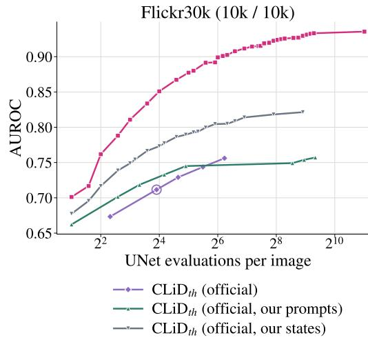

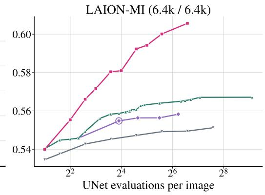  
published CLiD setting (15 queries)

Table 3: LoFIT and $\mathrm { C L i D } _ { \mathrm { t h } }$ on identical reference predictions and diffusion states. Bold marks the best value in each reference group.
<table><tr><td></td><td colspan="2">Flickr30k</td><td colspan="2">COCO</td><td colspan="2">Pokemon</td><td colspan="2">LAION-MI</td></tr><tr><td>Method</td><td>AUROC</td><td>TPR@1% FPR</td><td>AUROC</td><td>TPR@1% FPR</td><td>AUROC</td><td>TPR@1% FPR</td><td>AUROC</td><td>TPR@5% FPR</td></tr><tr><td colspan="9">All reference families (LAION-MI: 36 references; Table 2 uses 7)</td></tr><tr><td>LoFIT</td><td>0.935</td><td>0.454</td><td>0.954</td><td>0.478</td><td>0.896</td><td>0.272</td><td>0.573</td><td>0.085</td></tr><tr><td> $\mathrm { C L i D } _ { \mathrm { t h } } \left( \alpha = 0 . 5 \right)$ </td><td>0.731</td><td>0.106</td><td>0.752</td><td>0.130</td><td>0.764</td><td>0.058</td><td>0.563</td><td>0.084</td></tr><tr><td> $\mathrm { C L i D } _ { \mathrm { t h } } \left( \mathrm { o r a c l e } \alpha \right)$ </td><td>0.813</td><td>0.092</td><td>0.824</td><td>0.083</td><td>0.815</td><td>0.079</td><td>0.569</td><td>0.083</td></tr><tr><td colspan="9">Empty reference only</td></tr><tr><td>LoFIT</td><td>0.900</td><td>0.268</td><td>0.914</td><td>0.287</td><td>0.781</td><td>0.070</td><td>0.606</td><td>0.094</td></tr><tr><td> $\mathrm { C L i D } _ { \mathrm { t h } } \left( \alpha = 0 . 5 \right)$ </td><td>0.730</td><td>0.112</td><td>0.736</td><td>0.094</td><td>0.720</td><td>0.053</td><td>0.549</td><td>0.089</td></tr><tr><td> $\mathrm { C L i D } _ { \mathrm { t h } } \left( \mathrm { o r a c l e } \alpha \right)$ </td><td>0.806</td><td>0.146</td><td>0.799</td><td>0.097</td><td>0.756</td><td>0.053</td><td>0.553</td><td>0.081</td></tr></table>

Image membership with generated captions. With BLIP-2 OPT-6.7b (Li et al., 2023) captions, prompt-based LoFIT achieves higher AUROC than official $\mathrm { C L i D } _ { \mathrm { t h } }$ with oracle α. Using random captions and the empty reference, LoFIT reaches 0.641, 0.669, and 0.621 AUROC on fine-tuned SD v1.4 for Flickr30k, COCO, and Pokemon, respectively, compared with 0.603, 0.650, and 0.576 for $\mathrm { C L i D } _ { \mathrm { t h } }$ . On LAION-MI, the corresponding AUROC values are 0.546 and 0.535. Gaussian conditioning probes provide further improvements on the fine-tuned models. Appendix C.3 reports the setup and full comparisons

## 5 UNDERSTANDING THE MEMBERSHIP $\mathbf { S }$ IGNAL

The following analyses use the SD v1.4 fine-tunes and pretrained SD v1.5.

## 5.1 EARLY MEMBERSHIP DETECTION DURING FINE-TUNING

LoFIT detects membership earlier and approaches saturation sooner than official $\mathrm { C L i D } _ { \mathrm { t h } }$ (Figure 3). At 20k steps, LoFIT achieves AUROC 0.917 and TPR 0.353 at 1% FPR. By 40k, these reach 0.994 and 0.875, while $\mathrm { C L i D } _ { \mathrm { t h } }$ continues improving through 80k steps. Absolute denoising loss remains a weak discriminator across these checkpoints. We evaluate the same 10,000 member and 10,000 non-member Flickr30k pairs throughout. LoFIT keeps its references and $1 2 \times 4$ diffusion states fixed; $\mathrm { C L i D } _ { \mathrm { t h } }$ uses the released caption reductions and three-state configuration.

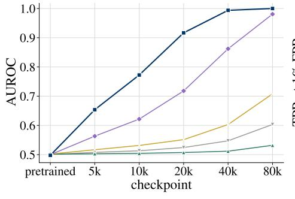

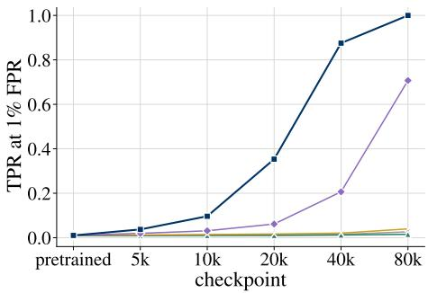  
Figure 3: Membership inference across Flickr30k fine-tuning checkpoints, including official $\mathrm { C L i D } _ { \mathrm { t h } }$ . Membership denotes participation in this fine-tuning run

## 5.2 CAPTION AND GAUSSIAN CONDITIONING PROBES

Table 4 compares caption and Gaussian probes at equal single-reference cost $( 2 T K$ denoiser evaluations). Both use the same images, diffusion-state grids, and alignment score; original-caption losses match across all datasets (Appendix C.2). AUROC is averaged across references within each group.

Table 4: Single-reference AUROC for combined caption edits and Gaussian probes.
<table><tr><td>Reference directions</td><td>Flickr30k</td><td>COCO</td><td>Pokemon</td><td>LAION-MI</td></tr><tr><td>Combined edits</td><td>0.880</td><td>0.909</td><td>0.810</td><td>0.569</td></tr><tr><td>Gaussian,  $h = 1 6 0$ </td><td>0.854</td><td>0.903</td><td>0.805</td><td>0.534</td></tr></table>

Gaussian probes approach combined edits on COCO and Pokemon. On LAION-MI, the empty caption achieves AUROC 0.606, compared with 0.534 for Gaussian probes at $h = 1 6 0$ . Pooling caption and Gaussian responses further improves discrimination on the fine-tuned models (Appendix C.2). Gaussian probes require direct modification of conditioning embeddings, extending access beyond LoFIT's text-condition gray-box interface.

## 5.3 ALIGNMENT ISOLATES THE DIRECTIONAL MEMBERSHIP SIGNAL

The discrepancy term in CLiD measures conditional denoising-loss gaps (Zhai et al., 2024), while LoFIT isolates their first-order response. For a fixed noisy image and target noise, the gap decomposes as

$$
\Delta _ { i j } = | | \boldsymbol { r } _ { i } + \delta _ { i j } | | _ { 2 } ^ { 2 } - | | \boldsymbol { r } _ { i } | | _ { 2 } ^ { 2 } = 2 \langle \boldsymbol { r } _ { i } , \delta _ { i j } \rangle + | | \delta _ { i j } | | _ { 2 } ^ { 2 } ,\tag{11}
$$

$$
\begin{array} { r } { \frac { \Delta _ { i j } } { \parallel \delta _ { i j } \parallel _ { 2 } } = { } \quad \underbrace { 2 v _ { i j } } _ { \mathrm { ~ \normalfont ~  ~ } } + { } \quad \underbrace { \parallel \delta _ { i j } \parallel _ { 2 } } _ { \mathrm { ~ \normalfont ~  ~ } } . } \end{array}\tag{12}
$$

$$
\mathrm { { f i r s t - o r d e r ~ r e s p o n s e } \quad \ s h i f t { \ m a g n i t u d e } }
$$

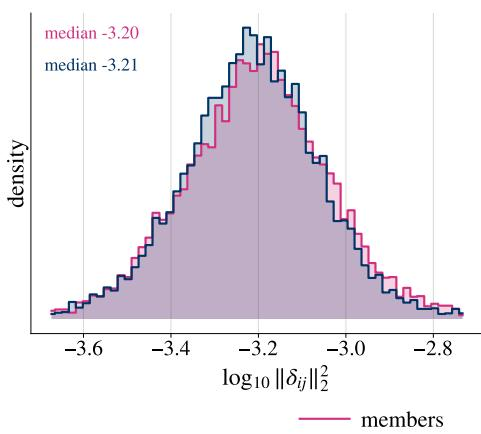

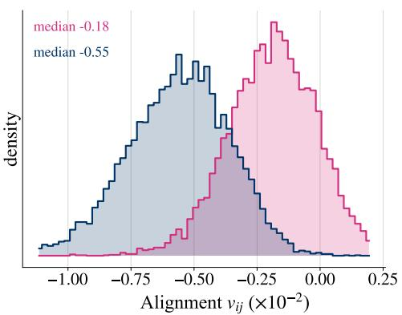  
Figure 4: Conditional prediction statistics on Flickr30k. Left: distributions of squared shift magnitude $\| \delta _ { i j } \| _ { 2 } ^ { 2 }$ on a logarithmic scale. Right: normalized residual interaction $\langle r _ { i } , \delta _ { i j } \rangle / \| \delta _ { i j } \| _ { 2 }$ the LoFIT response. Shift magnitudes largely overlap, while the first-order response separates the classes. Magenta denotes members and blue denotes non-members. Full profiles appear in Appendix B.2.

The normalized gap adds shift magnitude to LoFIT's first-order response $2 v _ { i j }$ . Shift magnitudes largely overlap between the classes, whereas the response is more negative for non-members (Figure $4 ;$ full profiles in Appendix B.2).

On identical predictions under the default configuration, LoFIT outperforms both raw and normalized gaps in AUROC and low-FPR TPR across all four datasets (Table 5). Isolating the first-order response therefore improves discrimination beyond normalization alone.

Table 5: Readout comparison on identical predictions and diffusion states. Bold marks the best value per metric.
<table><tr><td></td><td colspan="2">Flickr30k</td><td colspan="2">COCO</td><td colspan="2">Pokemon</td><td colspan="2">LAION-MI</td></tr><tr><td>Readout</td><td>AUROC</td><td>TPR@1% FPR</td><td>AUROC</td><td>TPR@1% FPR</td><td>AUROC</td><td>TPR@1% FPR</td><td>AUROC</td><td>TPR@5% FPR</td></tr><tr><td>Loss gap  $\Delta _ { i j }$ </td><td>0.813</td><td>0.092</td><td>0.818</td><td>0.078</td><td>0.804</td><td>0.065</td><td>0.549</td><td>0.076</td></tr><tr><td>Normalized gap</td><td>0.906</td><td>0.334</td><td>0.930</td><td>0.380</td><td>0.882</td><td>0.127</td><td>0.567</td><td>0.085</td></tr><tr><td>Shift magnitude  $\| \delta _ { i j } \| _ { 2 }$ </td><td>0.503</td><td>0.012</td><td>0.487</td><td>0.014</td><td>0.457</td><td>0.024</td><td>0.480</td><td>0.053</td></tr><tr><td>LoFIT</td><td>0.935</td><td>0.454</td><td>0.954</td><td>0.478</td><td>0.896</td><td>0.272</td><td>0.602</td><td>0.101</td></tr></table>

## 6 CONCLUSION

We introduced LoFIT, a membership inference method that measures local conditional fit for a queried image-caption pair. Members exhibit less potential for denoising-loss reduction toward alternative-caption predictions. LoFIT captures this difference through the normalized first-order response and averages it across reference captions and diffusion states using only forward queries.

Experiments across multiple diffusion backbones show improved membership discrimination in both fine-tuning and pretraining settings, with additional results extending LoFIT to video generation. Analysis of training dynamics shows that LoFIT detects membership earlier in fine-tuning than the baselines. LoFIT also improves the trade-off between membership inference performance and query cost, achieving higher AUROC than CLiD with the same number of denoiser evaluations. These findings establish local conditional fit as a useful signal for auditing training-data use.

Limitations. LoFIT's effectiveness depends on the available caption: generated captions retain membership information but yield lower discrimination than supplied training captions (Appendix C.3). The method requires forward access to the denoiser at specified noisy inputs, timesteps and conditions, which generation-only APIs do not provide.

## REFERENCES

Stephen Boyd and Lieven Vandenberghe. Convex Optimization. Cambridge University Press, 2004. ISBN 978-0-521-83378-3.

Nicholas Carlini, Jamie Hayes, Milad Nasr, Matthew Jagielski, Vikash Sehwag, Florian Tramèr, Borja Balle, Daphne Ippolito, and Eric Wallace. Extracting training data from diffusion models. In 32nd USENIX Security Symposium, 2023.

Jinhao Duan, Fei Kong, Shiqi Wang, Xiaoshuang Shi, and Kaidi Xu. Are diffusion models vulnerable to membership inference attacks? In International Conference on Machine Learning, 2023.

Jan Dubiński, Antoni Kowalczuk, Stanisław Pawlak, Przemysław Rokita, Tomasz Trzciński, and Paweł Morawiecki. Towards more realistic membership inference attacks on large diffusion models. In Proceedings of the IEEE/CVF Winter Conference on Applications of Computer Vision, 2024.

Wenjie Fu, Huandong Wang, Liyuan Zhang, Chen Gao, Yong Li, and Tao Jiang. A probabilistic fluctuation based membership inference attack for diffusion models. arXiv preprint arXiv:2308.12143, 2024.

Jonathan Ho and Tim Salimans. Classifier-free diffusion guidance. arXiv preprint arXiv:2207.12598, 2022.

Jonathan Ho, Ajay Jain, and Pieter Abbeel. Denoising diffusion probabilistic models. In Advances in Neural Information Processing Systems, 2020.

Chunsan Hong, Tae-Hyun Oh, and Minhyuk Sung. Membench: Memorized image trigger prompt dataset for diffusion models. arXiv preprint arXiv:2407.17095, 2024.

Joonsung Jeon, Woo Jae Kim, Suhyeon Ha, Sooel Son, and Sung eui Yoon. No caption, no problem: Caption-free membership inference via model-fitted embeddings. In International Conference on Learning Representations, 2026.

Fei Kong, Jinhao Duan, RuiPeng Ma, Hengtao Shen, Xiaofeng Zhu, Xiaoshuang Shi, and Kaidi Xu. An efficient membership inference attack for the diffusion model by proximal initialization. In International Conference on Learning Representations, 2024.

Lambda. Pokemon-blip-captions. https://huggingface.co/datasets/lambdalabs/ pokemon-blip-captions/,2023.

Jingwei Li, Jing Dong, Tianxing He, and Jingzhao Zhang. Towards black-box membership inference attack for diffusion models. In International Conference on Machine Learning, 2025.

Junnan Li, Dongxu Li, Silvio Savarese, and Steven Hoi. Blip-2: Bootstrapping language-image pre-training with frozen image encoders and large language models. In International Conference on Machine Learning, 2023.

Puwei Lian, Yujun Cai, Songze Li, and Bingkun Bao. Noise as a probe: Membership inference attacks on diffusion models leveraging initial noise. arXiv preprint arXiv:2601.21628, 2026.

Tsung-Yi Lin, Michael Maire, Serge Belongie, Lubomir Bourdev, Ross Girshick, James Hays, Pietro Perona, Deva Ramanan, C. Lawrence Zitnick, and Piotr Dollár. Microsoft coco: Common objects in context. In Proceedings of the European Conference on Computer Vision, 2014.

Nan Liu, Shuang Li, Yilun Du, Antonio Torralba, and Joshua B Tenenbaum. Compositional visual generation with composable diffusion models. In Proceedings of the European Conference on Computer Vision, 2022.

Kepan Nan, Rui Xie, Penghao Zhou, Tiehan Fan, Zhenheng Yang, Zhijie Chen, Xiang Li, Jian Yang, and Ying Tai. Openvid-1m: A large-scale high-quality dataset for text-to-video generation. In International Conference on Learning Representations, 2025.

Tao Qi, Huili Wang, Yuanhong Huang, Wendan Wang, Lianchao Zhao, Jinrui Wang, Zichen Qin, Shangguang Wang, and Yongfeng Huang. Black-box membership inference attacks on the pretraining data of image-generation models. In Proceedings of the IEEE/CVF Conference on Computer Vision and Pattern Recognition, 2026.

Lu Qiu, Yizhuo Li, Yuying Ge, Yixiao Ge, Ying Shan, and Xihui Liu. Animeshooter: A multi-shot animation dataset for reference-guided video generation. arXiv preprint arXiv:2506.03126, 2025.

Alec Radford, Jong Wook Kim, Chris Hallacy, Aditya Ramesh, Gabriel Goh, Sandhini Agarwal, Girish Sastry, Amanda Askell, Pamela Mishkin, Jack Clark, Gretchen Krueger, and Ilya Sutskever. Learning transferable visual models from natural language supervision. In International Conference on Machine Learning, 2021.

Mingxing Rao, Bowen Qu, and Daniel Moyer. Score-based membership inference on diffusion models. arXiv preprint arXiv:2509.25003, 2025.

Robin Rombach, Andreas Blattmann, Dominik Lorenz, Patrick Esser, and Björn Ommer. Highresolution image synthesis with latent diffusion models. In Proceedings of the IEEE/CVF Conference on Computer Vision and Pattern Recognition, 2022.

Reza Shokri, Marco Stronati, Congzheng Song, and Vitaly Shmatikov. Membership inference attacks against machine learning models. In IEEE Symposium on Security and Privacy, 2017.

Gowthami Somepalli, Vasu Singla, Micah Goldblum, Jonas Geiping, and Tom Goldstein. Understanding and mitigating copying in diffusion models. In Advances in Neural Information Processing Systems, 2023a.

Gowthami Somepalli, Vasu Singla, Micah Goldblum, Jonas Geiping, and Tom Goldstein. Diffusion art or digital forgery? investigating data replication in diffusion models. In Proceedings of the IEEE/CVF Conference on Computer Vision and Pattern Recognition, 2023b.

Shuai Tang, Zhiwei Steven Wu, Sergul Aydore, Michael Kearns, and Aaron Roth. Membership inference attacks on diffusion models via quantile regression. arXiv preprint arXiv:2312.05140, 2023.

Team Wan, Ang Wang, Baole Ai, Bin Wen, Chaojie Mao, Chen-Wei Xie, Di Chen, Feiwu Yu, Haiming Zhao, Jianxiao Yang, Jianyuan Zeng, Jiayu Wang, Jingfeng Zhang, Jingren Zhou, Jinkai Wang, Jixuan Chen, Kai Zhu, Kang Zhao, Keyu Yan, Lianghua Huang, Mengyang Feng, Ningyi Zhang, Pandeng Li, Pingyu Wu, Ruihang Chu, Ruili Feng, Shiwei Zhang, Siyang Sun, Tao Fang, Tianxing Wang, Tianyi Gui, Tingyu Weng, Tong Shen, Wei Lin, Wei Wang, Wei Wang, Wenmeng Zhou, Wente Wang, Wenting Shen, Wenyuan Yu, Xianzhong Shi, Xiaoming Huang, Xin Xu, Yan Kou, Yangyu Lv, Yifei Li, Yijing Liu, Yiming Wang, Yingya Zhang, Yitong Huang, Yong Li, You Wu, Yu Liu, Yulin Pan, Yun Zheng, Yuntao Hong, Yupeng Shi, Yutong Feng, Zeyinzi Jiang, Zhen Han, Zhi-Fan Wu, and Ziyu Liu. Wan: Open and advanced large-scale video generative models. arXiv preprint arXiv:2503.20314, 2025.

Yuxin Wen, Yuchen Liu, Chen Chen, and Lingjuan Lyu. Detecting, explaining, and mitigating memorization in diffusion models. In International Conference on Learning Representations, 2024.

Zhuoyi Yang, Jiayan Teng, Wendi Zheng, Ming Ding, Shiyu Huang, Jiazheng Xu, Yuanming Yang, Wenyi Hong, Xiaohan Zhang, Guanyu Feng, Da Yin, Yuxuan Zhang, Weihan Wang, Yean Cheng, Bin Xu, Xiaotao Gu, Yuxiao Dong, and Jie Tang. Cogvideox: Text-to-video diffusion models with an expert transformer. In International Conference on Learning Representations, 2025.

Peter Young, Alice Lai, Micah Hodosh, and Julia Hockenmaier. From image descriptions to visual denotations: New similarity metrics for semantic inference over event descriptions. Transactions of the Association for Computational Linguistics, 2:67–78, 2014. doi: 10.1162/tacl\_a\_00166.

Shengfang Zhai, Huanran Chen, Yinpeng Dong, Jiajun Li, Qingni Shen, Yansong Gao, Hang Su, and Yang Liu. Membership inference on text-to-image diffusion models via conditional likelihood discrepancy. In Advances in Neural Information Processing Systems, 2024.

## A EXPERIMENTAL PROTOCOLS

This appendix documents target-model training, data construction, reference captions, and baseline evaluation.

Training configurations. We fine-tune the full UNet using the diffusers text-to-image training script, with the VAE and text encoders frozen. The tokenizer and diffusion noise schedule remain fixed. All nine fine-tuned targets use AdamW with learning rate $1 0 ^ { - 5 } , \beta = ( 0 . 9 , 0 . 9 9 9 )$ , weight decay 0.01, and optimizer epsilon $1 0 ^ { - 8 }$ . The learning rate is constant with no warmup. Training minimizes epsilon-prediction MSE with timesteps sampled uniformly from a 1,000-step DDPM schedule, without SNR weighting, caption dropout, or noise offset. We use FP16 mixed precision, gradient checkpointing, and gradient clipping at norm 1.0. EMA weights are maintained during training; all attacks evaluate the raw UNet weights.

SD-XL starts from stabilityai/stable-diffusion-xl-base-1.0 and follows the shared training recipe at 1024 × 1024 resolution. Table 6 lists the evaluated checkpoints and effective batch sizes. Steps count optimizer updates, and batch sizes include all devices and gradient accumulation. SD v2.1 Flickr30k uses training seed 0; the SD v1.4 runs and SD v2.1 COCO/Pokemon do not set a training seed. The data split seed is 0 for every backbone.

Table 6: Target-model training runs and evaluated checkpoints.
<table><tr><td></td><td>Dataset</td><td>Effective batch</td><td>Evaluated update</td></tr><tr><td>Model SD v1.4</td><td>Flickr30k</td><td>16</td><td>20,000</td></tr><tr><td></td><td>COCO</td><td>256</td><td>1,000</td></tr><tr><td></td><td>Pokemon</td><td>256</td><td>200</td></tr><tr><td>SD v2.1</td><td></td><td></td><td></td></tr><tr><td></td><td>Flickr30k COCO</td><td>16 256</td><td>20,000 1,000</td></tr><tr><td></td><td>Pokemon</td><td>256</td><td>200</td></tr><tr><td>SD-XL</td><td></td><td></td><td></td></tr><tr><td></td><td>Flickr30k</td><td>16</td><td>20,000</td></tr><tr><td></td><td>COCO</td><td>256</td><td>1,000</td></tr><tr><td></td><td>Pokemon</td><td>256</td><td>200</td></tr></table>

Image splits and captions. We shuffle each dataset once with seed 0, assign the first n images to members, and take the next n as non-members, with n = 10,000 for Flickr30k and $n = 2 { , } 5 0 0$ for COCO. Pokemon uses the first 416 images as members and the remaining 417 as non-members. Each source row contains one image; all captions associated with a row remain on the same side of the split. We retain only the first Flickr30k caption before shuffling. Every image has one fixed caption throughout training, and the same string serves as its original caption during evaluation. The caption columns are caption, captions, and text for Flickr30k, COCO, and Pokemon, respectively.

Preprocessing. We resize the shorter image side to 1024 pixels for SD-XL and 512 for SD v1.4, SD v1.5, and SD v2.1, then apply a square center crop at that resolution. Training adds horizontal flipping with probability 0.5 and normalizes pixels to [—1, 1]; attack evaluation omits flipping. LoFIT, naive loss, PIA, and SecMI use the VAE posterior mean. The official CLiD implementation instead samples from the VAE posterior and normalizes each channel with mean and standard deviation 0.5.

Flickr30k shadow model. After the same shuffle, zero-based rows 20,000–29,999 provide 10,000 shadow members and rows 30,000–31,782 provide 1,783 shadow non-members. Both groups are disjoint from the target-model training and evaluation images. The SD v1.4 shadow model uses the target's training recipe, effective batch size 16, and 20,000 updates. Its member and non-member features train the $\mathrm { C L i D } _ { \mathrm { v e c } }$ classifier.

## A.1 REFERENCE CONSTRUCTION

Our reference families extend CLiD's caption reduction and embedding perturbations (Zhai et al., 2024). The language-model edits are inspired by SD-MIA's textual perturbations (Qi et al., 2026) and use gpt –4 . 1-mini. Table 7 summarizes their construction. The same procedure is applied to members and non-members. The expanded pools combine language-model edits, random captions, and the empty prompt. Case-only edits, word shuffling, and negation are excluded.

Table 7: Reference-caption families and their construction.
<table><tr><td>Prompt family</td><td>Construction</td></tr><tr><td colspan="2">Standard language-model rewrites</td></tr><tr><td>Token-level edits</td><td>Small wording changes, including one- or two-word synonym substitutions that preserve meaning.</td></tr><tr><td>Paraphrases</td><td>Rephrase the caption while preserving its meaning, including light and heavy rewrites with increasing changes in wording.</td></tr><tr><td>Style changes</td><td>Change how the caption is presented.</td></tr><tr><td>Semantic edits</td><td>Change depicted entities or actions, including variants that alter one, two, or three or more content words.</td></tr><tr><td>Combined edits</td><td>Change both wording and semantic content.</td></tr><tr><td colspan="2">Additional references</td></tr><tr><td>Random captions</td><td>Randomly sample M captions of other images from the dataset&#x27;s pooled caption</td></tr><tr><td>Empty prompt</td><td>corpus; exclude identical strings. Use the empty string ∅.</td></tr></table>

Caption-rewriting prompts. The templates below share a system prompt. Here, {cap} is the original caption, {n} is the requested number of variants per family, and H\_bot h denotes combined edits.

## System prompt

You rewrite image captions for a controlled experiment. Answer with   
STRICT JSON only, no prose. Keep every variant a natural image caption   
of similar length to the original.

## User prompt: paraphrases, token-level, style, and semantic edits

Original caption: {cap}   
Produce this JSON object exactly: {"para": [{n} paraphrases: SAME   
meaning, different wording, each clearly distinct from the others],   
"token": [{n} variants: change only 1-2 words, meaning essentially   
preserved],"style": [{n} variants: same content, add a   
style/medium/lighting modifier], "sem": [{n} variants: CHANGE one   
salient object or attribute so the described scene differs]}

## User prompt: combined edits

Original caption: {cap}   
Produce this JSON object exactly: {"H\_both": [5 variants: HARD   
NEGATIVES that describe a clearly DIFFERENT scene. Each variant must   
(a) change THREE or more content words (objects, attributes, actions,   
places) so the scene is different, AND (b) lightly paraphrase the rest   
so that about half of the remaining words differ from the original   
wording. Keep the same sentence style and similar length; the five   
variants must be distinct from each other]}

## A.2 REFERENCE POOLS AND EVALUATION SETTINGS

Table 8 lists the number of references per family. Each reference slot contains one caption generated or sampled for each queried image using the same construction procedure. The main SD v1.4 evaluations use all eligible references; SD v2.1 and SD-XL use the reduced sets in Table 9, and LAION-MI uses random captions and the empty prompt. For each reference, residuals, prediction shifts, and loss gaps are computed from the same predictions and target noise. Separately evaluated caption families can use different noise draws. In that case, averaging across families also averages over more noise realizations.

Table 8: References per image in the expanded pools, before zero-shift omissions.
<table><tr><td>Reference family</td><td>Flickr30k</td><td>COCO</td><td>Pokemon</td><td>LAION-MI</td></tr><tr><td colspan="5">Standard language-model rewrites</td></tr><tr><td>Token-level edits</td><td>6</td><td>8</td><td>14</td><td>6</td></tr><tr><td>Paraphrases</td><td>8</td><td>12</td><td>18</td><td>8</td></tr><tr><td>Style changes</td><td>2</td><td>4</td><td>4</td><td>2</td></tr><tr><td>Semantic edits</td><td>8</td><td>10</td><td>19</td><td>8</td></tr><tr><td>Combined edits</td><td>5</td><td>5</td><td>5</td><td>5</td></tr><tr><td colspan="5">Additional references</td></tr><tr><td>Random captions</td><td>12</td><td>6</td><td>6</td><td>6</td></tr><tr><td>Empty prompt</td><td>1</td><td>1</td><td>1</td><td>1</td></tr><tr><td>Total</td><td>42</td><td>46</td><td>67</td><td>36</td></tr></table>

Zero-shift handling. Let D be the number of elements in a noise prediction. We omit a statereference pair when $\rvert \rvert \delta _ { i j } \rvert \rvert _ { 2 } ^ { 2 } / D \leq 1 0 ^ { - 1 2 }$ and average over all remaining pairs, as in Equation 10. An image with no valid pairs receives score zero. The reference counts in Table 8 are specified before this numerical check.

Configurations for additional analyses. The scoring rules in Tables 5 and 13 are compared using the default reference sets and diffusion states in Section 4.1. Each score averages its per-reference, per-state responses.

Table 3 compares LoFIT and $\mathrm { C L i D } _ { \mathrm { t h } }$ using either the complete pools in Table 8 or the empty reference alone. Both scores use identical predictions over 48 states on Flickr30k and LAION-MI and 16 on COCO and Pokemon.

To track membership discrimination during fine-tuning, we evaluate successive model checkpoints using randomly sampled captions and the empty prompt as references for each dataset. Analyses of caption edits and Gaussian perturbations use the caption sets and query budgets specified for each experiment. All analyses use the same alignment score.

SD v2.1 and SD-XL reference sets. Table 9 specifies the reduced reference sets used for the SD v2.1 and SD-XL results in Table 1. Query counts use $T K ( 1 + | \mathcal { R } | )$ , reusing the original prediction across references at each state.

Table 9: SD v2.1 and SD-XL reference counts and evaluation budgets.
<table><tr><td>Configuration</td><td>Flickr30k</td><td>COCO</td><td>Pokemon</td></tr><tr><td>Combined edits</td><td>5</td><td>5</td><td>5</td></tr><tr><td>Semantic edits</td><td>2</td><td>2</td><td>5</td></tr><tr><td>Heavy paraphrases</td><td>2</td><td>2</td><td>5</td></tr><tr><td>Empty prompt</td><td>1</td><td>1</td><td>1</td></tr><tr><td>Total references</td><td>10</td><td>10</td><td>16</td></tr><tr><td>Timesteps T</td><td>12</td><td>4</td><td>4</td></tr><tr><td>Noise draws K</td><td>4</td><td>4</td><td>4</td></tr><tr><td>Denoiser evaluations</td><td>528</td><td>176</td><td>272</td></tr></table>

## A.3 BASELINE IMPLEMENTATIONS AND CALIBRATION

This section specifies the baseline scoring procedures and the data used for calibration and classifier training.

Naive loss, PIA, and SecMI. Each attack uses its default fixed-timestep setting and one noise realization per image, with seed 0. Predictions use the supplied caption without classifier-free guidance. Each method returns an image-level L2-distance score without classifier training or post-hoc calibration. Images and VAE latents follow the preprocessing above.

CLiD. We use the released character-clipping variant of CLiD (Zhai et al., 2024). Each image is evaluated under its original caption, three character-based caption thirds, and the empty prompt. One Gaussian noise draw per timestep is shared across conditions, giving 15 denoiser queries per image. Evaluation uses sampled VAE latents and FP32 model weights. The features are the original-caption denoising MSE and four conditional loss gaps, each averaged over the three states.

For $\mathrm { C L i D } _ { \mathrm { t h } } ,$ we apply RobustScaler to the original loss and negative mean gap before combining them with weights 1 — α and α. Calibration follows the experiment-specific protocols below.

For the supplied-caption results on SD v1.4 and LAION-MI (Tables 1 and 2), we select oracle $\alpha \in \{ 0 , 0 . 1 , \ldots , 1 \}$ to maximize AUROC using evaluation-pool membership labels. These entries give an oracle AUROC upper bound over the tested grid, rather than an independently calibrated attack. TPR is evaluated at the same selected α. The selected values are 0.9, 0.9, 0.7, and 0.6 for Flickr30k, COCO, Pokemon, and LAION-MI, respectively. SD v2.1 uses fixed $\alpha = 0 . 5$ with scaling fitted on the unlabeled evaluation pool, and SD-XL uses cross-fitting (Table 10).

$\mathrm { C L i D } _ { \mathrm { v e c } }$ uses the five features as inputs to the released XGBoost classifier. SD v1.4 Flickr30k uses shadow-model training; the remaining SD v1.4, SD v2.1, SD-XL, and LAION-MI settings use stratified two-fold cross-fitting on target-model features. We split member and non-member images separately, train on one fold, evaluate the other, and exchange the folds. We repeat this procedure with seeds 0–4 and average the fold metrics across repetitions. For LAION-MI, we compute AUROC from pooled out-of-fold predictions. Cross-fitting uses labeled target examples in the training fold, with each scored image excluded from that fold. The classifier uses n\_est imators=20, max\_depth=3,gamma=0.7,subsample=0.7,colsample\_bytree=0.7,reg-alpha=1, and reg\_1ambda=1.

Table 10: CLiD calibration and classifier configurations for Tables 1 and 2.
<table><tr><td>Target setting</td><td> $\mathrm { C L i D } _ { \mathrm { t h } }$ </td><td> $\mathrm { C L i D } _ { \mathrm { v e c } }$ </td></tr><tr><td>SD v1.4 Flickr30k</td><td>Oracle α = 0.9</td><td>Shadow-trained classifier</td></tr><tr><td>SD v1.4 COCO, Pokemon</td><td>Oracle α = 0.9 and 0.7</td><td>Target two-fold cross-fitting</td></tr><tr><td>SD v2.1, all datasets</td><td>Fixed  $\alpha = 0 . 5 ;$  unlabeled target-pool</td><td>Target two-fold cross-fitting</td></tr><tr><td> ${ \mathrm { S D } } { \mathrm { - X L } } ,$  all datasets</td><td>scaling Target cross-fitting for scaler and α</td><td>Target two-fold cross-fitting</td></tr><tr><td>SD v1.5 LAION-MI</td><td>Oracle α = 0.6</td><td>Target two-fold cross-fitting</td></tr></table>

$\mathbf { C L i D } _ { \mathrm { t h } }$ on LoFIT's references and states. Table 3 isolates the scoring rule by computing both methods from identical predictions. For each dataset and reference configuration, $\mathrm { C L i D } _ { \mathrm { t h } }$ fits RobustScaler on the pooled evaluation examples and combines the scaled original loss and negative mean gap as above. We report fixed $\alpha \ \mathrm { ~  ~ { ~ = ~ } ~ } \ 0 . 5$ and an oracle α selected to maximize evaluation AUROC. Each oracle row reports AUROC and TPR at that same α. In Flickr30k/COCO/Pokemon/LAION-MI order, the oracle values are $1 . 0 / 0 . 9 / 0 . 8 / 0 . 7$ for all reference families and $0 . 9 / 0 . 9 / 0 . 7 / 0 . 7$ for the empty reference alone.

CLiD with BLIP-generated captions. In Table $1 7 , \mathrm { C L i D } _ { \mathrm { t h } }$ uses the released caption reductions and diffusion states with the BLIP-2 caption as the original condition. The same oracle protocol selects $\alpha = 0 . 8 , 0 . 8 , 0 . 2$ , and 0.4 for Flickr30k, COCO, Pokemon, and LAION-MI, respectively. We report TPR at the same AUROC-maximizing α.

CLiD calibration in the query-budget comparison. Figure 2 uses two-fold cross-fitting to calibrate CLiDth on each dataset. Within each training fold, we fit the scaler and select α from $\{ 0 , 0 . 1 , \ldots , 1 \}$ by AUROC, then score the held-out fold. We repeat the stratified two-fold split twice using a random generator initialized with seed 0 and average the held-out metrics. This procedure is separate from the main-table calibration in Table 10.

SD-MIA. We use the SD-MIA generation, caption-perturbation, and CLIP-scoring pipeline, with classifier-free guidance scale 6 for generation.

PFAMI. We follow the released PFAMI statistical attack (Fu et al., 2024). For text-to-image diffusion, we VAE-encode perturbed images at the target model's resolution and condition on the original caption with guidance scale 1. Fine-tuned SD v1.4 and SD v2.1 targets use their corresponding pretrained backbones for calibration; LAION-MI uses the uncalibrated statistic. Evaluation costs 110 denoiser queries per image, or 220 with calibration.

## A.4 LAION-MI MATCHING AND POPULATION CONTROLS

LAION-MI members originate from LAION-2B-en records included in Stable Diffusion training; non-members come from a later crawl (Dubiński et al., 2024). CLIP matching controls their imagetext similarity discrepancy. We examine its effect on attack performance and the population differences that remain.

CLIP matching. We test whether CLIP matching removes class differences in image-text similarity. Before matching, mean similarities are $0 . 2 6 9 8 \pm 0 . 0 3 8 9$ for members and $0 . 2 4 \bar { 1 } 1 \pm 0 . 0 5 2 6$ for non-members. Matching partitions their shared range into 20 bins and subsamples each class to the smaller count per bin. Using CLIP similarity as the membership score, AUROC falls from 0.668 to 0.503 (Table 11). This matching analysis retains 6,389 examples per class; the final attack evaluation uses a separate matched population of 6,400 examples per class.

Table 11: AUROC using CLIP image-text similarity as the membership score, before and after matching.
<table><tr><td>Membership score</td><td>Before matching</td><td>After matching</td></tr><tr><td>CLIP image-text similarity</td><td>0.668</td><td>0.503</td></tr></table>

Effect on SD-MIA. With the same 6,400 members, matching reduces SD-MIA AUROC from 0.611 against all 9,578 non-members to 0.571 against the 6,400 retained non-members (Table 12). The retained and excluded non-member groups are themselves distinguishable, showing that population differences can inflate apparent membership discrimination.

Table 12: SD-MIA AUROC before and after CLIP matching, with population controls on LAION-MI.
<table><tr><td>Comparison</td><td>Group 1 size</td><td>Group 2 size</td><td>AUROC</td></tr><tr><td>Members vs. all non-members (before)</td><td>6,400</td><td>9,578</td><td>0.611</td></tr><tr><td>Members vs. matched non-members (after)</td><td>6,400</td><td>6,400</td><td>0.571</td></tr><tr><td>Members vs. excluded non-members</td><td>6,400</td><td>3,178</td><td>0.691</td></tr><tr><td>Matched vs. excluded non-members</td><td>6,400</td><td>3,178</td><td>0.635</td></tr></table>

## B EVIDENCE FOR THE DIRECTIONAL MEMBERSHIP SIGNAL

These analyses examine the position of the original prediction relative to denoising minima and identify which components of conditional predictions carry the membership signal. The loss-landscape and prediction-shift analyses use captions with varying degrees of wording and semantic modification, together with random captions and the empty prompt (Appendix A.2).

## B.1 LOSS MINIMA ALONG PREDICTION SHIFTS

At fixed target checkpoints, we test whether members’ original predictions lie closer to a denoising minimum along prediction shifts. Figures 5 and 6 show the loss curves and minimum locations.

This visualization uses a separate caption-edit experiment with 4 timesteps and 4 noise draws (16 states) per image, rather than the 48-state Flickr30k configuration in the main evaluation. For each image-reference pair, ${ \bar { X } } _ { j }$ and $\bar { S } _ { j }$ are the state averages of $\langle r _ { i } , \delta _ { i j } \rangle / D$ and $\begin{array} { r l } { \| \delta _ { i j } \| _ { 2 } ^ { 2 } / D _ { : } } \end{array}$ , respectively, where D is the prediction dimension. With the step expressed in root-mean-square prediction units, the mean loss change is

$$
\overline { { { L } } } _ { j } ( s ) - \overline { { { L } } } _ { j } ( 0 ) = 2 s \widetilde { v } _ { j } + s ^ { 2 } , \qquad \widetilde { v } _ { j } = \frac { \bar { X } _ { j } } { \sqrt { S _ { j } } } , \qquad s _ { j } ^ { * } = - \widetilde { v } _ { j } .\tag{13}
$$

Here $s = 0$ is the original prediction, the reference lies at $s = { \sqrt { \bar { S } _ { j } } }$ and $s _ { j } ^ { * }$ is the unconstrained minimum of the averaged curve. The curve coefficient $\widetilde { v } _ { j }$ normalizes after state averaging; LoFIT instead normalizes each $v _ { i j }$ before averaging.

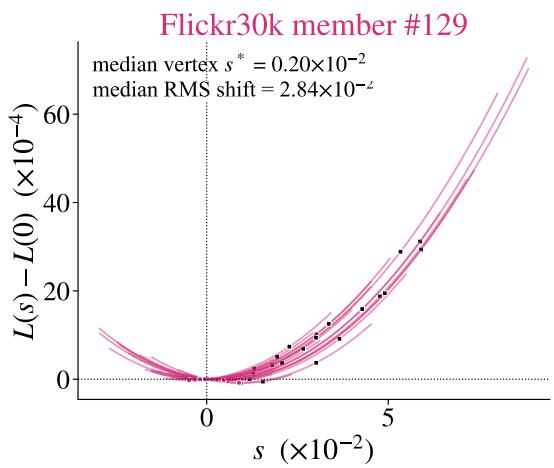

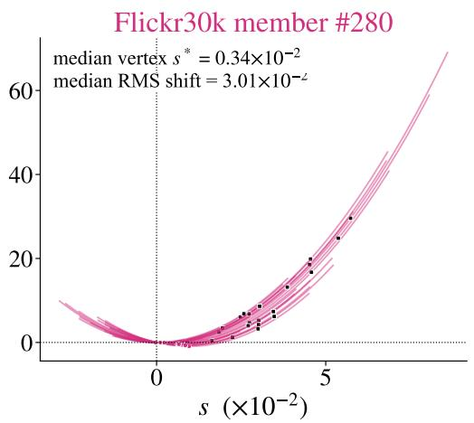

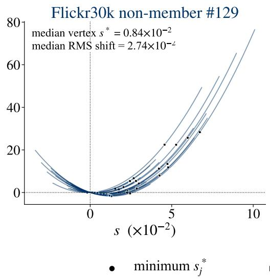

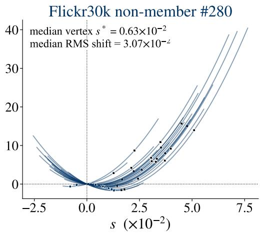

$$
s = \sqrt { \bar { S } _ { j } }
$$

Figure 5: Loss landscapes for two Flickr30k members (top) and two non-members (bottom) under alternative reference captions. Each curve uses the state-averaged statistics for one reference. The original prediction is at $s = 0$ , and the vertical axis gives the mean loss change. Dots mark minima and squares reference predictions; curves include extrapolation. The RMS shift is $\sqrt { \bar { S } _ { j } }$ (Equation 13).

Figure 5 illustrates the contrast on four Flickr30k examples: members’ minima lie near the original prediction, while non-members’ minima lie farther toward the references. Figure 6 shows this pattern across all four datasets. Median $s _ { j } ^ { * }$ values for members/non-members are 0.23/0.82 on Flickr30k, 0.16/0.88 on COCO, and $0 . 1 4 \dot { / 0 . 6 2 }$ on Pokemon, all in units of $1 0 ^ { - 2 }$ . The difference is smaller on LAION-MI (0.34/0.47). Thus, the fine-tuned models show a consistent geometric signature: members’ original predictions are closer to the minima along these reference-defined lines.

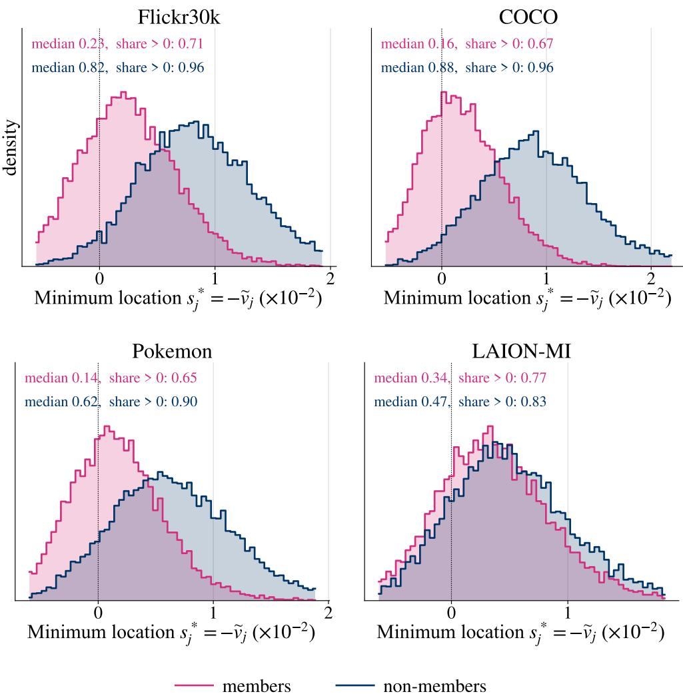  
Figure 6: Distribution of minimum locations $s _ { j } ^ { * } = - \widetilde { v } _ { j }$ from the state-averaged loss curves. Each observation is an image-reference pair. Members' minima (magenta) concentrate closer to the original prediction at $s = 0$ than non-members' minima (blue), with weaker separation on LAION-MI. Positive values indicate that the minimum lies toward the reference prediction.

## B.2 MEMBERSHIP INFORMATION IN THE LOSS-GAP COMPONENTS

We extend the loss-gap decomposition in Section 5.3 across all four datasets to examine which component carries membership information. For each dataset, Figure 7 shows squared shift magnitudes in the upper panel and the LoFIT response $\langle r _ { i } , \delta _ { i j } \rangle / \| \delta _ { i j } \| _ { 2 }$ in the lower panel. Shift magnitudes largely overlap between the classes, while LoFIT responses are more negative for non-members. Separation is pronounced on the fine-tuned models and weaker on LAION-MI. Table 5 tests these components on the full evaluation sets under the default reference configuration: mean shift magnitude remains near chance, while alignment provides stronger discrimination than the loss gap.

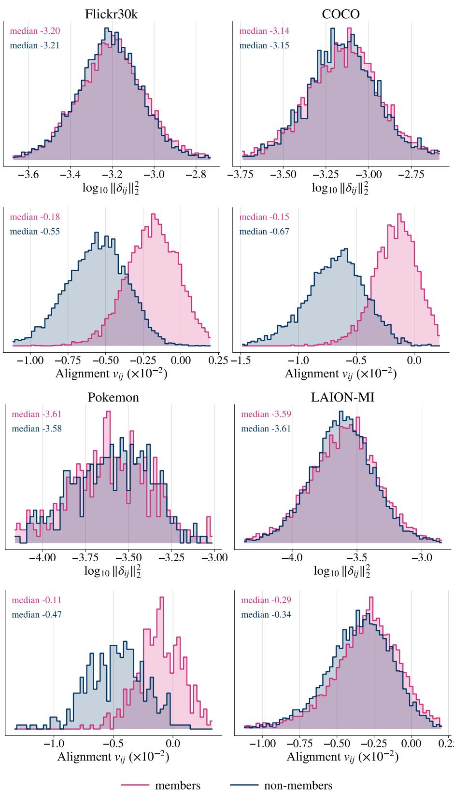  
Figure 7: Conditional prediction statistics across four datasets. For each dataset, the upper panel shows $\log _ { 1 0 } { \Vert \delta _ { i j } \Vert _ { 2 } ^ { 2 } }$ and the lower panel shows normalized alignment $\langle r _ { i } , \delta _ { i j } \rangle / \| \delta _ { i j } \| _ { 2 }$ , the LoFIT response. Magenta and blue denote members and non-members, respectively

## B.3 PRESERVING THE RESPONSE SIGN IMPROVES DISCRIMINATION

We test whether retaining the sign of the alignment response improves membership discrimination. A negative $v _ { i j }$ indicates that movement toward the reference prediction initially decreases denoising loss; a positive value indicates an increase. Taking the absolute value or square removes this distinction.

Table 13 compares these scoring rules on identical predictions using the settings in Appendix A.2. Here E denotes averaging over references and diffusion states. The signed mean improves both AUROC and low-FPR TPR over the absolute and squared responses on all three fine-tuned models, and improves AUROC on LAION-MI. Preserving the direction of the initial loss change therefore strengthens the membership signal. We also test cosine normalization, which additionally divides each response by the residual norm. It lowers AUROC on the fine-tuned models and ties LoFIT on LAION-MI.

Table 13: Membership scores with and without the response sign, evaluated on identical predictions.
<table><tr><td></td><td colspan="2">Flickr30k</td><td colspan="2">COCO</td><td colspan="2">Pokemon</td><td colspan="2">LAION-MI</td></tr><tr><td>Score</td><td>AUROC</td><td>TPR@1% FPR</td><td>AUROC</td><td>TPR@1% FPR</td><td>AUROC</td><td>TPR@1% FPR</td><td>AUROC</td><td>TPR@5% FPR</td></tr><tr><td> $\mathbb { E } [ v ] \ : ( \mathrm { o u r s } )$ </td><td>0.935</td><td>0.454</td><td>0.954</td><td>0.478</td><td>0.896</td><td>0.272</td><td>0.602</td><td>0.101</td></tr><tr><td> $- \dot { \mathbb { E } } [ | v | ]$ </td><td>0.893</td><td>0.183</td><td>0.915</td><td>0.246</td><td>0.837</td><td>0.062</td><td>0.595</td><td>0.086</td></tr><tr><td> $- \mathbb { E } [ v ^ { 2 } ]$ </td><td>0.886</td><td>0.184</td><td>0.910</td><td>0.216</td><td>0.835</td><td>0.087</td><td>0.595</td><td>0.088</td></tr><tr><td> $\mathbb { E } [ v ^ { \cdot } / \| \dot { r } \| _ { 2 } ]$ </td><td>0.917</td><td>0.377</td><td>0.944</td><td>0.410</td><td>0.891</td><td>0.255</td><td>0.602</td><td>0.101</td></tr></table>

## C CHOOSING INFORMATIVE CONDITIONING DIRECTIONS

This section examines how reference selection and perturbation design affect LoFIT's membership discrimination. We study which references provide strong and complementary signals, compare conditioning changes with alternative perturbations, and assess how reference selection changes when the original caption is unavailable.

## C.1 REFERENCE QUALITY AND COMPLEMENTARITY

To guide reference selection, we examine how well individual reference captions distinguish members from non-members and whether combining caption families improves discrimination.

Reference quality at equal cost. We evaluate each reference independently at equal query cost to separate reference quality from the benefit of averaging. Table 14 reports the mean and standard deviation of AUROC across reference slots within each family. We use the expanded reference pools in Appendix A.2, the full evaluation sets, and the diffusion-state configurations in Section 4.1, requiring 2TK denoiser evaluations per image. The empty prompt contributes a single slot.

Table 14: Single-reference LoFIT AUROC (mean ± standard deviation across slots) at equal query cost. Bold marks the highest mean per dataset.
<table><tr><td>Reference family</td><td>Flickr30k</td><td>COCO</td><td>Pokemon</td><td>LAION-MI</td></tr><tr><td>Token-level edits Paraphrases</td><td> $0 . 6 4 2 \pm 0 . 0 2 2$   $0 . 7 3 7 \pm 0 . 0 2 7$ </td><td> $0 . 6 7 9 \pm 0 . 0 2 6$   $0 . 7 5 6 \pm 0 . 0 2 9$ </td><td> $0 . 6 5 5 \pm 0 . 0 3 0$   $0 . 7 0 1 \pm 0 . 0 4 1$ </td><td> $0 . 5 1 5 \pm 0 . 0 0 8$   $0 . 5 1 7 \pm 0 . 0 0 9$ </td></tr><tr><td>Style changes</td><td> $0 . 6 5 0 \pm 0 . 0 3 3$ </td><td> $0 . 7 0 0 \pm 0 . 0 2 4$ </td><td> $0 . 6 3 8 \pm 0 . 0 1 5$ </td><td> $0 . 5 0 4 \pm 0 . 0 1 0$ </td></tr><tr><td>Semantic edits</td><td></td><td></td><td></td><td></td></tr><tr><td></td><td> $0 . 7 4 3 \pm 0 . 0 6 4$ </td><td> $0 . 7 9 3 \pm 0 . 0 5 8$ </td><td> $0 . 7 3 8 \pm 0 . 0 4 7$ </td><td> $0 . 5 2 9 \pm 0 . 0 1 7$ </td></tr><tr><td>Combined edits</td><td> $0 . 8 8 0 \pm 0 . 0 0 2$ </td><td> $0 . 9 0 9 \pm 0 . 0 0 7$ </td><td> $\mathbf { 0 . 8 1 0 \pm 0 . 0 1 4 }$ </td><td> $0 . 5 6 9 \pm 0 . 0 0 6$ </td></tr><tr><td>Random captions Empty prompt</td><td> $0 . 8 3 6 \pm 0 . 0 0 9$  0.900</td><td> $0 . 8 1 9 \pm 0 . 0 1 1$  0.914</td><td> $0 . 7 4 0 \pm 0 . 0 1 7$  0.781</td><td> $0 . 5 7 4 \pm 0 . 0 0 7$ </td></tr></table>

The empty prompt is strongest on Flickr30k, COCO, and LAION-MI; combined edits lead on Pokemon and among language-model rewrites on every dataset. Semantic edits vary more across refer-

ences; on COCO, their mean single-reference AUROC is 0.793, compared with 0.819 for random captions.

Combined edits also outperform random captions when both use four references. For each family, we randomly sample four references and evaluate AUROC, repeating this procedure 25 times. The mean AUROC is 0.919 versus 0.894 on Flickr30k and 0.940 versus 0.872 on COCO. Averaging also benefits semantic edits: on COCO, their mean AUROC increases from 0.793 with one reference to 0.897 with four.

## C.2 CAPTION-BASED AND GAUSSIAN CONDITIONING PROBES

We compare the membership information supplied by individual caption and Gaussian references, then examine their combination. We use the full evaluation sets and diffusion-state grids in Table 14. Each reference is scored independently by averaging alignment responses over states. We report the mean and standard deviation of AUROC across references, at a cost of 2TK queries per image per reference.

Gaussian probes query $e _ { 0 } + h U _ { j }$ , where $e _ { 0 } \in \mathbb { R } ^ { 7 7 \times 7 6 8 }$ is the original caption's conditioning tensor and $U _ { j }$ is Gaussian noise normalized to unit Frobenius norm. We sample four Gaussian directions per image at each $h \in \{ 4 0 , 8 0 , 1 6 0 \}$ and reuse each direction across that image's diffusion states. Table 15 averages the four single-direction AUROCs at each scale and reports their standard deviation where available; caption-family counts appear in Table 8. The denoiser converts each conditioning perturbation into a prediction shift, which is scored using the same alignment formula as a caption reference. These probes require direct access to the conditioning embedding interface, beyond the text-condition queries assumed by LoFIT.

We match the caption and Gaussian collections by image and timestep/noise-draw index. Their original-caption denoising losses agree exactly on all four datasets.

Table 15: Single-reference AUROC for caption and Gaussian probes. Entries show means and standard deviations where available.
<table><tr><td>Reference</td><td>Flickr30k</td><td>COCO</td><td>Pokemon</td><td>LAION-MI</td></tr><tr><td colspan="5">Caption references</td></tr><tr><td>Empty prompt</td><td> $0 . 9 0 0$ </td><td> $0 . 9 1 4$ </td><td> $0 . 7 8 1$ </td><td>0.606</td></tr><tr><td>Combined edits</td><td> $0 . 8 8 0 \pm 0 . 0 0 2$ </td><td> $0 . 9 0 9 \pm 0 . 0 0 7$ </td><td> $0 . 8 1 0 \pm 0 . 0 1 4$ </td><td>0.569</td></tr><tr><td>Random captions</td><td> $0 . 8 3 6 \pm 0 . 0 0 9$ </td><td> $0 . 8 1 9 \pm 0 . 0 1 1$ </td><td> $0 . 7 4 0 \pm 0 . 0 1 7$ </td><td>0.574</td></tr><tr><td>Semantic edits</td><td> $0 . 7 4 3 \pm 0 . 0 6 4$ </td><td> $0 . 7 9 3 \pm 0 . 0 5 8$ </td><td> $0 . 7 3 8 \pm 0 . 0 4 7$ </td><td>0.529</td></tr><tr><td>Paraphrases</td><td> $0 . 7 3 7 \pm 0 . 0 2 7$ </td><td> $0 . 7 5 6 \pm 0 . 0 2 9$ </td><td> $0 . 7 0 1 \pm 0 . 0 4 1$ </td><td>0.517</td></tr><tr><td>Style changes</td><td> $0 . 6 5 0 \pm 0 . 0 3 3$ </td><td> $0 . 7 0 0 \pm 0 . 0 2 4$ </td><td> $0 . 6 3 8 \pm 0 . 0 1 5$ </td><td>0.504</td></tr><tr><td>Token-level edits</td><td> $0 . 6 4 2 \pm 0 . 0 2 2$ </td><td> $0 . 6 7 9 \pm 0 . 0 2 6$ </td><td> $0 . 6 5 5 \pm 0 . 0 3 0$ </td><td>0.515</td></tr><tr><td colspan="5">Gaussian conditioning probes</td></tr><tr><td> $h = 4 0$ </td><td> $0 . { \dot { 6 } } { \dot { 8 } } 8 \pm 0 . 0 0 2$ </td><td> $0 . 7 3 1 \pm 0 . 0 0 4$ </td><td> $0 . 6 4 6 \pm 0 . 0 2 5$ </td><td>0.520</td></tr><tr><td> $h = 8 0$ </td><td> $0 . 8 0 6 \pm 0 . 0 0 1$ </td><td> $0 . 8 6 3 \pm 0 . 0 0 4$ </td><td> $0 . 7 6 1 \pm 0 . 0 1 4$ </td><td>0.534</td></tr><tr><td> $h = 1 6 0$ </td><td> $0 . 8 5 4 \pm 0 . 0 0 1$ </td><td> $0 . 9 0 3 \pm 0 . 0 0 3$ </td><td> $0 . 8 0 5 \pm 0 . 0 0 9$ </td><td>0.534</td></tr></table>

On the fine-tuned models, a single Gaussian direction at $h = 1 6 0$ outperforms a random caption on average and approaches combined edits, particularly on COCO and Pokemon. This ranking differs on pretrained LAION-MI: Gaussian probes yield AUROC 0.520–0.534, compared with 0.574 for random captions and 0.606 for the empty prompt. These single-reference results favor Gaussian probes on the fine-tuned models and caption references on LAION-MI at the tested perturbation scales.

Combining captions and Gaussian probes. Adding Gaussian probes to the caption pool improves membership discrimination on all three fine-tuned models (Table 16). We pool alignment responses from the complete caption reference sets in Table 8 and eight additional Gaussian probes, four at $h = 8 0$ and four at $h = 1 6 0$ These combined configurations use more queries than the caption-only configurations. AUROC increases from 0.935 to 0.946 on Flickr30k, 0.954 to 0.966 on COCO, and 0.896 to 0.910 on Pokemon. TPR at 1% FPR rises from 0.454 to 0.501 on Flickr30k and from 0.478 to 0.565 on COCO. On LAION-MI, combining the full caption pool with Gaussian probes changes AUROC from 0.573 to 0.575.

Table 16: AUROC after adding Gaussian probes to the full caption pool.
<table><tr><td>References</td><td>Flickr30k</td><td>COCO</td><td>Pokemon</td><td>LAION-MI</td></tr><tr><td>Caption pool</td><td>0.935</td><td>0.954</td><td>0.896</td><td>0.573</td></tr><tr><td>Caption + Gaussian</td><td>0.946</td><td>0.966</td><td>0.910</td><td>0.575</td></tr></table>

## C.3 MEMBERSHIP INFERENCE WITH GENERATED CAPTIONS

We evaluate image-membership inference when the original caption is unavailable. A BLIP-2 OPT-6.7b (Li et al., 2023) caption, generated by greedy decoding, replaces c0 throughout scoring and reference construction. Membership labels indicate whether the image was used for training. All results use the full evaluation populations. LoFIT and the loss-gap controls use the timestep grids in Section 4.1 and four noise draws.

Reference construction. Caption references comprise randomly sampled BLIP-2 captions of other images in the pool, the empty prompt, and language-model rewrites of the generated caption. Gaussian references perturb its conditioning tensor as $e _ { \mathrm { B } } + h U _ { j }$ , where eB encodes the BLIP-2 caption and $U _ { j }$ is normalized Gaussian noise, as defined in Appendix C.2. We test three directions at each $\bar { h } \in \{ 4 0 , 8 0 , 1 6 0 \}$ and average alignment responses over directions and states; the nine-direction configuration pools all three scales. The loss-gap baseline averages conditional loss differences on the same predictions used by LoFIT. A single-scale Gaussian configuration requires 192 denoiser evaluations per image on Flickr30k and LAION-MI, and 64 on COCO and Pokemon, excluding caption generation.

Official CLiD uses the released evaluation configuration with oracle α, as specified in Appendix A.3.

Table 17: Image-membership inference with BLIP-2 captions. Bold marks the best value per metric.
<table><tr><td></td><td colspan="2">Flickr30k</td><td colspan="2">COCO</td><td colspan="2">Pokemon</td><td colspan="2">LAION-MI</td></tr><tr><td>Score and references</td><td>AUROC</td><td>TPR@1% FPR</td><td>AUROC</td><td>TPR@1% FPR</td><td>AUROC</td><td>TPR@1% FPR</td><td>AUROC</td><td>TPR@5% FPR</td></tr><tr><td>Official CLiD</td><td></td><td></td><td></td><td></td><td></td><td></td><td></td><td></td></tr><tr><td>CLiDth, oracle α</td><td>0.603</td><td>0.031</td><td>0.650</td><td>0.044</td><td>0.576</td><td>0.041</td><td>0.535</td><td>0.084</td></tr><tr><td>Loss-based controls</td><td></td><td></td><td></td><td></td><td></td><td></td><td></td><td></td></tr><tr><td>Naive denoising loss</td><td>0.522</td><td>0.014</td><td>0.525</td><td>0.018</td><td>0.554</td><td>0.026</td><td>0.521</td><td>0.071</td></tr><tr><td>Mean loss gap, empty</td><td>0.627</td><td>0.063</td><td>0.673</td><td>0.059</td><td>0.523</td><td>0.041</td><td>0.536</td><td>0.081</td></tr><tr><td>Mean loss gap, random +</td><td>0.587</td><td>0.033</td><td>0.619</td><td>0.039</td><td>0.567</td><td>0.046</td><td>0.527</td><td>0.087</td></tr><tr><td>empty</td><td></td><td></td><td></td><td></td><td></td><td></td><td></td><td></td></tr><tr><td>LoFIT with caption references</td><td>0.680</td><td>0.073</td><td>0.763</td><td></td><td></td><td></td><td>0.564</td><td></td></tr><tr><td>Empty only Random + empty</td><td>0.641</td><td>0.029</td><td>0.669</td><td>0.103</td><td>0.530 0.621</td><td>0.007 0.034</td><td>0.546</td><td>0.092 0.076</td></tr><tr><td>Language-model rewrites</td><td>0.684</td><td>0.070</td><td>0.752</td><td>0.027 0.091</td><td>0.605</td><td>0.062</td><td>0.545</td><td>0.077</td></tr><tr><td>LoFIT with Gaussian references</td><td></td><td></td><td></td><td></td><td></td><td></td><td></td><td></td></tr><tr><td>h = 40</td><td>0.749</td><td>0.081</td><td>0.800</td><td></td><td></td><td>0.046</td><td></td><td>0.063</td></tr><tr><td>h = 80</td><td>0.838</td><td>0.190</td><td>0.894</td><td>0.106 0.236</td><td>0.669 0.782</td><td>0.130</td><td>0.535 0.544</td><td>0.066</td></tr><tr><td>h = 160</td><td>0.842</td><td>0.214</td><td>0.904</td><td>0.264</td><td>0.802</td><td>0.139</td><td>0.532</td><td>0.068</td></tr><tr><td>All nine directions</td><td>0.837</td><td>0.192</td><td>0.896</td><td>0.252</td><td>0.777</td><td>0.111</td><td>0.540</td><td>0.066</td></tr><tr><td>Mean loss gap, same nine</td><td>0.618</td><td>0.038</td><td>0.648</td><td>0.057</td><td>0.600</td><td>0.036</td><td>0.494</td><td>0.054</td></tr><tr><td>LoFIT with mixed references</td><td></td><td></td><td></td><td></td><td></td><td></td><td></td><td></td></tr><tr><td>Random + empty + Gaussian</td><td>0.755</td><td>0.096</td><td>0.849</td><td>0.193</td><td>0.761</td><td>0.072</td><td>0.552</td><td>0.081</td></tr><tr><td></td><td></td><td></td><td></td><td></td><td></td><td></td><td></td><td></td></tr><tr><td>All captions + Gaussian</td><td>0.749</td><td>0.117</td><td>0.830</td><td>0.186</td><td>0.717</td><td>0.087</td><td>0.554</td><td>0.078</td></tr></table>

Alignment remains informative with generated captions. With random captions and the empty reference, LoFIT exceeds official $\mathrm { C L i D } _ { \mathrm { t h } }$ with oracle α in AUROC across all four datasets (Table 17). On identical predictions, it also outperforms the loss-gap baseline in AUROC with the empty reference alone, random captions plus empty, and the nine Gaussian directions.

With BLIP-generated captions, Gaussian probes outperform caption references on the fine-tuned models. $\mathrm { A t } h = 1 6 0$ , AUROC reaches 0.842, 0.904, and 0.802 on Flickr30k, COCO, and Pokemon, respectively. Using the supplied captions yields higher AUROC (Table 1). Within the BLIP setting, combining caption references with Gaussian probes lowers AUROC relative to using the nine Gaussian directions alone on these datasets. On LAION-MI, the empty reference yields AUROC 0.564, above the caption mixtures and Gaussian probes in Table 17. These results show that the most informative references depend on the available query caption.

## D MEMBERSHIP INFERENCE ON VIDEO DIFFUSION MODELS

We evaluate whether LoFIT's conditional membership signal extends to video generation using CogVideoX-2b (Yang et al., 2025) and Wan2.1 (Team Wan et al., 2025) on Anime-Shooter (Qiu et al., 2025) and OpenVid (Nan et al., 2025).

Training. We fully fine-tune both models for 200 iterations on Anime-Shooter. On OpenVid, we fully fine-tune CogVideoX-2b for 4,000 iterations and Wan2.1 for 7,000 iterations. All runs use batch size 64. Membership denotes inclusion in the fine-tuning data.

Evaluation. On Anime-Shooter, we evaluate 500 members for each backbone, with 4,000 nonmembers for CogVideoX-2b and 3,998 for Wan2.1. On OpenVid, we evaluate 1,000 members and 4,000 non-members for both backbones. We report AUROC and TPR at 5% FPR (Table 18).

For CogVideoX, we use 12 timesteps $t \in \{ 8 0 , 1 6 0 , \ldots , 9 6 0 \}$ and construct noisy video latents. For Wan2.1, the same nominal timesteps map to noise levels $\sigma = t / 1 0 0 0 \in \{ 0 . 0 8 , 0 . 1 6 , \ldots , 0 . 9 6 \}$ , with

$$
x _ { \sigma } = ( 1 - \sigma ) x _ { 0 } + \sigma \epsilon ,\tag{14}
$$

where $x _ { 0 }$ is the clean video latent and $\epsilon \sim \mathcal { N } ( 0 , I )$ . Wan2.1 losses and alignment responses are evaluated in velocity-prediction space. For each video and state, we draw one noise tensor using a fixed random seed and share it across conditions, so the original and reference predictions use the same noisy input.

The original condition is the clip's training caption, and the sole reference is the empty prompt LoFIT uniformly averages the responses over all 12 predefined states, requiring 24 denoiser forward evaluations per video (12 states $\times ~ 2$ conditions). PIA and SecMI use 13 and 6 forward evaluations per video, respectively.

Table 18: Video membership inference on fine-tuned CogVideoX-2b and Wan2.1. Bold marks the best value per model, dataset, and metric.
<table><tr><td></td><td colspan="4">CogVideoX-2b</td><td colspan="4">Wan2.1</td></tr><tr><td></td><td colspan="2">Anime-Shooter</td><td colspan="2">OpenVid</td><td colspan="2">Anime-Shooter</td><td colspan="2">OpenVid</td></tr><tr><td>Method</td><td>AUROC</td><td>TPR@5% FPR</td><td>AUROC</td><td>TPR@5% FPR</td><td>AUROC</td><td>TPR@5% FPR</td><td>AUROC</td><td>TPR@5% FPR</td></tr><tr><td>Naive loss</td><td>0.580</td><td>0.122</td><td>0.504</td><td>0.044</td><td>0.515</td><td>0.072</td><td>0.502</td><td>0.056</td></tr><tr><td>PIA</td><td>0.547</td><td>0.090</td><td>0.502</td><td>0.052</td><td>0.504</td><td>0.052</td><td>0.490</td><td>0.050</td></tr><tr><td>SecMI</td><td>0.508</td><td>0.074</td><td>0.591</td><td>0.108</td><td>0.488</td><td>0.068</td><td>0.493</td><td>0.046</td></tr><tr><td> $\mathrm { C L i D } _ { \mathrm { t h } } \left( \alpha = 0 . 5 \right)$ </td><td>0.870</td><td>0.530</td><td>0.594</td><td>0.114</td><td>0.564</td><td>0.074</td><td>0.547</td><td>0.072</td></tr><tr><td>LoFIT (ours)</td><td>0.948</td><td>0.692</td><td>0.656</td><td>0.116</td><td>0.610</td><td>0.112</td><td>0.604</td><td>0.105</td></tr></table>

Results. LoFIT achieves the highest AUROC and TPR across all four fine-tuning settings. On CogVideoX-2b, it reaches AUROC 0.948 on Anime-Shooter and 0.656 on OpenVid, compared with 0.870 and 0.594 for $\mathrm { C L i D } _ { \mathrm { t h } }$ . On Wan2.1, LoFIT achieves AUROC 0.610 and TPR 0.112 on Anime-Shooter, exceeding $\mathrm { C L i D } _ { \mathrm { t h } }$ at 0.564 and 0.074. On OpenVid, it achieves AUROC 0.604 and TPR 0.105, compared with 0.547 and 0.072 for $\mathrm { C L i D } _ { \mathrm { t h } }$ . These results extend the conditional membership signal across two video-generation backbones.