# Pair-Relative Partial Equivariance for Rotation-Robust Keypoint Descriptor Matching

Jongmin Lee Chung-Ang University

jmlee@cau.ac.kr

## Abstract

Learned keypoint descriptors trained on upright imagery often fail under large in-plane rotation. Steerers [5] address this by applying a single exact SO(2) representation to the descriptor space, but this global group constraint can be too rigidfor keypoint descriptors, whose angular responses need not follow a single group representation. We propose pair-relative partial equivariance, which measures equivariance under the empirical distribution of relative rotations in image pairs, and PaSteer, a relaxed descriptor-steeringframework that allows the steering map to leave the exact representation manifold while retaining the lightweight, backbone-free design of steering. PaSteer instantiates this relaxation with two variants: an identitypreserving residual steerer (PaSteer-soft) and a free-form Fourier steerer (PaSteer-free). We show that the per-angle optimal linear steerer for a fixed non-equivariant descriptor generally does not obey the group composition law, explaining why exact representations can be suboptimal in the frozen-descriptor regime. On Roto-360, MegaDepth-1500, AIMS, and IMC-PT, PaSteer consistently improves rotationrobust matching over an exact steerer on frozen DeDoDe descriptors, especially under large relative rotations, with minimal upright degradation.

## 1. Introduction

Local feature matching is a backbone of structure-frommotion, visual localization, and 3D reconstruction. Modern learned descriptors such as SuperPoint [8], DISK [33], XFeat [27], and DeDoDe [9] are trained almost exclusively on upright internet and SfM imagery. Unlike SIFT [22], they therefore degrade sharply once the relative in-plane rotation between two images leaves a narrow band. This matters in practice: astronaut photography from the ISS [31], endoscopy, underwater imagery, and aerial imagery routinely contain large or arbitrary roll.

Existing remedies either build rotation handling into the descriptor or add steering on top of a released descriptor. Rotation-invariant or equivariant descriptors improve robustness through group pooling [21] or rotation-equivariant backbones with group alignment [17, 18, 29], but they require modifying or retraining the representation and may discard orientation as a useful matching cue. Steerers [5] take a lighter route: they keep the descriptor backbone fixed and encode rotation as a linear map $\rho ( \theta )$ on the description space. However, this map is constrained to be an exact SO(2) representation, $\rho ( \theta + \phi ) = \rho ( \theta ) \rho ( \phi )$ , forcing one global homomorphism to explain the descriptor response over the entire group. For an already-trained descriptor that was not optimized to be equivariant, this exact representation constraint can be overly rigid. Throughout, by a frozen released descriptor we mean an off-the-shelf descriptor taken from publicly released weights and used as is, without any retraining.

(a) Exact Steerers 148 correct  
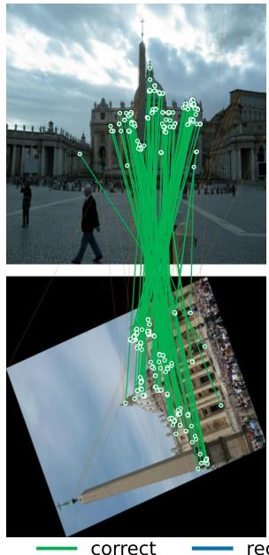

(b) PaSteer-free 242 correct (+113 rec.)  
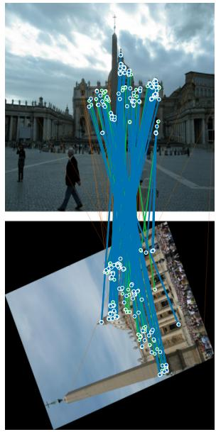  
Figure 1. PaSteer-free recovers correspondences that exact steering misses. A MegaDepth-1500 [19] pair under a large 112◦ in-plane rotation. Both panels share the same frozen DeDoDe-B [9] descriptor; only the steering changes. Exact Steerers [5] finds 148 correct matches (left), PaSteer-free 242 (right). Green: correct; blue: recovered (+113 correct matches); orange: rejected.

The key observation of this paper is that rotation robustness in matching is pair-relative, not group-uniform. Matching depends on the relative rotation ∆θ between two images, and the distribution of ∆θ varies sharply by domain. Measured from ground-truth poses, MegaDepth-1500 [19] pairs are mostly near-upright, whereas astronaut imagery [31] is close to uniform over SO(2) (Sec. 4). Thus, a single fixed degree of equivariance cannot be ideal for both. This is precisely the setting addressed by partial equivariance, where equivariance is not all-or-nothing but a data-dependent degree [2, 11, 28, 34, 35]. To our knowledge, this view has not been applied to descriptor matching.

We connect partial equivariance to rotation-robust descriptor matching through PaSteer, a relaxed steering framework that keeps the lightweight, backbone-free design of descriptor steering while loosening the exact SO(2) representation constraint. PaSteer allows the steering map to leave the representation manifold, rather than forcing one homomorphism to fit all angles. We instantiate this idea in two operating points: PaSteer-soft, a conservative identity-preserving relaxation anchored to the exact generator, and PaSteer-free, a free-form Fourier steerer that directly models the angle-dependent map. Both variants change only the steering map; the detector, frozen descrip tor, keypoints, probe grid, matcher, and geometric estimator are kept fixed in our controlled comparisons. Across Roto-360 [17], MegaDepth-1500 [19], AIMS [31], and IMC-PT [13], this relaxation improves frozen-descriptor matching most under large relative rotations.

Our contributions are four-fold:

• We formulate pair-relative partial equivariance for descriptor matching, measuring equivariance against the empirical distribution q(∆θ) of pairwise relative rotations rather than against the uniform group.

• We introduce PaSteer, a relaxed steering framework that preserves the deployability of descriptor steering while loosening the exact SO(2) representation constraint.

• We show that, for a frozen non-equivariant descriptor, the per-angle optimal linear steerer is generally nonhomomorphic, so an exact SO(2) representation is intrinsically restrictive.

• We clarify the scope of relaxation: it is most beneficial for frozen released descriptors and becomes comparable to exact steering under full joint descriptor–steerer training.

## 2. Related Work

Local feature matching. Establishing correspondences between images underlies structure-from-motion, visual localization, and 3D reconstruction. Sparse pipelines detect and describe keypoints [8, 22, 27, 33], and DeDoDe [9] in particular decouples detection from description and is the descriptor we build on. Learned matchers then resolve the assignment, either over sparse keypoints [20, 30] or densely without an explicit detector [10, 32]. These descriptors and matchers are trained almost exclusively on upright internet and SfM imagery, so they degrade once the relative rotation of a pair leaves a narrow band; dense matchers such as RoMa [10] are robust to viewpoint but remain weak under large in-plane rotation. We propose neither a new detector nor a new matcher: our intervention is confined to the descriptor steering stage, leaving the detector and matcher fixed so that steering mechanisms can be compared on a single frozen descriptor under controlled conditions.

Rotation-equivariant features and descriptors. Groupequivariant CNNs extend weight sharing from translations to larger symmetry groups [6, 37], and steerable formulations express the rotation action analytically on feature fields [7, 36]. For matching, one line builds rotation handling directly into the descriptor representation. GIFT [21] pools a descriptor over a transformation orbit to obtain invariance, Self-Sca-Ori [16] estimates a canonical keypoint scale and orientation, while REKD [17], RELF [18], and S-TREK [29] learn rotation-equivariant detectors and descriptors and align the group dimension to a canonical pose; RELF reports strong results on the Roto-360 benchmark introduced with REKD [17]. The same groupequivariant machinery underlies dense correspondence [23] and frequency-domain pose regression [15]. SE2-LoFTR [3] instead places an SE(2)-equivariant backbone inside a detector-free matcher. Building the symmetry into the representation is robust, but it carries a cost: invariance spends discriminative capacity, since orientation is itself a matching cue, and an equivariant backbone must be trained from scratch rather than reused from a released descriptor. These methods also impose equivariance over the entire group.

Steerers and orientation handling. Steerers [5] are the closest baseline to our setting: they keep the backbone untouched and encode a rotation as a single linear map on the description space of a frozen or jointly trained DeDoDe descriptor, requiring ρ to be an exact representation of SO(2); they report state of the art on Roto-360 and AIMS [31]. Requiring an exact representation ties a global SO(2) action to the whole descriptor space, so one linear map must account for every rotation consistently. Affine Steerers [4] generalize the construction to GL(2). A follow-up line asks whether invariance should live in the descriptor or the matcher [24, 25] and shows that data scaling shrinks the upright-rotated gap. These works steer with an exact representation, train with multiples of 90◦, and do not train descriptors with non-trivial steerers. We ask instead whether an exact representation is the right constraint for a frozen released descriptor, and relax it to a continuous, pair-relative degree of equivariance.

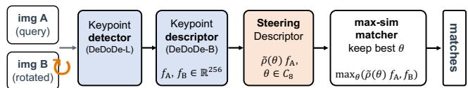  
Figure 2. PaSteer matching pipeline. An SO(2) keypoint detector (DeDoDe-L [9]) and a keypoint descriptor (DeDoDe-B) feed a steered max-similarity matcher: the query descriptors are steered by ρ˜(θ) over the $C _ { 8 }$ probe grid under partial equivariance, and the best-scoring angle is kept per keypoint.

Partial, relaxed, and learned equivariance. A growing body of work treats equivariance as a learnable degree rather than a hard constraint. Augerino [2] learns an augmentation distribution; Residual Pathway Priors [11] add a soft non-equivariant residual path; approximately equivariant networks [35] mix equivariant and free kernels; and Partial G-CNNs [28] learn a distribution over a group subset so a layer is equivariant only on $S \subseteq G$ The probabilistic-degree approach [34] learns per-layer equivariance for steerable CNNs via a Fourier parameterization. The Lie derivative [12] quantifies learned equivariance, and approximation-generalization trade-offs under approximate group equivariance have been analyzed theoretically [14, 26]. All of these methods relax the degree of equivariance inside a network backbone, and none has been applied to image matching or to descriptor steering. PaSteer adapts the partial-equivariance idea to the steering map rather than the backbone, making the degree of equivariance data-determined and tying it to the empirically measured relative rotation distribution of image pairs.

## 3. Method

Figure 2 overviews the six-stage pipeline. (1) A query $I _ { 1 }$ and a target $I _ { 2 } ,$ , which may differ by an arbitrary inplane rotation, enter the system. (2) A rotation-equivariant SO(2) detector (DeDoDe-L [9]) produces keypoints in both images. (3) A frozen DeDoDe-B descriptor f describes each keypoint, giving $f _ { A } , f _ { B } \in \mathbb { R } ^ { 2 5 6 }$ . (4) Before matching, a steering map evaluated over a $C _ { 8 }$ probe grid steers the query descriptors into a bank of candidate frames. (5) A maximum-similarity matcher scores each steered query against the target, keeps the best-scoring angle per keypoint, and applies a mutual-nearest-neighbour selection. (6) The surviving correspondences feed the usual geometric estimator (essential matrix or homography) for pose or registration.

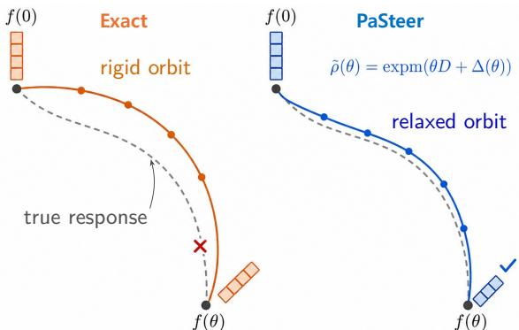  
Figure 3. Exact representation vs. relaxed steering. The gray dashed curve denotes the true angular response of the keypoint descriptor. The orange solid curve shows the rigid exact-representation orbit, which misses this response, while the blue solid curve shows the relaxed PaSteer-soft orbit, $\tilde { \rho } ( \theta ) =$ $\mathrm { e x p m } ( \theta D + \Delta ( \theta ) )$ ), which follows the true response more closely.

The rest of this section develops PaSteer. Section 3.1 formalizes pair-relative partial equivariance, the degree of equivariance measured against the rotation a domain actually exhibits, and gives the intuition for why relaxing helps; Sec. 3.2 introduces the relaxed steering family and its two instances, Sec. 3.3 how each steerer fills the steering slot, Sec. 3.4 the matcher that turns steered descriptors into correspondences, and Sec. 3.5 explains training objectives.

## 3.1. Pair-relative partial equivariance

Let $f : X \to \mathbb { R } ^ { D }$ be a keypoint descriptor on an image domain X, and let $R _ { \theta } : X  X$ be the in-plane rotation action for $\theta \in \mathrm { S O } ( 2 ) \cong [ 0 , 2 \pi )$ . A steerer [5] is a map $\rho :$ $\mathrm { S O } ( 2 )  \mathbb { R } ^ { D \times D }$ intended to satisfy $f ( R _ { \theta } I ) \approx \rho ( \theta ) f ( I )$ so that a descriptor extracted from an upright image can be transported into the frame of a rotated one. In exact steering [5], ρ is constrained to be a group representation,

$$
\rho ( \theta + \phi ) = \rho ( \theta ) \rho ( \phi ) , \qquad \rho ( 0 ) = I ,\tag{1}
$$

which, for $\mathrm { S O } ( 2 )$ , is parameterized by a single generator D via $\rho ( \theta ) = \mathrm { e x p m } ( \theta D )$ with expm(2πD) = I.

The key observation is that matching performance depends on the relative rotation $\Delta \theta ~ = ~ \theta _ { 2 } - \theta _ { 1 }$ of a pair $( I _ { 1 } , I _ { 2 } )$ , not on absolute orientation. We therefore measure equivariance against the empirical relative-rotation distribution of the data [12], following the partial-equivariance view [2, 11, 26, 28, 34, 35].

Definition 1 (Pair-relative partial equivariance). Let $q ( \Delta \theta )$ be the distribution of the relative rotation of image pairs in a domain. A descriptor f is ε-partially equivariant with respect to q and a steerer $\rho$ if

$$
\begin{array} { r } { \mathbb { E } _ { \Delta \theta \sim q } \mathbb { E } _ { I } \left. \boldsymbol { f } ( R _ { \Delta \theta } I ) - \boldsymbol { \rho } ( \Delta \theta ) \boldsymbol { f } ( I ) \right. ^ { 2 } \leq \varepsilon . } \end{array}\tag{2}
$$

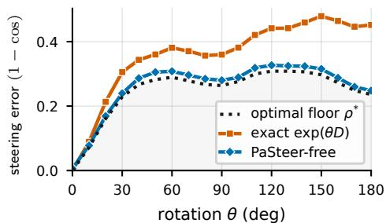  
Figure 4. The relaxed map approaches the optimal floor. Steering error is 1 − cos of the cosine similarity between a steered upright descriptor $\rho ( \theta ) f ( I )$ and the truly rotated one $f ( R _ { \theta } I )$ (lower is better, 0 is exact recovery). On fixed DeDoDe-B [9] descriptor, PaSteer tracks the optimal per-angle floor, while the exact representation [5] falls short and its error grows with rotation angle.

The exact-steering setting is the special case $q =$ Uniform $\mathrm { ( S O ( 2 ) ) }$ with $\rho$ constrained as in Eq. (1). We make two changes: q is estimated from data, concentrated near $0 ^ { \circ }$ for SfM imagery and near-uniform for astronaut imagery, and $\rho$ is allowed to leave the representation manifold. We refer to the constrained case as exact and the unconstrained case as relaxed.

Why relaxing helps. Figure 3 shows the intuition. The frozen keypoint descriptor was never trained to rotate as a group, so its true angular response is not a representation, and the best linear steerer at each angle is not one either. An exact representation is locked to the representation manifold and cannot reach this per-angle optimum, whereas a relaxed steerer can. Figure 4 visualizes the steering error of the exact map growing with angle while the relaxed map hugs the optimal per-angle floor. Supp. Sec. A makes this precise with a closed form for the optimal per-angle steerer.

## 3.2. Relaxed steering family

PaSteer is a relaxed steering family that lets the steering map leave the exact representation manifold, placing a single knob between a rigid exact steerer and a fully free-form one and turning it only as far as the data needs. It has two instances, named consistently throughout the paper.

PaSteer-soft is a residual-exponential relaxation anchored to the exact generator: it keeps the generator-exponential form and adds only a small low-rank Fourier residual that vanishes at $\theta \quad = \quad 0 .$ , in the spirit of soft/approximateequivariance residuals [11, 35]. This preserves the upright identity exactly, while relaxing the exact representation constraint with a small number of additional parameters. It is the conservative, capacity-light, identity-preserving variant.

PaSteer-free is a free-form Fourier relaxation: since the per-angle optimal steerer is in general not a representation (supp. Sec. A), it drops the generator-exponential form and parameterizes the angle-dependent map directly in a Fourier basis over the probe grid [28, 34], giving up the orthogonality and homomorphism constraints to approach that optimum. It is the main high-capacity instance in our full-scale experiments; its upright identity is approximate rather than exact, and its larger parameterization is a training and storage cost.

With the exact representation as the rigid endpoint, the three steerers used throughout the paper are:

• Exact: a single ${ \mathrm { S O } } ( 2 )$ representation.

• PaSteer-soft: a representation-anchored, bounded residual-exponential relaxation.

• PaSteer-free: a free-form Fourier relaxation that drops the representation form.

“Exact” denotes the Steerers [5] representation retrained at our budget, used as the baseline throughout.

## 3.3. Steering stage

All compared methods share the same detector, frozen descriptor, keypoints, $C _ { 8 }$ probe grid, matcher, and geometric estimator; the only component that changes is the steering map ${ \tilde { \rho } } .$ Exact fills this slot with the representation $\rho ( \theta ) = \mathrm { e x p m } ( \theta D )$ . PaSteer-soft adds a bounded low-rank Fourier residual to the exact generator core,

$$
\tilde { \rho } ( \theta ) = \mathrm { e x p m } \big ( \theta D + \Delta ( \theta ) \big ) ,\tag{3}
$$

$$
\begin{array} { c } { { \displaystyle \Delta ( \theta ) = \sum _ { k = 1 } ^ { K } \big [ S _ { k } \sin k \theta + C _ { k } ( \cos k \theta - 1 ) \big ] \mathrm { , } } } \\ { { S _ { k } = U _ { k } V _ { k } ^ { \top } , \qquad C _ { k } = P _ { k } Q _ { k } ^ { \top } \quad \mathrm { o f ~ r a n k ~ } r . } } \end{array}\tag{4}
$$

with $\Delta ( 0 ) = 0 , { \ : } \mathrm { s o } \ \tilde { \rho } ( 0 ) = I$ exactly and upright pairs incur no steering error. PaSteer-free drops the representation form and parameterizes the per-angle map directly,

$$
\tilde { \rho } ( \theta ) = A _ { 0 } + \sum _ { k = 1 } ^ { K } \big [ A _ { k } \cos k \theta + B _ { k } \sin k \theta \big ] , \quad A _ { 0 } \approx I ,\tag{5}
$$

an unconstrained linear map per angle. Each steerer then applies its chosen map over the $C _ { 8 }$ probe grid $\Theta \ =$ $\{ 0 , 4 5 ^ { \circ } , \ldots , 3 1 5 ^ { \circ } \}$ , sending a query descriptor $f _ { A }$ to a steered bank $g _ { A } ( \theta ) = \tilde { \rho } ( \theta ) f _ { A }$

Deployability. All three deployed steerers share the same test-time structure: their $C _ { 8 }$ steering maps are precomputed before inference, and during matching each query descriptor is transformed by these fixed maps and scored by the same maximum-similarity matcher. PaSteer-free therefore has identical inference cost to exact steering; its larger parameterization affects only training and storage, not the perpair inference. We separately test whether the gain comes from extra parameters in Sec. 4.3.

## 3.4. Matching

We score steered descriptors over candidate angles and produce final correspondences. For each query keypoint, the matcher selects the candidate angle whose steered descriptor best matches the target, following the steered maximumsimilarity matching of Steerers [5]. With $\ell _ { 2 }$ -normalized descriptors, the similarity between a query keypoint a and a target keypoint b is

$$
S _ { a b } = \operatorname* { m a x } _ { \theta \in \Theta } \langle \widehat { \tilde { \rho } ( \theta ) f _ { A } ^ { a } } , \widehat { f _ { B } ^ { b } } \rangle .\tag{6}
$$

An upright pair selects an angle near $\theta = 0$ , whereas a rotated pair selects the angle that best explains its relative rotation, without requiring any rotation prior. A mutual-nearestneighbour dual-softmax selection [32] on S yields the final correspondences for the geometric estimator. Since Exact, PaSteer-soft, and PaSteer-free differ only in $\tilde { \rho } ,$ this comparison isolates the effect of relaxing the steering map.

## 3.5. Training

Frozen-descriptor objective. With f fixed, we train only the steering map $\tilde { \rho }$ by minimizing the steering error of Definition 1. Equation (2) uses a squared $\ell _ { 2 }$ distance for clarity; we minimize its empirical cosine form, consistent with the matcher of Sec. 3.4, ${ \mathcal { L } } ~ = ~ \mathbb { E } _ { \Delta \theta \sim q } \mathbb { E } _ { I } { \left[ \begin{array} { l l } { 1 } & { - } \end{array} \right] }$ cos $( f ( R _ { \Delta \theta } I ) , \tilde { \rho } ( \Delta \theta ) f ( I ) ) ]$ ]. The distribution $q ( \Delta \theta )$ both draws and weights the training angles, so this q-weighting is where pair-relative partial equivariance enters learning, concentrated near $0 ^ { \circ }$ for handheld imagery and nearuniform otherwise. For Exact and PaSteer-soft the upright identity is exact by construction (Eq. (4)), so the $\Delta \theta = 0$ term is guaranteed rather than learned.

Joint objective. In the full-scale joint regime the descriptor and steerer train together under the standard DeDoDe matching loss [9] rather than the steering error, with continuous in-plane rotation augmentation that exposes the steerer to all relative angles, not the multiples of $9 0 °$ used by the original Steerers [5]; Fig. 5 isolates this continuous coverage. The joint comparison is reported in Sec. 4.5; the optimizer, step count, learning rate, and data splits, shared across all steerers, are in Sec. 4.

## 4. Experiments

We organize the experiments around five questions. Section 4.1 tests whether relaxing the representation constraint improves descriptor matching across benchmarks. Section 4.2 analyzes why the relaxation helps. Section 4.3 asks whether the gain comes merely from added capacity. Section 4.4 studies when equivariance matters under different relative-rotation distributions. Finally, Section 4.5 clarifies the scope of the relaxation under full joint descriptor– steerer training.

Model and steerer setup. Most matching results follow the Setting-A structure of Steerers [5]: the DeDoDe-B descriptor [9] and the SO(2) detector are fixed, and only the steering transform is trained. This setup isolates the representation constraint, since the exact and PaSteer arms use the same descriptor, detector, keypoints, matcher, initialization, and generator core, and differ only in the steering form. We call this shared setup matched-budget; parameter count is not matched here and is controlled separately in Sec. 4.3. Because the descriptor itself is not adapted to rotation, this protocol also caps absolute performance; the full-scale joint comparison is reported separately in Sec. 4.5.

<table><tr><td>benchmark / metric</td><td>Exact</td><td>PaSteer-free</td><td>∆</td></tr><tr><td>Roto-360 @5px</td><td>92.0</td><td>93.4</td><td>+1.4</td></tr><tr><td>MD-1500 C4 AUC@5</td><td>32.5</td><td>36.4</td><td>+3.9</td></tr><tr><td>MD-1500 SO2 AUC@5</td><td>20.0</td><td>22.9</td><td>+2.8</td></tr><tr><td>AIMS AP</td><td>48.6</td><td>50.1</td><td>+1.5</td></tr><tr><td>IMC-PT C4 AUC@20</td><td>67.2</td><td>75.2</td><td>+8.0</td></tr><tr><td>IMC-PT SO2 AUC@20</td><td>41.1</td><td>50.6</td><td>+9.5</td></tr></table>

Table 1. Main result. On frozen DeDoDe-B descriptors [9], we measure absolute scores for the exact steerer and PaSteer-free with their difference $\Delta ,$ on Roto-360 [17] correct matches @5px; MegaDepth-1500 [19] pose AUC@5◦; AIMS [31] average precision on the full FMAP set (323 frames); IMC-PT [13] pose AUC@20◦. PaSteer-free improves over the exact steerer on all four benchmarks, by the widest margin under large relative rotation.

<table><tr><td>steerer</td><td>Roto</td><td>upr.</td><td>C4</td><td>SO2</td><td>AIMS</td></tr><tr><td>exact expm</td><td>92.0</td><td>49.0</td><td>32.5</td><td>20.0</td><td>48.6</td></tr><tr><td>PaSteer-free (ours)</td><td>93.4</td><td>49.3</td><td>36.4</td><td>22.9</td><td>50.1</td></tr><tr><td> $\Delta$  (free—exact)</td><td>+1.4</td><td>+0.3</td><td>+3.9</td><td>+2.8</td><td>+1.5</td></tr></table>

Table 2. Full-scale MegaDepth training. PaSteer-free versus the exact steerer, both trained on the full MegaDepth set on a frozen DeDoDe-B [9] with identical scenes, budget, generator core, and initialization. Roto denotes Roto-360 correct matches @5px [17]; upr., C4, SO2 denote MegaDepth-1500 pose $\operatorname { A U C } \ @ 5 ^ { \circ }$ (upright/C4/SO2) [19]; AIMS denotes average precision on AIMS [31]. The ∆ row is the relaxed-over-exact margin.

Training and matching details. Unless noted, all learned steerers are trained on a fixed HPatches [1] training split for a few thousand Adam steps and are evaluated with the same matching protocol: maximum-similarity matching over $C _ { 8 }$ probe angles, with dual-softmax [32] for the unsteered baseline. For the closed-form optimal steerer of supp. Eq. 8, we estimate G and C(θ) on the same HPatches training split as the learned steerers and report steering error on a disjoint HPatches evaluation split, using ridge weight $\lambda = 1 0 ^ { - 2 }$ · mean(diag(G)). The HPatches train and evaluation sequences, together with the Roto-360 [17] test sequences, are listed in supp. Sec. E.

<table><tr><td>desc.</td><td>metric</td><td></td><td>Exact PS-free</td><td>∆</td></tr><tr><td rowspan="3">DeDoDe-B</td><td>Roto-360 @5px</td><td>92.0</td><td>93.4</td><td>+1.4</td></tr><tr><td>MD-1500 C4 AUC@5</td><td>32.5</td><td>36.4</td><td>+3.9</td></tr><tr><td>MD-1500 SO2 AUC@5</td><td>20.0</td><td>22.9</td><td>+2.8</td></tr><tr><td rowspan="3">DeDoDe-G</td><td>Roto-360 @5px</td><td>51.1</td><td>80.6</td><td>+29.5</td></tr><tr><td>MD-1500 C4 AUC@5</td><td>12.9</td><td>21.6</td><td> $+ 8 . 7$ </td></tr><tr><td>MD-1500 SO2 AUC@5</td><td>11.8</td><td>20.1</td><td>+8.3</td></tr></table>

Table 3. The cost of the exact constraint grows with descriptor capacity. Comparison with the exact steerer and PaSteer-free (PS-free) on DeDoDe-B [9] and the larger DeDoDe-G, on Roto-360 [17] correct matches @5px and MegaDepth-1500 [19] pose AUC@5◦ (C4/SO2). The margin widens markedly on DeDoDe-G across every rotation axis; scores are means over three training seeds (two for exact on DeDoDe-G).

Exact, PaSteer, and released Steerers. Our exact baseline is the exact-representation counterpart to PaSteer, not an ad-hoc baseline. It uses the same steering mechanism as Steerers [5], a single SO(2) representation $\rho ( \theta ) =$ expm(θD), under the same Setting-A structure. The difference from the released Steerers model is protocol rather than mechanism: our exact and PaSteer variants use the matched-budget setup above, whereas the released model is trained on MegaDepth [19] with rotations at multiples of 90◦ and uses a Procrustes matcher. The released Steerers rows in Tab. 4 and supp. Tabs. 10 and 11 are therefore absolute-performance references, while the controlled comparison is exact versus PaSteer under matched training.

Datasets. We evaluate matching on Roto-360 [17], MegaDepth-1500 [19], AIMS [31], and the IMC-PT 2020 validation set [13].

## 4.1. Does relaxation improve descriptor matching?

Our central regime is frozen descriptors: equipping an already-trained descriptor with rotation robustness without retraining it, with the SO2 detector fixed.

The relaxed-over-exact margin. Table 1 is the main results: on a frozen descriptor, relaxing the representation constraint improves matching on all four benchmarks, by the widest margin on the large-rotation C4 and SO2 axes, while upright stays within a fraction of a point of exact (slightly below for PaSteer-free, whose err(0) is near but nonzero, and exactly zero for PaSteer-soft by construction). The reported ∆ is a controlled within-protocol difference that sidesteps the AIMS [31] absolute-AP protocol gap noted below.

Full-scale Setting-A absolutes. Table 2 reports the fullscale MegaDepth [19] training results, where PaSteer-free wins on every axis. Additional results are in the supplement.

<table><tr><td>steering 3px</td><td>5px</td><td>10px</td></tr><tr><td>Matched-budget controlled comparison</td></tr><tr><td>none (unsteered) 19.7 20.5 exact expm (our budget) 77.3 78.3</td><td>21.6 79.2 90.1 91.0</td></tr><tr><td>PaSteer-soft (r=12, ours) 89.1 PaSteer-free (ours) 93.9</td></tr><tr><td>95.1 96.0</td></tr><tr><td>Released reference models, not controlled</td></tr><tr><td></td></tr><tr><td>exact, release Setting-A 91.4 93.0 94.1 98.5</td></tr></table>

Table 4. Matched-budget three-way comparison on Roto-360 [17], correct matches % @{3,5,10}px, frozen DeDoDe-B [9]. The top block is the matched-budget controlled comparison (ordering exact < PaSteer-soft < PaSteer-free); the bottom block lists released models as absolute references only, not controlled comparisons. Per-benchmark MegaDepth-1500 and AIMS tables are in supp. Sec. B.

Scaling to a larger descriptor. Tab. 3 shows the results on a larger-sized descriptor DeDoDe-G [9]. The cost of enforcing an exact representation grows with descriptor capacity. DeDoDe-G uses a substantially larger DINOv2 backbone than DeDoDe-B, and the relaxed-over-exact margin widens on every rotation axis. This mirrors Sec. 4.2: on the larger descriptor, the per-angle optimum departs further from a group representation, a gap that only the free-form steerer can effectively close.

Matched-budget three-way comparison. Table 4 shows the Roto-360 [17] matched-budget comparison among exact, PaSteer-soft, and PaSteer-free, trained with the same data and budget on the same HPatches [1] sequences. The ordering exact < PaSteer-soft < PaSteer-free holds, with PaSteer-soft improving over the matched exact steerer while keeping err(0) = 0 and PaSteer-free improving further. The released SO2-Spread-B model reaches higher absolute accuracy under a different full-scale released training protocol, so it should be read as an upper reference rather than a controlled counterpart to PaSteer. The same matchedbudget ordering reproduces on MegaDepth-1500 and AIMS (PaSteer-soft +7.3 AP, 44.4 vs. 37.1; PaSteer-free 51.2), with full per-benchmark tables in supp. Sec. B.

Continuous-angle robustness. Figure 5 shows the results as pair relative rotation is swept continuously, isolating continuous steering from augmenting only by multiples of 90◦ on MD-1500 pose AUC@5◦. The unsteered descriptor is reliable only near upright rotations; the exact steerer restores robustness but dips at the $C _ { 8 }$ discretization-worst angles. PaSteer-free leads across most angles, especially near these dips, and also raises the accuracy level between probe angles, showing that the gain is not just a $C _ { 8 }$ gap-filling ef-

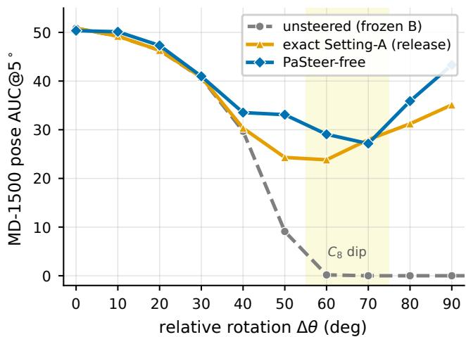  
Figure 5. Continuous-angle robustness. Per-angle MD-1500 [19] pose $\operatorname { A U C } \ @ 5 ^ { \circ }$ as the relative in-plane rotation $\Delta \theta$ is swept continuously, on a frozen DeDoDe-B [9] descriptor with $C _ { 8 }$ probes. Unsteered (gray dashed) is the frozen descriptor without steering; exact Setting-A (orange) is the released Steerers [5] Setting-A model; PaSteer-free (blue) is our relaxed steerer. PaSteer-free is at or above both across nearly the whole sweep, with the largest gains at the $C _ { 8 }$ discretization-worst angles.

fect.

## 4.2. Why does the partial equivariance help?

Table 5 shows steering-error results on HPatches [1] evaluation set using a frozen DeDoDe-B [9] descriptor. We compare each learned steerer with the closed-form per-angle optimum $\rho ^ { \star }$ of supp. Eq. 8, which serves as an oracle lowererror reference rather than a deployable model.

The exact steerer is consistently farther from this optimum, especially at large rotations. PaSteer-free stays close to $\rho ^ { \star }$ at all reported angles, and PaSteer-soft falls in between (Fig. 4). The bottom rows show that $\rho ^ { \star }$ has a large composition violation, meaning that the best angle-wise maps do not compose as a single SO(2) representation. This explains why the exact representation constraint is limiting for a frozen descriptor, and why PaSteer-free can better match its actual angular response.

## 4.3. Capacity and constraint controls

Mechanism comparison. Tab. 6 shows that PaSteer-free obtains the lowest steering error at every angle but at a large parameter cost, raising whether the extra capacity, not the relaxation, buys the gain. To separate the two we use two controls: PaSteer-soft, a capacity-light residual that keeps $\mathrm { e r r } ( 0 ) = 0$ and whose out-of-band gain over exact saturates with rank, so it is a functional-form effect rather than added capacity; and an orthogonality-preserving residual of matched size that isolates the orthogonality constraint. Table 6 reports steering error in and out of the natural partialequivariance band of Fig. 5.

<table><tr><td>θ</td><td> $\rho ^ { \star }$ </td><td></td><td>exact PaSteer-soft PaSteer-free</td><td></td></tr><tr><td> $3 0 ^ { \circ }$ </td><td>0.229</td><td>0.305</td><td>0.311</td><td>0.239</td></tr><tr><td> $9 0 ^ { \circ }$ </td><td>0.2640.360</td><td></td><td>0.348</td><td>0.280</td></tr><tr><td> $1 8 0 ^ { \circ }$ </td><td>0.2360.452</td><td></td><td>0.366</td><td>0.248</td></tr><tr><td>comp. violation</td><td></td><td></td><td>0.60-0.70</td><td></td></tr><tr><td>orthog. deviation</td><td></td><td></td><td>0.85-1.04</td><td></td></tr></table>

Table 5. Steering error against the per-angle optimum. Steering error 1 − cos is reported on HPatches [1] evaluation set using a frozen DeDoDe-B [9] descriptor. The top rows compare the closed-form per-angle optimum $\rho ^ { \star }$ , the exact steerer, PaSteer-soft, and PaSteer-free at selected rotation angles. The bottom rows report the composition violation and orthogonality deviation of $\rho ^ { \star }$ : the former measures how far $\rho ^ { \star } ( \theta + \phi )$ is from $\rho ^ { \star } ( \theta ) \rho ^ { \star } ( \phi )$ , and the latter measures how far $\rho ^ { \star \top } \rho ^ { \star }$ is from the identity.
<table><tr><td>config</td><td>+params%</td><td>in-band</td><td>out-band err(0)</td><td></td></tr><tr><td>exact expm</td><td>0</td><td>0.152</td><td>0.410</td><td>0.000</td></tr><tr><td>PaSteer-soft (r=12)</td><td>+75</td><td>0.156</td><td>0.374</td><td>0.000</td></tr><tr><td>PaSteer-soft (r=24)</td><td> $+ 1 5 0$ </td><td>0.155</td><td>0.379</td><td>0.000</td></tr><tr><td>PaSteer-free</td><td>+1200</td><td>0.123</td><td>0.297</td><td>0.006</td></tr></table>

Table 6. The gain is functional form, not parameter count. Steerer mechanism comparison on a frozen DeDoDe-B [9] descriptor (HPatches [1] evaluation set): steering error 1 − cos in and out of the partial-equivariance band, with err(0) the error at $0 ^ { \circ }$ The out-of-band gain of PaSteer-soft over exact saturates with rank despite added parameters, so the remaining gap to PaSteer-free reflects leaving the representation and orthogonality constraints, not capacity.

Deployability. PaSteer-free is fully deployable: as in Sec. 3.3, all three steerers are precomputed linear maps over the shared $C _ { 8 }$ probe grid scored by the same matcher, so PaSteer-free runs at exactly the inference cost of the exact steerer, its larger parameterization a one-time training and storage cost, not a per-match one. The +1200% is relative to the small exact generator; PaSteer-free has 0.85M parameters, 6.3% of the DeDoDe-B descriptor.

Capacity fairness. Table 7 shows a sweep of the harmonic order K of the free-form Fourier map that separates relaxation from raw capacity; the parameter cost (2K+1) · $2 5 6 ^ { 2 }$ grows directly with K. More parameters alone do not help: K=1 already has more parameters than the exact steerer (1.5% vs. 0.48% of the descriptor) yet is markedly worse, and the relaxed-over-exact margin turns positive from $K { = } 3 \ \mathrm { { o n } . }$ , so $K { \geq } 3$ is a safe default (we use $K { = } 6 )$ . The gain thus comes from leaving the representation and orthogonality constraints, not from parameter count.

## 4.4. When does equivariance matter?

Table 8 shows when equivariance matters by changing the pair-relative rotation distribution $q ( \Delta \theta )$ while keeping the matching setup fixed. We evaluate RotoReal by resampling

<table><tr><td>steerer</td><td>params (%)</td><td>Roto@5</td><td>C4@5</td><td>SO2@5</td><td>∆C4</td><td>∆SO2</td></tr><tr><td>exact</td><td>0.48</td><td>92.1</td><td>32.3</td><td>20.3</td><td>一</td><td>一</td></tr><tr><td>K=1</td><td>1.5</td><td>89.0</td><td>20.8</td><td>12.4</td><td>-11.6</td><td>-7.9</td></tr><tr><td>K=2</td><td>2.4</td><td>92.2</td><td>29.9</td><td>19.2</td><td>-2.4</td><td>-1.0</td></tr><tr><td>K=3</td><td>3.4</td><td>93.1</td><td>34.6</td><td>22.6</td><td>+2.3</td><td>+2.3</td></tr><tr><td>K=4</td><td>4.4</td><td>93.4</td><td>35.1</td><td>23.5</td><td>+2.7</td><td>+3.2</td></tr><tr><td> $K { = } 6$ </td><td>6.3</td><td>93.6</td><td>37.9</td><td>23.9</td><td> ${ \bf + 5 . 6 }$ </td><td> $+ 3 . 7$ </td></tr></table>

Table 7. Free-Fourier capacity sweep over harmonic order K. Frozen DeDoDe-B [9] Setting-A: Roto@5 is Roto-360 [17] correct matches % @5px; C4@5 and SO2@5 are MegaDepth-1500 [19] pose AUC@5◦; ∆C4 and ∆SO2 are PaSteer-free(K) minus exact; params (%) is steerer parameters as a fraction of the descriptor. More parameters alone do not beat exact: a sufficient harmonic order in the free-form parameterization is needed to cross it.
<table><tr><td>steering</td><td>T1 handheld</td><td>T3 uniform</td></tr><tr><td>dual softmax (none)</td><td>50.8</td><td>10.7</td></tr><tr><td>exact expm (ours)</td><td>50.7</td><td>19.7</td></tr><tr><td>PaSteer-soft (r=12, ours)</td><td>50.7</td><td>24.7</td></tr><tr><td>PaSteer-free (ours)</td><td>49.9</td><td>35.0</td></tr><tr><td>Steerers Setting-A (release, ref.)</td><td>50.7</td><td>30.6</td></tr></table>

Table 8. The useful degree of equivariance depends on $q ( \Delta \theta )$ RotoReal MD-1500 [19] pose AUC@5◦ on a frozen DeDoDe-B [9], resampling pairs under a measured handheld distribution (T1) versus uniform over SO(2) (T3); only the steering changes. Steering is near-irrelevant on T1 and separates the methods only on T3. The release row is MegaDepth-trained and shown for reference.

MD-1500 [19] pairs under two distributions: T1 draws $| \Delta \theta |$ from a measured handheld distribution, whereas T3 samples rotations uniformly over SO(2).

The result supports the pair-relative view of Definition 1. On T1, the common small-rotation regime, steering is nearly irrelevant because the upright descriptor already covers the rotations realized in the data. On T3, where large rotations are common, the methods separate clearly and the matched-training ordering exact < PaSteer-soft < PaSteerfree reappears.

This is the empirical core of partial equivariance: the benefit of full SO(2) equivariance is small when $q ( \Delta \theta )$ is concentrated near upright, but becomes important when q places mass on large rotations. Thus, the useful degree of equivariance is not fixed globally; it is determined by the pair-relative rotation distribution of the domain.

## 4.5. What is the scope?

Table 9 shows the full-scale joint descriptor–steerer comparison on MegaDepth [19], where only the steerer mechanism differs. Exact and PaSteer-free reach parity, suggesting that joint training lets the descriptor absorb the representation constraint. Thus, PaSteer is primarily a frozendescriptor retrofit method: it helps most when the descriptor cannot be retrained, while becoming largely neutral under full joint training. The larger DeDoDe-G [9] joint result shows the same scope boundary, with a small edge for exact steering (supp. Sec. D).

<table><tr><td>model</td><td>MD upright</td><td>MD C4</td><td>MD SO2</td></tr><tr><td>exact steerer</td><td>50.3</td><td>47.0</td><td>43.3</td></tr><tr><td>PaSteer-free (ours)</td><td>49.7</td><td>47.1</td><td>43.6</td></tr></table>

Table 9. Joint training reaches parity, isolating the frozendescriptor advantage. Full-scale joint descriptor–steerer training on DeDoDe-B [9], pose AUC@5◦ on MegaDepth-1500 [19], with identical scenes, schedule, generator core, and initialization so only the steerer mechanism differs. Exact and PaSteer-free reach parity once the descriptor co-adapts, so the advantage of the relaxation is concentrated in the frozen-descriptor regime (supp. Tab. 10).

## 5. Conclusion

We formulated rotation-robust keypoint descriptor matching as pair-relative partial equivariance, where equivariance is measured against the empirical relative-rotation distribution $q ( \Delta \theta )$ rather than the uniform group. For a fixed, nonequivariant descriptor, the per-angle optimal linear steerer is generally not a group representation, which explains why an exact SO(2) representation can be restrictive in the frozendescriptor regime. PaSteer relaxes this constraint with two variants: PaSteer-soft, which preserves the upright identity exactly, and PaSteer-free, which directly parameterizes the angle-dependent map.

Our experiments support this view. The steering-error analysis shows that the best steering map changes with rotation angle and is not well captured by one exact representation. Matching experiments show that PaSteer improves robustness to large rotations while preserving upright performance, and distribution controlled experiments confirm that steering matters most when large relative rotations are common. Overall, PaSteer provides a lightweight way to add rotation robustness to already-trained descriptors without changing the descriptor backbone.

A natural next step is to extend this pair-relative, datadriven view from in-plane rotation to richer geometric transformations such as scale, affine, and viewpoint changes, potentially reducing the amount of augmentation or training data needed to obtain robust descriptors.

Limitations. Our evaluation is limited to DeDoDe descriptors, and we compare against exact steering rather than rotation-equivariant methods that retrain the backbone. The steerer also applies the same $C _ { 8 }$ grid to every pair instead of adapting its degree of equivariance.

Acknowledgements. This work was supported by the National Research Foundation of Korea (NRF) grant funded by the Korea government (MSIT) (RS-2026-25598824).

## References

[1] Vassileios Balntas, Karel Lenc, Andrea Vedaldi, and Krystian Mikolajczyk. HPatches: A benchmark and evaluation of handcrafted and learned local descriptors. In IEEEConf.Comput.Vis.PatternRecog., 2017. 5, 6, 7, 11, 12, 13

[2] Gregory Benton, Marc Finzi, Pavel Izmailov, and Andrew Gordon Wilson. Learning invariances in neural networks from training data. In Adv.NeuralInform.Process.Syst., 2020. 2, 3

[3] Georg Bokman and Fredrik Kahl. A case for using rota-¨ tion invariant features in state of the art feature matchers. In IEEEConf.Comput.Vis.PatternRecog.Worksh., 2022. 2

[4] Georg Bokman, Johan Edstedt, Michael Felsberg, and¨ Fredrik Kahl. Affine steerers for structured keypoint description. In Eur.Conf.Comput.Vis., 2024. 2

[5] Georg Bokman, Johan Edstedt, Michael Fels-¨ berg, and Fredrik Kahl. Steerers: A framework for rotation equivariant keypoint descriptors. In IEEEConf.Comput.Vis.PatternRecog., 2024. 1, 2, 3, 4, 5, 6, 7, 11, 12, 13, 14, 15

[6] Taco S. Cohen and Max Welling. Group equivariant convolutional networks. In Int.Conf.Mach.Learn., 2016. 2

[7] Taco S. Cohen and Max Welling. Steerable CNNs. In Int.Conf.Learn.Represent., 2017. 2

[8] Daniel DeTone, Tomasz Malisiewicz, and Andrew Rabinovich. SuperPoint: Self-supervised interest point detection and description. In IEEEConf.Comput.Vis.PatternRecog.Worksh., 2018. 1, 2

[9] Johan Edstedt, Georg Bokman, M¨ arten Wadenb˚ ack, and¨ Michael Felsberg. DeDoDe: Detect, don’t describe – describe, don’t detect for local feature matching. In Int.Conf.3DVis., 2024. 1, 2, 3, 4, 5, 6, 7, 8, 11, 12, 13, 14

[10] Johan Edstedt, Qiyu Sun, Georg Bokman, M ¨ arten ˚ Wadenback, and Michael Felsberg. RoMa: Robust dense¨ feature matching. In IEEEConf.Comput.Vis.PatternRecog., 2024. 2

[11] Marc Finzi, Gregory Benton, and Andrew Gordon Wilson. Residual pathway priors for soft equivariance constraints. In Adv.NeuralInform.Process.Syst., 2021. 2, 3, 4

[12] Nate Gruver, Marc Finzi, Micah Goldblum, and Andrew Gordon Wilson. The Lie derivative for measuring learned equivariance. In Int.Conf.Learn.Represent., 2023. 3

[13] Yuhe Jin, Dmytro Mishkin, Anastasiia Mishchuk, Jiˇr´ı Matas, Pascal Fua, Kwang Moo Yi, and Eduard Trulls. Image matching across wide baselines: From paper to practice. International Journal of Computer Vision, 129(2):517–547, 2021. 2, 5, 6, 12, 14, 15

[14] Risi Kondor and Shubhendu Trivedi. On the generalization of equivariance and convolution in neural networks to the action of compact groups. In Int.Conf.Mach.Learn., 2018. 3

[15] Jongmin Lee and Minsu Cho. 3D equivariant pose regression via direct Wigner-D harmonics prediction. In Adv.NeuralInform.Process.Syst., 2024. 2

[16] Jongmin Lee, Yoonwoo Jeong, and Minsu Cho. Selfsupervised learning of image scale and orientation. In Brit.Mach.Vis.Conf., 2021. 2

[17] Jongmin Lee, Byungjin Kim, and Minsu Cho. Selfsupervised equivariant learning for oriented keypoint detection. In IEEEConf.Comput.Vis.PatternRecog., 2022. 1, 2, 5, 6, 8, 12, 13, 14, 16

[18] Jongmin Lee, Byungjin Kim, Seungwook Kim, and Minsu Cho. Learning rotation-equivariant features for visual correspondence. In IEEEConf.Comput.Vis.PatternRecog., 2023. 1, 2, 13

[19] Zhengqi Li and Noah Snavely. MegaDepth: Learning single-view depth prediction from internet photos. In IEEEConf.Comput.Vis.PatternRecog., 2018. 1, 2, 5, 6, 7, 8, 12, 13, 14, 15

[20] Philipp Lindenberger, Paul-Edouard Sarlin, and Marc Pollefeys. LightGlue: Local feature matching at light speed. In Int.Conf.Comput.Vis., 2023. 2

[21] Yuan Liu, Zehong Shen, Zhixuan Lin, Sida Peng, Hujun Bao, and Xiaowei Zhou. GIFT: Learning transformationinvariant dense visual descriptors via group CNNs. In Adv.NeuralInform.Process.Syst., 2019. 1, 2

[22] David G. Lowe. Distinctive image features from scale invariant keypoints. Int.J.Comput.Vis., 2004. 1, 2

[23] Juhong Min, Jongmin Lee, Jean Ponce, and Minsu Cho. Learning to compose hypercolumns for visual correspon dence. In Eur.Conf.Comput.Vis., 2020. 2

[24] David Nordstrom, Johan Edstedt, Georg B¨ okman,¨ Jonathan Astermark, Anders Heyden, Viktor Larsson, Marten Wadenb˚ ack, Michael Felsberg, and Fredrik Kahl.¨ LoMa: Local feature matching revisited. arXiv preprint arXiv:2604.04931, 2026. 3

[25] David Nordstrom, Johan Edstedt, Fredrik Kahl, and¨ Georg Bokman. Who handles orientation?¨ Investigating invariance in feature matching. In IEEEConf.Comput.Vis.PatternRecog.Worksh., 2026. 3

[26] Mircea Petrache and Shubhendu Trivedi. Approximation generalization trade-offs under (approximate) group equiv ariance. In Adv.NeuralInform.Process.Syst., 2023. 3

[27] Guilherme Potje, Felipe Cadar, Andre Araujo, Renato´ Martins, and Erickson R. Nascimento. XFeat: Accelerated features for lightweight image matching. In IEEEConf.Comput.Vis.PatternRecog., 2024. 1, 2

[28] David W. Romero and Suhas Lohit. Learning partial equivariances from data. In Adv.NeuralInform.Process.Syst., 2022. 2, 3, 4

[29] Emanuele Santellani, Christian Sormann, Mattia Rossi, Andreas Kuhn, and Friedrich Fraundorfer. S-TREK: Sequential translation and rotation equivariant keypoints for local fea ture extraction. In Int.Conf.Comput.Vis., 2023. 1, 2

[30] Paul-Edouard Sarlin, Daniel DeTone, Tomasz Malisiewicz, and Andrew Rabinovich. SuperGlue: Learning feature matching with graph neural networks. In IEEEConf.Comput.Vis.PatternRecog., 2020. 2

[31] Alex Stoken and Kenton Fisher. Find my astronaut photo: Automated localization and georectification of astronaut photography. In IEEEConf.Comput.Vis.PatternRecog.Worksh., 2023. 1, 2, 5, 6, 11, 12, 13, 14, 16

[32] Jiaming Sun, Zehong Shen, Yuang Wang, Hujun Bao, and Xiaowei Zhou. LoFTR: Detector-free local feature matching with transformers. In IEEEConf.Comput.Vis.PatternRecog., 2021. 2, 5

[33] Michał Tyszkiewicz, Pascal Fua, and Eduard Trulls. DISK: Learning local features with policy gradient. In Adv.NeuralInform.Process.Syst., 2020. 1, 2

[34] Lars Veefkind and Gabriele Cesa. A probabilistic approach to learning the degree of equivariance in steerable CNNs. In Int.Conf.Mach.Learn., 2024. 2, 3, 4

[35] Rui Wang, Robin Walters, and Rose Yu. Approximately equivariant networks for imperfectly symmetric dynamics. In Int.Conf.Mach.Learn., 2022. 2, 3, 4

[36] Maurice Weiler and Gabriele Cesa. General E(2)-equivariant steerable CNNs. In Adv.NeuralInform.Process.Syst., 2019. 2

[37] Daniel E. Worrall, Stephan J. Garbin, Daniyar Turmukhambetov, and Gabriel J. Brostow. Harmonic networks: Deep translation and rotation equivariance. In IEEEConf.Comput.Vis.PatternRecog., 2017. 2

# Pair-Relative Partial Equivariance for Rotation-Robust Keypoint Descriptor Matching

— Supplementary Material —

This supplement collects analyses that support the main paper but do not fit its page budget. Section A develops the full theory (the closed-form optimal steerer and the nonhomomorphism theorem). Section B reports the matchedbudget per-benchmark absolute scores for the three-way comparison. Section C details the AIMS [31] evaluation protocol. Section D delimits the scope under DeDoDe-G [9] joint training. Section E lists the HPatches [1] training, evaluation, and test splits. Section F shows dataset-by-dataset qualitative comparisons. Throughout, PaSteer-free is our free-form Fourier steerer and exact is the Steerers [5] representation retrained at our budget on a frozen DeDoDe-B descriptor.

## A. Why relaxation helps: theory

This section gives the theory behind PaSteer in full, expanding the brief summary in Sec. 3.1. The argument is short and has one moving part: for a fixed, non-equivariant descriptor, the best possible linear steerer at each angle is itself generally not a group representation, so an exact representation steerer is provably suboptimal and a relaxed steerer can do strictly better.

The best steerer at a single angle. Fix the descriptor $f$ and one rotation angle $\theta .$ The steerer that best transports descriptors from the upright frame into the θ-rotated frame is the linear map minimizing the average squared steering error,

$$
\boldsymbol { \rho } ^ { \star } ( \boldsymbol { \theta } ) = \underset { M \in \mathbb { R } ^ { D \times D } } { \arg \operatorname* { m i n } } \ \mathbb { E } _ { I } \big \| \boldsymbol { f } ( R _ { \boldsymbol { \theta } } \boldsymbol { I } ) - M \boldsymbol { f } ( \boldsymbol { I } ) \big \| ^ { 2 } .\tag{7}
$$

This is an ordinary ridge least-squares problem, so it has the closed-form solution

$$
\begin{array} { r l } & { \rho ^ { \star } ( \theta ) = C ( \theta ) \left( G + \lambda I \right) ^ { - 1 } , } \\ & { C ( \theta ) = \mathbb { E } \bigl [ f ( R _ { \theta } I ) f ( I ) ^ { \top } \bigr ] , } \\ & { \quad G = \mathbb { E } \bigl [ f ( I ) f ( I ) ^ { \top } \bigr ] . } \end{array}\tag{8}
$$

Here $G$ is the covariance of the descriptor and $C ( \theta )$ is the cross-covariance between upright and rotated descriptors. We call $\rho ^ { \star }$ the per-angle optimal steerer: it is the best any linear steerer can do at angle θ, but it estimates a separate full $D \times D$ matrix for each angle and therefore serves as an oracle reference rather than a practical compact model.

The ceiling is not a representation. The exact steerer implicitly assumes that the angle-wise transport maps chain together into a representation, $\rho ( \theta + \phi ) = \rho ( \theta ) \rho ( \phi )$ . This holds only under a restrictive second-order condition. Write $L ( \rho ) = \mathbb { E } _ { \theta \sim q } \mathbb { E } _ { I } \| f ( R _ { \theta } I ) - \rho ( \theta ) f ( I ) \| ^ { 2 }$ for the aggregate steering loss.

Theorem 1 (The per-angle optimum is generally not a representation). Assume $\lambda ~ \to ~ 0 ^ { + }$ and G is invertible, so that $\rho ^ { \star } ( \theta ) \ = \ C ( \theta ) G ^ { - 1 }$ . Then $\rho ^ { \star }$ satisfies $\rho ^ { \star } ( \theta + \phi ) ~ =$ $\rho ^ { \star } ( \theta ) \rho ^ { \star } ( \phi )$ for all θ, ϕ if and only if

$$
C ( \theta + \phi ) = C ( \theta ) G ^ { - 1 } C ( \phi ) .\tag{9}
$$

Thus, the per-angle optimum is a representation only when the angle-wise descriptor correlations compose consistently. Frozen upright-trained descriptors generally violate this condition, so their optimal angle-wise steerers need not form a single exact $\mathrm { S O } ( 2 )$ action. Because $\rho ^ { \star }$ is the angle-wise least-squares optimum, it lower-bounds the loss of any exact representation, with a strict gap whenever the least-squares optimum is unique and the violation occurs on angles of positive q-measure. This is the load-bearing claim of the paper.

Two caveats. First, failure of the composition law is the property we rely on. A separate, weaker fact is that $\rho ^ { \star }$ need not be orthogonal; but an $\mathrm { S O } ( 2 )$ representation need not be orthogonal either, unless one additionally asks for a unitary representation. We therefore report both metrics and lean on the composition violation. Second, at finite ridge $\lambda >$ 0 the solution has $\rho ^ { \star } ( 0 ) = G ( G + \lambda I ) ^ { - 1 } \neq I .$ This is a numerical regularization effect rather than a property of $f ,$ and the zero-angle error vanishes in the unregularized limit $\lambda  0 ^ { + }$ . We therefore state the theorem in the clean population limit and use λ only to stabilize the estimator.

From ceiling to method. $\rho ^ { \star }$ is an oracle per-angle matrix; the practical question is how closely a compact steerer can approach it. PaSteer-free approximates $\rho ^ { \star }$ with a handful of harmonics, while PaSteer-soft (Eq. (3)) trades a little of this gap for an exact upright identity $\tilde { \rho } ( 0 ) = I$ and graceful extrapolation beyond the training angles. Section 4.2 verifies all of this on real DeDoDe-B [9] and DeDoDe-G descriptors: the per-angle optimum violates the composition law, a free-form steerer nearly attains the optimal floor, and a trained exact steerer falls short, with the gap widening on the larger descriptor, as the theorem predicts.

## B. Matched-budget per-benchmark absolutes

Controlled-comparison convention. Unless stated otherwise, a controlled comparison means that the descriptor, detector, keypoints, matcher, data split, training budget, and evaluation protocol are fixed, and only the steerer changes. Released or published models are included only as absoluteperformance references and are not used for mechanismlevel claims.

<table><tr><td>steering</td><td>upright C4</td><td>SO2</td></tr><tr><td colspan="3">Matched-budget controlled comparison</td></tr><tr><td>dual softmax (none) exact expm (ours, HPatches)</td><td>49.8 12.4</td><td>11.4 19.4</td></tr><tr><td>PaSteer-soft (r=12, ours)</td><td>49.8 28.5 49.8 37.5</td><td>24.4</td></tr><tr><td>PaSteer-free (ours) 49.0</td><td>43.1</td><td>33.0</td></tr><tr><td colspan="3">Released reference models, not controlled</td></tr><tr><td>exact Setting-A (release)</td><td>49.8 39.5</td><td>31.3</td></tr><tr><td>Steerers SO2-Spread-B</td><td>49.7 49.0</td><td>47.5</td></tr></table>

Table 10. MegaDepth-1500 [19] matched-budget absolutes. Pose AUC@5◦ on a frozen DeDoDe-B [9]. The top block is the matched-budget controlled comparison (exact < PaSteer-soft < PaSteer-free); the bottom block lists released models as absolute references only.

Tables 10 and 11 show the MegaDepth-1500 [19] and AIMS [31] per-benchmark absolute scores behind the matched-budget three-way comparison (exact, PaSteersoft, PaSteer-free) of Sec. 4.1, each trained on the same HPatches [1] sequences over a frozen DeDoDe-B [9] descriptor; the Roto-360 [17] table is in the main paper (Tab. 4). These complement the main comparison by confirming the same ordering, exact < PaSteer-soft < PaSteerfree, on per-benchmark pose AUC and average precision. Following the convention above, the top block of each table is the controlled comparison and the bottom block lists released models as absolute references only, so the mechanism-level claim should be read from the matchedbudget block. The released exact steerer is MegaDepthtrained (hence in-domain on MegaDepth-1500) and the released joint Steerers [5] additionally differ in steerer family and, on AIMS, use a non-public Procrustes protocol (Sec. C).

## B.1. Additional full-scale absolute results and protocol notes

Tables 12 and 13 show full-scale Setting-A controlled comparisons of the exact and relaxed steerers on IMC-PT [13] and the AIMS [31] full-FMAP set, on a frozen DeDoDe-B [9]. The AIMS numbers in Tab. 11 and Tab. 13 correspond to different training scales: HPatches matchedbudget versus full-scale Setting-A. These complement the headline margins (Tab. 1) by giving the absolute scores behind them at full scale: PaSteer-free improves over exact mainly on the large-rotation axes and splits while staying within a fraction of a point of exact near upright. Protocol caveats specific to AIMS are deferred to Sec. C.

<table><tr><td>steering AP</td></tr><tr><td>Matched-budget controlled comparison</td></tr><tr><td>unsteered (dual softmax) 25.5</td></tr><tr><td>exact expm (ours, HPatches) 37.1</td></tr><tr><td>PaSteer-soft (r=12, ours) 44.4</td></tr><tr><td>PaSteer-free (ours) 51.2</td></tr><tr><td>Released reference models, not controlled</td></tr><tr><td>exact Setting-A (release, MegaDepth) 46.3 Steerers SO2-Freq1-B 57.7</td></tr></table>

Table 11. AIMS [31] matched-budget absolutes. Average precision on the FMAP evaluation subset, frozen DeDoDe-B [9], with identical candidate set and positives across rows. The top block is the matched-budget controlled comparison (same ordering as Roto-360 [17]); the bottom block lists released models as absolute references only.

<table><tr><td>IMC-PT [13]</td><td>upright</td><td>C4</td><td>SO2</td></tr><tr><td>exact</td><td>66.4/80.7/89.5</td><td>41.5/55.6/67.2</td><td>22.2/31.3/41.1</td></tr><tr><td>PaSteer-free</td><td>66.0/80.6/89.647.3/62.7/75.228.7/40.1/50.6</td><td></td><td></td></tr></table>

Table 12. IMC-PT full-scale Setting-A controlled comparison. IMC-PT 2020 [13] validation (1500 pairs/axis), frozen DeDoDe-B [9], pose AUC@{5,10,20}◦. PaSteer-free improves over exact on the large-rotation C4/SO2 axes (up to +8.0/+9.5 AUC) while staying within a fraction of a point of exact on upright.

<table><tr><td>steerer</td><td>AP All</td><td>AP A.O.</td></tr><tr><td>exact expm</td><td>48.63</td><td>43.40</td></tr><tr><td>PaSteer-free (ours)</td><td>50.11</td><td>45.24</td></tr><tr><td>margin</td><td>+1.48</td><td>+1.85</td></tr></table>

Table 13. AIMS [31] full-FMAP controlled comparison. Exact versus PaSteer-free on the full FMAP evaluation set (323 frames, 21 777 pairs), frozen DeDoDe-B [9], full-scale Setting-A, C8 maximum-similarity matching with identical candidate set and positives. AP All is over all pairs and AP A.O. is the large-rotation (any-orientation) split; PaSteer-free improves on both. Protocol caveats are in Sec. C.

Table 13 reports the controlled AIMS full-FMAP comparison: the exact and relaxed steerers share the frozen DeDoDe-B descriptor, candidate set, positives, C8 maximum-similarity matcher, and training budget, with only the steerer mechanism differing. PaSteer-free improves over exact on both the overall and the large-rotation (A.O.) split. The absolute level reflects the AIMS protocol of Sec. C.

<table><tr><td>model</td><td>Roto</td><td>MD upr.</td><td>MD C4</td><td>MD SO2</td></tr><tr><td>exact steerer (joint)</td><td>91.9</td><td>49.7</td><td>46.1</td><td>42.3</td></tr><tr><td>PaSteer-free (ours, joint)</td><td>90.7</td><td>45.8</td><td>41.5</td><td>38.2</td></tr><tr><td>PaSteer-free (pinned, ours, joint)</td><td>一</td><td>47.7</td><td>42.2</td><td>39.2</td></tr></table>

Table 14. Joint training on DeDoDe-G. Full-scale joint descriptor–steerer training on DeDoDe-G [9]. We report Roto-360 [17] correct matches @5px and MegaDepth-1500 [19] pose $\operatorname { A U C } \ @ 5 ^ { \circ }$ for upright, C4, and SO2 rotations. All rows use the same scenes, schedule, generator core, and initialization; only the steerer mechanism differs. Unlike the frozen-descriptor setting, the exact steerer keeps a small edge after the descriptor co-adapts, while pinning $\tilde { \rho } ( 0 ) = I$ recovers part of the PaSteer-free upright gap.

## C. AIMS evaluation protocol

This section explains why our AIMS average precision differs from the published Steerers number and why the within-protocol exact-vs-PaSteer comparison is the relevant evidence. The AIMS [31] average precision we report on a frozen descriptor (Setting-A) is in the 46–50 AP range, whereas Steerers [5] report ≈ 60 AP. The two numbers are produced by different evaluation protocols and are not directly comparable: they differ in the matcher, the candidate set, and the positive-label protocol. The reported ≈ 60 AP uses a Procrustes matcher with the released, MegaDepthtrained [19] SO2-Freq1-B model and a candidate retrieval set and positive-label margin that are not public. Our controlled study instead fixes the public FMAP candidate and positive set and uses maximum-similarity matching over $C _ { 8 }$ probe angles for every method, the protocol under which all steerers in this paper are compared on equal footing. Under this protocol the released exact Setting-A steerer scores ≈ 46 AP (44.9 on the 162-frame subset, 46.3 on the full set), which is the within-protocol anchor; under the Procrustes and full-FMAP protocol the same pipeline reproduces 57.7 AP, matching the published setting. The relevant quantity is therefore the within-protocol exact-vs-PaSteerfree comparison (Tab. 13).

## D. Joint training on DeDoDe-G

Table 14 shows full-scale joint descriptor–steerer training on the larger DeDoDe-G [9] descriptor (DINOv2 ViT-L backbone), with identical scenes, schedule, generator core, and initialization so that only the steerer mechanism differs; the exact generator is held skew-symmetric to remain a valid representation. It complements the DeDoDe-B joint result of the main paper (Sec. 4.5), where the two arms reach parity once the descriptor co-adapts.

Under joint training on the larger G descriptor the exact steerer marginally outperforms PaSteer-free on the rotation axes (C4, SO2) and on upright; pinning the upright identity $\tilde { \rho } ( 0 ) = I$ of the relaxed steerer (the PaSteer-free (pinned) row, two seeds) recovers about half of the gap but does not reverse it. This is the regime opposite to the frozen DeDoDe-G Setting-A result, where the relaxed steerer dominates the exact one by a wide margin on every rotation axis (Tab. 3). This result delimits the scope of PaSteer: relaxation helps in the frozen-descriptor retrofit regime, whereas a jointly trained descriptor can adapt to, or even benefit from, the exact representation constraint.

## E. HPatches training, evaluation, and test splits

Roto-360 [17] applies in-plane rotations to the 116 HPatches [1] sequences (prefix i for illumination sequences, v for viewpoint sequences). For the matchedbudget steerers we do not introduce a new evaluation boundary: the 10 sequences of the REKD/RELF Roto-360 debug split [17, 18] are used verbatim as the Roto-360 matching test set and never enter training or evaluation. The remaining non-debug sequences are placed in a fixed order and shuffled once with a fixed random seed; the first 60 form the steerer training set and the next 12 the steeringerror evaluation set, leaving the remaining 34 unused. We fix the seed so that this partition is deterministic and identical for every steerer variant: the exact and relaxed arms are then trained and evaluated on exactly the same sequences, so any difference between them reflects the steering form alone rather than a different split. This 60/12 partition is newly defined here.

These HPatches splits govern only the matched-budget, HPatches-trained steerers and the steering-error and theory results: Tabs. 5 and 6 and the matched blocks of Tabs. 4, 10 and 11 (the “ours, HPatches” rows). The full-scale Setting-A results (Tabs. 2, 3 and 12) and the joint training of Tabs. 9 and 14 are trained on MegaDepth and do not use this partition.

Train (60). i books, i boutique, i bridger,

i brooklyn, i castle, i chestnuts,

i crownday, i crownnight, i dc, i dome,

i fenis, i fruits, i gonnenberg,

i greenhouse, i greentea, i indiana,

i kions, i kurhaus, i leuven, i lionday,

i lionnight, i melon, i miniature,

i nijmegen, i partyfood, i pencils, i pinard,

i pool, i salon, i ski, i smurf, i steps,

i yellowtent, v abstract, v adam, v artisans,

v boat, v bricks, v calder, v cartooncity,

v churchill, v circus, v coffeehouse,

v dirtywall, v dogman, v graffiti,

v home, v laptop, v machines, v maskedman,

v pomegranate, v posters, v soldiers,

v strand, v sunseason, v underground,

v vitro, v wapping, v war, v wounded.

Evaluation set for steering error (12). i autannes, i ktirio, i londonbridge, i tools, i veggies, i zion, v azzola, v beyus, v bird, v busstop, v man, v samples.

Roto-360 test (the REKD/RELF debug split, 10). i ajuntament, i bologna, i resort, i table, i troulos, v birdwoman, v courses, v gardens, v tabletop, v wormhole.

## F. Qualitative comparison

Figures 6 to 9 show qualitative comparisons on MegaDepth-1500 [19], IMC-PT [13], Roto-360 [17], and AIMS [31], illustrating dataset by dataset what the relaxed steerer recovers that an exact representation cannot. Each figure compares three steerers on one image pair, all on the same frozen DeDoDe-B [9] descriptor, the same SO2 detector, and the same keypoints, so any difference is attributable to the steerer alone: (a) no steer (the raw upright descriptor), (b) the exact Steerers [5] representation $\rho ( \theta ) { \bf \theta } = { \bf \theta }$ expm(θD), and (c) PaSteer-free. The color convention is fixed throughout: green lines are ground-truth-verified correct matches, blue lines (panel (c)) are the correct matches PaSteer-free recovers but the exact steerer misses, and faint orange lines are rejected matches (subsampled); the number of inlier lines drawn is capped for legibility while the panel titles report the true counts. We rotate the synthetic-rotation pairs (MegaDepth-1500, IMC-PT) to $1 1 2 ^ { \circ }$ and the Roto-360 pair to $7 0 ^ { \circ }$ , angles off the $C _ { 8 }$ probe grid $\{ 0 ^ { \circ } , 4 5 ^ { \circ } , \ldots \}$ (the $^ { \bullet \circ } C _ { 8 } { \cdot } \mathrm { d i p } ^ { \prime }$ angles of Fig. 5) where the exact representation is weakest; AIMS pairs carry their own intrinsic rotation and are not rotated synthetically.

Across all four datasets the pattern is the same: without steering the upright descriptor collapses under large rotation, the exact steerer recovers most of the structure, and PaSteer-free recovers a further set of correct matches (blue) that the representation constraint leaves unmatched. The effect is largest on AIMS, where the pair-relative rotation distribution $q ( \Delta \theta )$ is closest to uniform (Sec. 4.4) and the cost of forcing a single exact representation over all of $\mathrm { S O } ( 2 )$ is highest. The qualitative pattern is consistent with the steering-error and non-homomorphism analyses in Sec. A and Sec. 4.2.

correct match recovered by PaSteer-free (missed by exact) rejected / outlier

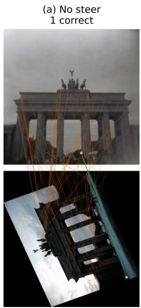

(b) Exact Steerers 156 correct  
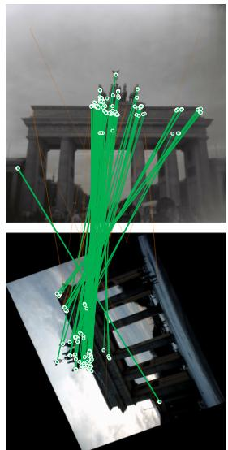  
(c) PaSteer-free 272 correct (+129 rec.)

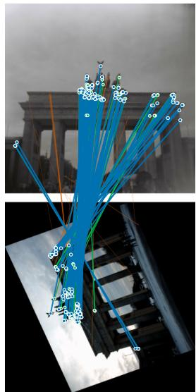  
Figure 6. Qualitative results on MegaDepth-1500 [19] (scene 0022 0.5 0.7, pair 2), target rotated 112◦ in-plane. No steer: 1 correct match; exact Steerers [5]: 156; PaSteer-free: 272 (+129 recovered).

(a) No steer 2 correct  
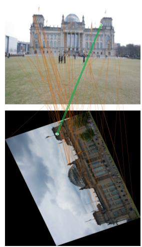  
(b) Exact Steerers 164 correct

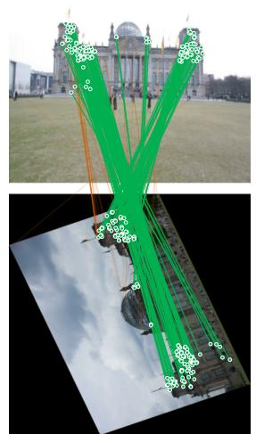  
(c) PaSteer-free 323 correct (+164 rec.)

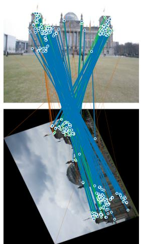  
Figure 7. Qualitative results on IMC-PT 2020 [13] (reichstag), target rotated 112◦. No steer: 2 correct; exact: 164; PaSteerfree: 323 (+164 recovered).  
correct match recovered by PaSteer-free (missed by exact) rejected / outlier

(a) No steer 0 correct  
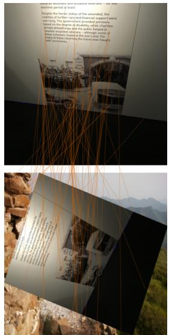

(b) Exact Steerers 109 correct  
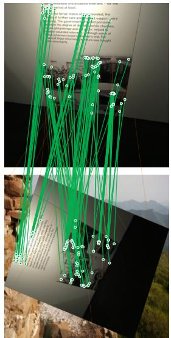

(c) PaSteer-free 188 correct (+92 rec.)  
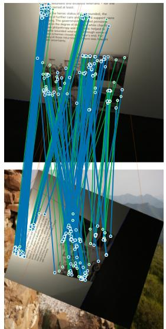  
Figure 8. Qualitative results on Roto-360 [17] (sequence v charing), pure in-plane rotation of $7 0 ^ { \circ }$ with a ground-truth homography. No steer: 0 correct; exact: 109; PaSteer-free: 188 (+92 recovered). Inliers are GT-homography reprojection $\leq 5 \mathrm { p x }$

(a) No steer 9 correct  
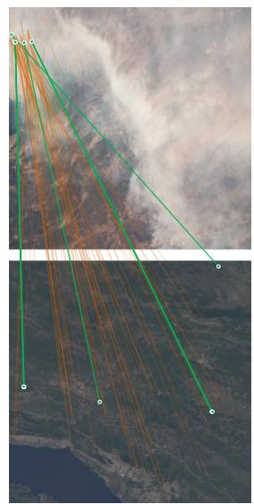

(b) Exact Steerers 108 correct  
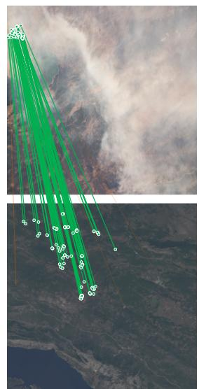

(c) PaSteer-free 233 correct (+133 rec.)  
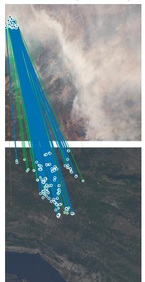  
Figure 9. Qualitative results on AIMS [31] (astronaut frame ISS052-E-27335 vs. a satellite tile), relative rotation $\approx 5 1 ^ { \circ }$ . No steer: 9 correct; exact: 108; PaSteer-free: 233 (+133 recovered). Inliers are MAGSAC homography inliers.