# Parametric CAD Bench v3: Evaluating Agentic Parametric CAD Authoring from Text and Engineering Drawings

Mei Chen gNucleus AI, Inc. mei.chen@gnucleus.ai

Yu Xia gNucleus AI, Inc. peggy.xia@gnucleus.ai

Haipeng Mao gNucleus AI, Inc. roc.mao@gnucleus.ai

Results snapshot: September 24, 2026

## Abstract

Producing an executable CAD script is not suficient to establish that an agent has satisfied an engineering design request. Evaluation must also consider the resulting geometry, specified dimensions, and native CAD modeling history. We present Parametric CAD Bench v3, a 100-task benchmark comprising 30 text-to-CAD creation tasks, 30 text-to-CAD create-and-edit tasks, and 40 tasks that reconstruct mechanical parts from engineering drawings. Agents operate in a pinned FreeCAD environment and submit native CAD artifacts to a separate programmatic verifier. The primary metric is mean continuous task reward, combining geometry similarity and specification consistency rather than binary task success. A September 24, 2026 snapshot covers 13 model–agent systems; Claude Code with Claude Opus 5.5 achieves the highest overall point estimate, 61.03%, and an image-to-CAD mean reward of 84.66%. These measurements describe complete systems, not isolated model capabilities. We release versioned tasks, evaluation configurations, and inspectable result artifacts.

## 1 Introduction

Computer-aided design (CAD) systems represent engineering intent as editable digital models. In a parametric CAD system, the artifact contains more than final geometry: a geometry kernel represents and manipulates curves, surfaces, topology, and solids; constraint solvers enforce dimensional and geometric relationships; and feature histories and dependency graphs record modeling steps so that changes to upstream parameters or features propagate to downstream geometry. These capabilities are fundamental to both professional CAD systems such as Siemens NX, CATIA, Creo, and SolidWorks, and open-source systems such as FreeCAD, which uses Open CASCADE Technology (OCCT) as its geometry kernel. By contrast, CadQuery is a code-centric parametric CAD library built on OCCT. Our benchmark instead requires native FreeCAD documents with an application-managed feature tree and document dependencies, rather than a CadQuery program or exported B-rep alone.

This distinction matters for evaluating CAD agents in real engineering workflows, where parametric CAD systems underpin modern mechanical design and manufacturing. An output can resemble the requested part while containing incorrect dimensions, missing features, broken dependencies, or a static shape in place of the required native feature structure. Conversely, alternative feature constructions can satisfy the same engineering requirements. Evaluating CAD agents therefore requires more than testing whether generated code executes or whether the resulting geometry is visually or geometrically similar.

Our central question is whether general-purpose AI agents can produce geometrically correct, specification-consistent, parametric CAD artifacts across three workflows.

The benchmark has evolved through three releases. We released Parametric CAD Bench v1 in May 2026 to evaluate text-based creation of native parametric FreeCAD models [11]. In September 2026, v2 retained the 100-task creation format while tightening validation and evaluation isolation: it upgraded the validator and FreeCAD runtime, moved held-out assets into a separate verifier image, and standardized reward reporting and failure handling [12]. V3 broadened the suite to include editing and reconstruction from engineering drawings [13]; the September 24 update added evaluations of Claude Opus 5.5 with two agent frameworks [14].

This paper focuses on v3; v1 and v2 provide historical context rather than additional evaluation cohorts.

Parametric CAD Bench v3 evaluates three workflows: text-to-CAD creation, text-to-CAD createand-edit (two-stage creation and editing), and image-to-CAD (reconstruction from engineering drawings); we refer to the first two as creation and create-and-edit. Its native FreeCAD output contract permits inspection beyond a rendered image, while its grader combines geometric and task-specific specification checks. These checks are proxies for the intended engineering requirements; they do not by themselves certify manufacturing readiness or functional editability under arbitrary future modifications.

The contribution of this work is threefold:

1. A versioned 100-task evaluation suite spanning three CAD workflows with native parametric output requirements.

2. An isolated execution and programmatic scoring protocol, with frozen configurations and per-task diagnostic artifacts.

3. A dated evaluation of complete model–agent systems, exposing diferences across workflows and observed failure modes.

## 2 Related Work

CADGenBench: artifact-centered CAD evaluation. CADGenBench evaluates CAD generation and editing through tool-agnostic STEP/BREP submissions [4, 19]. Its public leaderboard accepts a ZIP archive of candidate artifacts; the hosted Hugging Face Space runs evaluation, and maintainers separately review methodology evidence before marking a submission validated [5, 19]. This is an artifact-submission protocol rather than a requirement to run a submitted agent inside a common task environment. However, it is not restricted to single-shot generation: its reference baseline is iterative, and evaluation tools are also available locally [4, 19]. Our emphasis is instead on evaluating complete agent executions in a versioned FreeCAD environment and requiring native parametric documents.

CADBench: multimodal CAD-program reconstruction. MIT’s CADBench evaluates reconstruction of executable, editable CAD programs from meshes and rendered images [7]. Its released evaluation pipeline currently accepts generated programs as CadQuery Python code; supporting other CAD programming languages would require adapting the pipeline [3]. It contains 18,000 samples across six benchmark families and five input modalities, with complexity-stratified

STEP-based splits and diversity-aware sampling. Its six metrics cover volumetric IoU, surface IoU, Chamfer distance, valid-shape rate, token count, and operation count. Like Parametric CAD Bench v3, it evaluates executable CAD geometry rather than rendered appearance alone. However, its reported general-purpose VLM evaluation uses direct generation without tool use, self-correction, or multi-turn refinement; we evaluate complete interactive agent workflows in FreeCAD. CADBench emphasizes reconstruction from 3D observations and object renders, whereas our suite combines text-based creation, create-and-edit, and reconstruction from dimensioned engineering drawings. Its paper also distinguishes code editability from recovering the original feature tree, sketch constraints, or design intent, which it does not require. Our tasks instead require native FreeCAD documents with task-specific parametric structure and specification checks, without requiring exact reproduction of the reference construction history. The benchmarks are complementary: CADBench provides broad reconstruction and modality-shift diagnostics, while our smaller suite studies end-to-end CAD task completion by model–agent systems.

BenchCAD: programmatic CAD over CadQuery. BenchCAD 1.0 contains 17,900 executionverified CadQuery programs across 106 industrial part families, with image-to-code, instructionguided code editing, and visual/code question-answering tasks [21]. Its generation evaluation compares the executed geometry with a reference; the current website also reports agentic runs with rendering, measurement, and iterative tool use [2]. BenchCAD 2.0, released on October 12, 2026, after our September 24 snapshot, adds part and assembly construction from dimensioned engineering drawings, reverse engineering from rendered views, and agentic evaluation in an ofline sandbox, all scored against reference geometry [1]. Its drawing-based part tasks are the closest counterpart to our image-to-CAD workflow. The distinction from Parametric CAD Bench v3 is therefore not whether agents can use tools, but the modeling interface and required output representation. CadQuery is a high-level parametric CAD library built on Python bindings to Open CASCADE Technology (OCCT), not the geometry kernel itself [6]. FreeCAD also uses OCCT, but provides a CAD application with native model history, geometry-constrained sketches, and a Python API [8]. BenchCAD’s CadQuery tasks emphasize parametric program synthesis, whereas our tasks require agents to construct and save native FreeCAD documents with the specified feature structure. Both are CAD workflows; our setting additionally exercises the application-level document and feature system.

CAD-bench: functional CAD generation. CAD-bench, presented at an ICML 2026 workshop, executes generated CAD code or agent-produced STEP files and checks the exported geometry with task-specific tests, including dimensional and pose verification, thread-profile analysis, and rigid-body simulation in Blender [20]. Its 17 tasks span four dificulty tiers, from basic solids to threaded mating pairs and gear trains. It therefore tests whether generated parts function together, whereas Parametric CAD Bench v3 requires native parametric FreeCAD documents across 100 tasks and scores their geometric similarity and compliance with named dimensions without simulating mechanisms. Despite the similar name, it is a separate benchmark with a diferent evaluation target.

3DCodeBench: mesh-based procedural 3D authoring. 3DCodeBench evaluates Blender Python scripts generated from text and images, including iterative execution and visual feedback [9]. Its evaluated outputs are meshes, assessed through executability, geometric and perceptual similarity, and pairwise human preferences. In contrast, Parametric CAD Bench v3 targets engineering-oriented mechanical CAD: native parametric FreeCAD documents with boundary-representation (B-rep) geometry and task-specific dimensional and structural checks. B-rep geometry represents surfaces and their topological relationships, rather than only a polygonal surface approximation [18]. Thus the distinction is between procedural mesh assets and dimensionally specified, editable CAD models, not between imprecise and precise software. 3DCodeBench includes manufactured objects, but its evaluation does not require native mechanical-CAD feature histories or engineering-dimension compliance. Likewise, our checks do not certify complete manufacturability.

Terminal-Bench and Harbor: agent evaluation infrastructure. Terminal-Bench provides complementary methodology for evaluating agents on dificult terminal workflows [17]. Our benchmark is built on Harbor, a framework for specifying and evaluating agent tasks in sandboxed environments [16]. We also contributed three FreeCAD tasks to Terminal-Bench 3.0/4.0: two create-and-edit tasks (freecad-impeller and freecad-spring-clip) and one image-to-CAD task (freecad-platform-drawing) [15]. These tasks follow the same create-and-edit and engineeringdrawing reconstruction workflow types evaluated in Parametric CAD Bench v3.

## 3 Tasks and Dataset Construction

## 3.1 Task workflows

Table 1 describes the released task composition.
<table><tr><td>Workflow</td><td></td><td>Tasks Agent input</td><td>Required CAD artifacts</td></tr><tr><td>Text-to-CAD Creation</td><td></td><td>30 Part description and specified Native parametric model parameters</td><td></td></tr><tr><td>Text-to-CAD Create-and-Edit</td><td>30</td><td>tion, and target requirements</td><td>Base description, edit instruc- Base and edited native models</td></tr><tr><td>Image-to-CAD</td><td>40</td><td>Engineering drawing and general Native model reconstructed from execution requirements</td><td>the drawing</td></tr></table>

Table 1: The v3 task composition. Text-to-CAD create-and-edit is a two-stage construction workflow, not editing an externally supplied CAD document.

In create-and-edit, the agent first constructs the base from text and then produces the edited model; both artifacts are graded. The task does not provide an externally authored starting FCStd. Scoring the two artifacts does not establish that the agent actually reused the base or preserved its feature history. Image-to-CAD tasks provide engineering drawings rather than the held-back dimensional specification.

## 3.2 Example tasks

Text-to-CAD creation examples. Two creation tasks illustrate the range of specifications. Figure 1 shows freecad-2002df3ce7, a trussed upper plate: a thin planar frame whose outline is the union of three rectangular sections with rounded corner chamfers, with mirrored trapezoidal recesses on the sides of the largest section. Diagonal truss webs separate seventeen triangular openings and one central six-sided opening, forming 18 internal loops; peripheral mounting holes and a center bore complete the part. Its 86 key parameters fall into five groups (Table 2). The description fixes the conventions needed to place them, including a sketch frame rotated about global +X so that layout +y points along global −Z, and centroid, base-length, and base-angle definitions for each isosceles opening. The grader reference builds the plate from one sketch and one pad; it is one solid with 203 faces, 280 mm wide, 549 mm tall, and 8 mm thick.

Figure 2 shows freecad-fa0a1abef3, an asymmetric clevis joint connector: a rectangular central body with a large split-ring clevis at its +X end, a smaller fork at its −X end, and a long rounded side arm with three relief slots. The description states that the two ends are not mirror images and fixes global axes along, across, and through the connector. Its 44 key parameters fall into eight groups. The grader reference uses eight sketches, four pads, and four pockets; it is one solid with 31 faces, measuring 157 mm by 45 mm by 50 mm. Appendix B reproduces both complete descriptions and parameter lists as given to the agent.

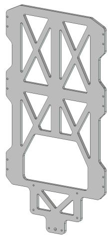  
(a) Front oblique view

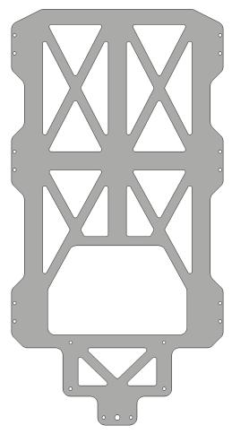  
(b) Front view

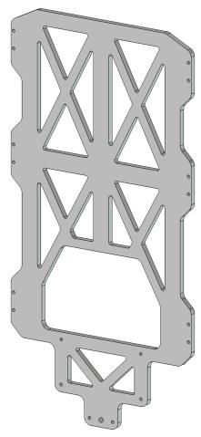  
(c) Opposite oblique view

Figure 1: Grader reference of text-to-CAD creation example freecad-2002df3ce7, a trussed upper plate. (b) faces the plate, showing its 18 internal openings, side mounting holes, and centered end extension.  
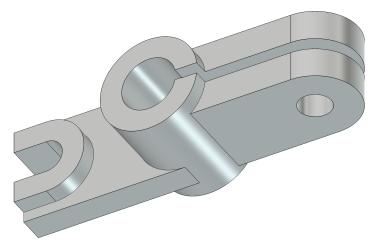  
(a) Front oblique view

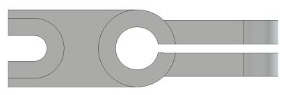  
(b) Axial view

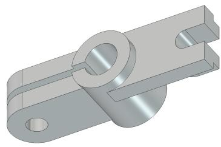  
(c) Opposite oblique view

Figure 2: Grader reference of text-to-CAD creation example freecad-fa0a1abef3, an asymmetric clevis joint connector. (b) looks along the split-ring axis, showing the fork, the large clevis, and the slotted side arm.

The held-back grader specification also states how each parameter is checked. Only 8 of the plate’s 86 parameters and 7 of the connector’s 44 are bound to witnesses on the final geometry; the task’s param\_check.py measures the rest from native sketch and feature geometry. Neither task uses task-specific bindings. A candidate therefore earns specification credit only when its model exposes the named dimensions in a form these checks can measure. Section 5.5 reports how the evaluated systems fared on both tasks.

(a) Trussed upper plate, freecad-2002df3ce7
<table><tr><td>Parameter group</td><td>Parameters</td><td>Witness</td><td>Custom</td><td>Native</td></tr><tr><td>Plate outline, thickness, and side recesses</td><td>21</td><td>2</td><td>0</td><td>19</td></tr><tr><td>Truss layout and diagonal angles</td><td>7</td><td>1</td><td>0</td><td>6</td></tr><tr><td>Mounting holes and center bore</td><td>15</td><td>2</td><td>0</td><td>13</td></tr><tr><td>Triangular and central openings</td><td>41</td><td>3</td><td>0</td><td>38</td></tr><tr><td>Second right-triangular opening</td><td>2</td><td>0</td><td>0</td><td>2</td></tr><tr><td>Total</td><td>86</td><td>8</td><td>0</td><td>78</td></tr></table>

(b) Asymmetric clevis joint connector, freecad-fa0a1abef3
<table><tr><td>Parameter group</td><td>Parameters</td><td>Witness</td><td>Custom</td><td>Native</td></tr><tr><td>Central body</td><td>3</td><td>1</td><td>0</td><td>2</td></tr><tr><td>Large split-ring clevis</td><td>10</td><td>4</td><td>0</td><td>6</td></tr><tr><td>Clevis pin-hole cut</td><td>2</td><td>0</td><td>0</td><td>2</td></tr><tr><td>Fork prongs</td><td>5</td><td>1</td><td>0</td><td>4</td></tr><tr><td>Fork U-shaped opening</td><td>5</td><td>0</td><td>0</td><td>5</td></tr><tr><td>Side arm</td><td>9</td><td>0</td><td>0</td><td>9</td></tr><tr><td>Central relief slot</td><td>3</td><td>1</td><td>0</td><td>2</td></tr><tr><td>Upper and lower relief slots</td><td>7</td><td>0</td><td>0</td><td>7</td></tr><tr><td>Total</td><td>44</td><td>7</td><td>0</td><td>37</td></tr></table>

Table 2: Key-parameter groups of the two text-to-CAD creation examples and how the grader checks them. Witness: bound to a witness on the final geometry. Custom: a task-specific binding applied by param\_check.py. Native: measured by param\_check.py from native sketch or feature geometry.

Text-to-CAD create-and-edit example. Figure 3 illustrates freecad-ff7883ab0c. The agent first builds an axisymmetric flanged inlet housing: a continuous 50.8 mm central bore, a tapered inlet rim, a tubular middle body, a tapered rear hub, and a plain 152.4 mm rear flange disk. The edit adds a fourfold-symmetric front plate, 16.51 mm thick, whose outline joins side, corner, and transition arcs with short tangent connectors. It also adds four 13.34 mm through bolt holes in the plate and four 19.05 mm openings cut 34.54 mm deep from the rear flange face, each pattern placed from a signed seed center at uniform angular spacing. The tubular body, inlet rim, rear hub, rear disk envelope, and central passage must remain unchanged. Fifteen base parameters and 14 additional target parameters specify diameters, axial positions, arc radii, hole sizes and counts, and seed-center ofsets. The complete supplied base description, edit instruction, and parameter lists appear in Appendix C.

This task couples an axisymmetric base with a non-circular, arc-bounded plate and two four-hole patterns on opposite faces. The script must save both answer\_base.FCStd and answer\_edit.FCStd, each as an editable single-body PartDesign model. Both stages are evaluated; a plausible final silhouette alone does not demonstrate correct base construction or compliance with the plate-outline and hole requirements. As with the other create-and-edit tasks, the two saved artifacts do not by themselves prove that the target reused the base feature history.

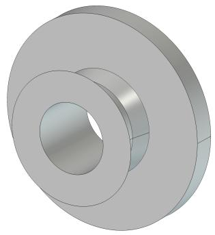  
(a) Base: oblique view

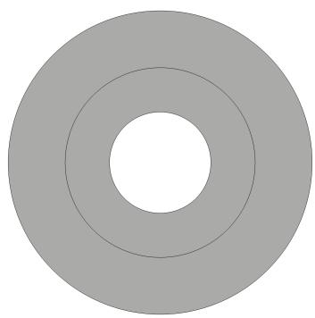  
(b) Base: axial view

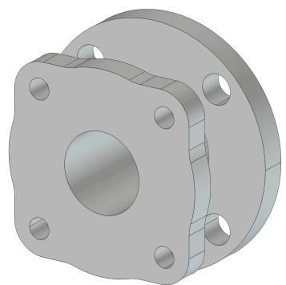  
(c) Edited target: oblique view

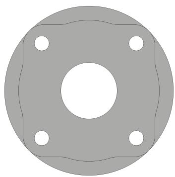  
(d) Edited target: axial view  
Figure 3: Text-to-CAD create-and-edit example freecad-ff7883ab0c: trusted base reference (top) and edited target reference (bottom), shown in oblique and axial views. Each view uses the same angle and scale for both stages. The edit adds the front flange plate, its four bolt holes, and four rear-face openings while retaining the axisymmetric body and central bore.

Image-to-CAD example. Figure 4 shows the input drawing and trusted reference for freecad-9749149002. The drawing combines orthographic, section, and isometric views of a linkage arm with two eye ends, angled transitions, and ribbed connecting beams. Dimension labels specify its 56 mm overall length, 19.5 mm depth, unequal 3 mm and 2 mm eye holes, and local radii and ofsets. The agent must reconcile these views and dimensions to construct an editable single-solid PartDesign model.

Unlike the text-based examples, the agent receives no separate prose description or keyparameter list: the drawing is its only geometry input. It must write /app/answer.py and save /app/answer.FCStd under FreeCAD 1.1.0. The reference shown here is held back during evaluation; it illustrates the intended output, not an additional agent input.

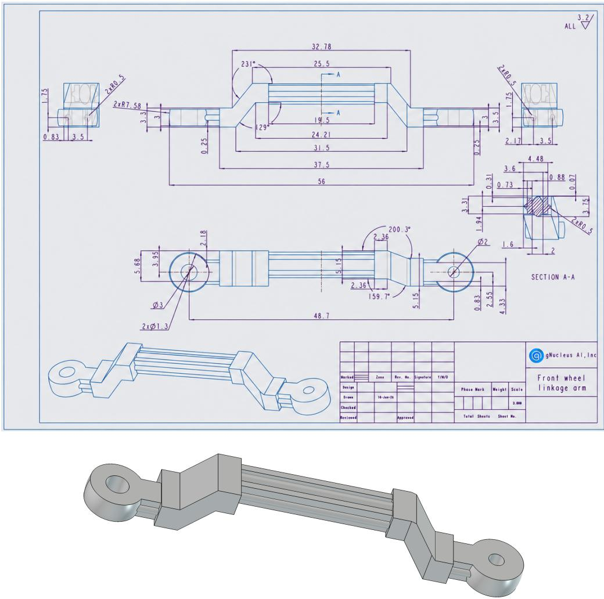  
Figure 4: Image-to-CAD example freecad-9749149002, a front-wheel linkage arm. Top: the engineering drawing supplied to the agent, cropped to its frame; the scale line and general-tolerance note outside the frame are not shown. Bottom: an oblique view of the held-back grader reference.

## 3.3 Reference-model statistics

We count solid-modeling steps using FreeCAD’s native feature type hierarchy: objects derived from Part::Feature, excluding body containers, sketches, and datum helpers. Intermediate and hidden feature-history objects are included; a pattern counts as one feature regardless of instance count. Generic Part::Feature objects count too, so this statistic alone does not certify parametric editability. Sketch counts are reported separately. The main distribution gives each task one observation, using the target reference for create-and-edit rather than counting both stages as separate tasks. The 100 final reference models contain 687 solid-modeling feature objects in total, with a mean of 6.87, a median of 6, and a range of 1–20 features per task. For the 30 create-and-edit pairs, the base and target means are 2.47 and 5.60, respectively. These describe the provided reference constructions; they do not establish a minimum number of features required for a valid alternative solution or a calibrated measure of task dificulty.

<table><tr><td>Workflow</td><td>Tasks</td><td>Mean features</td><td>Median</td><td>Min</td><td>Max</td></tr><tr><td>All final references</td><td>100</td><td>6.87</td><td>6</td><td>1</td><td>20</td></tr><tr><td>Text-to-CAD Creation</td><td>30</td><td>5.20</td><td>4</td><td>1</td><td>20</td></tr><tr><td>Text-to-CAD Create-and-Edit (target)</td><td>30</td><td>5.60</td><td>5.5</td><td>2</td><td>10</td></tr><tr><td>Image-to-CAD</td><td>40</td><td>9.08</td><td>8</td><td>2</td><td>20</td></tr></table>

Table 3: Measured solid-modeling feature counts in the v3 grader references. Text-to-CAD createand-edit contributes its target only to the 100-task distribution.

Figure 5 shows unit-bin histograms for the full benchmark and each workflow. Supplementary figures show feature-type composition, sketch counts, and base/target distributions for the 30 edit pairs.

## 4 Execution and Evaluation

## 4.1 Pinned runtime and isolation

The runtime uses FreeCAD 1.1.0, Harbor 0.23.0, and task schema 1.3. The verifier pins gnucleus-freecad-validator 0.6.0 with its v2 scorer. The benchmark version, validator package version, and scorer version are distinct identifiers. Reference geometry and task-specific grader assets are placed in a separate verifier environment rather than the agent environment. Each public job records its agent version and concurrency.

## 4.2 Programmatic scoring

The verifier computes two independent axes, geometry\_similarity and cad\_spec\_consistency, using the default v2 scorer in gnucleus-freecad-validator 0.6.0 [10].

Geometric similarity. The scorer compares the candidate and reference solids using surface-type areas, volume, total surface area, normalized principal moments of inertia, and face-center iterative closest point (ICP) alignment. Let $q _ { \mathrm { s u r f } }$ , qvol, qarea, qmom and qICP denote their respective subscores in [0, 1]. After the gates below pass, the geometric score is

$$
p = { \frac { 0 . 0 5 q _ { \mathrm { s u r f } } + 0 . 1 7 5 q _ { \mathrm { v o l } } + 0 . 1 7 5 q _ { \mathrm { a r e a } } + 0 . 1 0 q _ { \mathrm { m o m } } } { 0 . 5 0 } } ,\tag{1}
$$

$$
g = p \left( 0 . 5 0 + 0 . 5 0 q _ { \mathrm { I C P } } \right) .\tag{2}
$$

Volume receives full credit at relative error at most 0.1% and zero subscore at 1% or more; the corresponding thresholds for surface-type areas, total surface area, and normalized principal moments are 1% and 10%. Intermediate errors receive logarithmically interpolated credit. Surface-type comparison uses the largest per-type relative area error, with a denominator floor of 1% of the larger total surface area. An independently measured OCCT oriented bounding box is a gate, not an additional weighted subscore: maximum relative error across sorted extents of 10% or more sets $g = 0$ . Structural gates also require one non-empty PartDesign::Body producing one solid through allowed native features rather than baked shape holders. Candidates with more than 5,000 faces, or face/vertex counts difering from the reference by more than 50% of the larger count, are rejected. Gate failures override the spatial multiplier’s nonzero floor. Face-center alignment depends on face decomposition, so congruent geometry built through a diferent feature history need not receive $g = 1$

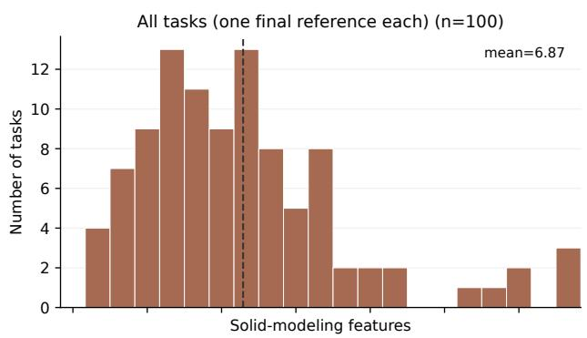

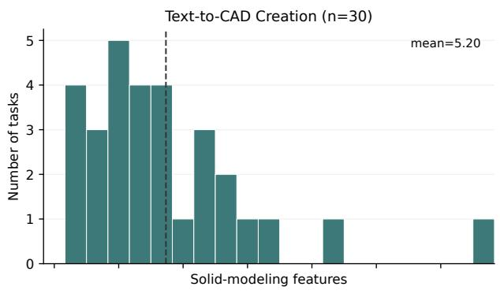

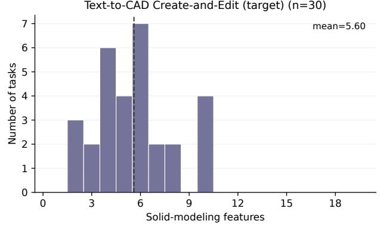

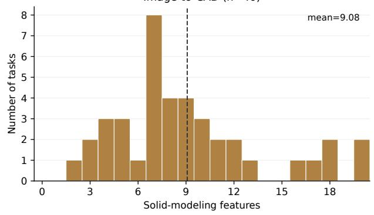  
Figure 5: Solid-modeling features per final reference model. The aggregate contains 100 tasks, not 130 documents; dashed lines mark cohort means. Counts reflect reference construction choices rather than a calibrated dificulty measure or a required solution sequence.

CAD specification consistency. The scorer parses the task’s held-back specification and checks its parameters against measurements extracted from the candidate document. CAD engineers wrote the parameter-checking logic shipped in each task’s tests/grader/param\_check.py. Most tasks share a workflow-level implementation, and a subset adds case-specific checks. These checks encode ways to measure the dimensions, the correct placement of dimensions on the CAD part, feature relationships, and derived quantities required by the task’s specification. They supplement generic measurements with engineering-specific checks beyond global shape similarity. The v2 path honors trusted geometry bindings and case-local param\_check.py refinements where supplied; remaining checks use generic per-kind measurements. The default scalar relative tolerance is 1%, with case-specific measurement logic and binding tolerances where applicable. Let n be the number of parsed specification parameters and f the number classified as inconsistent or not found. The default v2 failure budget is 10:

$$
s = \left\{ { \begin{array} { l l } { 0 , } & { n = 0 , } \\ { \operatorname* { m a x } \left( 0 , 1 - { \frac { f } { \operatorname* { m i n } ( n , 1 0 ) } } \right) , } & { n > 0 . } \end{array} } \right.\tag{3}
$$

For $n \geq 1 0$ , each failed or unmeasurable parameter costs 0.1, preventing large specifications from diluting failures. This score measures the encoded checks, not every possible engineering requirement or functional editability under arbitrary future changes.

Combined task reward. Let $g , s \in [ 0 , 1 ]$ denote geometry and specification scores. Define

$$
H ( g , s ) = \left\{ { \begin{array} { l l } { 0 , } & { g = 0 { \mathrm { ~ o r ~ } } s = 0 , } \\ { \displaystyle { \frac { 2 g s } { g + s } } , } & { { \mathrm { o t h e r w i s e . } } } \end{array} } \right.\tag{4}
$$

For creation and image-to-CAD, the task reward is $r = H ( g , s )$ . For create-and-edit, each output is scored separately, then combined:

$$
r _ { \mathrm { e d i t } } = H ( H ( g _ { \mathrm { b a s e } } , s _ { \mathrm { b a s e } } ) , H ( g _ { \mathrm { t a r g e t } } , s _ { \mathrm { t a r g e t } } ) ) .\tag{5}
$$

Thus a zero score on a required axis or deliverable cannot be rescued by another axis. The wrappers clamp rewards to $[ 0 , 1 ]$ ; text reward files use six decimal places, and the image-to-CAD wrapper also rounds its JSON reward to six decimal places.

The reported overall percentage is

$$
S = \frac { 1 0 0 } { N } \sum _ { i = 1 } ^ { N } r _ { i } , \qquad N = 1 0 0 .\tag{6}
$$

Final exception outcomes contribute zero. Workflow percentages are computed within each cohort, so $S = 0 . 3 0 S _ { \mathrm { c r e a t e } } + 0 . 3 0 S _ { \mathrm { e d i t } } + 0 . 4 0 S _ { \mathrm { i m a g e } }$

This continuous reward is not Pass@1. We additionally report the fraction of final rewards exactly equal to 1.0 as the operational perfect-task rate. A scored trial is one without a final exception; scored count and positive-reward count are diferent quantities.

## 5 Results and Analysis

## 5.1 Dated leaderboard snapshot

Figures 9–12 visualize the 13-row September 24, 2026 snapshot. The plots are generated from the published leaderboard rows. The overall chart shows 95% intervals computed as the mean reward $\pm 1 . 9 6 s / \sqrt { 1 0 0 }$ , where s is the sample standard deviation of a system’s 100 per-task rewards. They describe uncertainty over the task sample, given one final trial per task, not variability across repeated runs of a system. Workflow charts show point estimates only.

Claude Code with Claude Opus 5.5 achieves the highest overall point estimate, 61.03%, followed by mini-swe-agent with the same model at 57.96%, Codex with GPT-6 Astra at 56.87%, and Claude Code with Claude Fable 5.1 at 56.75%. Point-estimate ordering alone does not demonstrate a statistically decisive ranking.

The workflow leaders difer: Fable 5.1 with Claude Code has the highest creation point estimate (55.48%), Astra with Codex leads create-and-edit (44.37%), and Opus 5.5 with Claude Code leads image-to-CAD (84.66%). Because workflows use diferent task populations, these diferences cannot be attributed solely to input modality.

## 5.2 Same-model and same-agent comparisons

We pair final rewards by task ID, rather than comparing only cohort means. For the following descriptive counts, two outcomes are similar when their rewards difer by at most 0.05 (5 percentage points); a higher outcome must exceed this tolerance. Similarity is not a statistical equivalence claim, nor does it imply success: two zero-reward outcomes also count as similar. Final exception outcomes retain their zero rewards.

Opus 5.5 versus Opus 5 with Claude Code. Within Claude Code, the overall point estimate rises from 50.86% for Opus 5 to 61.03% for Opus 5.5, a 10.18 percentage-point increase. The release analysis reports a paired 95% confidence interval of 5.22–15.13 points for this improvement [14]. It is a normal approximation over the 100 per-task reward diferences: their mean $\pm \ : 1 . 9 6 s _ { d } / \sqrt { 1 0 0 }$ where $s _ { d }$ is their sample standard deviation. Table 4 shows that this is not a uniform improvement across workflows. For creation, Opus 5.5 is higher on 8 tasks, similar on 18, and lower on 4; for create-and-edit, the corresponding counts are 4, 23, and 3. Image-to-CAD shows the broadest improvement: Opus 5.5 is higher on 22 of 40 tasks, similar on 15, and lower on only 3. Its median paired drawing-task gain is 7.62 points, and all five drawings receiving zero reward under Opus 5 receive positive reward under Opus 5.5. The 22.02-point image-to-CAD mean gain accounts for approximately 87% of the overall improvement after applying the benchmark’s 30/30/40 workflow weights.

Claude Code versus mini-swe-agent with Opus 5.5. To support multimodal tasks, we add an explicit system prompt to the mini-swe-agent run: when a task references an image, the agent must first send that image through its multimodal observation channel, inspect the resulting visual input, and only then proceed with the task. This is paired with a configured bridge that converts marked, base64-encoded shell output into image content for the model; the prompt alone does not enable image transport. The Opus 5.5 configuration uses mini-swe-agent 2.4.6, preserves complete image payloads, and leaves malformed image output as text.

With Opus 5.5 held constant, Claude Code exceeds mini-swe-agent by 3.08 points. However, the paired interval computed the same way is [−1.15, 7.31] points, so these results do not establish an overall advantage for either agent. The workflow-level comparison in Table 5 is more informative than the overall ordering. Claude Code leads creation by 8.07 points, with 9 higher outcomes, 20 similar outcomes, and 1 lower outcome. mini-swe-agent leads create-and-edit by 1.68 points: Claude Code is higher on 2 tasks, similar on 24, and lower on 4. For image-to-CAD, 30 of 40 outcomes are similar, and each agent is higher on 5 tasks. Claude Code’s 2.90-point mean advantage there therefore reflects the magnitudes of the difering outcomes, rather than a greater number of task-level wins. Both systems exceed 80% mean reward on drawing reconstruction with direct image input. These comparisons remain conditional on the evaluated configurations and dates, including diferent Claude Code versions; they are not completely controlled model or agent ablations.

<table><tr><td>Workflow</td><td>N</td><td>A mean</td><td>B mean</td><td>A higher</td><td>Similar</td><td>B higher</td></tr><tr><td>Text-to-CAD Creation</td><td>30</td><td>50.87%</td><td>49.48%</td><td>8</td><td>18</td><td>4</td></tr><tr><td>Text-to-CAD Create-and-Edit</td><td>30</td><td>39.69%</td><td>36.52%</td><td>4</td><td>23</td><td>3</td></tr><tr><td>Image-to-CAD</td><td>40</td><td>84.66%</td><td>62.64%</td><td>22</td><td>15</td><td>3</td></tr><tr><td>Overall</td><td>100</td><td>61.03%</td><td>50.86%</td><td>34</td><td>56</td><td>10</td></tr></table>

Table 4: Claude Code held constant; A: Opus 5.5, B: Opus 5. Higher means a task reward advantage greater than 5 percentage points; Similar includes the boundary. These counts do not establish statistical equivalence.

<table><tr><td>Workflow</td><td>N</td><td>A mean</td><td>B mean</td><td>A higher</td><td>Similar</td><td>B higher</td></tr><tr><td>Text-to-CAD Creation</td><td>30</td><td>50.87%</td><td>42.79%</td><td>9</td><td>20</td><td>1</td></tr><tr><td>Text-to-CAD Create-and-Edit</td><td>30</td><td>39.69%</td><td>41.38%</td><td>2</td><td>24</td><td>4</td></tr><tr><td>Image-to-CAD</td><td>40</td><td>84.66%</td><td>81.77%</td><td>5</td><td>30</td><td>5</td></tr><tr><td>Overall</td><td>100</td><td>61.03%</td><td>57.96%</td><td>16</td><td>74</td><td>10</td></tr></table>

Table 5: Opus 5.5 held constant; A: Claude Code, B: mini-swe-agent with multimodal bridge. Higher means a task reward advantage greater than 5 percentage points; Similar includes the boundary. These counts do not establish statistical equivalence.

Initial takeaway. The clearest observed gain is in engineering-drawing reconstruction: Opus 5.5 improves Claude Code’s image-to-CAD score by 22.02 points, versus 1.39 points for creation and 3.17 points for create-and-edit. Both Opus 5.5 systems exceed 80% on image-to-CAD (84.66% and 81.77%), so the strong drawing results are not confined to one agent implementation [14]. This suggests substantial progress in drawing-to-CAD task completion, but not uniformly reliable CAD authoring: the same systems reach only 39.69% and 41.38% on create-and-edit. These are distinct task cohorts, not a controlled test of modality alone. Together with the launch post’s Gemin comparison across two agents, the results also indicate that model capability and agent interface both matter; they do not identify a universally superior agent [13].

## 5.3 Multimodal CAD performance

Image-to-CAD produces the largest separation between the evaluated model–agent systems. Across the 13 rows, its mean reward ranges from 8.18% to 84.66%, a 76.49-point spread. By comparison, creation ranges from 23.32% to 55.48% (32.16 points), and create-and-edit from 23.23% to 44.37% (21.14 points). The five highest image-to-CAD systems achieve 62.64–84.66%, whereas the remaining eight achieve only 8.18–31.10%. Drawing reconstruction therefore distinguishes these systems much more sharply than either text-based workflow.

This pattern is also visible within a single agent family. Across the three Claude Code rows, image-to-CAD ranges from 62.64% with Opus 5 to 84.66% with Opus 5.5, a 22.02-point diference. The corresponding spreads are only 6.00 points for creation and 3.17 points for create-and-edit. Agent configuration matters as well: Gemini 3.8 Flash achieves 31.10% on image-to-CAD with mini-swe-agent’s multimodal bridge, versus 17.45% with Antigravity, a 13.65-point diference. Its creation and create-and-edit diferences between these agents are smaller, at 4.66 and 5.90 points, respectively.

These results suggest that multimodal CAD task completion is a major diferentiator among the evaluated systems. Strong drawing performance requires interpreting views, dimensions, and geometric relationships and translating them into a valid parametric model. However, these scores measure that entire workflow, not visual perception in isolation: CAD construction, tool use, image transport, and failure recovery can all afect the outcome. The larger score spread does not by itself establish which of these factors causes the gap, particularly because the workflows contain diferent tasks.

## 5.4 Eficiency

Cost per score point. We divide the known API cost of the complete 100-task run by its overall score on the 0–100 scale. API costs come from the usage recorded in each job’s artifacts. For Grok Build with Grok 4.7 and for mini-swe-agent with Kimi K3, Muse Spark 1.3, and Claude Opus 5.5, whose artifacts record no or incomplete cost, they come from our audits, which price the token usage in the saved trajectories at standard API rates. This descriptive ratio measures expenditure per achieved score point, not the marginal cost of improving a system by one point. Codex with GPT-6 Astra has the lowest ratio among all 13 systems: \$317.81 divided by 56.87 points, or \$5.59 per point. Its total spend is not the lowest, but the additional expenditure buys substantially higher reward: compared with GPT-5.6 Sol using Codex, Astra costs only \$25.82 more while scoring 26.89 points higher.

Per-task speed. Astra also has the shortest mean elapsed trial duration, 14.42 minutes, compared with 16.58 minutes for Sol, 31.11 for Claude Code with Fable 5.1, and 32.51 for Claude Code with Opus 5.5. These are final-trial elapsed times, including setup, agent execution, and verification, rather than isolated model inference latency. We do not use whole-job wall time to rank speed, because concurrency, pauses, retries, and scheduling difer between runs.

Reward–cost trade-of. Astra’s 56.87% mean reward is close to Fable 5.1’s 56.75%, but its known API cost is approximately 70% lower and its mean trial duration is less than half as long. The higher-scoring Claude Code–Opus 5.5 system improves the point estimate by 4.17 points over Astra, at 1.81 times the API cost and 2.25 times the mean trial duration. Astra therefore ofers a favorable observed balance of reward, cost, and per-task speed, rather than the highest reward at any price. These comparisons describe the evaluated configurations and their audited API accounting; they exclude some compute and hosting costs and do not establish why one system requires less time or expenditure.

## 5.5 Observed task dificulty

Across the 1,300 selected final trials from the 13 evaluated systems, 393 (30.23%) earn zero reward. Table 6 summarizes the pattern by workflow. Create-and-edit has the largest zero-outcome rate, 41.54%, compared with 22.56% for creation and 27.50% for image-to-CAD. These counts use the oficial final outcomes, including zero-valued final exceptions and reruns of provider or platform failures that produced no model outcome, rather than the superseded attempts.

<table><tr><td>Workflow</td><td>Zero outcomes</td><td>All 13 zero</td><td>≥7 zero</td><td>Any perfect</td></tr><tr><td>Text-to-CAD Creation</td><td>22.56%</td><td>0</td><td>5</td><td>6</td></tr><tr><td>Text-to-CAD Create-and-Edit</td><td>41.54%</td><td>5</td><td>11</td><td>3</td></tr><tr><td>Image-to-CAD</td><td>27.50%</td><td>0</td><td>8</td><td>6</td></tr><tr><td>Overall</td><td>30.23%</td><td>5</td><td>24</td><td>15</td></tr></table>

Table 6: Observed dificulty across 13 evaluated systems. Zero outcomes is the fraction of final trials with zero reward. The last three columns count distinct tasks: zero in all 13 systems, zero in at least 7 systems, and reward exactly 1.0 in at least one system. Cohorts contain 30 text-to-CAD creation, 30 text-to-CAD create-and-edit, and 40 image-to-CAD tasks.

Dificulty is concentrated in a subset of tasks. Twenty-four tasks receive zero reward from at least 7 of the 13 systems: 5 creation tasks, 11 create-and-edit tasks, and 8 image-to-CAD tasks. Five tasks receive zero from every system, all in create-and-edit. On 26 tasks, no system reaches 0.5: 9 creation, 16 create-and-edit, and 1 image-to-CAD. At the other end, 15 tasks earn a perfect reward of exactly 1.0 from at least one system (6 creation, 3 create-and-edit, and 6 image-to-CAD). Thus, strong aggregate drawing performance coexists with substantial remaining dificulty, especially in two-stage CAD construction. These are descriptive outcomes for the evaluated systems and configurations, not estimates of a task’s inherent solvability.

The saved diagnostics also show that zero reward is usually associated with the CAD scoring criteria rather than a final execution exception. Of the 393 zeros, 326 involve a zero geometry component, including 50 that also have a zero specification component. Another 33 fail only specification consistency; the remainder comprise 23 final exceptions, 7 missing outputs, and 4 scorer crashes. This breakdown describes observed failure surfaces, not independently adjudicated root causes.

Example task outcomes. The two creation examples fail in diferent ways. The trussed plate (Figure 1) is one of the 24 tasks with zero reward from at least 7 systems: 9 of the 13 systems receive zero (Table 7). Eight of these zeros come from the specification axis alone. These outcomes have geometry similarity between 0.126 and 0.445, but 12 to 80 of the 86 parameters are inconsistent or not found, which exhausts the failure budget of 10 in Equation 3. The ninth zero is a final exception. Among the four positive outcomes, Claude Fable 5.1 with Claude Code is nearly exact (0.999, with every parameter consistent); the others miss 1, 7, and 9 parameters. Codex with GPT-5.6 Terra earns 0.140 with lower geometry similarity (0.232) than five zero-reward attempts, because it stays within the failure budget. On this task, specification consistency rather than overall shape separates the rewarded attempts.

The clevis connector (Figure 2) shows the opposite pattern (Table 8). Twelve of the 13 systems earn positive reward, and Claude Opus 5 with Claude Code earns 1.000 to three decimals, with

every parameter consistent. Only Codex with GPT-5.6 Terra receives zero, on both axes. The other eleven positive outcomes miss at most 7 of the 44 parameters, but their geometry similarity ranges only from 0.175 to 0.500. Two of them, Claude Fable 5.1 with Claude Code and Gemini 3.8 Flash with mini-swe-agent, pass every parameter check yet earn 0.419 because their geometry similarity is 0.265. Here, geometry rather than the named dimensions limits most rewards.
<table><tr><td>Model</td><td>Agent</td><td>Reward</td><td>g</td><td>S</td><td>Failed</td><td>Outcome</td></tr><tr><td>Claude Fable 5.1</td><td>Claude Code</td><td>0.999</td><td>0.998</td><td>1.000</td><td>0</td><td>positive</td></tr><tr><td>Grok 4.6</td><td>Grok Build</td><td>0.628</td><td>0.482</td><td>0.900</td><td>1</td><td>positive</td></tr><tr><td>GPT-6 Astra</td><td>Codex</td><td>0.375</td><td>0.500</td><td>0.300</td><td>7</td><td>positive</td></tr><tr><td>GPT-5.6 Terra</td><td>Codex</td><td>0.140</td><td>0.232</td><td>0.100</td><td>9</td><td>positive</td></tr><tr><td>Claude Opus 5</td><td>Claude Code</td><td>0.000</td><td>0.146</td><td>0.000</td><td>13</td><td>specification zero</td></tr><tr><td>Claude Opus 5.5</td><td>Claude Code</td><td>0.000</td><td>0.445</td><td>0.000</td><td>12</td><td>specification zero</td></tr><tr><td>Claude Opus 5.5</td><td>mini-swe-agent</td><td>0.000</td><td></td><td></td><td></td><td>final exception</td></tr><tr><td>GPT-5.6 Sol</td><td>Codex</td><td>0.000</td><td>0.299</td><td>0.000</td><td>80</td><td>specification zero</td></tr><tr><td>Gemini 3.8 Flash</td><td>Antigravity</td><td>0.000</td><td>0.195</td><td>0.000</td><td>19</td><td>specification zero</td></tr><tr><td>Gemini 3.8 Flash</td><td>mini-swe-agent</td><td>0.000</td><td>0.247</td><td>0.000</td><td>17</td><td>specification zero</td></tr><tr><td>Grok 4.7</td><td>Grok Build</td><td>0.000</td><td>0.319</td><td>0.000</td><td>18</td><td>specification zero</td></tr><tr><td>Kimi K3</td><td>mini-swe-agent</td><td>0.000</td><td>0.286</td><td>0.000</td><td>19</td><td>specification zero</td></tr><tr><td>Muse Spark 1.3</td><td>mini-swe-agent</td><td>0.000</td><td>0.126</td><td>0.000</td><td>24</td><td>specification zero</td></tr></table>

Table 7: Final outcomes of the 13 evaluated systems on the trussed-plate example freecad-2002df3ce7. g and s are the geometry and specification scores; Failed counts the parameters, of 86, that are inconsistent or not found. —: no scored output after a final exception.

<table><tr><td>Model</td><td>Agent</td><td>Reward</td><td>g</td><td>S</td><td>Failed</td><td>Outcome</td></tr><tr><td>Claude Opus 5</td><td>Claude Code</td><td>1.000</td><td>1.000</td><td>1.000</td><td>0</td><td>positive</td></tr><tr><td>Claude Opus 5.5</td><td>Claude Code</td><td>0.615</td><td>0.500</td><td>0.800</td><td>2</td><td>positive</td></tr><tr><td>Claude Fable 5.1</td><td>Claude Code</td><td>0.419</td><td>0.265</td><td>1.000</td><td>0</td><td>positive</td></tr><tr><td>Gemini 3.8 Flash</td><td>mini-swe-agent</td><td>0.419</td><td>0.265</td><td>1.000</td><td>0</td><td>positive</td></tr><tr><td>GPT-6 Astra</td><td>Codex</td><td>0.397</td><td>0.264</td><td>0.800</td><td>2</td><td>positive</td></tr><tr><td>Kimi K3</td><td>mini-swe-agent</td><td>0.397</td><td>0.264</td><td>0.800</td><td>2</td><td>positive</td></tr><tr><td>Muse Spark 1.3</td><td>mini-swe-agent</td><td>0.397</td><td>0.264</td><td>0.800</td><td>2</td><td>positive</td></tr><tr><td>Grok 4.7</td><td>Grok Build</td><td>0.307</td><td>0.190</td><td>0.800</td><td>2</td><td>positive</td></tr><tr><td>Gemini 3.8 Flash</td><td>Antigravity</td><td>0.299</td><td>0.190</td><td>0.700</td><td>3</td><td>positive</td></tr><tr><td>Claude Opus 5.5</td><td>mini-swe-agent</td><td>0.252</td><td>0.218</td><td>0.300</td><td>7</td><td>positive</td></tr><tr><td>Grok 4.6</td><td>Grok Build</td><td>0.252</td><td>0.218</td><td>0.300</td><td>7</td><td>positive</td></tr><tr><td>GPT-5.6 Sol</td><td>Codex</td><td>0.243</td><td>0.175</td><td>0.400</td><td>6</td><td>positive</td></tr><tr><td>GPT-5.6 Terra</td><td>Codex</td><td>0.000</td><td>0.000</td><td>0.000</td><td>26</td><td>geometry and specification zero</td></tr></table>

Table 8: Final outcomes of the 13 evaluated systems on the clevis-connector example freecad-fa0a1abef3. Columns as in Table 7; Failed counts the parameters, of 44, that are inconsistent or not found.

## 6 Discussion and Limitations

The benchmark is a curated 100-task FreeCAD evaluation, not a representative sample of all engineering CAD. Family dependencies and selection choices limit generalization. Native singlebody PartDesign requirements do not cover general assembly mating, FEM/FEA, manufacturing qualification, or broad organic-surface modeling.

Create-and-edit measures two-stage construction, not maintenance of an externally authored document. Grader rewards are heuristic proxies: geometric similarity and checked parameters do not certify all future edits, design intent, or engineering validity. Alternative valid constructions may challenge reference-based comparisons.

Public assets, providers’ undisclosed training data, and changing provider implementations limit contamination claims and reproducibility. Agent tools, prompts, serving paths, and budgets confound model-only comparisons. Single oficial attempts do not establish run-to-run robustness. Known API costs exclude some compute and hosting costs.

## 7 Conclusion

Parametric CAD Bench v3 evaluates agentic CAD authoring across text-based creation, create-andedit, and engineering-drawing reconstruction. Its 100 tasks require native parametric FreeCAD models, evaluated through geometric similarity and CAD-engineer-curated specification checks.

Across 13 evaluated model–agent systems, the largest performance diferences occur in imageto-CAD. Opus 5.5’s improvement over Opus 5 is concentrated in drawing reconstruction, while agent comparisons reveal workflow-dependent strengths rather than a universally superior interface. Create-and-edit remains challenging: five tasks receive zero reward from every evaluated system. Cost and speed also distinguish systems; Codex with GPT-6 Astra ofers the lowest observed API cost per score point and the shortest mean trial duration.

These results highlight substantial progress alongside remaining limitations in reliable parametric CAD construction. By releasing versioned tasks, execution configurations, scoring code, and inspectable run artifacts, Parametric CAD Bench provides a versioned, inspectable foundation for measuring progress in engineering-oriented CAD agents.

## References

[1] BenchCAD. BenchCAD 2.0: Benchmarking programmatic CAD on real engineering work. Blog post, October 2026. URL https://benchcad.com/blog/benchcad-2.html. Published October 12, 2026; accessed November 1, 2026.

[2] BenchCAD. BenchCAD: A benchmark for programmatic CAD, 2026. URL https://benchcad. com/. Accessed October 6, 2026; includes agentic evaluation results.

[3] CADBench Contributors. CADBench: Evaluation code and submission requirements. Oficial project repository, 2026. URL https://github.com/anniedoris/CADBench. Accessed October 6, 2026.

[4] CADGenBench Contributors. CADGenBench benchmark submission requirements, 2026. URL https://github.com/huggingface/cadgenbench/blob/main/docs/benchmark/ submission.md. Accessed October 6, 2026.

[5] CADGenBench Contributors. CADGenBench validation policy, 2026. URL https://github. com/huggingface/cadgenbench/blob/main/docs/benchmark/validation.md. Accessed October 6, 2026.

[6] CadQuery Contributors. CadQuery documentation: Introduction. Oficial documentation, n.d. URL https://cadquery.readthedocs.io/en/latest/intro.html. Accessed October 6, 2026.

[7] Anna C. Doris, Jacob Thomas Sony, Ghadi Nehme, Era Syla, Amin Heyrani Nobari, and Faez Ahmed. CADBench: A multimodal benchmark for AI-assisted CAD program generation, 2026. URL https://arxiv.org/abs/2605.10873. Version 2, June 18, 2026.

[8] FreeCAD Contributors. FreeCAD: Your own 3d parametric modeler. Oficial project repository and overview, n.d. URL https://github.com/FreeCAD/FreeCAD. Accessed October 6, 2026.

[9] Yipeng Gao, Lei Shu, Genzhi Ye, Xi Xiong, Ameesh Makadia, Meiqi Guo, Laurent Itti, and Jindong Chen. 3DCodeBench: Benchmarking agentic procedural 3d modeling via code, 2026. URL https://arxiv.org/abs/2606.01057.

[10] gNucleus AI. FreeCAD Validator 0.6.0: Geometry and specification scoring implementation. Versioned source code, 2026. URL https://github.com/gNucleus-AI/freecad-validator/ tree/v0.6.0/src/freecad\_validator. Version 0.6.0, default v2 scorer.

[11] gNucleus AI. Parametric CAD Bench: Can ai agents author editable cad? Benchmark release post, May 2026. URL https://cadbench.ai/news/parametric-cad-bench. Published May 13, 2026.

[12] gNucleus AI. CAD Bench v2: A corrected benchmark for the new frontier. Benchmark release post, September 2026. URL https://cadbench.ai/news/cad-bench-v2. Published September 8, 2026.

[13] gNucleus AI. Parametric CAD Bench V3: Text, editing, and engineering drawings. Benchmark release post, September 2026. URL https://cadbench.ai/news/cad-bench-v3. Published September 21, 2026.

[14] gNucleus AI. Parametric CAD Bench V3: Claude Opus 5.5 takes the lead. Leaderboard update post, September 2026. URL https://cadbench.ai/news/cad-bench-v3-opus-5-5. Published September 24, 2026.

[15] gNucleus AI. FreeCAD tasks contributed to Terminal-Bench. Task implementations in the Terminal-Bench repository, 2026. URL https://github.com/harbor-framework/ terminal-bench/tree/main/tasks. Tasks: freecad-impeller, freecad-spring-clip, and freecadplatform-drawing; accessed October 6, 2026.

[16] Harbor Framework. Harbor. Framework website, 2026. URL https://harborframework.com. Accessed October 6, 2026.

[17] Mike A. Merrill et al. Terminal-Bench: Benchmarking agents on hard, realistic tasks in command line interfaces, 2026. URL https://arxiv.org/abs/2601.11868.

[18] Open CASCADE. Open CASCADE Technology: Modeling data. Oficial user guide, n.d. URL https://dev.opencascade.org/doc/overview/html/occt\_user\_guides\_\_modeling\_ data.html. Accessed October 6, 2026.

[19] Michael Rabinovich and Hugging Face. CADGenBench: A benchmark for AI-driven CAD generation. Benchmark and leaderboard website, 2026. URL https://huggingface.co/ spaces/HuggingAI4Engineering/CADGenBench. Accessed October 6, 2026.

[20] Dhruv Saini. CAD-bench: Benchmarking language models on functional CAD generation. Poster, The Second Workshop on Agents in the Wild: Safety, Security, and Beyond, ICML 2026, 2026. URL https://icml.cc/virtual/2026/67851. Accessed November 1, 2026.

[21] Haozhe Zhang, Kaichen Liu, Miaomiao Chen, Lei Li, Shaojie Yang, Cheng Peng, and Hanjie Chen. BenchCAD: A comprehensive, industry-standard benchmark for programmatic CAD, 2026. URL https://arxiv.org/abs/2605.10865.

## A Reproducibility and Artifact Index

The following public resources accompany this paper:

• Benchmark: https://cadbench.ai/

• V3 tasks and leaderboard: https://hub.harborframework.com/datasets/gnucleus-ai/ cad-bench/v3

• Run configurations and trial artifacts: the public Harbor job linked from each leaderboard row.

• Scoring code (validator): https://github.com/gNucleus-AI/freecad-validator

The frozen dataset digest is

sha256:8a786725d3648a76282fc5868df06da3d5e00d603f283573a53430803465d78a.

The reported runs use Harbor 0.23.0, FreeCAD 1.1.0, and gnucleus-freecad-validator 0.6.0, published on PyPI and tagged v0.6.0 (commit 2a5d67f) in the validator repository. The trials of the linked Harbor jobs include agent logs, generated models, and saved verifier outputs.

The benchmark tasks, including their specifications, reference models, and drawings, were authored by gNucleus AI and are released under the Apache License 2.0, as is the validator. The task images redistribute FreeCAD and Open CASCADE Technology under the LGPL-2.1, with their license notices.

Apart from the four audited API costs described in Section 5.4, every reported statistic is computed from the public tasks and the final trials of the public Harbor jobs, and can be recomputed from them.

## B Text-to-CAD Creation Example Specifications

For each creation example, the agent receives the description and key parameters below, reproduced exactly as given, including their full decimal precision. The instruction adds the output contract shared by creation tasks: write a FreeCAD 1.1.0 script to /app/answer.py that saves /app/answer.FCStd, building the model as a parametric feature tree in a single PartDesign Body that produces exactly one solid, with editable features rather than a pre-computed shape.

## B.1 Trussed upper plate (freecad-2002df3ce7)

The key parameters are listed in Table 9.

A trussed upper plate consists of a thin, planar outer frame with rounded corners, repeated diagonal truss webs, open cutouts, peripheral mounting holes, and a centered end extension.

The outer profile is centered on truss\_layout\_symmetry\_axis\_x and is the union of three rectangular sections: large\_outer\_rectangle, middle\_outer\_rectangle, and small\_outer\_rectangle. The large rectangle has two mirrored trapezoidal side recesses on each side, with equal diagonal flanks, and a centered lower flat bounded by symmetric rounded chamfers. The two upper corners of the large rectangle have chamfer setback large\_outer\_rectangle\_upper\_corner\_ chamfer\_setback. All rectangular-section corner chamfers use rectangular\_section\_corner\_ chamfer\_fillet\_radius.

The truss layout is centered on truss\_layout\_symmetry\_axis\_x. All named layout x and y coordinates use a sketch frame at the global origin. Rotate this frame from the global XY plane by -base\_sketch\_plane\_rotation\_angle about global +X, using the right-hand convention. Thus layout +x points along global +X, layout +y points along global -Z, and the plate extends from global Y=0 in the +Y direction by plate\_thickness. Its triangular substructures are six large triangles, six medium triangles, two right triangles, one small triangle, and two chamfer-cut right tri angles. Each strictly isosceles triangle is defined by its centroid, ideal base length, and base angle; its rounded profile uses truss\_cutout\_transition\_radius. large\_triangular\_opening\_pair\_01 through \_03 and medium\_triangular\_opening\_pair\_01 through \_02 each define two mirrored isosceles openings. The first and third large pairs have exterior vertical bases, while the second has interior vertical bases. The first medium pair has lower horizontal bases and the second has upper horizontal bases. medium\_triangular\_opening\_pair\_03 has an interior vertical base and two diagonal flanks meeting at a rounded exterior apex. An upper horizontal truncation joins the interior base to the upper flank; all four transitions are rounded with truss\_cutout\_ transition\_radius. The two right triangles and the small triangle have lower horizontal bases and upward apices. The chamfer-cut right triangles have upper horizontal bases, exterior vertical legs, and rounded diagonal cut corners.

central\_trapezoidal\_opening defines the remaining non-triangular internal loop; together with the seventeen triangular openings, it forms eighteen internal loops. It shares truss\_layout\_ symmetry\_axis\_x with the outer profile and center bore. Its rounded six-sided boundary has an upper horizontal edge, two upper vertical sidewalls, two lower flanks sloping inward toward the bottom, and a lower horizontal edge. The lower flanks are inclined by truss\_diagonal\_ angle\_family\_3 from the vertical. The finished straight lower edge has central\_trapezoidal\_ opening\_lower\_flat\_width. All six corners are tangent rounds of central\_trapezoidal\_ opening\_corner\_radius; the named envelope and center locate the complete boundary. The plate body is governed by plate\_thickness. The triangular transitions use truss\_cutout\_ transition\_radius, while central\_trapezoidal\_opening uses central\_trapezoidal\_opening\_ corner\_radius. The mounting holes and center bore are governed by their respective diameters, pair spacings, rows, and axes.

Table 9: Key parameters of freecad-2002df3ce7, as given to the agent. Check: W, a witness on the final geometry; C, a custom binding; N, a native sketch or feature measurement by the task’s param\_check.py.
<table><tr><td>Parameter</td><td></td><td>Value Unit Check</td></tr><tr><td>Plate outline, thickness, and side recesses</td><td></td><td></td></tr><tr><td>plate_thickness</td><td>8.00 mm</td><td>W</td></tr><tr><td>base_sketch_plane_rotation_angle</td><td>90.0 deg</td><td>N</td></tr><tr><td>large_outer_rectangle_width</td><td>280.00 mm</td><td>N</td></tr></table>

<table><tr><td>Parameter</td><td>Value</td><td>Unit</td><td>Check</td></tr><tr><td>large_outer_rectangle_height</td><td>447.00</td><td>mm</td><td>N</td></tr><tr><td>large_outer_rectangle_center_y</td><td>-51.00</td><td>mm</td><td>N</td></tr><tr><td>middle_outer_rectangle_width</td><td>144.00</td><td>mm</td><td>N</td></tr><tr><td>middle_outer_rectangle_height</td><td>64.00</td><td>mm</td><td>N</td></tr><tr><td>middle_outer_rectangle_center_y</td><td>204.50</td><td>mm</td><td>N</td></tr><tr><td>small_outer_rectangle_width</td><td>52.00</td><td>mm</td><td>N</td></tr><tr><td>small_outer_rectangle_height</td><td>38.00</td><td>mm</td><td>N</td></tr><tr><td>small_outer_rectangle_center_y</td><td>255.50</td><td>mm</td><td>N</td></tr><tr><td>rectangular_section_corner_chamfer_fillet_radius</td><td>10.00</td><td>mm</td><td>W</td></tr><tr><td>large_outer_rectangle_lower_corner_chamfer_flat_width</td><td>200.00</td><td>mm</td><td>N</td></tr><tr><td>large_outer_rectangle_upper_corner_chamfer_setback</td><td>17.00</td><td>mm</td><td>N</td></tr><tr><td>large_outer_rectangle_side_trapezoidal_recess_depth</td><td>17.00</td><td>mm</td><td>N</td></tr><tr><td>large_outer_rectangle_side_trapezoidal_recess_01_center_y</td><td>-149.50</td><td>mm</td><td>N</td></tr><tr><td>large outer rectangle side trapezoidal recess 01 outer height</td><td>98.28</td><td>mm</td><td>N</td></tr><tr><td>large_outer_rectangle_side_trapezoidal_recess_01_inner_flat_height</td><td>47.72</td><td>mm</td><td>N</td></tr><tr><td>large_outer_rectangle_side_trapezoidal_recess_02_center_y</td><td>25.50</td><td>mm</td><td>N</td></tr><tr><td>large_outer_rectangle_side_trapezoidal_recess_02_outer_height</td><td>148.28</td><td>mm</td><td>N</td></tr><tr><td>large_outer_rectangle_side_trapezoidal_recess_02_inner_flat_height</td><td>97.72</td><td>mm</td><td>N</td></tr><tr><td>Truss layout and diagonal angles</td><td></td><td></td><td></td></tr><tr><td>truss_layout_symmetry_axis_x</td><td>0.00</td><td>mm</td><td>N</td></tr><tr><td>truss_cutout_transition_radius</td><td>3.00</td><td>mm</td><td>W</td></tr><tr><td>truss_diagonal_angle_family_1</td><td>27.3777028</td><td>deg</td><td>N</td></tr><tr><td>truss_diagonal_angle_family_2</td><td>63.4349488</td><td>deg</td><td>N</td></tr><tr><td>truss_diagonal_angle_family_3</td><td>28.8386275</td><td>deg</td><td>N</td></tr><tr><td>truss_diagonal_angle_family_4</td><td>46.1233027</td><td>deg</td><td>N</td></tr><tr><td>truss_diagonal_angle_family_5</td><td>165.8183429</td><td>deg</td><td>N</td></tr><tr><td>Mounting holes and center bore</td><td></td><td></td><td></td></tr><tr><td>mounting_hole_diameter</td><td>4.30</td><td>mm</td><td>W</td></tr><tr><td>center_bore_diameter</td><td>7.00</td><td>mm</td><td>W</td></tr><tr><td>center_bore_axis_y center_mounting_hole_pair_half_spacing</td><td>264.50</td><td>mm</td><td>N</td></tr><tr><td></td><td>18.00</td><td>mm</td><td>N</td></tr><tr><td>upper_inner_mounting_hole_pair_half_spacing</td><td>62.00</td><td>mm</td><td>N</td></tr><tr><td>lower_inner_mounting_hole_pair_half_spacing</td><td>61.76</td><td>mm</td><td>N</td></tr><tr><td>upper_inner_mounting_hole_pair_y</td><td>226.50</td><td>mm</td><td>N</td></tr><tr><td>lower_inner_mounting_hole_pair_y</td><td>165.50</td><td>mm</td><td>N</td></tr><tr><td>side_mounting_hole_axis_x</td><td>136.00</td><td>mm</td><td>N</td></tr><tr><td>side_mounting_hole_row_1_y</td><td>137.50</td><td>mm</td><td>N</td></tr><tr><td>side_mounting_hole_row_2_y</td><td>113.50</td><td>mm</td><td>N</td></tr><tr><td>side_mounting_hole_row_3_y</td><td>-62.50</td><td>mm</td><td>N</td></tr><tr><td>side_mounting_hole_row_4_y</td><td>-86.50</td><td>mm</td><td>N</td></tr><tr><td>side_mounting_hole_row_5_y</td><td>-216.32</td><td>mm</td><td>N</td></tr><tr><td>side_mounting_hole_row_6_y</td><td>-240.32</td><td>mm</td><td>N</td></tr><tr><td>Triangular and central openings large_triangular_opening_pair_01_02_base_length</td><td></td><td></td><td></td></tr><tr><td>large_triangular_opening_pair_01_02_base_angle</td><td>141.90</td><td>mm</td><td>N</td></tr><tr><td>large_triangular_opening_pair_01_positive_member_centroid_x</td><td>27.3777028</td><td>deg</td><td>N</td></tr><tr><td></td><td>86.75</td><td>mm</td><td>N</td></tr><tr><td>large_triangular_opening_pair_01_positive_member_centroid_y</td><td>-170.50</td><td>mm</td><td>N</td></tr><tr><td>large_triangular_opening_pair_02_positive_member_centroid_x</td><td>24.25</td><td>mm</td><td>N</td></tr><tr><td>large_triangular_opening_pair_02_positive_member_centroid_y</td><td>-170.50</td><td>mm</td><td>N</td></tr><tr><td>large_triangular_opening_pair_03_positive_member_centroid_x</td><td>86.78</td><td>mm</td><td>N</td></tr><tr><td>large_triangular_opening_pair_03_positive_member_centroid_y</td><td>16.50</td><td>mm</td><td>N</td></tr><tr><td>large_triangular_opening_pair_03_base_length</td><td>133.12</td><td>mm</td><td>N</td></tr><tr><td>large_triangular_opening_pair_03_base_angle</td><td>28.8386275</td><td>deg</td><td>N</td></tr><tr><td>medium_triangular_opening_pair_01_02_base_length</td><td>73.49</td><td>mm</td><td>N</td></tr><tr><td>medium_triangular_opening_pair_01_02_base_angle</td><td>62.6222972</td><td>deg</td><td>N</td></tr><tr><td>medium_triangular_opening_pair_01_positive_member_centroid_x</td><td>55.50</td><td>mm</td><td>N</td></tr><tr><td>medium_triangular_opening_pair_01_positive_member_centroid_y</td><td>-230.85</td><td>mm</td><td>N</td></tr><tr><td>medium_triangular_opening_pair_02_positive_member_centroid_x</td><td>55.50</td><td>mm</td><td>N</td></tr><tr><td>medium_triangular_opening_pair_02_positive_member_centroid_y</td><td>-110.15</td><td>mm</td><td>N</td></tr><tr><td>medium_triangular_opening_pair_03_center_x</td><td>30.11</td><td>mm</td><td>N</td></tr><tr><td>medium_triangular_opening_pair_03_center_y</td><td>-7.95</td><td>mm</td><td>N</td></tr><tr><td>medium_triangular_opening_pair_03_envelope_width</td><td>36.23</td><td>mm</td><td>N</td></tr><tr><td>medium_triangular_opening_pair_03_envelope_height</td><td>66.89</td><td>mm</td><td>N</td></tr><tr><td>right_triangular_opening_pair_base_length</td><td>73.30</td><td>mm</td><td>N</td></tr><tr><td>right_triangular_opening_pair_base_angle</td><td>61.1613725</td><td>deg</td><td>N</td></tr><tr><td>right_triangular_opening_01_centroid_x</td><td>55.50</td><td>mm</td><td>N</td></tr><tr><td>right_triangular_opening_01_centroid_y</td><td>-40.31</td><td>mm</td><td>N</td></tr><tr><td>central_trapezoidal_opening_center_y</td><td>96.50</td><td>mm</td><td>N</td></tr><tr><td>central_trapezoidal_opening_corner_radius</td><td>10.00</td><td>mm</td><td>W</td></tr><tr><td>central_trapezoidal_opening_envelope_width</td><td>184.30</td><td>mm</td><td>W</td></tr><tr><td>central_trapezoidal_opening_envelope_height</td><td>118.00</td><td>mm</td><td>W</td></tr><tr><td>central_trapezoidal_opening_lower_flat_width</td><td>108.61</td><td>mm</td><td>N</td></tr><tr><td>small_triangular_opening_centroid_x</td><td>0.00</td><td>mm</td><td>N</td></tr><tr><td>small_triangular_opening_centroid_y</td><td>186.39</td><td>mm</td><td>N</td></tr><tr><td>small_triangular_opening_base_length</td><td>86.69</td><td>mm</td><td>N</td></tr><tr><td>small_triangular_opening_base_angle</td><td>43.8766972</td><td>deg</td><td>N</td></tr><tr><td>chamfer_cut_right_triangular_opening_01_center_x</td><td>-32.55</td><td>mm</td><td>N</td></tr><tr><td>chamfer_cut_right_triangular_opening_01_center_y</td><td>203.69</td><td>mm</td><td>N</td></tr><tr><td>chamfer_cut_right_triangular_opening_01_envelope_width</td><td>38.90</td><td>mm</td><td>N</td></tr><tr><td>chamfer_cut_right_triangular_opening_01_envelope_height</td><td>37.63</td><td>mm</td><td>N</td></tr><tr><td>chamfer_cut_right_triangular_opening_02_center_x</td><td>32.55</td><td>mm</td><td>N</td></tr><tr><td>chamfer_cut_right_triangular_opening_02_center_y</td><td>203.69</td><td>mm</td><td>N</td></tr><tr><td>chamfer_cut_right_triangular_opening_02_envelope_width</td><td>38.90</td><td>mm</td><td>N</td></tr><tr><td>chamfer_cut_right_triangular_opening_02_envelope_height</td><td>37.63</td><td>mm</td><td>N</td></tr><tr><td>Second right-triangular opening</td><td></td><td></td><td></td></tr><tr><td>right_triangular_opening_02_centroid_x</td><td>-55.50</td><td>mm</td><td>N</td></tr><tr><td>right_triangular_opening_02_centroid_y</td><td>-40.31</td><td>mm</td><td>N</td></tr></table>

## B.2 Asymmetric clevis joint connector (freecad-fa0a1abef3)

The key parameters are listed in Table 10.

An asymmetric clevis joint connector has a centered rectangular body, a large split-ring clevis at its positive-X end, a smaller fork at the negative-X end, and a long rounded side arm extending beyond the large clevis. Use global X along the connector, global Y across its width, and global Z through its thickness; the two ends are not mirror images.

The central body uses the listed connector\_body dimensions. The large clevis is centered at clevis\_arc\_center\_x\_offset, opens toward positive X, and uses clevis\_end\_outer\_ diameter, pin\_hole\_diameter, clevis\_slot\_width\_gap, and the first-clevis tangent controls for its split-ring profile. Its inner and outer circular boundaries share a center, and the pinhole cut enters from the positive-Z face. Its Z placement is set by clevis\_body\_depth and clevis\_body\_depth\_offset, and its pin-hole cut uses pin\_hole\_center\_offset\_x and pin\_ hole\_depth. The clevis\_body\_depth\_offset is measured from the central body’s positive-Z face.

The smaller fork opens toward negative X, with its rounded center one clevis\_fork\_prong\_ straight\_length inward from the body end. Its concentric prong arcs, U-shaped opening, and positive-Z projection use the corresponding clevis\_fork and clevis\_slot parameters. The U-shaped opening is concentric with the rounded fork end and is cut from the positive-Z face toward negative Z. clevis\_fork\_prong\_thickness is the extrusion thickness rather than the radial wall thickness. This fork has no separate pin hole.

The long side arm lies against the front Y face and runs from clevis\_arm\_profile\_start\_ x to the rounded end located by clevis\_arm\_end\_center\_x and clevis\_arm\_end\_center\_z\_ offset. Its profile uses the listed clevis\_arm and clevis\_end dimensions, and clevis\_pin\_ hole\_diameter defines a concentric hole through its rounded end parallel to global Y. The central, upper, and lower relief slots all belong to this arm: they begin at clevis\_arm\_profile\_ start\_x, extend toward and open through the rounded end, and use their listed lengths, widths, transverse positions, and common slot\_depth. All three relief slots enter from the positive-Z face and cut toward negative Z.

Table 10: Key parameters of freecad-fa0a1abef3, as given to the agent. Check: W, a witness on the final geometry; C, a custom binding; N, a native sketch or feature measurement by the task’s param\_check.py.
<table><tr><td>Parameter</td><td>Value</td><td>Unit</td><td>Check</td></tr><tr><td>Central body</td><td></td><td></td><td></td></tr><tr><td>connector_body_length</td><td>75.0</td><td>mm</td><td>N</td></tr><tr><td>connector_body_width</td><td>45.0</td><td>mm</td><td>N</td></tr><tr><td>connector_body_thickness</td><td>12.0</td><td>mm</td><td>W</td></tr><tr><td>Large split-ring clevis</td><td></td><td></td><td></td></tr><tr><td>clevis_end_outer_diameter</td><td>45.0</td><td>mm</td><td>W</td></tr><tr><td>pin_hole_diameter</td><td>25.0</td><td>mm</td><td>W</td></tr><tr><td>clevis_slot_width_gap</td><td>5.0</td><td>mm</td><td>W</td></tr><tr><td>clevis_arc_center_x_offset</td><td>37.5</td><td>mm</td><td>N</td></tr><tr><td>clevis_body_depth</td><td>50.0</td><td>mm</td><td>W</td></tr><tr><td>clevis_body_depth_offset</td><td>-20.0</td><td>mm</td><td>N</td></tr><tr><td>first_clevis_outer_slot_tangent_angle</td><td>6.3793702</td><td>deg</td><td>N</td></tr><tr><td>first_clevis_inner_slot_tangent_angle</td><td>11.536959</td><td>deg</td><td>N</td></tr><tr><td>first_clevis_inner_prong_tangent_x</td><td>49.7474487</td><td>mm</td><td>N</td></tr><tr><td>first_clevis_outer_prong_tangent_x Clevis pin-hole cut</td><td>59.8606798</td><td>mm</td><td>N</td></tr><tr><td>pin_hole_depth</td><td>34.5</td><td>mm</td><td>N</td></tr><tr><td>pin_hole_center_offset_x</td><td>37.5</td><td>mm</td><td>N</td></tr><tr><td>Fork prongs</td><td></td><td></td><td></td></tr><tr><td>clevis_fork_outer_arc_radius</td><td>17.5</td><td>mm</td><td>W</td></tr><tr><td>clevis_fork_inner_arc_radius</td><td>7.5</td><td>mm</td><td>N</td></tr><tr><td>clevis_fork_arc_central_angle</td><td>180</td><td>deg</td><td>N</td></tr><tr><td>clevis_fork_prong_straight_length</td><td>15.0</td><td>mm</td><td>N</td></tr><tr><td>clevis_fork_prong_thickness</td><td>8.0</td><td>mm</td><td>N</td></tr><tr><td>Fork U-shaped opening</td><td></td><td></td><td></td></tr><tr><td>clevis_slot_arc_radius</td><td>7.5</td><td>mm</td><td>N</td></tr><tr><td>clevis_slot_arc_central_angle</td><td>180.0</td><td>deg</td><td>N</td></tr><tr><td>clevis_slot_straight_length</td><td>15.0</td><td>mm</td><td>N</td></tr><tr><td>clevis_slot_profile_width</td><td>15.0</td><td>mm</td><td>N</td></tr><tr><td>clevis_slot_depth</td><td>34.5</td><td>mm</td><td>N</td></tr><tr><td>Side arm</td><td></td><td></td><td></td></tr><tr><td>clevis_pin_hole_diameter</td><td>15.0</td><td>mm</td><td>N</td></tr><tr><td></td><td></td><td></td><td></td></tr><tr><td>clevis_end_arc_radius</td><td>20.0</td><td>mm</td><td>N</td></tr><tr><td>clevis_end_arc_central_angle</td><td>180.0</td><td>deg</td><td>N</td></tr><tr><td>clevis_arm_length</td><td>46.7196386</td><td>mm</td><td>N</td></tr><tr><td>clevis_arm_width</td><td>40.0</td><td>mm</td><td>N</td></tr><tr><td>clevis_arm_depth</td><td>45.0</td><td>mm</td><td>N</td></tr><tr><td>clevis_arm_profile_start_x</td><td>52.9513389</td><td>mm</td><td>N</td></tr><tr><td>clevis_arm_end_center_x</td><td>99.6709775</td><td>mm</td><td>N</td></tr><tr><td>clevis_arm_end_center_z_offset</td><td>9.0</td><td>mm</td><td>N</td></tr><tr><td>Central relief slot</td><td></td><td></td><td></td></tr><tr><td>clevis_slot_length</td><td>74.88</td><td>mm</td><td>N</td></tr><tr><td>clevis_slot_width</td><td>5.21</td><td>mm</td><td>W</td></tr><tr><td>clevis_slot_y_min</td><td>-2.71</td><td>mm</td><td>N</td></tr><tr><td>Upper and lower relief slots</td><td></td><td></td><td></td></tr><tr><td>upper_slot_length</td><td>72.25</td><td>mm</td><td>N</td></tr><tr><td>upper_slot_width</td><td>6.96</td><td>mm</td><td>N</td></tr><tr><td>upper_slot_y_min</td><td>16.3556146</td><td>mm</td><td>N</td></tr><tr><td>lower_slot_length</td><td>73.8</td><td>mm</td><td>N</td></tr><tr><td>lower_slot_width</td><td>10.06</td><td>mm</td><td>N</td></tr><tr><td>lower_slot_y_min slot_depth</td><td>-26.4156146 73.6</td><td>mm mm</td><td>N N</td></tr></table>

## C Text-to-CAD Create-and-Edit Example Specification

For freecad-ff7883ab0c, the following base description, edit instruction, and parameters reproduce the supplied task specification. The shared output contract requires a FreeCAD 1.1.0 script at /app/answer.py and two documents derived from the script filename at runtime: answer\_base.FCStd and answer\_edit.FCStd. Each must contain an editable parametric feature tree in a single PartDesign Body producing one solid.

Base part. An axisymmetric flanged inlet housing has a continuous central bore, a tapered inlet rim, a tubular middle body, a tapered rear hub, and a plain cylindrical rear flange disk. Along the axis, the rear hub widens into the flange disk, the body narrows through a short taper and continues cylindrically, and the inlet end expands through its tapered rim. No contoured front plate or rear-face circular opening pattern is present yet.

Edit instruction. Add the front flange plate and rear opening pattern to the axisymmetric inlet body. Starting at tapered\_inlet\_rim\_axial\_end\_position, extend the fourfold-symmetric front plate forward by square\_flange\_thickness while preserving the existing central bore. Form its closed outline from the named side, corner, and transition arcs joined by the short tangent connectors. Add number\_of\_bolt\_holes equal through holes from the signed seed center and distribute them uniformly around the housing axis. From the rear cylindrical flange face, cut number\_of\_flange\_base\_counterbores equal circular openings with flange\_base\_counterbore\_diameter and flange\_base\_counterbore\_depth, again using the signed seed center and uniform angular spacing. Keep the tubular body, inlet rim, rear hub, rear disk envelope, and central passage unchanged.

Table 11: Text-to-CAD create-and-edit example parameters, reproduced from the agent instruction. The 15 base parameters remain unchanged; the edit adds the 14 target requirements below.
<table><tr><td>Parameter</td><td>Value Unit</td><td></td></tr><tr><td>Base part (unchanged by the edit)</td><td></td><td></td></tr><tr><td>central_bore_diameter</td><td></td><td>50.8 mm</td></tr><tr><td>tubular_body_outer_diameter</td><td>68.58</td><td>mm</td></tr><tr><td>tubular_body_taper_end_diameter</td><td>75.2 mm</td><td></td></tr><tr><td>tapered_inlet_rim_small_diameter</td><td>88.84</td><td>mm</td></tr><tr><td>tapered_inlet_rim_large_diameter</td><td>95.25</td><td>mm</td></tr><tr><td>tapered_hub_small_diameter</td><td>92.08</td><td>mm</td></tr><tr><td>tapered_hub_large_diameter</td><td>97.78</td><td>mm</td></tr><tr><td>rounded_flange_outer_diameter</td><td>152.4</td><td>mm</td></tr><tr><td>tapered_hub_axial_start_position</td><td>-27.36</td><td>mm</td></tr><tr><td>rounded_flange_axial_start_position</td><td>-24.51 mm</td><td></td></tr><tr><td>tubular_body_axial_start_position</td><td>-8.0</td><td>mm</td></tr><tr><td>tubular_body_axial_middle_position</td><td>7.57</td><td>mm</td></tr><tr><td>tubular_body_axial_end_position</td><td></td><td>26.8 mm</td></tr><tr><td>tapered_inlet_rim_axial_start_position</td><td></td><td>26.8 mm</td></tr><tr><td>tapered_inlet_rim_axial_end_position</td><td></td><td>30.0 mm</td></tr><tr><td>Additional target requirements</td><td></td><td></td></tr><tr><td>square_flange_thickness</td><td></td><td>16.51 mm</td></tr><tr><td>square_flange_side_arc_radius</td><td>63.5</td><td>mm</td></tr><tr><td>square_flange_corner_arc_radius</td><td>19.4447813 mm</td><td></td></tr><tr><td>square_flange_transition_arc_radius</td><td></td><td>25.4 mm</td></tr><tr><td>square_flange_corner_arc_center_offset</td><td>40.132</td><td>mm</td></tr><tr><td>number_of_bolt_holes</td><td>4</td><td></td></tr><tr><td>bolt_hole_diameter</td><td>13.34</td><td>mm</td></tr><tr><td>bolt_hole_seed_center_x_offset</td><td>42.6562166</td><td>mm</td></tr><tr><td>bolt_hole_seed_center_y_offset</td><td>42.6562166</td><td>mm</td></tr><tr><td>flange_base_counterbore_depth</td><td>34.54</td><td>mm</td></tr><tr><td>number_of_flange_base_counterbores</td><td>4</td><td></td></tr><tr><td>flange_base_counterbore_diameter</td><td>19.05</td><td>mm</td></tr><tr><td>flange_base_counterbore_seed_center_x_offset</td><td>-42.72</td><td>mm</td></tr><tr><td>flange_base_counterbore_seed_center_y_offset</td><td>-42.83</td><td>mm</td></tr></table>

## D Supplementary Reference-Model Statistics

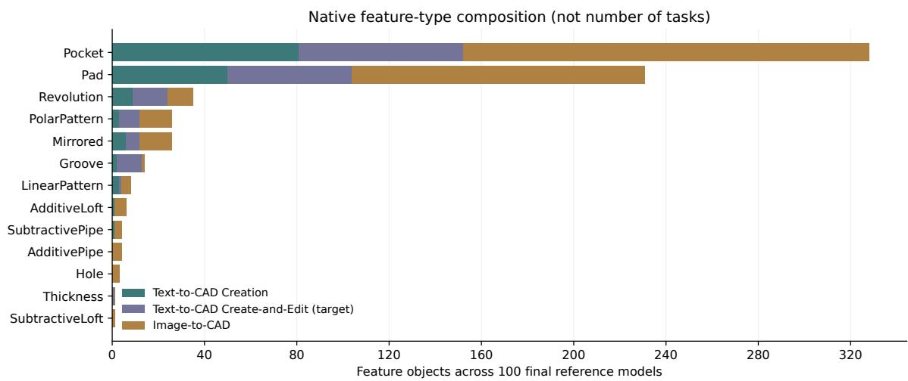  
Figure 6: Feature-object types across the 100 final references, broken down by workflow. A task can contribute several objects of the same type.

## Text-to-CAD Create-and-Edit: reference feature counts

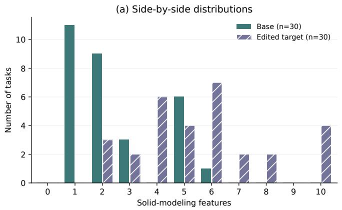

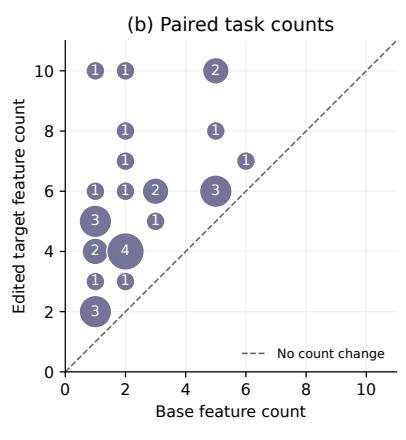  
Circle area and numeral = number of tasks

Figure 7: Feature counts for the 30 text-to-CAD create-and-edit pairs. Left: side-by-side bars distinguish base and edited target distributions. Right: paired base/target counts; circle area and numerals show how many tasks share each pair. The dashed diagonal indicates no count change. The target-minus-base count is not necessarily the number of operations needed to perform an edit.

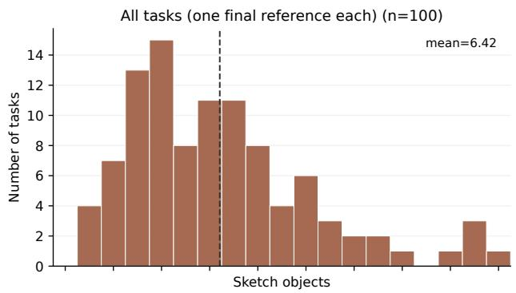

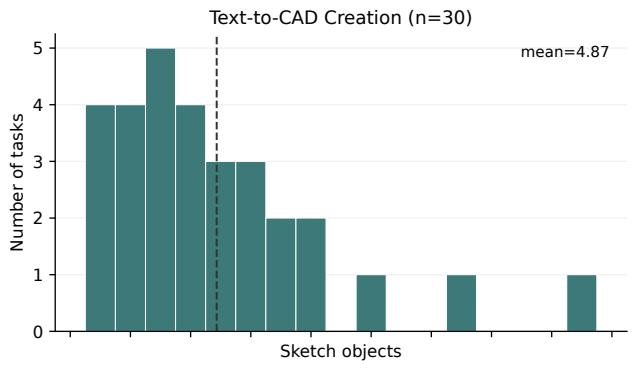

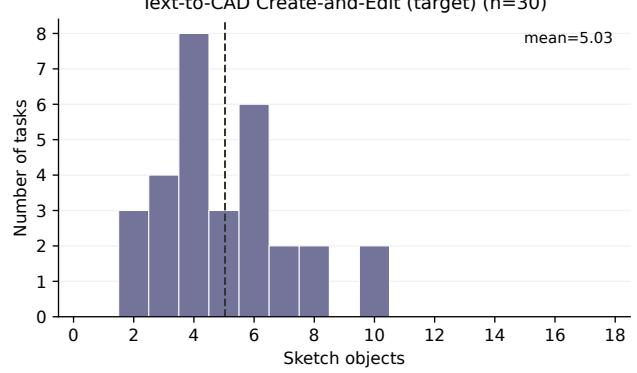

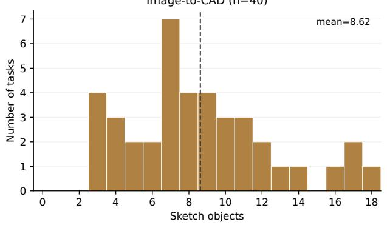  
Figure 8: Saved sketch-object counts per final reference model. Sketch objects are excluded from the solid-modeling feature statistic.

## E Leaderboard Figures

Each chart occupies a landscape page to keep all 1 3 model–agent labels readable .

Pa ra metric CAD Benc h v3  
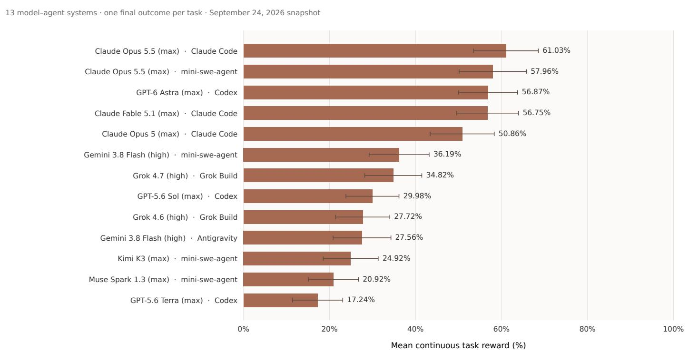  
W h i s ke rs : sto red 9 5 % ta s k- l eve l c o nfi d e n c e i nte rva l s ; ra n ki n g i s by po i nt est i m a te .  
Fi n a l exc e pt i o n o u tc o m es c o u nt a s ze ro . Pe rc e nta g es a re m ea n rewa rd n ot b i n a ry s u c c ess ra tes .

Figure 9 : Overall mean continuous reward across 1 00 tasks in the September 24 2026 snapshot . Whiskers show 95 % task-level intervals . Every final exception counts as zero . Ranking is by point estimate not demonstrated statistical separation .

1 3 m od e l –a g e nt syste m s · o n e fi n a l o u tc o m e pe r ta s k · Se pte m be r 2 4 2 0 2 6 s n a ps h ot  
Pa ra metric CAD Benc h v3  
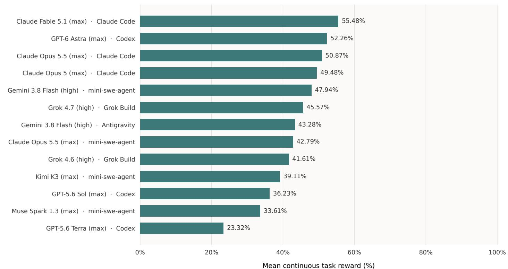  
Po i n t est i m a tes o n l y: wo rkfl ow-s pec i fi c c o nfi d e n c e i n te rva l s a re n ot sto red i n t h e row fi l es  
Fi n a l exc e pt i o n o u tc o m es c o u n t a s ze ro . Pe rc e n ta g es a re m e a n rewa rd , n ot b i n a ry s u c c ess ra tes .

Figure 1 0 : Text-to- CAD creation mean reward across 30 tasks . Systems are ordered by their creation point estimates ; workflow-specific intervals are not plotted .

Text-to -CAD C rea te-a n d - E d i t | 3 0 ta s ks  
Pa ra metric CAD Benc h v3  
1 3 m od e l –a g e nt syste m s · o n e fi n a l o u tc o m e pe r ta s k · Se pte m be r 2 4 2 0 2 6 s n a ps h ot  
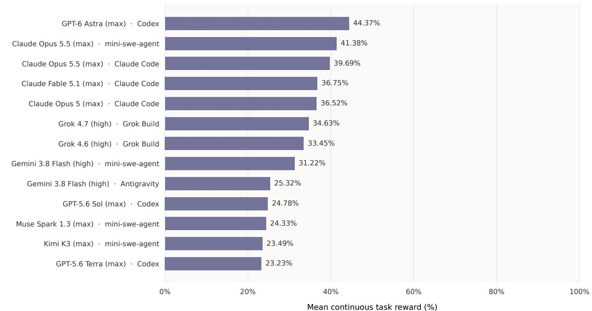  
Po i n t est i m a tes o n l y: wo rkfl ow-s pec i fi c c o nfi d e n c e i n te rva l s a re n ot sto red i n t h e row fi l es  
Fi n a l exc e pt i o n o u tc o m es c o u n t a s ze ro . Pe rc e n ta g es a re m e a n rewa rd , n ot b i n a ry s u c c ess ra tes .

Figure 1 1 : Text-to- CAD create-and-edit mean reward across 30 tasks . Each task scores both base and target artifacts through the nested harmonic aggregation in Equation 5 . Bars show point estimates not binary success rates .

## Pa ra metric CAD Benc h v3

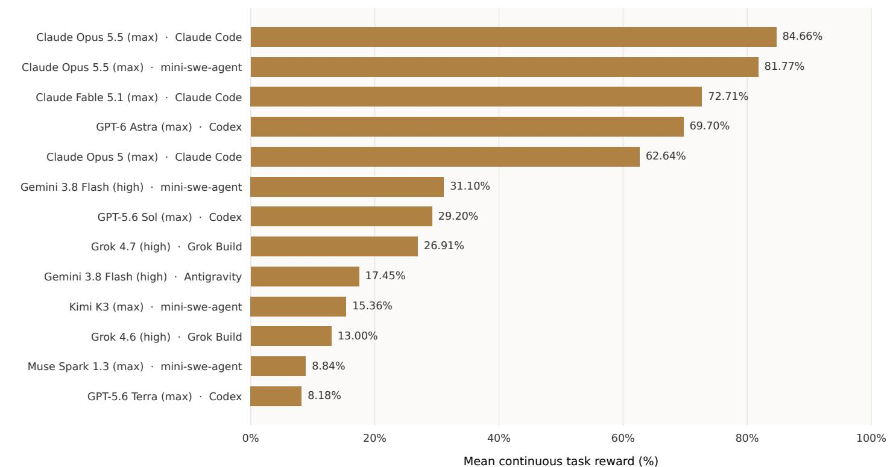  
Po i n t est i m a tes o n l y: wo rkfl ow-s pec i fi c c o nfi d e n c e i n te rva l s a re n ot sto red i n t h e row fi l es  
Fi n a l exc e pt i o n o u tc o m es c o u n t a s ze ro . Pe rc e n ta g es a re m e a n rewa rd , n ot b i n a ry s u c c ess ra tes .

Figure 1 2 : Image-to- CAD mean reward across 40 engineering-drawing tasks . Bars show workflow point estimates only. Diferent workflow populations prevent treating cross-workflow diferences as a controlled modality ablation .