# Performance evaluation of super-resolution techniques for characterization and phenotyping of commodity crops using multispectral imagery

Abhiram Karukayil1 , Jo˜ao F. C. Mota1 , Mateo V´asquez-Guevara2 , Tito Arevalo-Ramirez2 and Fernando Auat Cheein3,4

School of Engineering and Physical Sciences, Heriot-Watt University, Edinburgh, UK, ak5001@hw.ac.uk, j.mota@hw.ac.uk

2 Department of Electrical Engineering, Department of Mechanical Engineering and Metallurgy, School of Engineering, Faculty of Engineering, Pontificia Universidad Cat´olica de Chile, Santiago, Chile; mvasquezg9@estudiante.uc.cl, tito.arevalo@uc.cl

3 School of Mathematical and Computer Sciences, Heriot-Watt University, Edinburgh, UK

4 Harper Adams University, England, UK, fauat@harper-adams.ac.uk

Correspondence: Jo˜ao F. C. Mota (j.mota@hw.ac.uk)

Keywords: Vegetation indices, single-image super-resolution, remote sensing, multispectral images.

Multispectral imagery provides spectral information beyond the visible range for vegetation monitoring, but it typically sufers from limited spatial resolution, which can obscure fine crop structures and afect vegetation-index (VI) estimates. This study evaluates2 whether single-image super-resolution (SISR) methods developed for red, green, and blue (RGB) imagery can enhance the spatialv resolution of red, green, and near-infrared (RGN) crop images while preserving spectral fidelity. Eight pretrained methods are appliedo directly to RGN images without fine-tuning: bicubic and nearest-neighbor interpolation, Real-ESRGAN, HAT, HiT-SR, SRFormer, ResShift, and StableSR. Reconstruction at 4× and 16× is evaluated for whole images and manually segmented leaf regions. Reconstruction quality is assessed using mean absolute error (MAE), peak signal-to-noise ratio (PSNR), structural similarity index (SSIM),2 spectral angle mapper (SAM), and erreur relative globale adimensionnelle de synth\`ese (ERGAS). Eight VIs, computed from reference and super-resolved images, are evaluated using MAE, PSNR, and SSIM. Transformer-based methods significantly outperform GAN- and difusion-based approaches in both evaluation settings (p < 0.001), with HAT, HiT-SR, and SRFormer forming the highest-performing statistical tier. These findings indicate that RGB-trained SISR can enhance spatial detail in RGN crop imagery while maintaining spectral consistency and VI reliability for high-resolution crop phenotyping.s

## 1 Introduction1

The increasing global demand for food, coupled with the overuse of arable land and climate instability,2 has accelerated the adoption of precision agriculture. A key technology facilitating this transition is8 multispectral remote sensing, which allows non-destructive monitoring of crop canopies over large areas,2 either from unmanned aerial vehicles (UAVs) or from satellite platforms [1]. Vegetation indices (VIs). such as the normalized diference vegetation index (NDVI) and the optimized soil-adjusted vegetation index (OSAVI) are commonly derived from multispectral bands to quantify canopy vigor, biomass, and6 structural characteristics [2]. However, the relatively low spatial resolution of multispectral sensors, which:2 prioritize spectral fidelity over spatial detail, limits their ability to resolve fine-scale structures such asv individual leaves. As a result, pixels capturing both healthy and stressed tissues can distort spectralX responses and reduce the reliability of VIs for diagnostic applications [3].r

a Image super-resolution (SR) has emerged as a promising approach to address these spatial limitations by reconstructing high-resolution images from low-resolution observations. Super-resolution methods are broadly categorized into single-image super-resolution (SISR) and multi-frame super-resolution (MFSR) [4]. SISR methods reconstruct high-resolution images from a single input by exploiting internal image statistics, whereas MFSR methods combine information from multiple observations of the same scene. Traditiona SISR approaches include classical techniques such as nearest-neighbor upsampling and bicubic upsampling, while recent advances in deep learning have led to substantial improvements using convolutional neura networks (CNNs) [5], generative adversarial networks (GANs) [6], transformers [7], and difusion models [8]. These models learn from large datasets strong image priors and long-range dependencies, achieving state-of-the-art performance on red, green, and blue (RGB) image reconstruction tasks. Previous studies demonstrated the potential of SR in agricultural contexts, such as disease monitoring and UAV-based crop analysis [9–11]. However, most existing SR architectures are designed for RGB images and optimized for perceptual quality rather than pixel fidelity [12]. This raises concerns about their suitability for multispectral data, where spectral accuracy is a key factor for reliable vegetation analysis.

Multispectral and hyperspectral imaging captures spatial and spectral information simultaneously, providing detailed spectral measurements for remote-sensing applications [13]. Building on these capabilities, super-resolution methods have been developed to enhance the spatial resolution of both types of imagery. Recent unsupervised methods, including M2U-Net [14], EDIP-Net [15], and XINet [16], investigate hyperspectral reconstruction using image observations, spectral information, and image-specific priors. Related work has also explored spectral-band modelling for SR and large-scale representation learning for remote sensing, as illustrated by MambaX [17] and SpectralGPT [18]. These studies are designed for hyperspectral or multispectral data, whereas the present work examines the direct transfer of RGB-trained SISR methods to RGN crop imagery. In agricultural applications, UAV-based multispectral imaging can acquire data from much shorter distances than satellite platforms, but payload capacity, swath width, sensor optics, and operational constraints can still limit the spatial resolution obtainable for fine-scale crop analysis. Highresolution multispectral sensors may also impose additional cost, weight, and power requirements [19]. Consequently, SR may ofer a practical alternative for enhancing spatial detail in multispectral imagery, provided that spectral integrity and vegetation-index reliability are preserved. Since this study focuses exclusively on single-image super-resolution, the terms SR and SISR are used interchangeably here.

Motivated by these challenges, we investigate the applicability of RGB-trained SISR models for multispectral crop images, with a focus on improving spatial resolution. To assess their ability to transfer be yond the RGB domain, we apply the methods directly to multispectral RGN images. All super-resolution methods are evaluated using their publicly available pretrained implementations and default inference configurations, without adapting the models to the acquired RGN imagery, allowing us to compare their performance when directly applied to RGN multispectral imagery. In the absence of UAV deployment, and to emulate low-altitude observations, we acquired RGN imagery at ground level using a MAPIR Survey3W multispectral camera, resulting in a horizontal or near-horizontal viewing perspective. We consider eight SISR methods, spanning four methodological categories: classical filtering approaches (bicubic and nearest neighbor [20]), GAN-based (Real-ESRGAN [6]), transformer-based (hybrid attention transformer (HAT) [21], hierarchical transformer for eficient image super-resolution (HiT-SR) [22], SRFormer [7]), and difusion-based (ResShift [8], StableSR [23]). To provide a comprehensive benchmark, we also consider two scale factors, 4× and 16×, and analyze two diferent scenarios: whole-image reconstruction, where metrics are computed across the entire image, and leaf-level reconstruction, where the same images are evaluated only within manually segmented leaf regions using masked analysis. For the 4× experiments, each image was processed once using the corresponding 4× model. For 16× reconstruction, the same 4× inference procedure was applied sequentially twice. This protocol was consistently applied across all methods and acquired images. Reconstruction performance on RGN images is assessed using mean absolute error (MAE) [24], peak signal-to-noise ratio (PSNR) [25], structural similarity index (SSIM) [25], spectral angle mapper (SAM), and erreur relative globale adimensionnelle de synth\`ese (ERGAS). And VI evaluation is performed using eight indices computed from both reference and super-resolved images, where performance is measured on the resulting VI maps using MAE, PSNR, and SSIM. Our main contribution is a systematic benchmark of RGB-trained SR methods for multispectral crop imagery, examining how diferent SR architectures influence spatial reconstruction quality, spectral consistency, and VI behavior for precision crop phenotyping.

## 2 Materials and Methods

This section describes how we prepared the dataset, implemented the super-resolution (SR) methods, and used vegetation indices (VI) in the experiments.

## 2.1 Data Acquisition

We collected the data between 11:00 and 13:00 UTC−4 on 7 March 2025 in a commercial corn field located at 34.198140◦ S, 70.701147◦ W, in Graneros commune, Cachapoal Province, Libertador General Bernardo O’Higgins Region, Chile; see Fig. 2a. The study area is characterized by a Mediterranean climate, with cold, partly cloudy winters and warm, dry summers, and reported annual temperatures ranging approximately from $4 ^ { \circ } \mathrm { C }$ to $2 9 ^ { \circ } \mathrm { C }$ [26]. During the acquisition period, weather conditions were mostly clear, with air temperatures ranging from 22.2 to 24.5 (◦)C, relative humidity between 37% and 46%, wind speeds of 5.0–11.4 km $\mathrm { h } ^ { - 1 }$ , cloud cover of 1–7%, and shortwave solar radiation between 731 and 866 W $\mathrm { m ^ { - \bar { 2 } } }$ [27].

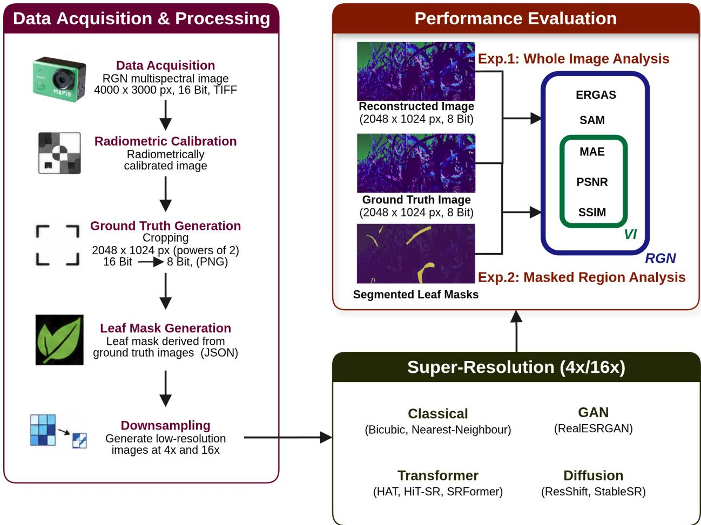  
Figure 1: Our experimental workflow for multispectral image acquisition, super-resolution processing, and performance assessment through whole-image (Experiment 1, Sec. 3.3) and leaf-level (Experiment 2, Sec. 3.4) evaluation. Groundtruth images are generated during data acquisition & processing by extracting a centered 2048 × 1024 image patch and converting it from 16-bit to an 8-bit portable network graphics (PNG) format. The images are subsequently downsampled by factors of ×4 and ×16, reconstructed using diferent SR methods, and evaluated at the whole-image and masked-region levels. The RGN reconstruction metrics are indicated in the blue box, while VI reconstruction metrics are indicated in the green box.

At the time of acquisition, the maize crop was at the V14 phenological stage, approximately ten days before flowering, with an average canopy height of 2 m. In contrast, the sunflower crop was at approximately 10% flowering, with an average canopy height of 0.5 m. The field corresponded to experimental maize and sunflower material sown on 30 October 2024, with a row spacing of 0.70 m and an approximate plant density of 70,000 plants $\mathrm { { h a ^ { - 1 } } }$ . See Fig. 3 for illustrative RGB images. We acquired multispectral data using a MAPIR Survey3W multispectral camera mounted on a Bunker Agilex unmanned ground vehicle (UGV), positioned approximately 1 m above the ground, as illustrated in Figs 2b-2c. The camera captures red, green, and near-infrared bands centered at 660, 550, and 850 nm, respectively, enabling the computation of vegetation indices such as the normalized diference vegetation index (NDVI). The system is equipped with a Sony Exmor R IMX117 12 MP CMOS sensor and produces images with a spatial resolution of $4 0 0 0 \times 3 0 0 0$ pixels. In addition, the camera incorporates a non-fisheye wide-angle lens, which reduces geometric distortion and preserves spatial image quality for subsequent analysis. Images were acquired with ISO fixed at 50, aperture set to f/2.8, and a focal length of 3.37 mm, while exposure time was automatically adjusted according to illumination conditions, ranging approximately from 1/447 to 1/133 s during field acquisition. RAW and JPEG image pairs were recorded simultaneously at intervals of approximately 2–3 s. While RAW files preserve 12-bit per-channel radiometric information required for quantitative analysis, JPEG files provide 8-bit visual references for rapid inspection.

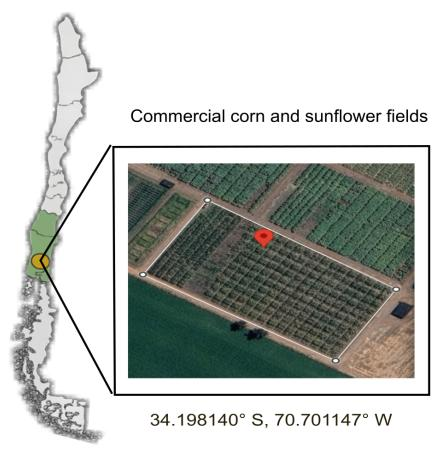  
Graneros, O'Higgins Region, Chile  
(a) Study area and field location

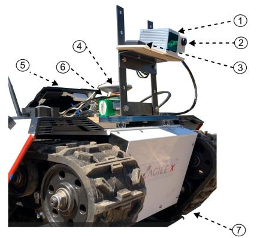  
④ VectorNav GPS Antenna ⑤ Downwelling Light Sensor

(b) UGV platform  
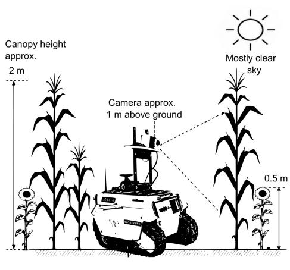  
(c) Multispectral acquisition setup

Figure 2: Ground-based multispectral data acquisition framework. (a) Study area and field location. (b) Bunker Agilex UGV platform configuration. (c) Ground-based multispectral acquisition setup.  
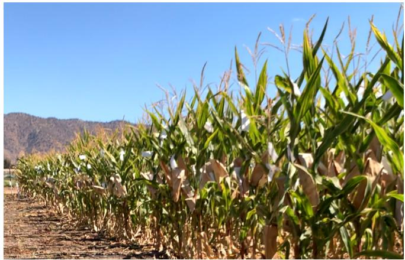  
(a) Maize

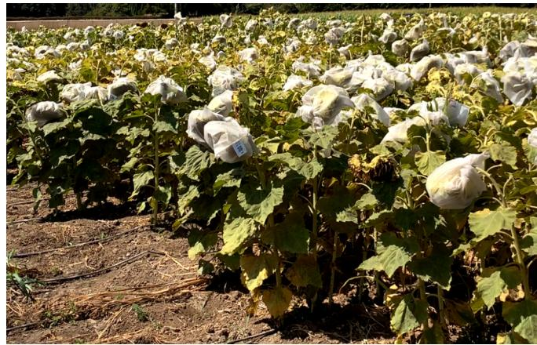  
(b) Sunflower  
Figure 3: RGB images of (a) maize and (b) sunflowers during data collection under identical imaging conditions.

## 2.2 Data Preparation

Figure 1 shows our experimental workflow, from data acquisition to evaluation. Following the manufacturer’s recommendation, we performed radiometric calibration using MAPIR camera control software [28] and used reflectance calibration targets acquired during the same experimental session. Specifically, we used the MAPIR difuse reflectance standard calibration target package T4-R125, which contains four diffuse reflectance standards of known reflectance, each measuring 125×125 mm, together with a QR/fiducia marker for automatic target detection and panel sampling. According to the manufacturer, the reflectance standards are characterized over the 250–2500 nm spectral range using spectrophotometers equipped with an integrating sphere. We used 17 calibration-target images within the MAPIR Camera Control workflow: 13 (resp. 4) images acquired before (resp. after) the field sequence. The RAW images were imported into the software, the T4-R125 calibration target was automatically identified through the QR/fiducial marker, and the four reflectance panels were sampled to estimate the relationship between pixel intensity and surface reflectance. MAPIR Camera Control then applied the radiometric calibration to the RAW image sequence and exported the results as reflectance-calibrated, 16-bit, three-band tagged image file format (TIFF) images. This workflow reduces variability associated with illumination changes, sensor spectral response, and optical efects such as vignetting, thereby improving the consistency of reflectance measurements across the dataset.

# ()1-11111\~ -ノ1ヘ-11〇1 117/1-0111

Figure 4: Visualization of the 100 manually segmented maize leaves used for masked-region analysis (Sec. 3.4). Note the morphological variability within the dataset.

To evaluate the performance of SISR techniques, we acquired a dataset of 75 radiometrically calibrated multispectral images comprising red, green, and near-infrared (RGN) bands. The dataset included 35 maize field images and 40 sunflower field images, which served as the high-resolution reference data for al experiments. Groundtruth images were generated by cropping the original 4000×3000 pixel, 16-bit TIFF images to 2048×1024 pixels, ensuring compatibility with the 4× and 16× downsampling and reconstruction procedures. Low-resolution inputs were generated by downsampling the reference images using the INTER AREA method implemented in OpenCV [29] in Python. The cropped images were subsequently converted to 8-bit PNG format for compatibility with all the evaluated SR methods. We used the ful dataset to analyze whole-image reconstruction (Sec. 3.3), and 100 maize leaves for leaf-level reconstruction (Sec. 3.4). For the latter, we selected 20 non-adjacent images, from which we manually segmented 5 leaves using labelme-ytu [30]. The resulting annotations were stored in javascript object notation (JSON) format and used for the masked-region evaluation, as shown in Figure 4.

## 2.3 Super-Resolution Methods

Table 1 summarizes the SR methods considered in this study. They include classical interpolation, GANbased, transformer-based, and difusion-based, providing a representative spectrum of modern SR approaches. Bicubic interpolation [31] estimates new pixel values using cubic interpolation in a local neighborhood, based on a 4 × 4 grid of neighboring pixels. Nearest-neighbor (NN) interpolation [39] assigns to each output pixel the value of the closest input pixel without introducing additional spatial information. Although NN interpolation does not improve image detail, it preserves the original pixel arrangement, although this often results in blocky artifacts and reduced visual smoothness. Transformer-based methods, such as hybrid attention transformer (HAT) [21], hierarchical transformer for eficient image superresolution (HiT-SR) [22], and SRFormer [7], use self-attention mechanisms to capture long-range spatial dependencies with the aim of recovering fine structural and textural details. They overcome limitations of early vision transformers by improving cross-window and multi-scale feature interactions. For example, HAT [21] enhances information exchange via hybrid attention, which combines channel attention with overlapping spatial attention. HiT-SR [22], on the other hand, employs a hierarchical multi-scale windowing strategy with eficient spatial–channel interaction modules to capture broader contextual dependencies with reduced computational complexity. SRFormer implicitly expands the receptive field by using a permuted self-attention mechanism. Real-ESRGAN [6] builds on the generative adversarial network (GAN) model ESRGAN [40] by incorporating a high-order degradation model to simulate realistic complex distortions. These methods are trained using adversarial and perceptual losses, which encourage visually sharp and perceptually realistic textures, albeit at the cost of reduced pixel-level accuracy. Training stability is improved by using a U-Net-based [41] discriminator with spectral normalization, which enhances the discrimination of structural artifacts and stabilizes adversarial learning. Difusion-based methods, such as ResShift [8, 36] and StableSR [23], formulate SR as an iterative denoising process. These models progressively refine low-resolution inputs through stochastic sampling steps. However, reliance on iterative refinement may introduce deviations in spectral accuracy in remote sensing applications where radiometric consistency must be maintained.

Table 1: Super-resolution algorithms evaluated in this study. They are classified by category and, for the learning-based methods, the training datasets are also indicated.
<table><tr><td>SR Technique</td><td>Category</td><td>Training Datasets</td></tr><tr><td>Bicubic [31]</td><td>Classical</td><td></td></tr><tr><td>NN [20]</td><td>Classical</td><td></td></tr><tr><td>HAT [21]</td><td>Transformer</td><td>ImageNet [32] and DF2K( DIV2K + Flickr2K [33])</td></tr><tr><td>HiT-SR [22]</td><td>Transformer</td><td>DIV2K [34]</td></tr><tr><td>SR Former [7]</td><td>Transformer</td><td>DIV2K [34] and DF2K( DIV2K + Flickr2K [33])</td></tr><tr><td>Real ESRGAN [6]</td><td>GAN</td><td>DIV2K [34], Flickr2K [33] and OutdoorSceneTraining (OST) [35]</td></tr><tr><td>ResShift [8, 36]</td><td>Diffusion Model</td><td>ImageNet [32]</td></tr><tr><td>Stable SR [23]</td><td>Diffusion Model</td><td>DIV2K [34], DIV8K [37], Flickr2K [33], OST [35] and FFHQ [38]</td></tr></table>

Overall, the methods assessed here mainly difer in how they reconstruct high-resolution information from low-resolution inputs. Traditional interpolation techniques estimate pixel values using information from neighboring pixels without learning from data, making them straightforward and computationally eficient. Transformer-based approaches learn spatial features and use attention mechanisms to model dependencies across diferent regions of an image, supporting the reconstruction of complex structures. GANbased methods use adversarial training and perceptual losses to produce more visually realistic outputs, although the synthesized details may not closely correspond to the ground-truth pixel values. Difusion based techniques formulate reconstruction as an iterative denoising process, enabling the generation of fine details but with higher computational cost and the potential to introduce artifacts.

## 2.4 Vegetation Indices

Vegetation indices (VIs), which enable assessing crop condition, biomass, canopy vigor, and physiological stress, can be computed from reflectance values obtained from multispectral images. Table 2 summarizes the VIs we used, all of which computed from the red, green, and near-infrared (NIR) bands. The normalized diference vegetation index (NDVI) and diference vegetation index (DVI) were used to characterize vegetation presence and canopy condition. Biomass-related characteristics were assessed using the ratio vegetation index (RVI) and modified simple ratio (MSR), both based on the relationship between NIR and red reflectance. The MSR can reduce saturation efects in dense vegetation. To account for soil background efects, we also evaluated the soil adjusted vegetation index (SAVI) and optimized soil adjusted vegetation index (OSAVI). Physiological stress and chlorophyll-related responses were assessed using the green normalized diference vegetation index (GNDVI), which uses green reflectance instead of red reflectance and is more sensitive to variations in chlorophyll content.

Table 2: Vegetation indices used in this study to assess super-resolution reconstruction. $R _ { \mathrm { { N I R } } } , \ R _ { \mathrm { { R e d } } }$ , and $R _ { \mathrm { G r e e n } }$ denote reflectance values of the near-infrared (850 nm), red (550 nm), and green (660 nm) bands.
<table><tr><td>Index</td><td>Description</td><td>Formula</td><td>Ref.</td></tr><tr><td>DVI</td><td>Difference Vegetation Index</td><td> $R _ { \mathrm { N I R } } - R _ { \mathrm { R e d } }$ </td><td>[42]</td></tr><tr><td>MSAVI</td><td>Modified Soil Adjusted Vegetation Index</td><td> $2 R _ { \mathrm { N I R } } + \frac { 1 } { 2 } - \frac { 1 } { 2 } \sqrt { ( 2 R _ { \mathrm { N I R } } + 1 ) ^ { 2 } - 8 ( R _ { \mathrm { N I R } } - R _ { \mathrm { R e d } } ) }$ </td><td>[43]</td></tr><tr><td>NDVI</td><td>Normalized Difference Vegetation Index</td><td> $( R _ { \mathrm { N I R } } - R _ { \mathrm { R e d } } ) / ( R _ { \mathrm { N I R } } + R _ { \mathrm { R e d } } )$ </td><td>[44]</td></tr><tr><td>OSAVI</td><td>Optimized Soil Adjusted Vegetation Index</td><td> $1 . 1 6 ( R _ { \mathrm { N I R } } - R _ { \mathrm { R e d } } ) / ( R _ { \mathrm { N I R } } + R _ { \mathrm { R e d } } + 0 . 1 6 )$ </td><td>[45]</td></tr><tr><td>RVI</td><td>Ratio Vegetation Index</td><td> $R _ { \mathrm { N I R } } / R _ { \mathrm { R e d } }$ </td><td>[46]</td></tr><tr><td>SAVI</td><td>Soil Adjusted Vegetation Index</td><td> $1 . 5 ( R _ { \mathrm { N I R } } - R _ { \mathrm { R e d } } ) / ( R _ { \mathrm { N I R } } + R _ { \mathrm { R e d } } + 0 . 5 )$ </td><td>[47]</td></tr><tr><td>GNDVI</td><td>Green Normalized Difference Vegetation Index</td><td> $( R _ { \mathrm { N I R } } - R _ { \mathrm { G r e e n } } ) / ( R _ { \mathrm { N I R } } + R _ { \mathrm { G r e e n } } )$ </td><td>[48]</td></tr><tr><td>MSR</td><td>Modified Simple Ratio</td><td> $( R _ { \mathrm { N I R } } / R _ { \mathrm { R e d } } - 1 ) / \sqrt { R _ { \mathrm { N I R } } / R _ { \mathrm { R e d } } + 1 }$ </td><td>[49]</td></tr></table>

## 3 Experimental Results

This section presents the evaluation metrics and assesses the performance of the super-resolution methods described in Section 2.3. Their ability to preserve spatial detail and spectral consistency is evaluated using the complementary metrics introduced in Section 3.1. Since multispectral super-resolution (SR) requires the preservation of both spatial detail and spectral information, reconstruction quality is evaluated from these two perspectives. For readability, all MAE values are scaled by 100, and the input RGB images are normalized to the range [0, 1].

We conducted two complementary experiments to evaluate reconstruction performance at diferent spatial scales. Experiment 1, reported in Section 3.3, evaluates whole-image reconstruction using the complete dataset of 35 maize-field images and 40 sunflower-field images. Experiment 2, reported in Section 3.4, evaluates leaf-level reconstruction within manually segmented mask regions using 100 maize leaves extracted from the same dataset. Together, these experiments allow us to assess the performance of the competing approaches both at the whole-image level and within individual leaf regions. In both experiments, reconstruction quality for RGN images is measured using MAE, PSNR, SSIM, SAM, and ERGAS, while VI reconstruction quality is evaluated using MAE, PSNR, and SSIM. Numerical values reported below in the text or in tables are average values computed across all the data samples. In contrast, boxplots visualize the distribution of errors and display the median as their central line. The evaluation metrics used in these experiments are described below.

## 3.1 Evaluation Metrics

Unlike RGB or grayscale images, multispectral SR requires preserving both spatial detail and spectra information. To evaluate reconstruction performance, we thus selected a range of metrics, each of which captures a diferent aspect of image quality. Given an image of size $H \times W \times C$ , where H and W denote spatial dimensions and C the number of channels/bands, we represent the value of each pixel of the reconstructed (resp. groundtruth) image by $x _ { i } \in \mathbb { R }$ (resp. $y _ { i } \in \mathbb { R } )$ , for $i = 1 , \dots , N : = H \cdot W \cdot C$ . We consider $C = 1$ for single-channel VI analysis and $C = 3$ for RGN images.

To assess reconstruction quality, we used the mean absolute error $\begin{array} { r } { \mathrm { ( M A E ) } [ 2 4 ] , ( 1 / N ) \sum _ { i = 1 } ^ { N } | x _ { i } - y _ { i } | } \end{array}$ , with lower values indicating smaller reconstruction errors and hence better performance. We also considered the standard peak signal-to-noise ratio (PSNR) [25], $1 0 \log _ { 1 0 } \mathrm { \left( M A X ^ { 2 } / M S E \right) }$ , which compares the maximum possible pixel value, MAX, with the mean-squared error (MSE), $\textstyle ( 1 / N ) \sum _ { i = 1 } ^ { N } ( x _ { i } - y _ { i } ) ^ { 2 }$ . Note that PSNR is expressed on a log scale (dB), and higher values indicate lower reconstruction error. The structural similarity index measure (SSIM) [25], defined as

$$
\mathrm { S S I M } ( x , y ) = \frac { ( 2 \mu _ { x } \mu _ { y } + C _ { 1 } ) ( 2 \sigma _ { x y } + C _ { 2 } ) } { ( \mu _ { x } ^ { 2 } + \mu _ { y } ^ { 2 } + C _ { 1 } ) ( \sigma _ { x } ^ { 2 } + \sigma _ { y } ^ { 2 } + C _ { 2 } ) } ,\tag{1}
$$

evaluates similarity between reconstructed and groundtruth images in terms of luminance, contrast, and structural characteristics. In (1), $\mu _ { x }$ and $\mu _ { y }$ represent mean intensities, $\sigma _ { x } ^ { 2 }$ and $\sigma _ { y } ^ { 2 }$ variances, and $\sigma _ { x y }$ is the covariance between x and y. The constants $C _ { 1 } , C _ { 2 } > 0$ are used for numerical stability. The higher the SSIM, the more similar the images are, with the value of 1 indicating perfect similarity. We computed SSIM values separately for each spectral band and report the average across all the bands.

To assess spectral reconstruction accuracy, we used spectral angle mapper (SAM) [50] and erreur relative globale adimensionnelle de synth\`ese (ERGAS) [51]. SAM is defined as

$$
\mathrm { S A M } ( x , y ) = \cos ^ { - 1 } \left( \frac { \sum _ { i = 1 } ^ { C } x _ { i } y _ { i } } { \sqrt { \sum _ { i = 1 } ^ { C } x _ { i } ^ { 2 } } \sqrt { \sum _ { i = 1 } ^ { C } y _ { i } ^ { 2 } } } \right) ,
$$

where C denotes the number of spectral bands. It views each image as a vector in a high-dimensional space and measures their angular similarity, ignoring magnitude factors. In turn, ERGAS is defined as

$$
\mathrm { E R G A S } = \frac { 1 0 0 } { r } \sqrt { \frac { 1 } { C } \sum _ { c = 1 } ^ { C } \left( \frac { \mathrm { R M S E } ^ { ( c ) } ( x , y ) } { \mu ^ { ( c ) } } \right) ^ { 2 } } ,
$$

where r represents the ratio between the spatial resolutions of the high- and low-resolution images, taking the values 4 for 4× upsampling and 16 for 16× upsampling. Again, C denotes the number of channels. The root mean squared error (RMSE) in the cth spectral band is defined as $\mathrm { R M S E } ^ { ( c ) } ( x , y ) ~ { = } ~$ $\textstyle \sqrt { ( 1 / N _ { c } ) \sum _ { i = 1 } ^ { N _ { c } } \left( x _ { i } ^ { ( c ) } - y _ { i } ^ { ( c ) } \right) ^ { 2 } }$ , where $x _ { i } ^ { ( c ) }$ and $y _ { i } ^ { ( c ) }$ denote the pixel values at location i of the reconstructed and reference images in channel $c ,$ and $N _ { c }$ is the total number of pixels in that band. Also, $\mu ^ { ( c ) } =$ $( 1 / N _ { c } ) \textstyle \sum _ { i = 1 } ^ { N _ { c } } y _ { i } ^ { ( c ) }$ denotes the mean value of $y ^ { ( c ) }$ . By normalizing the reconstruction error within each band, ERGAS allows comparing diferent methods in terms of their ability to preserve spectral information.

To statistically validate performance diferences across SR models, we performed non-parametric Kruskal– Wallis tests followed by Dunn’s post-hoc tests with Bonferroni correction [52] for all metrics under each experimental setup. We first applied the Kruskal–Wallis test to assess whether at least one model difered from the others. The degrees of freedom for this test are df $= k - 1 = 7$ , where $k = 8$ is the number of SR models compared. When the Kruskal–Wallis test indicated a significant diference, we performed pairwise comparisons between SR models using Dunn’s post-hoc test. To reduce the risk of false positives due to multiple comparisons, we applied a Bonferroni correction.

## 3.2 Computational Complexity of Super-Resolution Methods

To assess the practical computational requirements of the evaluated methods, Table 3 reports the number of trainable parameters, floating-point operations (FLOPs), and measured inference time. Learning-based methods were evaluated using publicly released pretrained checkpoints without retraining or fine-tuning; therefore, training time is not applicable to the present study. FLOPs and inference time were measured for a $5 1 2 \times 2 5 6 .$ -pixel low-resolution RGN input at 4× upscaling on an NVIDIA GeForce RTX 4090 Laptop GPU with 16 GB memory. The reported inference times correspond to a single 4× inference pass. Table 3 shows substantial diferences in computational requirements among the evaluated SISR methods. Bicubic and nearest-neighbor interpolation required negligible processing time. Among the learning-based approaches, HiT-SR had the lowest parameter count (0.87 M) and FLOPs (0.23 T), with an inference time of 0.31 s per image. Real-ESRGAN has the least inferencing time (0.24 s per image) even with more parameters and FLOPs than HiT-SR. HAT and SRFormer required 1.74 s and 1.42 s per image, respectively. The difusionbased methods had the highest computational requirements. StableSR required 1554.64 M parameters and 371.46 T FLOPs, with a mean inference time of 32.42 s per image. These results indicate that both reconstruction quality and inference cost should be considered when selecting an SR method for large-scale agricultural imaging.

Table 3: Computational characteristics of the evaluated super-resolution methods. Learning-based methods were evaluated using publicly released pretrained checkpoints without retraining or fine-tuning. FLOPs and inference time were measured for an LR RGN input of 512×256 pixels at 4× upscaling using an NVIDIA GeForce RTX 4090 (16 GB, mobile) GPU.
<table><tr><td>SR Technique</td><td>Parameters (M) FLOPs (T) Inference time</td><td></td><td> $\mathbf { ( s / i m a g e ) }$ </td></tr><tr><td>Bicubic [31]</td><td></td><td></td><td> $3 . 7 9 \times 1 0 ^ { - 4 }$ </td></tr><tr><td>Nearest neighbor [20]</td><td></td><td></td><td> $3 . 3 9 \times 1 0 ^ { - 4 }$ </td></tr><tr><td>HAT [21]</td><td>20.77</td><td>5.48</td><td>1.74</td></tr><tr><td>HiT-SR [22]</td><td>0.87</td><td>0.23</td><td>0.31</td></tr><tr><td>SRFormer [7]</td><td>10.52</td><td>3.04</td><td>1.42</td></tr><tr><td>Real-ESRGAN [6]</td><td>16.70</td><td>4.70</td><td>0.24</td></tr><tr><td>ResShift [8, 36]</td><td>173.92</td><td>43.21</td><td>4.36</td></tr><tr><td>Stable SR [23]</td><td>1554.64</td><td>371.46</td><td>32.42</td></tr></table>

Checkpoint details. For reproducibility, the publicly released pretrained weights used for inference are: HAT:-HAT SRx4 ImageNet-pretrain.pth; HiT-SR:-HiT-SRF-4x.pth; SRFormer:-SRFormer SRx4 DF2K.pth; RealESRGAN:-RealESRGAN x4plus.pth; ResShift–resshift realsrx4 s4 v3.pth with autoencoder vq f4.pth; StableSR–stablesr turbo.ckpt with vqgan cfw 00011.ckpt. Bicubic and NN do not require pretrained weights.

## 3.3 Experiment 1: Whole-Image Reconstruction

Figure 5 shows the reconstruction at a 4× factor by all the methods of two representative whole-image RGN examples, one for a maize crop (Fig. 5a), another for a sunflower crop (Fig. 5b). In both examples, it can be observed that the transformer- and attention-based algorithms (HAT, HiT-SR, and SRFormer) obtained the best reconstruction performance, followed by the classical methods (bicubic and NN). The worst performance was obtained by generative methods (RealESRGAN, ResShift, and StableSR) which, despite producing visually-pleasing reconstructions, introduced artifacts inexistent in the groundtruth images. Figure 6a reports the results for each metric in the entire dataset for both scaling factors 4× and 16×. The results are visualized using box plots, where the central horizontal line within each box denotes the median performance. The box boundaries represent the first and third quartiles (Q1–Q3), corresponding to the interquartile range (IQR). The whiskers extend to the most extreme data points within 1.5 times the IQR, while any samples outside this range are treated as outliers and plotted individually. To statistically validate performance diferences given the skewed error distributions and outliers, we performed non-parametric Kruskal–Wallis tests followed by post-hoc Dunn’s tests with Bonferroni correction. The omnibus tests confirmed significant diferences among models across all metrics for both $4 \times ~ ( H ( 7 ) ~ \in ~ [ 3 2 4 . 1 4 , 5 1 6 . 5 5 ]$ $p < 0 . 0 0 1 )$ and $1 6 \times ( H ( 7 ) \in [ 7 6 . 0 0 , 3 8 3 . 7 0 ] , p < 0 . 0 0 1 )$ setups.

Fig. 5 further validates this trend: for 4× upsampling (blue boxes), transformer- and attention-based methods consistently achieve the strongest results. Specifically, SRFormer obtained the lowest MAE (0.98) and lowest SAM (1.32◦), while sharing the highest SSIM (0.94) with HAT (1.00 MAE, 1.34◦ SAM). HiT SR achieved the highest PSNR (34.95 dB) and the lowest ERGAS (2.09), with only marginal diferences relative to SRFormer and HAT. Post-hoc pairwise tests confirmed that all three Transformer models significantly outperformed RealESRGAN, ResShift, and StableSR across all metrics $( p < 0 . 0 0 1$ , Bonferroniadjusted), while diferences among HAT, HiT-SR, and SRFormer were not statistically significant. Despite its simplicity, bicubic interpolation remained a competitive baseline, achieving a PSNR of 33.58 dB and an SSIM of 0.92. In contrast, the generative approaches exhibited substantially larger reconstruction errors. For a 16× factor (orange boxes), reconstruction quality deteriorated across all methods and exhibited larger variations. Transformer based approaches remained robust; HAT attained the lowest MAE (3.20), highest SSIM (0.73), and lowest SAM (3.24◦), closely followed by SRFormer (3.24 MAE, 0.72 SSIM, 3.29◦ SAM) and HiT-SR (3.26 MAE, 0.72 SSIM, 3.38◦ SAM), with no statistically significant diferences within the Transformer family. Pairwise tests confirmed that Transformers maintained statistically superior MAE, PSNR, SSIM, and SAM over generative models $( p \leq 0 . 0 0 8 )$ . Bicubic interpolation attained the highest PSNR (24.27 dB) and matched HiT-SR’s lowest ERGAS (1.98), while maintaining competitive fidelity relative to deep learning models at this extreme scaling factor. Generative and difusion models continued to yield the lowest quantitative fidelity, with ResShift and StableSR recording the highest spectral distortion and reconstruction errors.

Table 4a reports VI reconstruction results, with each column displaying the MAE, PSNR, and SSIM values for each VI index of Table 2. Non-parametric Kruskal–Wallis tests confirmed statistically significant performance diferences across models for all eight vegetation indices at both 4× $( H ( 7 ) \in [ 3 9 5 . 9 5 , 4 9 9 . 2 4 ]$ $p < 0 . 0 0 1 )$ and $1 6 \times ( H ( 7 ) \in [ 7 6 . 0 0 , 4 5 5 . 2 5 ]$ $p < 0 . 0 0 1 )$ scale factors. Post-hoc Dunn’s tests with Bonferroni correction verified that Transformer architectures (HAT, HiT-SR, and SRFormer) significantly outperformed GAN- and difusion-based baselines across all VI metrics $( p < 0 . 0 0 1 )$ , while pairwise diferences within the Transformer family were not statistically significant. It can be seen that HAT, SRFormer, and HiT-SR consistently achieve the strongest performance across both scaling factors, with HAT yielding the highest overall performance on most indices. At 4×, SAVI and OSAVI were reconstructed most accurately, where HAT achieved 41.46 dB PSNR and 0.95 SSIM for SAVI (MAE of 1.78) and 39.41 dB PSNR and 0.93 SSIM for OSAVI (MAE of 1.92), with SRFormer and HiT-SR producing closely comparable results. The DVI and NDVI remain within a relatively high-quality reconstruction range, whereas ratio-based indices such as MSR and RVI are reconstructed with poorer accuracy across all evaluated methods. At 16×, performance degradation becomes more noticeable, especially for the ratio-based indices. HAT maintained the highest accuracy across these indices, achieving 34.85 dB PSNR (MAE of 3.64, SSIM of 0.85) for SAVI and 32.90 dB PSNR (MAE of 3.86, SSIM of 0.80) for OSAVI, compared to 34.67 dB and 32.70 dB for SR-Former, and 34.52 dB and 32.54 dB for HiT-SR. In contrast, GAN and difusion-based methods exhibited substantially lower reconstruction quality, with ResShift producing the lowest RVI reconstruction at 16×, achieving an MAE of 64.72, a PSNR of 12.37 dB, and an SSIM of 0.44.

## 3.4 Experiment 2: Leaf-Level Reconstruction Analysis Within Masked Regions

Figure 6b and Table 4b show the results of leaf-level SR across 100 manually segmented leaf regions. Unlike Experiment 1, where reconstruction metrics were computed over the entire image, here metrics are computed exclusively in leaf regions. Non-parametric Kruskal–Wallis tests confirmed statistically significant performance variations across models across all raw bands and vegetation indices at both 4× $( H ( 7 ) \in [ 3 3 8 . 3 1 , 5 9 3 . 7 2 ] , p < 0 . 0 0 1 )$ and $1 6 \times ( H ( 7 ) \in [ 1 0 1 . 4 1 , 4 2 0 . 3 4 ] , p < 0 . 0 0 1 )$ scale factors. Comparing Figs. 6a and 6b for 4×, we observe that reconstruction performance improves in terms of PSNR, SSIM, and ERGAS for the top-performing methods. SRFormer obtained the best metrics: MAE of 1.06, PSNR of 36.63 dB, SSIM of 0.94, SAM of 1.26◦, and ERGAS of 2.00. Relative to Experiment 1, PSNR increases from 34.86 to 36.63 dB for SRFormer and from 34.95 to 36.60 dB for HiT-SR, and from 34.64 to 36.12 dB for HAT. Bicubic interpolation also shows improved performance, with PSNR increasing from 33.58 dB to 34.69 dB while maintaining an SSIM of 0.92. Difusion-based and GAN-based methods obtained larger errors and lower spectral consistency for most metrics. At 16×, reconstruction performance decreases for all methods. SRFormer achieved the lowest MAE (4.73) and the highest SSIM (0.63), HAT obtained the lowest SAM (4.94◦), and HiT-SR achieved the highest PSNR (23.80 dB) alongside the lowest ERGAS (2.40) among the learning-based methods. Unlike Experiment 1 where bicubic interpolation achieved the top PSNR at 16×, here the transformer based models (HiT-SR at 23.80 dB, SRFormer at 23.76 dB, and HAT at 23.55 dB) outperform bicubic interpolation (23.16 dB). Compared with Experiment 1, al methods exhibit reduced performance at 16×, and diferences between learning-based methods and bicubic interpolation are less pronounced under this scaling factor. As shown in Fig. 6b, generative models exhibit higher variability and more outliers.

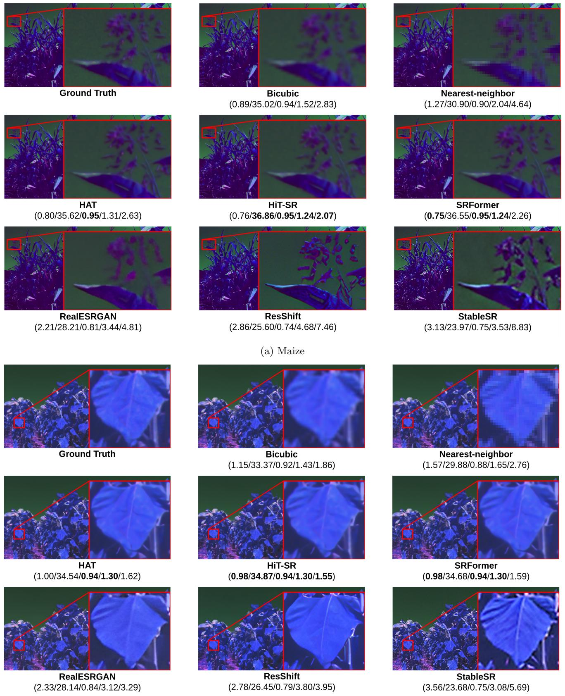  
(b) Sunflower  
Figure 5: Qualitative comparison of two representative 4× single-image super-resolution (SISR) reconstruction examples for (a) maize and (b) sunflower crops. For each example, the full reconstructed image is shown together with an enlarged loca region (zoomed-in view) to facilitate detailed comparison of crop structures, textures, and phenotypic characteristics. Results from all SISR methods are accompanied by the corresponding reconstruction metrics: MAE↓, PSNR (dB)↑, SSIM↑, SAM (◦)↓, and ERGAS↓. The zoomed-in regions highlight diferences in the preservation of fine-scale agricultural structures and spectral-spatial details. While the generative approaches (last row) produce visually sharper and more perceptually appealing reconstructions, they may introduce artificial structures or textures that are not supported by the groundtruth, indicating a potential trade-of between perceptual sharpness and faithful reconstruction of agriculturally relevant information.

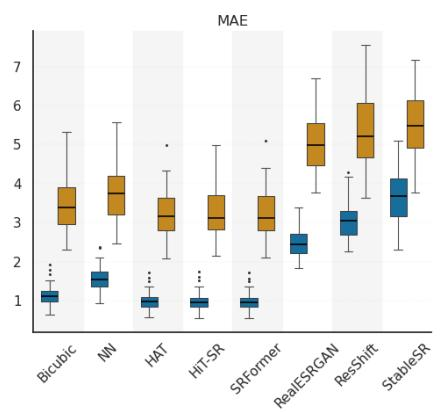

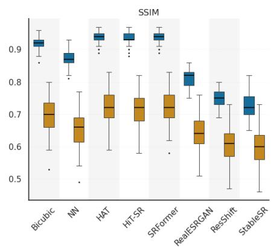

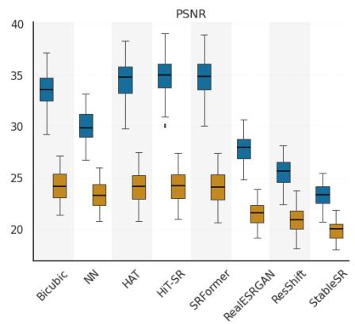

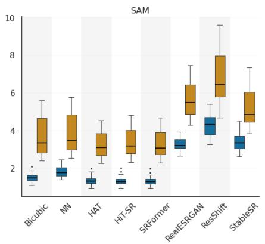

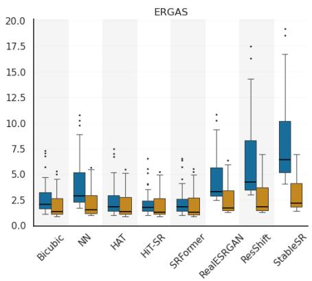  
(a) Whole image analysis ×4  ×16

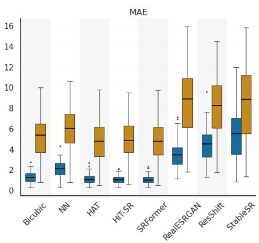

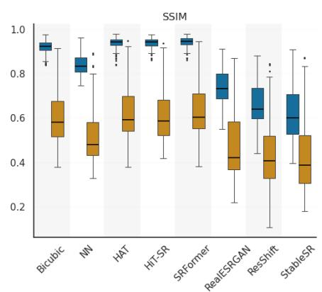

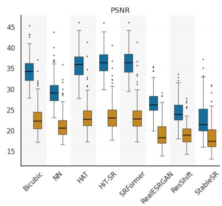

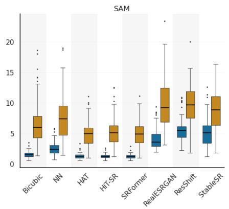

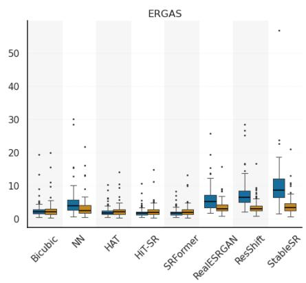  
(b) Masked region analysis  
Figure 6: Distributional comparison of RGN image reconstruction quality across SR models at 4× and 16× scaling factors. Figure (a) shows the whole image results (Sec. 3.3) and (b) shows masked leaf region results (Sec. 3.4).

Table4:Quantitativeevaluationofvegetationindex(VI)reconstructionderivedfromRGNimageryfordiferentSRmethodsat4×and16×scalingfactorsusing MAE↓,PSNR(dB)↑,andSSIM↑.Bestresultsinbold,andworstunderlined.Forreadability,MAEvaluesarescaledby100.(a)Whole-imageexperiments.(b) f-level experime
<table><tr><td rowspan="2">SR Technique</td><td rowspan="2">Scale</td><td>DVI</td><td>GNDVI</td><td>MSAVI</td><td>MSR</td><td>NDVI</td><td>OSAVI</td><td>RVI</td><td>SAVI</td></tr><tr><td>MAE / PSNR / SSIM</td><td>MAE / PSNR / SSIM</td><td>MAE / PSNR / SSIM</td><td>MAE / PSNR / SSIM</td><td>MAE  / PSNR / SSIM</td><td>MAE / PSNR / SSIM</td><td>MAE / PSNR / SSIM</td><td>MAE / PSNR / SSIM</td></tr><tr><td>Bicubic</td><td>4×</td><td>1.69 / 37.66 / 0.92</td><td>2.15 / 34.57 / 0.91</td><td>1.88 / 37.34 / 0.90</td><td>4.27 / 32.68 / 0.82</td><td>2.18 / 36.42 / 0.88</td><td>2.04 / 38.80 / 0.91</td><td>8.47 / 34.07 / 0.86</td><td>1.91 / 40.80 / 0.94</td></tr><tr><td rowspan="2">Nearest Neighbor</td><td>16× 4×</td><td>3.59 / 30.94 / 0.78</td><td>6.92 / 26.19 / 0.70</td><td>3.79 / 31.07 / 0.76</td><td>8.48 / 26.45 / 0.59</td><td>4.23 / 30.51 / 0.72</td><td>4.01 / 32.77 / 0.79</td><td>17.13 / 27.65 / 0.69</td><td>3.83 / 34.60 / 0.84</td></tr><tr><td>2.03 / 35.63 / 0.89 16×</td><td>3.86 / 30.12 / 0.75</td><td>2.79 / 32.00 / 0.87</td><td>2.20 / 35.60 / 0.87</td><td>4.92 / 31.10 / 0.78</td><td>2.49  / 34.94 / 0.85</td><td>2.36 / 37.23 / 0.89</td><td>9.83 / 32.44 / 0.83</td><td>2.23 / 39.11 / 0.92</td></tr><tr><td rowspan="2">HAT</td><td>4×</td><td>1.55 / 38.45 / 0.93</td><td>7.03 / 25.55 / 0.67 1.82 / 36.04 / 0.93</td><td>4.03 / 30.32 / 0.73 1.75 / 38.01 / 0.92</td><td>8.92 / 25.79 / 0.56</td><td>4.42 / 29.92 /  0.69</td><td>4.23 / 32.12 / 0.77</td><td>18.10 / 26.98 / 0.66</td><td>4.06 / 33.88 / 0.82</td></tr><tr><td>16× 3.35 / 31.36 / 0.79</td><td></td><td>5.36 / 26.94 / 0.74</td><td>3.60 / 31.34 / 0.77</td><td>4.01 / 33.17 / 0.84 8.33 / 26.18 / /0.60</td><td>2.05 / 37.00 / 0.89 4.11 / 30.47 / 0.72</td><td>1.92 / 39.41 / 0.93 3.86 / 32.90 / 0.80</td><td>7.97 / 33.95 / 0.88 17.06 / 26.67 / 0.70</td><td>1.78 / 41.46 / 0.95 3.64 / 34.85 / 0.85</td></tr><tr><td>HiT-SR</td><td>4× 16×</td><td>1.57 / 38.39 / 0.93 3.45 / 31.16 / 0.78</td><td>1.80 / 36.41 / 0.93 5.72 / 26.87 / 0.73</td><td>1.77 / 37.93 / 0.91 3.75 / 31.01 / 0.76</td><td>4.05 / 33.11 / 0.84 8.74 / 25.84 / 0.59</td><td>2.07 / 36.91 / 0.89 4.29 / 30.14 / 0.71</td><td>1.94 / 39.32 / 0.92 4.03 / 32.54 / 0.79</td><td>8.06 / 34.11 / 0.88 17.98 / 26.47 / 0.68</td><td>1.80 / 41.37 / 0.95 3.79 / 34.52 / 0.84</td></tr><tr><td>SRFormer</td><td>4× 16×</td><td>1.56 / 38.44 / 0.93 3.41 / 31.25 / 0.79</td><td>1.72 / 36.49 / 0.94 5.39 / 26.88 / 0.74</td><td>1.76 / 37.97 / 0.92 3.68 / 31.16 / 0.76</td><td>4.04 / 33.12 / 0.84</td><td>2.06 / 36.95 / 0.89 4.20 / 30.29 / 0.72</td><td>1.93 / 39.36 / 0.93</td><td>8.03 / 33.94 / 0.88</td><td>1.79 / 41.42 / 0.95</td></tr><tr><td rowspan="2">Real ESRGAN</td><td>4× 16×</td><td>3.35 / 32.26 / 0.82 5.58 / 27.70 / 0.70</td><td>4.87 / 28.50 / 0.79</td><td>3.83 / 31.58 / 0.79</td><td>8.53 / 26.00 / 0.59 9.09 / 26.24 / 0.63</td><td>4.53 / 30.35 / 0.74</td><td>3.95/ 32.70 / 0.79 4.21 / 32.87 / 0.81</td><td>17.49 / 26.55 / 0.69 18.40 / 26.80 / 0.72</td><td>3.72 / 34.67 / 0.84 3.89 / 35.03 / 0.86</td></tr><tr><td></td><td></td><td>9.16 / 23.26 / 0.64</td><td>6.19 / 27.39 / 0.68</td><td>14.41 / 22.21 / 0.50</td><td>7.14 / 26.46 / 0.64</td><td>6.69 / 28.90 / 0.72</td><td>29.33 / 22.65 / 0.64</td><td>6.26 / 30.90 / 0.77</td></tr><tr><td>ResShift</td><td>4× 16×</td><td>5.19 / 28.57 / 0.70 8.86 / 24.26 / 0.57 3.65 / 30.78 / 0.78</td><td>5.18 / 26.87 / 0.74 8.88 / 22.48 / 0.61</td><td>5.93 / / 27.94 / 0.65 9.86 / / 23.87 / 0.54</td><td>15.09 / 20.89 / 0.43 25.62 / 16.52 /0.32</td><td>6.92 / 26.86 / 0.59 11.04 / / 23.16 / 0.50</td><td>6.47 / 29.33 / 0.68 10.47 / 25.51 / 0.59</td><td>34.52 / 17.2 / 0.54 64.72 / 12.37 / 0.44</td><td>6.01 / 31.44 / 0.75 9.89 / 27.45 / 0.65</td></tr><tr><td>Stable SR</td><td>4× 16×</td><td>6.07 / 26.08 /0.67</td><td>5.09 / 26.67 / 0.74 8.23 / 23.22 / 0.63</td><td>3.96 / 30.63 / 0.75 6.30 / 26.37 / 0.65</td><td>9.82 / 24.02 / 0.57 14.51 / 20.86 / 0.47</td><td>4.71 / 29.24 / 0.69 6.92 / 25.83 / 0.60</td><td>4.33 / 31.99 / 0.77 6.60 / 28.14 / 0.68</td><td>20.95 / 22.27 / 0.66 31.19 / 19.67 / 0.59</td><td>4.02 / 34.13 / 0.83 6.34 / 29.92 / 0.74</td></tr><tr><td></td><td>(b) Performance of super-resolution methods evaluated within manually segmented leaf regions.</td><td></td><td></td><td></td><td></td><td></td><td></td><td></td><td></td></tr><tr><td>SR Technique</td><td>DVI Scale</td><td>MAE  / PSNR / SSIM</td><td>GNDVI MAE  / PSNR / SSIM</td><td>MSAVI MAE  / PSNR  / SSIM</td><td>MSR</td><td>NDVI</td><td>OSAVI</td><td>RVI</td><td>SAVI</td></tr><tr><td>Bicubic</td><td>4×</td><td>1.83 / 38.58 / 0.93 6.34 / 28.59 / 0.71</td><td>2.90 / 33.09 / 0.92</td><td>1.73 / 39.04 / 0.93</td><td>MAE / PSNR /SSIM 4.60 / 27.57 / 0.79</td><td>MAE /PSNR / SSIM 1.71 / 39.05 / 0.93</td><td>MAE  / PSNR  / SSIM 1.70 / 41.08 / 0.95</td><td>MAE  / PSNR / SSIM 11.60 / 27.30 / 0.79</td><td>MAE / PSNR / SSIM 1.71 / 42.67 / 0.96</td></tr><tr><td>Nearest Neighbor</td><td>16× 4×</td><td>2.73 / 34.64 / 0.87 7.34 / 26.99 / 0.62</td><td>14.46 / 21.07 / 0.53 5.02 / 28.18 / 0.83</td><td>5.53 / 29.72 / 0.74 2.51 / 35.36 / 0.88</td><td>13.46 / 18.85 / 0.37 6.32 / 24.51 / 0.70</td><td>5.06 / 30.34 / 0.75 2.39 / 35.75 / 0.88</td><td>5.20 / 32.11 / 0.80 2.41 / 37.62 / 0.90</td><td>33.66 / 18.65 / 0.37 15.78 / 24.44 / 0.70</td><td>5.43 / 33.39 / 0.83 2.47 / 39.04 / 0.92</td></tr><tr><td>HAT</td><td>16× 4×</td><td>1.59 / 39.86 / 0.95</td><td>16.34 / 19.77 / 0.43 2.41 / 35.43 / 0.95</td><td>6.48 / 27.95 / 0.65 1.56 / 39.99 / 0.95</td><td>15.38 / 17.41 / 0.27 4.29 / 28.22 / 0.82</td><td>5.90 / 28.62 / 0.67 1.59 / 39.77 / 0.94</td><td>6.08 / 30.37 / 0.73 1.56 / 41.90 / 0.96</td><td>37.93 / 17.43 / 0.28 10.88 / 27.91 / 0.82</td><td>6.35 / 31.65 / 0.77 1.55 / 43.62 / 0.97</td></tr><tr><td>HiT-SR</td><td>16× 4×</td><td>5.30 / 29.80 / 0.76 1.54 / 40.07 / 0.95</td><td>9.99 / 23.50 / 0.63 2.32 / 35.73 / 0.95</td><td>4.78 / 30.57 / 0.76 1.54 / 40.04 / 0.95</td><td>13.25 / 18.43 / 0.41 4.30 / 28.13 /  0.81</td><td>4.80 / 30.32 / 0.74 1.59 / 39.70 / 0.94</td><td>4.70 / 32.57 / 0.80 1.55 / 41.88 / 0.96</td><td>34.64 / 17.71 / 0.41 10.90 / 27.81 / 0.81</td><td>4.71 / 34.24 / /0.85 1.52 / 43.66 0.97</td></tr><tr><td>SRFormer</td><td>16× 4×</td><td>5.49 / 29.59 / 0.74 1.54 / 40.06 / 0.95</td><td>10.71 / 23.40 / 0.62 2.16 / 36.31 / 0.95</td><td>5.13 / 30.07 / 0.74 1.54 / 40.10 / 0.95</td><td>14.48 / 17.87 /0.38 4.25 / 28.26 / 0.82</td><td>5.20 / / 29.81 / 0.72 1.58 / 39.82 / 0.94</td><td>5.07 /  32.04 /  0.79 1.54 / 41.97 / 0.96</td><td>37.92 / 17.12 / 0.38 10.77 / 27.95 / 0.82</td><td>5.04 / 33.75 / 0.83 1.52 / 43.72 / 0.97</td></tr><tr><td>Real ESRGAN</td><td>16× 4×</td><td>5.39 / 29.71 / 0.75 4.61 / 30.93 / 0.83</td><td>9.85 / 23.67 / 0.63 6.71 / 26.69 / 0.79</td><td>4.87 / 30.42 / 0.76 4.77 / 30.70 /  0.81</td><td>13.31 / 18.48 / 0.40</td><td>4.83 / 30.31 / 0.74 5.17 / 30.06 / 0.77</td><td>4.75 / 32.48 / 0.80</td><td>34.64 / 17.85 / 0.40 34.78 / 17.99 / 0.45</td><td>4.79 / 34.11 / 0.84</td></tr><tr><td></td><td>16×</td><td>11.05 / 23.87 / 0.61 7.87 / 26.42 / 0.69</td><td>16.96 / 19.41 / 0.45</td><td>11.17 / 23.90 / 0.62</td><td>13.78 / 18.45 / 0.45 29.01 / 12.59 / 0.21</td><td>11.72 / 23.69 / 0.61</td><td>4.94 / 32.38 / 0.83 11.38 / 25.80 / 0.68</td><td>69.34 / 12.49 / 0.22</td><td>4.73 / 34.31 / 0.87 11.09 / 27.52 / 0.73</td></tr><tr><td>ResShift Stable SR</td><td>4× 16× 12.62 /</td><td>22.45 / 0.50 6.23 / 28.46 / 0.74</td><td>8.42 / 25.24 / 0.73 15.71 / 20.29 / 0.46</td><td>8.04 / / 26.23 / 0.66 12.75 22.36 / 0.49</td><td>26.67 / 11.96 / 0.30 47.41 /6.75 / 0.12</td><td>8.23 / 26.03 / 0.64 12.80 / / 22.37 / 0.48</td><td>8.06 / 28.16 / 0.71 12.55/ / 24.48 / 0.57</td><td>82.00 / 8.32 / 0.28 183.33 / 0.82 / 0.11</td><td>7.91 / 29.91 / 0.76 12.40 / 26.15 / 0.63</td></tr></table>

The VI reconstruction results in Table 4b follow a similar pattern. Non-parametric Kruskal-Wallis tests confirmed statistically significant performance diferences across models for all eight vegetation indices at both $4 \times ( H ( 7 ) \in [ 3 3 8 . 3 1 , 5 9 3 . 7 2 ] , p < 0 . 0 0 1 )$ and $1 6 \times ( H ( 7 ) \in [ 1 0 1 . 4 1 , 4 2 0 . 3 4 ] , p < 0 . 0 0 1 )$ scale factors. Post-hoc Dunn’s tests with Bonferroni correction verified that Transformer architectures (HAT, HiT-SR, and SRFormer) significantly outperformed GAN- and difusion-based baselines across all VI metrics $( p < 0 . 0 0 1 )$ , while pairwise diferences within the Transformer family were not statistically significant. At 4×, soil-adjusted indices (SAVI and OSAVI) were the best reconstructed indices within leaf regions. SRFormer achieved a PSNR of 43.72 dB (resp. 41.97 dB) and an SSIM of 0.97 (resp. 0.96) for SAVI (resp. OSAVI). HiT-SR and HAT produce comparable results for both indices, with HiT-SR achieving 43.66 dB (SAVI) and 41.88 dB (OSAVI), and HAT achieving 43.62 dB (SAVI) and 41.90 dB (OSAVI). In contrast, ratio-based indices such as MSR and RVI exhibited larger reconstruction errors and lower structural similarity for all the methods. At 16×, reconstruction quality decreased for all vegetation indices. HAT achieved the highest SAVI performance, with an MAE of 4.71, a PSNR of 34.24 dB, and an SSIM of 0.85. HAT also achieved the best OSAVI results, with an MAE of 4.70, a PSNR of 32.57 dB, and an SSIM of 0.80. SRFormer and HiT-SR produced similar, but slightly lower, results for these two indices. Reconstruction was weaker for ratio-based indices, most notably RVI. ResShift had the lowest RVI reconstruction quality at 16×, with an MAE of 183.33, a PSNR of 0.82 dB, and an SSIM of 0.11.

## 4 Discussion

The experimental results reveal key insights about applying RGB-pretrained SISR models to multispectral crop images in terms of spatial reconstruction quality and spectral consistency.

1. Behavior of super-resolution methods in multispectral reconstruction. Non-parametric Kruskal–Wallis tests followed by Dunn’s post-hoc tests with Bonferroni correction confirmed that Transformerbased methods (SRFormer, HiT-SR, and HAT) significantly outperform GAN and difusion-based approaches across both whole-image and leaf-level evaluations. This improvement is most evident in spectral metrics (SAM and ERGAS), indicating better preservation of inter-band relationships in RGN images compared to generative models. Although SRFormer, HiT-SR, and HAT achieve comparable performance overall, SRFormer shows slightly more stable behavior across scaling factors. Pairwise comparisons revealed no statistically significant diferences among SRFormer, HiT-SR, and HAT, placing all three transformer architectures within the same highest-performing statistical category. In contrast, GAN-based (RealESRGAN) and difusion-based models (ResShift, StableSR) produce visually sharper reconstructions but exhibit higher spectral distortion. This reflects their bias toward perceptual realism rather than radiometric accuracy. Bicubic interpolation remains a strong baseline in several cases and achieves competitive PSNR at high scaling factors compared to more complex pretrained models. It thus remains a robust, simple reference method for RGN-image reconstruction.

2. Impact of the upscaling factor on the quality of reconstruction. The scaling factor has a substantial impact on all the evaluated methods. At 4×, transformer-based models (SRFormer, HiT-SR, and HAT) significantly outperform classical interpolation methods (bicubic and nearest-neighbor) across both whole-image and leaf-level evaluations $( p < 0 . 0 0 1 )$ . However, at 16×, the performance gap narrows considerably, with bicubic interpolation achieving statistically comparable PSNR and ERGAS values to Transformer models in several cases. This reflects the severe loss of fine image detail, making accurate reconstruction dificult regardless of model type. The performance gap between learned SISR methods and bicubic interpolation becomes much smaller in terms of PSNR and SSIM. This indicates that when the input resolution is highly limited, there is insuficient information to reliably reconstruct fine details and, consequently, reconstruction is likely driven by simple interpolation be havior rather than learned model priors. As a result, increasing model complexity provides limited additional benefit, highlighting a fundamental limitation of SISR for multispectral images under extreme downsampling. We emphasize that the evaluated SISR models were originally designed for RGB images, which may further influence their performance when applied to multispectral data without fine-tuning.

3. Spectral consistency and vegetation index stability. The results highlight that spectral preservation is an important aspect of multispectral SR for vegetation analysis. Transformer-based approaches consistently achieved lower SAM and ERGAS values, indicating stronger preservation of spectral relationships and radiometric consistency. This advantage translated directly to VI reconstruction, where transformer-based methods obtained better performance across most indices. However, reconstruction reliability also depends on the VI formulation. Soil-adjusted indices such as SAVI and OSAVI remained comparatively robust, while ratio-based indices such as RVI and MSR were considerably more sensitive to reconstruction errors, especially at 16×. Since ratio formulations amplify small inter-band deviations, even minor spectral inaccuracies propagated into disproportionately larger index errors. This sensitivity persisted even in leaf-level evaluation, suggesting that the observed instability originates primarily from spectral error amplification rather than heterogeneous backgrounds. These findings confirm that visually convincing SR outputs alone are insuficient for quantitative agricultural analysis, especially when spectral relationships are not preserved.

4. Generalization to multispectral imagery and methodological limitations. Although the evaluated SR methods were originally developed for RGB imagery, we directly applied them to RGN multispectral data without domain-specific fine-tuning. The key challenge is to enhance spatial detail while preserving spectral information and reliable vegetation-index analysis for crop characterization and phenotyping. The evaluated methods showed varying performance across architectures and evalu ation conditions, with transformer-based architectures exhibiting the strongest overall performance. We acknowledge some limitations of our study. The evaluated methods were used directly without multispectral fine-tuning, which likely constrained the reconstruction performance, especially under extreme scaling factors. We also used RGN images acquired with a single acquisition configuration. Considering additional spectral bands, sensor types, or crop conditions could have led to diferent results. In addition, our imagery was acquired at ground level using a horizontal or near-horizontal viewing perspective, whereas multispectral remote sensing imagery is commonly acquired from a nadir-view perspective. Due to equipment limitations, we were unable to acquire comparable nadirview imagery, limiting our ability to evaluate the performance of SR methods under diferent viewing perspectives. Diferences in perspective, depth-dependent scale, leaf orientation, and occlusion may influence the spatial characteristics of the imagery and the generalization of pretrained SR models. Although leaf-level evaluation provided biologically meaningful analysis, manual segmentation is not scalable and may introduce annotation uncertainty. Since leaf morphology is irregular and masked regions are not perfectly rectangular, residual background pixels may remain during annotation, masking, or reconstruction padding, introducing minor background interference into leaf-level evaluation. These limitations may afect the reliability and generalizability of SR-based spatial and spectral measurements for crop characterization and phenotyping. Future work will compare SISR models developed for multispectral and hyperspectral imagery with the RGB-based models evaluated in this study. These findings highlight the need for future approaches that better preserve spectral relationships while enhancing spatial detail, with the goal of improving the reliability of super-resolved imagery for crop characterization and phenotyping. Since the current imagery was acquired from a horizontal or near-horizontal viewing perspective, further investigation is needed to determine how viewing geometry afects reconstruction quality, crop characterization, and phenotyping outcomes compared with the nadir perspective commonly used in remote sensing. The analysis could also be extended beyond the RGN bands to assess whether model performance is consistent across spectral bands with diferent spectral responses. Testing additional sensors, viewing perspectives, crop types, and growth stages would provide a broader assessment of model robustness and the practical benefits and limitations of super-resolution for crop characterization and phenotyping.

5. Implications for precision agriculture applications. The results demonstrate that visual reconstruction quality is a poor guide to evaluate SR methods in agricultural remote sensing. For downstream phenotyping tasks, spectral consistency plays a role more important than perceptual realism. Transformerbased approaches provide the most balanced trade-of between spatial enhancement and spectral preservation, making them the most suitable among the evaluated methods for crop monitoring applications. However, at 16×, the observed degradation highlights a practical limitation, as extreme super-resolution can introduce instability that afects quantitative interpretation. This indicates that the reliability of SR outputs for agronomic analysis strongly depends on the degree of downsampling and the preservation of inter-band relationships.

## 5 Conclusions

We evaluated the applicability of eight super-resolution (SR) methods originally developed for RGB imagery to RGN multispectral crop images using both whole-image and leaf-level reconstruction analysis. Across both evaluation settings and scaling factors (4× and 16×), non-parametric Kruskal–Wallis tests followed by Dunn’s post-hoc tests with Bonferroni correction confirmed that transformer-based approaches significantly achieved the strongest overall performance $( p < 0 . 0 0 1 )$ , with HAT, HiT-SR, and SRFormer belonging to the same top-performing statistical tier with no significant pairwise diferences. Bicubic interpolation remained a competitive baseline under moderate degradation, although its ability to recover fine structural information remained limited and its performance became statistically comparable to Transformers at extreme 16× scaling in several metrics. The findings show that the reliability of vegetation index reconstruction depends on the specific index: soil-adjusted indices (SAVI and OSAVI) were reconstructed more consistently, whereas ratio-based indices (RVI and MSR) exhibited substantially greater sensitivity to spectral distortions, especially for 16× scaling. Our results demonstrate that visual reconstruction quality is not a good proxy to assess SR methods for multispectral agricultural applications. Rather, preserving spectral relationships should be the determining factor for reliable quantitative analysis. The results indicate that transformer-based SR methods currently provide the most suitable balance between spatial enhancement and spectral accuracy for crop phenotyping tasks.

## Supporting Information

Supporting Information is available from the corresponding author if required.

## Acknowledgements

This work received support from the Agencia Nacional de Investigaci´on y Desarrollo (ANID) under grant FONDECYT Iniciaci´on, 11250090, and the Advanced Center of Electrical and Electronic Engineering (AC3E) grant Basal Project CIA250006 AC3E CIA250006.

## Declaration of Generative AI and AI-assisted technologies in the writing process

The authors used generative AI tools, such as Google Gemini and ChatGPT, to refine the grammar and improve readability.

## References

[1] J. Jiang, P. M. Atkinson, C. Chen, Q. Cao, Y. Tian, Y. Zhu, X. Liu, and W. Cao, “Combining UAV and Sentinel-2 satellite multi-spectral images to diagnose crop growth and N status in winter wheat at the county scale,” Field Crops Research, vol. 294, p. 108860, 2023.

[2] P. R. Mwinuka, S. K. Mourice, W. B. Mbungu, B. P. Mbilinyi, S. D. Tumbo, and P. Schmitter, “UAV-based multispectral vegetation indices for assessing the interactive efects of water and nitrogen in irrigated horticultural crops production under tropical sub-humid conditions: A case of african eggplant,” Agricultural Water Management, vol. 266, p. 107516, 2022.

[3] S. De Petris, F. Sarvia, F. Parizia, F. Ghilardi, A. Farbo, and E. Borgogno-Mondino, “Assessing mixedpixels efects in vineyard mapping from satellite: A proposal for an operational solution,” Computers and Electronics in Agriculture, vol. 222, p. 109092, 2024.

[4] H. Liu, Y. Qian, X. Zhong, L. Chen, and G. Yang, “Research on super-resolution reconstruction of remote sensing images: A comprehensive review,” Optical Engineering, vol. 60, no. 10, pp. 100 901– 100 901, 2021.

[5] C. Tian, Y. Zhang, W. Zuo, C.-W. Lin, D. Zhang, and Y. Yuan, “A heterogeneous group CNN for image super-resolution,” IEEE transactions on neural networks and learning systems, vol. 35, no. 5, pp. 6507–6519, 2022.

[6] X. Wang, L. Xie, C. Dong, and Y. Shan, “Real-ESRGAN: Training real-world blind super-resolution with pure synthetic data,” in Proceedings of the IEEE/CVF international conference on computer vision, 2021, pp. 1905–1914.

[7] Y. Zhou, Z. Li, C.-L. Guo, S. Bai, M.-M. Cheng, and Q. Hou, “SRFormer: Permuted self-attention for single image super-resolution,” in Proceedings of the IEEE/CVF international conference on computer vision, 2023, pp. 12 780–12 791.

[8] Z. Yue, J. Wang, and C. C. Loy, “ResShift: Eficient difusion model for image super-resolution by residual shifting,” Advances in neural information processing systems, vol. 36, pp. 13 294–13 307, 2023.

[9] V. A. Palan, S. Thakur, and N. Sumith, “Leveraging super-resolution technology in drone imagery for advanced plant disease diagnosis and prognosis,” IEEE Access, 2025.

[10] K. Yamamoto, T. Togami, and N. Yamaguchi, “Super-resolution of plant disease images for the acceleration of image-based phenotyping and vigor diagnosis in agriculture,” Sensors, vol. 17, no. 11, p. 2557, 2017.

[11] S. Wu, L. Deng, L. Guo, and Y. Wu, “Wheat leaf area index prediction using data fusion based on high-resolution unmanned aerial vehicle imagery,” Plant Methods, vol. 18, no. 1, p. 68, 2022.

[12] M. Vella and J. F. C. Mota, “Robust single-image super-resolution via CNNs and TV-TV minimization,” IEEE Trans. Im. Proc., vol. 30, pp. 7830–7841, 2021.

[13] D. Hong, C. Li, N. Yokoya, B. Zhang, X. Jia, A. Plaza, P. Gamba, J. A. Benediktsson, and J. Chanussot, “Hyperspectral imaging,” Nature Reviews Methods Primers, vol. 6, no. 1, p. 19, 2026.

[14] J. Li, K. Zheng, L. Gao, L. Ni, M. Huang, and J. Chanussot, “Model-informed multistage unsupervised network for hyperspectral image super-resolution,” IEEE Transactions on Geoscience and Remote Sensing, vol. 62, pp. 1–17, 2024.

[15] J. Li, K. Zheng, L. Gao, Z. Han, Z. Li, and J. Chanussot, “Enhanced deep image prior for unsupervised hyperspectral image super-resolution,” IEEE Transactions on Geoscience and Remote Sensing, vol. 63, pp. 1–18, 2025.

[16] J. Li, K. Zheng, Z. Li, L. Gao, and X. Jia, “X-shaped interactive autoencoders with cross-modality mutual learning for unsupervised hyperspectral image super-resolution,” IEEE transactions on geoscience and remote sensing, vol. 61, pp. 1–17, 2023.

[17] C. Li, D. Hong, B. Zhang, Z. Pan, N. Yokoya, and J. Chanussot, “Mambax: Image super-resolution with state predictive control,” arXiv preprint arXiv:2511.18028, 2025.

[18] D. Hong, B. Zhang, X. Li, Y. Li, C. Li, J. Yao, N. Yokoya, H. Li, P. Ghamisi, X. Jia et al., “Spectralgpt: Spectral remote sensing foundation model,” IEEE transactions on pattern analysis and machine intelligence, vol. 46, no. 8, pp. 5227–5244, 2024.

[19] S. K. Phang, T. H. A. Chiang, A. Happonen, and M. M. L. Chang, “From satellite to UAV-based remote sensing: A review on precision agriculture,” Ieee Access, vol. 11, pp. 127 057–127 076, 2023.

[20] R. Fattal, “Image upsampling via imposed edge statistics,” in ACM SIGGRAPH 2007 papers, 2007, pp. 95–es.

[21] X. Chen, X. Wang, W. Zhang, X. Kong, Y. Qiao, J. Zhou, and C. Dong, “HAT: Hybrid attention transformer for image restoration,” IEEE Transactions on Pattern Analysis and Machine Intelligence, 2025.

[22] X. Zhang, Y. Zhang, and F. Yu, “HiT-SR: Hierarchical transformer for eficient image superresolution,” in European conference on computer vision. Springer, 2024, pp. 483–500.

[23] J. Wang, Z. Yue, S. Zhou, K. C. Chan, and C. C. Loy, “Exploiting difusion prior for real-world image super-resolution,” International Journal of Computer Vision, vol. 132, no. 12, pp. 5929–5949, 2024.

[24] T. O. Hodson, “Root mean square error (RMSE) or mean absolute error (MAE): When to use them or not,” Geoscientific Model Development Discussions, vol. 2022, pp. 1–10, 2022.

[25] A. Hore and D. Ziou, “Image quality metrics: PSNR vs. SSIM,” in 2010 20th international conference on pattern recognition. IEEE, 2010, pp. 2366–2369.

[26] W. Atlas, “Climate and monthly weather forecast Graneros, Chile,” https://www.weather-atlas.com/ en/chile/graneros-climate, 2026, accessed: 2026-05-12.

[27] Open-Meteo, “Accurate weather forecasts for any location,” https://open-meteo.com/, 2026, accessed: 2026-05-12.

[28] “Process Tab — MAPIR Camera Control (MCC) — mapir.gitbook.io,” https://mapir.gitbook.io/ mapir-camera-control-mcc/interface-tabs/process-tab, [Accessed 27-07-2025].

[29] G. Bradski, “The opencv library.” Dr. Dobb’s Journal: Software Tools for the Professional Programmer, vol. 25, no. 11, pp. 120–123, 2000.

[30] “labelme-ytu,” image annotation tool (LabelMe fork), accessed 2026-05-05. [Online]. Available: https://pypi.org/project/labelme-ytu/

[31] D. Khaledyan, A. Amirany, K. Jafari, M. H. Moaiyeri, A. Z. Khuzani, and N. Mashhadi, “Low-cost implementation of bilinear and bicubic image interpolation for real-time image super-resolution,” in 2020 IEEE Global Humanitarian Technology Conference (GHTC). IEEE, 2020, pp. 1–5.

[32] J. Deng, W. Dong, R. Socher, L.-J. Li, K. Li, and L. Fei-Fei, “Imagenet: A large-scale hierarchical image database,” in 2009 IEEE conference on computer vision and pattern recognition. Ieee, 2009, pp. 248–255.

[33] R. Timofte, E. Agustsson, L. Van Gool, M.-H. Yang, and L. Zhang, “Ntire 2017 challenge on single image super-resolution: Methods and results,” in Proceedings of the IEEE conference on computer vision and pattern recognition workshops, 2017, pp. 114–125.

[34] E. Agustsson and R. Timofte, “Ntire 2017 challenge on single image super-resolution: Dataset and study,” in Proceedings of the IEEE conference on computer vision and pattern recognition workshops, 2017, pp. 126–135.

[35] X. Wang, K. Yu, C. Dong, and C. C. Loy, “Recovering realistic texture in image super-resolution by deep spatial feature transform,” in Proceedings of the IEEE conference on computer vision and pattern recognition, 2018, pp. 606–615.

[36] Z. Yue, J. Wang, and C. C. Loy, “Eficient difusion model for image restoration by residual shifting,” IEEE Transactions on Pattern Analysis and Machine Intelligence, vol. 47, no. 1, pp. 116–130, 2024.

[37] S. Gu, A. Lugmayr, M. Danelljan, M. Fritsche, J. Lamour, and R. Timofte, “Div8k: Diverse 8k resolution image dataset,” in 2019 IEEE/CVF International Conference on Computer Vision Workshop (ICCVW). IEEE, 2019, pp. 3512–3516.

[38] T. Karras, S. Laine, and T. Aila, “A style-based generator architecture for generative adversarial networks,” in Proceedings of the IEEE/CVF conference on computer vision and pattern recognition, 2019, pp. 4401–4410.

[39] Z. Wang, J. Chen, and S. C. Hoi, “Deep learning for image super-resolution: A survey,” IEEE transactions on pattern analysis and machine intelligence, vol. 43, no. 10, pp. 3365–3387, 2020.

[40] X. Wang, K. Yu, S. Wu, J. Gu, Y. Liu, C. Dong, Y. Qiao, and C. Change Loy, “ESRGAN: Enhanced super-resolution generative adversarial networks,” in Proceedings of the European conference on computer vision (ECCV) workshops, 2018, pp. 0–0.

[41] Z. Lu and Y. Chen, “Single image super-resolution based on a modified U-net with mixed gradient loss,” signal, image and video processing, vol. 16, no. 5, pp. 1143–1151, 2022.

[42] C. J. Tucker, “Red and photographic infrared linear combinations for monitoring vegetation,” Remote sensing of Environment, vol. 8, no. 2, pp. 127–150, 1979.

[43] Y. He, J. Peng, F. Liu, C. Zhang, and W. Kong, “Critical review of fast detection of crop nutrient and physiological information with spectral and imaging technology,” Transactions of the Chinese Society of Agricultural Engineering, vol. 31, no. 3, pp. 174–189, 2015.

[44] A. A. Gitelson, Y. J. Kaufman, R. Stark, and D. Rundquist, “Novel algorithms for remote estimation of vegetation fraction,” Remote sensing of Environment, vol. 80, no. 1, pp. 76–87, 2002.

[45] G. Rondeaux, M. Steven, and F. Baret, “Optimization of soil-adjusted vegetation indices,” Remote sensing of environment, vol. 55, no. 2, pp. 95–107, 1996.

[46] A. Bannari, D. Morin, F. Bonn, and A. Huete, “A review of vegetation indices,” Remote sensing reviews, vol. 13, no. 1-2, pp. 95–120, 1995.

[47] A. R. Huete, “A soil-adjusted vegetation index (SAVI),” Remote sensing of environment, vol. 25, no. 3, pp. 295–309, 1988.

[48] A. A. Gitelson, Y. J. Kaufman, and M. N. Merzlyak, “Use of a green channel in remote sensing of global vegetation from eos-modis,” Remote sensing of Environment, vol. 58, no. 3, pp. 289–298, 1996.

[49] C. Wu, Z. Niu, Q. Tang, and W. Huang, “Estimating chlorophyll content from hyperspectral vegetation indices: Modeling and validation,” Agricultural and forest meteorology, vol. 148, no. 8-9, pp. 1230– 1241, 2008.

[50] R. H. Yuhas, A. F. Goetz, and J. W. Boardman, “Discrimination among semi-arid landscape endmembers using the spectral angle mapper (SAM) algorithm,” in JPL, summaries of the third annual JPL airborne geoscience workshop. volume 1: AVIRIS workshop, 1992.

[51] H. Irmak, G. B. Akar, and S. E. Yuksel, “A map-based approach for hyperspectral imagery superresolution,” IEEE Transactions on Image Processing, vol. 27, no. 6, pp. 2942–2951, 2018.

[52] T. Pohlert, “The pairwise multiple comparison of mean ranks package (pmcmr),” R package, vol. 27, no. 2019, p. 9, 2014.