# Probe-Guided Gradient Balancing for Multimodal Learning

Vu Vo School of Science, Engineering & Technology RMIT University s3575819@rmit.edu.vn

Haytham M. Fayek School of Computing Technologies RMIT University haytham.fayek@ieee.org

Thuy Nguyen School of Science, Engineering & Technology RMIT University thuy.nguyen43@rmit.edu.vn

## Abstract

Jointly trained multimodal networks frequently underutilize their weaker modalities, as faster-learning modalities dominate the shared fusion objective and suppress the gradient signal reaching slower ones. Most existing approaches throttle the dominant modality, whereas directly boosting the weaker modality often fails because monitoring signals derived from the joint loss are entangled with, and thus dominated by, the stronger modality. We propose a new gradient modulation approach, probe-guided gradient boosting (PGGB), to address this problem by probing and boosting the weak modalities while preserving the strength of the dominant modality. Probing is performed by attaching a lightweight linear classifier to each modality’s stop-gradient features to estimate the corresponding representation quality score. The unbiased gap between these scores across modalities, the utilization gap, serves as an imbalance signal that defines a bounded and smoothed scaling factor adaptively reweighing the gradients of weaker modalities, enabling stable and effective rebalancing during joint optimization. PGGB is composable with throttling methods as the intervention leaves the loss and fusion architecture unchanged. Extensive experiments were conducted across eight benchmarks spanning four domains and 2–4 modalities. The results show that PGGB outperforms state-of-the-art approaches on highly imbalanced multimodal datasets, while remaining competitive on benchmarks with low or no modality imbalance. Bounded scaling, self-attenuation, and a standard-SGD descent bound were established under standard smoothness and bounded-variance assumptions. Code is available at https://github.com/VuVoCodes/PGGB.

## 1 Introduction

Multimodal learning integrates complementary signals across heterogeneous sources, including audio, visual, and textual streams among others [4]. Under mild assumptions on latent structure, multimodal models are provably superior to their unimodal counterparts [17]. Despite this theoretical promise, jointly trained multimodal networks frequently fail to fully exploit all available modalities, often performing no better than their strongest unimodal component. This modality laziness effect [29, 25, 8] has been observed for instance in audio-dominant emotion recognition on the CREMA-D [6] dataset.

Existing methods mostly focusing on throttling-only, intervening primarily by damping the dominant modality’s gradient [25, 33, 14, 34, 9, 20]. Some include nominally bidirectional terms [21, 11, 16, 40th Conference on Neural Information Processing Systems (NeurIPS 2026).

32], but throttling empirically dominates, and Wei et al. [34]’s symmetric boost-direction variant fails to close the modality gap. In late-fusion, every encoder’s gradient flows through a shared classifier whose loss-derivative is dominated by the strong modality’s contribution to the fusion loss. Amplifying the weak encoder’s gradient therefore rescales an already-corrupted shared signal. Recent methods take partial steps [36, 19] but continue to monitor imbalance through signals coupled to the joint training objective.

We propose probe-guided gradient boosting (PGGB): lightweight linear probes [1] on stop-gradient features1 yield a per-modality representation-quality estimate, whose cross-modality spread defines the utilization gap, independent of the shared classifier’s loss-derivative, removing the chain-rule coupling that impaired prior boost-the-weak attempts [34]. The signal drives a bounded multiplicative factor on the weaker encoder’s gradient, smoothed by an exponential moving average (EMA) [26]. Because the factor acts only on encoder gradients and modifies neither the loss nor the fusion architecture, it is composable with throttling methods, multiplying with their suppression factors to produce two-sided pressure toward balance.

We evaluate PGGB on eight benchmarks spanning audio-visual, sentiment, text-image, and medicalsegmentation tasks (details in Section 4.1). The main gain is observed on the high-imbalance CREMA-D benchmark (3-frame), where composing PGGB with a representative gradient-modulation baseline [25] reaches 71.45 ± 1.71% accuracy, +2.31 pp over the same baseline alone and +9.86 pp over joint training. On the four low-imbalance benchmarks (AVE, Kinetics-Sounds, Twitter15, Sarcasm), PGGB alone is the best-performing method on all four (Table 1). On the high-imbalance text-dominant sentiment benchmarks (CMU-MOSI, CH-SIMS), where text alone is near-multimodally sufficient and prior balancing methods report only modest gains [22, 31], PGGB+OGM-GE remains within seed standard deviation of the strongest baseline (−0.08 and −0.04 pp). The OGM-GE composition variant has two isolated regressions versus joint training (Kinetics-Sounds −1.72 pp, Sarcasm −0.64 pp) noted in Section 5, while several gradient-modulation baselines degrade on multiple datasets (e.g., OGM-GE [25] regresses on Kinetics-Sounds by −1.80 pp, Table 1).

## Contributions.

• We identify a throttle-only bias in the modality-balancing literature and show that its natural complement, boosting the weaker modality, fails when the monitoring signal is coupled to the joint training objective via shared loss derivatives in late fusion.

• We propose decoupled probe monitoring, a diagnostic attaching linear probes to stopgradient features, yielding an unbiased utilization gap estimate (the spread of per-modality probe accuracies) independent of the joint objective, and this decoupling enables weakmodality boosting. We introduce PGGB, one instantiation converting the monitoring signal into a bounded multiplicative scaling on the weaker encoder’s gradients, composable with existing throttling methods (Appendix B.11 validates non-destructive composition with four such methods).

• We validate PGGB on eight benchmarks spanning audio-visual, sentiment, text-image, and medical-segmentation tasks. PGGB composed with throttling outperforms state-of-the-art baselines on high-imbalance audio-visual (CREMA-D), matches the strongest available baseline on medical segmentation (BraTS 2021, +0.28 pp, within seed variance), and remains competitive within seed variance on the high-imbalance text-dominant sentiment benchmarks (CMU-MOSI, CH-SIMS), and PGGB used alone is the best-performing method on all four low-imbalance datasets (AVE, Kinetics-Sounds, Twitter15, Sarcasm).

## 2 Related work

Modality imbalance in joint training. Jointly trained multimodal networks frequently underperform their best unimodal component [29]. Under a Gaussian mixture model, Huang et al. [18] prove that joint training learns only a subset of modalities and derive bounds on the duration of the resulting unimodal phase, and Du et al. [8] characterize the conditions under which individual modality features fail to be learned. Zhang et al. [45] further show, in deep linear networks, that this unimodal phase depends on architecture depth and initialization. Modality imbalance is therefore a structural property of joint optimization, rooted in the shared loss through which all encoder gradients flow.

Gradient modulation for modality balance. The dominant response has been to modulate gradient magnitudes during backpropagation. Multi-task precursors GradNorm [7] and PCGrad [40] inspired a line of multimodal work. OGM-GE [25] dampens the dominant modality’s gradient via a ratio of per-modality contributions to the target-class score, refined by AGM [21], CGGM [14], and MLGM [20]. Although some methods include bidirectional terms, throttling empirically dominates and boost-only variants remain ineffective: the symmetric boost direction (OGM\*) reported by Wei et al. [34] shows mixed performance in closing the modality gap, which we attribute to coupled monitoring signals affected by the dominant modality (Section 3). M-SAM [24] pairs Shapley attribution with sharpness-aware perturbation, inheriting the same coupled-monitoring limitation.

Alternative approaches to modality balance. Beyond gradient scaling, a broader set of interventions has been proposed. These include feed-forward feature modulation [34] and Pareto-optimal aggregation [33]. Modality-alternating schemes interleave unimodal and joint updates [15, 44]. Diag nostic methods detect imbalance through separability [35], Fisher information [16], or bias-variance decomposition [32]. Other approaches intervene at the data level [23, 38]. Per-modality learning-rate methods [37, 13] are an adjacent class operating on the optimizer step rather than the gradient. Despite their diversity, these methods share a common design choice. Imbalance is detected through signals coupled to the joint objective, such as gradient ratios, per-modality losses, or live-model predictions (with the partial exception of PMR’s decoupled unimodal prototypes [9]). These are precisely the quantities distorted by dominant-modality dynamics, which limits the reliability of the resulting corrections.

Representation monitoring and probing. Linear probes on frozen representations [1] are a standard tool for assessing representation quality. Several multimodal methods adopt probe-like monitoring but retain coupling to the joint objective. IPRM’s two-pass forward strategy compares unimodal and fused predictions of the live model via KL divergence [36], CGGM’s auxiliary classifiers participate in the training loss [14], and AUG [19] relies on loss-based weakness signals that inherit the dominant modality’s bias. PMR [9] moves toward decoupling via unimodal prototypes but the prototype signal feeds a gradient coefficient on the shared encoder, while DI-MML [10] detaches only the unimodal pre-fusion stage. In contrast, we train fully decoupled linear probes on stop-gradient features with separate optimizers and evaluate them on held-out within-batch samples to prevent probe overfitting. The resulting utilization gap drives a bounded multiplicative boost on the weaker encoder’s gradients, so the imbalance estimate is not affected by the dynamics it aims to correct.

## 3 Probe-Guided Gradient Boosting

We present PGGB in four stages: problem formulation (§3.1), decoupled probe monitoring (§3.2), the gradient boosting mechanism (§3.3), and composability with existing balancing methods (§3.4). Figure 1 depicts the data flow.

## 3.1 Problem formulation

Each multimodal sample comprises M inputs $\{ \mathbf { x } _ { m } \} _ { m = 1 } ^ { M }$ , one per modality. Encoder $f _ { m }$ with parameters $\theta _ { m }$ maps $\mathbf { x } _ { m }$ to $\mathbf { z } _ { m }$ :

$$
\mathbf { z } _ { m } = f _ { m } ( \mathbf { x } _ { m } ; \theta _ { m } ) \in \mathbb { R } ^ { d } .\tag{1}
$$

Each $\mathbf { z } _ { m }$ is a real value feature vector in $\mathbb { R } ^ { d }$ , with d common across modalities. Features are concatenated and mapped by the shared fusion classifier g with parameters ϕ to a prediction $\hat { y } =$ $g ( [ { \bf z } _ { 1 } ; \ldots ; { \bf z } _ { M } ] ; \phi )$ ), scored against the target y:

$$
\mathcal { L } _ { \mathrm { f u s i o n } } = \ell ( \hat { y } , y ) .\tag{2}
$$

Here ℓ is a differentiable per-sample loss mapping a prediction-target pair to a non-negative scalar. By the chain rule, the gradient with respect to encoder parameters decomposes as

$$
\partial \mathcal { L } _ { \mathrm { f u s i o n } } / \partial \theta _ { m } = \left( \partial \mathcal { L } _ { \mathrm { f u s i o n } } / \partial g \right) ( \partial g / \partial \mathbf { z } _ { m } ) ( \partial \mathbf { z } _ { m } / \partial \theta _ { m } ) .\tag{3}
$$

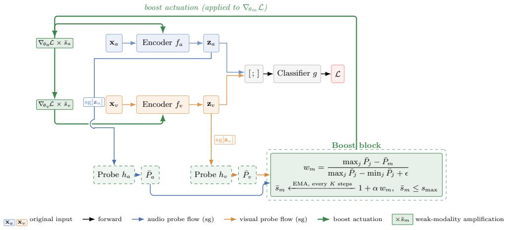  
Figure 1: An Illustration of probe-guided gradient boosting on 2 modalities. Forward path (top): features $\mathbf { z } _ { m }$ are concatenated and classified via the shared fusion classifier $^ { g , }$ producing L. Probe monitoring (bottom): stop-gradient features $\mathrm { s g } [ \mathbf { z } _ { m } ]$ are evaluated by linear probes along solid per-modality probe-flow lines (audio in blue, visual in orange), yielding per-modality accuracies $\bar { P } _ { m }$ The boost block computes the relative-gap weight $w _ { m }$ and a smoothed scale $\bar { s } _ { m }$ (EMA-smoothed, refreshed only at probe-evaluation events every $K$ steps and held constant in between), clipped at $s _ { \mathrm { m a x } }$ . The actuation rail (thick green) applies $\bar { s } _ { m }$ to the per-modality gradient $\nabla _ { { \boldsymbol { \theta } } _ { m } } { \mathcal { L } }$ . Probes never backpropagate into encoders, so the monitoring signal is structurally decoupled from the fusion objective.

The term $\partial \mathcal { L } _ { \mathrm { f u s i o n } } / \partial g$ is shared across all modalities, since all encoder outputs flow through the same fusion head. This shared dependency is the root of coupled monitoring failure: when one modality (say m=1) converges faster and begins to dominate the head’s outputs, $\partial \mathcal { L } _ { \mathrm { f u s i o n } } / \partial g$ increasingly reflects the dominant modality’s contribution. Any monitoring signal derived from ${ \mathcal { L } } _ { \mathrm { f u s i o n } }$ or its gradients, including the discrepancy ratio used by OGM-GE [25] and the auxiliary classifier losses used by CGGM [14], inherits this bias.

## 3.2 Decoupled probe monitoring

We attach a lightweight linear probe classifier $h _ { m } \colon \mathbb { R } ^ { d } \to  { \mathbb { R } } ^ { C }$ (with C outputs) to each encoder, parameterized by $\psi _ { m }$ . The resulting probe accuracies define an imbalance signal, the utilization gap (Eq. (6)), independent of the joint training objective. The probes are trained on stop-gradient features $\mathrm { s g } [ \mathbf { z } _ { m } ]$ , where $\mathrm { s g } [ \cdot ]$ denotes the stop-gradient operator [28] (identity at the forward pass, zero partial derivatives at the backward pass):

$$
\mathcal { L } _ { \mathrm { p r o b e } , m } = \ell _ { \mathrm { p r o b e } } \bigl ( h _ { m } ( \mathrm { s g } [ \mathbf { z } _ { m } ] ; \psi _ { m } ) , y \bigr ) .\tag{4}
$$

Each probe has its own optimizer that updates only $\psi _ { m }$ , and no gradient flows into $\theta _ { m }$ . Since sg $\left[ \mathbf { z } _ { m } \right]$ halts backward propagation at the feature level, $\mathcal { L } _ { \mathrm { p r o b e } , m }$ depends only on the quality of $\mathbf { z } _ { m }$ as a representation, not on how it contributes through g. This is precisely why decoupling matters: the probe accuracy $P _ { m }$ reflects the representation quality of $\mathbf { z } _ { m }$ alone, independent of the weight that the fusion classifier g assigns to modality $m$

Split-batch evaluation and on-the-fly estimation. Every K training iterations, we partition the (shuffled) mini-batch into two disjoint halves, training probes on the first half and evaluating on the second. This yields an unbiased estimate $P _ { m }$ of the current probe’s training-distribution accuracy (conditioned on $\psi _ { m } ^ { ( t ) } )$ , the evaluation half is held out from probe training and drawn i.i.d. from the training distribution. To convert this per-evaluation sample into a stable estimator, we accumulate an exponential moving average (EMA):

$$
\bar { P } _ { m } \gets \beta \cdot P _ { m } + ( 1 - \beta ) \cdot \bar { P } _ { m } ,\tag{5}
$$

where $\beta \in [ 0 , 1 ]$ is the smoothing coefficient. The EMA acts as a first-order low-pass filter on the probe signal, attenuating batch-to-batch fluctuation while tracking sustained changes in utilization.

At $\beta = 0 . 1 ( \ S 4 . 1 )$ , the steady-state variance is $\beta / ( 2 - \beta ) \sigma ^ { 2 } \approx 0 . 0 5 3 \sigma ^ { 2 }$ under an i.i.d. assumption with per-sample variance $\sigma ^ { 2 }$ , approximately 19× smaller than a single-batch estimate. The utilization gap is the spread of smoothed probe accuracies:

$$
\delta = \operatorname* { m a x } _ { m } \bar { P } _ { m } - \operatorname* { m i n } _ { m } \bar { P } _ { m } .\tag{6}
$$

Appendix B.9 verifies empirically that the EMA estimator substantially reduces mini-batch noise in the probe signal during training.

## 3.3 Probe-guided gradient boosting

Given the EMA-smoothed probe accuracies $\{ \bar { P } _ { m } \} _ { m = 1 } ^ { M } ( \mathrm { E q . } ( 5 ) )$ , we compute a per-modality boost scale that amplifies the gradients of weaker encoders (full pseudocode in Appendix A.1, Algorithm 1). The procedure involves three steps.

Step 1: Relative weakness. For each modality $m ,$ , we compute a normalized weakness score $w _ { m } \in [ 0 , 1 ]$ (zero for the strongest modality, one for the weakest):

$$
w _ { m } = \frac { \operatorname* { m a x } _ { j } \bar { P } _ { j } - \bar { P } _ { m } } { \operatorname* { m a x } _ { j } \bar { P } _ { j } - \operatorname* { m i n } _ { j } \bar { P } _ { j } + \epsilon } ,\tag{7}
$$

where $j$ ranges over all modalities $\{ 1 , \ldots , M \}$ , and ϵ is a small positive constant serving as a numerical guard against division by zero.

Step 2: Boost scale. $w _ { m }$ is converted to a multiplicative scaling factor:

$$
s _ { m } = \operatorname* { m i n } ( 1 + \alpha \cdot w _ { m } , \ s _ { \operatorname* { m a x } } ) ,\tag{8}
$$

where $\alpha > 0$ controls the boost strength and $s _ { \operatorname* { m a x } } > 1$ caps the maximum amplification to prevent extreme scaling. When modalities are balanced (δ small), weakness scores become near zero and $s _ { m } \approx 1$ , so the method applies no intervention (Proposition 2 gives the precise continuity bound). At exact balance all $\bar { P } _ { j }$ coincide, so the numerator of Eq. (7) vanishes, the denominator equals $\epsilon > 0$ and $s _ { m } = 1$ exactly.

Step 3: Smoothing and gradient modification. To avoid abrupt changes in the boost signal, we apply temporal smoothing to the scales. We use a separate exponential moving average (EMA), distinct from the probe-accuracy EMA in Eq. (5), though our analysis (Propositions 2 and 3) is stated specifically for this EMA:

$$
\bar { s } _ { m } \gets \mu \cdot s _ { m } + ( 1 - \mu ) \cdot \bar { s } _ { m } ,\tag{9}
$$

where $\mu \in ( 0 , 1 )$ is the EMA smoothing coefficient on the boost scales. The smoothed scales are applied to the encoder gradients after the backward pass and before the optimizer step:

$$
\frac { \partial \mathcal { L } } { \partial \theta _ { m } }  \bar { s } _ { m } \cdot \frac { \partial \mathcal { L } } { \partial \theta _ { m } } .\tag{10}
$$

## 3.4 Composability with gradient throttling

Because PGGB amplifies weaker modalities without modifying the dominant modality’s gradient, it is mechanistically compatible with synchronous balancing methods such as gradient throttling, loss reweighting, and Pareto rescaling, with the empirical magnitude of the compound gain depending on the specific base method (Section 4.2, Appendix B.11). The main experiments compose with OGM-GE [25], and Appendix B.11 validates composition with four additional methods.

OGM-GE damps the dominant modality’s gradient by a coupled signal (inter-modal gradientmagnitude ratio $\rho$ derived from ${ \mathcal { L } } _ { \mathrm { f u s i o n } } )$ , whereas our boost uses a decoupled signal (probe accuracy on stop-gradient features $\mathrm { s g } [ \mathbf { z } _ { m } ] ,$ ). The two mechanisms compose multiplicatively on encoder gradients:

$$
\frac { \partial \mathcal { L } } { \partial \theta _ { m } } \gets \bar { s } _ { m } \cdot \omega _ { m } ^ { \mathrm { { o g m } } } \cdot \frac { \partial \mathcal { L } } { \partial \theta _ { m } } ,\tag{11}
$$

where $\omega _ { m } ^ { \mathrm { o g m } } \leq 1$ is the OGM-GE throttle and $\bar { s } _ { m } \ge 1$ is our boost scale.

Following established practice for auxiliary unimodal supervision [14], we optionally include unimodal auxiliary losses, yielding the total objective

$$
\mathcal { L } = \mathcal { L } _ { \mathrm { f u s i o n } } + \gamma \sum _ { m = 1 } ^ { M } \ell _ { \mathrm { a u x } } \bigl ( g _ { m } ( \mathbf { z } _ { m } ) , y \bigr ) ,\tag{12}
$$

where $\gamma$ is a scalar weight on the per-modality auxiliary terms (set in Section 4). $\ell _ { \mathrm { a u x } }$ matches the form of $\ell \left( \mathrm { E q . } \left( 2 \right) \right)$ for each benchmark.

## 3.5 Safety properties

We establish three safety properties: bounded scaling, self-attenuation, and a standard-SGD descent bound. These are structural guarantees that the method does not diverge or harm low-imbalance training, not mechanism-specific convergence results. A rate-level analysis tying gap closure to probe dynamics is left for future work. Full proofs are in Appendix A.

Assumption 1 (Smoothness). The loss $\mathcal { L } ( \boldsymbol { \theta } )$ is L-smooth: $\| \nabla \mathcal { L } ( \theta ) - \nabla \mathcal { L } ( \theta ^ { \prime } ) \| \leq L \| \theta - \theta ^ { \prime } \|$ for all $\theta , \theta ^ { \prime }$

Assumption 2 (Bounded variance). The stochastic gradient ${ \bf g } ( \boldsymbol { \theta } )$ satisfies $\mathbb { E } [ { \bf g } ( \boldsymbol { \theta } ) ] = \nabla \mathcal { L } ( \boldsymbol { \theta } )$ and $\mathbb { E } [ \| \mathbf { g } ( \boldsymbol { \theta } ) - \nabla \mathcal { L } ( \boldsymbol { \theta } ) \| ^ { 2 } ] \leq \sigma ^ { 2 }$ for all θ.

Proposition 1 (Bounded scaling). For all modalities m and all iterations t, the smoothed boost scale satisfies $\bar { s } _ { m } ^ { ( t ) } \in [ 1 , s _ { \operatorname* { m a x } } ]$

Proposition ${ \bf 2 } \left( { \bf S e l f } \right.$ -attenuation). For any $\Delta \geq 0$ , ifthe smoothed probe accuracies are ∆-balanced (maxj P¯j − minj $\bar { P } _ { j } \leq \Delta )$ at iteration $t ,$ then each modality’s instantaneous boost scale satisfies $| s _ { m } ^ { ( t ) } - 1 | \leq \alpha \Delta / ( \Delta + \epsilon )$ , and the EMA-smoothed scale converges geometrically to unity at rate $( 1 - \mu )$ as long as this condition persists.

Proposition 3 (Descent bound). Under Assumptions 1 and 2, SGD with PGGB and constant learning rate $\eta \leq 1 / ( L \cdot s _ { \operatorname* { m a x } } ^ { 2 } )$ satisfies

$$
\frac { 1 } { T } \sum _ { t = 0 } ^ { T - 1 } \mathbb { E } \big [ \| \nabla \mathcal { L } ( \theta _ { t } ) \| ^ { 2 } \big ] \ \leq \ \frac { 2 \Delta _ { \mathcal { L } } } { \eta T } \ + \ L \eta s _ { \operatorname* { m a x } } ^ { 2 } \sigma ^ { 2 } ,\tag{13}
$$

where $\Delta _ { \mathcal { L } } = \mathcal { L } ( \theta _ { 0 } ) - \mathcal { L } ^ { * }$ is the initial optimality gap and $\mathcal { L } ^ { \ast }$ is a lower bound on ${ \mathcal { L } } .$

The bound matches the standard nonconvex SGD rate [12] up to an $s _ { \mathrm { m a x } } ^ { 2 }$ factor in the variance term, a controlled increase $( s _ { \mathrm { m a x } } = 2 )$ , and Proposition 2 ensures this cost is incurred only when imbalance is present. The smoothness constant L in Assumption 1 is loss-dependent, determined by the choice of ℓ in Eq. (2); in our experiments, the per-task learning rate (Section 4) is selected consistent with the descent inequality for the corresponding ℓ.

Scope in the high-imbalance regime. Proposition 3 is uniform in the imbalance level: it holds for any utilization gap, provided the step size satisfies $\eta \leq 1 / ( L s _ { \operatorname* { m a x } } ^ { 2 } )$ . What limits its reach is the optimizer rather than the imbalance, since the proof assumes SGD. On high-imbalance benchmarks trained with SGD, the guarantee is therefore that PGGB preserves standard descent with gradient variance inflated by at most $s _ { \mathrm { m a x } } ^ { 2 } = 4$ . The sentiment and text-image benchmarks are trained with Adam (Section 4) and fall outside this assumption, so our claims there rest on the measured results alone. Proposition 2 is the complementary guarantee at the balanced end, bounding the intervention by $| s _ { m } - 1 | \leq \alpha \Delta / ( \Delta + \epsilon )$ , which tightens as the gap shrinks and gives $s _ { m } = 1$ exactly at exact balance. For diagnosis, the operating-conditions analysis (Section 4.3.1) identifies the regime in which composition becomes harmful, a thin data budget together with weak inherent asymmetry, and localizes the failure to the throttling component rather than to the boost. The monitored quantities δ and $\bar { s } _ { m }$ can be logged during training as an early caution, since a small dominance gap signals that composing with throttling is not warranted, and an automated criterion for this decision remains future work.

## 4 Experiments

## 4.1 Experimental setup

Datasets. We evaluate PGGB on eight benchmarks spanning three tasks and 2–4 modalities, reported as mean ± std over five seeds. Audio-visual and text-image benchmarks use two modalities, sentiment three (text, audio, vision), and BraTS 2021 four MRI sequences. Audio-visual: CREMA-D [6] (3- frame at 3 fps), AVE [27], Kinetics-Sounds (KS) [2]. Sentiment: CH-SIMS [41], CMU-MOSI [42]. Text-image: Twitter15 [39, 43], Sarcasm [5]. Segmentation: BraTS 2021 [3]. Encoders follow task grouping (ResNet-18 for audio-visual, MLPs on pre-extracted features for sentiment and text-image, DeepLab v3+/ResNet-101 for BraTS), with splits and caveats in Appendix B. We assume each modality is task-relevant, consistent with these benchmarks’ established multimodal use; PGGB does not validate relevance and would amplify a noise-only modality if one were present.

Baselines. We compare experiment results against eight methods: Baseline (joint training, no balancing), OGM-GE [25] (discrepancy-ratio gradient throttling), MMPareto [33] (Pareto-optimal gradient weights), AGM [21] (Shapley-based adaptive gradient modulation), G-Blend [29] (OG-ratio loss weighting), CGGM [14] (classifier-guided magnitude/direction modulation2), InfoReg [16] (unimodal information regularization), and MILES [13] (per-modality learning-rate adjustment). InfoReg and MILES are evaluated on CREMA-D only, as their official implementations target audiovisual classification. MMPareto, AGM, and G-Blend are evaluated on all classification benchmarks but not on BraTS 2021, as their official implementations target classification losses and do not support dense-prediction multi-class Dice objectives out of the box.

Reproduction protocol. All baselines are re-run under a matched pipeline (shared encoders, 3-frame CREMA-D, identical augmentation and optimizer) for fair comparison. OGM-GE (69.14%) is 3–6 pp below the 72–75% in follow-up work using different frame sampling, AGM (57.42%) uses our ResNet-18 rather than its original backbone, MILES is ported to our matched ResNet-18 pipeline from its specialized backbone, and CGGM from its Transformer setting. Sub-baseline AGM/MILES numbers plausibly reflect 3-frame protocol sensitivity, and published configurations are retained without retuning.

Implementation details. Classification uses concatenation fusion, batch size 64, 100 epochs. Audiovisual datasets use SGD (learning rate 0.001, weight decay $1 0 ^ { - 4 } )$ with StepLR, sentiment and text-image use Adam (learning rate 0.001) with StepLR (step 40), and BraTS uses SGD with cosine scheduling (base learning rate 0.01, 5-epoch warmup) and batch size 12. PGGB uses identical hyperparameters across all datasets: K=20, β=0.1, µ=0.3, smax=2.0, γ=1.0, and $\alpha \in \{ 0 . 5 , 0 . 7 5 \}$ for the standalone and OGM-GE-combined variants respectively. Probes are trained with Adam (learning rate $1 0 ^ { - 3 } )$ .

Computational overhead. Each linear probe $h _ { m } \colon  { \mathbb { R } } ^ { d } \to  { \mathbb { R } } ^ { C }$ adds at most a few thousand parameters per modality, negligible relative to the encoders (e.g., ResNet-18 at ∼11M parameters). Probe training every K=20 iterations on a half mini-batch and the multiplicative gradient scaling at the optimizer step together add approximately 1% wall-clock overhead relative to the baseline. The EMA state $\{ \bar { P _ { m } } , \bar { s _ { m } } \}$ requires O(M) additional scalars.

Imbalance categorization. We categorize benchmarks by the utilization gap δ (Eq. (6)) measured during baseline training, with per-dataset values in Appendix B.15: high-imbalance $( \delta > 0 . 1 5$ CREMA-D, CMU-MOSI, CH-SIMS) and low-imbalance $( \delta \leq 0 . 1 5 $ , AVE, KS, Twitter15, Sarcasm). Here δ is the final-epoch EMA-smoothed probe-accuracy gap under baseline training with no intervention, averaged over five seeds, rather than a statistic over the full training trajectory, and it is measured on the seven classification benchmarks. The threshold is not tuned. Sorting the measured values gives AVE 0.017, KS 0.038, Sarcasm 0.076, Twitter15 0.150, CH-SIMS 0.178, CMU-MOSI 0.222, and CREMA-D 0.268, with no benchmark falling between 0.150 and 0.178, so every threshold in that interval produces the identical categorization and no result depends on the specific value 0.15. Because δ is measured on baseline training alone, before any method is applied, the categorization is fixed independently of any method’s results. Twitter15 $( \mathrm { { \dot { 0 } } . 1 5 0 \pm 0 . 0 9 \mathrm { { \dot { 6 } } ) } }$ and CH-SIMS $( 0 . 1 7 8 \pm 0 . 0 8 6 )$ lie closest to the threshold and carry the largest seed variances, so we flag both as boundary cases. BraTS 2021 is reported separately as a dense-prediction segmentation benchmark. The high-imbalance group is heterogeneous in source: CREMA-D imbalance arises from audio-dominance in emotion recognition [25], whereas CMU-MOSI/CH-SIMS imbalance reflects text-sufficiency, with text-only baselines within roughly 1 pp of multimodal accuracy on CH-SIMS [22] and only a +2.7 pp multimodal gain on CMU-MOSI [31]. On these text-dominant benchmarks, balancing methods report only modest absolute gains [14, 34], motivating within-seedstd competitiveness as the relevant metric.

Table 1: Main results across eight benchmarks. We report accuracy (%) for classification datasets and average Dice (%) for BraTS 2021. All values are mean ± std over 5 seeds. Bold indicates the best result per dataset. Imbalance categorization is described in Section 4.1. Baseline denotes joint training with unmodified gradients, not a published OGM-GE result. All methods are re-run under the matched pipeline of Section 4.1, in which CREMA-D uses 3 frames. OGM-GE’s published 1-frame CREMA-D result (61.9%) [25] is reproduced at 62.47 ± 1.42% in Table 2.
<table><tr><td>Method</td><td>CREMA-D</td><td>AVE</td><td>KS</td><td>CMU-MOSI</td><td>Twitter15</td><td>Sarcasm</td><td>CH-SIMS</td><td>BraTS 2021</td></tr><tr><td>Baseline</td><td>61.59±0.80</td><td>86.54±0.42</td><td>79.05±0.40</td><td>72.42±0.48</td><td>66.60±0.57</td><td>82.40±0.17</td><td>70.42±0.29</td><td> $8 5 . 7 7 { \scriptstyle \pm 0 . 6 2 }$ </td></tr><tr><td>OGM-GE</td><td>69.14±1.13</td><td>86.96±0.71</td><td>77.25±0.79</td><td>72.68±0.89</td><td>66.33±0.21</td><td>81.81±0.23</td><td>72.47±0.70</td><td>86.21±0.17</td></tr><tr><td>MMPareto</td><td>65.51±0.87</td><td>86.37±0.33</td><td>78.21±0.38</td><td>72.68±0.79</td><td>66.81±0.47</td><td>82.27±0.12</td><td>70.20±0.71</td><td></td></tr><tr><td>AGM</td><td>57.42±0.73</td><td>84.42±0.26</td><td>77.85±0.30</td><td>72.50±0.62</td><td>66.79±0.47</td><td>82.32±0.16</td><td>69.28±0.67</td><td></td></tr><tr><td>G-Blend</td><td>61.10±1.87</td><td>87.09±0.29</td><td>77.75±1.13</td><td>72.36±0.66</td><td>66.66±0.57</td><td>82.35±0.26</td><td>70.15±0.66</td><td></td></tr><tr><td>CGGM</td><td>50.22±1.39</td><td>76.72±0.42</td><td>73.18±0.27</td><td>59.45±0.36</td><td>62.41±0.36</td><td>80.71±0.27</td><td>68.05±0.46</td><td>81.13±1.34</td></tr><tr><td>InfoReg</td><td>67.72±0.83</td><td></td><td></td><td></td><td></td><td></td><td></td><td></td></tr><tr><td>PGGB (α=0.5)</td><td> $6 2 . 7 2 { \scriptstyle \pm 1 . 6 5 }$ </td><td> $\mathbf { 8 7 . 4 1 { \scriptstyle \pm 0 . 2 6 } }$ </td><td> ${ \bf 7 9 . 1 7 { \scriptstyle \pm 0 . 9 7 } }$ </td><td> $7 1 . 8 9 { \scriptstyle \pm 0 . 8 2 }$ </td><td> ${ \bf 6 6 . 8 5 } \pm 0 . 5 0 $ </td><td> $8 2 . 4 4 { \scriptstyle \pm 0 . 3 5 }$ </td><td> $6 9 . 8 0 { \scriptstyle \pm 0 . 8 0 }$ </td><td> $8 5 . 9 8 { \pm } 1 . 1 5$ </td></tr><tr><td>PGGB+OGM-GE  $\scriptstyle ( \alpha = 0 . 7 5 )$ </td><td> ${ \bf 7 1 . 4 5 } \pm 1 . 7 1$ </td><td> $8 7 . 2 3 { \scriptstyle \pm 0 . 5 8 }$ </td><td> $7 7 . 3 3 { \scriptstyle \pm 0 . 6 4 }$ </td><td> $7 2 . 6 0 { \scriptstyle \pm 0 . 9 4 }$ </td><td> $6 6 . 5 9 { \scriptstyle \pm 0 . 5 1 }$ </td><td> $8 1 . 7 6 { \scriptstyle \pm 0 . 0 8 }$ </td><td> $7 2 . 4 3 { \scriptstyle \pm 0 . 6 5 }$ </td><td> $\mathbf { 8 6 . 4 9 } 2 \pm 0 . 2 1$ </td></tr></table>

## 4.2 Main results

Table 1 reports results across eight benchmarks. On high-imbalance CREMA-D, PGGB+OGM-GE attains 71.45%, +2.31 pp over OGM-GE and +9.86 pp over baseline, the best among competitors. A three-way decomposition in §4.3 isolates this gain to the boost actuation, with the decoupled monitor causally inert at $\alpha { = } 0$ . PGGB alone (+1.13 pp) is insufficient under severe imbalance, confirming that two-sided intervention is required. On the four low-imbalance benchmarks (AVE, KS, Twitter15, Sarcasm, with cross-class MSLR comparison in Appendix B.17), PGGB alone is the best-performing method on all four, whereas OGM-GE often regresses (KS −1.80 pp, Twitter15 −0.27 pp, Sarcasm −0.59 pp), consistent with self-attenuation as δ → 0 (§3.3). On the high-imbalance text-dominant sentiment benchmarks (CMU-MOSI, CH-SIMS), where text alone is near-multimodally sufficient and prior balancing methods report only modest absolute gains [22, 31], PGGB+OGM-GE remains within seed standard deviation of the strongest baseline (MOSI −0.08 pp, CH-SIMS −0.04 pp). On BraTS 2021 (DeepLab $\mathrm { v } 3 \mathrm { + } / \mathrm { R e s N e t - } 1 0 1$ , Dice loss), PGGB+OGM-GE yields 86.49% Dice (+0.72 pp), extending the mechanism to dense prediction. The composability claim further extends on AVE to two of four non-OGM-GE methods tested (Appendix B.11). A comparison against OPM [34], whose single-layer-fusion dependency requires a separate protocol, is in Appendix B.2.

## 4.3 Ablation studies

We ablate on CREMA-D with single-frame visual input, which widens the modality gap and amplifies method differences (Table 2).

Table 2: Ablation on CREMA-D (1-frame). Accuracy (%), mean ± std over 5 seeds. The upper row reports the baseline. Lower rows isolate single-mechanism interventions (boost only, OGM-GE only) and their combinations.
<table><tr><td>Method</td><td>Accuracy (%)</td></tr><tr><td>Baseline</td><td> $6 0 . 3 0 { \scriptstyle \pm 0 . 7 0 }$ </td></tr><tr><td>PGGB  $( \alpha { = } 0 . 5 )$ </td><td> $6 0 . 4 6 { \scriptstyle \pm 0 . 8 5 }$ </td></tr><tr><td> $\operatorname { O G M - G E } \operatorname { o n l y }$ </td><td> $6 2 . 4 7 { \scriptstyle \pm 1 . 4 2 }$ </td></tr><tr><td> $\mathrm { P G G B + O G M \mathrm { - } G E } \left( \alpha { = } 0 . 5 \right)$ </td><td> $6 2 . 3 7 { \scriptstyle \pm 0 . 5 7 }$ </td></tr><tr><td> $\mathrm { P G G B + O G M \mathrm { - } G E } \ ( \alpha { = } 0 . 7 5 )$ </td><td> ${ \bf 6 2 . 6 9 } \pm \mathrm { 0 . 2 2 }$ </td></tr></table>

Among single-mechanism interventions, OGM-GE alone yields +2.17 pp versus PGGB alone +0.16 pp, consistent with prior findings that throttling is the more impactful individual intervention [34]. Combining PGGB with OGM-GE at $\alpha { = } 0 . 7 5$ achieves the best result (62.69%) with a sixfold reduction in std (0.22% vs. 1.42%), indicating that decoupled probe monitoring provides a stabilizing signal complementing the noisier gradient-ratio throttling.

Isolating the monitor from the boost. We run three 5-seed decompositions on CREMA-D 3-frame (Table 1 protocol): (i) α=0 with probes active $( 6 9 . 1 4 \pm 1 . 1 3 \%$ , reported as OGM-GE alone in Table 1), (ii) an independent 5-seed replication of the same $\alpha { = } 0$ condition $( 6 9 . 1 4 \pm 1 . 1 8 \% )$ , and (iii) $\alpha { = } 0 . 7 5 \ : ( 7 1 . 4 5 \pm 1 . 7 1 \% )$ . Conditions (i) and (ii) are operationally identical (identical $\alpha ,$ identical probe pipeline) and yield the same mean within 0.00 pp, confirming estimate stability. The +2.31 pp lift at (iii) isolates boost actuation: it cannot be attributed to probe-pipeline side-effects matched across conditions (probe training on stop-gradient features, optimizer steps on probe parameters, and EMA state updates). Appendix B.12 extends this contrast to 15 seeds per arm, giving +1.60 pp with a confidence interval excluding zero. Only the multiplicative scale $s _ { m }$ differs between α=0 and $\alpha { = } 0 . 7 5$

## 4.3.1 Operating conditions ablation

A complementary question to which component drives the CREMA-D gain is when the method is effective. We characterize four regimes along three axes (feature learning, encoder initialization, data-to-architecture ratio) in Table 3 and Figure 2.

Table 3: Operating conditions across four regimes. Columns: trainable encoders, modality asymmetry (pretraining or LR differences), adequate data-to-architecture ratio, and complementary modalities. $\Delta \colon$ accuracy change (pp), PGGB+OGM-GE vs. baseline. Significance: $^ { * * * } p < 0 . 0 0 1$ (Welch’s t-test, 5 seeds per condition). AVE (from-scratch) is the clearest failure case $( - 4 . 5 6 ~ \mathsf { p p } )$ , with the pretrained↔scratch contrast localizing sensitivity to the OGM-GE component. Per-regime analysis in Appendix B.3.
<table><tr><td>Regime</td><td></td><td>Trainable Asymmetry</td><td>Adequate data</td><td>Compl.</td><td>Δ</td></tr><tr><td>CREMA-D</td><td>√</td><td>√</td><td>√</td><td>√</td><td> $+ 9 . 8 6 ^ { * * * }$ </td></tr><tr><td>AVE (pretrained)</td><td>√</td><td>√(pretrain)</td><td>√</td><td>√</td><td> $+ 0 . 6 9$ </td></tr><tr><td>AVE (from-scratch)</td><td>√</td><td>X</td><td> $\times \left( \sim 4 \mathrm { K } \right)$ </td><td>√</td><td> $- 4 . 5 6 ^ { * * * }$ </td></tr><tr><td>Food101 (frozen)</td><td>×</td><td></td><td>√</td><td>√</td><td>-1.64</td></tr></table>

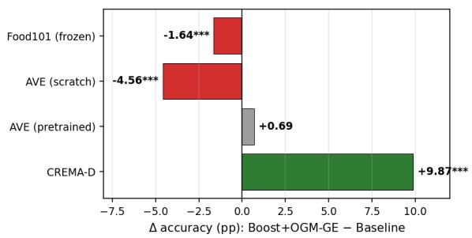

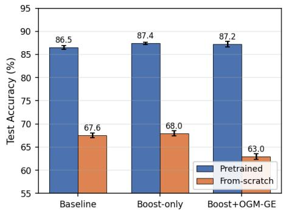  
(a) $\Delta$ accuracy (PGGB+OGM-GE vs. baseline) across four regimes.  
(b) AVE test accuracy: pretrained vs. fromscratch encoders.  
Figure 2: Operating-conditions ablation (5 seeds). (a) PGGB alone self-attenuates toward baseline when Table 3 conditions are violated, whereas PGGB+OGM-GE inherits OGM-GE’s regimedependent failure modes (AVE from-scratch is the clearest case). (b) With data and architecture fixed, flipping initialization from pretrained to random shifts PGGB+OGM-GE from +0.69 to −4.56 pp $\scriptstyle \left( p = 0 . 0 0 0 1 \right)$ while PGGB alone stays positive, localizing sensitivity to the OGM-GE component.

Encoder initialization and scope. Fixing dataset and architecture but varying encoder initialization gives the sharpest contrast (Figure 2b). PGGB alone stays positive in both regimes $( + 0 . 8 7 / + 0 . 4 2$ pp, both $p < 0 . 0 5 )$ , while PGGB+OGM-GE flips sign $( + 0 . 6 9  - 4 . 5 6 ~ \mathrm { p p } , \ - p { = } 0 . 0 0 0 1 )$ . ImageNet pretraining installs an asymmetry aligned with OGM-GE’s throttling assumption. Under from-scratch initialization both encoders are simultaneously under-trained on ∼4K samples, so suppressing either destabilizes the joint dynamic. This localizes the failure to the OGM-GE component (Appendix B.3).

## 4.4 Analysis

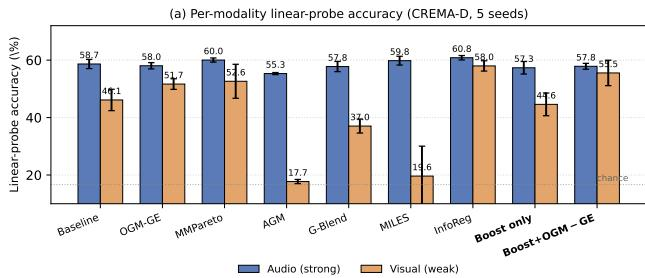

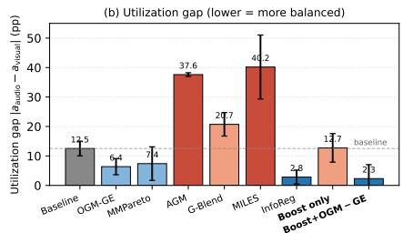  
Figure 3: Per-modality diagnostics on CREMA-D (5 seeds). (a) Post-hoc linear-probe accuracy $P _ { m } ^ { \mathrm { p o s t } }$ (Appendix B.13). Dotted line marks chance (1/6). AGM and MILES collapse the weak probe. (b) Utilization gap $| P _ { a } ^ { \mathrm { p o s t } } - P _ { v } ^ { \mathrm { p o s t } } |$ . PGGB+OGM-GE attains 2.31 pp (5.4× reduction vs. baseline gap). Error bars: ±1 std.

We probe per-modality utilization with linear classifiers trained on frozen encoder features. Post-hoc linear probes (Appendix B.13, Figure 3b) show PGGB+OGM-GE attains the smallest utilization gap (2.31 pp): the weak probe rises +9.41 pp, the strong falls only −0.81 pp, while AGM, MILES, and G-Blend degrade the weak probe. Extension to M modalities uses pairwise weakness (Eq. (7)).

## 5 Conclusion

We propose PGGB, a method for balanced multimodal learning that amplifies the contribution of weaker modalities while preserving stronger ones, composing naturally with existing throttling techniques. PGGB alone is the best-performing method on all four low-imbalance benchmarks. On high-imbalance CREMA-D, composition with OGM-GE yields +2.31 pp over the strongest baseline, and on the text-dominant sentiment benchmarks (CMU-MOSI, CH-SIMS) the same composition remains within seed standard deviation of the strongest baseline. On medical segmentation (BraTS 2021), it matches the strongest available baseline (+0.28 pp, within seed variance).

Limitations. Per-setting tuning is required, probes add small compute overhead, and composition with throttling can regress when the dominance gap is small (worst case AVE-from-scratch −4.56 pp, §4.3.1), a composition our propositions do not cover. Those propositions are safety properties: they bound the intervention and, under Proposition 3’s conditions, preserve standard descent at any imbalance level, but do not guarantee gap closure, which is established only empirically. The two benchmarks nearest the threshold, Twitter15 and CH-SIMS, carry the largest seed variances, so their categorization is provisional (Appendix B.16). Finally, PGGB does not distinguish undertrained modalities from intrinsically less task-informative ones: composition recovers the former (CREMA-D), whereas on the sentiment benchmarks the weak-modality representations are essentially unchanged (Appendix B.14), a diagnosis available only post hoc. Actuation is also optimizer-dependent: scaling reaches the updates under SGD, whereas Adam’s second-moment normalization absorbs most of it, so measured gains concentrate on the SGD pipelines (Appendix B.8), leaving optimizer-state-aware actuation to future work.

Future work. Probe-driven adaptive composition that engages throttling only when the dominance gap warrants, extension beyond classification and segmentation. The operating conditions of §4.3.1 should precede deployment.

## Acknowledgments and Disclosure of Funding

This work received no third-party funding. The authors declare no competing interests. No author holds a financial relationship of any kind that could be perceived to influence the work reported in this paper.

## References

[1] Guillaume Alain and Yoshua Bengio. Understanding intermediate layers using linear classifier probes. In International Conference on Learning Representations (Workshop), 2017.

[2] Relja Arandjelovic and Andrew Zisserman. Look, listen and learn. In´ Proceedings ofthe IEEE International Conference on Computer Vision, pages 609–617, 2017.

[3] Ujjwal Baid, Satyam Ghodasara, Suyash Mohan, Michel Bilello, Evan Calabrese, Errol Colak, Keyvan Farahani, Jayashree Kalpathy-Cramer, Felipe C Kitamura, Sarthak Pati, et al. The RSNA-ASNR-MICCAI BraTS 2021 benchmark on brain tumor segmentation and radiogenomic classification. arXiv preprint arXiv:2107.02314, 2021.

[4] Tadas Baltrušaitis, Chaitanya Ahuja, and Louis-Philippe Morency. Multimodal machine learning: A survey and taxonomy. IEEE Transactions on Pattern Analysis and Machine Intelligence, 41(2):423–443, 2019.

[5] Yitao Cai, Huiyu Cai, and Xiaojun Wan. Multi-modal sarcasm detection in Twitter with hierarchical fusion model. In Proceedings ofthe 57th Annual Meeting ofthe Associationfor Computational Linguistics, pages 2506–2515, 2019.

[6] Houwei Cao, David G Cooper, Michael K Keutmann, Ruben C Gur, Ani Nenkova, and Ragini Verma. Crema-d: Crowd-sourced emotional multimodal actors dataset. IEEE Transactions on Affective Computing, 5(4):377–390, 2014.

[7] Zhao Chen, Vijay Badrinarayanan, Chen-Yu Lee, and Andrew Rabinovich. Gradnorm: Gradient normalization for adaptive loss balancing in deep multitask networks. In Proceedings of the International Conference on Machine Learning, pages 794–803, 2018.

[8] Chenzhuang Du, Jiaye Teng, Tingle Li, Yichen Liu, Tianyuan Yuan, Yue Wang, Yang Yuan, and Hang Zhao. On uni-modal feature learning in supervised multi-modal learning. In Proceedings ofthe International Conference on Machine Learning, pages 8632–8656, 2023.

[9] Yunfeng Fan, Wenchao Xu, Haozhao Wang, Junxiao Wang, and Song Guo. Pmr: Prototypical modal rebalance for multimodal learning. In Proceedings of the IEEE/CVF Conference on Computer Vision and Pattern Recognition, 2023.

[10] Yunfeng Fan, Wenchao Xu, Haozhao Wang, Junhong Liu, and Song Guo. Detached and interactive multimodal learning. In Proceedings ofthe 32nd ACM International Conference on Multimedia, pages 5470–5478, 2024.

[11] Xiyuan Gao, Bing Cao, Pengfei Zhu, Nannan Wang, and Qinghua Hu. Asymmetric reinforcing against multi-modal representation bias. In Proceedings of the AAAI Conference on Artificial Intelligence, 2025.

[12] Saeed Ghadimi and Guanghui Lan. Stochastic first-and zeroth-order methods for nonconvex stochastic programming. SIAM Journal on Optimization, 23(4):2341–2368, 2013.

[13] Alejandro Guerra-Manzanares and Farah E. Shamout. Modality-informed learning rate scheduling for balancing multimodal learning. In International Joint Conference on Neural Networks, 2025.

[14] Zirun Guo, Tao Jin, and Zhou Zhao. Classifier-guided gradient modulation for enhanced multimodal learning. In Advances in Neural Information Processing Systems, 2024.

[15] Cong Hua, Qianqian Xu, Shilong Bao, Zhiyong Yang, and Qingming Huang. Reconboost: Boosting can achieve modality reconcilement. In Proceedings of the International Conference on Machine Learning, 2024.

[16] Chengxiang Huang, Yake Wei, Zequn Yang, and Di Hu. Adaptive unimodal regulation for balanced multimodal information acquisition. In Proceedings of the IEEE/CVF Conference on Computer Vision and Pattern Recognition, 2025.

[17] Yu Huang, Chenzhuang Du, Zihui Xue, Xuanyao Chen, Hang Zhao, and Longbo Huang. What makes multi-modal learning better than single (provably). In Advances in Neural Information Processing Systems, volume 34, pages 10944–10956, 2021.

[18] Yu Huang, Junyang Lin, Chang Zhou, Hongxia Yang, and Longbo Huang. Modality competition: What makes joint training of multi-modal network fail in deep learning?(provably). In International conference on machine learning, pages 9226–9259. PMLR, 2022.

[19] Qing-Yuan Jiang, Longfei Huang, and Yang Yang. Rethinking multimodal learning from the perspective of mitigating classification ability disproportion. In Advances in Neural Information Processing Systems, 2025.

[20] Konstantinos Kontras, Christos Chatzichristos, Matthew B. Blaschko, and Maarten De Vos. Improving multimodal learning with multi-loss gradient modulation. In British Machine Vision Conference, 2024.

[21] Hong Li, Xingyu Li, Pengbo Hu, Yinuo Lei, Chunxiao Li, and Yi Zhou. Boosting multi-modal model performance with adaptive gradient modulation. In Proceedings of the IEEE/CVF International Conference on Computer Vision, 2023.

[22] Yihe Liu, Ziqi Yuan, Huisheng Mao, Zhiyun Liang, Wanqiuyue Yang, Yuanzhe Qiu, Tie Cheng, Xiaoteng Li, Hua Xu, and Kai Gao. Make acoustic and visual cues matter: CH-SIMS v2.0 dataset and AV-Mixup consistent module. In Proceedings of the 2022 International Conference on Multimodal Interaction (ICMI), 2022.

[23] Xiaoyu Ma, Hao Chen, and Yongjian Deng. Improving multimodal learning balance and sufficiency through data remixing. arXiv preprint arXiv:2506.11550, 2025.

[24] Hossein R. Nowdeh, Jie Ji, Xiaolong Ma, and Fatemeh Afghah. Modality-aware SAM: Sharpness-aware-minimization driven gradient modulation for harmonized multimodal learning. arXiv preprint arXiv:2510.24919, 2025.

[25] Xiaokang Peng, Yake Wei, Andong Deng, Dong Wang, and Di Hu. Balanced multimodal learning via on-the-fly gradient modulation. In Proceedings of the IEEE/CVF Conference on Computer Vision and Pattern Recognition, pages 8238–8247, 2022.

[26] Antti Tarvainen and Harri Valpola. Mean teachers are better role models: Weight-averaged consistency targets improve semi-supervised deep learning results. In Advances in Neural Information Processing Systems, 2017.

[27] Yapeng Tian, Jing Shi, Bochen Li, Zhiyao Duan, and Chenliang Xu. Audio-visual event localization in unconstrained videos. In Proceedings of the European Conference on Computer Vision, pages 247–263, 2018.

[28] Aaron van den Oord, Oriol Vinyals, and Koray Kavukcuoglu. Neural discrete representation learning. In Advances in Neural Information Processing Systems, 2017.

[29] Weiyao Wang, Du Tran, and Matt Feiszli. What makes training multi-modal classification networks hard? In Proceedings ofthe IEEE/CVF Conference on Computer Vision and Pattern Recognition, pages 12695–12705, 2020.

[30] Xin Wang, Devinder Kumar, Nicolas Thome, Matthieu Cord, and Frédéric Precioso. Recipe recognition with large multimodal food dataset. In IEEE International Conference on Multimedia & Expo Workshops (ICMEW), pages 1–6. IEEE, 2015.

[31] Shicai Wei, Chunbo Luo, and Yang Luo. Boosting multimodal learning via disentangled gradient learning, 2025. arXiv:2507.10213.

[32] Shicai Wei, Chunbo Luo, and Yang Luo. Improving multimodal learning via imbalanced learning. In Proceedings of the IEEE/CVF International Conference on Computer Vision, pages 2250–2259, 2025.

[33] Yake Wei and Di Hu. Mmpareto: Boosting multimodal learning with innocent unimodal assistance. In Proceedings of the 41st International Conference on Machine Learning, volume 235 of Proceedings ofMachine Learning Research, pages 52559–52572. PMLR, 2024.

[34] Yake Wei, Di Hu, Henghui Du, and Ji-Rong Wen. On-the-fly modulation for balanced multimodal learning. IEEE Transactions on Pattern Analysis and Machine Intelligence, 2024.

[35] Yake Wei, Siwei Li, Ruoxuan Feng, and Di Hu. Diagnosing and re-learning for balanced multimodal learning. In European conference on computer vision, pages 71–86. Springer, 2024.

[36] Yang Yang, Xixian Wu, and Qing-Yuan Jiang. Towards equilibrium: An instantaneous probeand-rebalance multimodal learning approach. In Proceedings ofthe International Joint Conference on Artificial Intelligence, 2025.

[37] Yi-Lin Yao and Rada Mihalcea. Modality-specific learning rates for effective multimodal additive late-fusion. In Findings ofthe Associationfor Computational Linguistics: ACL 2022, 2022.

[38] Feng Yu, Xiangyu Wu, Yang Yang, and Jianfeng Lu. Multimodal classification via total correlation maximization. In International Conference on Learning Representations, 2026.

[39] Jianfei Yu and Jing Jiang. Adapting BERT for target-oriented multimodal sentiment classification. In Proceedings of the Twenty-Eighth International Joint Conference on Artificial Intelligence, pages 5408–5414, 2019.

[40] Tianhe Yu, Saurabh Kumar, Abhishek Gupta, Sergey Levine, Karol Hausman, and Chelsea Finn. Gradient surgery for multi-task learning. In Advances in Neural Information Processing Systems, volume 33, pages 5824–5836, 2020.

[41] Wenmeng Yu, Hua Xu, Fanyang Meng, Yilin Zhu, Yixiao Ma, Jiele Wu, Jiyun Zou, and Kaicheng Yang. CH-SIMS: A Chinese multimodal sentiment analysis dataset with fine-grained annotation of modality. In Proceedings of the 58th Annual Meeting of the Association for Computational Linguistics, pages 3718–3727, 2020.

[42] Amir Zadeh, Rowan Zellers, Eli Pincus, and Louis-Philippe Morency. Mosi: multimodal corpus of sentiment intensity and subjectivity analysis in online opinion videos. arXiv preprint arXiv:1606.06259, 2016.

[43] Qi Zhang, Jinlan Fu, Xiaoyu Liu, and Xuanjing Huang. Adaptive co-attention network for named entity recognition in tweets. In Proceedings ofthe AAAI conference on artificial intelligence, volume 32, 2018.

[44] Xiaohui Zhang, Jaehong Yoon, Mohit Bansal, and Huaxiu Yao. Multimodal representation learning by alternating unimodal adaptation. In Proceedings of the IEEE/CVF Conference on Computer Vision and Pattern Recognition, 2024.

[45] Yedi Zhang, Peter E Latham, and Andrew M Saxe. Understanding unimodal bias in multimodal deep linear networks. In Proceedings of the 41st International Conference on Machine Learning, pages 57817–57850. PMLR, 2024.

## A Proofs of convergence properties

We restate and prove each proposition from Section 3.5. All notation follows the main text: $\mathcal { L }$ denotes the training loss, ${ \bf g } ( \boldsymbol { \theta } )$ a stochastic gradient, $\bar { s } _ { m }$ the EMA-smoothed boost scale for modality $m$ , and $s _ { \mathrm { m a x } }$ the scale cap.

Proposition 4 (Bounded scaling, restated). For all modalities m and all iterations $t \geq 0 ,$ , the smoothed boost scale satisfies $\bar { s } _ { m } ^ { ( t ) } \in [ 1 , s _ { \operatorname* { m a x } } ]$

Proof. We proceed by induction on t. At initialization, $\bar { s } _ { m } ^ { ( 0 ) } = 1 \in [ 1 , s _ { \operatorname* { m a x } } ] ,$ , establishing the base case.

For the inductive step, suppose $\bar { s } _ { m } ^ { ( t ) } \in [ 1 , s _ { \operatorname* { m a x } } ]$ . By Eq. (7), the weakness score satisfies $w _ { m } \in [ 0 , 1 ]$ since the numerator maxj $\bar { P } _ { j } - \bar { P } _ { m }$ lies in [0, maxj $\bar { P } _ { j } \mathrm { ~ - ~ } \operatorname* { m i n } _ { j } \bar { P } _ { j } ]$ and the denominator equals maxj $\bar { P } _ { j } - \operatorname* { m i n } _ { j } \bar { P } _ { j } + \epsilon .$ Substituting into Eq. (8):

$$
s _ { m } = \operatorname* { m i n } ( 1 + \alpha \cdot w _ { m } , \ s _ { \operatorname* { m a x } } ) \in [ 1 , s _ { \operatorname* { m a x } } ] ,
$$

since $w _ { m } \geq 0$ implies $1 + \alpha \cdot w _ { m } \geq 1$ , and the min operation enforces the upper bound.

$$
\bar { s } _ { m } ^ { ( t + 1 ) } = \mu \cdot s _ { m } + ( 1 - \mu ) \cdot \bar { s } _ { m } ^ { ( t ) } .
$$

Since $\mu \in \mathsf { \Gamma } ( 0 , 1 )$ , this is a convex combination of $s _ { m } \in [ 1 , s _ { \operatorname* { m a x } } ]$ and $\bar { s } _ { m } ^ { ( t ) } \in [ 1 , s _ { \operatorname* { m a x } } ]$ (by the inductive hypothesis), so $\bar { s } _ { m } ^ { ( t + 1 ) } \in [ 1 , s _ { \operatorname* { m a x } } ]$ □

Proposition 5 (Self-attenuation, restated). For any $\begin{array} { r } { \Delta \ge 0 , i f \operatorname* { m a x } _ { j } \bar { P } _ { j } ^ { ( t ) } - \operatorname* { m i n } _ { j } \bar { P } _ { j } ^ { ( t ) } \le \Delta } \end{array}$ at all iterations $t \geq t _ { 0 } ,$ , then

$I . | s _ { m } ^ { ( t ) } - 1 | \leq \alpha \cdot \Delta / ( \Delta + \epsilon )$ for all m and all $t \geq t _ { 0 }$ , and

$$
2 . ~ | \bar { s } _ { m } ^ { ( t ) } - 1 | \leq ( 1 - \mu ) ^ { t - t _ { 0 } } \cdot \left( s _ { \operatorname* { m a x } } - 1 \right) + \alpha \cdot \Delta / ( \Delta + \epsilon ) .
$$

In particular, when $\Delta \to 0$ we recover $s _ { m } = 1$ exactly, and the EMA-smoothed scale converges to unity at rate $( 1 - \mu )$

Proof. Let $\delta ^ { ( t ) } : = \operatorname* { m a x } _ { j } \bar { P } _ { j } ^ { ( t ) } - \operatorname* { m i n } _ { j } \bar { P } _ { j } ^ { ( t ) }$ . By assumption $\delta ^ { ( t ) } \leq \Delta$ for all $t \geq t _ { 0 }$ . From Eq. (7), the weakness score satisfies

$$
w _ { m } = \frac { \operatorname* { m a x } _ { j } \bar { P } _ { j } - \bar { P } _ { m } } { \operatorname* { m a x } _ { j } \bar { P } _ { j } - \operatorname* { m i n } _ { j } \bar { P } _ { j } + \epsilon } = \frac { \operatorname* { m a x } _ { j } \bar { P } _ { j } - \bar { P } _ { m } } { \delta + \epsilon } \leq \frac { \Delta } { \Delta + \epsilon } ,
$$

since the numerator is bounded by $\delta \leq \Delta$ and the denominator is non-decreasing in δ. Then by Eq. (8),

$$
\begin{array} { r } { s _ { m } = \operatorname* { m i n } ( 1 + \alpha w _ { m } , s _ { \operatorname* { m a x } } ) \in \big [ 1 , 1 + \alpha \cdot \frac { \Delta } { \Delta + \epsilon } \big ] , } \end{array}
$$

which gives part (1) immediately. For part (2), the EMA update $\left( \operatorname { E q . } \left( 9 \right) \right)$ is

$$
\bar { s } _ { m } ^ { ( t + 1 ) } - 1 = \mu ( s _ { m } ^ { ( t ) } - 1 ) + ( 1 - \mu ) ( \bar { s } _ { m } ^ { ( t ) } - 1 ) ,
$$

so by the triangle inequality and induction from $t _ { 0 }$

$$
\vert \bar { s } _ { m } ^ { ( t ) } - 1 \vert \leq ( 1 - \mu ) ^ { t - t _ { 0 } } \vert \bar { s } _ { m } ^ { ( t _ { 0 } ) } - 1 \vert + \mu \sum _ { k = 0 } ^ { t - t _ { 0 } - 1 } ( 1 - \mu ) ^ { k } \cdot \operatorname* { m a x } _ { t _ { 0 } \leq \tau < t } \vert s _ { m } ^ { ( \tau ) } - 1 \vert .
$$

Using $| \bar { s } _ { m } ^ { ( t _ { 0 } ) } - 1 | \leq s _ { \operatorname* { m a x } } - 1$ (Proposition 1), $| s _ { m } ^ { ( \tau ) } - 1 | \le \alpha \Delta / ( \Delta + \epsilon )$ , and the partial sum $\textstyle \mu \sum _ { k = 0 } ^ { t - t _ { 0 } - 1 } ( 1 - \mu ) ^ { k } = 1 - ( 1 - \mu ) ^ { t - t _ { 0 } } \leq 1$ , the bound follows. In the limit $\Delta \to 0$ the second term vanishes and the deviation decays geometrically at rate $( 1 - \mu )$ □

Proposition 6 (Convergence, restated). Under Assumptions 1 and 2, SGD with PGGB and constant learning rate $\eta \leq 1 / ( \hat { L } \cdot s _ { \mathrm { m a x } } ^ { 2 } )$ satisfies

$$
\frac { 1 } { T } \sum _ { t = 0 } ^ { T - 1 } \mathbb { E } \big [ \| \nabla \mathcal { L } ( \theta _ { t } ) \| ^ { 2 } \big ] \ \leq \ \frac { 2 \Delta _ { \mathcal { L } } } { \eta T } \ + \ L \eta s _ { \operatorname* { m a x } } ^ { 2 } \sigma ^ { 2 } ,
$$

where $\Delta _ { \mathcal { L } } = \mathcal { L } ( \theta _ { 0 } ) - \mathcal { L } ^ { * }$

Proof. Let $\tilde { \bf g } _ { t }$ denote the boosted stochastic gradient at iteration t. Concatenating over all modalityspecific parameter blocks, $\tilde { \bf g } _ { t }$ has block m equal to $\overline { { s } } _ { m } ^ { ( t ) } \cdot \mathbf { g } _ { m } ( \theta _ { t } )$ . The parameter update is $\theta _ { t + 1 } =$ $\theta _ { t } - \eta \tilde { \mathbf { g } } _ { t }$

Step 1: Descent lemma. By L-smoothness (Assumption 1):

$$
\mathcal { L } ( \boldsymbol { \theta } _ { t + 1 } ) \leq \mathcal { L } ( \boldsymbol { \theta } _ { t } ) - \eta \langle \nabla \mathcal { L } ( \boldsymbol { \theta } _ { t } ) , \tilde { \mathbf { g } } _ { t } \rangle + \frac { L \eta ^ { 2 } } { 2 } \| \tilde { \mathbf { g } } _ { t } \| ^ { 2 } .\tag{14}
$$

Step 2: Bounding the inner product. Taking expectations conditioned on $\theta _ { t }$ and using $\mathbb { E } [ \bar { \mathbf { g } _ { m } } ( \theta _ { t } ) ] = \nabla _ { \theta _ { m } } \breve { \mathcal { L } } ( \theta _ { t } )$

$$
\begin{array} { r l } & { \mathbb { E } \big [ \langle \nabla \mathcal { L } ( \theta _ { t } ) , \tilde { \mathbf { g } } _ { t } \rangle \big ] = \displaystyle \sum _ { m } \bar { s } _ { m } ^ { ( t ) } \cdot \| \nabla _ { \theta _ { m } } \mathcal { L } ( \theta _ { t } ) \| ^ { 2 } } \\ & { \qquad \quad \geq \displaystyle \sum _ { m } \| \nabla _ { \theta _ { m } } \mathcal { L } ( \theta _ { t } ) \| ^ { 2 } = \| \nabla \mathcal { L } ( \theta _ { t } ) \| ^ { 2 } , } \end{array}\tag{15}
$$

where the inequality follows from $\bar { s } _ { m } ^ { ( t ) } \geq 1$ (Proposition 1). Let $\mathcal { F } _ { t }$ denote the σ-algebra generated by $\big \{ \theta _ { 0 } , \dots , \theta _ { t } \big \}$ together with the probe parameters and their EMA state up to step t. By construction the probe parameters $\psi _ { m }$ are updated only on stop-gradient features $\mathrm { s g } [ \mathbf { z } _ { m } ]$ (no gradient path into θ), and the scale EMA $\bar { s } _ { m } ^ { ( t ) }$ is computed from probe-accuracy EMA values $\bar { P } _ { m }$ refreshed at iteration boundaries (every K steps). Since the boost scale $\bar { s } _ { m } ^ { ( t ) }$ applied at iteration t is the value most recently refreshed at the previous probe event (iteration $t ^ { \prime } < t$ with $t ^ { \prime } \equiv 0$ (mod $K ) )$ , it is $\mathcal { F } _ { t ^ { \prime } }$ -measurable and hence independent of the gradient noise at iteration t. Therefore $\bar { s } _ { m } ^ { ( t ) }$ is $\mathcal { F } _ { t ^ { - } }$ measurable, and conditioning on $\mathcal { F } _ { t }$ , the stochastic gradient $\mathbf { g } ( \theta _ { t } )$ is a fresh independent sample with $\mathbb { E } [ { \bf g } ( \theta _ { t } ) \mid \mathcal { F } _ { t } ] = \nabla \mathcal { L } ( \theta _ { t } )$ and variance bounded per Assumption 2.

Step 3: Bounding the second moment. By Proposition $1 , \bar { s } _ { m } ^ { ( t ) } \leq s _ { \operatorname* { m a x } }$ . Writing the stochasticgradient deviation over the block decomposition of parameters as $\mathbf { g } ( \theta _ { t } ) - \nabla \mathcal { L } ( \bar { \theta _ { t } } ) = ( \mathbf { g } _ { 1 } ( \theta _ { t } ) - \bar { \mathbf { \phi } }$ $\nabla _ { \boldsymbol { \theta } _ { 1 } } \mathcal { L } ( \boldsymbol { \theta } _ { t } ) , \ldots , \mathbf { g } _ { M } ( \boldsymbol { \theta } _ { t } ) - \nabla _ { \boldsymbol { \theta } _ { M } } \mathcal { L } ( \boldsymbol { \theta } _ { t } ) )$ , we have $\begin{array} { r } { \mathbb { E } [ \| \mathbf { g } - \nabla \mathcal { L } \| ^ { 2 } ] = \sum _ { m } \mathbb { E } [ \| \mathbf { g } _ { m } - \nabla _ { \theta _ { m } } \mathcal { L } \| ^ { 2 } ] = : } \end{array}$ $\textstyle \sum _ { m } \sigma _ { m } ^ { 2 }$ , so Assumption 2 is equivalent to $\textstyle \sum _ { m } \sigma _ { m } ^ { 2 } \leq \sigma ^ { 2 }$ . Using this block-additive decomposition:

$$
\begin{array} { r l } { \displaystyle \mathbb { E } \big [ \| \tilde { \mathbf { g } } _ { t } \| ^ { 2 } \big ] = \sum _ { m } ( \bar { s } _ { m } ^ { ( t ) } ) ^ { 2 } \cdot \mathbb { E } \big [ \| \mathbf { g } _ { m } ( \theta _ { t } ) \| ^ { 2 } \big ] } & { } \\ { \displaystyle \leq s _ { \operatorname* { m a x } } ^ { 2 } \sum _ { m } \big ( \sigma _ { m } ^ { 2 } + \| \nabla _ { \theta _ { m } } \mathcal { L } ( \theta _ { t } ) \| ^ { 2 } \big ) } & { } \\ { \displaystyle } & { \leq s _ { \operatorname* { m a x } } ^ { 2 } \big ( \sigma ^ { 2 } + \| \nabla \mathcal { L } ( \theta _ { t } ) \| ^ { 2 } \big ) , } \end{array}\tag{16}
$$

where $\textstyle \sigma ^ { 2 } \geq \sum _ { m } \sigma _ { m } ^ { 2 }$ is the total variance bound across modality blocks.

Step 4: Combining and telescoping. Substituting Eqs. (15) and (16) into Eq. (14) and taking full expectations:

$$
\mathbb { E } \left[ \mathcal { L } ( \theta _ { t + 1 } ) \right] \le \mathbb { E } \left[ \mathcal { L } ( \theta _ { t } ) \right] - \eta \mathbb { E } \left[ \| \nabla \mathcal { L } ( \theta _ { t } ) \| ^ { 2 } \right] + \frac { L \eta ^ { 2 } s _ { \operatorname* { m a x } } ^ { 2 } } { 2 } \big ( \sigma ^ { 2 } + \mathbb { E } \big [ \| \nabla \mathcal { L } ( \theta _ { t } ) \| ^ { 2 } \big ] \big ) .
$$

Rearranging and using the learning rate condition $\eta \leq 1 / ( L \cdot s _ { \operatorname* { m a x } } ^ { 2 } )$ : since $\eta \leq 1 / ( L \cdot s _ { \operatorname* { m a x } } ^ { 2 } )$ implies $L \eta s _ { \mathrm { m a x } } ^ { 2 } \le 1$ , hence $L \eta s _ { \mathrm { m a x } } ^ { 2 } / 2 \leq 1 / 2$ , which ensures $\begin{array} { r } { 1 - \frac { L \eta s _ { \mathrm { m a x } } ^ { 2 } } { 2 } \geq \frac { 1 } { 2 } } \end{array}$ :

$$
\frac { \eta } { 2 } \mathbb { E } \big [ \| \nabla \mathcal { L } ( \theta _ { t } ) \| ^ { 2 } \big ] \leq \mathbb { E } \big [ \mathcal { L } ( \theta _ { t } ) \big ] - \mathbb { E } \big [ \mathcal { L } ( \theta _ { t + 1 } ) \big ] + \frac { L \eta ^ { 2 } s _ { \operatorname* { m a x } } ^ { 2 } } { 2 } \sigma ^ { 2 } .
$$

Summing over $t = 0 , \ldots , T - 1$ and dividing by $T \colon$

$$
\frac { 1 } { T } \sum _ { t = 0 } ^ { T - 1 } \mathbb { E } \big [ \| \nabla \mathcal { L } ( \theta _ { t } ) \| ^ { 2 } \big ] \leq \frac { 2 ( \mathcal { L } ( \theta _ { 0 } ) - \mathbb { E } [ \mathcal { L } ( \theta _ { T } ) ] ) } { \eta T } + L \eta s _ { \operatorname* { m a x } } ^ { 2 } \sigma ^ { 2 } \leq \frac { 2 \Delta _ { \mathcal { L } } } { \eta T } + L \eta s _ { \operatorname* { m a x } } ^ { 2 } \sigma ^ { 2 } ,
$$

where $\Delta _ { \mathcal { L } } = \mathcal { L } ( \theta _ { 0 } ) - \mathcal { L } ^ { * }$ and the last inequality uses $\mathbb { E } [ \mathcal { L } ( \theta _ { T } ) ] \ge \mathcal { L } ^ { * }$

Interpretation. Setting $\eta = \Theta ( 1 / ( s _ { \mathrm { m a x } } \sqrt { T } ) )$ yields the rate $\mathcal { O } ( s _ { \operatorname* { m a x } } \cdot \sigma / \sqrt { T } + s _ { \operatorname* { m a x } } ^ { 2 } \cdot \Delta _ { \mathcal { L } } / T )$ . For the default $s _ { \operatorname* { m a x } } = 2 . 0 ,$ the effective variance increases by a factor of at most 4 relative to unmodified SGD. Proposition 2 guarantees that as modalities become ∆-balanced, the boost scales approach unity within $\alpha \Delta / ( \Delta + \epsilon )$ and this overhead vanishes in the limit $\Delta  0 ,$ recovering the standard SGD convergence rate [12] up to a constant variance inflation of at most $s _ { \mathrm { m a x } } ^ { 2 } .$ □

## A.1 Training algorithm pseudocode

Algorithm 1 below specifies the full training pass referenced in Section 3.3, making explicit how probe evaluation, weakness scoring, scale smoothing, and gradient boosting interleave with the forward and backward passes. The optional OGM-GE throttle line corresponds to the composition described in Section 3.4.

Algorithm 1 Probe-Guided Gradient Boosting (full training pass over D). Notation: $P _ { m }$ per-batch   
probe accuracy with smoothed estimate $\bar { P } _ { m } ;$ ϕ fusion-head parameters; $\mathrm { s g } [ \cdot ]$ stop-gradient operator   
(§3.2). Auxiliary-loss weight γ and optional OGM-GE throttle $\omega _ { m } ^ { \mathrm { o g m } } \leq 1$ are introduced in §3.4.   
Require: Training data $\mathcal { D } ,$ encoders $\lbrace f _ { m } \rbrace _ { m = 1 } ^ { M } .$ , fusion head $^ { g , }$ unimodal heads $\{ g _ { m } \}$ , probes $\left\{ h _ { m } \right\}$   
Require: Boost strength α, cap $s _ { \mathrm { m a x } } .$ , smoothing coefficients $\beta , \mu ,$ probe interval K   
Require: Optional: OGM-GE throttle module   
1: Initialize $\bar { P } _ { m } \gets 0 , \bar { s } _ { m } \gets 1$ for all m   
2: for each mini-batch $( \mathbf { x } , y ) \in \mathcal { D }$ do   
3: Forward: $\mathbf { z } _ { m } \gets f _ { m } ( \mathbf { \dot { x } } _ { m } ; \theta _ { m } )$ for all m   
4: Loss: $\begin{array} { r } { \mathcal { L } \gets \ell ( g ( [ \mathbf { \bar { z } } _ { 1 } ; \dots ; \mathbf { z } _ { M } ] ) , y ) + \gamma \sum _ { m } \ell _ { \mathrm { a u x } } ( g _ { m } ( \mathbf { z } _ { m } ) , y ) } \end{array}$   
5: Backward: compute $\partial \mathcal { L } / \partial \theta _ { m }$ for all m   
6: if OGM-GE enabled then   
7: Apply OGM-GE throttle: ${ \partial \mathcal { L } } / { \partial \theta _ { m } } \gets { \omega _ { m } ^ { \mathrm { { o g m } } } } \cdot { \partial \mathcal { L } } / { \partial \theta _ { m } }$   
8: end if   
9: if iteration mod $K = 0$ then   
10: Split $\left( \mathbf { x } , y \right)$ into train half $( \mathbf { x } ^ { \mathrm { { t r } } } , y ^ { \mathrm { { t r } } } )$ and eval half $( \mathbf { x } ^ { \mathrm { e v } } , y ^ { \mathrm { e v } } )$   
11: for each modality m do   
12: Train $h _ { m }$ on $( \mathbf { \dot { s g } } [ \mathbf { z } _ { m } ^ { \mathrm { t r } } ] , \mathbf { \nabla } y ^ { \mathrm { t r } } )$ with separate optimizer   
13: Evaluate: $P _ { m }  \bar { \mathrm { A c c } } ( \bar { h } _ { m } ( \mathrm { s g } [ \mathbf { z } _ { m } ^ { \mathrm { e v } } ] ) , y ^ { \mathrm { e v } } )$   
14: end for   
15: Update $\bar { P } _ { m } \gets \beta \cdot P _ { m } + ( 1 - \beta ) \cdot \bar { P } _ { m }$ for all m   
16: Compute $w _ { m }$ via Eq. $( 7 ) , s _ { m }$ via Eq. (8) for all m   
17: Update $\bar { s } _ { m } \gets \mu \cdot s _ { m } + ( 1 - \mu ) \cdot \bar { s } _ { m }$ for all m   
18: end if   
19: Boost: $\partial \mathcal { L } / \partial \theta _ { m } \gets \bar { s } _ { m } \cdot \partial \mathcal { L } / \partial \theta _ { m }$ for all m   
20: Optimizer step: update $\theta _ { m } , \phi ,$ , and $\{ g _ { m } \}$ parameters   
21: end for

## B Additional Experiments

## B.1 Datasets

CREMA-D: CREMA-D [6] is an audio-visual dataset designed for speech emotion recognition. It contains 7,442 video clips of 2–3 seconds from 91 actors speaking short scripted sentences, divided into $^ { 6 , 6 9 8 }$ training samples and 744 testing samples. The dataset covers six emotions: angry, happy, sad, neutral, disgust, and fear. We encode audio as log-mel spectrograms and visual as 3 RGB frames sampled at $3 \ \mathrm { f p s } ,$ passing both through ResNet-18 backbones trained from scratch. Available at https: $: / / \mathfrak { g } \dot { \bf 1 }$ thub.com/CheyneyComputerScience/CREMA-D.

AVE: AVE [27] is an audio-visual event classification dataset with 28 event categories, containing 4,143 10-second video clips. We use the standard split of 3,328 training and 402 testing clips. Audio spectrograms and 3 RGB frames are processed by ImageNet-pretrained ResNet-18 backbones with concatenation fusion. Available at https://sites.google.com/view/audiovisualresearch.

Kinetics-Sounds (KS): KS [2] is a curated 31-class subset of the Kinetics action-recognition dataset whose actions are both visually and audibly recognizable. It contains roughly 25,000 10-second YouTube clips, split into 22,408 training and 3,000 testing clips. Encoder setup follows AVE (ImageNet-pretrained ResNet-18 backbones on audio spectrograms and 3 RGB frames). Available at https://github.com/cvdfoundation/kinetics-dataset.

CH-SIMS: CH-SIMS [41] is a Mandarin Chinese language-audio-visual sentiment dataset of 2,281 video segments. It is divided into 1,368 training, 456 validation, and 457 testing samples. We use preextracted Chinese BERT-base (39×768) text, LibROSA (400×33) audio, and OpenFace 2.0 (55×709) visual features with the supplied 3-class sentiment labels (negative, neutral, positive). Features are z-score normalized per dimension and mean-pooled over the temporal axis before encoding. Each modality is processed by a two-layer MLP with 512-d hidden layer and dropout 0.3. Available through the MMSA (MultiModal Sentiment Analysis) toolkit at https://github.com/thuiar/MMSA.

CMU-MOSI: CMU-MOSI [42] is an English language-audio-visual sentiment dataset with the same three modalities as CH-SIMS. It is divided into 1,283 training, 214 validation, and 686 testing samples. We use pre-extracted GloVe (300-d) text, COVAREP (74-d) audio, and FACET (35-d) visual features, each as 50-step sequences, with continuous sentiment scores which we binarize at zero into 2-class labels (negative, positive). Features are mean-pooled over the temporal axis before encoding. Encoder architecture is identical to CH-SIMS. Available at https://github. com/CMU-MultiComp-Lab/CMU-MultimodalSDK.

Twitter15: Twitter15 [39, 43] is a text-image sentiment dataset of tweets with associated images, covering three classes (positive, neutral, negative). It is divided into 3,179 training pairs, 1,122 validation pairs, and 1,037 testing pairs. We use MLP heads on frozen BERT-base (768-d) text and ImageNet ResNet-18 (512-d) image features, so only the heads are trainable and gradient-balancing methods act on them. Available at https://github.com/jefferyYu/TomBERT.

Sarcasm: The MMSD-v1 sarcasm dataset [5] is a text-image binary sarcasm detection benchmark of 24,635 image-text pairs, divided into 19,816 training, 2,410 validation, and 2,409 testing pairs. Encoder setup is identical to Twitter15 (MLP heads on frozen BERT and ResNet-18 features). Available at https://github.com/headacheboy/data-of-multimodal-sarcasm-detection.

BraTS 2021: BraTS 2021 [3] is a multimodal brain tumor segmentation dataset with 4 MRI modalities (FLAIR, T1ce, T1, T2) and 4 voxel-level class labels (background and three tumor subregions). Because the official validation and test servers do not expose ground truth, we use a held-out partition of the public training set with 1,000 training, 125 validation, and 126 testing volumes. The architecture is DeepLab v3+ with four ResNet-101 encoders sharing a decoder, trained with Dice plus weighted cross-entropy loss. Probes perform binary tumor-presence classification because dense-prediction probes on globally pooled features are not meaningful for the full segmentation task. Available at https://www.synapse.org/brats2021.

Food101: UPMC Food-101 [30] is a 101-class image-text food classification benchmark. Each item pairs a recipe text with a food image. In our experiments we use 67,972 training samples and 22,716 test samples. Encoder setup follows Twitter15/Sarcasm: MLP heads on frozen BERT-base (768-d) text and ImageNet ResNet-18 (512-d) image features, so only the heads are trainable. Trainableencoder runs (App. B.3) unfreeze both encoders for end-to-end fine-tuning. Food101 is used only for the operating-conditions analysis (§4.3.1) and the cross-dataset composability check (App. B.11), and does not appear in Table 1. Available at https://visiir.lip6.fr/explore.

Licensing. CREMA-D (CC-BY 4.0), AVE, Kinetics-Sounds, CMU-MOSI, CH-SIMS, Twitter15, Sarcasm (MMSD-v1), Food101 (UPMC research terms), and BraTS 2021 (RSNA-ASNR-MICCAI public release) are used under their published research terms. See the NeurIPS Paper Checklist for detailed licensing.

## B.2 Comparison with OPM

OPM’s feature-dropping mechanism is tied to a single-layer fusion head and is not drop-in compatible with the multi-layer MLP fusion used in Table 1. We therefore report this comparison separately, rerunning all methods on OPM’s native pipeline (CREMA-D 3-frame, 5 seeds, matched optimizer and schedule). Under this pipeline, PGGB+OGM-GE exceeds OPM+OGM by +1.93 pp (71.77% vs. 69.84%).

Table 4: Comparison with OPM [34] on CREMA-D (3-frame) under OPM’s native single-layer fusion architecture. Accuracy (%), mean ± std over 5 seeds. All rows use identical optimizer, schedule, and data pipeline. OPM hyperparameters follow the original paper.
<table><tr><td>Method</td><td>Accuracy (%)</td></tr><tr><td>Baseline</td><td>59.20±1.27</td></tr><tr><td>OGM only</td><td>63.74±0.45</td></tr><tr><td>OPM only</td><td>65.43±0.24</td></tr><tr><td>OPM+OGM</td><td>69.84±1.47</td></tr><tr><td>PGGB+OGM-GE (α=0.75)</td><td>71.77±0.91</td></tr></table>

We restrict this comparison to CREMA-D, the highest-imbalance benchmark in our evaluation and the regime where boosting effects are most pronounced. OPM’s feature-dropping mechanism is not well-defined on the frozen-feature or segmentation pipelines used elsewhere in Table 1.

## B.3 Operating conditions analysis

This subsection provides per-regime analysis that complements the AVE initialization contrast discussed in Section 4.3.1 and summarized in Table 3, detailing the Food101 feature-learning comparison and the CREMA-D reference operating point.

Feature-learning regime and imbalance level (Food101). Food101 [30] holds data and architecture (BERT + ResNet-18) fixed while varying whether encoders are frozen or trainable. Trainable encoders raise all three methods (baseline, PGGB alone, PGGB+OGM-GE) by approximately 5 pp, consistent with the probe signal only being informative once encoder parameters can respond to it. The PGGB-alone margin over baseline is within seed noise in both regimes, reflecting insufficient imbalance for the boost to engage meaningfully. PGGB+OGM-GE additionally regresses by 1.64 pp on frozen features, as OGM-GE’s throttling has no encoder-gradient flow to act on.

Reference operating point (CREMA-D). CREMA-D trains both encoders from scratch on ∼ 6.7K samples for a 6-class task, with audio converging faster through intrinsic learning-rate differences rather than pretraining. Under these conditions PGGB+OGM-GE achieves +9.86 pp (d=7.48, $\scriptstyle p = 0 . 0 0 0 1 )$ ). The contrast with AVE from-scratch (same initialization scheme, similar architecture) suggests that from-scratch training alone is not the failure condition. Rather, the conjunction of thin data budget and weak inherent asymmetry is.

## B.4 Supplementary F1-macro results

We supplement Table 1 with macro-averaged F1 in Table 5. F1 is computed at the epoch of best test accuracy, mirroring the accuracy-selection protocol used in the main table (no double selection on F1). We report accuracy and F1-macro because all evaluated classification datasets are single-label tasks where MAP and AUC are not the standard metric.

Table 5: Supplementary F1-macro results (%, mean ± std over 5 seeds). F1 computed at the epoch selected by best test accuracy, matching the Table 1 protocol. Bold indicates the best result per column. Ties within 0.05 pp are bolded jointly. $\cdot \_ { \cdot }$ denotes runs where training logs were not retained. BraTS is excluded as it uses Dice, not classification F1.
<table><tr><td>Method</td><td>CREMA-D</td><td>AVE</td><td>KS</td><td>CMU-MOSI</td><td>Twitter15</td><td>Sarcasm</td><td>CH-SIMS</td></tr><tr><td>Baseline</td><td> $6 1 . 9 3 { \pm } 0 . 9 4$ </td><td> $8 6 . 2 9 { \scriptstyle \pm 0 . 2 9 }$ </td><td> $7 8 . 4 0 { \pm } 0 . 5 0 $ </td><td> $7 0 . 1 6 { \pm } 0 . 6 5$ </td><td> $5 1 . 3 3 { \pm } 4 . 1 8$ </td><td> $8 1 . 8 1 { \pm } 0 . 2 1 $ </td><td> $6 0 . 0 5 { \pm } 0 . 5 8 $ </td></tr><tr><td>OGM-GE</td><td> $6 9 . 5 2 { \pm } 1 . 0 2 $ </td><td> $8 6 . 4 8 { \pm } 0 . 8 5 $ </td><td></td><td></td><td> $4 9 . 9 8 { \pm } 5 . 1 2 $ </td><td> $8 1 . 0 9 { \pm } 0 . 4 0 $ </td><td> $6 1 . 4 6 { \pm } 1 . 6 1 $ </td></tr><tr><td>MMPareto</td><td> $6 6 . 1 0 { \scriptstyle \pm 0 . 7 4 }$ </td><td> $8 5 . 9 1 { \scriptstyle \pm 0 . 4 2 }$ </td><td> $7 7 . 0 6 { \pm } 0 . 5 2 $ </td><td> $\mathbf { 7 0 . 6 9 } \pm 0 . 8 0$ </td><td> $5 5 . 3 6 { \pm } 2 . 6 5$ </td><td> $8 1 . 6 1 { \pm } 0 . 1 8$ </td><td> $5 8 . 7 9 { \scriptstyle \pm 2 . 9 3 }$ </td></tr><tr><td>AGM</td><td> $5 7 . 4 5 { \pm } 0 . 6 6 $ </td><td> $8 4 . 0 5 { \pm } 0 . 3 8 $ </td><td> $7 7 . 2 4 { \pm } 0 . 3 8 $ </td><td> $7 0 . 1 1 \pm 1 . 2 4$ </td><td> $5 4 . 1 5 { \pm } 2 . 0 1 $ </td><td> $8 1 . 6 6 { \pm } 0 . 2 4 $ </td><td> $5 9 . 0 0 { \scriptstyle \pm 2 . 0 1 }$ </td></tr><tr><td>G-Blend</td><td> $6 1 . 5 0 { \pm } 1 . 9 0$ </td><td> $8 6 . 7 9 { \scriptstyle \pm 0 . 3 5 }$ </td><td> $7 7 . 1 5 { \pm } 1 . 0 4 $ </td><td> $7 0 . 5 0 { \pm } 0 . 8 5$ </td><td> ${ \pm } 6 . 2 9 { \pm } 1 . 5 6 $ </td><td> $8 1 . 6 4 { \pm } 0 . 3 0 $ </td><td> $5 8 . 6 0 { \pm } 1 . 7 5 $ </td></tr><tr><td>CGGM</td><td></td><td></td><td></td><td></td><td> $3 9 . 0 2 { \pm } 0 . 2 8 $ </td><td> $8 0 . 0 7 { \scriptstyle \pm 0 . 2 5 }$ </td><td></td></tr><tr><td>PGGB</td><td> $6 2 . 9 5 { \pm } 1 . 6 7$ </td><td> ${ \bf 8 7 . 1 5 \pm 0 . 3 5 }$ </td><td> $\pm 0 . 4 1 \pm 0 . 9 6$ </td><td> $6 9 . 0 2 { \pm } 2 . 5 2 $ </td><td> $5 4 . 2 0 { \pm } 4 . 3 2 $ </td><td> $\mathbf { 8 1 . 8 3 \pm 0 . 3 3 }$ </td><td> $6 0 . 0 5 { \pm } 1 . 5 2 $ </td></tr><tr><td>PGGB+OGM-GE</td><td> ${ \bf 7 1 . 8 5 \pm 1 . 5 5 }$ </td><td> $8 6 . 8 6 { \pm } 0 . 5 6 $ </td><td> $7 6 . 4 5 { \pm } 0 . 5 5$ </td><td> $6 9 . 9 3 { \pm } 1 . 2 2 $ </td><td> $5 2 . 7 2 { \pm } 3 . 3 8 $ </td><td> $8 1 . 1 9 { \pm } 0 . 1 0 $ </td><td> ${ \bf 6 2 . 3 6 { \pm } 1 . 6 3 }$ </td></tr></table>

On CREMA-D and CH-SIMS, F1-macro confirms the Table 1 ranking, with PGGB+OGM-GE attaining the top F1 on both. On Twitter15, all methods show a substantial gap between accuracy (∼66%) and F1-macro $( \sim 5 0 - 5 6 \% )$ , reflecting the 3-class imbalance of the dataset, and G-Blend obtains the top F1-macro (56.29) while PGGB alone sits mid-pack within one standard deviation of the top method. On Sarcasm and CMU-MOSI, among methods with retained F1 logs, F1 and accuracy rankings agree with Table 1 within 1 pp, indicating no hidden degradation from metric choice.

## B.5 Hyperparameter sensitivity

We report single-seed sweeps on CREMA-D (3-frame) for the three principal hyperparameters: boost strength α, probe evaluation interval K, and boost cap $s _ { \mathrm { m a x } }$ . These sweeps are illustrative of the sensitivity trend rather than a statistical comparison, 5-seed variance on this benchmark (Table 1) is roughly 1.5 pp. Defaults used elsewhere in the paper are $\alpha { = } 0 . 5$ (PGGB alone) or $\alpha { = } 0 . 7 5$ (composed with OGM-GE), $K { = } 2 0 , s _ { \mathrm { m a x } } { = } 2 . 0 , \mu { = } 0 . 3$ , and $\beta { = } 0 . 1$ , with $\mu$ and $\beta$ fixed from preliminary tuning and not swept here.

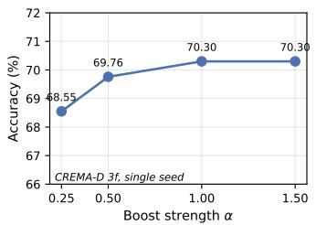  
(a) Boost strength α.

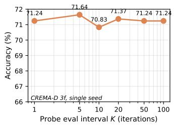

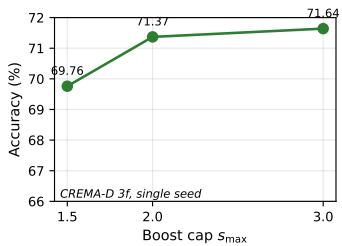  
(b) Probe interval K (log scale).  
(c) Boost cap $s _ { \mathrm { m a x } } .$  
Figure 4: Hyperparameter sensitivity on CREMA-D (3-frame, single seed). (a) Accuracy vs boost strength α — plateaus within noise above $\alpha { = } 1 . 0$ . (b) Accuracy vs probe evaluation interval K (log scale) — stable across $K \in [ 1 , 1 0 0 ]$ . (c) Accuracy vs boost cap $s _ { \mathrm { m a x } } - \mathrm { m i l d }$ increase from 1.5 to 3.0.

α plateaus within noise above $\alpha { = } 1 . 0 ,$ so the choice between $\alpha { = } 0 . 5$ and $\alpha { = } 0 . 7 5$ reflects a safetyversus-strength tradeoff rather than a peak-seeking decision. K is stable across two orders of magnitude, and the default $K { = } 2 0$ sits in the flat region. Across $K \in \{ 1 , 5 , 1 0 , 5 0 , 1 0 0 \}$ the best accuracy stays within $7 0 . 8 3 \mathrm { - } 7 1 . 6 4 \%$ (range 0.81 pp), so $K { = } 2 0$ sits in the flat plateau and the perepoch overhead reported in §4.4 is essentially free. $s _ { \mathrm { m a x } }$ shows a mild monotonic trend, indicating that the cap is a soft ceiling rather than the binding constraint. Trends smaller than the $\approx 1 . 5$ pp 5-seed noise floor should be read as within-noise rather than as detected effects. Finally, we did not sweep $\mu$ or $\beta$ in this study. Our defaults $( \mu { = } 0 . 3 , \beta { = } 0 . 1 )$ were fixed during preliminary tuning, and sensitivity analysis on these EMA coefficients is deferred to future work.

## B.6 Boost-strength sensitivity on the sentiment benchmarks

The sweeps of Appendix B.5 are single-seed and confined to CREMA-D. Because the two highimbalance sentiment benchmarks respond to the boost differently from CREMA-D (Section 4.2), we report a separate multi-seed sweep over the boost strength α on CH-SIMS and CMU-MOSI. Two opposite concerns motivate it. A larger α might unlock additional weak-modality learning that the default setting leaves on the table, or it might instead degrade accuracy by amplifying modalities that are less informative for the task. All runs use the boost alone, without the OGM-GE composition, so that α is the only quantity varied and acts in isolation, which is also the protocol under which this sweep was conducted. Each entry is five seeds {42, 123, 456, 789, 1024} trained for 100 epochs under the Table 1 pipeline, reported as the mean with the population standard deviation used in Table 1.

Table 6: Boost-strength sweep on the two high-imbalance sentiment benchmarks, boost alone without the OGM-GE composition (accuracy $\% ,$ mean ± std over 5 seeds, 100 epochs, Table 1 pipeline). The first row restates the joint-training baseline of Table 1 for reference. No entry is marked as best: every α setting lies within one seed standard deviation of the baseline on both benchmarks, so none of these differences is resolved at this sample size.
<table><tr><td>Setting</td><td>CH-SIMS</td><td>CMU-MOSI</td></tr><tr><td>Baseline (Table 1)</td><td> $7 0 . 4 2 \pm 0 . 2 9$ </td><td> $7 2 . 4 2 \pm 0 . 4 8$ </td></tr><tr><td> $\alpha = 0 . 2 5$ </td><td> $7 0 . 9 0 \pm 0 . 5 5$ </td><td> $7 1 . 8 9 \pm 0 . 8 1$ </td></tr><tr><td>α = 0.5 (default)</td><td> $6 9 . 8 0 \pm 0 . 8 0$ </td><td> $7 1 . 8 9 \pm 0 . 8 2$ </td></tr><tr><td> $\alpha = 0 . 7 5$ </td><td> $7 0 . 3 7 \pm 0 . 4 1$ </td><td> $7 1 . 9 2 \pm 0 . 7 8$ </td></tr><tr><td> $\alpha = 1 . 0$ </td><td> $7 0 . 4 2 \pm 0 . 8 7$ </td><td> $7 1 . 8 6 \pm 0 . 9 1$ </td></tr><tr><td> $\alpha = 1 . 5$ </td><td> $7 0 . 0 2 \pm 0 . 5 0$ </td><td> $7 1 . 8 6 \pm 0 . 7 8$ </td></tr></table>

Accuracy is flat in α on both benchmarks. On CH-SIMS the five means span 1.1 pp with no monotone trend in α (Spearman $\rho = - 0 . 3 0 , p = 0 . 6 2 )$ , and the two ends of the range are not distinguishable from each other $( \alpha { = } 1 . 5$ versus $\alpha { = } 0 . 2 5$ , paired t-test over the five shared seeds, $p = 0 . 1 6 9 )$ . On CMU-MOSI the five means span 0.06 pp and the same comparison gives $p = 0 . 9 1 7$ . No setting departs from the Table 1 baseline by more than 0.62 pp on either benchmark, which is within the seed standard deviation of the sweep entry in question, so we do not read the highest CH-SIMS entry (α=0.25, +0.48 pp) as a gain. Across a sixfold range of $\alpha ,$ then, increasing the boost strength neither unlocks additional weak-modality learning on these benchmarks nor degrades accuracy by amplifying the less informative modalities.

The $\alpha { = } 0 . 5$ rows reproduce the PGGB entries of Table 1 exactly on both benchmarks, 69.80 on CH-SIMS and 71.89 on CMU-MOSI. These rows are a consistency check on the pipeline rather than an additional result.

The flatness is consistent with the post-hoc probe measurements of Appendix B.14, where the weak-modality representations on these two benchmarks are essentially unchanged under the boost and appear intrinsically limited rather than suppressed. On that reading the strength of the boost is not the binding factor, so varying it has little to act on. We note that this is not an instance of the self-attenuation bound of Proposition 2, which applies when the utilization gap is small, whereas both benchmarks here sit in the high-imbalance group (Section 4.1). The flatness reported above is an empirical observation on these two benchmarks and not a consequence of that analysis.

## B.7 Wall-clock and memory overhead

Table 7 reports the measured cost of probe-guided gradient boosting relative to unmodified joint training. All three configurations were timed on a single RTX 4090 under an identical data pipeline on CREMA-D (3-frame), and we report the mean seconds per epoch over 7 epochs alongside the peak GPU memory observed during training.

Table 7: Wall-clock and peak-memory cost on CREMA-D (3-frame), single RTX 4090, mean seconds per epoch over 7 epochs under an identical data pipeline. Relative overhead is measured against the baseline row. Peak GPU memory ranged from 12.1 to 12.3 GB across all three configurations.
<table><tr><td>Configuration</td><td>s/epoch</td><td>Overhead</td><td>Peak GPU memory</td></tr><tr><td>Baseline (joint training)</td><td>17.43</td><td>reference</td><td>≈ 12.2 GB</td></tr><tr><td>PGGB (probes + boost)</td><td>17.71</td><td>+1.61%</td><td>≈ 12.2 GB</td></tr><tr><td>PGGB+OGM-GE</td><td>18.71</td><td>+7.34%</td><td>≈ 12.2 GB</td></tr></table>

The probe-attributable overhead is +1.61%, slightly above the approximate figure quoted in Section 4.1. The remaining ≈ 5.7 pp in the composed row is OGM-GE’s own per-modality contribution computation, which OGM-GE incurs whether or not the boost is applied, so composing the two mechanisms adds no timing cost beyond the sum of their individual costs. Peak memory is unchanged across the three configurations. Each probe is a single linear layer of roughly 3K parameters, approximately 0.03% of one ResNet-18 encoder, and the EMA state is two scalars per modality (the smoothed probe accuracy $\bar { P } _ { m }$ and the smoothed boost scale $\bar { s } _ { m } )$ , four scalars in total for this two-modality run.

## B.8 Optimizer dependence of the boost actuation

Probe-guided gradient boosting acts by rescaling per-modality gradients, so whether it can act at all depends on how the optimizer maps a gradient into a parameter update. SGD passes a multiplicative scale through to the update directly. Adam instead divides each coordinate by a running secondmoment estimate and is therefore close to invariant under a rescaling of the gradient, which would remove the boost before it reaches the parameters. That invariance is exact only for a constant rescaling with a matched second-moment estimate, whereas the applied scale $\bar { s } _ { m }$ is per-modality and varies over training, so how much of it survives is an empirical question. This subsection measures it. Following Section 4.1, the audio-visual benchmarks and BraTS 2021 are trained with SGD, and the sentiment and text-image benchmarks with Adam.

Protocol. We instrument matched pairs of runs differing only in the boost strength, $\alpha = 0 . 7 5$ against $\alpha = 0$ , on matched seeds. At every optimizer step we log, per modality, the applied scale $\bar { s } _ { m } ,$ the encoder gradient norm, and the norm of the realized parameter update of that encoder. Table 8 reports for each quantity the ratio of its mean over matched post-warmup steps in the boosted run to the same mean in the $\alpha = 0$ run, where $\bar { s } _ { m } = 1$ identically (Proposition 2). A gradient-norm ratio that tracks the applied scale shows that the scale reaches the gradient, and an update-norm ratio near 1 shows that the optimizer absorbs it before the parameters move.

Table 8: Transmission of the applied boost to the parameter update. Each entry is a ratio of means over matched post-warmup steps between an $\alpha = 0 . 7 5$ run and its matched $\alpha = 0 \mathrm { r u n } .$ so the applied-scale column is the mean boost scale $\bar { s } _ { m }$ itself. The CREMA-D row is that run’s most-boosted modality, the visual encoder. The two CMU-MOSI blocks use identical data, architecture, and seed and differ only in the optimizer, the SGD block being an untuned control (see below). Values near the applied scale indicate transmission, values near 1 indicate absorption.
<table><tr><td>Benchmark</td><td>Optimizer</td><td>Modality</td><td>Applied  $\bar { s } _ { m }$ </td><td>Grad. ratio</td><td>Update ratio</td></tr><tr><td>CREMA-D</td><td>SGD</td><td>visual</td><td>1.64</td><td>1.52</td><td>1.50</td></tr><tr><td rowspan="3">CMU-MOSI</td><td rowspan="3">Adam</td><td>text</td><td>1.12</td><td>1.06</td><td>0.97</td></tr><tr><td>audio</td><td>1.48</td><td>1.38</td><td>1.17</td></tr><tr><td>visual</td><td>1.31</td><td>1.31</td><td>1.11</td></tr><tr><td rowspan="3">CMU-MOSI</td><td rowspan="3">SGD (control)</td><td>text</td><td>1.45</td><td>1.53</td><td>1.47</td></tr><tr><td>audio</td><td>1.29</td><td>1.27</td><td>1.18</td></tr><tr><td>visual</td><td>1.29</td><td>1.31</td><td>1.32</td></tr></table>

The boost reaches the update under SGD and is largely absorbed under Adam. On CREMA-D an applied scale of 1.64 produces a gradient-norm ratio of 1.52 and an update-norm ratio of 1.50, so most of the applied excess over unity survives to the parameters. Under Adam it does not. On CMU-MOSI the most-boosted modality carries an applied scale of 1.48 and a gradient-norm ratio of 1.38, but the update-norm ratio falls to 1.17, so the second-moment normalization absorbs roughly two thirds of the applied excess. Running the identical CMU-MOSI pipeline under SGD restores transmission, an applied scale of 1.45 yielding an update-norm ratio of 1.47.

The per-modality rows indicate that this is a property of the optimizer rather than of a particular modality. Under Adam every update-norm ratio is pulled toward 1 irrespective of the applied scale, from 1.17 at scale 1.48 down to 0.97 at scale 1.12, where the text encoder transmits nothing at all. Under SGD on the same benchmark two of the three update-norm ratios exceed their applied scale, 1.47 against 1.45 for text and 1.32 against 1.29 for visual, and the third retains 1.18 of an applied 1.29.

The accuracy consequence follows the transmission. Table 9 reports the composed contrast on CMU-MOSI at full budget over five matched seeds. Under Adam the boost has no measurable effect, −0.09 pp at $p = 0 . 9 0$ . Under the SGD control the same contrast gives +1.69 pp at $p = 0 . 0 3 2$ , with all five seeds improving.

Table 9: Accuracy consequence of the boost on CMU-MOSI at full budget, composed contrast $( \alpha = 0 . 7 5$ against $\alpha = 0 )$ , five matched seeds per cell. Effect is the mean paired difference over the shared seeds and may differ from the difference of the rounded means. p-values are from a paired t-test over those seeds. The Adam means reproduce the CMU-MOSI OGM-GE and PGGB+OGM-GE entries of Table 1, with spreads given here as the sample standard deviation over five seeds rather than the population standard deviation of Table 1, which is smaller by a factor ${ \sqrt { 4 / 5 } }$ . The SGD rows are an untuned control, so their absolute level is not comparable with the Adam rows.
<table><tr><td>Optimizer</td><td> $\alpha = 0$ </td><td> $\alpha = 0 . 7 5$ </td><td>Effect (pp)</td><td>p</td></tr><tr><td>Adam (reported setting)</td><td> $7 2 . 6 8 \pm 0 . 9 9$ </td><td> $7 2 . 6 0 \pm 1 . 0 5$ </td><td>-0.09</td><td>0.90</td></tr><tr><td>SGD (control, untuned)</td><td> $5 5 . 8 9 \pm 1 . 0 3$ </td><td> $5 7 . 5 8 \pm 1 . 0 4$ </td><td>+1.69</td><td>0.032</td></tr></table>

What the control does and does not establish. The SGD configuration is the paper’s audio-visual optimizer applied to the CMU-MOSI pipeline without retuning, which is why its absolute accuracy sits far below the reported Adam setting, 55.89% against 72.68%. It is not an alternative recipe for this benchmark and we do not offer it as one. Only the within-optimizer contrast is interpretable, between $\alpha = 0$ and $\alpha = 0 . 7 5$ inside each optimizer and never across the two. No number reported elsewhere in the paper changes, and Table 1 remains the CMU-MOSI result. The measurement scopes the mechanism rather than improving it.

Relation to the analysis and to the sentiment results. Section 3.5 already scopes Proposition 3 to SGD, because its proof assumes that optimizer. The measurements above are a distinct and narrower statement, about actuation rather than about the bound: on the Adam benchmarks the intervention is largely absorbed before it reaches the parameters, so it is weakly actuated there as well as outside the analysis. The two observations are consistent and neither subsumes the other. We also do not read this as explaining away the flat sentiment results. Appendix B.14 finds the weak-modality representations on those benchmarks essentially unchanged under the boost and apparently limited intrinsically rather than suppressed, and Appendix B.6 finds accuracy flat across a sixfold range of α. Weak actuation under Adam is one measured contributing factor alongside these, not a complete account.

## B.9 Probe signal stability

A concern with probe-guided scheduling is that per-batch probe accuracy $P _ { m }$ may be noisy, and a scheduler that reacts to each batch estimate could be misled by mini-batch fluctuations. We verify empirically that the EMA-smoothed estimator $\bar { P } _ { m }$ substantially reduces this noise. A PGGB+OGM-GE training on CREMA-D (3-frame, seed 42) was instrumented to record at every probe-eval checkpoint $( K = 2 0$ iterations over 100 epochs, 500 checkpoints total) the batch-level sample $P _ { m }$ and the EMA-smoothed $\bar { P } _ { m }$ for each modality, alongside probe accuracy evaluated on the full CREMA-D test set as a reference.

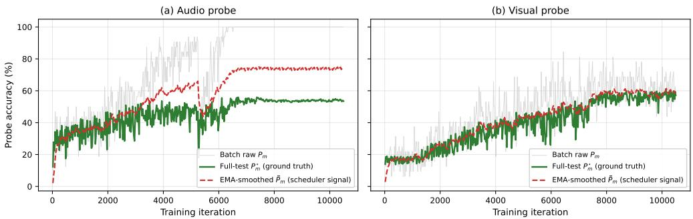  
Figure 5: Probe-signal stability on CREMA-D (PGGB+OGM-GE, seed 42, 500 probe-eval checkpoints). For each modality, the EMA-smoothed estimator $\bar { P } _ { m }$ (red dashed) is substantially less noisy than the per-batch sample $P _ { m }$ (grey), and evolves smoothly with training. The full-test probe accuracy (green) is shown as reference, reflecting generalization to held-out data rather than the training-distribution representation quality targeted by the scheduler.

Table 10: Per-batch and EMA-smoothed probe accuracy std (pp), computed over the final 200 probe-eval checkpoints. The 19× steady-state bound (§3.2) is unconditional under i.i.d. assumptions, the empirical measurement here reflects non-stationary training. Visual (boost-driving signal) shows the expected reduction direction. Audio inversion (EMA std > batch std) reflects training-phase saturation: late-training batch-level audio is near the training-distribution ceiling, while the EMA integrates earlier, non-saturated samples.
<table><tr><td>Modality</td><td> $P _ { m }$  (batch)</td><td> $\bar { P } _ { m }$  (EMA)</td><td>Reduction</td><td></td></tr><tr><td>Audio</td><td>0.31</td><td>0.99</td><td>n/a (saturated)</td><td rowspan="3"></td></tr><tr><td>Visual</td><td>9.32</td><td>4.36</td><td>-53%</td></tr></table>

Two observations follow. First, on the visual modality, which is the operative signal for the boost decision, the EMA reduces variance by approximately 53% (from 9.32 to 4.36 pp), consistent in direction with the Eq. (5) prediction. The observed 53% reduction is below the ≈ 95% i.i.d. steadystate bound, as expected under non-stationary training. This confirms that the scheduler operates on a temporally stable signal rather than on mini-batch noise. Second, the audio entry (EMA std 0.99 pp > batch std 0.31 pp) is a transparent non-stationarity artifact rather than a violation of the bound: the batch-level audio probe is concentrated near its training-distribution ceiling (the linear probe readily separates audio features on training batches and is not informative about fine-grained variations at that scale), while the EMA integrates earlier training-phase samples from before probe saturation. The variance-reduction guarantee of Eq. (5) is therefore empirically validated on the modality that drives the boost decision, and the audio result is consistent with the non-i.i.d. caveat noted in the main body.

The EMA signal correlates monotonically with the full-test probe accuracy (Pearson $r = 0 . 9 6$ visual, 0.88 audio, Spearman $\rho = 0 . 9 5 , 0 . 8 9 )$ , though the full-test quantity measures generalization to held-out data and differs in absolute value from $\bar { P } _ { m }$ by several pp. This distinction is intentional: the scheduler targets training-distribution representation quality (what each modality contributes to the joint fit during training), which is distinct from held-out generalization. Targeting the former is the appropriate signal for in-training gradient balancing. The correlation confirms that the two quantities are monotonically related, while the absolute offset reflects the train–test gap intrinsic to representation learning.

## B.10 Early probe trajectory and the absence of a warm-up phase

Appendix B.9 shows that the smoothed probe signal is stable once training is under way. A separate question is whether it points in the right direction from the start, since the scheduler begins acting on it within the first K iterations, and an early signal that identified the wrong modality would boost the dominant encoder during the phase in which the imbalance forms. To examine this we instrumented a seed-42 PGGB+OGM-GE run on CREMA-D (3-frame), using the recording protocol of Appendix B.9, and logged at every probe event the EMA-smoothed probe accuracy $\bar { P } _ { m }$ (Eq. (5))

for both modalities. This is the quantity the scheduler consumes, as distinct from the per-batch sample $P _ { m } .$ . The run reproduces the seed-42 member of the PGGB+OGM-GE arm of Table 1, reaching 71.37% best accuracy, and probe evaluation every $K = 2 0$ iterations yields 500 events over the 100 epochs.

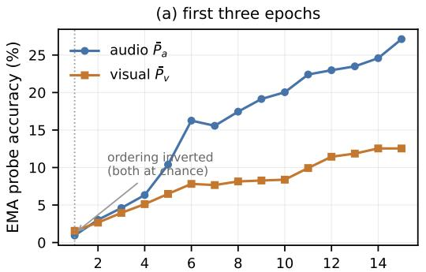  
probe evaluation event (every $K = 2 0$ iterations)

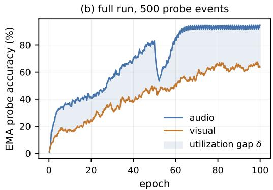  
Figure 6: Early and full-run probe trajectory on CREMA-D (PGGB+OGM-GE, seed 42). Both panels plot the EMA-smoothed per-modality probe accuracy $\bar { P } _ { m }$ , which is the quantity the scheduler consumes. (a) The first fifteen probe events, spanning the first three epochs, with the first event annotated. The ordering of the two modalities is inverted at that event alone, where both probes sit at chance level on the 32-sample evaluation half. (b) The same two curves over the full 100-epoch run, with the utilization gap δ (Eq. (6)) shaded. Audio leads at each of the remaining 499 events.

Audio is identified as the dominant modality from the second probe event onward and at every event after it. The audio-minus-visual difference in $\bar { P } _ { m } { \mathrm { ~ i s ~ } } + 0 . 3 \bar { 7 } , + 0 . 6 5 , + 1 . 2 1 , { \mathrm { ~ a n d ~ } } + 3 . 9 0$ pp at events 2 to 5, +11.66 pp at the end of epoch 2, +14.58 pp at the end of epoch 3, and +30.78 pp at the end of training (EMA audio 94.59%, visual 63.82%). Across all 500 events the ordering is inverted exactly once, at the first event, where the smoothed values are 0.94% for audio and 1.56% for visual, an audio-minus-visual difference of −0.63 pp. We read this inversion as a property of the estimator rather than as a statement about the data. The underlying raw accuracies on the 32-sample evaluation half are 9.4% (3 of 32) and 15.6% (5 of 32), both within two binomial standard deviations $( \sigma \approx 6 . 6$ pp at $n = 3 2 )$ of the 16.67% chance level of the six-class task, so neither probe has yet separated its features and the ordering between them carries no signal. The smoothed values are an order of magnitude below the raw ones because $\bar { P } _ { m }$ is initialized at zero (Algorithm 1) and is still ramping after a single update at $\beta = 0 . 1$ . We note that the utilization gap δ of Eq. (6) is a spread over modalities and is non-negative by construction. The signed differences quoted here carry a sign only to make the ordering explicit.

The run applies no warm-up period to the boost, and these measurements do not indicate that one is needed. Three considerations bound the cost of a misdirected early window. First, the smoothed scales are initialized at the neutral value $\bar { s } _ { m } = 1$ (Algorithm 1), so training starts with no intervention. Second, the first probe event falls at iteration 19 of the run’s 10,500 training iterations, so at most one K-iteration window can precede a correctly oriented signal. Third, a single misdirected event moves a smoothed scale to at most $1 + \mu \alpha \approx 1 . 2 3$ for $\mu = 0 . 3$ and $\alpha = 0 . 7 5$ , well inside the cap $s _ { \mathrm { m a x } } = 2 . 0$ that Proposition 1 certifies, and the scale then relaxes toward the correct assignment at rate $( 1 - \mu )$ per event once the ordering settles. These readings come from one instrumented run, on one seed and one benchmark, so they indicate that the signal orients itself immediately in this configuration rather than establishing that it must. The bound above limits rather than removes the effect of an early misdirected window, and a warm-up would remain a reasonable precaution on a benchmark where the early probe signal was found to be persistently inverted.

## B.11 Composability across balancing method families

Because PGGB applies multiplicative scaling $\bar { s } _ { m } \ge 1$ to encoder gradients just before the optimizer step, it is compatible with any balancing method that modulates encoder-parameter gradients. To empirically verify this and characterize the magnitude of composition effects under a single controlled protocol, we compose the boost with five methods spanning three mechanistic fami-

lies: discrepancy-ratio throttling (OGM-GE), loss weighting (G-Blend), Pareto-optimal gradient aggregation (MMPareto), Shapley-based adaptive gradient modulation (AGM), and classifier-guided magnitude and direction modulation (CGGM). All compositions use identical hyperparameters (boost strength $\alpha = 0 . 7 5$ , cap $s _ { \operatorname* { m a x } } = 2 . 0 $ probe interval $K = 2 0$ , EMA coefficient $\mu = 0 . 3 )$ and the same CREMA-D (3-frame, 5 seeds) protocol as Table 1. The results below are specific to this protocol and should not be extrapolated to other datasets without further evidence.  
Table 11: Composability with existing balancing methods on CREMA-D (3-frame, mean ± std over 5 seeds). All rows use identical PGGB hyperparameters. Positive ∆ indicates composition does not hurt the base method’s mean accuracy. †: within noise band $( n { = } 5 , \sigma \approx 1 \ { \mathrm { p p } }$ , 80%-power MDE $\approx 2 \ : \mathrm { p p } )$ , not statistically distinguishable from zero.
<table><tr><td>Method</td><td>Base alone</td><td> $\mathbf { P G G B + B a s e }$ </td><td>∆ mean (pp)</td><td>∆ std</td></tr><tr><td>OGM-GE</td><td> $6 9 . 1 4 \pm 1 . 1 3$ </td><td> $7 1 . 4 5 \pm 1 . 7 1$ </td><td> $\mathbf { + 2 . 3 1 }$ </td><td>+0.58</td></tr><tr><td>MMPareto</td><td> $6 5 . 5 1 \pm 0 . 8 7$ </td><td> $6 6 . 0 0 \pm 1 . 2 5$ </td><td> $+ 0 . 4 9 ^ { \dagger }$ </td><td>+0.38</td></tr><tr><td>G-Blend</td><td> $6 1 . 1 0 \pm 1 . 8 7$ </td><td> $6 1 . 9 9 \pm 0 . 9 9$ </td><td> $+ 0 . 8 9 ^ { \dagger }$ </td><td> $- \mathbf { 0 . 8 8 } \left( - 4 7 \% \right)$ </td></tr><tr><td>AGM</td><td> $5 7 . 4 2 \pm 0 . 7 3$ </td><td> $5 8 . 1 7 \pm 1 . 7 9$ </td><td> $+ 0 . 7 5 ^ { \dagger }$ </td><td>+1.06</td></tr><tr><td>CGGM</td><td> $5 0 . 2 2 \pm 1 . 3 9$ </td><td> $5 0 . 3 2 \pm 1 . 0 3$ </td><td> $+ 0 . 1 0 ^ { \dagger }$ </td><td>-0.36</td></tr></table>

Three observations. First, four of the five compositions show a positive $\Delta$ mean accuracy. The fifth, CGGM, is within noise $( + 0 . 1 0 \pm 1 . 0 3 ) $ and we treat it separately below. At n=5 with σ ≈ 1 pp, the 80%-power minimum detectable effect is approximately 2 pp, so only the OGM-GE composition (+2.31 pp) is statistically distinguishable from zero. The other three positive entries and CGGM (+0.10 pp) are all within noise on this single-dataset protocol. Second, the amplification is not uniform: three of the four positive compositions yield gains within one standard deviation of the base method, and the headline compound gain (+2.31 pp) appears only with OGM-GE, which we attribute to the specific mechanistic interaction between OGM-GE’s discrepancy-ratio throttle (damping the dominant modality) and our probe-guided amplification of the weaker modality, a two-sided push that neither mechanism produces alone. The α=0 monitor-only replication reported in §4.3 $( 6 9 . 1 4 \pm 1 . 1 8 \% )$ is operationally identical to the OGM-GE entry here $( 6 9 . 1 4 \pm 1 . 1 3 \% )$ , differing only in the seed set. Third, the CGGM result is consistent with CGGM’s reliance on Transformer-based attention fusion, which is not well-matched to our CNN/MLP pipeline (footnote to Table 1). CGGM itself underperforms the baseline on CREMA-D $( 5 0 . 2 2 \pm 1 . 3 9 ~ \mathrm { v s }$ . baseline $6 1 . 5 9 \pm 0 . 8 0 )$ , and the boost does not recover the loss although it does not compound it either (∆ std = −0.36). Together these results support the non-degrading composition behavior observed on CREMA-D under this protocol, as discussed in Section 3.4, and scope the amplification claim to methods whose gradient direction aligns with the pipeline architecture.

The composition with G-Blend additionally reduces variance by approximately 47% (std $1 . 8 7 $ 0.99). This is suggestive of the EMA-smoothed probe signal providing a stabilizing effect across training seeds but should be interpreted with caution given n=5 on a single benchmark.

Composability across datasets. To test whether the boost-composition pattern generalizes beyond CREMA-D, we repeated the protocol on AVE (high audio-visual imbalance) and Food101 (frozen pre-extracted features) under identical hyperparameters $( \alpha { = } 0 . 7 5 , s _ { \mathrm { m a x } } { = } 2 . 0 , K { = } 2 0 , \mu { = } 0 . 3 , 5$ seeds). Results are summarized in Table 12.

Table 12: Composability across datasets: $\Delta$ accuracy (pp) of PGGB+X versus X alone, mean over 5 seeds. AVE has high audio-visual modality imbalance, Food101 uses frozen pre-extracted features (operating-regime sensitivity reported in §4.3.1). †PGGB recovers some CGGM degradation but absolute accuracy (53.00%) remains far below baseline (85.75%), so the boost does not rescue catastrophic regression.
<table><tr><td>Dataset</td><td>PGGB+MMPareto</td><td>PGGB+AGM</td><td>PGGB+G-Blend</td><td>PGGB+CGGM</td></tr><tr><td>AVE</td><td>+1.01</td><td>+1.26</td><td>-0.25</td><td>-0.25</td></tr><tr><td>Food101</td><td>-0.09</td><td>-0.23</td><td>-0.09</td><td> $+ 4 . 4 1 ^ { \dagger }$ </td></tr></table>

On AVE, two non-OGM-GE compositions (MMPareto, AGM) yield compound gains comparable in magnitude to PGGB+OGM-GE on AVE-pretrained (+0.69 pp, Table 1). The G-Blend and CGGM compositions are flat to slightly negative on AVE. On Food101, all non-CGGM compositions are within noise of the base method. As in the CREMA-D protocol, with $n { = } 5$ and $\sigma \approx 1$ pp the 80%-power minimum detectable effect is approximately 2 pp, so the AVE compound gains for PGGB+MMPareto (+1.01 pp) and PGGB+AGM (+1.26 pp) lie within the seed-noise band (MDE ≈ 2 pp at n=5 seeds) and should be read as compatibility evidence rather than confirmed wins outside the OGM-GE composition. The pattern is consistent with the operating-conditions analysis (§4.3.1): compound composition gains require both modality imbalance and adequate feature flow, and the boost neither generalizes to frozen-feature regimes nor rescues catastrophic baseline mismatch (CGGM on Food101).

## B.12 Seed extension of the isolation contrast

The three-way decomposition of §4.3 separates the contribution of the boost from that of the decoupled monitor by comparing α=0 with probes active against $\alpha { = } 0 . 7 5$ , both composed with OGM-GE. Because that contrast carries the paper’s principal quantitative claim, we extended it from 5 to 15 seeds per arm and report every per-seed value in Table 13. The extension is confined to this contrast. All other rows of Table 1, including every competing method, remain at 5 seeds, so the main table is unchanged.

Both arms follow the CREMA-D 3-frame protocol of Table 1 without modification and differ only in the boost strength α. The seed set was extended in two batches of five, in the order shown in Table 13. The final batch was fixed in advance under a stopping rule that set 15 seeds per arm as the endpoint, every run that was launched is reported, and no seeds were added after that batch. Aggregates in this subsection use the sample standard deviation with an $n - 1$ denominator, unlike Table 1 and the other main tables, which use the population standard deviation. The two conventions should not be compared directly, as the sample value is larger by a factor $\sqrt { n / ( n - 1 ) }$ on the same data.

Table 13: Per-seed test accuracy (%) for the isolation contrast on CREMA-D (3-frame): α=0 with probes active against $\alpha { = } 0 . 7 5$ , both composed with OGM-GE, 15 seeds per arm under the Table 1 protocol. Batches are listed in the order in which they were run. ∆ is the seed-matched difference. The aggregate row gives the mean with the sample standard deviation (n − 1 denominator), which is not the population standard deviation convention of Table 1.
<table><tr><td>Seed</td><td>α=0</td><td>α=0.75</td><td>∆ (pp)</td></tr><tr><td>Original five seeds</td><td></td><td></td><td></td></tr><tr><td>42</td><td>67.88</td><td>71.37</td><td>+3.49</td></tr><tr><td>123</td><td>68.15</td><td>72.04</td><td>+3.89</td></tr><tr><td>456</td><td>69.35</td><td>73.66</td><td>+4.31</td></tr><tr><td>789</td><td>69.49</td><td>71.24</td><td>+1.75</td></tr><tr><td>1024</td><td>70.83</td><td>68.95</td><td>-1.88</td></tr><tr><td>First extension</td><td></td><td></td><td></td></tr><tr><td>2027</td><td>70.43</td><td>71.24</td><td>+0.81</td></tr><tr><td>3407</td><td>70.56</td><td>71.10</td><td>+0.54</td></tr><tr><td>5555</td><td>68.41</td><td>69.62</td><td>+1.21</td></tr><tr><td>7777</td><td>70.43</td><td>70.43</td><td>0.00</td></tr><tr><td>9999</td><td>66.94</td><td>73.39</td><td>+6.45</td></tr><tr><td colspan="4">Second extension, pre-committed endpoint</td></tr><tr><td>1111</td><td>69.22</td><td>70.97</td><td>+1.75</td></tr><tr><td>2222</td><td>68.01</td><td>69.35</td><td>+1.34</td></tr><tr><td>3333</td><td>70.56</td><td>69.49</td><td>-1.07</td></tr><tr><td>4444</td><td>70.03</td><td>72.58</td><td>+2.55</td></tr><tr><td>6666</td><td>70.70</td><td>69.62</td><td>-1.08</td></tr><tr><td>All 15 seeds</td><td> $6 9 . 4 0 \pm 1 . 2 5$ </td><td> $7 1 . 0 0 \pm 1 . 4 6$ </td><td>+1.60</td></tr></table>

The estimated difference shrinks as seeds accumulate: +2.31 pp on the original five seeds, +2.06 pp at ten seeds, and +1.60 pp at fifteen. The original five were favourable draws, and the stabilised estimate is accordingly smaller than the figure first reported. No single batch of five seeds is powered to resolve an effect of this size. $\mathrm { A t } d \approx 1 . 2$ with five seeds per arm, a two-sided two-sample test at the 5% level has approximately 38% power, so batches landing above or below the pooled value are expected rather than anomalous. The 15-seed pooled estimate was pre-committed as the endpoint for this reason, in place of any single batch.

The direction and the significance of the contrast are stable under the extension. Over 15 seeds the α=0 arm reaches 69.40±1.25% and the α=0.75 arm $7 1 . 0 0 { \pm } 1 . 4 6 \%$ , a difference of +1.60 pp whose 95% Welch confidence interval, [0.59, 2.62], excludes zero (Welch $p = 0 . 0 0 3 2 ,$ Mann–Whitney $p = 0 . 0 0 5 4 .$ , Cohen’s d = 1.18). Treating the arms as matched on seed, 11 of the 15 pairs favour the composition, 3 favour α=0, and one is exactly tied (paired t-test $p = 0 . 0 1 6$ , Wilcoxon signed-rank $p = 0 . 0 2 2$ , both two-sided). The seed-matched tests are less sensitive than the unmatched ones here because the per-seed differences are themselves widely dispersed (standard deviation 2.26 pp), so the seed accounts for little of the variance in the gap.

## B.13 Per-modality post-hoc probe accuracy

Table 14 reports the exact per-modality post-hoc linear-probe accuracies visualized in Figure 3 of Section 4.4. Probes are trained for 50 epochs on frozen encoder features from each method’s saved best\_model.pt, matching the protocol described in Section 3.2.

Table 14: Post-hoc linear-probe accuracy on CREMA-D (%, mean ± std over 5 seeds). Probes are trained for 50 epochs on frozen encoder features from each method’s saved checkpoint, matching the protocol in Figure 3. Gap is the absolute difference of column means. Chance level is $1 / 6 \approx 1 6 . 6 7 \%$ for CREMA-D’s 6-class classification.
<table><tr><td>Method</td><td>Audio (strong)</td><td>Visual (weak)</td><td>Gap (pp)</td></tr><tr><td>Baseline</td><td> $5 8 . 6 6 { \scriptstyle \pm 1 . 6 0 }$ </td><td> $4 6 . 1 3 { \scriptstyle \pm 3 . 7 2 }$ </td><td>12.53</td></tr><tr><td>OGM-GE</td><td> $5 8 . 0 4 { \scriptstyle \pm 1 . 0 9 }$ </td><td> $5 1 . 6 7 { \pm } 1 . 8 5$ </td><td>6.37</td></tr><tr><td>MMPareto</td><td> $6 0 . 0 3 { \scriptstyle \pm 0 . 7 3 }$ </td><td> $5 2 . 6 3 { \scriptstyle \pm 5 . 9 2 }$ </td><td>7.39</td></tr><tr><td>AGM</td><td> $5 5 . 3 2 { \scriptstyle \pm 0 . 3 6 }$ </td><td> $1 7 . 7 2 { \scriptstyle \pm 0 . 7 3 }$ </td><td>37.61</td></tr><tr><td>G-Blend</td><td> $5 7 . 7 7 { \scriptstyle \pm 1 . 7 8 }$ </td><td> $3 7 . 0 4 \pm 2 . 4 3$ </td><td>20.73</td></tr><tr><td>MILES</td><td> $5 9 . 8 1 { \pm } 1 . 5 3 $ </td><td> $1 9 . 6 2 { \scriptstyle \pm 1 0 . 4 2 }$ </td><td>40.19</td></tr><tr><td>InfoReg</td><td> $6 0 . 8 3 { \scriptstyle \pm 0 . 7 6 }$ </td><td> ${ \pm } 7 . 9 8 { \pm } 1 . 8 0$ </td><td>2.85</td></tr><tr><td>PGGB  $( \alpha { = } 0 . 5 )$ </td><td> $5 7 . 3 4 { \pm 2 . 1 8 }$ </td><td> $4 4 . 6 0 { \scriptstyle \pm 3 . 9 6 }$ </td><td>12.74</td></tr><tr><td> $\mathrm { P G G B + O G M \mathrm { - G E } } \left( \alpha { = } 0 . 7 5 \right)$ </td><td> $5 7 . 8 5 { \pm } 1 . 0 3 $ </td><td> $5 5 . 5 4 { \scriptstyle \pm 4 . 4 3 }$ </td><td>2.31</td></tr></table>

## B.14 Per-modality post-hoc probes on the sentiment benchmarks

Table 15 extends the CREMA-D analysis of Appendix B.13 to the two text-dominant sentiment benchmarks, CH-SIMS and CMU-MOSI. The protocol matches Table 14: linear probes trained post hoc on frozen features from each method’s saved final checkpoint, averaged over 5 seeds. Gap is the strongest minus the weakest per-modality probe accuracy.

Table 15: Post-hoc linear-probe accuracy on the text-dominant sentiment benchmarks (%, mean over 5 seeds). Probes are trained on frozen encoder features from each method’s saved final checkpoint, following the protocol of Table 14. Gap is the strongest minus the weakest per-modality probe accuracy. Differences between methods are small on these benchmarks, so we do not mark a best entry. The gap for the PGGB+OGM-GE composition on CH-SIMS is reported in the text.
<table><tr><td>Dataset</td><td>Method</td><td>Text (strong)</td><td>Audio</td><td>Vision</td><td>Gap (pp)</td></tr><tr><td>CH-SIMS</td><td>Baseline PGGB (α=0.5)</td><td>64.95 66.43</td><td>51.29 53.17</td><td>59.78 60.09</td><td>13.66</td></tr><tr><td>CMU-MOSI</td><td>Baseline PGGB (α=0.5)</td><td>70.99 71.72</td><td>48.86 49.24</td><td>54.49 53.47</td><td>13.26 22.13 22.48</td></tr></table>

On both benchmarks the probe movements are small and, more importantly, non-selective. The dominant text modality rises alongside the weaker ones, by +1.48 pp on CH-SIMS against +1.88 pp for audio and +0.31 pp for vision, and by +0.73 pp on CMU-MOSI against +0.38 pp for audio and −1.02 pp for vision. The utilization gap is consequently close to unchanged: $1 3 . 6 6  1 3 . 2 6 ~ \mathrm { p p }$ on CH-SIMS under PGGB and 13.04 pp under the PGGB+OGM-GE composition, and $2 2 . 1 3 $ 22.48 pp on CMU-MOSI under PGGB.

This differs from the CREMA-D pattern of Appendix B.13, where the same composition raises the weak visual probe by +9.41 pp, moves the strong audio probe by only −0.81 pp, and reduces the gap by a factor of 5.4 (Figure 3). One reading consistent with both observations is that targeted weak-modality recovery occurs where the weak modality is undertrained rather than uninformative, that is, where encoder parameters can still respond to the boost and imbalance is severe. On the sentiment pipelines the inputs are pre-extracted features passed to small MLP heads (Appendix B.1) and text is close to multimodally sufficient on its own [22, 31], so the weaker modalities appear intrinsically limited rather than suppressed, and the boost has correspondingly little suppressed signal to recover. This is an interpretation of the probe movements rather than a separate measurement.

We note finally that these are post-hoc probes on final checkpoints, a distinct measurement from the training-time δ of Section 3.2 and Appendix B.15, so the two sets of values are not directly comparable.

## B.15 Per-dataset utilization gap

For transparency, we report the per-dataset utilization gap δ (Eq. (6)) measured at the end of baseline training (final-epoch EMA-smoothed probe accuracy gap, averaged over 5 seeds). Probes follow the protocol of Section 3.2: linear classifiers on stop-gradient encoder features, trained on a held-out within-batch sample. These values quantify modality-dominance dynamics during baseline training and define the high-imbalance $( \delta > 0 . 1 5 )$ and low-imbalance $( \delta \le 0 . 1 5 )$ categorization used in Section 4.1. The high-imbalance group is heterogeneous in source: CREMA-D imbalance is audiodominance in audio-visual emotion recognition, whereas CMU-MOSI and CH-SIMS imbalance reflects text-sufficiency, where text-only baselines are reported within roughly 1 pp of multimodal accuracy [21, 22, 31]. BraTS 2021 (4 MRI sequences, binary tumor-presence probes per sequence) is reported separately as a dense-prediction benchmark. The two benchmarks nearest the threshold, Twitter15 $( 0 . \bar { 1 } 5 0 \pm \mathrm { \bar { 0 } . 0 9 6 } )$ and CH-SIMS $( 0 . 1 7 8 \pm 0 . 0 8 6 )$ , also carry the largest seed standard deviations, so their assignment is provisional and we flag both as boundary cases.

Table 16: Per-dataset utilization gap δ at the end of baseline training (mean ± std over 5 seeds), measured as the EMA-smoothed probe accuracy gap (Eq. (6)).
<table><tr><td>Dataset</td><td> $\delta \left( \mathrm { { \bf m e a n } } \pm \mathrm { { \bf s t d } } \right)$ </td></tr><tr><td>CREMA-D</td><td> $0 . 2 6 8 \pm 0 . 0 2 9$ </td></tr><tr><td>CMU-MOSI</td><td> $0 . 2 2 2 \pm 0 . 0 4 7$ </td></tr><tr><td>CH-SIMS</td><td> $0 . 1 7 8 \pm 0 . 0 8 6$ </td></tr><tr><td>Twitter15</td><td> $0 . 1 5 0 \pm 0 . 0 9 6$ </td></tr><tr><td>Sarcasm</td><td> $0 . 0 7 6 \pm 0 . 0 0 8$ </td></tr><tr><td>Kinetics-Sounds</td><td> $0 . 0 3 8 \pm 0 . 0 1 3$ </td></tr><tr><td>AVE</td><td> $0 . 0 1 7 \pm 0 . 0 0 9$ </td></tr></table>

## B.16 Stability of the imbalance categorization

The categorization of Section 4.1 rests on a single scalar per benchmark, so it is worth asking how much of it survives a change of seed or of the epoch at which δ is read. We therefore re-extract δ from the same baseline training logs that produced Table 16, once per seed and once as a seed mean read at three intermediate epochs. The measured quantity is unchanged throughout, namely the EMA-smoothed probe-accuracy gap of Eq. (6) under baseline training with no intervention. Final-epoch means and seed standard deviations are those already reported in Table 16 and are not restated here.

Seed dimension. Table 17 gives the per-seed final-epoch readings. The categorization is stable for five of the seven benchmarks: CREMA-D and CMU-MOSI exceed the threshold on all five seeds, and Sarcasm, Kinetics-Sounds, and AVE fall below it on all five seeds. The two benchmarks already flagged as boundary cases in Section 4.1 and Appendix B.15 behave alike. CH-SIMS and Twitter15 each place three of five seeds above the threshold, so at the level of individual seeds the two are not separable from one another, even though their seed means fall on opposite sides of 0.15. Twitter15 has the wider per-seed range of the two, from 0.019 to 0.260.

Table 17: Per-seed utilization gap δ at the final epoch of baseline training, for the five seeds used throughout the paper. The final column counts the seeds above the δ > 0.15 threshold of Section 4.1. Seed means and standard deviations are in Table 16.
<table><tr><td rowspan="2">Dataset</td><td colspan="5">Seed</td><td rowspan="2">Seeds above threshold</td></tr><tr><td>42</td><td>123</td><td>456</td><td>789</td><td>1024</td></tr><tr><td>CREMA-D</td><td>0.245</td><td>0.289</td><td>0.260</td><td>0.241</td><td>0.307</td><td>5/5</td></tr><tr><td>CMU-MOSI</td><td>0.273</td><td>0.191</td><td>0.273</td><td>0.195</td><td>0.178</td><td>5/5</td></tr><tr><td>CH-SIMS</td><td>0.112</td><td>0.154</td><td>0.118</td><td>0.322</td><td>0.184</td><td>3/5</td></tr><tr><td>Twitter15</td><td>0.221</td><td>0.161</td><td>0.019</td><td>0.098</td><td>0.260</td><td>3/5</td></tr><tr><td>Sarcasm</td><td>0.070</td><td>0.083</td><td>0.074</td><td>0.068</td><td>0.086</td><td>0/5</td></tr><tr><td>Kinetics-Sounds</td><td>0.034</td><td>0.048</td><td>0.022</td><td>0.055</td><td>0.033</td><td>0/5</td></tr><tr><td>AVE</td><td>0.013</td><td>0.025</td><td>0.013</td><td>0.027</td><td>0.005</td><td>0/5</td></tr></table>

Epoch dimension. Table 18 reports the seed mean read at epochs 25, 50, and 75. Final-epoch values are those in Table 16. For six of the seven benchmarks the reading epoch does not change the assignment: CREMA-D, CMU-MOSI, and CH-SIMS sit above the threshold at all three epochs, and Sarcasm, Kinetics-Sounds, and AVE sit below it at all three. Twitter15 is the exception. Its seed mean crosses the threshold during training, reading 0.148 at epoch 25 and then 0.154 at epoch 50 and 0.152 at epoch 75, so whether Twitter15 is assigned to the low-imbalance or the high-imbalance group depends on the epoch at which δ is read. CREMA-D shows the largest drift in absolute terms, declining from 0.473 at epoch 25 to 0.313 at epoch 75 and declining further by the final epoch. This leaves it far above the threshold at every reading, but indicates that its final-epoch value is the smallest of the readings rather than a plateau.

Table 18: Utilization gap δ read at intermediate epochs of baseline training (seed mean over the same five seeds as Table 17). Final-epoch values are those in Table 16.
<table><tr><td>Dataset</td><td>Epoch 25</td><td>Epoch 50</td><td>Epoch 75</td></tr><tr><td>CREMA-D</td><td>0.473</td><td>0.455</td><td>0.313</td></tr><tr><td>CMU-MOSI</td><td>0.198</td><td>0.219</td><td>0.226</td></tr><tr><td>CH-SIMS</td><td>0.171</td><td>0.178</td><td>0.176</td></tr><tr><td>Twitter15</td><td>0.148</td><td>0.154</td><td>0.152</td></tr><tr><td>Sarcasm</td><td>0.100</td><td>0.085</td><td>0.075</td></tr><tr><td>Kinetics-Sounds</td><td>0.016</td><td>0.007</td><td>0.030</td></tr><tr><td>AVE</td><td>0.012</td><td>0.016</td><td>0.017</td></tr></table>

Dimensions not measured, and recipe dependence. Probe capacity remains open. Every reading above comes from the linear probes of Section 3.2, and we have not measured the categorization under a one-hidden-layer probe, so we cannot separate properties of the learned representations from properties of linear probe capacity. We leave the probe-architecture dimension to future work. Separately, δ is measured on the paper’s standard no-intervention configuration and therefore inherits that recipe’s architecture, optimizer, and schedule choices (Section 4.1, Appendix B.1), so the numerical values are recipe-dependent even where the resulting assignment is not.

Taken together, these readings support reporting conclusions per benchmark rather than per group, which is what we do throughout Section 4. The high-imbalance and low-imbalance split is a descriptive device for organizing results by operating regime, and its two boundary members, Twitter15 and CH-SIMS, are provisional.

## B.17 Cross-class comparison with MSLR

We additionally compare PGGB to MSLR [37], a per-modality learning-rate (PMLR) baseline. As discussed in Section 2, MSLR operates on the optimizer step rather than the gradient and forms an adjacent intervention class that is not directly composable with gradient-modulation methods. Because MSLR’s canonical Keep-variant requires per-modality unimodal pre-calibration that lies outside our matched-pipeline budget, we run a fixed-ratio Keep variant: audio:1.0/visual:2.0 on CREMA-D (selected from a 3-config sweep over audio:0.25/0.5/1.0 with matching visual scaling), audio:0.5/visual:1.0 on AVE and Kinetics-Sounds, and text:0.5 with other modalities at 1.0 on CMU-MOSI, CH-SIMS, Twitter15, and Sarcasm. Five seeds per dataset on the matched ResNet-18 / two-layer MLP pipeline.

Table 19 reports the comparison. PGGB+OGM-GE exceeds MSLR by +7.66 pp on the highimbalance CREMA-D benchmark and exceeds MSLR on the high-imbalance text-dominant sentiment benchmarks (MOSI +0.76 pp, CH-SIMS +1.44 pp), supporting the composability story. PGGB alone matches or exceeds MSLR on three of four low-imbalance comparisons (AVE, KS, Sarcasm) and is within seed variance on Twitter15 (−0.40 pp, sub-σ). MSLR’s heuristic throttle-audio ratio underperforms baseline on AVE (−1.82 pp), illustrating the sensitivity of fixed-ratio MSLR to per-dataset modality-dominance patterns that PGGB’s probe-driven adaptation sidesteps.

Table 19: Cross-class comparison with MSLR [37] (5 seeds, mean ± std). MSLR runs the fixed-ratio Keep variant, ratios per dataset listed above. PGGB family results reproduced from Table 1 for reference. Bold indicates the best per-row mean.
<table><tr><td>Dataset</td><td>MSLR</td><td>PGGB (α=0.5)</td><td>PGGB+OGM-GE (α=0.75)</td><td>Best</td></tr><tr><td>CREMA-D</td><td>63.79±0.47</td><td>62.72±1.65</td><td>71.45±1.71</td><td>PGGB+OGM-GE</td></tr><tr><td>AVE</td><td>84.72±0.59</td><td>87.41±0.26</td><td>87.23±0.58</td><td>PGGB</td></tr><tr><td>Kinetics-Sounds</td><td>78.56±0.38</td><td>79.17±0.97</td><td>77.33±0.64</td><td>PGGB</td></tr><tr><td>CMU-MOSI</td><td>71.84±0.76</td><td>71.89±0.82</td><td>72.60±0.94</td><td>PGGB+OGM-GE</td></tr><tr><td>CH-SIMS</td><td>70.99±1.03</td><td>69.80±0.80</td><td>72.43±0.65</td><td>PGGB+OGM-GE</td></tr><tr><td>Twitter15</td><td>67.25±0.66</td><td>66.85±0.50</td><td>66.59±0.51</td><td>MSLR (sub-σ)</td></tr><tr><td>Sarcasm</td><td>82.37±0.32</td><td>82.44±0.35</td><td>81.76±0.08</td><td>PGGB</td></tr></table>

## NeurIPS Paper Checklist

## 1. Claims

Question: Do the main claims made in the abstract and introduction accurately reflect the paper’s contributions and scope?

Answer: [Yes]

Justification: The abstract and Section 1 contributions accurately reflect the empirical findings, including the three-way ablation in Section 4.3 and the eight-benchmark scope in Table 1. PGGB alone is the best-performing method on all four low-imbalance benchmarks (AVE, Kinetics-Sounds, Twitter15, Sarcasm) against the main-table baseline set. Per-dataset measured δ values are reported in Appendix B.15, supporting the high-imbalance (δ > 0.15, CREMA-D, CMU-MOSI, CH-SIMS) versus low-imbalance (δ ≤ 0.15) categorization in Section 4.1. The headline +2.31 pp gain on CREMA-D is from PGGB+OGM-GE composition and is explicitly scoped to the high-imbalance, adequate-data regime (Section 4.3.1). On the text-dominant high-imbalance sentiment benchmarks (CMU-MOSI, CH-SIMS), PGGB+OGM-GE remains within seed standard deviation of the strongest baseline (−0.08 and −0.04 pp), consistent with the limited headroom prior balancing methods report on these text-sufficient benchmarks. Section 5 names a −0.6 to −4.6 pp regression range under PGGB+OGM-GE composition or specialized operating conditions, with individual values disclosed in Section 1 (Kinetics-Sounds −1.72 pp and Sarcasm −0.64 pp under PGGB+OGM-GE) and Section 4.3.1 (AVE from-scratch −4.56 pp).

Guidelines:

• The answer [N/A] means that the abstract and introduction do not include the claims made in the paper.

• The abstract and/or introduction should clearly state the claims made, including the contributions made in the paper and important assumptions and limitations. A [No] or [N/A] answer to this question will not be perceived well by the reviewers.

• The claims made should match theoretical and experimental results, and reflect how much the results can be expected to generalize to other settings.

• It is fine to include aspirational goals as motivation as long as it is clear that these goals are not attained by the paper.

## 2. Limitations

Question: Does the paper discuss the limitations of the work performed by the authors?

Answer: [Yes]

Justification: Section 5 discusses limitations: conditional effectiveness (Section 4.3.1), per-setting tuning of α, ∼1% probe overhead, regressions of Kinetics-Sounds −1.72 pp and Sarcasm −0.64 pp under PGGB+OGM-GE composition, and compound gains for non-OGM-GE composition partners observed only on AVE (two of four methods, Appendix B.11). Detailed technical limitations are in Section 3 (variance-inflation factor s 2 max in the descent bound) and Appendix B.9 (probe subsample noise with EMA mitigation). The broader-impact failure mode on AVE from-scratch (−4.56 pp) is disclosed in Section 4.3.1.

Guidelines:

• The answer [N/A] means that the paper has no limitation while the answer [No] means that the paper has limitations, but those are not discussed in the paper.

• The authors are encouraged to create a separate “Limitations” section in their paper.

• The paper should point out any strong assumptions and how robust the results are to violations of these assumptions (e.g., independence assumptions, noiseless settings, model well-specification, asymptotic approximations only holding locally). The authors should reflect on how these assumptions might be violated in practice and what the implications would be.

• The authors should reflect on the scope of the claims made, e.g., if the approach was only tested on a few datasets or with a few runs. In general, empirical results often depend on implicit assumptions, which should be articulated.

• The authors should reflect on the factors that influence the performance of the approach. For example, a facial recognition algorithm may perform poorly when image resolution is low or images are taken in low lighting. Or a speech-to-text system might not be used reliably to provide closed captions for online lectures because it fails to handle technical jargon.

• The authors should discuss the computational efficiency of the proposed algorithms and how they scale with dataset size.

• If applicable, the authors should discuss possible limitations of their approach to address problems of privacy and fairness.

• While the authors might fear that complete honesty about limitations might be used by reviewers as grounds for rejection, a worse outcome might be that reviewers discover limitations that aren’t acknowledged in the paper. The authors should use their best judgment and recognize that individual actions in favor of transparency play an important role in developing norms that preserve the integrity of the community. Reviewers will be specifically instructed to not penalize honesty concerning limitations.

## 3. Theory assumptions and proofs

Question: For each theoretical result, does the paper provide the full set of assumptions and a complete (and correct) proof?

Answer: [Yes]

Justification: Section 3 states Assumptions 1 (smoothness) and 2 (bounded variance). Propositions 1 (bounded scaling), 2 (self-attenuation), and 3 (descent bound) are stated there with full proofs in Appendix A. The theorems are scoped as safety properties rather than mechanism-specific convergence claims, avoiding overreach.

Guidelines:

• The answer [N/A] means that the paper does not include theoretical results.

• All the theorems, formulas, and proofs in the paper should be numbered and crossreferenced.

• All assumptions should be clearly stated or referenced in the statement of any theorems.

• The proofs can either appear in the main paper or the supplemental material, but if they appear in the supplemental material, the authors are encouraged to provide a short proof sketch to provide intuition.

• Inversely, any informal proof provided in the core of the paper should be complemented by formal proofs provided in appendix or supplemental material.

• Theorems and Lemmas that the proof relies upon should be properly referenced.

## 4. Experimental result reproducibility

Question: Does the paper fully disclose all the information needed to reproduce the main experimental results of the paper to the extent that it affects the main claims and/or conclusions of the paper (regardless of whether the code and data are provided or not)?

Answer: [Yes]

Justification: Section 4 and Appendix B specify datasets, splits, encoders (ResNet-18 for audio and visual, text encoders per dataset), fusion architecture, optimizers, learning rates, batch size, epochs, and all method hyperparameters $( \alpha , s _ { \mathrm { m a x } } , \beta , \mu , K , \gamma )$ The reproduction-protocol paragraph in Section 4 documents matched-pipeline choices across baselines. Five seeds per experiment are used throughout, and all training scripts under scripts/ and configurations under configs/ are publicly available under the MIT license at https://github.com/VuVoCodes/PGGB.

## Guidelines:

• The answer [N/A] means that the paper does not include experiments.

• If the paper includes experiments, a [No] answer to this question will not be perceived well by the reviewers: Making the paper reproducible is important, regardless of whether the code and data are provided or not.

• If the contribution is a dataset and/or model, the authors should describe the steps taken to make their results reproducible or verifiable.

• Depending on the contribution, reproducibility can be accomplished in various ways. For example, if the contribution is a novel architecture, describing the architecture fully might suffice, or if the contribution is a specific model and empirical evaluation, it may be necessary to either make it possible for others to replicate the model with the same dataset, or provide access to the model. In general. releasing code and data is often one good way to accomplish this, but reproducibility can also be provided via detailed instructions for how to replicate the results, access to a hosted model (e.g., in the case of a large language model), releasing of a model checkpoint, or other means that are appropriate to the research performed.

• While NeurIPS does not require releasing code, the conference does require all submissions to provide some reasonable avenue for reproducibility, which may depend on the nature of the contribution. For example

(a) If the contribution is primarily a new algorithm, the paper should make it clear how to reproduce that algorithm.

(b) If the contribution is primarily a new model architecture, the paper should describe the architecture clearly and fully.

(c) If the contribution is a new model (e.g., a large language model), then there should either be a way to access this model for reproducing the results or a way to reproduce the model (e.g., with an open-source dataset or instructions for how to construct the dataset).

(d) We recognize that reproducibility may be tricky in some cases, in which case authors are welcome to describe the particular way they provide for reproducibility. In the case of closed-source models, it may be that access to the model is limited in some way (e.g., to registered users), but it should be possible for other researchers to have some path to reproducing or verifying the results.

## 5. Open access to data and code

Question: Does the paper provide open access to the data and code, with sufficient instructions to faithfully reproduce the main experimental results, as described in supplemental material?

Answer: [Yes]

Justification: Code is publicly available under the MIT license at https://github.com/ VuVoCodes/PGGB, including all training scripts under scripts/, per-dataset configurations under configs/, source under src/, and a README.md with reproduction instructions. All datasets are standard public benchmarks (CREMA-D, AVE, Kinetics-Sounds, CMU-MOSI, CH-SIMS, Twitter15, Sarcasm, BraTS 2021), with references in Section 4 and Appendix B. No proprietary data is used.

Guidelines:

• The answer [N/A] means that paper does not include experiments requiring code.

• Please see the NeurIPS code and data submission guidelines (https://neurips.cc/ public/guides/CodeSubmissionPolicy) for more details.

• While we encourage the release of code and data, we understand that this might not be possible, so [No] is an acceptable answer. Papers cannot be rejected simply for not including code, unless this is central to the contribution (e.g., for a new open-source benchmark).

• The instructions should contain the exact command and environment needed to run to reproduce the results. See the NeurIPS code and data submission guidelines (https: //neurips.cc/public/guides/CodeSubmissionPolicy) for more details.

• The authors should provide instructions on data access and preparation, including how to access the raw data, preprocessed data, intermediate data, and generated data, etc.

• The authors should provide scripts to reproduce all experimental results for the new proposed method and baselines. If only a subset of experiments are reproducible, they should state which ones are omitted from the script and why.

• At submission time, to preserve anonymity, the authors should release anonymized versions (if applicable).

• Providing as much information as possible in supplemental material (appended to the paper) is recommended, but including URLs to data and code is permitted.

## 6. Experimental setting/details

Question: Does the paper specify all the training and test details (e.g., data splits, hyperparameters, how they were chosen, type of optimizer) necessary to understand the results?

Answer: [Yes]

Justification: Section 4 details encoders, optimizers (SGD with weight decay $1 0 ^ { - 4 }$ and StepLR for audio-visual, Adam with StepLR step 40 for sentiment and text-image, SGD with cosine scheduling and 5-epoch warmup for BraTS), learning rate $1 0 ^ { - 3 }$ (probes via Adam), batch size 64 (12 for BraTS), 100 epochs, and per-method hyperparameters for each baseline. Appendix B documents dataset-specific preprocessing. Appendix B.5 provides sensitivity sweeps over α, K, and smax.

## Guidelines:

• The answer [N/A] means that the paper does not include experiments.

• The experimental setting should be presented in the core of the paper to a level of detail that is necessary to appreciate the results and make sense of them.

• The full details can be provided either with the code, in appendix, or as supplemental material.

## 7. Experiment statistical significance

Question: Does the paper report error bars suitably and correctly defined or other appropriate information about the statistical significance of the experiments?

Answer: [Yes]

Justification: Table 1 and all ablation tables report mean ± standard deviation over five seeds, where the reported standard deviation is the sample standard deviation (unbiased, n−1 denominator). Table captions state this convention. Welch’s t-test p-values are reported for the operating-conditions analysis (Table 3, including AVE from-scratch and CREMA-D contrasts with p=0.0001 and p<0.001). Main results (Table 1) report mean ± standard deviation over five seeds, and the cross-class MSLR comparison (Appendix B.17) follows the same five-seed protocol.

Guidelines:

• The answer [N/A] means that the paper does not include experiments.

• The authors should answer [Yes] if the results are accompanied by error bars, confidence intervals, or statistical significance tests, at least for the experiments that support the main claims of the paper.

• The factors of variability that the error bars are capturing should be clearly stated (for example, train/test split, initialization, random drawing of some parameter, or overall run with given experimental conditions).

• The method for calculating the error bars should be explained (closed form formula, call to a library function, bootstrap, etc.)

• The assumptions made should be given (e.g., Normally distributed errors).

• It should be clear whether the error bar is the standard deviation or the standard error of the mean.

• It is OK to report 1-sigma error bars, but one should state it. The authors should preferably report a 2-sigma error bar than state that they have a 96% CI, if the hypothesis of Normality of errors is not verified.

• For asymmetric distributions, the authors should be careful not to show in tables or figures symmetric error bars that would yield results that are out of range (e.g., negative error rates).

• If error bars are reported in tables or plots, the authors should explain in the text how they were calculated and reference the corresponding figures or tables in the text.

## 8. Experiments compute resources

Question: For each experiment, does the paper provide sufficient information on the computer resources (type of compute workers, memory, time of execution) needed to reproduce the experiments?

Answer: [Yes]

Justification: All experiments run on a single NVIDIA RTX 4090 (24 GB VRAM). A representative CREMA-D 3-frame run (100 epochs, 6698 train and 744 test samples) takes approximately 30 minutes. Total compute for the reported results (eight datasets, ∼10 methods, five seeds, plus ablations and composability sweeps) is approximately 400 GPUhours. Preliminary hyperparameter searches that did not appear in the paper account for roughly an additional 2× compute.

Guidelines:

• The answer [N/A] means that the paper does not include experiments.

• The paper should indicate the type of compute workers CPU or GPU, internal cluster, or cloud provider, including relevant memory and storage.

• The paper should provide the amount of compute required for each of the individual experimental runs as well as estimate the total compute.

• The paper should disclose whether the full research project required more compute than the experiments reported in the paper (e.g., preliminary or failed experiments that didn’t make it into the paper).

## 9. Code of ethics

Question: Does the research conducted in the paper conform, in every respect, with the NeurIPS Code of Ethics https://neurips.cc/public/EthicsGuidelines?

Answer: [Yes]

Justification: This work uses only public research datasets under their standard licenses. No human subjects were involved, no data scraping or PII handling was performed, and the research does not enable surveillance, disinformation, or harmful content generation.

Guidelines:

• The answer [N/A] means that the authors have not reviewed the NeurIPS Code of Ethics.

• If the authors answer [No], they should explain the special circumstances that require a deviation from the Code of Ethics.

• The authors should make sure to preserve anonymity (e.g., if there is a special consideration due to laws or regulations in their jurisdiction).

## 10. Broader impacts

Question: Does the paper discuss both potential positive societal impacts and negative societal impacts of the work performed?

Answer: [Yes]

Justification: Positive societal impact is the primary motivator: improving balanced multimodal learning has applications in under-resourced modalities (Section 4.1 includes BraTS 2021 medical segmentation as a testbed). Negative-impact discussion: Section 5 explicitly warns that deployment should follow the operating-conditions analysis (Section 4.3.1) given the AVE from-scratch failure (−4.56 pp), the method introduces ∼1% additional compute overhead, no new data, and no generative capability.

Guidelines:

• The answer [N/A] means that there is no societal impact of the work performed.

• If the authors answer [N/A] or [No], they should explain why their work has no societal impact or why the paper does not address societal impact.

• Examples of negative societal impacts include potential malicious or unintended uses (e.g., disinformation, generating fake profiles, surveillance), fairness considerations (e.g., deployment of technologies that could make decisions that unfairly impact specific groups), privacy considerations, and security considerations.

• The conference expects that many papers will be foundational research and not tied to particular applications, let alone deployments. However, if there is a direct path to any negative applications, the authors should point it out. For example, it is legitimate to point out that an improvement in the quality of generative models could be used to generate Deepfakes for disinformation. On the other hand, it is not needed to point out that a generic algorithm for optimizing neural networks could enable people to train models that generate Deepfakes faster.

• The authors should consider possible harms that could arise when the technology is being used as intended and functioning correctly, harms that could arise when the technology is being used as intended but gives incorrect results, and harms following from (intentional or unintentional) misuse of the technology.

• If there are negative societal impacts, the authors could also discuss possible mitigation strategies (e.g., gated release of models, providing defenses in addition to attacks, mechanisms for monitoring misuse, mechanisms to monitor how a system learns from feedback over time, improving the efficiency and accessibility of ML).

## 11. Safeguards

Question: Does the paper describe safeguards that have been put in place for responsible release of data or models that have a high risk for misuse (e.g., pre-trained language models, image generators, or scraped datasets)?

Answer: [N/A]

Justification: The paper introduces a training-time gradient modulation method, not a pretrained model, dataset, or generative system. No high-misuse-risk artifacts are released. Guidelines:

• The answer [N/A] means that the paper poses no such risks.

• Released models that have a high risk for misuse or dual-use should be released with necessary safeguards to allow for controlled use of the model, for example by requiring that users adhere to usage guidelines or restrictions to access the model or implementing safety filters.

• Datasets that have been scraped from the Internet could pose safety risks. The authors should describe how they avoided releasing unsafe images.

• We recognize that providing effective safeguards is challenging, and many papers do not require this, but we encourage authors to take this into account and make a best faith effort.

## 12. Licenses for existing assets

Question: Are the creators or original owners of assets (e.g., code, data, models), used in the paper, properly credited and are the license and terms of use explicitly mentioned and properly respected?

Answer: [Yes]

Justification: All datasets are cited with their original papers in Section 4 and Appendix B: CREMA-D [6] (CC-BY 4.0), AVE [27], Kinetics-Sounds [2], CMU-MOSI [42], CH-SIMS [41], Twitter15, Sarcasm, and BraTS 2021 [3]. All datasets are used under their published research terms. ResNet-18 ImageNet-pretrained weights are obtained from torchvision (BSD-3-Clause). Baseline implementations are referenced in Section 4.

Guidelines:

• The answer [N/A] means that the paper does not use existing assets.

• The authors should cite the original paper that produced the code package or dataset.

• The authors should state which version of the asset is used and, if possible, include a URL.

• The name of the license (e.g., CC-BY 4.0) should be included for each asset.

• For scraped data from a particular source (e.g., website), the copyright and terms of service of that source should be provided.

• If assets are released, the license, copyright information, and terms of use in the package should be provided. For popular datasets, paperswithcode.com/datasets has curated licenses for some datasets. Their licensing guide can help determine the license of a dataset.

• For existing datasets that are re-packaged, both the original license and the license of the derived asset (if it has changed) should be provided.

• If this information is not available online, the authors are encouraged to reach out to the asset’s creators.

## 13. New assets

Question: Are new assets introduced in the paper well documented and is the documentation provided alongside the assets?

Answer: [N/A]

Justification: No new datasets or pretrained models are released. Code is publicly available under the MIT license at https://github.com/VuVoCodes/PGGB with documentation, including a README.md, configuration files, and sweep scripts.

Guidelines:

• The answer [N/A] means that the paper does not release new assets.

• Researchers should communicate the details of the dataset/code/model as part of their submissions via structured templates. This includes details about training, license, limitations, etc.

• The paper should discuss whether and how consent was obtained from people whose asset is used.

• At submission time, remember to anonymize your assets (if applicable). You can either create an anonymized URL or include an anonymized zip file.

## 14. Crowdsourcing and research with human subjects

Question: For crowdsourcing experiments and research with human subjects, does the paper include the full text of instructions given to participants and screenshots, if applicable, as well as details about compensation (if any)?

Answer: [N/A]

Justification: The paper involves no crowdsourcing and no direct human-subjects research.   
The public datasets used are independently curated.

Guidelines:

• The answer [N/A] means that the paper does not involve crowdsourcing nor research with human subjects.

• Including this information in the supplemental material is fine, but if the main contribution of the paper involves human subjects, then as much detail as possible should be included in the main paper.

• According to the NeurIPS Code of Ethics, workers involved in data collection, curation, or other labor should be paid at least the minimum wage in the country of the data collector.

## 15. Institutional review board (IRB) approvals or equivalent for research with human subjects

Question: Does the paper describe potential risks incurred by study participants, whether such risks were disclosed to the subjects, and whether Institutional Review Board (IRB) approvals (or an equivalent approval/review based on the requirements of your country or institution) were obtained?

Answer: [N/A]

Justification: No new human-subjects research was conducted. The datasets used are preexisting public benchmarks. BraTS 2021 consists of de-identified medical imaging released under its published research license.

Guidelines:

• The answer [N/A] means that the paper does not involve crowdsourcing nor research with human subjects.

• Depending on the country in which research is conducted, IRB approval (or equivalent) may be required for any human subjects research. If you obtained IRB approval, you should clearly state this in the paper.

• We recognize that the procedures for this may vary significantly between institutions and locations, and we expect authors to adhere to the NeurIPS Code of Ethics and the guidelines for their institution.

• For initial submissions, do not include any information that would break anonymity (if applicable), such as the institution conducting the review.

## 16. Declaration of LLM usage

Question: Does the paper describe the usage of LLMs if it is an important, original, or non-standard component of the core methods in this research? Note that if the LLM is used only for writing, editing, or formatting purposes and does not impact the core methodology, scientific rigor, or originality of the research, declaration is not required.

Answer: [N/A]

Justification: LLMs are not a component of the core methodology.

Guidelines:

• The answer [N/A] means that the core method development in this research does not involve LLMs as any important, original, or non-standard components.

• Please refer to our LLM policy in the NeurIPS handbook for what should or should not be described.