# Progressive Multi-Scale Super-Resolution via Cascaded Bicubic Anchors and Inter-Scale Mutual Refinement

Chun-An Lin , Student Member, IEEE, Yu-Chia Chang, Chi-Mao Fan, Yen-Chieh Ouyang , Life Member, IEEE, and Tsung-Jung Liu , Member, IEEE

Abstract—Super-resolution networks are trained for one magnification factor, so several output resolutions require several models. We propose PMS-SR, a progressive single-input multipleoutput network that produces ×2, ×4, and ×8 results in one forward pass, with a Transformer backbone on the low-resolution grid. In Stage 1, each scale is predicted as a residual over the detached bicubic upsampling of the previous scale’s prediction. With Dirac and zero initialization, training starts exactly from the bicubic cascade, and each head adds only the band the previous scale lacks. In Stage 2, inter-scale mutual refinement couples the scales in both directions through space-to-depth feedback, deformable alignment, and per-pixel fusion, so ×8 features refine the ×2 output. Trained on DF2K, the 7.95M-parameter model achieves a higher PSNR than every compared multiscale method at ×4 and ×8 on all five standard benchmarks. At ×8, it outperforms the ×8-specific DRN-L on all of them, leads all compared methods on Urban100, and is within 0.13 dB of the best result elsewhere. Against three single-scale SwinIR-M models, PMS-SR uses 22% of the parameters, runs 2.9× faster on BSD100 inputs, and its outputs agree 6.7–12.4 dB more closely. Code and pretrained models will be released at https://github.com/julian135707/PMS-SR upon acceptance.

Index Terms—Image super-resolution, inter-scale mutual refinement, multi-scale super-resolution, Transformer.

## I. INTRODUCTION

Ingle-image super-resolution (SISR) reconstructs a high-S resolution (HR) image from a low-resolution (LR) input. It is used throughout the video pipeline, in surveillance, adaptive streaming, zoomable playback, and content remastering, as well as in medical imaging [1] and thermal infrared imaging [2], [3]. Since SRCNN [4] introduced end-to-end learning for this task, accuracy has improved through deeper residual networks such as EDSR [5], attention-based networks such as RCAN [6], and, more recently, window-attention Transformers such as SwinIR [7] and HAT [8].

Most of these networks are single-scale, with a separate model trained for each magnification factor. Many video systems, however, need several renditions of the same content, for example the resolution ladders of adaptive streaming, zoomable playback, and surveillance viewers that switch between an overview and a detailed view. With single-scale models, every rendition requires its own large network. Multiscale SISR methods share this computation. LapSRN and MS-LapSRN [9], [10] predict a Laplacian pyramid progressively, MSWSR [11] and MLWAN [12] produce multi-scale outputs in the wavelet domain, and ProSR [13] grows an asymmetric dense pyramid with strong ×8 results. These works show that progressive ×2 steps extend well to ×8 and that the way the scales are coupled, through shared features and the residual anchor of each scale, largely determines multi-scale accuracy. Existing progressive methods, however, are convolutional, spend much of their computation on upsampled grids, and pass information only from coarse to fine, so evidence found at a fine scale is never used to correct the coarser outputs that the same model delivers.

In this paper, we treat $\times 2 / { \times } 4 / { \times } 8$ super-resolution (SR) as one coupled reconstruction problem. All deep feature extraction is performed on the LR grid with cross-shaped window (CSWin) attention [14], whose horizontal and vertical stripes cover both image axes at low cost, complemented by the channel attention block of HAT [8]. In Stage 1, a pyramid with decreasing channel width expands the features $\times 2  \times 4  \times 8$ by sub-pixel convolution [15] and, in the spirit of MS-LapSRN [10], predicts each scale as a residual over the bicubic upsampling of the previous scale’s prediction, so each head only adds the band that the previous scale cannot represent. In Stage 2, inter-scale mutual refinement (IMR) refines all scales jointly: fine features are folded back to coarser grids by space-to-depth, coarse features are aligned to finer grids by deformable alignment, and a per-pixel fusion weights the streams; the ×8 refinement runs on the ×4 grid at one quarter of the cost.

Stripe attention, channel attention branches, sub-pixel upsampling, deformable warping, and residual multi-stage refinement are established components, and we reuse them unchanged. Our contribution lies in the mechanisms that couple the scales in the single-input multiple-output (SIMO) setting. The main contributions are as follows.

• A SIMO formulation of $\times 2 / { \times } 4 / { \times } 8$ SR: a single 7.95M-parameter model produces all three outputs in one forward pass, and all of its attention operates on the LR grid.

• Cascaded residual anchoring: each scale is anchored on the detached, bicubically upsampled prediction of the previous scale. With Dirac and zero initialization, training starts exactly from the bicubic cascade, and each higher head adds only the band that the previous scale lacks instead of the increasingly large residual left by a direct anchor. Replacing the cascade with a direct anchor costs 2.4 dB at ×8 on BSD100 in our ablation.

• Inter-scale mutual refinement (IMR): a second stage that combines space-to-depth feedback, deformable crossscale alignment, and per-pixel fusion with a refine-thenupsample ×8 path. Fine-to-coarse signals have been used in SR before, but only inside single-scale models (Sec. II); here they flow between renditions that are delivered together, so ×8 evidence also improves the $\times 2$ output.

• Multi-scale accuracy: under the standard DF2K training and Y-channel evaluation protocol, PMS-SR has the highest PSNR among the compared multi-scale methods in every ×4 and ×8 entry. At ×8 it outperforms the ×8- specific DRN-L on all five standard benchmarks; against the strongest published ×8 models (SwinIR-M, DBPN-RES-MR64-3, and RDRN, with 1.5 to 4.6 times as many parameters), it is at least 0.16 dB ahead on Urban100, significantly so against SwinIR-M in a paired per-image test (adjusted $p \ < \ 1 0 ^ { - 8 } ,$ ), and at most 0.13 dB behind elsewhere.

• Cross-scale consistency with degenerate controls: we measure whether the delivered renditions agree, a property that per-factor evaluation does not capture. They agree 6.7–12.4 dB more closely than those of three independently trained models, and because agreement alone is maximized by degenerate ladders, we report it together with the fidelity of each rendition.

## II. RELATED WORK

## A. CNN-Based Super-Resolution

SRCNN [4] pioneered end-to-end SISR. EDSR [5] scaled up residual networks, RCAN [6] added channel attention, and D-DBPN [16] iterated up- and down-projections; its extended version [17] remains one of the strongest ×8 models. Subpixel convolution [15] moved most of the computation to the LR grid and is now the standard upsampler. EDSR and RCAN serve as the CNN references in our experiments.

## B. Transformer and State-Space Models

Following ViT [18] and Swin [19], SwinIR [7] brought window attention to image restoration. Later Transformers such as EDT [20], SRFormer [21], and HAT [8], and statespace models such as MambaIR [22], MambaIRv2 [23], and SRMamba-T [24], are also single-scale, and most of them serve as our single-scale references (Sec. IV-C). Compact state-space SR for thermal images, with fewer than one million parameters [3], also trains one model per factor. Among anisotropic window designs [25], CSWin [14] pairs full-axis horizontal and vertical stripes, and HAT showed that a parallel channel attention branch complements window attention. We build on this line by combining CSWin stripes with the channel attention of HAT and by using NAFNet blocks [26] in the shallow feature extraction and reconstruction modules.

## C. Progressive and Multi-Scale Super-Resolution

MDSR [5] shares a feature extractor across ×2, ×3, and ×4 but produces only one scale per forward pass. LapSRN and MS-LapSRN [9], [10] predict Laplacian residuals progressively with deep supervision. MSSR [27], MSWSR [11], and MLWAN [12] output multiple scales with compact convolutional or wavelet-based designs, and ProSR-L [13] grows an asymmetric dense pyramid and reports the strongest published multi-scale ×8 results. PMS-SR differs from these methods in three respects: its stripe-window Transformer backbone operates only on the LR grid, its anchors form a bicubic cascade over predicted images rather than over the LR input, and a second stage couples the scales in both directions. ProSR also reports that anchoring on the outputs of the previous level can destabilize training; our detached cascade anchor (Sec. III-B) keeps this anchor while blocking the gradients of higher scales. Arbitrary-scale methods with implicit functions [28] also serve several factors with one network, but they decode each factor in a separate pass; we compare with fixedfactor methods only.

Another line of work passes information from fine back to coarse, but within a single factor: D-DBPN [16] alternates up- and down-projections so that LR-grid errors correct the HR features, SRFBN [29] feeds a hidden state back to the input over unfolded iterations, and DRN [30] adds a dual regression that maps the SR output back to the LR input. These methods show that fine-to-coarse signals help, but each delivers one factor, so the returned signal has no coarser output to revise; IMR instead exchanges information between the three delivered renditions.

## D. Feature Alignment in Restoration

Cross-resolution alignment is a recurring problem in restoration. EDVR [31] popularized deformable alignment for video restoration, and DCNv2 [32] underlies most modern alignment modules. The multi-stage MPRNet [33] motivates the residual refinement used in IMR, to which we add zero-initialized deformable alignment for cross-scale misalignment and a perpixel softmax gate.

## III. METHOD

Given one LR input $I _ { \mathrm { L R } } \in \mathbb { R } ^ { 3 \times H \times W }$ , PMS-SR outputs six images in a single forward pass: the Stage-1 predictions $\hat { I } _ { s } ^ { ( 1 ) }$ and the refined Stage-2 predictions $\hat { I } _ { s } ^ { ( 2 ) }$ for $s \in \{ 2 , 4 , 8 \}$ . At test time, the Stage-2 outputs are used. As shown in Fig. 1, the model comprises (i) an LR-grid CSWin backbone, (ii) a Stage-1 progressive reconstruction pyramid with cascaded anchors, and (iii) the Stage-2 inter-scale mutual refinement (IMR) module. The input is reflection-padded to a multiple of 8 (the least common multiple of the stripe widths) and all outputs are cropped back, so arbitrary input sizes are supported.

## A. LR-Grid CSWin Backbone

A shallow feature extraction (SFE) module lifts the input to C=128 channels,

$$
F _ { 0 } = \mathrm { N A F } \big ( \mathrm { C o n v } _ { 3 \times 3 } ( I _ { \mathrm { L R } } ) \big ) ,\tag{1}
$$

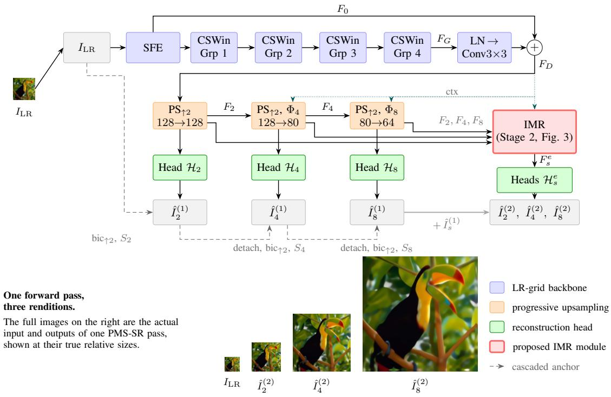  
SFE: shallow feature extraction (Conv3×3 → NAF block), output F ; CSWin Grp: residual group of four cross-shaped-window blocks (Fig. 2), last-group output $F _ { G } ; \mathrm { P S } _ { \uparrow 2 } \mathrm { : \times 2 }$ sub-pixel upsampling with the indicated channel change; Φ : concatenation with ctx and 1×1 fusion; ctx (dotted): F fed to the context projections; gray arrow: Stage-1 outputs added to the Stage-2 corrections; $\mathcal { H } _ { s } , \mathcal { H } _ { s } ^ { e } \colon$ Stage-1 and Stage-2 heads; detach: stop-gradient sg(·); Ss: 3×3 skip convolution; $\hat { I } _ { s } ^ { ( 1 ) } , \hat { I } _ { s } ^ { ( 2 ) }$ : Stage-1 and Stage-2 outputs.

Fig. 1. Overall architecture of PMS-SR. All attention runs on the LR grid (blue). Stage 1 (orange) expands the features $\times 2  \times 4  \times 8$ with decreasing widths; the ×2 output is a residual over the bicubically upsampled input, and each higher scale is a residual over the detached, bicubically upsampled prediction of the previous scale (dashed cascade). Stage 2, the IMR module (red, Fig. 3), refines all scales jointly; the heads of both stages are green. The bottom row shows the actual input and outputs of one forward pass at their true relative sizes.

where NAF(·) is a NAFNet block [26] providing early channel mixing and simplified channel attention. Four residual CSWin groups follow. Each group contains four CSWin blocks and ends with a full 3×3 convolution plus a group-level residual, analogous to the residual groups of SwinIR [7]. With $F _ { G }$ denoting the output of the last group, the backbone output is

$$
F _ { D } = \mathrm { C o n v } _ { 3 \times 3 } \big ( \mathrm { L N } ( F _ { G } ) \big ) + F _ { 0 } ,\tag{2}
$$

where LN is layer normalization. The global residual lets the attention layers focus on high-frequency content.

1) Cross-Shaped Window Attention: Each CSWin block (Fig. 2) splits the channels in half. One half attends within horizontal stripes of size $s _ { w } \times W$ , and the other within vertical stripes of size $H \times s _ { w } ,$ , where the stripe width $s _ { w }$ is 4 in the first two groups and 8 in the last two. Together, the two branches form a cross-shaped receptive field that spans both axes of the feature map in a single layer [14]. Attention uses locallyenhanced positional encoding (LePE), which adds a depthwise 3×3 convolution of the values to the attention output:

$$
\mathrm { A t t n } ( Q , K , V ) = \mathrm { s o f t m a x } \Big ( Q K ^ { \top } / \sqrt { d } \Big ) V + \mathrm { D W C o n v } ( V ) ,\tag{3}
$$

where Q, K, and V are the query, key, and value matrices of one stripe and d is the channel dimension of each attention head. For numerical stability under mixed-precision training, the attention logits and softmax are always computed in single precision.

2) Parallel Channel Attention Branch: Stripe attention, like shifted-window attention, has no access to global channel statistics [8]. We therefore adopt the channel attention block (CAB) of HAT [8] without structural change. It consists of a 3×3 convolution that compresses the channels by a factor of three, a GELU, a 3×3 convolution that restores them, and squeeze-and-excitation (SE). HAT runs the CAB in parallel with shifted-window attention; we run it in parallel with the stripe attention of every block. We make only two changes: the branch scale α is a learnable scalar initialized to 0.01, the value that HAT keeps fixed, and the squeeze-and-excitation uses a reduction ratio of 16 instead of 30:

$$
\begin{array} { r l } & { X ^ { \prime } = X _ { l - 1 } + \operatorname { P r o j } \left[ \mathrm { A t t n } _ { h } \parallel \mathrm { A t t n } _ { v } \right] \left( \mathrm { L N } ( X _ { l - 1 } ) \right) } \\ & { ~ + \alpha \mathrm { C A B } \big ( \mathrm { L N } ( X _ { l - 1 } ) \big ) , } \\ & { X _ { l } = X ^ { \prime } + \mathrm { L e F F } \big ( \mathrm { L N } ( X ^ { \prime } ) \big ) , } \end{array}\tag{4}
$$

(5)

where $X _ { l - 1 }$ and $X _ { l }$ are the input and output of the l-th block, $\mathrm { A t t n } _ { h }$ and Attnv are the horizontal- and vertical-stripe multi-head self-attentions (H- and V-stripe MSA in Fig. 2), ∥ denotes channel concatenation, Proj is a linear projection, and LeFF [34] is a feed-forward network with an interleaved 3×3 depthwise convolution for locality.

B. Stage 1: Progressive Reconstruction with Cascaded Anchors

Computation is cheapest on coarse grids, so the channel width decreases as the resolution grows: $( C _ { 2 } , C _ { 4 } , C _ { 8 } ) \ =$ (128, 80, 64). Features are expanded by ×2 sub-pixel convolution $\mathrm { P S } _ { \uparrow 2 } ( \cdot )$ [15] (a 3×3 convolution followed by PixelShuffle; each instance has its own weights and output width):

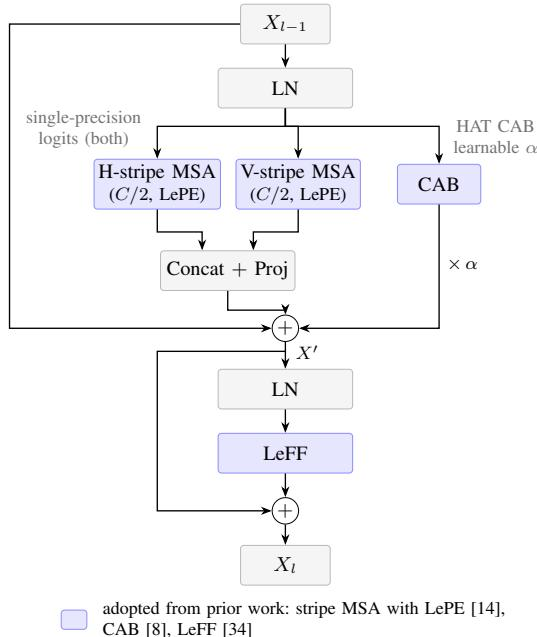  
LN: layer normalization; MSA: multi-head self-attention (H-/V-stripe MSA: Attn and Attn in Eq. (4)); LePE: locally-enhanced positional encoding; CAB: channel attention block (Conv3×3 → GELU → Conv3×3 → SE); LeFF: locally-enhanced feed-forward network; Proj: linear projection; α: learnable scalar (init. 0.01). The contributions of this paper are in Stages 1 and 2 (Figs. 1 and 3).  
Fig. 2. One CSWin block of PMS-SR (Eqs. (3)–(5)): two parallel stripe attentions (horizontal and vertical, half the channels each) plus a channel attention block (CAB) scaled by a learnable $\alpha ,$ followed by a LeFF feedforward network. Blue boxes are adopted from prior work without structural change: stripe attention with LePE [14], the CAB of HAT [8], and LeFF [34]. The learnable α and the single-precision attention logits are annotated.

$$
\begin{array} { r l } & { F _ { 2 } = \mathrm { P S } _ { \uparrow 2 } ( F _ { D } ) , } \\ & { F _ { 4 } = \Phi _ { 4 } \big [ \mathrm { P S } _ { \uparrow 2 } ( F _ { 2 } ) \big \| \mathrm { c t x } _ { 4 } ( F _ { D } ) \big ] , } \\ & { F _ { 8 } = \Phi _ { 8 } \big [ \mathrm { P S } _ { \uparrow 2 } ( F _ { 4 } ) \big \| \mathrm { c t x } _ { 8 } ( F _ { D } ) \big ] , } \end{array}\tag{6}
$$

where ct $\mathrm { x } _ { s } ( \cdot )$ is a 1×1 projection followed by bilinear resizing to the ×s grid and $\Phi _ { s }$ is a 1×1 fusion. This LR context injection gives the ×4 and ×8 branches a direct path to the backbone that bypasses accumulated error.

Each scale is predicted by a lightweight head $\mathcal { H } _ { s }$ (one NAF block and a two-layer convolutional tail) as a residual over an explicit image-domain anchor:

$$
\hat { I } _ { 2 } ^ { ( 1 ) } = \mathcal { H } _ { 2 } ( F _ { 2 } ) + S _ { 2 } \big ( \mathrm { b i c } _ { \uparrow 2 } ( I _ { \mathrm { L R } } ) \big ) ,\tag{7}
$$

$$
\hat { I } _ { 4 } ^ { ( 1 ) } = \mathcal { H } _ { 4 } ( F _ { 4 } ) + S _ { 4 } \big ( \mathrm { b i c } _ { \uparrow 2 } ( \mathrm { s g } ( \hat { I } _ { 2 } ^ { ( 1 ) } ) ) \big ) ,\tag{8}
$$

$$
\hat { I } _ { 8 } ^ { ( 1 ) } = \mathcal { H } _ { 8 } ( F _ { 8 } ) + S _ { 8 } \big ( \mathrm { b i c } _ { \uparrow 2 } ( \mathrm { s g } ( \hat { I } _ { 4 } ^ { ( 1 ) } ) ) \big ) ,\tag{9}
$$

where bic↑r denotes bicubic ×r interpolation [35] (the $\mathrm { P y } .$ Torch implementation), sg(·) denotes the stop-gradient (detach) operation, and $S _ { s }$ is a $3 { \times } 3$ skip convolution. Because the ×4 output is anchored on the predicted $\times 2$ image, $\mathcal { H } _ { 4 }$ only has to add the band that $\hat { I } _ { 2 } ^ { ( 1 ) }$ cannot represent. Two choices are intended to stabilize the cascade. First, the anchor is detached; otherwise the $\times 8$ loss would back-propagate into $\mathcal { H } _ { 2 }$ and $\mathcal { H } _ { 4 }$ and change the effective weights of the deep supervision; ProSR reports instability for anchors built on predicted outputs [13]. Second, the skip convolutions $S _ { s }$ are Dirac-initialized and the last layer of every head is zeroinitialized, so $\hat { I } _ { s } ^ { ( 1 ) }$ equals the bicubic cascade exactly at initialization. A direct anchor would start within 0.03 dB of this point; what the cascade changes is the residual that each head learns afterwards, which axis (c) of the ablation study isolates.

## C. Stage 2: Inter-Scale Mutual Refinement

Stage 1 is strictly coarse-to-fine: errors at $\times 2$ propagate to the finer scales, and ×8 evidence never corrects the coarser ones. The IMR module (Fig. 3) performs one round of bidirectional exchange over the Stage-1 features $( F _ { 2 } , F _ { 4 } , F _ { 8 } )$ with the backbone feature $F _ { D }$ as an additional context input for the ×8 row.

1) Space-to-Depth Feedback: Fine-to-coarse feedback uses PixelUnshuffle (space-to-depth) by a factor r followed by a 1×1 projection, denoted $\mathrm { P U } _ { \downarrow r }$ . The space-to-depth rearrangement itself is lossless: every sub-pixel phase becomes a separate channel, $\mathbf { s o } ,$ unlike pooling, no fixed low-pass filter discards high-frequency evidence before the learned projection:

$$
F _ { 2 } ^ { e } = F _ { 2 } + \mathrm { S C F } _ { 2 } \big [ F _ { 2 } , \mathrm { P U } _ { \downarrow 2 } ( F _ { 4 } ) , \mathrm { P U } _ { \downarrow 4 } ( F _ { 8 } ) \big ] ,\tag{10}
$$

where the superscript e marks the refined (Stage-2) features and $\operatorname { S C F } _ { s }$ is the spatial–channel fusion described below.

2) Deformable Cross-Scale Alignment: Coarse-to-fine paths suffer sub-pixel misalignment after upsampling. A lightweight deformable alignment $\operatorname { D A } ( \cdot , \cdot )$ , in the spirit of deformable convolution v2 [32], takes the feature to be warped as its first argument and the reference feature as its second. From the concatenated pair, two $3 { \times } 3$ convolutions predict one 2-D offset (tanh-bounded to ±10 pixels) and one modulation scalar per pixel. The first feature is then warped by bilinear sampling and fused with the reference by pointwise and depthwise convolutions. The last prediction layer is zero-initialized, giving zero offsets and unit modulation, so alignment starts as the identity mapping. With $\mathrm { D A } _ { 4 }$ and $\mathrm { D A } _ { 8 }$ denoting the two instances,

$$
F _ { 4 } ^ { e } = F _ { 4 } + \mathrm { S C F } _ { 4 } \big [ F _ { 4 } , ~ \mathrm { D A } _ { 4 } \big ( \mathrm { P S } _ { \uparrow 2 } ( F _ { 2 } ^ { e } ) , F _ { 4 } \big ) , ~ \mathrm { P U } _ { \downarrow 2 } ( F _ { 8 } ) \big ] .\tag{11}
$$

3) Refine-then-Upsample for ×8: Refining directly on the $\times 8$ grid is memory- and compute-intensive. We instead fold $F _ { 8 }$ to a ×4-grid representation $\tilde { F } _ { 8 } = \mathrm { P U } _ { \downarrow 2 } ( F _ { 8 } )$ , computed by a PU instance different from the one in (11), align $F _ { 4 } ^ { e }$ to ${ \mathrm { i t } } ,$ inject a backbone context stream $\mathrm { c t x } _ { 8 } ^ { e } ( F _ { D } )$ (a separate 1×1 projection of $F _ { D }$ , bilinearly resized to the ×4 grid) as a lowfrequency anchor, fuse on the $\times 4$ grid, and expand only the correction back to $\times 8 \colon$

$$
F _ { 8 } ^ { e } = F _ { 8 } + \mathrm { P S } _ { \uparrow 2 } \Big ( \mathrm { S C F } _ { 8 } \big [ \tilde { F } _ { 8 } , \mathrm { D A } _ { 8 } \big ( F _ { 4 } ^ { e } , \tilde { F } _ { 8 } \big ) , \mathrm { c t x } _ { 8 } ^ { e } ( F _ { D } ) \big ] \Big ) .\tag{12}
$$

This runs the entire $\times 8$ refinement at one quarter of the $\times 8 –$ grid cost.

4) Spatial–Channel Fusion: Each fusion operator $\operatorname { S C F } _ { s }$ takes its three input streams separately and combines them with a per-pixel softmax gate. A 1×1 compression followed by a $3 { \times } 3$ convolution produces three spatial weight maps that sum to one at every pixel, and the weighted sum of the streams is refined by a NAF block. The gate lets each location decide how much to rely on each scale. $\mathrm { S C F _ { 8 } }$ operates on the ×4 grid. Every PU, PS, DA, and SCF operator is a separate module with its own weights.

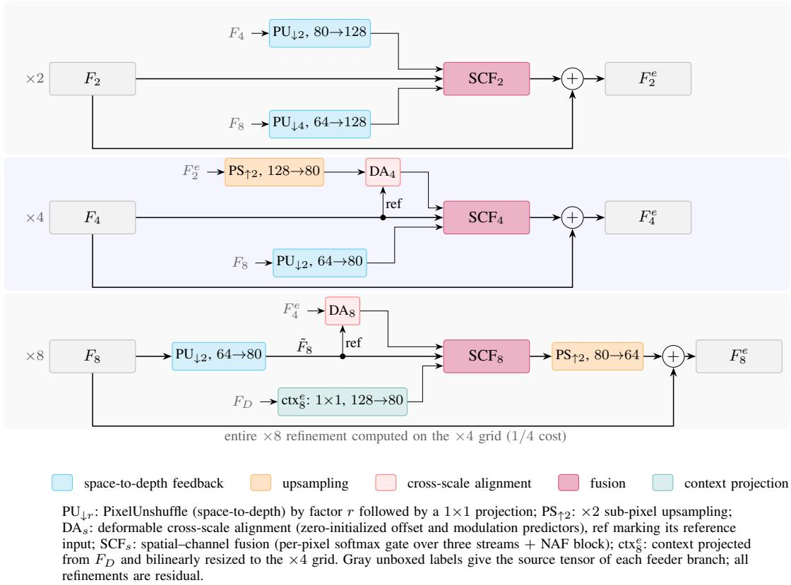  
Fig. 3. The inter-scale mutual refinement (IMR) module, Stage 2 (Eqs. (10)–(12)). Fine features are folded back by space-to-depth $( \mathrm { P U } _ { \downarrow r } )$ , coarse features are aligned to the finer grid by deformable alignment $\mathrm { ( D A } _ { s } ) _ { : }$ , and the streams are fused per pixel $( \operatorname { S C F } _ { s } )$ . The ×8 row refines entirely on the ×4 grid and expands only the correction (refine-then-upsample). All refinements are residual.

Finally, zero-initialized enhancement heads He (two NAF blocks and the same two-layer convolutional tail as $\mathcal { H } _ { s } )$ produce residual corrections in the image domain, following the multi-stage design of MPRNet [33]:

$$
\hat { I } _ { s } ^ { ( 2 ) } = \hat { I } _ { s } ^ { ( 1 ) } + \mathcal { H } _ { s } ^ { e } ( F _ { s } ^ { e } ) , \qquad s \in \{ 2 , 4 , 8 \} .\tag{13}
$$

## D. Training Objective

All six outputs are supervised (deep supervision). For a prediction ˆI and its target I, the loss combines a Charbonnier term [36], an edge term [33], and a frequency-domain term [37]:

$$
\ell ( \hat { I } , I ) = \ell _ { \mathrm { c h a r } } ( \hat { I } , I ) + 0 . 0 5 \ell _ { \mathrm { e d g e } } ( \hat { I } , I ) + 0 . 0 1 \ell _ { \mathrm { f f t } } ( \hat { I } , I ) ,\tag{14}
$$

where $\begin{array} { r c l } { \ell _ { \mathrm { c h a r } } } & { = } & { \frac { 1 } { N } \sum _ { i } \sqrt { ( \hat { I } _ { i } - I _ { i } ) ^ { 2 } + \varepsilon ^ { 2 } } } \end{array}$ over the N pixel values $( \varepsilon ^ { 2 } { = } 1 0 ^ { - 6 } ) , \ \ell _ { \mathrm { e d g e } }$ is the $L _ { 1 }$ distance between Laplacian filter responses, and $\ell _ { \mathrm { { f f t } } }$ is the $L _ { 1 }$ distance between the real and imaginary parts of the orthonormal 2-D FFT coefficients. Frequency-domain supervision [37], [38] and spatial–frequency processing [39], [40] likewise emphasize high-frequency content, which a purely spatial loss tends to underweight. With scale weights $( \lambda _ { 2 } , \lambda _ { 4 } , \lambda _ { 8 } ) = ( 0 . 5 , 0 . 8 , 1 . 2 )$ emphasizing the hardest factor, the total objective is

$$
\begin{array} { r l } & { \mathcal { L } ^ { ( j ) } = \displaystyle \sum _ { s \in \{ 2 , 4 , 8 \} } \lambda _ { s } \ell \big ( \hat { I } _ { s } ^ { ( j ) } , I _ { s } ^ { \mathrm { H R } } \big ) , \quad j \in \{ 1 , 2 \} , } \\ & { } \\ & { \mathcal { L } = \big ( 0 . 4 \mathcal { L } ^ { ( 1 ) } + 0 . 6 \mathcal { L } ^ { ( 2 ) } \big ) / 2 . 5 , } \end{array}\tag{15}
$$

where the superscript j indexes the stage: $\mathcal { L } ^ { ( 1 ) }$ supervises the Stage-1 outputs $\hat { I } _ { s } ^ { ( 1 ) }$ and $\mathcal { L } ^ { ( 2 ) }$ the Stage-2 outputs $\mathring { I } _ { s } ^ { ( 2 ) } .  I _ { s } ^ { \mathrm { H R } }$ is the ground truth at scale s, i.e., the HR patch for $s = 8$ and its bicubic downsampling by $8 / s$ for $s = 2$ and 4, since training feeds the ×8 LR patch to all three outputs (Sec. IV-A). The divisor $2 . 5 = \textstyle \sum _ { s } \lambda _ { s }$ normalizes the scale weights, and the stage weights 0.4 and 0.6 favor the delivered Stage-2 outputs.

## IV. EXPERIMENTS

## A. Datasets, Degradations, and Evaluation Protocol

a) Training sets: Following recent SISR practice, we train on DF2K (DIV2K [41] and Flickr2K [5], 3450 HR images). Each HR image is cropped to a multiple of 8 and downsampled by MATLAB-equivalent bicubic interpolation (with antialiasing) to $1 / 2 , 1 / 4$ , and $1 / 8$ of its size, which gives scale-aligned quadruples. In every iteration, a random 48×48 LR patch and its aligned 96×96, 192×192, and 384×384 counterparts are cropped on the fly and augmented with the same random flips and $9 0 °$ rotations. The training degradation is identical to the test-time degradation.

b) Test benchmarks: We report results on the five standard benchmarks, Set5 [42] (5 images), Set14 [43] (14 images), BSD100 [44] (100 images), Urban100 [45] (100 images), and Manga109 [46] (109 images), at $\times 2 , \times 4 ,$ and ×8, with LR inputs generated by bicubic downsampling in the MATLAB imresize convention [35] after modulo cropping. Because SR papers use one image from each of the 109 Manga109 volumes, we checked that our copy is the standard set: its bicubic PSNRs at $\times 2$ and ×4 (30.82 and 24.90 dB) agree within 0.02 dB with those in [6] (30.80 and 24.89 dB), and the released SwinIR-M model reproduces its published Manga109 scores exactly (39.92/0.9797 at $\times 2$ and 32.03/0.9260 at ×4).

c) Evaluation protocol: Following common practice [6], [10], [13], peak signal-to-noise ratio (PSNR) and structural similarity (SSIM) [47] are computed on the Y (luminance) channel of YCbCr after conversion from sRGB, on 8-bit images with s border pixels removed at scale s. The Stage-2 outputs are evaluated. At ×8, we also report the learned perceptual image patch similarity (LPIPS) [48] (AlexNet backbone, lower is better). To test whether a difference between two methods is systematic, we apply the two-sided Wilcoxon signed-rank test [49] to the per-image Y-PSNR differences on each benchmark and adjust the resulting p-values with the Holm procedure [50] over the benchmarks of each comparison.

## B. Implementation Details

a) Framework and hardware: All experiments are implemented in PyTorch 2.2 (CUDA 12.1) and run on a single NVIDIA RTX 4090 GPU (24 GB). Training the reported model takes about 146 GPU-hours (1.75 s per iteration at batch size 16 for 300k iterations), and gradient checkpointing on the ×4 and ×8 branches keeps the peak memory at 15.4 GB. All random seeds are fixed.

b) Architecture hyperparameters: The backbone uses an embedding width of C=128 and four groups of four CSWin blocks, with stripe widths (4, 4, 8, 8) and (4, 4, 8, 8) attention heads across the groups, a LeFF expansion ratio of 2.0, qkv bias, and stochastic depth with a drop rate that increases linearly over the blocks to a maximum of 0.1.

c) Optimization: All scales are trained jointly with the objective in (15) for 300k iterations at batch size 16, using Adam $( \beta _ { 1 } { = } 0 . 9 , ~ \beta _ { 2 } { = } 0 . 9 9 9 )$ and a learning rate of $2 \times 1 0 ^ { - 4 }$ with a 2k-iteration warm-up, halved at 150k, 240k, 270k, and 285k iterations. We train in bfloat16 with single-precision attention logits, clip gradients at 2.0, and keep an exponential moving average (EMA) of the weights with decay min(0.999, (1+t)/(10+t)) at iteration $t ;$ the EMA weights are used for evaluation. The checkpoint with the best average fullimage Y-PSNR on Set5 over the three scales (iteration 275k) is used. Since Set5 is also a test benchmark, we checked that this choice brings no advantage: the final 300k iterate scores 38.17/32.70/27.49 dB against 38.16/32.72/27.49 dB, and the three-scale average validation PSNR varies by only 0.009 dB (standard deviation) over the last 50k iterations.

d) Inference: Test images are processed in 48×48 LR tiles with an overlap of 16 pixels, which matches the attention geometry seen in training. Because several baselines use whole-image inference, we also evaluated PMS-SR on whole images: the PSNR changes by at most 0.04 dB at ×8 on the five benchmarks (Sec. IV-F) and by −0.02 to +0.12 dB at ×2 and ×4 on Set5, Set14, BSD100, and Urban100 (192×192 tiles for Urban100), with the largest change in favor of wholeimage inference (Set14 at ×2: 34.07 vs. 33.95 dB). All tables use the tiled protocol.

## C. Quantitative Comparison with Representative Methods

a) Comparison with multi-scale methods: Table I compares PMS-SR with the other multi-scale methods, the most direct comparison. Published values come from the original papers (ProSR SSIM from its supplementary material; MSWSR from the compilation in [12]), and MDSR does not support $\times 8 .$ The cells marked † were measured under our protocol and fill unpublished entries: the released MDSR model, the single released MSWSR checkpoint, which produces ×2, ×4, and ×8 outputs, and the ProSR-L checkpoints on the authors project page for Set5 and Manga109, which ProSR does not report. Our pipeline reproduces the published MSWSR results within 0.02 dB, the result images released with ProSR-L score within 0.06 dB of its published values, and its checkpoints reproduce the Set5 scores of those images within 0.02 dB. The released MDSR weights, a PyTorch port of the original model, reproduce the published MDSR results only within −0.12 to +0.09 dB, so the MDSR† entries carry this uncertainty. ProSR-S is omitted because its weights are no longer available and ProSR-L is more accurate in every reported entry. PMS-SR+ uses the geometric self-ensemble [5]; like the DIV2K-only control (same architecture, 800 DIV2K images, one third of the schedule), it is shown for reference and not ranked.

At ×8, which MDSR cannot produce, PMS-SR is the best multi-scale method in every PSNR entry and in every SSIM entry except Set14, where MLWAN reports a higher SSIM (0.6574 vs. 0.6551) with a 0.40 dB lower PSNR. PMS-SR is 0.08–0.32 dB better than ProSR-L, which has about twice as many parameters, and 0.42–1.68, 0.26–1.07, and 0.33–1.37 dB better than MS-LapSRN, MLWAN, and MSWSR, respectively. It also leads every column at ×4. At ×2, it leads on Urban100 and is within 0.05 dB of ProSR-L on Set5, Set14, and BSD100, with the highest SSIM on Set5; on Manga109, ProSR-L† and MDSR† are 0.18 and 0.17 dB ahead, which may reflect the low weight given to $\times 2$ in our objective (15). The DIV2Konly control separates the effect of the training data. Trained on DIV2K with one third of the schedule, it already comes close to ProSR-L at ×8 with half of its parameters (+0.02 dB on Urban100, equal on BSD100, and −0.09, −0.10, and −0.16 dB on Set5, Set14, and Manga109). At ×8 it also stays within 0.2 dB of the DIV2K-trained RCAN and the DF2Ktrained DRN-L on every benchmark (Table III). The design therefore accounts for most of the lead over MSWSR and MLWAN and reaches nearly the accuracy of ProSR-L at half its size, whereas the margin over ProSR-L also reflects the larger training set and the full schedule.

b) Comparison with single-scale methods: SIMO and single-input single-output (SISO) models solve different deployment problems, so this comparison is asymmetric by design: each SISO model is trained for one factor, and a ladder of three such models has at least 4.5× the parameters of PMS-SR. Table I is therefore our primary comparison, and Table III shows how much PMS-SR gives up, or gains, by covering three factors with one model. Except for the † rows, all baseline values are published results; the Manga109 and ×8 values of EDSR and the ×8 values of D-DBPN follow the compilations in RCAN [6] and SAN [51], and the ×8 values of SwinIR-M come from its supplementary material. The † rows are our whole-image measurements of the released DRN-L weights. The same pipeline reproduces the published results of DRN-L within 0.02 dB and those of SwinIR-M, including its ×8 results, within 0.05 dB.

TABLE I  
COMPARISON WITH MULTI-SCALE SUPER-RESOLUTION METHODS (PSNR / SSIM, Y CHANNEL). BEST IN RED, SECOND BEST IN BLUE; PMS-SR+ (SELF-ENSEMBLE) AND THE DIV2K-ONLY CONTROL ARE NOT RANKED. † = MEASURED BY US FROM THE AUTHORS’ RELEASED WEIGHTS (SEC. IV-C).
<table><tr><td>Method</td><td>Scale</td><td>Params (M)</td><td>Set5 PSNR / SSIM</td><td>Set14 PSNR / SSIM</td><td>BSD100 PSNR / SSIM</td><td>Urban100 PSNR / SSIM</td><td>Manga109 PSNR / SSIM</td></tr><tr><td colspan="6">Scale ×2</td><td></td><td></td></tr><tr><td>LapSRN [9]</td><td>×2</td><td>1.31</td><td>37.52 / 0.959</td><td>33.08 / 0.913</td><td>31.80 / 0.895</td><td>30.41 / 0.910</td><td>37.27 / 0.974</td></tr><tr><td>MSWSR [11]</td><td>×2</td><td>1.23</td><td>37.49 / 0.9582†</td><td>33.23 / 0.9123</td><td>31.88 / 0.8929</td><td>31.14 / 0.9169</td><td>37.32 / 0.9733</td></tr><tr><td>MLWAN [12]</td><td>×2</td><td>1.23</td><td>37.68 / 0.9589</td><td>33.47 / 0.9227</td><td>31.96 / 0.8974</td><td>31.34 / 0.9309</td><td>37.39 / 0.9733</td></tr><tr><td>MS-LapSRN [10]</td><td>×2</td><td>0.22</td><td>37.78 / 0.960</td><td>33.28 / 0.915</td><td>32.05 / 0.898</td><td>31.15 / 0.919</td><td>37.78 / 0.976</td></tr><tr><td>MDSR [5]</td><td>×2</td><td>8.00</td><td>38.11 / 0.9602</td><td>33.85 / 0.9198</td><td>32.29 / 0.9007</td><td>32.84 / 0.9347</td><td>39.09 / 0.9779</td></tr><tr><td>ProSR-L [13]</td><td>×2</td><td>15.50</td><td>38.17 / 0.9608†</td><td>34.00 / 0.921</td><td>32.34 / 0.902</td><td>32.91 / 0.935</td><td>39.10 / 0.9777†</td></tr><tr><td>PMS-SR (DIV2K-only, 113 sched.)</td><td>×2</td><td>7.95</td><td>38.04 / 0.9607</td><td>33.74 / 0.9186</td><td>32.17 / 0.8985</td><td>32.42 / 0.9310</td><td>38.57 / 0.9769</td></tr><tr><td>PMS-SR (Ours)</td><td>×2</td><td>7.95</td><td>38.16 / 0.9611</td><td>33.95 / 0.9200</td><td>32.31 / 0.9002</td><td>33.03 / 0.9366</td><td>38.92 / 0.9777</td></tr><tr><td>PMS-SR+ (Ours)</td><td>×2</td><td>7.95</td><td>38.21 / 0.9613</td><td>34.06 / 0.9208</td><td>32.35 / 0.9005</td><td>33.15 / 0.9375</td><td>39.07 / 0.9780</td></tr><tr><td colspan="8">Scale ×4</td></tr><tr><td>LapSRN [9]</td><td>×4</td><td>1.31</td><td>31.54 / 0.885</td><td>28.19 / 0.772</td><td>27.32 / 0.728</td><td>25.21 / 0.756</td><td>29.09 / 0.890</td></tr><tr><td>MSWSR [11]</td><td>×4</td><td>1.23</td><td>32.00 / 0.8913†</td><td>28.47 / 0.7776</td><td>27.48 / 0.7311</td><td>25.78 / 0.7744</td><td>30.01 / 0.8999</td></tr><tr><td>MLWAN [12]</td><td>×4</td><td>1.23</td><td>32.19 / 0.8957</td><td>28.55 / 0.7797</td><td>27.67 / 0.7429</td><td>25.89 / 0.7779</td><td>30.16 / 0.9110</td></tr><tr><td>MS-LapSRN [10]</td><td>×4</td><td>0.22</td><td>31.74 / 0.889</td><td>28.26 / 0.774</td><td>27.43 / 0.731</td><td>25.51 / 0.768</td><td>29.54 / 0.897</td></tr><tr><td>MDSR [5]</td><td>×4</td><td>8.00</td><td>32.50 / 0.8973</td><td>28.72 / 0.7857</td><td>27.72 / 0.7418</td><td>26.67 / 0.8041</td><td>31.04 / 0.9145†</td></tr><tr><td>ProSR-L [13]</td><td>×4</td><td>15.50</td><td>32.53 / 0.8991†</td><td>28.94 / 0.790</td><td>27.79 / 0.743</td><td>26.89 / 0.809</td><td>31.39 / 0.9181†</td></tr><tr><td>PMS-SR (DIV2K-only, sched.)</td><td>×4</td><td>7.95</td><td>32.52 / 0.8985</td><td>28.86 / 0.7877</td><td>27.74 / 0.7420</td><td>26.77 / 0.8056</td><td>31.10 / 0.9159</td></tr><tr><td>PMS-SR (Ours)</td><td>×4</td><td>7.95</td><td>32.72 / 0.9012</td><td>29.00 / 0.7915</td><td>27.87 / 0.7464</td><td>27.25 / 0.8177</td><td>31.69 / 0.9222</td></tr><tr><td>PMS-SR+ (Ours)</td><td>×4</td><td>7.95</td><td>32.79 / 0.9020</td><td>29.08 / 0.7927</td><td>27.90 / 0.7470</td><td>27.38 / 0.8204</td><td>31.90 / 0.9237</td></tr><tr><td colspan="8">Scale ×8</td></tr><tr><td>LapSRN [9]</td><td>×8</td><td>1.31</td><td>26.14 / 0.738</td><td>24.44 / 0.623</td><td>24.54 / 0.586</td><td>21.81  / 0.581</td><td>23.39 / 0.735</td></tr><tr><td>MSWSR [11]</td><td>×8</td><td>1.23</td><td>26.76 / 0.7631†</td><td>24.82 / 0.6338</td><td>24.74 / 0.5914</td><td>22.30 / 0.6045</td><td>24.21 / 0.7609</td></tr><tr><td>MLWAN [12]</td><td>×8</td><td>1.23</td><td>26.89 / 0.7732</td><td>24.97 / 0.6574</td><td>24.81  / 0.5969</td><td>22.95 / 0.6371</td><td>24.51 / 0.7833</td></tr><tr><td>MS-LapSRN [10]</td><td>×8</td><td>0.22</td><td>26.34 / 0.753 27.35 / 0.7885†</td><td>24.57 / 0.629</td><td>24.65 / 0.592</td><td>22.06 / 0.598</td><td>23.90 / 0.759</td></tr><tr><td>ProSR-L [13]</td><td>×8</td><td>15.50</td><td>27.26 / 0.7862</td><td>25.29 / 0.652 25.19 / 0.6490</td><td>24.99 / 0.606</td><td>23.04 / 0.645</td><td>25.29 / 0.8045</td></tr><tr><td>PMS-SR (DIV2K-only, 113 sched.)</td><td>×8 ×8</td><td>7.95 7.95</td><td>27.49 / 0.7922</td><td>25.37 / 0.6551</td><td>24.99 / 0.6050 25.07 / 0.6094</td><td>23.06 / 0.6448 23.36 / 0.6593</td><td>25.13 / 0.7997</td></tr><tr><td>PMS-SR (Ours) PMS-SR+ (Ours)</td><td>×8</td><td>7.95</td><td>27.54 / 0.7935</td><td>25.44 / 0.6568</td><td>25.11 / 0.6103</td><td>23.46 / 0.6623</td><td>25.58 / 0.8129 25.75 / 0.8158</td></tr><tr><td></td><td></td><td></td><td></td><td></td><td></td><td></td><td></td></tr></table>

At ×8, PMS-SR outperforms EDSR, D-DBPN, RCAN, SAN, and the ×8-specific DRN-L [30] on all five benchmarks. On Set5 it is 0.53 dB above the 45.5M EDSR and 0.18 dB above RCAN, and it exceeds DRN-L by 0.38 dB on Urban100 (23.36 vs. 22.98 dB) and by 0.26 dB on Manga109 (25.58 vs. 25.32 dB). Three published ×8 models are stronger on some benchmarks: SwinIR-M [7], DBPN-RES-MR64-3 [17], and RDRN [52], with 12.1M, 23.1M, and about 36M parameters for ×8 alone. Where they are ahead of PMS-SR (on Set5, Set14, BSD100, or Manga109), the margin is at most 0.13 dB, whereas PMS-SR is at least 0.16 dB ahead of all of them on Urban100, with the highest SSIM there as well. PMS-SR is also not significantly different from SwinIR-M on BSD100 and Manga109 in the paired test below (adjusted $p = 0 . 1 7$ and 0.52), while using 22% of the parameters of three SwinIR-M models. HAT, HMA, and the Mamba-based models do not report ×8 results.

Because several of these margins are small, we apply the paired test of Sec. IV-A where PMS-SR loses as well as where it wins, with all competitors re-evaluated under the same protocol. At ×8, PMS-SR is better than SwinIR-M on 81 of the 100 Urban100 images (median gain 0.090 dB, adjusted $p ~ < ~ 1 0 ^ { - 8 } )$ . On the other four benchmarks, the differences are not significant (adjusted $p > 0 . 1 6 )$ . Against DRN-L the advantage is broader: PMS-SR is better on all 100 Urban100 images (median gain 0.249 dB), on 102 of the 109 Manga109 images (0.191 dB), and on 85 of the 100 BSD100 images (adjusted $p < 1 0 ^ { - 9 }$ in all three cases). At the smaller factors, which carry less weight in our objective, SwinIR-M stays ahead (mean differences of 0.06–0.33 dB on BSD100, Urban100, and Manga109 at ×4 and 0.23–1.00 dB at ×2; adjusted $p < 1 0 ^ { - 9 }$ on these sets).

TABLE II  
PSNR GAP (DB) BETWEEN SINGLE-PASS PMS-SR AND SWINIR-M, THESTRONGEST COMPETITOR WITH RELEASED MODELS FOR ALL THREEFACTORS (PUBLISHED SWINIR-M VALUES; ×8 FROM ITSSUPPLEMENTARY MATERIAL). POSITIVE VALUES (RED) FAVOR PMS-SR.
<table><tr><td>Benchmark</td><td>×2</td><td>×4</td><td>×8</td></tr><tr><td>Set5</td><td>-0.26</td><td>-0.20</td><td>-0.06</td></tr><tr><td>Set14</td><td>-0.51</td><td>-0.09</td><td>-0.09</td></tr><tr><td>BSD100</td><td>-0.22</td><td>-0.05</td><td>+0.03</td></tr><tr><td>Urban100</td><td>-0.78</td><td>-0.20</td><td>+0.19</td></tr><tr><td>Manga109</td><td>-1.00</td><td>-0.34</td><td>+0.03</td></tr><tr><td>Average</td><td>-0.55</td><td>-0.18</td><td>+0.02</td></tr></table>

c) Gap to the single-scale models acrossfactors: Table II summarizes the single-scale comparison from the viewpoint of a multi-scale model. The gap to SwinIR-M shrinks from −0.55 dB on average at ×2 to −0.18 dB at ×4 and becomes slightly positive at ×8. It never widens with the factor on any benchmark and is positive at ×8 on three of the five benchmarks, significantly so on Urban100. This trend is consistent with the design: the objective gives the largest weight to the hardest factor (15), the cascaded anchors keep the shared backbone from being spent on the factor that bicubic interpolation already serves well, and the IMR gains are larger at ×4 and ×8 than at ×2 (Table IV). A system that must deliver all three renditions thus gives up 0.2–1.0 dB at ×2 against an 11.8M single-scale model and obtains ×8 results on par with the strongest single-scale ×8 models, with 22% of the parameters of the three-model ladder.

d) Self-ensemble: As in EDSR+ and RCAN+ [5], [6], PMS-SR+ averages the outputs over the eight standard flips and rotations at eight times the inference cost. The gain is positive in all fifteen benchmark–factor combinations (+0.03 to +0.21 dB) and, at every factor, largest on Manga109 and Urban100, whose line art and repeated structures benefit most from averaging over orientations. Because the same technique applies to every baseline, PMS-SR+ is not ranked against single models; against published self-ensembles at ×8, it is ahead of RCAN+ [6] on all five benchmarks, of SwinIR+ [7] on BSD100, Urban100, and Manga109, and of RDRN+ [52] only on Urban100.

e) Manga109: On Manga109, PMS-SR leads every ×4 and ×8 entry among the multi-scale methods, by 0.30 and 0.29 dB over ProSR-L†. At ×8, PMS-SR (25.58 dB) is above RCAN, D-DBPN, DRN-L†, and SwinIR-M (25.14– 25.55 dB) but below DBPN-RES-MR64-3 (25.71 dB) and RDRN (25.66 dB); per image it is better than RCAN and DRN-L on 106 and 102 of the 109 pages, whereas the 59/109 split against SwinIR-M is not significant. The DIV2K-only control reaches 25.13 dB, close to D-DBPN and RCAN.

## D. Qualitative Comparison

Fig. 4 compares PMS-SR at ×8 with bicubic interpolation, RCAN [6], the ×8-specific DRN-L [30], and the released SwinIR-M ×8 model [7]. All methods receive the same LR input, and we ran the baselines with the authors’ weights. The examples are images on which PMS-SR leads all three networks in both PSNR and SSIM; at ×8 this holds for 31, 60, and 32 images of BSD100, Urban100, and Manga109, and at ×4 for 9 images, whereas at ×2 the single-scale Transformers lead on almost every image (Sec. IV-C), so no ×2 example is shown. At ×8, PMS-SR is ahead of the best baseline by 0.39 dB on the BSD100 violinist, 1.45 and 0.65 dB on the two Urban100 fac¸ades, and 0.51 dB on the Manga109 title in Fig. 4. On the Manga109 page in Fig. 5(a), it is 0.95– 1.71 dB better than all three baselines and keeps the title strokes separate where the baselines merge or thicken them. In the two ×4 cases of Fig. 5(b) and (c), it is 0.81 and 0.51 dB ahead of SwinIR-M. Each PMS-SR result comes from a pass that also produced the other two renditions.

a) Perceptual quality: Under the same protocol, the ×8 LPIPS values on Set5, Set14, BSD100, Urban100, and Manga109 are 0.284/0.428/0.534/0.361/0.214 for PMS-SR, 0.278/0.422/0.529/0.351/0.209 for SwinIR-M, 0.281/0.429/0.540/0.375/0.219 for DRN-L, and 0.288/0.430/0.538/0.364/0.219 for RCAN (0.54–0.72 for bicubic interpolation). PMS-SR is therefore within 0.011 of SwinIR-M on every benchmark, lower than RCAN on all five, and lower than DRN-L on all except Set5. Like these baselines, PMS-SR is trained with a distortion-oriented objective, so its gains lie in fidelity and cross-factor coverage rather than in perceptual quality.

## E. Ablation Studies

a) Effectiveness of the Inter-Scale Mutual Refinement Stage: Evaluating the Stage-1 outputs $\hat { I } _ { s } ^ { ( 1 ) }$ of the same trained model removes the entire IMR module at test time (Table IV, run on Set5, Set14, BSD100, and Urban100). IMR improves PSNR on every benchmark of the table at every scale, with the largest gains on Urban100 (+0.08 to +0.10 dB at all three scales and +0.0044 SSIM at ×8), where repeated structures benefit most from cross-scale alignment. In the paired test, the full model is better on 87–98 of the 100 images of BSD100 and Urban100 at every scale (BSD100: 87, 94, and 87; Urban100: 96, 97, and 98 at ×2, ×4, and ×8; adjusted $p < 1 0 ^ { - 1 2 }$ in all cases). It is also better on 11–12 of the 14 Set14 images (adjusted $p \leq 0 . 0 2 2 )$ , whereas the differences on the five Set5 images are not significant. Because this is a test-time ablation of jointly trained weights, the gains measure the contribution of Stage 2 within the trained model; axis (a) below measures the effect of training without it.

Fig. 6 shows that the correction added by Stage 2 is sparse: it concentrates on boundaries and texture transitions that the cascade does not fully resolve and leaves flat regions almost unchanged.

b) Further ablation axes: Separating the individual mechanisms of Sec. III requires retraining. We therefore train five variants from scratch with a shortened but otherwise identical 50k-iteration schedule, each using the checkpoint selected as in Sec. IV-B (Table V): (a) no Stage 2, (b) no channel attention branch, (c) a direct $\mathrm { b i c } _ { \uparrow s } ( I _ { \mathrm { L R } } )$ anchor instead of the cascade in (7)–(9), (d) no anchor detachment, and (e) concatenation instead of deformable alignment. These variants are comparable with one another but not with the 300k model.

TABLE III  
REFERENCE COMPARISON WITH SINGLE-SCALE (SISO) MODELS. EACH TRAINED PER FACTOR (PARAMS IS THE PER-FACTOR SIZE). AGAINST ONE 7.95M PMS-SR COVERING ALL THREE FACTORS (∗). BEST IN RED, SECOND BEST IN BLUE; PMS-SR+ (SELF-ENSEMBLE) IS NOT RANKED. † = MEASURED BY US FROM THE AUTHORS’ RELEASED WEIGHTS (SEC. IV-C); ≈ = SIZE REPORTED FOR THE ×4 MODEL.
<table><tr><td>Method</td><td>Scale</td><td>Params (M)</td><td>Set5 PSNR / SSIM</td><td>Set14 PSNR / SSIM</td><td>BSD100 PSNR / SSIM</td><td>Urban100 PSNR / SSIM</td><td>Manga109 PSNR / SSIM</td></tr><tr><td>EDSR [5] (2017)</td><td>×2</td><td>40.7</td><td>38.11 / 0.9601</td><td>33.92 / 0.9195</td><td>32.32 / 0.9013</td><td>32.93 / 0.9351</td><td>39.10 / 0.9773</td></tr><tr><td>RCAN [6] (2018)</td><td>×2</td><td>15.4</td><td>38.27 / 0.9614</td><td>34.12 / 0.9216</td><td>32.41  / 0.9027</td><td>33.34 / 0.9384</td><td>39.44 / 0.9786</td></tr><tr><td>SAN [51] (2019)</td><td>×2</td><td>15.7</td><td>38.31 / 0.9620</td><td>34.07 / 0.9213</td><td>32.42 / 0.9028</td><td>33.10 / 0.9370</td><td>39.32 / 0.9792</td></tr><tr><td>IGNN [53] (2020)</td><td>×2</td><td>49.5</td><td>38.24 / 0.9613</td><td>34.07 / 0.9217</td><td>32.41  / 0.9025</td><td>33.23 / 0.9383</td><td>39.35 / 0.9786</td></tr><tr><td>NLSA [54] (2021)</td><td>×2</td><td>44.2</td><td>38.34 / 0.9618</td><td>34.08 / 0.9231</td><td>32.43 / 0.9027</td><td>33.42 / 0.9394</td><td>39.59 / 0.9789</td></tr><tr><td>SwinIR-M [7] (2021)</td><td>×2</td><td>11.8</td><td>38.42 / 0.9623</td><td>34.46 / 0.9250</td><td>32.53 / 0.9041</td><td>33.81  / 0.9427</td><td>39.92 / 0.9797</td></tr><tr><td>EDT [20] (2023)</td><td>×2</td><td>11.5</td><td>38.45  / 0.9624</td><td>34.57 / 0.9258</td><td>32.52 / 0.9041</td><td>33.80 / 0.9425</td><td>39.93 / 0.9800</td></tr><tr><td>SRFormer [21] (2023)</td><td>×2</td><td>10.4</td><td>38.51 / 0.9627</td><td>34.44 / 0.9253</td><td>32.57  / 0.9046</td><td>34.09 / 0.9449</td><td>40.07 / 0.9802</td></tr><tr><td>HAT [8] (2023)</td><td>×2</td><td>20.8</td><td>38.63 / 0.9630</td><td>34.86 / 0.9274</td><td>32.62 / 0.9053</td><td>34.45  / 0.9466</td><td>40.26 / 0.9809</td></tr><tr><td>MambaIR [22] (2024)</td><td>×2</td><td>20.4</td><td>38.57 / 0.9627</td><td>34.67  / 0.9261</td><td>32.58 / 0.9048</td><td>34.15 / 0.9446</td><td>40.28 / 0.9806</td></tr><tr><td>HMA [55] (2024)</td><td>×2</td><td>≈69.9</td><td>38.79 / 0.9641</td><td>35.11 / 0.9286</td><td>32.67 / 0.9061</td><td>34.85 / 0.9493</td><td>40.73 / 0.9824</td></tr><tr><td>MambaIRv2-B [23] (2025)</td><td>×2</td><td>22.9</td><td>38.65 / 0.9631</td><td>34.89 / 0.9275</td><td>32.62 / 0.9053</td><td>34.49 / 0.9468</td><td>40.42 / 0.9810</td></tr><tr><td>PMS-SR (Ours)</td><td>×2</td><td>7.95*</td><td>38.16 / 0.9611</td><td>33.95 / 0.9200</td><td>32.31  / 0.9002</td><td>33.03 / 0.9366</td><td>38.92 / 0.9777</td></tr><tr><td>PMS-SR+ (Ours)</td><td>×2</td><td>7.95*</td><td>38.21 / 0.9613</td><td>34.06 / 0.9208</td><td>32.35 / 0.9005</td><td>33.15 / 0.9375</td><td>39.07 / 0.9780</td></tr><tr><td>EDSR [5] (2017)</td><td>×4</td><td>43.1</td><td>32.46 / 0.8968</td><td>28.80 / 0.7876</td><td>27.71 / 0.7420</td><td>26.64 / 0.8033</td><td>31.02 / 0.9148</td></tr><tr><td>RCAN [6] (2018)</td><td>×4</td><td>15.6</td><td>32.63 / 0.9002</td><td>28.87 / 0.7889</td><td>27.77 / 0.7436</td><td>26.82 / 0.8087</td><td>31.22 / 0.9173</td></tr><tr><td>SAN [51] (2019)</td><td>×4</td><td>15.9</td><td>32.64 / 0.9003</td><td>28.92 / 0.7888</td><td>27.78 / 0.7436</td><td>26.79 / 0.8068</td><td>31.18 / 0.9169</td></tr><tr><td>DRN-L† [30] (2020)</td><td>×4</td><td>9.8</td><td>32.74 / 0.9015</td><td>28.97 / 0.7913</td><td>27.83 / 0.7449</td><td>27.03 / 0.8131</td><td>31.71 / 0.9215</td></tr><tr><td>IGNN [53] (2020)</td><td>×4</td><td>49.5</td><td>32.57 / 0.8998</td><td>28.85 / 0.7891</td><td>27.77 / 0.7434</td><td>26.84 / 0.8090</td><td>31.28 / 0.9182</td></tr><tr><td>NLSA [54] (2021)</td><td>×4</td><td>44.2</td><td>32.59 / 0.9000</td><td>28.87 / 0.7891</td><td>27.78 / 0.7444</td><td>26.96 / 0.8109</td><td>31.27 / 0.9184</td></tr><tr><td>SwinIR-M [7] (2021)</td><td>×4</td><td>11.9</td><td>32.92 / 0.9044</td><td>29.09 / 0.7950</td><td>27.92 / 0.7489</td><td>27.45 / 0.8254</td><td>32.03 / 0.9260</td></tr><tr><td>EDT [20] (2023)</td><td>×4</td><td>11.6</td><td>32.82 / 0.9031</td><td>29.09 / 0.7939</td><td>27.91  / 0.7483</td><td>27.46 / 0.8246</td><td>32.05 / 0.9254</td></tr><tr><td>SRFormer [21] (2023)</td><td>×4</td><td>10.5</td><td>32.93 / 0.9041</td><td>29.08 / 0.7953</td><td>27.94 / 0.7502</td><td>27.68 / 0.8311</td><td>32.21 / 0.9271</td></tr><tr><td>HAT [8] (2023)</td><td>×4</td><td>20.8</td><td>33.04 / 0.9056</td><td>29.23 / 0.7973</td><td>28.00 / 0.7517</td><td>27.97 / 0.8368</td><td>32.48 / 0.9292</td></tr><tr><td>MambaIR [22] (2024)</td><td>×4</td><td>20.4</td><td>33.03 / 0.9046</td><td>29.20 / 0.7961</td><td>27.98 / 0.7503</td><td>27.68 / 0.8287</td><td>32.32 / 0.9272</td></tr><tr><td>HMA [55] (2024)</td><td>×4</td><td>69.9</td><td>33.15 / 0.9060</td><td>29.32 / 0.7996</td><td>28.05 / 0.7530</td><td>28.42 / 0.8450</td><td>32.97 / 0.9320</td></tr><tr><td>MambaIRv2-B [23] (2025)</td><td>×4</td><td>23.1</td><td>33.14 / 0.9057</td><td>29.23 / 0.7975</td><td>28.00 / 0.7511</td><td>27.89 / 0.8344</td><td>32.57 / 0.9295</td></tr><tr><td>PMS-SR (Ours)</td><td>×4</td><td>7.95*</td><td>32.72 / 0.9012</td><td>29.00 / 0.7915</td><td>27.87  / 0.7464</td><td>27.25 / 0.8177</td><td>31.69 / 0.9222</td></tr><tr><td>PMS-SR+ (Ours)</td><td>×4</td><td>7.95*</td><td>32.79 / 0.9020</td><td>29.08 / 0.7927</td><td>27.90 / 0.7470</td><td>27.38 / 0.8204</td><td>31.90 / 0.9237</td></tr><tr><td>EDSR [5] (2017)</td><td>×8</td><td>45.5</td><td>26.96 / 0.7762</td><td>24.91  / 0.6420</td><td>24.81  / 0.5985</td><td>22.51 / 0.6221</td><td>24.69 / 0.7841</td></tr><tr><td>D-DBPN [16] (2018)</td><td>×8</td><td>23.2</td><td>27.21 / 0.7840</td><td>25.13 / 0.6480</td><td>24.88 / 0.6010</td><td>22.73 / 0.6312</td><td>25.14 / 0.7987</td></tr><tr><td>RCAN [6] (2018)</td><td>×8</td><td>15.7</td><td>27.31 / 0.7878</td><td>25.23 / 0.6511</td><td>24.98 / 0.6058</td><td>23.00 / 0.6452</td><td>25.24 / 0.8029</td></tr><tr><td>SAN [51] (2019)</td><td>×8</td><td>16.0</td><td>27.22 / 0.7829</td><td>25.14 / 0.6476</td><td>24.88 / 0.6011</td><td>22.70 / 0.6314</td><td>24.85 / 0.7906</td></tr><tr><td>DRN-L† [30] (2020)</td><td>×8</td><td>10.0</td><td>27.42 / 0.7920</td><td>25.28 / 0.6528</td><td>25.01 / 0.6059</td><td>22.98 / 0.6434</td><td>25.32 / 0.8060</td></tr><tr><td>DBPN-RES-MR64-3 [17] (2021)</td><td>×8</td><td>23.1</td><td>27.51 / 0.793</td><td>25.41 / 0.657</td><td>25.05 / 0.607</td><td>23.20 / 0.652</td><td>25.71 / 0.813</td></tr><tr><td>SwinIR-M [7] (2021)</td><td>×8</td><td>12.1</td><td>27.55 / 0.7941</td><td>25.46 / 0.6568</td><td>25.04 / 0.6092</td><td>23.17 / 0.6547</td><td>25.55 / 0.8132</td></tr><tr><td>RDRN [52] (2022)</td><td>×8</td><td>≈36.4</td><td>27.52 / 0.7953</td><td>25.40 / 0.6548</td><td>25.10 / 0.6084</td><td>23.20 / 0.6511</td><td>25.66 / 0.8114</td></tr><tr><td>PMS-SR (Ours)</td><td>×8</td><td>7.95*</td><td>27.49 / 0.7922 27.54 / 0.7935</td><td>25.37  / 0.6551</td><td>25.07 / 0.6094</td><td>23.36 / 0.6593</td><td>25.58 / 0.8129</td></tr><tr><td>PMS-SR+ (Ours)</td><td>×8</td><td>7.95*</td><td></td><td>25.44 / 0.6568</td><td>25.11 / 0.6103</td><td>23.46 / 0.6623</td><td>25.75 / 0.8158</td></tr></table>

TABLE IV

TEST-TIME ABLATION OF THE IMR MODULE: STAGE-1 OUTPUTS (W/O IMR) VS. THE FULL MODEL, IDENTICAL TRAINED WEIGHTS (PSNR / SSIM, Y CHANNEL; BETTER IN RED, TIES UNMARKED).
<table><tr><td>Scale</td><td>Variant</td><td>Set5</td><td>Set14</td><td>BSD100</td><td>Urban100</td></tr><tr><td rowspan="2">×2</td><td>w/o IMR</td><td>38.14 / 0.9611</td><td>33.93 0.9198</td><td>32.30 / 0.9001</td><td>32.95 / 0.9361</td></tr><tr><td>Full</td><td>38.16 0.9611 1</td><td>33.95 0.9200</td><td>32.31 0.9002</td><td>33.03 0.9366</td></tr><tr><td rowspan="2">×4</td><td>w/o IMR</td><td>32.64 1 0.9006</td><td>28.96 1 0.7906</td><td>27.84 1 0.7458</td><td>27.15 / 0.8154</td></tr><tr><td>Full</td><td>32.72 0.9012</td><td>29.00 0.7915</td><td>27.87 0.7464</td><td>27.25 / 0.8177</td></tr><tr><td rowspan="2">×8</td><td>w/o IMR</td><td>27.43 / 0.7900</td><td>25.34 1 0.6535</td><td>25.05 / 0.6083</td><td>23.27 / 0.6549</td></tr><tr><td>Full</td><td>27.49 / 0.7922</td><td>25.37 0.6551 1</td><td>25.07 0.6094</td><td>23.36 / 0.6593</td></tr></table>

Two mechanisms have a clear effect at this budget. Replacing the cascaded anchor (c) causes large losses exactly where the cascade operates: −0.99 dB at ×4 and −2.38 dB at ×8 on BSD100 (−2.61 and −4.46 dB on Set5), whereas ×2, whose anchor is the same in both designs, is unchanged, as the design predicts. Concatenation instead of deformable alignment (e)

costs 0.24–0.29 dB on BSD100 at every scale. Variants (a), (b), and (d) stay within ±0.02 dB of the reference on BSD100 at this budget; Stage 2 nevertheless gives systematic gains with the full schedule (Table IV), and detachment is kept because ProSR reports instability for anchors built on predicted outputs [13].

## F. Efficiency and Cross-Scale Consistency

a) Complexity: Table VI compares the cost of producing all three renditions of one input, with floating-point operations (FLOPs) counted by the thop library on the same 64×64 LR input. Whole-image inference, which stays within −0.02 to +0.12 dB of the tiled protocol of the accuracy tables (Sec. IV-B), needs 142.17 GFLOPs for all three outputs, fewer than the 159.15 GFLOPs of the SwinIR-M ladder, with 22% of its parameters. The tiled mode processes overlapping tiles and needs 2.25 times as many FLOPs. SwinIR-M is the strongest competitor with released weights for all three factors

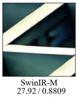

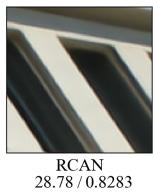

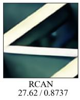

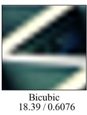

HR (BSD100, ×8)  
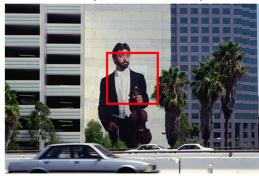

  
HR PSNR / SSIM

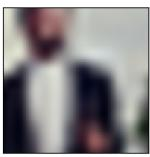  
Bicubic 19.72 / 0.4291

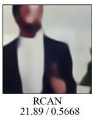  
(a)

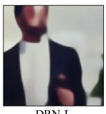  
DRN-L 21.98 / 0.5771

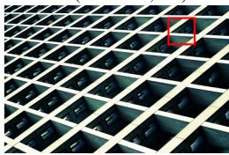

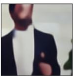  
SwinIR-M 21.96/0.5815

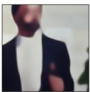  
PMS-SR (ours) 22.37/0.6077

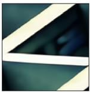  
PMS-SR (ours) 29.75/0.8978

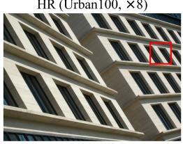

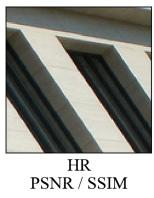

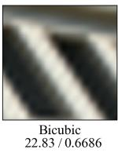  
(b)

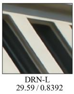

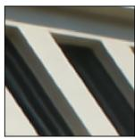  
SwinIR-M 29.20/0.8383

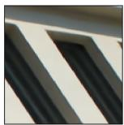  
PMS-SR (ours) 30.24/ 0.8554

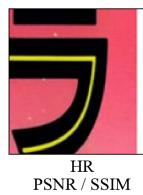

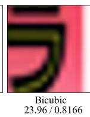

(c)  
  
(d)

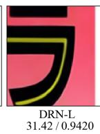

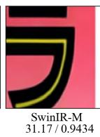

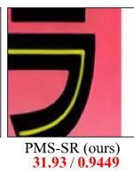  
Fig. 4. Visual comparison at ×8: (a) BSD100 violinist, (b) Urban100 img 043, (c) Urban100 img 025, and (d) Manga109 GinNoChimera. Full-image PSNR (dB) / SSIM is given below each panel, and the best value of each metric is shown in bold red.

## TABLE V

FURTHER ABLATION AXES, TRAINED FROM SCRATCH UNDER A   
SHORTENED 50K-ITERATION PROTOCOL (Y-PSNR, DB). DEGRADATIONS   
OF AT LEAST 0.2 DB VS. THE 50K REFERENCE IN BOLD; ALL REMAINING DIFFERENCES ARE WITHIN +0.1DB.

<table><tr><td rowspan="2">Variant</td><td colspan="3">BSD100</td><td colspan="3">Set5</td></tr><tr><td>×2</td><td>×4</td><td>×8</td><td>×2</td><td>×4</td><td>×8</td></tr><tr><td>Full model (50k reference)</td><td>32.19</td><td>27.75</td><td>24.98</td><td>38.00</td><td>32.47</td><td>27.26</td></tr><tr><td>(a) w/o Stage 2 (IMR), from scratch</td><td>32.20</td><td>27.74</td><td>24.96</td><td>38.01</td><td>32.46</td><td>27.24</td></tr><tr><td>(b) w/o channel attention branch</td><td>32.19</td><td>27.73</td><td>24.96</td><td>38.01</td><td>32.47</td><td>27.23</td></tr><tr><td>(c) direct bic↑s anchor</td><td>32.21</td><td>26.76</td><td>22.60</td><td>38.03</td><td>29.86</td><td>22.80</td></tr><tr><td>(d) cascade without detachment</td><td>32.21</td><td>27.75</td><td>24.99</td><td>38.01</td><td>32.55</td><td>27.29</td></tr><tr><td>(e) concat instead of deformable align.</td><td>31.95</td><td>27.46</td><td>24.73</td><td>37.65</td><td>31.91</td><td>26.78</td></tr></table>

(weights are also released for RCAN, which is weaker at every factor). Among the multi-scale methods, MSWSR is the most recent with released ×8 weights; it is much smaller (1.23M parameters) but 0.33–1.37 dB less accurate at ×8. The full ladder needs fewer FLOPs than three SwinIR-M models in whole-image mode and less runtime in both modes,

## TABLE VI

COST OF PRODUCING THE FULL ×2/×4/×8 LADDER FOR ONE INPUT. FLOPS ARE MEASURED WITH THOP ON THE SAME 64×64 LR INPUT, AND

RUNTIMES ARE AVERAGED OVER THE 100 BSD100 ×8 LR INPUTS (ABOUT 60×40) ON AN RTX 4090. TILED: 48×48 TILES WITH OVERLAP 16, AS IN THE ACCURACY TABLES.

<table><tr><td>Method (ladder)</td><td>Params</td><td>FLOPs</td><td>Runtime</td></tr><tr><td>SwinIR-M ×2 [7]</td><td>11.75M</td><td>48.05G</td><td>30.3 ms</td></tr><tr><td>SwinIR-M ×4</td><td>11.90M</td><td>50.55G</td><td>31.5 ms</td></tr><tr><td>SwinIR-M ×8</td><td>12.05M</td><td>60.55G</td><td>32.6 ms</td></tr><tr><td>SwinIR-M ladder (3 models, 3 passes)</td><td>35.70M</td><td>159.15G</td><td>94.4 ms</td></tr><tr><td>Derived ladder (SwinIR-M ×8 + bicubic↓)</td><td>12.05M</td><td>60.55G</td><td>32.6 ms</td></tr><tr><td>PMS-SR (1 model, 1 pass, whole image)</td><td>7.95M</td><td>142.17G</td><td>32.8 ms</td></tr><tr><td>PMS-SR (1 model, 1 pass, tiled)</td><td>7.95M</td><td>319.88G</td><td>47.1 ms</td></tr></table>

because attention runs only on the LR grid and the cross-scale exchange for ×8 runs on the ×4 grid. Fig. 7 summarizes the trade-off at ×8: PMS-SR reaches the five-benchmark mean of SwinIR-M, DBPN-RES-MR64-3, and RDRN (25.37 vs.

(a) HR reference  

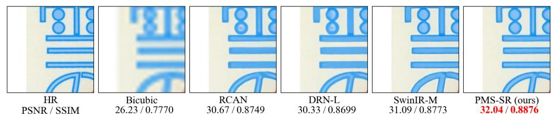

(a)  
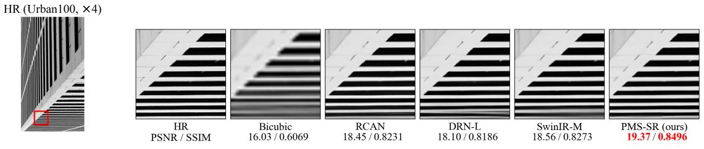

(b)  
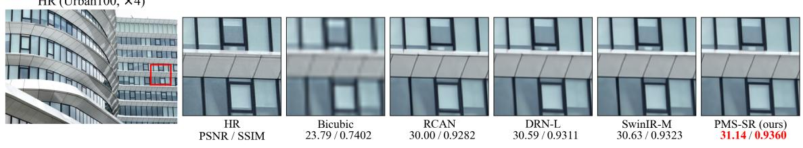  
(c)  
Fig. 5. Visual comparison at (a) ×8 on Manga109 (YukiNoFuruMachi), (b) ×4 on Urban100 img 011, and (c) ×4 on Urban100 img 052. Protocol and highlighting are the same as in Fig. 4.

25.35–25.38 dB) with at most 22% of the parameters of their three-model ladders.

b) Cost of the ladder: On an otherwise idle RTX 4090, one whole-image PMS-SR pass delivers all three renditions in 32.8 ms, against 94.4 ms for the SwinIR-M ladder on the same inputs. At this input size, the 2.9× speed-up is much larger than the 1.12× FLOPs ratio because the ladder pays the fixed per-network overhead three times; for larger inputs, where arithmetic dominates, the speed-up is expected to approach the FLOPs ratio. The tiled mode takes 47.1 ms and is still 2.0× faster than the ladder. The derived ladder is the cheapest option (32.6 ms), but all of its renditions are tied to the $\times 8$ output.

c) Cross-scale consistency: A SIMO model delivers several renditions of one input, so a property that per-factor evaluation never measures becomes relevant: whether the renditions agree with one another. Table VII measures this for a single LR input as the Y-PSNR between the downsampled higherfactor output and the delivered lower-factor output on the five benchmarks. PMS-SR reaches 45.6–52.4 dB $( \times 8  \times 4 )$ and 45.5–50.9 dB $( \times 4  \times 2 )$ , against 34.5–42.5 dB and 38.3– 44.3 dB for three independent SwinIR-M models, an advantage of 6.7–12.4 dB that is largest on Urban100.

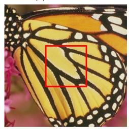

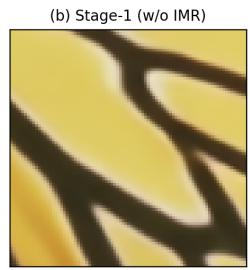

Agreement alone is not evidence of quality. A bicubic ladder reaches about 62 dB at $\times 8 \to \times 4$ because it adds no detail, and a derived ladder $\mathrm { ~ \textit ~ { ~ ~ } ~ } ( \mathrm { ~ a ~ } \times 8$ model followed by downsampling) is consistent by construction, so agreement must be read together with fidelity. In the fidelity columns, PMS-SR gives the most accurate $\times 2$ renditions of the non-control systems on all five benchmarks, and on the two 100-image benchmarks its ×2 and ×8 renditions are the most accurate of all tested systems (e.g., 32.58 and 25.07 dB on BSD100). PMS-SR is also more accurate than the derived ladder at every factor on BSD100 and Urban100 (by up to 0.19 dB), whereas the derived ladder, whose ×2 and ×4 renditions are only downsampled ×8 outputs, is 0.07–0.15 dB ahead on the small Set5 and Set14. Three independent models have competitive fidelity but the weakest agreement.

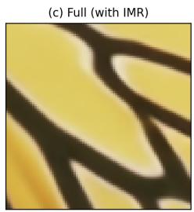

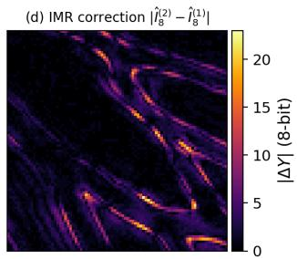  
Fig. 6. Effect of IMR at ×8: (a) HR image with the zoomed region, (b) Stage-1 output (without IMR), (c) full model (with IMR), and (d) the correction $| \hat { I } _ { 8 } ^ { ( 2 ) } - \hat { I } _ { 8 } ^ { ( 1 ) } |$ on the Y channel, which concentrates along edges and texture transitions.

TABLE VII  
SINGLE-INPUT DEPLOYMENT: EACH SYSTEM RECEIVES THE SAME ×8 LR INPUT AND DELIVERS ALL THREE RENDITIONS (WHOLE-IMAGE INFERENCE) LEFT: CROSS-SCALE AGREEMENT; RIGHT: FIDELITY OF EACH RENDITION. ITALIC ROWS ARE DEGENERATE CONTROLS; THE BEST FIDELITY PER COLUMN (CONTROLS EXCLUDED) IS IN RED
<table><tr><td></td><td></td><td colspan="2">Agreement (dB) ↑</td><td colspan="3">Fidelity (dB) ↑</td></tr><tr><td>Benchmark</td><td>System</td><td>×8→×4</td><td>×4→×2</td><td>×2</td><td>×4</td><td>×8</td></tr><tr><td rowspan="4">Set5</td><td>Bicubic ladder (control)</td><td>62.48</td><td>55.16</td><td>27.72</td><td>25.36</td><td>24.40</td></tr><tr><td>Derived ladder (×8 only, control)</td><td>8</td><td>∞</td><td>33.24</td><td>29.32</td><td>27.59</td></tr><tr><td>SwinIR-M (3 independent models)</td><td>40.52</td><td>42.54</td><td>32.89</td><td>29.33</td><td>27.59</td></tr><tr><td>PMS-SR (1 modei, 1 pass)</td><td>52.36</td><td>50.21</td><td>33.09</td><td>29.19</td><td>27.49</td></tr><tr><td rowspan="4">Set14</td><td>Bicubic ladder (control)</td><td>62.10</td><td>55.32</td><td>27.73</td><td>24.74</td><td>23.19</td></tr><tr><td>Derived ladder (×8 only, control)</td><td>∞</td><td>∞</td><td>32.31</td><td>27.77</td><td>25.46</td></tr><tr><td>SwinIR-M (3 independent models)</td><td>40.14</td><td>42.16</td><td>32.00</td><td>27.84</td><td>25.46</td></tr><tr><td>PMS-SR (1 model, 1 pass)</td><td>50.57</td><td>49.18</td><td>32.24</td><td>27.68</td><td>25.37</td></tr><tr><td rowspan="4">BSD100</td><td>Bicubic ladder (control)</td><td>62.91</td><td>56.89</td><td>29.03</td><td>25.65</td><td>23.67</td></tr><tr><td>Derived ladder (×8 only, control)</td><td>∞</td><td>∞</td><td>32.42</td><td>27.71</td><td>25.05</td></tr><tr><td>SwinIR-M (3 independent models)</td><td>42.54</td><td>44.25</td><td>32.34</td><td>27.79</td><td>25.05</td></tr><tr><td>PMS-SR (1 modei, 1 pass)</td><td>51.48</td><td>50.91</td><td>32.58</td><td>27.77</td><td>25.07</td></tr><tr><td rowspan="4">Urban100</td><td>Bicubic ladder (control)</td><td>62.40</td><td>54.75</td><td>25.94</td><td>22.62</td><td>20.74</td></tr><tr><td>Derived ladder (×8 only, control)</td><td>∞</td><td>∞</td><td>32.15</td><td>26.38</td><td>23.19</td></tr><tr><td>SwinIR-M (3 independent models)</td><td>34.53</td><td>38.30</td><td>31.75</td><td>26.64</td><td>23.19</td></tr><tr><td>PMS-SR (1 modei, 1 pass)</td><td>46.91</td><td>46.98</td><td>32.32</td><td>26.57</td><td>23.35</td></tr><tr><td rowspan="4">Manga109</td><td>Bicubic ladder (control)</td><td>62.83</td><td>54.46</td><td>25.46</td><td>22.50</td><td>21.46</td></tr><tr><td>Derived ladder (×8 only, control)</td><td>∞</td><td>∞</td><td>32.24</td><td>27.45</td><td>25.55</td></tr><tr><td>SwinIR-M (3 independent models)</td><td>35.80</td><td>38.45</td><td>31.65</td><td>27.67</td><td>25.55</td></tr><tr><td>PMS-SR (1 modei, 1 pass)</td><td>45.64</td><td>45.54</td><td>32.46</td><td>27.55</td><td>25.54</td></tr></table>

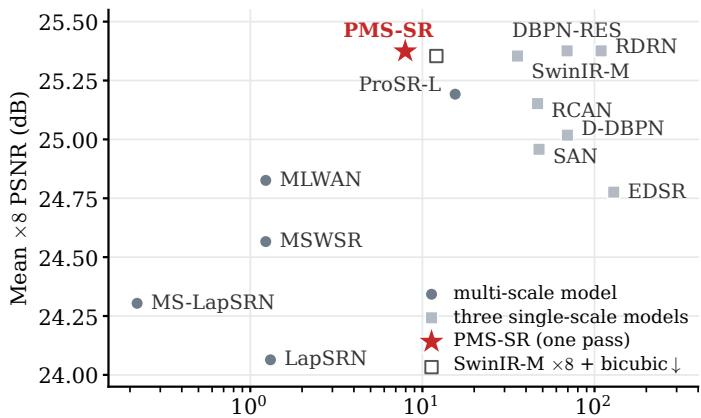  
Total parameters of the model set (M, log scale)  
Fig. 7. Mean ×8 PSNR over the five benchmarks vs. the total parameters of the models that deliver ×2, ×4, and ×8 (Tables I–VI). Single-scale methods count as three models; where one size is reported, it is tripled. DRN-L has no ×2 model. The hollow marker is the derived ladder.

## V. DISCUSSION

Three design decisions keep ×8 affordable in one SIMO pass: deep feature extraction is confined to the LR grid with a narrowing channel pyramid, detached cascaded anchors limit each head to the band the previous scale lacks (the most important axis in Table V), and IMR couples the scales in both directions, with larger gains at ×4 and ×8 than at ×2 (Table IV). Our training also uses only about 30% of the sample budget of SwinIR, so further gains may be possible.

For video systems, the single-pass design suits services that keep several renditions of one source. An edge node that upscales a low-bitrate stream can produce the whole ladder in one pass instead of running three SwinIR-M-class models with 4.5× the parameters. Because the renditions are mutually consistent (Sec. IV-F), switching between factors changes the viewed content much less than with independent models. Downsampling one ×8 output (the derived ladder in Tables VI and VII) gives exact agreement at a lower cost, but its ×2 and ×4 renditions are only downsampled ×8 outputs, and on the two 100-image benchmarks PMS-SR is more accurate at every factor.

## A. Limitations

Three limitations should be noted. First, the accuracy rank ing depends on the factor: PMS-SR is on par with the strongest single-scale models at ×8 and competitive at ×4, whereas at ×2 single-scale Transformers remain 0.2–1.8 dB ahead (Table III). Our objective gives the largest weight to the hardest factor (15), and the ×2 and ×4 heads are trained against bicubically downsampled targets (Sec. III-D), which may also contribute; a deployment that prioritizes ×2 would need to rebalance these weights. Second, the sub-pixel pyramid restricts the factors to powers of two. Non-dyadic factors require an extra branch or resampling, and arbitrary-scale operation (Sec. II) is outside our scope. Third, all experiments use single images with the bicubic degradation; real-world degradations [56] are not modeled. Temporal consistency is not modeled either, and per-frame application does not prevent flicker; cross-scale consistency (Table VII) is a different property from cross-frame consistency. Extending the cascaded anchors and IMR along the time axis is a natural next step.

## VI. CONCLUSION

We introduced PMS-SR, a progressive Transformer-based SIMO framework that reconstructs ×2, ×4, and ×8 images in a single forward pass. Its CSWin backbone is deliberately standard and confined to the LR grid. The contribution lies in how the three renditions are coupled: cascaded anchors start the optimization exactly from the bicubic cascade and limit each head to the band the previous scale lacks, and inter-scale mutual refinement exchanges information between the scales in both directions, with the ×8 refinement computed on the ×4 grid. With 7.95M parameters, PMS-SR has the highest PSNR among the compared multi-scale methods in every ×4 and ×8 entry. At ×8, it outperforms the ×8-specific DRN-L on all five benchmarks, gives the best Urban100 result among the compared methods, and stays within 0.13 dB of the strongest ×8-specific models elsewhere. One pass of one model, with 22% of the parameters of a three-model ladder, delivers all three renditions. Future work includes curriculum-style scale scheduling [13], extension of the pyramid to arbitrary factors, and application of the cascaded anchors and IMR to video SR and joint restoration.

## ACKNOWLEDGMENT

TThis work was supported by the National Science and Technology Council (NSTC), Taiwan, under Grant NSTC 114- 2221-E-005-040-MY2.

## REFERENCES

[1] Z. Wang, J. Chen, and S. C. H. Hoi, “Deep learning for image superresolution: A survey,” IEEE Trans. Pattern Anal. Mach. Intell., vol. 43, no. 10, pp. 3365–3387, 2021.

[2] C.-A. Lin, T.-J. Liu, and K.-H. Liu, “LIRSRN: A lightweight infrared image super-resolution network,” in Proc. IEEE Int. Symp. Circuits Syst. (ISCAS), 2024, pp. 1–5.

[3] C.-A. Lin, T.-J. Liu, and Y.-C. Ouyang, “TIRMamba: A thermal-priormodulated state-space network for sub-million-parameter infrared image super-resolution,” 2026, arXiv:2610.05182.

[4] C. Dong, C. C. Loy, K. He, and X. Tang, “Image super-resolution using deep convolutional networks,” IEEE Trans. Pattern Anal. Mach. Intell., vol. 38, no. 2, pp. 295–307, 2016.

[5] B. Lim, S. Son, H. Kim, S. Nah, and K. M. Lee, “Enhanced deep residual networks for single image super-resolution,” in Proc. IEEE Conf. Comput. Vis. Pattern Recognit. Workshops (CVPRW), 2017, pp. 1132–1140.

[6] Y. Zhang, K. Li, K. Li, L. Wang, B. Zhong, and Y. Fu, “Image superresolution using very deep residual channel attention networks,” in Proc. Eur. Conf. Comput. Vis. (ECCV), 2018, pp. 286–301.

[7] J. Liang, J. Cao, G. Sun, K. Zhang, L. Van Gool, and R. Timofte, “SwinIR: Image restoration using Swin transformer,” in Proc. IEEE/CVF Int. Conf. Comput. Vis. Workshops (ICCVW), 2021, pp. 1833–1844.

[8] X. Chen, X. Wang, J. Zhou, Y. Qiao, and C. Dong, “Activating more pixels in image super-resolution transformer,” in Proc. IEEE/CVF Conf. Comput. Vis. Pattern Recognit. (CVPR), 2023, pp. 22 367–22 377.

[9] W.-S. Lai, J.-B. Huang, N. Ahuja, and M.-H. Yang, “Deep Laplacian pyramid networks for fast and accurate super-resolution,” in Proc. IEEE Conf. Comput. Vis. Pattern Recognit. (CVPR), 2017, pp. 624–632.

[10] W.-S. Lai, J.-B. Huang, N. Ahuja, and M.-H. Yang, “Fast and accurate image super-resolution with deep Laplacian pyramid networks,” IEEE Trans. Pattern Anal. Mach. Intell., vol. 41, no. 11, pp. 2599–2613, 2019.

[11] H. Zhang, J. Xiao, and Z. Jin, “Multi-scale image super-resolution via a single extendable deep network,” IEEE J. Sel. Topics Signal Process., vol. 15, no. 2, pp. 253–263, 2021.

[12] J. Ma, X. Han, X. Zhang, and Z. Li, “MLWAN: Multi-scale learning wavelet attention module network for image super resolution,” Sensors, vol. 22, no. 23, p. 9110, 2022.

[13] Y. Wang, F. Perazzi, B. McWilliams, A. Sorkine-Hornung, O. Sorkine-Hornung, and C. Schroers, “A fully progressive approach to singleimage super-resolution,” in Proc. IEEE/CVF Conf. Comput. Vis. Pattern Recognit. Workshops (CVPRW), 2018, pp. 864–873.

[14] X. Dong et al., “CSWin transformer: A general vision transformer backbone with cross-shaped windows,” in Proc. IEEE/CVF Conf. Comput. Vis. Pattern Recognit. (CVPR), 2022, pp. 12 124–12 134.

[15] W. Shi et al., “Real-time single image and video super-resolution using an efficient sub-pixel convolutional neural network,” in Proc. IEEE Conf. Comput. Vis. Pattern Recognit. (CVPR), 2016, pp. 1874–1883.

[16] M. Haris, G. Shakhnarovich, and N. Ukita, “Deep back-projection networks for super-resolution,” in Proc. IEEE/CVF Conf. Comput. Vis. Pattern Recognit. (CVPR), 2018, pp. 1664–1673.

[17] M. Haris, G. Shakhnarovich, and N. Ukita, “Deep back-projection networks for single image super-resolution,” IEEE Trans. Pattern Anal. Mach. Intell., vol. 43, no. 12, pp. 4323–4337, 2021.

[18] A. Dosovitskiy et al., “An image is worth 16×16 words: Transformers for image recognition at scale,” in Proc. Int. Conf. Learn. Represent. (ICLR), 2021.

[19] Z. Liu et al., “Swin transformer: Hierarchical vision transformer using shifted windows,” in Proc. IEEE/CVF Int. Conf. Comput. Vis. (ICCV), 2021, pp. 10 012–10 022.

[20] W. Li, X. Lu, S. Qian, and J. Lu, “On efficient transformer-based image pre-training for low-level vision,” in Proc. Int. Joint Conf. Artif. Intell. (IJCAI), 2023, pp. 1089–1097.

[21] Y. Zhou, Z. Li, C.-L. Guo, S. Bai, M.-M. Cheng, and Q. Hou, “SRFormer: Permuted self-attention for single image super-resolution,” in Proc. IEEE/CVF Int. Conf. Comput. Vis. (ICCV), 2023, pp. 12 780– 12 791.

[22] H. Guo, J. Li, T. Dai, Z. Ouyang, X. Ren, and S.-T. Xia, “MambaIR: A simple baseline for image restoration with state-space model,” in Proc. Eur. Conf. Comput. Vis. (ECCV), 2024, pp. 222–241.

[23] H. Guo et al., “MambaIRv2: Attentive state space restoration,” in Proc. IEEE/CVF Conf. Comput. Vis. Pattern Recognit. (CVPR), 2025, pp. 28 124–28 133.

[24] C. Liu, D. Zhang, G. Lu, W. Yin, J. Wang, and G. Luo, “SRMamba-T: Exploring the hybrid Mamba-Transformer network for single image super-resolution,” Neurocomputing, vol. 624, p. 129488, 2025.

[25] Z. Chen, Y. Zhang, J. Gu, Y. Zhang, L. Kong, and X. Yuan, “Cross aggregation transformer for image restoration,” in Proc. Adv. Neural Inf. Process. Syst. (NeurIPS), vol. 35, 2022, pp. 25 478–25 490.

[26] L. Chen, X. Chu, X. Zhang, and J. Sun, “Simple baselines for image restoration,” in Proc. Eur. Conf. Comput. Vis. (ECCV), 2022, pp. 17–33.

[27] X. Jia, X. Xu, B. Cai, and K. Guo, “Single image super-resolution using multi-scale convolutional neural network,” in Proc. Pacific Rim Conf. Multimedia (PCM), 2017, pp. 149–157.

[28] Y. Chen, S. Liu, and X. Wang, “Learning continuous image representation with local implicit image function,” in Proc. IEEE/CVF Conf. Comput. Vis. Pattern Recognit. (CVPR), 2021, pp. 8628–8638.

[29] Z. Li, J. Yang, Z. Liu, X. Yang, G. Jeon, and W. Wu, “Feedback network for image super-resolution,” in Proc. IEEE/CVF Conf. Comput. Vis. Pattern Recognit. (CVPR), 2019, pp. 3867–3876.

[30] Y. Guo et al., “Closed-loop matters: Dual regression networks for single image super-resolution,” in Proc. IEEE/CVF Conf. Comput. Vis. Pattern Recognit. (CVPR), 2020, pp. 5407–5416.

[31] X. Wang, K. C. Chan, K. Yu, C. Dong, and C. C. Loy, “EDVR: Video restoration with enhanced deformable convolutional networks,” in Proc. IEEE/CVF Conf. Comput. Vis. Pattern Recognit. Workshops (CVPRW), 2019, pp. 1954–1963.

[32] X. Zhu, H. Hu, S. Lin, and J. Dai, “Deformable ConvNets v2: More deformable, better results,” in Proc. IEEE/CVF Conf. Comput. Vis. Pattern Recognit. (CVPR), 2019, pp. 9308–9316.

[33] S. W. Zamir et al., “Multi-stage progressive image restoration,” in Proc. IEEE/CVF Conf. Comput. Vis. Pattern Recognit. (CVPR), 2021, pp. 14 821–14 831.

[34] Z. Wang, X. Cun, J. Bao, W. Zhou, J. Liu, and H. Li, “Uformer: A general U-shaped transformer for image restoration,” in Proc. IEEE/CVF Conf. Comput. Vis. Pattern Recognit. (CVPR), 2022, pp. 17 683–17 693.

[35] R. G. Keys, “Cubic convolution interpolation for digital image processing,” IEEE Trans. Acoust., Speech, Signal Process., vol. 29, no. 6, pp. 1153–1160, 1981.

[36] P. Charbonnier, L. Blanc-Feraud, G. Aubert, and M. Barlaud, “Two de-´ terministic half-quadratic regularization algorithms for computed imaging,” in Proc. IEEE Int. Conf. Image Process. (ICIP), vol. 2, 1994, pp. 168–172.

[37] S.-J. Cho, S.-W. Ji, J.-P. Hong, S.-W. Jung, and S.-J. Ko, “Rethinking coarse-to-fine approach in single image deblurring,” in Proc. IEEE/CVF Int. Conf. Comput. Vis. (ICCV), 2021, pp. 4641–4650.

[38] L. Jiang, B. Dai, W. Wu, and C. C. Loy, “Focal frequency loss for image reconstruction and synthesis,” in Proc. IEEE/CVF Int. Conf. Comput. Vis. (ICCV), 2021, pp. 13 919–13 929.

[39] C.-A. Lin, Y.-C. Chang, and T.-J. Liu, “Infrared image super-resolution with multi-domain attention and spatial-frequency processing,” in Proc. IEEE Int. Conf. Consum. Electron.-Taiwan (ICCE-Taiwan), 2024, pp. 97–98.

[40] C.-A. Lin, T.-J. Liu, Y.-C. Ouyang, and Y.-C. Yu, “Lightweight infrared image super-resolution by spatial-frequency attention with spatialshifts,” in Proc. IEEE Int. Conf. Consum. Electron.-Taiwan (ICCE-Taiwan), 2025, pp. 53–54.

[41] E. Agustsson and R. Timofte, “NTIRE 2017 challenge on single image super-resolution: Dataset and study,” in Proc. IEEE Conf. Comput. Vis. Pattern Recognit. Workshops (CVPRW), 2017, pp. 1122–1131.

[42] M. Bevilacqua, A. Roumy, C. Guillemot, and M.-L. Alberi-Morel, “Lowcomplexity single-image super-resolution based on nonnegative neighbor embedding,” in Proc. Brit. Mach. Vis. Conf. (BMVC), 2012, pp. 135.1– 135.10.

[43] R. Zeyde, M. Elad, and M. Protter, “On single image scale-up using sparse-representations,” in Proc. Int. Conf. Curves and Surfaces, 2010, pp. 711–730.

[44] D. Martin, C. Fowlkes, D. Tal, and J. Malik, “A database of human segmented natural images and its application to evaluating segmentation algorithms and measuring ecological statistics,” in Proc. IEEE Int. Conf. Comput. Vis. (ICCV), vol. 2, 2001, pp. 416–423.

[45] J.-B. Huang, A. Singh, and N. Ahuja, “Single image super-resolution from transformed self-exemplars,” in Proc. IEEE Conf. Comput. Vis. Pattern Recognit. (CVPR), 2015, pp. 5197–5206.

[46] K. Aizawa et al., “Building a manga dataset ‘Manga109’ with annotations for multimedia applications,” IEEE MultiMedia, vol. 27, no. 2, pp. 8–18, 2020.

[47] Z. Wang, A. C. Bovik, H. R. Sheikh, and E. P. Simoncelli, “Image quality assessment: From error visibility to structural similarity,” IEEE Trans. Image Process., vol. 13, no. 4, pp. 600–612, 2004.

[48] R. Zhang, P. Isola, A. A. Efros, E. Shechtman, and O. Wang, “The unreasonable effectiveness of deep features as a perceptual metric,” in Proc. IEEE/CVF Conf. Comput. Vis. Pattern Recognit. (CVPR), 2018, pp. 586–595.

[49] F. Wilcoxon, “Individual comparisons by ranking methods,” Biometrics Bull., vol. 1, no. 6, pp. 80–83, 1945.

[50] S. Holm, “A simple sequentially rejective multiple test procedure,” Scand. J. Statist., vol. 6, no. 2, pp. 65–70, 1979.

[51] T. Dai, J. Cai, Y. Zhang, S.-T. Xia, and L. Zhang, “Second-order attention network for single image super-resolution,” in Proc. IEEE/CVF Conf. Comput. Vis. Pattern Recognit. (CVPR), 2019, pp. 11 065–11 074.

[52] A. Panaetov, K. E. Daou, I. Samenko, E. Tetin, and I. Ivanov, “RDRN: Recursively defined residual network for image super-resolution,” in Proc. Asian Conf. Comput. Vis. (ACCV), 2022, pp. 4110–4125.

[53] S. Zhou, J. Zhang, W. Zuo, and C. C. Loy, “Cross-scale internal graph neural network for image super-resolution,” in Proc. Adv. Neural Inf. Process. Syst. (NeurIPS), vol. 33, 2020, pp. 3499–3509.

[54] Y. Mei, Y. Fan, and Y. Zhou, “Image super-resolution with nonlocal sparse attention,” in Proc. IEEE/CVF Conf. Comput. Vis. Pattern Recognit. (CVPR), 2021, pp. 3517–3526.

[55] S.-C. Chu, Z.-C. Dou, J.-S. Pan, S. Weng, and J. Li, “HMANet: Hybrid multi-axis aggregation network for image super-resolution,” in Proc. IEEE/CVF Conf. Comput. Vis. Pattern Recognit. Workshops (CVPRW), 2024, pp. 6257–6266.

[56] K. Zhang, J. Liang, L. Van Gool, and R. Timofte, “Designing a practical degradation model for deep blind image super-resolution,” in Proc. IEEE/CVF Int. Conf. Comput. Vis. (ICCV), 2021, pp. 4791–4800.

Chun-An Lin (Student Member, IEEE) is currently pursuing the Ph.D. degree with the Department of Electrical Engineering, National Chung Hsing University, Taiwan, and a Lecturer with the College of Computing and Informatics, Providence University, Taiwan. He received his M.S. degree from the Department of Multimedia Design, National Taichung University of Science and Technology, Taiwan, in 2021 and his B.S. degree from the Department of Computer Science & Communication Engineering, Providence University, Taiwan, in 2019. His research focuses on Machine Learning, Deep Learning, Image Super-Resolution, and Medical Image Analysis.

Yu-Chia Chang received the M.S. degree from the Department of Electrical Engineering, National Chung Hsing University, Taiwan, in 2025, and his B.S. degree from the Department of Electrical Engineering, Yuan Ze University, Taiwan, in 2018. His research focuses on Image Super-Resolution, Object Detection, Image Processing, Machine Learning, Deep Learning, Reinforcement Learning, and Feature Engineering.

Chi-Mao Fan is currently an AI R&D Engineer in the Digital Image Technology Department (DIT) at ASUS, Taipei, Taiwan. He received his M.S. degree in Electrical Engineering from National Chung Hsing University, Taiwan, in 2023 and his B.S. degree in Electrical Engineering from Yuan Ze University, Taiwan, in 2021. His research interests include Computer Vision, Image Restoration, Image Denoising, Oriented Object Detection, and Retrieval-Augmented Generation, with a focus on bridging academic research and industrial applications.

Yen-Chieh Ouyang (Life Member, IEEE) received the Bachelor of Science degree in electrical engineering from Feng Chia University, Taiwan, in 1981, and the Master of Science and Doctor of Philosophy degrees in electrical engineering from The University of Memphis, Memphis, TN, USA, in 1987 and 1992, respectively. In August 1992, he joined the Department of Electrical Engineering, National Chung Hsing University, Taiwan, where he is currently a Professor. His research expertise lies in information-theoretical image processing with appli-

cations in medical imaging and remote sensing. He has significant experience in developing hyperspectral imaging models for magnetic resonance (MR) imaging applications and in the software engineering aspects of implementing and testing these methods. Furthermore, his research interests extend to the development and evaluation of cloud computing systems for various realworld applications. He also integrates artificial intelligence, machine learning, cognitive science, and deep neural networks into his work, applying these to intelligent systems such as decision support systems, human-computer interaction, and machine learning, as well as to algorithmic problems aimed at improving efficiency. His diverse research interests include: hyperspectral image processing, medical image processing, agricultural production applications, communication networks, network security in mobile networks, cloud computing, multimedia system design, and performance evaluation.

Tsung-Jung Liu (Member, IEEE) received the B.S. degree in electrical engineering from National Tsing Hua University, Hsinchu, Taiwan, in 1998, the M.S. degree in communication engineering from National Taiwan University, Taipei, Taiwan, in 2001, and the Ph.D. degree in electrical engineering from the University of Southern California, Los Angeles, CA, USA, in 2014. He is currently an Associate Professor with the Department of Electrical Engineering, and the Graduate Institute of Communication Engineering, National Chung Hsing University,

Taichung, Taiwan. His research interests include computer vision, perceptual image/video processing, visual quality assessment, image restoration, machine learning/deep learning, and artificial intelligence.