# R<sup>2</sup>-Omni: Reducing Structural and Precision Redundancy in Omni-LLMs for Long-Form Generation

Bolong Feng<sup>1,2</sup> Pengfei Zhou<sup>1,3,†</sup> Zhenglin Wan<sup>3</sup> Wei Wang<sup>4</sup> Wangbo Zhao<sup>4,†</sup>

<sup>1</sup>InfRec, Cardinal AI Lab <sup>2</sup>Shanghai Jiao Tong University

<sup>3</sup>National University of Singapore <sup>4</sup>The Hong Kong University of Science and Technology

<sup>†</sup>Corresponding authors

Abstract Omni-modal large language models (Omni-LLMs) typically process large numbers of multimodal tokens from audio-visual inputs, incurring substantial computational costs and a large memory footprint for the key-value (KV) cache. Aggressive token pruning can alleviate this problem while maintaining competitive performance on multiple-choice tasks, which require only a single option as output. However, we observe substantial quality degradation when generating long-form, open-ended responses. We attribute this gap to query-guided selection, which can retain suficient evidence for answer selection while discarding details needed for comprehensive generation. This motivates reducing overlapping information across tokens, termed structural redundancy, while preserving diverse content. However, the retained representations may still contain precision redundancy due to unnecessarily high numerical precision in their cached values. To address these two levels of redundancy in token representations, we introduce a training-free framework named R<sup>2</sup>-Omni. First, Structure-Aware Token Consolidation (STC) consolidates redundant representations using spatiotemporal similarity in video and local continuity in audio. Then, Semantic-Sensitivity Guided Precision Allocation (SSPA) allocates value precision to the retained representations according to the estimated reduction in attention-output error under quantized keys, with query attention and audio-visual alignment providing a semantic prior. Extensive experiments on long-form generation benchmarks demonstrate an average 5.0× reduction in the memory footprint while preserving 97.98% of baseline generation quality and achieving a 1.48× end-to-end speedup, highlighting the benefits of jointly reducing structural and precision redundancy.

## 1. Introduction

Omni-modal large language models (Omni-LLMs) [1–3] can jointly process text, video, and audio, enabling powerful audio-visual reasoning and open-ended generation. These capabilities support diverse applications, including real-time multimodal assistants [4, 5] and complex video understanding tasks [6, 7]. However, long audio-visual inputs introduce many multimodal tokens, substantially increasing prefill computation and the memory footprint during autoregressive decoding.

Token pruning [8–12] efectively reduces these costs by removing redundant tokens from the multimodal input. These methods can substantially reduce token counts while maintaining strong performance on multiple-choice benchmarks [13–16], even under aggressive compression. However, this behavior does not extend equally to long-form generation. As shown in Fig. 1(a), dense-captioning quality degrades much faster than multiple-choice performance as the pruning ratio increases, revealing the limitations of these methods on open-ended tasks that better reflect real-world use.

We attribute this gap to query-guided token pruning, where methods typically use query attention to assess token importance for the current question and discard tokens with low scores. For multiplechoice tasks, this approach can retain suficient evidence to identify the correct option while discarding other irrelevant details. In contrast, long-form generation is an open-ended task and requires broader information coverage, including more events, attributes, and temporal details beyond the evidence needed for a single decision. Tokens receiving low attention scores from the initial query may still contain unique information needed later in generation, so directly removing them can significantly degrade performance. This suggests that we should target only intrinsic structural redundancy, such as spatial similarity, temporal persistence, and local audio continuity, for token reduction while preserving diverse multimodal content for subsequent generation.

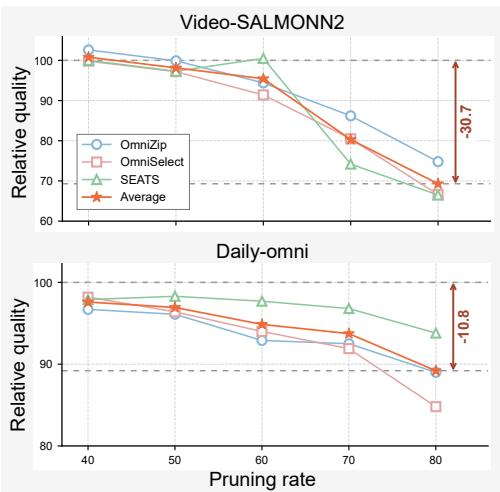

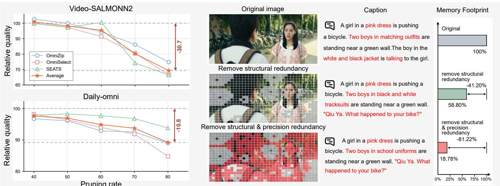  
(a) Task robustness under token pruning  
(b) Reducing structural and precision redundancy  
Figure 1 | Motivation of $\mathbf { R } ^ { 2 } { \cdot } \mathbf { O m n } .$ (a) Aggressive token pruning degrades long-form generation on the Video-SALMONN 2 testset [6] more severely than multiple-choice performance on Daily-Omni [16]. Details are provided in Appendix A.1 (b) After structural redundancy is reduced ( gray masks ), we further reduce the precision of cached values ( red masks ), and the model holds all details. This suggests that precision redundancy remains, enabling further reduction in the memory footprint.

However, even after structural redundancy is reduced, the retained tokens may still be represented at unnecessarily high numerical precision. As illustrated in Fig. 1(b), reducing the precision of their cached values can further decrease the memory footprint while preserving suficient information to successfully complete the task. This precision redundancy therefore provides an additional opportunity for compression without discarding more tokens [17–21]. Taken together, these observations reveal two forms of redundancy in token representations: overlapping information across tokens and excess numerical precision in each token’s cached value.

To address this problem, we propose $\mathbf { R } ^ { 2 } { \cdot } \mathbf { O m n i } ,$ a training-free framework that jointly reduces structural and precision redundancy in the token representations of Omni-LLMs. Specifically, we first introduce Structure-Aware Token Consolidation (STC) to consolidate overlapping representations based on spatiotemporal similarity in video and local continuity in audio, preserving diverse information while efectively shortening the input sequence. Then, to address precision redundancy within the retained representations, we design Semantic-Sensitivity Guided Precision Allocation (SSPA). It uses query attention and audio-visual alignment as a semantic prior, allocating value precision under a memory budget to minimize attention-output error under quantized keys. Through this coordinated design, STC and SSPA exploit the redundancy across input sequence and cached values in Omni-LLMs, while preserving multimodal information essential for long-form generation.

Extensive experiments on long-form generation benchmarks [6, 7, 22] demonstrate an average 5.0× reduction in memory footprint while preserving 97.98% of baseline generation quality and achieving a 1.48× end-to-end speedup, highlighting the practical benefits of jointly addressing both forms of redundancy.

## 2. Related Work

Token Pruning for Omni-LLMs. Early token pruning methods mainly target VLMs through attentionguided pruning, informative-token selection, and dynamic sparsification [23–25]. Another line of work exploits token similarity to merge redundant video representations [26–29]. With the emergence of Omni-LLMs [1–3], recent studies have extended compression to joint audio-video inputs. Omnispecific methods span modality-asymmetric guidance, where one modality guides compression of the other [8, 9], and more joint or modality-adaptive audio-visual selection [10, 30]. Recently, compression has expanded across the LLM boundary, coordinating pre-LLM structural reduction with layer-wise semantic refinement inside the LLM [11, 12].

KV Cache Quantization. KV-cache quantization has progressed from fixed-precision low-bit schemes toward outlier-aware, token-adaptive, and mixed-precision designs. Existing methods exploit K/V distribution asymmetry, preserve salient or outlier components, or adapt precision according to token, layer, or query importance [17, 18, 21, 31, 32]. More recently, these techniques have been extended to multimodal models, including ultra-low-bit quantization for VideoLLMs, dynamic multimodal quantization, and extreme quantization across language, vision-language, and Omni-LLMs [20, 33, 34]. In contrast, our method evaluates precision upgrades directly in the attention-output space and allocates value precision conditioned on both quantized keys and joint multimodal semantic evidence.

Joint Token–KV Compression. Several works jointly explore token and KV compression. VLM methods reduce prefill computation and KV storage through token sparsification or temporal compression [25, 26], combine streaming token reduction with low-bit memory [35], or couple token pruning with model and sometimes KV quantization [36, 37]. Omni-specific methods also prune audio-video tokens and their corresponding KV entries [38]. These approaches focus on VLMs, model quantization, or token eviction. To the best of our knowledge, R<sup>2</sup>-Omni is the first framework to jointly reduce structural redundancy in audio-video tokens and precision redundancy in the resulting KV cache for eficient Omni-LLMs.

## 3. R<sup>2</sup>-Omni

## 3.1. Overview

Omni-LLMs typically comprise vision and audio encoders, modality projectors, and an LLM backbone. Given a video, its visual and audio streams $X ^ { \nu } , X ^ { a }$ are sampled and processed by the corresponding encoders to obtain

$$
Z ^ { \nu } = g _ { \nu } ( X ^ { \nu } ) , \qquad Z ^ { a } = g _ { a } ( X ^ { a } )\tag{1}
$$

where $Z ^ { \nu } ~ \in ~ \mathbb { R } ^ { N _ { \nu } \times D }$ and $Z ^ { a } ~ \in ~ \mathbb { R } ^ { N _ { a } \times D }$ contain $N _ { \nu }$ video and $N _ { a }$ audio tokens. The projectors then map these features into the LLM embedding space, where the tokens are temporally organized and combined with the text prompt. During prefill, the LLM processes this sequence to construct layerwise KV caches, which are repeatedly accessed during autoregressive decoding. Long audio-visual sequences therefore increase both prefill computation and the memory footprint of the cache.

As shown in Fig. 2, R<sup>2</sup>-Omni applies two training-free stages. Structure-Aware Token Consolidation (STC) shortens the prefill input by consolidating overlapping audio-visual content according to intrinsic similarity rather than initial-query relevance, retaining diverse evidence for long-form generation. Semantic-Sensitivity Guided Precision Allocation (SSPA) then assigns precision to the resulting cache according to attention-output distortion and a multimodal semantic prior, without evicting additional tokens. Thus, structural similarity determines consolidation, while output distortion determines storage precision.

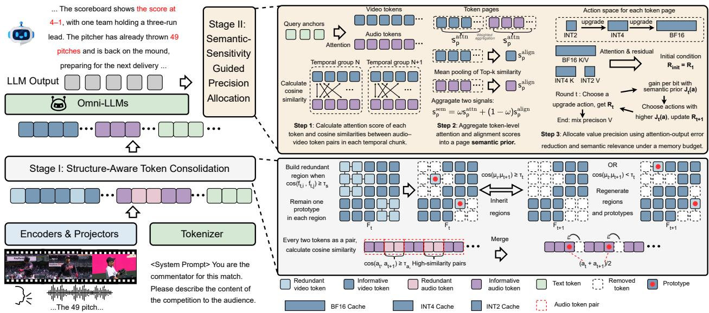  
Figure 2 | Overview of $\mathbf { R } ^ { 2 } { \cdot } \mathbf { O } \mathbf { m } \mathbf { n } \dot { \mathbf { u } }$ . Structure-Aware Token Consolidation(STC) reduces overlapping information across audio-visual tokens before prefill. Semantic-Sensitivity Guided Precision Allocation(SSPA) reduces excess precision in the resulting cache by evaluating value upgrades through attention-output distortion under quantized keys, guided by a multimodal semantic prior.

## 3.2. Stage I: Structure-Aware Token Consolidation

STC exploits spatial and temporal similarity in video and local continuity in audio. Its consolidation decisions depend on these input structures, without using query attention as a removal criterion.

Spatial–Temporal Video Consolidation. To reduce redundancy within and across frames, we process non-overlapping adjacent frame pairs $\left( F _ { t } , F _ { t + 1 } \right)$ . Here, $F _ { t } = \{ f _ { t , i } \} _ { i = 1 } ^ { H W }$ and $f _ { t , i } \in \mathbb { R } ^ { D }$ is the token at position � on the $H \times W$ feature grid. For the first frame $F _ { t }$ , we connect spatial neighbors with cosine similarity above $\tau _ { s }$ and traverse qualifying edges with Union-Find to form connected components, splitting oversized components into bounded regions. This confines consolidation to groups formed through local similarity while retaining isolated tokens. Within each region �, we select the original token closest to its centroid:

$$
\bar { f } _ { R } = \frac { 1 } { | R | } \sum _ { i \in R } f _ { t , i } , \qquad i _ { R } ^ { * } = \arg \operatorname* { m a x } _ { i \in R } \cos ( f _ { t , i } , \bar { f } _ { R } ) .\tag{2}
$$

We next assess whether these regions persist in the second frame using the frame means $\begin{array} { r l } { \mu _ { t } } & { { } = } \end{array}$ (��)<sup>−</sup> $^ { - 1 } \sum _ { i } f _ { t , i }$ . If cos $\left( \mu _ { t } , \mu _ { t + 1 } \right) \geq \tau _ { t }$ , we reuse the first frame’s region coverage and remove tokens at the corresponding second-frame positions. Uncovered positions are retained, and first-frame representatives remain unchanged. Otherwise, $F _ { t + 1 }$ undergoes independent spatial consolidation.

Local-Continuity Audio Consolidation. For audio, structural redundancy arises from locally continuous content. We therefore divide tokens into local chunks and rank adjacent pairs $\left( a _ { t } , a _ { t + 1 } \right)$ satisfying cos $( a _ { t } , a _ { t + 1 } ) \geq \tau _ { a }$ by similarity. We greedily select non-overlapping pairs, replacing each with $\bar { a } _ { t } = ( a _ { t } + a _ { t + 1 } ) / 2$ at its first position and removing the second. Chunk boundaries and a cap on the merged-token fraction limit consolidation of locally continuous content, preserving acoustic details and transitions. Neighborhood construction, region-size constraints, and position handling are specified in Appendix B.1.1.

## 3.3. Stage II: Semantic-Sensitivity Guided Precision Allocation

After STC, the retained representations may still contain precision redundancy. SSPA addresses this by evaluating how much attention-output error each value upgrade removes and allocating precision accordingly. Following KIVI’s K/V asymmetry [17], managed historical keys use channel-wise INT4 and values receive page-wise precision. We also adopt normalized Hadamard preconditioning [20, 39, 40].

Page Organization and Group-wise Calibration. We organize retained tokens into contiguous pages of at most 32 tokens, splitting pages at modality boundaries. Tokens within a page share a value precision, making pages common units for semantic scoring, allocation, and storage. To estimate their precision needs, we use the final $N _ { q }$ prefill queries as anchors $Q .$ This balances the limited coverage of a single final query against the cost of using all queries. These anchors score the retained context before decoding, so calibration requires no additional generated queries or external calibration data. For audio–visual alignment, each modality is partitioned into temporal chunks by relative sequence position, and matching indices define correspondence. To reduce calibration overhead, we divide decoder layers into groups of four. The first layer assigns page precision under a depth-dependent budget, and the remaining layers reuse this assignment while independently quantizing their own KV.

Multimodal Semantic Prior. Query relevance highlights prompt-related content, while audio–visual alignment captures cross-modal evidence, jointly guiding precision allocation. We first measure query relevance and audio–visual alignment at the token level. For token �, the weighted average of attention received from the query anchors gives $s _ { i } ^ { \mathrm { a t t n } }$ . To capture audio–visual alignment evidence, we compare its normalized key feature with features from the other modality in the corresponding temporal chunk. Averaging the largest at most four cosine similarities gives $s _ { i } ^ { \mathrm { a l i g n } }$

These token-level signals are then aggregated separately within each page using a top-� mean and rank-normalized within each modality. The resulting page scores form the semantic prior

$$
\begin{array} { r } { s _ { p } ^ { \mathrm { s e m } } = \omega s _ { p } ^ { \mathrm { a t t n } } + ( 1 - \omega ) s _ { p } ^ { \mathrm { a l i g n } } , } \end{array}\tag{3}
$$

where $s _ { p } ^ { \mathrm { a t t n } }$ and $s _ { p } ^ { \mathrm { a l i g n } }$ are the normalized page scores and � balances query relevance and cross-modal correspondence. This prior guides upgrades together with output-error reduction and storage cost. Weighting, aggregation parameters, and fallback rules are given in Appendix B.1.2.

Output-Sensitive Precision Allocation. We evaluate precision demand through the efect of a value upgrade on the attention readout. At an allocation layer, let $K , V$ be the retained BF16 states and define $\mathcal { A } ( K ) = \operatorname { s o f t m a x } ( Q K ^ { \top } / \sqrt { d } )$ , where � is the attention feature dimension. A hat denotes reconstruction after quantization. For each allocation pass, we fix the current layout’s INT4 keys $\hat { K }$ and initialize values in INT2. This provides a common starting point for evaluating page upgrades. The initial residual and the readout correction from upgrading page � via action $a = \left( p , u \to \nu \right)$ are

$$
\begin{array} { r } { R _ { \mathrm { i n i t } } = \pmb { \mathcal { A } } ( K ) V - \pmb { \mathcal { A } } ( \hat { K } ) \hat { V } _ { 2 } , \qquad C _ { a } = \pmb { \mathcal { A } } _ { p } ( \hat { K } ) \left( \hat { V } _ { v , p } - \hat { V } _ { u , p } \right) . } \end{array}\tag{4}
$$

Here, $\hat { V } _ { 2 }$ is the all-INT2 reconstruction, $\hat { V } _ { b , p }$ is page � reconstructed at precision �, and ${ \mathcal { A } } _ { p }$ selects its attention columns. We consider $( u , \nu ) \in \{ ( 2 , 4 ) , ( 4 , 1 6 ) \}$ , with $\hat { V } _ { 1 6 , p } ~ { = } ~ V _ { p } . ~ R _ { \mathrm { i n i t } }$ includes both key-induced attention changes and value quantization error relative to BF16; an upgrade subtracts $C _ { a }$ from the current residual.

To account for the efects of previously selected upgrades, allocation proceeds in rounds � within each refinement pass. Let $R _ { t }$ denote the residual at the start of round �, initialized as $R _ { 1 } = R _ { \mathrm { i n i t } }$ . The distortion measure $\mathcal { L }$ emphasizes large anchor errors and their variation across adjacent anchors (Appendix B.1.2). We use this measure to evaluate whether an upgrade’s correction reduces the current residual, defining its benefit and priority as

$$
r _ { t } ( a ) = \mathcal { L } \big ( R _ { t } \big ) - \mathcal { L } \big ( R _ { t } - C _ { a } \big ) , \qquad J _ { t } ( a ) = \frac { r _ { t } ( a ) } { \Delta B _ { a } } \left[ 1 + \beta ( 2 P _ { a } - 1 ) \right] .\tag{5}
$$

$\Delta B _ { a }$ refers to additional bit cost caused by action $^ { a , }$ thus $r _ { t } ( a ) / \Delta B _ { a }$ means the gain from action � per additional bit. $P _ { a } \in [ 0 , 1 ]$ combines semantic relevance with the within-modality rank of sensitivity $\mathcal { L } ( C _ { a } )$ . This prioritizes distortion reduction per additional byte, while allowing semantic relevance and output sensitivity to adjust the ranking of beneficial upgrades. Using these priorities, each round greedily selects positive-gain actions in descending $J _ { t } ( a )$ , skipping those exceeding the remaining global, modality, or round budgets. Each page advances by at most one tier. After applying the selected batch $\mathcal { U } _ { t }$ , we update the residual as $\begin{array} { r } { R _ { t + 1 } = R _ { t } - \sum _ { a \in \mathcal { U } _ { t } } C _ { a } } \end{array}$ and recompute gains for the next round.

The inner rounds hold $\hat { K }$ fixed, but the resulting assignment can afect its reconstruction: value pages are stored in precision-specific pools, with keys arranged in the same order. This preserves logical positions while potentially changing the tokens that share a key quantization block. Outer passes therefore reconstruct $\hat { K }$ under the updated layout and restart allocation from INT2 with recomputed residuals and corrections. We evaluate each candidate under its own reconstructed KV cache and retain the lowest-distortion assignment. Algorithm 2 and cache-layout, budget, and refinement details are provided in Appendix B.1.2.

## 4. Experiments

In this section, we evaluate $\mathtt { R } ^ { 2 }$ -Omni across three long-form generation benchmarks and three Omni-LLMs. We introduce the experimental setup in Sec. 4.1, present the main results in Sec. 4.2, analyze eficiency in Sec. 4.3, and discuss ablation studies in Sec. 4.4.

## 4.1. Experimental Setup

Benchmarks. We evaluate $\mathrm { R } ^ { 2 } { \cdot } 0 \mathrm { m n i }$ on three long-form audio-visual generation benchmarks: video-SALMONN-2 testset [6], LongVALE [22], and OmniDCBench [7]. These benchmarks cover diverse long-form audio-visual generation scenarios, including detailed video captioning, dense time-aware captioning, and fine-grained temporal event understanding.

Compared Baselines. We compare R<sup>2</sup>-Omni with representative training-free multimodal compression methods. Token Pruning Baselines: 1) OmniZip [8], 2) OmniSelect [10], and 3) SEATS [11]. KV-Cache Quantization Baselines: 1) KIVI [17], 2) OTT [21], and 3) OScaR [20]. For a fair comparison, all methods use the same backbone models, multimodal inputs, and decoding configurations whenever applicable. We align the compression budget under the same comparable compression ratios.

Implementation Details. We evaluate $\mathrm { R } ^ { 2 } { \cdot } \mathrm { O m n i }$ on three representative Omni-LLMs: Qwen2.5-Omni-3B, Qwen2.5-Omni-7B [1], and MiniCPM-o-4.5 [3]. All experiments are conducted on NVIDIA H800 80GB GPUs using greedy decoding. Within each model, all methods use the same inputs, prompts, and generation settings.

For Video-SALMONN-2, Qwen uniformly samples 128 frames, while MiniCPM uses native A/V-aligned sampling with at most 100 frames. LongVALE uses uniform sampling with at most 100 frames, and OmniDCBench samples at 2 FPS with at most 160 frames. Method configurations and baseline adaptations appear in Appendix B.

Table 1 | Comparison with token-pruning and KV-cache quantization methods on three long-form generation benchmarks. Ratio refers to the compression ratio of the final memory footprint relative to the baseline. Original model , Token Pruning , KV Quantization , and $\mathtt { R } ^ { 2 } .$ -Omni indicate the corresponding method groups. The best and second-best results among compressed methods are highlighted in bold and underline.
<table><tr><td rowspan="2">Method</td><td colspan="3">Video-SALMONN 2</td><td colspan="2">LongVALE</td><td colspan="2">OmniDCBench</td><td rowspan="2">Avg. Rel. Quality</td></tr><tr><td>Correct ↑</td><td>EER↓</td><td>Ratio ↑</td><td>SODA-C ↑</td><td>Ratio ↑</td><td>SODA-M ↑</td><td>Ratio ↑</td></tr><tr><td>Qwen2.5-Omni-3B</td><td>24.45</td><td>85.66</td><td>1.00×</td><td>2.06</td><td>1.00×</td><td>5.01</td><td>1.00×</td><td>100.0</td></tr><tr><td>+ OmniSelect</td><td>15.18</td><td>95.65</td><td>5.12×</td><td>2.20</td><td>5.08×</td><td>3.39</td><td>5.14×</td><td>81.53</td></tr><tr><td>+ OmniZip</td><td>17.49</td><td>92.79</td><td>5.12×</td><td>2.12</td><td>5.18×</td><td>4.65</td><td>5.29×</td><td>89.89</td></tr><tr><td>+ SEATS</td><td>16.76</td><td>93.04</td><td>4.88×</td><td>2.21</td><td>5.28×</td><td>4.67</td><td>5.27×</td><td>90.28</td></tr><tr><td>+ KIVI</td><td>19.42</td><td>89.64</td><td>5.29×</td><td>2.15</td><td>5.22×</td><td>3.46</td><td>5.17×</td><td>87.10</td></tr><tr><td>+ OScaR</td><td>22.32</td><td>87.82</td><td>5.11×</td><td>1.80</td><td>5.15×</td><td>3.96</td><td>5.12×</td><td>88.81</td></tr><tr><td>+ OTT</td><td>22.85</td><td>87.93</td><td>5.25×</td><td>1.71</td><td>5.21×</td><td>5.14</td><td>5.13×</td><td>94.12</td></tr><tr><td>+ R²-Omni</td><td>23.54</td><td>85.63</td><td>5.39×</td><td>2.23</td><td>5.34×</td><td>4.78</td><td>5.06×</td><td>99.99</td></tr><tr><td>Qwen2.5-Omni-7B</td><td>31.97</td><td>79.39</td><td>1.00×</td><td>1.63</td><td>1.00×</td><td>7.32</td><td>1.00×</td><td>100.0</td></tr><tr><td>+ OmniSelect</td><td>18.74</td><td>92.82</td><td>5.10x</td><td>1.48</td><td>4.93×</td><td>4.77</td><td>4.81×</td><td>75.03</td></tr><tr><td>+ OmniZip</td><td>20.00</td><td>91.28</td><td>5.08×</td><td>1.60</td><td>4.99×</td><td>5.42</td><td>4.88×</td><td>80.43</td></tr><tr><td>+ SEATS</td><td>25.74</td><td>84.93</td><td>5.10×</td><td>1.68</td><td>4.96×</td><td>6.44</td><td>4.90×</td><td>91.26</td></tr><tr><td>+ KIVI</td><td>31.25</td><td>80.82</td><td>5.00×</td><td>1.52</td><td>5.17×</td><td>7.07</td><td>4.97×</td><td>96.45</td></tr><tr><td>+ OScaR</td><td>31.23</td><td>78.48</td><td>5.17×</td><td>1.61</td><td>5.12×</td><td>7.04</td><td>5.07×</td><td>98.45</td></tr><tr><td>+ OTT</td><td>31.47</td><td>80.31</td><td>4.92×</td><td>1.43</td><td>5.04×</td><td>8.18</td><td>4.89×</td><td>99.19</td></tr><tr><td>+ R²-Omni</td><td>31.78</td><td>79.96</td><td>5.07×</td><td>1.71</td><td>4.94×</td><td>7.09</td><td>4.91×</td><td>100.11</td></tr><tr><td>MiniCPM-o-4.5</td><td>41.01</td><td>68.12</td><td>1.00×</td><td>2.72</td><td>1.00×</td><td>17.14</td><td>1.00×</td><td>100.0</td></tr><tr><td>+ OmniSelect</td><td>12.87</td><td>95.02</td><td>4.92×</td><td>1.54</td><td>5.10×</td><td>3.47</td><td>4.93×</td><td>44.98</td></tr><tr><td>+ OmniZip</td><td>13.83</td><td>94.30</td><td>4.93×</td><td>1.68</td><td>5.12×</td><td>3.39</td><td>5.21×</td><td>46.88</td></tr><tr><td>+ SEATS</td><td>14.06</td><td>94.44</td><td>4.89×</td><td>1.58</td><td>5.16×</td><td>2.87</td><td>5.37×</td><td>45.31</td></tr><tr><td>+ KIVI</td><td>35.75</td><td>72.19</td><td>5.01×</td><td>2.61</td><td>5.22×</td><td>15.01</td><td>5.26×</td><td>91.27</td></tr><tr><td>+ OScaR</td><td>37.27</td><td>70.78</td><td>4.81×</td><td>2.62</td><td>4.96×</td><td>15.20</td><td>5.08×</td><td>93.03</td></tr><tr><td>+ OTT</td><td>36.09</td><td>71.89</td><td>4.88×</td><td>2.53</td><td>5.15×</td><td>15.44</td><td>5.35×</td><td>91.46</td></tr><tr><td>+ R²-Omni</td><td>37.42</td><td>71.08</td><td>5.28×</td><td>2.33</td><td>5.08×</td><td>17.60</td><td>4.96×</td><td>93.86</td></tr></table>

Table 2 | Comparison with naively composed token-pruning and KV-cache quantization baselines. comp. Ratio refers to the compression ratio of the final memory footprint relative to the baseline. The best and second-best quality results among completed compressed methods are highlighted in bold and underline.
<table><tr><td rowspan="2">Method</td><td colspan="3">Video-SALMONN 2</td><td colspan="2">LongVALE</td><td colspan="2">OmniDCBench</td><td rowspan="2">Avg. Rel. Quality</td></tr><tr><td>Correct ↑</td><td>EER↓</td><td>Ratio ↑</td><td>SODA-C ↑</td><td>Ratio ↑</td><td>SODA-M ↑</td><td>Ratio ↑</td></tr><tr><td>Qwen2.5-Omni-3B</td><td>24.45</td><td>85.66</td><td>1.00×</td><td>2.06</td><td>1.00×</td><td>5.01</td><td>1.00×</td><td>100.0</td></tr><tr><td> $\mathrm { + \ O m n i Z i p + K I V I }$ </td><td>18.99</td><td>89.41</td><td>5.11×</td><td>1.97</td><td>5.23×</td><td>3.79</td><td>5.07×</td><td>86.19</td></tr><tr><td> $+ \ 0 \mathrm { m n i } S \mathrm { e l e c t } + \mathrm { O T T }$ </td><td>22.48</td><td>88.14</td><td>5.12×</td><td>1.92</td><td>5.37×</td><td>5.02</td><td>5.19x</td><td>95.63</td></tr><tr><td> $+ \ S \mathrm { E A T S } + \mathrm { O S c a R }$ </td><td>21.44</td><td>87.49</td><td>5.32×</td><td>1.98</td><td>5.34x</td><td>2.71</td><td>5.51×</td><td>83.95</td></tr><tr><td>+  $\mathbf { R } ^ { 2 } { \cdot } \mathbf { O } \mathbf { m } \mathbf { n } \dot { \mathbf { u } }$ </td><td>23.54</td><td>85.63</td><td>5.39×</td><td>2.23</td><td>5.34×</td><td>4.78</td><td>5.06x</td><td>99.99</td></tr></table>

## 4.2. Main Results on Long-form Generation Benchmarks

We evaluate $\mathrm { R } ^ { 2 } { \cdot } \mathrm { O m n i }$ against token-pruning and KV-cache quantization baselines on three Omni-LLMs and three long-form generation benchmarks at a fixed budget. We further compare with naive pruning–quantization compositions and study performance across compression ratios.

Results across Omni-LLMs. Qwen2.5-Omni and MiniCPM-o-4.5 employ diferent architectures for processing audio-visual inputs. We preserve their native multimodal input pipelines and adapt the compression methods to their token and KV-cache interfaces, enabling comparison under comparable cache budgets. In Table 1, we evaluate our method against existing pruning and quantization methods on both Qwen2.5-Omni model scales and MiniCPM-o-4.5. Notably, $\mathtt { R } ^ { 2 }$ -Omni outperforms all baselines in average relative quality across the evaluated backbones, demonstrating its ability to preserve long-form generation quality under compression.

Comparison with Naive Composition. Simply combining token pruning and KV-cache quantization can compound information loss: pruning removes semantic evidence, while quantization introduces additional errors into the retained representations. In Table 2, we compare $\mathtt { R } ^ { 2 }$ -Omni with direct combinations of existing pruning and quantization methods. Notably, $\mathtt { R } ^ { 2 }$ -Omni achieves the highest average relative quality, highlighting the benefit of a unified design that coordinates token consolidation and precision allocation to limit their combined distortion. More results across diferent Omni-LLMs are provided in Appendix A.4.

Results across Compression Ratios. Stronger cache compression places greater pressure on preserving the multimodal evidence needed for long-form generation. Figure 3 shows the results of $\mathrm { R } ^ { \bar { 2 } . }$ -Omni, KIVI, and OmniZip across diferent compression ratios on three benchmarks. $\mathrm { R } ^ { 2 } { \cdot } \mathrm { O m n i }$ maintains stable quality as compression increases, while the baselines exhibit more obvious degradation. Notably, $\mathtt { R } ^ { 2 } .$ -Omni retains 95.21% average relative quality even at 9× compression, demonstrating its ability to achieve higher compression ratio while preserving generation quality.

Case study. As shown in Figure 4, $\mathtt { R } ^ { 2 }$ -Omni better preserves speech-dependent and cross-modal semantics, while OmniZip and OScaR mainly retain coarse visual descriptions and lose much of the dialogue information. By preserving complementary visual and audio-text evidence, $\mathtt { R } ^ { 2 } .$ Omni enables a more coherent understanding of the complete interaction under compression.

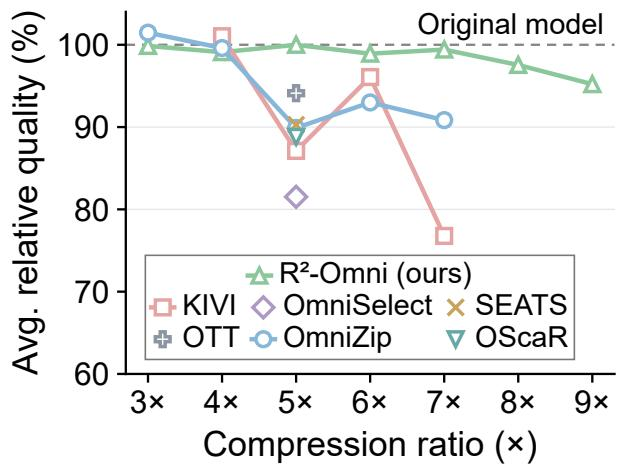  
Figure 3 | Quality–compression trade-of on Qwen2.5-Omni-3B. Average relative quality across three long-form generation benchmarks. Solid curves connect results at diferent compression ratios, while unconnected markers indicate single-point results. R<sup>2</sup>-Omni maintains comparatively stable quality as compression increases. Details are provided in Appendix A.3.

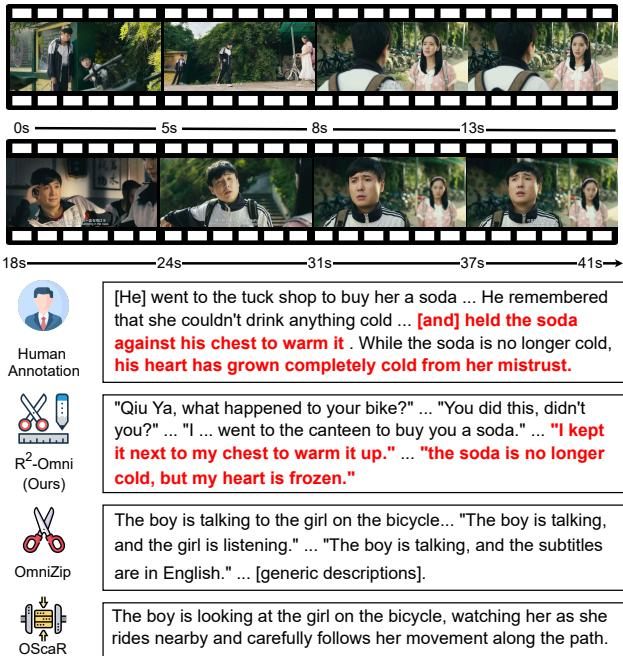  
Figure 4 | Case study. $\mathtt { R } ^ { 2 } .$ -Omni better preserves the dialogue content and its associated multimodal details.

## 4.3. Eficiency Analysis

We evaluate Qwen2.5-Omni-7B on a single NVIDIA H800 over 16K–256K raw contexts and 2,048 generated tokens. Figure 5 shows the complementary benefits of token pruning and KV quantization for prefilling and decoding. At 256K, $\mathtt { R } ^ { 2 } .$ -Omni achieves the best end-to-end latency, with 1.48× end-to-end speedup over BF16 and 1.24× over the strongest competing compression system. It also provides 1.22× higher peak throughput and 6.56× final compression of memory footprint.

Table 3 | Component ablation of $\mathbf { R } ^ { 2 } { \cdot } \mathbf { O m n i }$ . Ratio refers to the compression ratio of the final memory footprint relative to the baseline. Quality is evaluated with 256 frames on Video-SALMONN 2; LongVALE and OmniDCBench follow the main input settings.
<table><tr><td rowspan="2">Method</td><td colspan="3">Video-SALMONN 2</td><td colspan="2">LongVALE</td><td colspan="2">OmniDCBench</td><td colspan="3">Efficiency (256K)</td></tr><tr><td>Correct ↑</td><td>EER↓</td><td>Ratio</td><td>SODA-C↑</td><td>Ratio</td><td>SODA-M↑</td><td>Ratio</td><td>TTFT(s) TPOT(ms/tok)</td><td></td><td>E2E(s)</td></tr><tr><td>R2-Omni</td><td>21.02</td><td></td><td>88.57 7.07×</td><td>2.12</td><td>6.79×</td><td>5.11</td><td>6.93×</td><td>27.03</td><td>25.90</td><td>40.34</td></tr><tr><td>w/o SSPA</td><td>17.66</td><td></td><td>91.80 7.11×</td><td>2.03</td><td>5.13×</td><td>3.47</td><td>7.01×</td><td>25.50</td><td>21.86</td><td>36.67</td></tr><tr><td>w/o STC</td><td>20.39</td><td></td><td>90.16 3.97×</td><td>1.77</td><td>3.95×</td><td>5.35</td><td>3.95×</td><td>58.54</td><td>39.61</td><td>78.86</td></tr></table>

## 4.4. Ablation Studies

In this section, we conduct ablation studies to examine the contributions of STC and SSPA, the role of semantic signals in precision allocation, and the compression–quality trade-of induced by STC similarity thresholds.

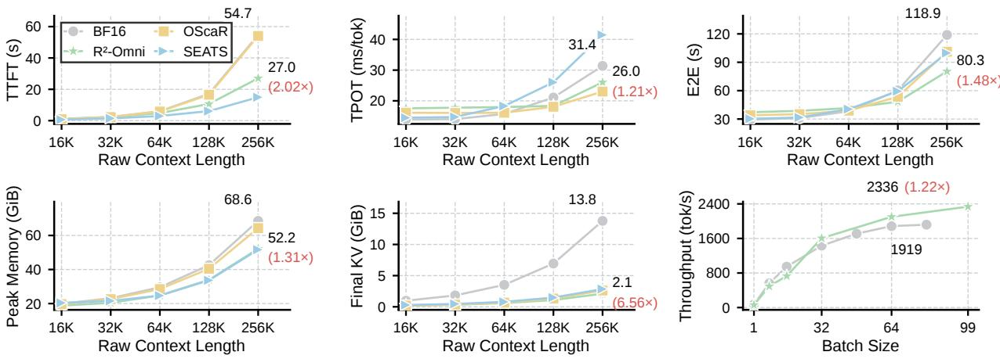  
Figure 5 | End-to-end eficiency of $\mathbf { R } ^ { 2 } { \cdot } \mathbf { O } \mathbf { m } \mathbf { n } ^ { \dagger }$ and the BF16 baseline. $\mathrm { R } ^ { 2 } { \cdot } 0 \mathrm { m n i }$ consistently improves inference latency, memory eficiency, decoding throughput, and maximum batch capacity. Detials are provided in Appendix A.2

Contributions of STC and SSPA. STC and SSPA address redundancy in the token sequence and the precision of the retained representations, respectively. In Table 3, we compare the full method with variants that retain only one stage. Notably, $\mathrm { R } ^ { 2 } { \cdot } \mathrm { O m n i }$ preserves better generation quality than STC-only while achieving stronger cache compression than SSPA-only. These results highlight the complementary roles of both stages and support their joint design for eficient long-form generation.

Table 4 | Ablation of SSPA allocation signals on Qwen2.5-Omni-3B. Ratio refers to the compression ratio of the final memory footprint relative to the baseline. All variants use the same STC output and configured precision budget.
<table><tr><td rowspan="2">Method</td><td colspan="3">Video-SALMONN 2</td><td colspan="2">LongVALE</td><td colspan="2">OmniDCBench</td></tr><tr><td>Correct ↑</td><td>EER↓</td><td>Ratio</td><td>SODA-C ↑</td><td>Ratio</td><td>SODA-M ↑</td><td>Ratio</td></tr><tr><td> $\mathtt { R } ^ { 2 } .$  -Omni</td><td>23.54</td><td>85.63</td><td>5.39×</td><td>2.23</td><td>5.34×</td><td>4.78</td><td>5.06x</td></tr><tr><td>w/o A-V Alignment</td><td>23.57</td><td>86.81</td><td>5.36x</td><td>2.12</td><td>5.34×</td><td>4.55</td><td>5.00×</td></tr><tr><td>w/o Semantic Prior</td><td>23.48</td><td>87.99</td><td>5.34×</td><td>2.01</td><td>5.33×</td><td>4.61</td><td>5.04×</td></tr></table>

Table 5 | Token retention and generation quality across STC similarity thresholds on Qwen2.5- Omni-3B. Token Ret. refers to Token retention ratio after STC.
<table><tr><td colspan="2">Threshold</td><td colspan="3">Video-SALMONN 2</td><td colspan="2">LongVALE</td><td colspan="2">OmniDCBench</td></tr><tr><td> $\tau _ { s }$ </td><td> $\tau _ { a }$ </td><td>Token Ret. (%)</td><td>Correct ↑</td><td>EER↓</td><td>Token Ret. (%)</td><td>SODA-C ↑</td><td>Token Ret. (%)</td><td>SODA-M ↑</td></tr><tr><td>0.7</td><td>0.8</td><td>56.14</td><td>23.54</td><td>85.63</td><td>59.73</td><td>2.23</td><td>61.84</td><td>4.78</td></tr><tr><td>0.5</td><td>0.6</td><td>18.49</td><td>18.32</td><td>90.45</td><td>23.50</td><td>2.28</td><td>22.77</td><td>4.26</td></tr><tr><td>0.3</td><td>0.4</td><td>6.97</td><td>16.00</td><td>92.56</td><td>12.24</td><td>2.00</td><td>10.32</td><td>3.18</td></tr></table>

SSPA Allocation Signals. The semantic prior guides precision allocation using query attention and cross-modal relevance. In Table 4, we evaluate its contribution by removing A–V alignment or the entire semantic prior while preserving the STC output and precision budget. Incorporating both signals generally improves generation quality, highlighting the benefit of using semantic information to refine output-sensitive allocation and preserve relevant content during quantization.

Compression–Quality Trade-of in STC. Table 5 examines how the spatial and audio similarity thresholds afect token retention and generation quality, with all other settings fixed. Lower thresholds admit less similar tokens for consolidation and consistently reduce token retention. Quality varies across benchmarks at intermediate thresholds, but the lowest thresholds consistently degrade quality, suggesting that aggressive consolidation may merge distinct content. This motivates using STC to reduce overlapping representations and SSPA to further compress the retained context.

## 5. Conclusion

We presented $\mathrm { R } ^ { 2 } { \cdot } \mathrm { O m n i } .$ , a training-free framework that jointly reduces structural and precision redundancy for eficient long-form generation in Omni-LLMs. STC consolidates overlapping audiovisual representations while preserving diverse content, and SSPA allocates value precision according to attention-output sensitivity under quantized keys, guided by a multimodal semantic prior. Across three Omni-LLMs and three long-form generation benchmarks, $\mathtt { R } ^ { 2 }$ -Omni achieves an average 5.0× KV-cache compression while retaining 97.98% of baseline generation quality. It also delivers a 1.48× end-to-end speedup in our long-context eficiency evaluation. These results highlight the benefits of jointly reducing overlapping representations and excess numerical precision while preserving the multimodal information needed for comprehensive generation.

Limitations and Future Work. The achievable compression of $\mathtt { R } ^ { 2 }$ -Omni depends in part on its precision allocation strategy, which shapes the balance between memory eficiency and generation quality. This balance may vary across models and application settings, leaving room for further refinement of the framework. Future work will extend $\bar { \mathsf { R } ^ { 2 } }$ -Omni to a broader range of model architectures and explore its application in agentic systems with more diverse generation requirements.

## AI use statement

We used AI tools to assist with writing and language refinement, literature retrieval and discovery, and code revision and debugging during research execution. The authors take full responsibility for the final content of this work.

## References

[1] Jin Xu, Zhifang Guo, Jinzheng He, Hangrui Hu, Ting He, Shuai Bai, Keqin Chen, Jialin Wang, Yang Fan, Kai Dang, Bin Zhang, Xiong Wang, Yunfei Chu, and Junyang Lin. Qwen2.5-omni technical report, 2025. URL https://arxiv.org/abs/2503.20215.

[2] Jin Xu, Zhifang Guo, Hangrui Hu, Yunfei Chu, Xiong Wang, Jinzheng He, Yuxuan Wang, Xian Shi, Ting He, Xinfa Zhu, et al. Qwen3-omni technical report. arXiv preprint arXiv:2509.17765, 2025.

[3] Junbo Cui, Bokai Xu, Chongyi Wang, Tianyu Yu, Weiyue Sun, Yingjing Xu, Tianran Wang, Zhihui He, Wenshuo Ma, Tianchi Cai, et al. Minicpm-o 4.5: Towards real-time full-duplex omni-modal interaction. arXiv preprint arXiv:2604.27393, 2026.

[4] Amala Sanjay Deshmukh, Kateryna Chumachenko, Tuomas Rintamaki, Matthieu Le, Tyler Poon, Danial Mohseni Taheri, Ilia Karmanov, Guilin Liu, Jarno Seppanen, Arushi Goel, et al. Nemotron

3 nano omni: eficient and open multimodal intelligence. arXiv preprint arXiv:2604.24954, 2026.

[5] Huawei Lin, Yunzhi Shi, Tong Geng, Weijie Zhao, Wei Wang, and Ravender Pal Singh. Agentomni: Test-time multimodal reasoning via model coordination for understanding anything. arXiv preprint arXiv:2511.02834, 2025.

[6] Changli Tang, Yixuan Li, Yudong Yang, Jimin Zhuang, Guangzhi Sun, Wei Li, Zejun Ma, and Chao Zhang. video-salmonn 2: Caption-enhanced audio-visual large language models. arXiv preprint arXiv:2506.15220, 2025.

[7] Linli Yao, Yuancheng Wei, Yaojie Zhang, Lei Li, Xinlong Chen, Feifan Song, Ziyue Wang, Kun Ouyang, Yuanxin Liu, Lingpeng Kong, et al. Timechat-captioner: Scripting multi-scene videos with time-aware and structural audio-visual captions. arXiv preprint arXiv:2602.08711, 2026.

[8] Keda Tao, Kele Shao, Bohan Yu, Weiqiang Wang, Jian Liu, and Huan Wang. Omnizip: Audioguided dynamic token compression for fast omnimodal large language models. In Proceedings of the IEEE/CVF Conference on Computer Vision and Pattern Recognition, pages 17682–17692, 2026.

[9] Yue Ding, Yiyan Ji, Jungang Li, Xuyang Liu, Xinlong Chen, Junfei Wu, Bozhou Li, Bohan Zeng, Yang Shi, Yushuo Guan, et al. Omnisift: Modality-asymmetric token compression for eficient omni-modal large language models. arXiv preprint arXiv:2602.04804, 2026.

[10] Morunliu Yang, Ruotao Xu, Le Li, Yue Wang, Jianxin Zhang, Juntao Li, Yihang Lou, Siwei Feng, and Peifeng Li. Omniselect: Dynamic modality-aware token compression for eficient omni-modal large language models. arXiv preprint arXiv:2605.18041, 2026.

[11] Zijie Xin, Jie Yang, Ruixiang Zhao, Tianyi Wang, Fengyun Rao, Jing Lyu, and Xirong Li. Stageadaptive token selection for eficient omni-modal llms. arXiv preprint arXiv:2605.20035, 2026.

[12] Wanshun Su, Yang Shi, Feihu Liu, Ziwen Yu, Yan Min, Zhuoran Zhang, Qixun Wang, Haotian Wang, Shixuan Liu, Yuanxing Zhang, et al. Omnipack: Unified token compression for eficient omni-modal large language models. arXiv preprint arXiv:2608.03812, 2026.

[13] Chaoyou Fu, Yuhan Dai, Yongdong Luo, Lei Li, Shuhuai Ren, Renrui Zhang, Zihan Wang, Chenyu Zhou, Yunhang Shen, Mengdan Zhang, et al. Video-mme: The first-ever comprehensive evaluation benchmark of multi-modal llms in video analysis. In 2025 IEEE/CVF Conference on Computer Vision and Pattern Recognition (CVPR), pages 24108–24118. IEEE, 2025.

[14] Jack Hong, Shilin Yan, Jiayin Cai, Xiaolong Jiang, Yao Hu, and Weidi Xie. Worldsense: Evaluating real-world omnimodal understanding for multimodal llms. In International Conference on Learning Representations, volume 2026, pages 52423–52443, 2026.

[15] Keda Tao, Yuhua Zheng, Jia Xu, Wenjie Du, Kele Shao, Hesong Wang, Xueyi Chen, Xin Jin, Junhan Zhu, Bohan Yu, et al. Lvomnibench: Pioneering long audio-video understanding evaluation for omnimodal llms. arXiv preprint arXiv:2603.19217, 2026.

[16] Ziwei Zhou, Rui Wang, Zuxuan Wu, and Yu-Gang Jiang. Daily-omni: Towards audio-visual reasoning with temporal alignment across modalities. arXiv preprint arXiv:2505.17862, 2025.

[17] Zirui Liu, Jiayi Yuan, Hongye Jin, Shaochen Zhong, Zhaozhuo Xu, Vladimir Braverman, Beidi Chen, and Xia Hu. Kivi: A tuning-free asymmetric 2bit quantization for kv cache. arXiv preprint arXiv:2402.02750, 2024.

[18] Coleman Hooper, Sehoon Kim, Hiva Mohammadzadeh, Michael W Mahoney, Yakun S Shao, Kurt Keutzer, and Amir Gholami. Kvquant: Towards 10 million context length llm inference with kv cache quantization. Advances in Neural Information Processing Systems, 37:1270–1303, 2024.

[19] Amir Zandieh, Majid Daliri, Majid Hadian, and Vahab Mirrokni. Turboquant: Online vector quantization with near-optimal distortion rate. In International Conference on Learning Representations, volume 2026, pages 56418–56439, 2026.

[20] Zunhai Su, Rui Yang, Chao Zhang, Yaxiu Liu, Yifan Zhang, Wei Wu, Jing Xiong, Dayou Du, Xialie Zhuang, Yulei Qian, et al. Oscar: The occam’s razor for extreme kv cache quantization in llms and beyond. arXiv preprint arXiv:2605.19660, 2026.

[21] Yi Su, Yuechi Zhou, Quantong Qiu, Juntao Li, Qingrong Xia, Ping Li, Xinyu Duan, Zhefeng Wang, and Min Zhang. Accurate kv cache quantization with outlier tokens tracing. In Proceedings of the 63rd Annual Meeting of the Association for Computational Linguistics (Volume 1: Long Papers), pages 12895–12915, 2025.

[22] Tiantian Geng, Jinrui Zhang, Qingni Wang, Teng Wang, Jinming Duan, and Feng Zheng. Longvale: Vision-audio-language-event benchmark towards time-aware omni-modal perception of long videos. In 2025 IEEE/CVF Conference on Computer Vision and Pattern Recognition (CVPR), pages 18959–18969. IEEE, 2025.

[23] Liang Chen, Haozhe Zhao, Tianyu Liu, Shuai Bai, Junyang Lin, Chang Zhou, and Baobao Chang. An image is worth 1/2 tokens after layer 2: Plug-and-play inference acceleration for large vision-language models. In European Conference on Computer Vision, pages 19–35. Springer, 2024.

[24] Senqiao Yang, Yukang Chen, Zhuotao Tian, Chengyao Wang, Jingyao Li, Bei Yu, and Jiaya Jia. Visionzip: Longer is better but not necessary in vision language models. In 2025 IEEE/CVF Conference on Computer Vision and Pattern Recognition (CVPR), pages 19792–19802. IEEE, 2025.

[25] Yefei He, Feng Chen, Jing Liu, Wenqi Shao, Hong Zhou, Kaipeng Zhang, and Bohan Zhuang. Zipvl: Eficient large vision-language models with dynamic token sparsification. arXiv preprint arXiv:2410.08584, 2024.

[26] Keda Tao, Can Qin, Haoxuan You, Yang Sui, and Huan Wang. Dycoke: Dynamic compression of tokens for fast video large language models. In 2025 IEEE/CVF Conference on Computer Vision and Pattern Recognition (CVPR), pages 18992–19001. IEEE, 2025.

[27] Tianyu Fu, Tengxuan Liu, Qinghao Han, Guohao Dai, Shengen Yan, Huazhong Yang, Xuefei Ning, and Yu Wang. Framefusion: Combining similarity and importance for video token reduction on large vision language models. In 2025 IEEE/CVF International Conference on Computer Vision (ICCV), pages 22654–22663. IEEE, 2025.

[28] Jeongseok Hyun, Sukjun Hwang, Su Ho Han, Taeoh Kim, Inwoong Lee, Dongyoon Wee, Joon-Young Lee, Seon Joo Kim, and Minho Shim. Multi-granular spatio-temporal token merging for training-free acceleration of video llms. In 2025 IEEE/CVF International Conference on Computer Vision (ICCV), pages 23990–24000. IEEE, 2025.

[29] Hao Luo, Zihao Yue, Wanpeng Zhang, Yicheng Feng, Sipeng Zheng, Deheng Ye, and Zongqing Lu. Openmmego: Enhancing egocentric understanding for lmms with open weights and data. Advances in Neural Information Processing Systems, 38:25749–25781, 2026.

[30] Chao Gong, Depeng Wang, Zhipeng Wei, Ya Guo, Huijia Zhu, and Jingjing Chen. Echoingpixels: Cross-modal adaptive token reduction for eficient audio-visual llms. arXiv preprint arXiv:2512.10324, 2025.

[31] Yefei He, Luoming Zhang, Weijia Wu, Jing Liu, Hong Zhou, and Bohan Zhuang. Zipcache: Accurate and eficient kv cache quantization with salient token identification. Advances in Neural Information Processing Systems, 37:68287–68307, 2024.

[32] Tao Zhang, Ziqian Zeng, Hao Peng, Huiping Zhuang, and Cen Chen. Mixkvq: Query-aware mixed-precision kv cache quantization for long-context reasoning. In Proceedings of the 64th Annual Meeting of the Association for Computational Linguistics (Volume 1: Long Papers), pages 7189–7204, 2026.

[33] Keda Tao, Haoxuan You, Yang Sui, Can Qin, and Huan Wang. Plug-and-play 1. x-bit kv cache quantization for video large language models. arXiv preprint arXiv:2503.16257, 2025.

[34] Jiahao Fan and Chien-Ming Chen. Eficient multimodal large language model via dynamic kv cache quantization. In Proceedings of the AAAI Conference on Artificial Intelligence, volume 40, pages 20994–21001, 2026.

[35] Xueyi Chen, Keda Tao, Kele Shao, and Huan Wang. Streamingtom: Streaming token compression for eficient video understanding. In Proceedings of the IEEE/CVF Conference on Computer Vision and Pattern Recognition, pages 24675–24685, 2026.

[36] Xinqing Li, Xin He, Xindong Zhang, Ming-Ming Cheng, Lei Zhang, and Yun Liu. Towards joint quantization and token pruning of vision-language models. arXiv preprint arXiv:2604.17320, 2026.

[37] Xinhao Wang, Zhonyu Xia, Zhiwei Lin, Zhe Li, and Yongtao Wang. Qapruner: Quantizationaware vision token pruning for multimodal large language models. arXiv preprint arXiv:2604.02816, 2026.

[38] Kyeongyoon Lee, Hongyeob Kim, Youngeun Kim, and Sungeun Hong. Deferred audio pruning with local audio-visual dynamics for omni-llms. arXiv preprint arXiv:2608.08794, 2026.

[39] Saleh Ashkboos, Amirkeivan Mohtashami, Maximilian L Croci, Bo Li, Pashmina Cameron, Martin Jaggi, Dan Alistarh, Torsten Hoefler, and James Hensman. Quarot: Outlier-free 4-bit inference in rotated llms. Advances in Neural Information Processing Systems, 37:100213–100240, 2024.

[40] Zunhai Su, Zhe Chen, Wang Shen, Hanyu Wei, Linge Li, Huangqi Yu, and Kehong Yuan. Rotatekv: Accurate and robust 2-bit kv cache quantization for llms via outlier-aware adaptive rotations. arXiv preprint arXiv:2501.16383, 2025.

[41] Chengyang Ying, Xinning Zhou, Hang Su, Dong Yan, Ning Chen, and Jun Zhu. Towards safe reinforcement learning via constraining conditional value-at-risk. arXiv preprint arXiv:2206.04436, 2022.

[42] Ju-Hyun Kim and Seungki Min. Risk-sensitive policy optimization via predictive cvar policy gradient. In Forty-first International Conference on Machine Learning, 2024.

[43] Qinglong Cao, Yuntian Chen, Lu Lu, Hao Sun, Zhengzhong Zeng, Xiaokang Yang, and Dongxiao Zhang. Generalized domain prompt learning for accessible scientific vision-language models. Nexus, 2(2), 2025.

## Supplementary Material

A Complete Experimental Results 16   
A.1 Complete Results of token pruning methods across tasks 16   
A.2 Complete Results of Eficiency Experiment 16   
A.3 Complete Results under Diferent Compression Ratios 17   
A.4 Results of naive combinations across Omni-LLMs. 18   
B Implementation Details 18   
B.1 R<sup>2</sup>-Omni Implementation 19   
B.2 Reproduction details of compared baselines 24   
B.3 Method Configurations at the Nominal 5× Budget 25   
B.4 R<sup>2</sup>-Omni Compression-Ratio Configurations 26   
B.5 Pruning–Quantization Composition Configurations 26   
C Long-Form Generation Benchmarks 26   
D Evaluated Omni-LLMs 29   
E Qualitative Case Studies 29   
E.1 Long-Range Temporal Coverage 29   
E.2 Fine-Grained Detail Preservation 30   
E.3 Factuality under Compression 30   
E.4 Comparison Between STC and Token Pruning 30

Table 6 | Token pruning quality on Video-SALMONN 2 and DailyOmni. Video-SALMONN 2 reports Correct rate, while DailyOmni reports multiple-choice accuracy. Relative quality is normalized to the corresponding BF16 baseline.
<table><tr><td colspan="2"></td><td colspan="2">Video-SALMONN 2</td><td colspan="2">DailyOmni</td></tr><tr><td>Method</td><td>Pruning</td><td>Correct ↑</td><td>Rel. Quality ↑</td><td>Accuracy ↑</td><td>Rel. Quality ↑</td></tr><tr><td>BF16</td><td>0%</td><td>24.45</td><td>100.00</td><td>55.56</td><td>100.00</td></tr><tr><td rowspan="5">OmniZip</td><td>40%</td><td>25.09</td><td>102.60</td><td>53.72</td><td>96.69</td></tr><tr><td>50%</td><td>24.43</td><td>99.90</td><td>53.38</td><td>96.09</td></tr><tr><td>60%</td><td>23.09</td><td>94.41</td><td>51.63</td><td>92.93</td></tr><tr><td>70%</td><td>21.07</td><td>86.18</td><td>51.38</td><td>92.48</td></tr><tr><td>80%</td><td>18.28</td><td>74.76</td><td>49.46</td><td>89.02</td></tr><tr><td rowspan="5">OmniSelect</td><td>40%</td><td>24.40</td><td>99.78</td><td>54.55</td><td>98.20</td></tr><tr><td>50%</td><td>23.77</td><td>97.21</td><td>53.55</td><td>96.39</td></tr><tr><td>60%</td><td>22.34</td><td>91.37</td><td>52.21</td><td>93.98</td></tr><tr><td>70%</td><td>19.68</td><td>80.47</td><td>51.04</td><td>91.88</td></tr><tr><td>80%</td><td>16.29</td><td>66.60</td><td>47.12</td><td>84.81</td></tr><tr><td rowspan="5">SEATS</td><td>40%</td><td>24.45</td><td>100.00</td><td>54.39</td><td>97.89</td></tr><tr><td>50%</td><td>23.80</td><td>97.33</td><td>54.64</td><td>98.35</td></tr><tr><td>60%</td><td>24.57</td><td>100.47</td><td>54.30</td><td>97.74</td></tr><tr><td>70%</td><td>18.14</td><td>74.17</td><td>53.80</td><td>96.84</td></tr><tr><td>80%</td><td>16.26</td><td>66.48</td><td>52.13</td><td>93.83</td></tr></table>

## A. Complete Experimental Results

## A.1. Complete Results of token pruning methods across tasks

We evaluate all token pruning methods on Qwen2.5-Omni-3B under the same model and evaluation settings. As shown in Table 6, moderate token pruning largely preserves model quality, whereas aggressive pruning causes substantial degradation, particularly on dense-captioning tasks. At pruning ratios of 70–80%, the Correct rate on Video-SALMONN 2 drops markedly across all methods, while the degradation on DailyOmni is comparatively smaller. This indicates that multiple-choice tasks can often be solved using a limited subset of salient evidence, whereas dense captioning requires retaining substantially more fine-grained visual information. These results support our motivation that aggressive token pruning may remove details that are unnecessary for answering a specific question but remain important for comprehensive long-form generation.

## A.2. Complete Results of Eficiency Experiment

We evaluate Qwen2.5-Omni-7B on a single NVIDIA H800 GPU using greedy decoding and raw context lengths from 16K to 256K. All methods use FlashAttention-2 for prefilling, and each result is the median of three measured runs after one warm-up run. As shown in Table 7, compression introduces additional selection, quantization, and cache-management overhead, which can dominate at short context lengths. Consequently, BF16 remains competitive for short inputs.

The benefit becomes more pronounced as the context grows. SEATS achieves the lowest TTFT through aggressive token reduction, whereas OScaR obtains the lowest TPOT at 256K through KV quantization. By jointly reducing token and precision redundancy, R<sup>2</sup>-Omni achieves the best end-to-end latency at both 128K and 256K while achieving the smallest final memory footprint. At 256K, it provides a 1.48× E2E speedup, uses 1.31× less peak memory, and reduces the final memory footprint by 6.56×

Table 7 | End-to-end eficiency across context lengths. TTFT denotes time-to-first-token, TPOT denotes time-per-output-token, and E2E denotes the total latency for generating 2,048 tokens. Peak is the peak allocated GPU memory, and Final is the physical memory footprint after generation. Context lengths refer to raw multimodal sequences before token consolidation. Lower is better for all metrics.
<table><tr><td>Method</td><td>Context</td><td>TTFT (s)</td><td>TPOT (ms/tok)</td><td>E2E (s)</td><td>Peak (GiB)</td><td>Final (GiB)</td></tr><tr><td>BF16</td><td>16K</td><td>0.964</td><td>13.871</td><td>29.357</td><td>19.920</td><td>0.978</td></tr><tr><td>R2-Omni</td><td>16K</td><td>1.223</td><td>17.563</td><td>37.184</td><td>18.790</td><td>0.209</td></tr><tr><td>OScaR</td><td>16K</td><td>0.950</td><td>16.124</td><td>33.963</td><td>19.654</td><td>0.191</td></tr><tr><td>SEATS</td><td>16K</td><td>0.645</td><td>14.482</td><td>30.288</td><td>20.387</td><td>0.288</td></tr><tr><td>BF16</td><td>32K</td><td>2.364</td><td>14.037</td><td>31.090</td><td>23.134</td><td>1.824</td></tr><tr><td>R²-Omni</td><td>32K</td><td>2.305</td><td>17.757</td><td>38.653</td><td>20.402</td><td>0.334</td></tr><tr><td>OScaR</td><td>32K</td><td>2.312</td><td>16.046</td><td>35.163</td><td>22.602</td><td>0.350</td></tr><tr><td>SEATS</td><td>32K</td><td>1.442</td><td>14.742</td><td>31.612</td><td>21.551</td><td>0.457</td></tr><tr><td>BF16</td><td>64K</td><td>6.013</td><td>15.721</td><td>38.196</td><td>29.560</td><td>3.516</td></tr><tr><td>R²-Omni</td><td>64K</td><td>4.816</td><td>17.972</td><td>41.605</td><td>24.792</td><td>0.590</td></tr><tr><td>OScaR</td><td>64K</td><td>5.829</td><td>16.114</td><td>38.814</td><td>28.502</td><td>0.668</td></tr><tr><td>SEATS</td><td>64K</td><td>2.966</td><td>18.315</td><td>40.461</td><td>24.669</td><td>0.795</td></tr><tr><td>BF16</td><td>128K</td><td>17.145</td><td>21.088</td><td>60.312</td><td>42.561</td><td>6.938</td></tr><tr><td>R²-Omni</td><td>128K</td><td>10.653</td><td>18.364</td><td>48.283</td><td>33.922</td><td>1.086</td></tr><tr><td>OScaR</td><td>128K</td><td>16.544</td><td>18.059</td><td>53.516</td><td>40.441</td><td>1.319</td></tr><tr><td>SEATS</td><td>128K</td><td>6.100</td><td>26.043</td><td>59.410</td><td>33.663</td><td>1.479</td></tr><tr><td>BF16</td><td>256K</td><td>54.701</td><td>31.375</td><td>118.910</td><td>68.561</td><td>13.782</td></tr><tr><td>R²-Omni</td><td>256K</td><td>27.030</td><td>26.014</td><td>80.347</td><td>52.189</td><td>2.102</td></tr><tr><td>OScaR</td><td>256K</td><td>54.023</td><td>23.025</td><td>101.139</td><td>64.317</td><td>2.612</td></tr><tr><td>SEATS</td><td>256K</td><td>14.923</td><td>41.465</td><td>99.782</td><td>51.652</td><td>2.848</td></tr></table>

over BF16. It is also 1.24× and 1.26× faster end-to-end than SEATS and OScaR, respectively. These results show that $\mathrm { R } ^ { 2 } { \cdot } \mathrm { O m n i }$ does not optimize a single isolated stage; instead, it provides a better overall balance between long-context latency and memory eficiency.

## A.3. Complete Results under Diferent Compression Ratios

Table 8 presents detailed quality results for $\mathtt { R } ^ { 2 } .$ -Omni, OmniZip, and KIVI across diferent compression ratios on Qwen2.5-Omni-3B. $\mathrm { R } ^ { \dot { 2 } . }$ -Omni maintains comparatively stable overall quality as compression increases, while the baselines exhibit more pronounced degradation under tighter memory budgets. These results demonstrate the ability of $\mathtt { R } ^ { 2 } .$ -Omni to accommodate stronger memory constraints while preserving long-form generation quality.

Table 8 | Quality across compression ratios on Qwen2.5-Omni-3B. For $\mathtt { R } ^ { 2 } .$ -Omni, each operating point adjusts only the STC thresholds and SSPA value-precision budget.
<table><tr><td rowspan="2">Method</td><td rowspan="2">Compression</td><td colspan="2">Video-SALMONN 2</td><td>LongVALE</td><td>OmniDCBench</td></tr><tr><td>Correct ↑</td><td>EER↓</td><td>SODA-C ↑</td><td>SODA-M ↑</td></tr><tr><td rowspan="6">R²-Omni</td><td>3x</td><td>25.75</td><td>84.28</td><td>2.09</td><td>4.56</td></tr><tr><td>4×</td><td>24.02</td><td>86.05</td><td>2.13</td><td>4.77</td></tr><tr><td>6x</td><td>22.58</td><td>87.33</td><td>2.25</td><td>4.81</td></tr><tr><td>7×</td><td>22.86</td><td>86.30</td><td>2.12</td><td>5.11</td></tr><tr><td>8×</td><td>22.18</td><td>87.02</td><td>2.11</td><td>4.94</td></tr><tr><td>9x</td><td>21.75</td><td>87.39</td><td>2.02</td><td>4.80</td></tr><tr><td rowspan="4">OmniZip</td><td>3x</td><td>21.39</td><td>88.08</td><td>2.50</td><td>5.00</td></tr><tr><td>4×</td><td>20.02</td><td>89.42</td><td>2.52</td><td>4.93</td></tr><tr><td>6x</td><td>16.98</td><td>93.45</td><td>2.44</td><td>4.63</td></tr><tr><td>7x</td><td>16.01</td><td>94.35</td><td>2.49</td><td>4.32</td></tr><tr><td rowspan="3">KIVI</td><td>4×</td><td>24.51</td><td>86.09</td><td>2.04</td><td>5.28</td></tr><tr><td>6x</td><td>22.27</td><td>87.39</td><td>2.06</td><td>4.77</td></tr><tr><td>7×</td><td>18.71</td><td>90.17</td><td>1.74</td><td>2.56</td></tr></table>

A.4. Results of naive combinations across Omni-LLMs.  
Table 9 extends the composition comparison to Qwen2.5-Omni-7B and MiniCPM-o-4.5. On MiniCPM-o-4.5, SEATS + OScaR achieves the best results on all four quality metrics among the three compositions. This reverses its ranking on Qwen2.5-Omni-7B, showing that the efectiveness of a direct composition depends on the backbone.

Table 9 | Direct pruning–quantization compositions on Qwen2.5-Omni-7B and MiniCPM-o-4.5.
<table><tr><td rowspan="2">Method</td><td colspan="3">Video-SALMONN 2</td><td colspan="2">LongVALE</td><td colspan="2">OmniDCBench</td></tr><tr><td></td><td></td><td></td><td></td><td></td><td></td><td>Correct ↑ EER ↓ KV Comp. SODA-C ↑ KV Comp. SODA-M ↑ KV Comp.</td></tr><tr><td>Qwen2.5-Omni-7B</td><td></td><td></td><td></td><td></td><td></td><td></td><td></td></tr><tr><td>OmniZip + KIVI</td><td>29.97</td><td>78.57</td><td>5.07×</td><td>1.44</td><td>5.34×</td><td>6.33</td><td>4.89×</td></tr><tr><td>OmniSelect + OTT</td><td>30.99</td><td>79.07</td><td>5.00×</td><td>1.40</td><td>5.35×</td><td>6.84</td><td>4.81×</td></tr><tr><td>SEATS + OScaR</td><td>15.12</td><td>93.92</td><td>5.27×</td><td>1.15</td><td>5.30x</td><td>3.57</td><td>5.22×</td></tr><tr><td>MiniCPM-o-4.5</td><td></td><td></td><td></td><td></td><td></td><td></td><td></td></tr><tr><td>OmniZip + KIVI</td><td>28.97</td><td>79.26</td><td>4.90×</td><td>1.84</td><td>5.41×</td><td>16.16</td><td>5.06×</td></tr><tr><td>OmniSelect + OTT</td><td>28.76</td><td>79.26</td><td>4.79×</td><td>1.97</td><td>5.01×</td><td>16.63</td><td>4.93×</td></tr><tr><td>SEATS + OScaR</td><td>34.80</td><td>73.53</td><td>4.91×</td><td>2.12</td><td>4.94×</td><td>16.87</td><td>4.93×</td></tr></table>

## B. Implementation Details

## B.1. $\mathbf { R } ^ { 2 } \mathbf { \cdot }$ -Omni Implementation

## B.1.1. Structure-Aware Token Consolidation

STC operates on the projected multimodal embeddings before the first language-decoder layer. The representative selection and audio merging rules are described in Sec. 3.2; below we specify region construction, boundary cases, and position handling.

Spatial region construction. We recover the post-vision-merge token grid and use fixed 8-neighbor connectivity. Each undirected edge is enumerated once using the ofsets (0, 1), (1, −1), (1, 0), and (1, 1), with out-of-bounds neighbors skipped. Cosine similarities are computed in a batch, and edges with similarity strictly greater than $\tau _ { s }$ are processed by Union-Find. The implementation uses path halving in Find; unions attach one root to the other without rank- or size-based balancing.

After all qualifying edges have been processed, tokens are grouped by their final roots. Each component is sorted by flattened grid index and split into groups of at most 128 tokens. Groups containing a single token are retained unchanged; each larger group retains one original representative according to Eq. 2. Connectivity is defined before this size-based split: it does not require pairwise similarity among all members, and the resulting bounded groups need not remain connected. Algorithm 1 summarizes this procedure. In the CUDA implementation, edge similarities are computed on the GPU and the threshold decisions are transferred to the CPU for Union-Find.

Temporal region reuse. Video frames are processed in non-overlapping adjacent pairs. When a pair passes the frame-similarity test in Sec. 3.2, the second frame drops positions covered by the first frame’s region groups R and retains all remaining positions. No second-frame representative is selected for these regions, and their features are not averaged into the first-frame representatives. If the frame-similarity test fails, the second frame is consolidated independently. An unpaired final frame undergoes spatial consolidation only.

Local audio merging. Audio chunks contain at most 50 tokens. Within each chunk, qualifying adjacent pairs are processed in descending similarity order, with each token participating in at most one merge. For a chunk of � tokens, at most $\lfloor n / 2 \rfloor$ pairs are accepted, so at least ⌈�/2⌉ tokens remain. Merging is performed once, without recursive or cross-chunk consolidation.

Sequence and position handling. In the Qwen integration, a common keep mask selects the updated embeddings, token IDs, attention mask, modality labels, and multimodal position IDs. Text and other non-audio-visual tokens remain unchanged. Retained tokens preserve their original semantic positions, with a merged audio pair using the left token’s position. Physical cache slots are compacted separately, so sequence compaction does not renumber the retained multimodal RoPE coordinates. For MiniCPM-o-4.5, STC uses native modality bounds and treats each 64-token visual block as an 8 × 8 grid; such a block need not correspond to a complete video frame. Its internal LLM handles positions, so the Qwen-specific position-ID procedure is not assumed for this adapter.

## B.1.2. Semantic-Sensitivity Guided Precision Allocation

Notation and page organization. We follow Sec. 3.3: � indexes a retained token, � a page, � a query anchor, and � an inner allocation round. Let P be the page set and $n _ { p }$ the number of tokens in page �. Each page contains at most 32 contiguous tokens and terminates at a modality boundary; short pages are retained as indivisible allocation units. The token indices belonging to page � are denoted by $\boldsymbol { { \mathcal { T } } } _ { p }$ For Algorithm 2, $\mathbf { b } = ( b _ { p } ) _ { p \in \mathcal { P } }$ denotes the complete value-precision assignment, with $b _ { p } \in \{ 2 , 4 , 1 6 \}$ Thus, � denotes a page, whereas b denotes a complete candidate. Within a refinement pass, the layout dependence of �<sup>ˆ</sup> and $C _ { a }$ is implicit, as in the main text. Head indices are omitted: attention scores are averaged across heads, output energies are averaged across heads and channels, and page

Algorithm 1 Union-Find Spatial Consolidation in STC   
Require: Frame features $\boldsymbol { F } = \{ f _ { i } \} _ { i = 1 } ^ { H W }$ ; token grid; threshold $\tau _ { s } ;$ maximum group size $L = 1 2 8$   
Ensure: Retained indices I; region groups R   
1: Helper routine Find(�):   
2: while parent[�] ≠ � do   
3: parent[�] ← parent[parent[�]]   
4: � ← parent[�]   
5: end while   
6: return �   
7: End helper routine   
8: Main procedure: initialize parent $[ i ]  i$   
9: Enumerate the non-duplicate 8-neighbor edges $\varepsilon$   
10: Compute $s _ { i j } = \cos ( f _ { i } , f _ { j } )$ for all $( i , j ) \in \mathcal { E }$   
11: for all $( i , j ) \in \mathcal { E }$ with $s _ { i j } > \tau _ { s }$ do   
12: �<sub>�</sub> ← Find(�); �<sub>�</sub> ← Find(�)   
13: if $r _ { i } \neq r _ { j }$ then   
14: parent[�<sub>�</sub>] ← �<sub>�</sub>   
15: end if   
16: end for   
17: Group tokens by Find(�) to obtain components C   
18: $\mathcal { I }  \emptyset ; \mathcal { R }  \emptyset$   
19: for all $C \in C$ do   
20: Sort � by grid index and split it into groups of size at most �   
21: for all resulting groups � do   
22: if |�| = 1 then   
23: I ← I ∪ �   
24: else   
25: Select $i _ { R } ^ { * }$ using Eq. 2   
26: ${ \cal { I } }  { \cal { I } } \bar { \cup } \{ i _ { R } ^ { * } \}$   
27: R ← R ∪ {�}   
28: end if   
29: end for   
30: end for   
31: return I in original order and R

precision assignments are shared across heads.

Query anchors and layer-group sharing. We use the final $N _ { q } = \operatorname* { m i n } ( 8 , N )$ available prefill queries, where $\begin{array} { r } { N = \sum _ { p \in \mathcal { P } } n _ { p } } \end{array}$ is the retained sequence length. They are obtained from the corresponding input states using the allocation layer’s query projection and positional encoding. Calibration attends to the complete retained history without an anchor-specific prefill causal mask, serving as a proxy for decoding. No external calibration data or future generated queries are used.

Layers are grouped in consecutive blocks of four. The first layer uses its own �, �, � to compute a complete page assignment, including all allocation rounds and layout refinements. The remaining layers reuse the page tiers but independently quantize their own KV with their own scales and zero points. For Qwen2.5-Omni-3B, all decoder layers use SSPA. For Qwen2.5-Omni-7B, layers 0 and 1 retain BF16 KV; grouping remains 0–3, 4–7, and so on, with layer 0 computing the assignment used by layers 2 and 3. Model-specific evaluated configurations are listed in Appendix B.3.

Hadamard preconditioning and quantization formats. We apply a normalized Walsh–Hadamard transform along the attention feature dimension. Queries and keys receive the same orthogonal transform after rotary position encoding, preserving their dot products before quantization. Values are also transformed, and the inverse transform is applied to the readout before the attention output projection. All calibration quantities $Q , K , V$ and their reconstructions are expressed in this transformed space.

In SSPA-managed historical caches, keys use per-channel afine INT4, calibrated over physical blocks of 32 tokens in the default Qwen profile. INT2 values use per-token afine quantization in groups of 32 channels, with FP16 scales and integer zero points. INT4 values use per-token symmetric quantization with FP32 scales; BF16 values retain their transformed representation. The value tier applies to the whole page, whereas quantization parameters are computed at the granularity of the corresponding format.

Token-level semantic signals. Using the reference attention ${ \mathcal { A } } ( K )$ from Sec. 3.3, token query relevance is

$$
s _ { i } ^ { \mathrm { a t t n } } = \sum _ { q = 1 } ^ { N _ { q } } w _ { q } [ \mathcal { R } ( K ) ] _ { q , i } , \qquad w _ { q } = \frac { \gamma ^ { N _ { q } - q } } { \sum _ { j = 1 } ^ { N _ { q } } \gamma ^ { N _ { q } - j } } .\tag{6}
$$

Anchors follow input order, and $\gamma = 0 . 8$ emphasizes later queries. All selected anchors participate in this weighted average; no top-� selection is applied to the anchors.

For alignment, audio and video tokens are independently assigned to 16 temporal chunks by relative sequence position after STC. Chunks with the same index provide approximate cross-modal correspondence, rather than exact timestamp synchronization. Let $\mathfrak { z } _ { i }$ be the normalized feature obtained by averaging token �’s unquantized key features across heads, and let $\mathcal { T } ( i )$ contain tokens of the other modality in the matching chunk. Then

$$
s _ { i } ^ { \mathrm { a l i g n } } = \mathrm { T o p M e a n } _ { 4 } \big ( \{ \cos ( z _ { i } , z _ { j } ) : j \in \mathcal { T } ( i ) \} \big ) ,\tag{7}
$$

where $\mathrm { T o p M e a n } _ { k }$ averages the largest at most � entries. If $\mathcal { T } ( i )$ is empty, we use cosine similarity to the other modality’s normalized global centroid. If either audio or video is absent, alignment falls back to query relevance.

Page aggregation and semantic prior. Each signal is aggregated separately from tokens to pages and then rank-normalized within audio or video:

$$
s _ { p } ^ { \xi } = \mathrm { R a n k N o r m } _ { m ( p ) } \left( \mathrm { T o p M e a n } _ { 4 } \bigl ( \{ s _ { i } ^ { \xi } : i \in { \cal I } _ { p } \} \bigr ) \right) , \qquad \xi \in \{ \mathrm { a t t n } , \mathrm { a l i g n } \} .\tag{8}
$$

Here, $m ( p )$ is the modality of page $p .$ ${ \mathrm { R a n k N o r m } } _ { m ( p ) }$ maps ranks among pages of that modality to $[ 0 , 1 ] .$ , with tied scores receiving their average rank. This prevents the raw scales of attention and alignment from dominating their combination in Eq. 3. The default attention weight is $\omega = 0 . 6 ;$ text and other pages receive a neutral semantic prior $s _ { p } ^ { \mathrm { s e m } } = 0 . 5$ . The two top-4 operations have distinct roles: one selects cross-modal similarities for each token, and the other aggregates token scores within each page.

Attention-output distortion. For an output-space tensor $X ,$ let $X _ { q }$ denote its component at anchor $q ,$ and let $\| X _ { q } \| _ { \mathrm { a v } } ^ { 2 }$ denote its mean squared energy. � can be the current residual $R _ { t }$ or an upgrade correction $C _ { a }$ . For $N _ { q } > 1$ , define $\Delta _ { 1 } X = 0$ and $\Delta _ { q } X = X _ { q } - X _ { q - 1 }$ for $q > 1$ . We use

$$
\begin{array} { r l r } & { \ell _ { q } ( \boldsymbol { X } ) = ( 1 - \lambda ) \| \boldsymbol { X } _ { q } \| _ { \mathrm { a v } } ^ { 2 } + \lambda \frac { N _ { q } } { N _ { q } - 1 } \| \boldsymbol { \Delta } _ { q } \boldsymbol { X } \| _ { \mathrm { a v } } ^ { 2 } , } & \\ & { \mathcal { L } ( \boldsymbol { X } ) = \mathrm { T o p M e a n } _ { k _ { \alpha } } \big ( \{ \ell _ { q } ( \boldsymbol { X } ) \} _ { q = 1 } ^ { N _ { q } } \big ) , \qquad k _ { \alpha } = \lceil ( 1 - \alpha ) N _ { q } \rceil . } & \end{array}\tag{9}
$$

The top-tail mean implements the empirical upper-tail CVaR objective [41, 42]. The factor $N _ { q } / ( N _ { q } - 1 )$ compensates for the zero transition at the first anchor. For $N _ { q } = 1$ , we use $\mathcal { L } ( X ) = \| X _ { 1 } \| _ { \mathrm { a v } } ^ { 2 }$ . Defaults $\alpha = 0 . 7 5$ and $\lambda = 0 . 5$ average the two largest losses when $N _ { q } = 8$ and balance residual magnitude

against anchor-to-anchor variation. This is an attention-readout objective before the output projection, not a final-logit or task-loss objective. Anchor weighting in Eq. 6 is used for relevance; the distortion objective uses the top-tail reduction above.

Action prior. For an action $a = ( p , u \to \nu )$ , we measure sensitivity by $\mathcal { L } ( C _ { a } )$ and construct

$$
P _ { a } = \eta s _ { p } ^ { \mathrm { s e m } } + ( 1 - \eta ) \mathrm { R a n k N o r m } _ { m ( p ) } ( \mathcal { L } ( C _ { a } ) ) .\tag{10}
$$

Correction sensitivities are normalized within each audio/video modality for the corresponding upgrade type. The defaults are $\eta = 0 . 7 5$ and $\beta = 0 . 2 5$ in $\mathrm { E q . } ~ 5$ . Thus, the prior multiplier lies in [0.75, 1.25] and adjusts the distortion reduction per byte without admitting actions with $r _ { t } ( a ) \leq 0$ The corrections $C _ { a }$ and priors $P _ { a }$ are computed once per refinement pass; the gains $r _ { t } ( a )$ and priorities $J _ { t } ( a )$ are recomputed from the current residual at every allocation round.

Precision budgets. Let $g$ index a layer group and $\bar { b } _ { g }$ be its average value-bit ceiling. For candidate b, the nominal constraint is

$$
\sum _ { p \in \mathcal { P } } n _ { p } b _ { p } \le N \bar { b } _ { g } , \qquad N = \sum _ { p \in \mathcal { P } } n _ { p } .\tag{11}
$$

Let $B _ { b }$ denote the actual per-token value-format cost at tier $^ { b , }$ including its scales and zero points. An upgrade $a = ( p , u \to \nu )$ costs $\Delta B _ { a } = n _ { p } \big ( B _ { \nu } - B _ { u } \big )$ . The separate value-format byte constraint is

$$
\begin{array} { r c l } { \displaystyle \sum _ { p \in \mathcal { P } } n _ { p } B _ { b _ { p } } \leq B _ { g } ^ { \mathrm { b u d g e t } } , } \\ { \displaystyle B _ { g } ^ { \mathrm { b u d g e t } } = N B _ { 2 } + \frac { \bar { b } _ { g } - 2 } { 1 4 } N \big ( B _ { 1 6 } - B _ { 2 } \big ) . } \end{array}\tag{12}
$$

These expressions omit integer rounding of the implementation budgets. The byte ceiling covers value payloads and their quantization metadata, not key storage, page indices, Recent-FP, reserved capacity, or workspaces. The bit budget is implemented in units of two additional bits per token: INT2→INT4 costs $n _ { p }$ units and INT4→BF16 costs $6 n _ { p }$ units.

For normalized group depth $z _ { g } \in [ 0 , 1 ]$ , the ceiling follows

$$
\bar { b } _ { g } = b _ { s } + ( b _ { \mathrm { d } } - b _ { s } ) \frac { \sigma ( \kappa ( z _ { g } - 1 / 2 ) ) - \sigma ( - \kappa / 2 ) } { \sigma ( \kappa / 2 ) - \sigma ( - \kappa / 2 ) } ,\tag{13}
$$

where $\sigma$ is the logistic sigmoid. The default Qwen profile uses shallow/deep ceilings $( b _ { s } , b _ { \mathrm { d } } ) = ( 3 . 6 , 3 . 0 )$ and steepness $\kappa = 8$ . The budget need not be exhausted.

For both byte and bit constraints, only the upgrade allowance above the all-INT2 baseline is divided among modalities:

$$
\rho _ { m } = \frac { \nu _ { m } N _ { m } } { \sum _ { m ^ { \prime } } \nu _ { m ^ { \prime } } N _ { m ^ { \prime } } } .\tag{14}
$$

Here, $N _ { m }$ is the retained token count of modality �. Default budget weights are $\nu _ { \mathrm { v i d e o } } ~ = ~ 0 . 6 .$ $\nu _ { \mathrm { a u d i o } } = 1 . 8$ , and $\nu _ { \mathrm { o t h e r } } = 1 . 0$ . Integer remainders are distributed by largest fractional remainder; unused modality allowances are not borrowed by other modalities.

Inner allocation rounds. For fixed reconstructed keys ${ \hat { K } } ,$ each allocation pass initializes all page tiers to INT2 and sets $R _ { 1 } = R _ { \mathrm { i n i t } }$ using Eq. 4. Algorithm 2 runs at most $T _ { \mathrm { a l l o c } } = 4$ rounds. At round �, each page contributes only its next one-tier action: INT2→INT4 or INT4→BF16; BF16 pages have no action. Actions with $r _ { t } ( a ) \leq 0$ are discarded. Remaining actions are considered in descending $J _ { t } ( a )$ and accepted only if their costs fit the remaining global, modality, and round budgets. Infeasible actions are skipped so that less costly actions can still be selected.

```latex
Algorithm 2 Output-Sensitive Budgeted Precision Allocation
Require: Historical �, �; query anchors �; pages $\mathcal { P } ;$ semantic priors $s _ { p } ^ { \mathrm { s e m . } } ;$ precision budgets
Ensure: Page precision assignment ${ \mathbf b } ^ { * } = ( b _ { p } ^ { * } ) _ { p \in \mathcal { P } }$ , shared within the layer group
1: Set $b _ { p } \gets 2$ for all pages; initialize candidate set S
2: Evaluate �(b) under its own cache layout (Eq. 16); add (b, �(b)) to S
3: for $o = 1 , \ldots , T _ { \mathrm { o u t e r } }$ do
4: Reconstruct INT4 keys $\hat { K }$ under the layout induced by b
5: Compute $R _ { \mathrm { i n i t } } .$ , corrections $C _ { a } \ ( \mathrm { E q . } 4 )$ , and priors $P _ { a }$
6: Set $b _ { p } ^ { \prime } \gets 2$ for all pages and $R _ { 1 }  R _ { \mathrm { i n i t } }$
7: for $t \stackrel { \cdot } { = } 1 , \ldots , T _ { \mathrm { a l l o c } }$ do
8: Enumerate the next one-tier actions allowed by $\mathbf { b } ^ { \prime } ;$ compute $r _ { t } ( a )$ and $J _ { t } ( a )$
9: In descending $J _ { t } ( a )$ , greedily form $\mathcal { U } _ { t }$ from positive-gain actions satisfying global, modality, and round
budgets
10: if $\mathcal { U } _ { t } = \emptyset$ then
11: break
12: end if
13: Apply $\mathcal { U } _ { t }$ to $\begin{array} { r } { \mathbf { b } ^ { \prime } ; R _ { t + 1 } \gets R _ { t } - \sum _ { a \in \mathcal { U } _ { t } } C _ { a } } \end{array}$
14: end for
15: Set b $ \mathbf { b ^ { \prime } } ;$ evaluate $D ( \mathbf { b } )$ under its own layout
16: Add (b, �(b)) to $s$
17: end for
18: Return the minimum-distortion assignment $\mathbf { b } ^ { * }$ in S (ties favor lower token-weighted value precision)
```

The round allowance approximately divides the remaining upgrade budget by the remaining number of rounds; the final round can use all remaining allowance. Pages are indivisible, and no page advances twice in one round. All actions in the selected batch $\mathcal { U } _ { t }$ are scored against the same starting residual $R _ { t }$ . After applying the batch, we update

$$
R _ { t + 1 } = R _ { t } - \sum _ { a \in \mathcal { U } _ { t } } C _ { a } .\tag{15}
$$

Remaining actions are rescored using this updated residual. An empty batch terminates the inner allocation. Positive individual gains do not guarantee a decrease for the complete batch because its corrections can interact; candidate evaluation below therefore uses the complete reconstructed readout.

Physical layout and outer refinement. Historical values are stably grouped into BF16, INT4, and INT2 pools. Keys follow the same token permutation in a single compact INT4 arena, where consecutive physical tokens form the key calibration blocks. Logical token positions and their rotary coordinates remain unchanged. Diferent page assignments can change the members of these blocks, especially near short pages, and therefore change the reconstructed $\hat { K } .$

Each outer pass takes the current candidate b, reconstructs $\hat { K }$ from the original BF16 keys using that candidate’s physical blocks, and fixes these reconstructed keys during inner allocation. It then restarts the value assignment at INT2, recomputes $R _ { \mathrm { i n i t } } , C _ { a }$ , and $P _ { a } ,$ , and produces a new candidate. Resetting the value tiers does not reset the fixed key reconstruction used to score that pass. The default $T _ { \mathrm { o u t e r } } = 2$ permits two proposals in addition to the initial all-INT2 candidate.

For each candidate $\mathbf { b } ,$ reconstruct its keys $\hat { K }$ under its own layout and let $\hat { V } _ { \mathbf { b } }$ contain its assigned value tiers. Its final score is

$$
D ( \mathbf { b } ) = \mathcal { L } \Big ( \mathcal { A } ( K ) V - \mathcal { A } ( \hat { K } ) \hat { V } _ { \mathbf { b } } \Big ) .\tag{16}
$$

This score uses mixed-precision values, unlike $R _ { \mathrm { i n i t } }$ , which always uses the all-INT2 baseline. The candidate set $s$ contains the initial assignment and every proposal; the smallest $D ( \mathbf { b } )$ is selected, with ties broken by the smaller token-weighted average $N ^ { - 1 } \sum _ { p } n _ { p } b _ { p }$ . Earlier proposals remain candidates even after another refinement pass. If a reordering leaves key-block membership unchanged, calibration can be reused and redundant refinement avoided. Key reconstruction uses the runtime quantizer; value corrections are simulated primarily in FP32, so stored-scale rounding and kernel accumulation can introduce small diferences from runtime execution.

Table 10 | Default R<sup>2</sup>-Omni implementation parameters.
<table><tr><td>Component</td><td>Parameter</td><td>Default setting</td></tr><tr><td>Video STC</td><td>Spatial / temporal similarity threshold</td><td>0.70 / 0.70</td></tr><tr><td>Video STC</td><td>Region size / prototypes / isolated retention</td><td>[2, 128] / one per region / 100%</td></tr><tr><td>Audio STC</td><td>Chunk size / merge threshold / maximum merge ratio</td><td>50 / 0.80 / 0.50</td></tr><tr><td>Semantic prior</td><td>Query anchors / recency decay</td><td>8 / 0.8</td></tr><tr><td>Semantic prior</td><td>Temporal chunks / alignment top-k / page top-k</td><td>16/4/4</td></tr><tr><td>Semantic prior</td><td>Attention-alignment weight ω</td><td>0.6</td></tr><tr><td>Page layout</td><td>Page size / layer-group size</td><td>32/4</td></tr><tr><td>Key quantization</td><td>Precision / scheme / calibration block</td><td>INT4 / per-channel affine / 32 tokens</td></tr><tr><td>Value quantization</td><td>Tiers / INT2 group size</td><td>BF16, INT4, INT2 / 32 channels</td></tr><tr><td>Distortion</td><td>CVaR level α / transition weight λ</td><td>0.75 / 0.5</td></tr><tr><td>Priority</td><td>Semantic weight η / prior strength β</td><td>0.75 / 0.25</td></tr><tr><td>Allocation</td><td>Outer refinements / allocation rounds</td><td>2/4</td></tr><tr><td>Modality budget</td><td>Video / audio / other weights</td><td>0.6 / 1.8 / 1.0</td></tr><tr><td>Depth schedule</td><td>Shallow-deep ceiling / sigmoid steepness</td><td>3.6→3.0 bits / 8</td></tr><tr><td>Generated cache</td><td>Recent-FP recompression chunk</td><td>128 tokens</td></tr></table>

Runtime and kernels. SSPA preserves the native FlashAttention-2 prefill output for the STCcompressed input. After each layer’s prefill attention completes, its historical cache is packed into the compact INT4 key arena and the three value pools. Only the page assignment is shared across a layer group; cache values and quantization parameters remain layer-specific.

During decoding, new queries, keys, and values undergo the corresponding position handling and Hadamard transforms. New KV states enter Recent-FP in BF16. The mixed-precision Triton kernel reads the packed historical pools and Recent-FP, dequantizes blocks on chip, and combines their local softmax statistics into a single globally normalized readout. The inverse value transform is applied before the output projection. The full historical cache is not materialized in BF16 during decoding, although prefill calibration and packing temporarily use floating-point KV.

Recent-FP is initially empty and has a default capacity of 128 tokens. When full and another token must be appended, its aligned 128-token block is transferred to history using INT4 keys and INT2 values. This is blockwise flushing, not a sliding window that always retains 128 floating-point tokens. Prompt-page assignments remain fixed during decoding, and transferred generated tokens do not trigger semantic rescoring or reallocation. When space is available, appending the current KV state is fused with attention readout. All scoring, allocation, and packing overheads are included in TTFT.

## B.2. Reproduction details of compared baselines

KIVI and OTT do not natively support Qwen2.5-Omni or the internal Qwen3 model used by MiniCPM-o. We denote our model-side adaptations as KIVI-OM and OTT-OM. The multimodal encoders, processor, and generation interface remain unchanged. Only text self-attention and cache management are adapted.

Shared model interface. Prompt prefilling follows the original pipeline of Omni-LLMs with FlashAttention-2. The adapter applies the model’s native Q/K/V projections, Qwen2.5 multimodal RoPE or Qwen3 QK normalization and RoPE, and then converts the completed cache to the baseline’s packed format. During decoding, it maps Qwen GQA heads to the layout expected by the packed operator and reconnects the resulting attention output to the original output projection. A thin cache wrapper exposes the packed state through the Transformers cache interface.

For Qwen2.5-Omni-7B, queries are scaled by $1 / { \sqrt { d } }$ before the FP16 packed QK readout. This is algebraically equivalent to scaling the completed logits and avoids FP16 overflow without modifying the cache format or CUDA kernels. Dense SDPA and FlashAttention-2 readouts are retained only as correctness references; eficiency results use native packed decode.

KIVI-OM. KIVI-OM preserves KIVI’s asymmetric quantization: keys are quantized per-channel over token groups, while values are quantized per-token over channel groups. Packing and low-bit readout use KIVI’s Triton quantizer and CUDA GEMV. The adapter maintains the full-precision residual cache, appends newly generated states, and flushes complete groups into the packed cache.

The reported Qwen2.5-Omni-3B experiments use the established Qwen-compatible KIVI transition in which K and V share the same Recent-FP boundary and aligned groups are quantized together. The released KIVI state transition is also exposed as a separate audit mode. We therefore report this baseline as KIVI-OM rather than claiming native Qwen2.5-Omni support.

OTT-OM. OTT-OM directly invokes the released OTT cache update routine for residual flushing, outlier scoring, traced-token updates, replacement, and K/V packing. Its Triton packer and CUDA GEMV are imported from the upstream implementation without modification. The adapter only translates the Qwen cache to the tuple consumed by the released update routine and maps Qwen GQA heads to the kernel layout.

Traced K/V states are restored in full precision during attention, while the remaining cache is read from the packed representation. Layer-wise tracing rules, residual size, outlier count, and auxiliary capacity follow the evaluated OTT profile. We report the resulting method as OTT-OM because the interface to Omni-LLMs, multimodal positional encoding, and GQA integration are provided by our adapter.

## B.3. Method Configurations at the Nominal 5× Budget

Triples follow VS (Video-SALMONN 2), LV (LongVALE), and OD (OmniDCBench) order. � is the quantization group size, � the BF16 residual length, and � the set of protected BF16 layers.

R<sup>2</sup>-Omni. Defaults follow Table 10.

(�<sub>�</sub>, �<sub>�</sub>) denotes shallow/deep value payload ceilings; $G _ { K } = G _ { V } = G$

• Qwen3B: $( V _ { s } , V _ { d } ) = ( 3 . 6 , 3 . 0 ) , G = 3 2 .$

• Qwen7B: $( V _ { s } , V _ { d } ) = ( 3 . 6 , 3 . 0 ) , G = 3 2 , P = \{ 0 , 1 \}$

• MiniCPM: ceilings (2.1, 2.0), (3.0, 2.4), (2.2, 2.0); � = (128, 32, 32); � = ∅ on VS and {0} on LV/OD.

KIVI. All models use the oficial native packed adapter, INT2 K/V.

• Qwen3B: � = 1024; � = 64 on VS and LV and 128 on OD.

• Qwen7B: $G = 1 2 8 , R = 1 0 2 4 , P = \{ 0 \}$

• MiniCPM: $G = 1 2 8 , R = 3 8 4$

OTT. All models use the oficial native packed adapter, INT2 K/V, � = 128, and sink capacity 32; � denotes traced outliers per flush.

• Qwen3B: $ R = ( 1 2 8 0 , 1 6 6 4 , 1 4 0 8 ) , s = 5 .$

• Qwen7B: $R = 8 9 6 , s = 3 , P = \{ 0 \}$

• MiniCPM: $R = 2 5 6 , s = 3 .$

OScaR. All models use the oficial packed path, residual block size 128, Hadamard rotation, key normalization, INT2 K/V, and � = 32.

OmniSelect. AudioCLIP threshold is 2.0. Audio/video retention rates are equal. For all models, we retain 18% on VS and LV, 12% on OD.

OmniZip. Audio/video retention rates are equal. For all models, we retain 18% on VS and LV, 12% on OD.

SEATS. Audio/video retention rates are equal. For all models, we retain 18% on VS and LV, 12% on OD.

## B.4. R<sup>2</sup>-Omni Compression-Ratio Configurations

Let ${ \pmb { \tau } } = ( \tau _ { s } , \tau _ { t } , \tau _ { a } )$ denote spatial/frame-pair/audio thresholds.

3×: � = (0.90, 0.90, 0.95); ceilings (6.1, 4.8) on VS and (6.5, 5.2) on LV/OD.

4×: � = (0.80, 0.80, 0.88); ceilings (4.7, 3.8) on VS/LV and (4.4, 3.6) on OD.

6×: � = (0.70, 0.70, 0.80); ceilings (3.9, 3.2), (3.7, 3.0), and (3.4, 2.8) on VS/LV/OD.

7×: � = (0.675, 0.675, 0.77); ceilings (3.2, 2.4), (2.8, 2.2), and (2.0, 2.0) on VS/LV/OD.

8×: � = (0.65, 0.65, 0.75); ceilings (3.2, 2.4), (2.8, 2.2), and (2.0, 2.0) on VS/LV/OD.

9×: � = (0.62, 0.62, 0.71); ceilings (3.2, 2.4), (2.8, 2.2), and (2.0, 2.0) on VS/LV/OD.

## B.5. Pruning–Quantization Composition Configurations

OmniZip + KIVI. OmniZip retains 65% per modality, with � = 3, contextual ratio 0.05, and retention bounds 45%–85%. KIVI uses INT2 K/V, � = 128, and � = (2944, 3072, 1152).

OmniSelect + OTT. OmniSelect retains 65% per modality with AudioCLIP threshold 2.0. OTT uses INT2 K/V, � = 128, � = (2944, 3072, 1408), � = 5, and sink capacity 32.

SEATS + OScaR. SEATS retains 70% per modality with late-block selection disabled. OScaR uses INT2 K/V, � = 32, residual block size 128, Hadamard rotation, and key normalization.

## C. Long-Form Generation Benchmarks

The experiments are conducted on the following long-form generation benchmarks.

video-SALMONN 2 Testset. The video-SALMONN2 testset [6] is a long-form generation benchmark designed to evaluate the completeness and factual accuracy of detailed video descriptions. It contains 483 videos spanning 14 diverse domains, with durations ranging from 30 to 60 seconds and an average duration of approximately 51 seconds. Each video is annotated with a set of fine-grained audio-visual events that serve as reference information for evaluating generated captions. The oficial evaluation employs an LLM-based judge to identify missed, incorrect, and hallucinated events, from which the event error rate (EER) is computed. We report the Correct rate and EER to jointly measure information preservation and generation accuracy.

LongVALE. LongVALE [22] is used as a long-form generation benchmark for temporally grounded descriptions of long videos. The full dataset contains approximately 8.4K long videos with 105K omni-modal events, where each event is annotated with precise temporal boundaries and detailed relation-aware captions covering visual, audio, and speech information. Its evaluation split consists of 1,171 videos containing 13,867 annotated omni-modal events, corresponding to 75.6 hours of video. LongVALE supports three fine-grained tasks: omni-modal temporal video grounding, dense video captioning, and segment captioning. Following the oficial Omni-DVC evaluation protocol, we use SODA-C to assess the overall quality of temporally grounded dense descriptions.

OmniDCBench. OmniDCBench [7] is a human-annotated long-form generation benchmark that requires Omni-LLMs to generate continuous, fine-grained, and structured audio-visual narratives with explicit temporal boundaries. It contains 1,122 high-resolution videos annotated by experts with cinematography knowledge, with an average annotation length of approximately 995 words per video. The annotations follow a six-dimensional structural schema covering audio-visual events, background and environment, camera state, shot editing, dialogue, and acoustic cues. This long-form generation benchmark jointly evaluates multi-scene temporal segmentation and detailed caption quality. We report SodaM for the overall quality.

Generation Prompts. We provide the complete generation prompts below.

Video-SALMONN 2: Generation Prompts   
Variant 1 (84 samples)   
Please provide a thorough description of all the content in the video,   
including every detail. As you describe, ensure that you also cover as much   
information from the audio as possible, and be mindful of the   
synchronization between the audio and video as you do so.   
Variant 2 (62 samples)   
Provide a comprehensive description of all the content in the video, leaving   
out no details. Be sure to include as much of the audio information as   
possible, and ensure that your descriptions of the audio and video are   
closely aligned.   
Variant 3 (59 samples)   
Please describe all the information in the video without sparing every detail   
in it. As you describe, you should also describe as much of the information   
in the audio as possible, and pay attention to the synchronization between   
the audio and video descriptions.   
Variant 4 (70 samples)   
Thoroughly describe everything in the video, capturing every detail. Include   
as much information from the audio as possible, and ensure that the   
descriptions of both audio and video are well-coordinated.   
Variant 5 (71 samples)   
Offer a detailed description of the video, making sure to include every detail.   
Also, incorporate as much information from the audio as you can, and   
ensure that your descriptions of the audio and video are in sync.   
Variant 6 (76 samples)

Describe every aspect of the video in full detail, covering all the   
information it contains. Additionally, include as much of the audio content   
as you can, and make sure your descriptions of the audio and video are   
synchronized.   
Variant 7 (61 samples)   
Give a detailed account of everything in the video, capturing all the   
specifics. While doing so, also include as much information from the audio   
as possible, ensuring that the descriptions of audio and video are well  
synchronized.

## LongVALE: User Prompt

Could you please detail the events that took place during different time   
segments in the video? List the events in the format: From xx to xx, event1   
From xx to xx, event2.   
... Use integer timestamps normalized to the range 00 to 99. Include relevant   
visual events, speech, sounds, and their relationships.

## OmniDCBench: User Prompt

First identify the meaningful scene changes throughout this entire {duration}-   
second video, then return only the final caption as valid JSON.   
The output must contain 6 to 12 chronological JSON objects, begin at 00:00,   
and cover the video through {end}. The final timestamp must end at {end}.   
Use scene boundaries rather than fixed-duration slicing. Never generate a   
timestamp beyond the video.   
Every object must contain exactly these string fields: timestamp,   
segment\_detail\_caption, video\_background, acoustics\_content, shooting\_style   
, speech\_content, camera\_state. Use an empty string only when the video   
provides no evidence.   
This is a syntax example for a different, hypothetical 10-second video; do not   
copy its timestamps or captions:   
[   
{"timestamp":"00:00-00:04","segment\_detail\_caption":"First event.","   
video\_background":"First setting.","acoustics\_content":"First sounds.","   
shooting\_style":"First shot style.","speech\_content":"First dialogue or   
empty string.","camera\_state":"First camera state."},   
{"timestamp":"00:04-00:10","segment\_detail\_caption":"Final event.","   
video\_background":"Final setting.","acoustics\_content":"Final sounds.","   
shooting\_style":"Final shot style.","speech\_content":"Final dialogue or   
empty string.","camera\_state":"Final camera state."}   
]   
For the actual video, replace the example with 6 to 12 detailed objects   
covering 00:00-{end}. Output no Markdown or explanation. The first   
character must be [ and the last must be ]. Stop immediately after ].

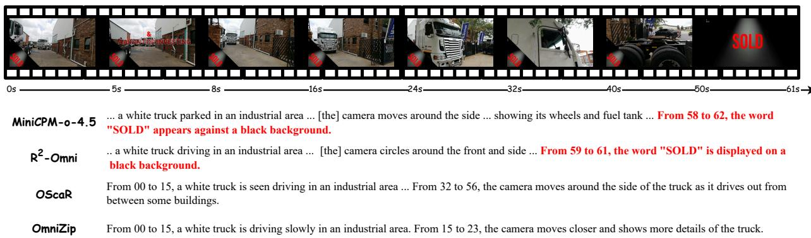  
Figure 6 | Qualitative comparison of long-range temporal coverage. R<sup>2</sup>-Omni preserves more complete event coverage across the full clip, while OmniZip and OScaR terminate their semantic coverage earlier. The key evidence is highlighted in red.

## D. Evaluated Omni-LLMs

Eficient use of pretrained multimodal models supports broader accessibility, including adaptation to scientific domains [43]. We briefly describe the two model architectures used in our experiments.

Qwen2.5-Omni. Qwen2.5-Omni [1] adopts a Thinker–Talker architecture. The Thinker integrates visual and audio encoders with a language backbone for multimodal understanding and text generation, while the Talker generates speech from the Thinker’s representations. Audio and video tokens are temporally interleaved and processed with time-aligned multimodal rotary position embeddings. Our experiments use the Thinker, applying STC before language-model prefill and SSPA to its historical KV cache.

MiniCPM-o-4.5. MiniCPM-o-4.5 [3] combines a SigLIP visual encoder, a Whisper audio encoder, and a Qwen3-8B language backbone. A visual resampler and an audio projector convert modality features into embeddings for joint processing with text. Dedicated speech decoders support audio generation. R<sup>2</sup>-Omni applies STC to the fused input embeddings and SSPA to the language backbone’s historical KV cache.

## E. Qualitative Case Studies

We provide qualitative examples to complement the quantitative evaluation and illustrate how diferent compression strategies afect multimodal information retention. Rather than comparing caption length, we focus on whether the generated descriptions preserve reference-supported events and semantic details throughout the input sequence.

## E.1. Long-Range Temporal Coverage

This example compares the temporal coverage preserved by diferent compression strategies. As shown in Figure 6, R<sup>2</sup>-Omni maintains a more complete description across the full video sequence, while OmniZip and OScaR lose part of the temporally distributed information after compression.

The comparison shows that R<sup>2</sup>-Omni is better able to preserve sparse events appearing near the end of a long multimodal sequence, providing more complete event coverage with a reduced memory footprint.

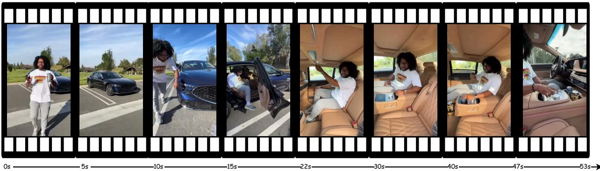  
R<sup>2</sup>-Omni The video features a man ... standing in front of a black Genesis G90 luxury sedan ... holding ... G Fuel ... demonstrates the self-closing door ... tan leather, headrest pillows, speakers embedded in the ceiling ... wireless charging ... “Use my code ‘BURNOUT’ for 30% off.” ... heated and(Hit 14 correct events) ventilated seats ... Apple CarPlay and Android Auto, a fingerprint sensor, and a head-up display.  
OScaR The video starts with a man ... holding a G Fuel energy drink ... [and] a dark blue Genesis G90... tan leather seats, headrest pillows, and (Hit 9 correct events) speakers integrated into the roof ... wireless charging pads, cup holders ... Apple CarPlay and Android Auto ... fingerprint reade

OmniZip A man with glasses and a white t-shirt stands in front of a blue car ... He opens the door ... The interior is tan leather. He points at some features on the back seat ... sits down behind the steering wheel.(Hit 3 correct events)

Figure 7 | Qualitative comparison of fine-grained detail preservation. Red text highlights details preserved by both $\mathtt { R } ^ { 2 }$ -Omni and OScaR but omitted by OmniZip, while blue text highlights additional details preserved by R<sup>2</sup>-Omni beyond OScaR.

## E.2. Fine-Grained Detail Preservation

This example compares how diferent compression methods preserve fine-grained information in a detail-rich vehicle demonstration. As shown in Figure 7, $\mathtt { R } ^ { 2 } .$ -Omni retains substantially more specific attributes and functional details than OmniZip, while also preserving additional information beyond OScaR.

The comparison shows that $\mathtt { R } ^ { 2 }$ -Omni maintains a denser set of reference-supported details under compression instead of reducing the video to a coarse description of its overall progression. The oficial event judge records 14 correct reference events for $\mathrm { R } ^ { 2 } { \cdot } \mathrm { O m n i }$ , compared with 9 for OScaR and 3 for OmniZip.

## E.3. Factuality under Compression

This example examines factuality preservation under multimodal compression. As shown in Figure $^ { 8 , }$ $\mathtt { R } ^ { 2 } .$ -Omni preserves the core interaction while introducing no hallucinated events according to the oficial event-level judge. The judge records zero hallucinations for both BF16 and $\mathrm { R } ^ { 2 } { \cdot } 0 \mathrm { m n i } .$ compared with five for OmniZip and four for OScaR.

The comparison suggests that removing redundant multimodal information can preserve factual consistency and may reduce interference from irrelevant or noisy representations during generation.

## E.4. Comparison Between STC and Token Pruning

This example compares STC with token pruning at the same final memory footprint. As shown in Figure 9, STC preserves substantially more of the original visual information after compression, while token pruning leads to a coarser representation and loses more fine-grained content.

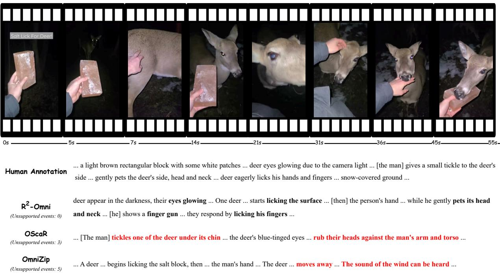  
Figure 8 | Qualitative comparison of factuality under compression. R<sup>2</sup>-Omni matches BF16 with zero judge-flagged hallucinated events, while OmniZip and OScaR introduce additional unsupported content. Unsupported events are highlighted in red.

This comparison shows that the advantage of STC does not come from using a larger memory budget, but from preserving a denser set of useful visual evidence with the same final memory footprint. This allows R<sup>2</sup>-Omni to maintain richer content with the same overall memory footprint.

R<sup>2</sup>-Omni STC  
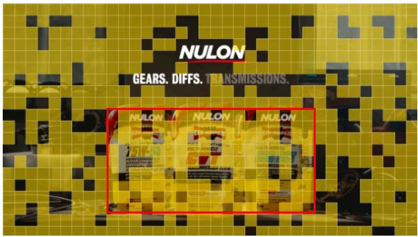

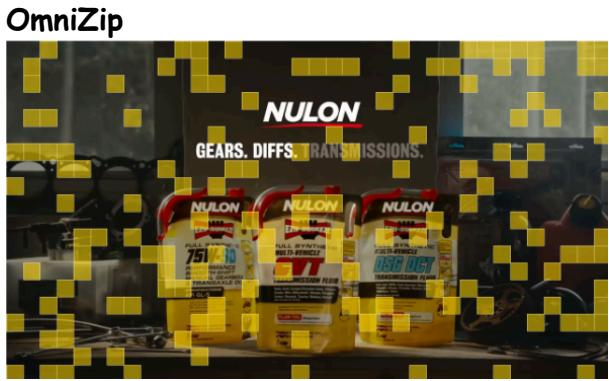

  
Three bottles of Nulon transmission fluid are displayed. The labels read "Nulon Full Synthetic 75W-90 ..."and "... DSG/DCT Transmission Fluid."

  
The video ends with a close-up of a bottle of NULON transmission fluid.  
Figure 9 | Comparison between STC and token pruning with the same final memory footprint. STC preserves substantially more original visual information after compression.