# ROUTEREPA: ROUTED REPRESENTATION ALIGN-MENT FOR JUST IMAGE TRANSFORMERS

Yi Tan1, Beier Zhu2,B, Sirui Chen3, Cheng Chen1, Xingyu Zhu4, Yuan Zhou1, Zhenshan Tan5, Tianrun Chen6, Hanwang Zhang1

1NTU 2USTC 3Tongji University 4NUS 5NUIST 6Moxin Technology yi.tan@ntu.edu.sg beier.zhu@ustc.edu.cn

## ABSTRACT

Representation alignment (REPA) is widely used to accelerate the training of latent-space diffusion transformers (DiTs). However, applying it to pixel-space models such as Just Image Transformers (JiT) is challenging. Our analysis reveals a pronounced representation conflict between discriminative alignment and pixel-space generation. Compared with its latent counterpart, JiT learns representations that are substantially less aligned with DINOv2. Applying REPA to JiT consistently reduces the reconstructability of its intermediate representations, whereas this effect is not observed in Latent JiT. We attribute this conflict to JiT directly reconstructing pixels, which requires its representations to hierarchically encode discriminative semantics and reconstruction-relevant visual information across network depths. To address these challenges, we propose Routed Representation Alignment (RouteREPA), which uses lightweight, representationdependent routers to adaptively route task-oriented representations for alignment and generation. We further apply routing across multiple network depths to accommodate their depth-dependent representation requirements. Extensive experiments on ImageNet-1K at 256×256 resolution show that RouteREPA consistently improves JiT across model scales and training budgets, outperforming standard REPA. On JiT-H/16, RouteREPA further surpasses PixelREPA using only onethird of its training epochs without classifier-free guidance.

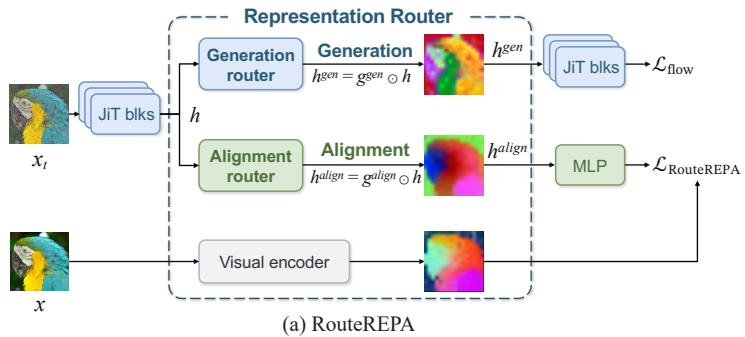

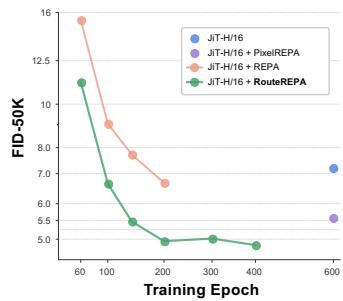  
(b) Training epochs vs. FID-50K  
Figure 1: Overview of RouteREPA. (a) Architecture of RouteREPA. Task-specific channelwise routers direct intermediate JiT representations to the generation and representation alignment branches according to their representation preference. (b) FID-50K during ImageNet-1K training at 256 × 256 resolution without CFG. RouteREPA requires fewer than 100 and 200 training epochs to match JiT-H/16 and PixelREPA-H/16 trained for 600 epochs, respectively.

## 1 INTRODUCTION

Latent-space diffusion transformers (DiTs), which perform denoising in the compact latent representations produced by pretrained variational autoencoders (VAEs) (Rombach et al., 2022; Peebles & Xie, 2023; Ma et al., 2024) or pretrained visual encoder (Zheng et al., 2026; Singh et al., 2026b), have become a dominant paradigm for efficient image generation. To further improve training efficiency, Representation Alignment (REPA) (Yu et al., 2025) introduces an auxiliary objective that aligns intermediate representations of the latent-space DiTs with features from DINOv2, providing semantic supervision that accelerates convergence.

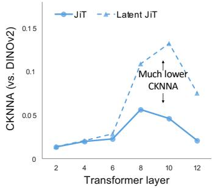  
(a) Alignment to DINOv2

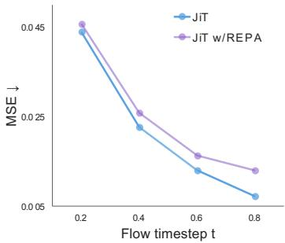  
(b) JiT reconstruction

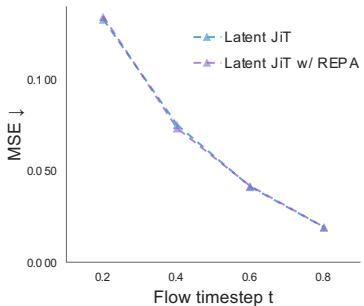  
(c) Latent JiT reconstruction  
Figure 2: Pixel-space generation of JiT introduces a pronounced representation conflict: (a) JiT aligns less closely with DINOv2 than Latent JiT. (b) REPA lowers the reconstruction capability of JiT intermediate representations. (c) In contrast, no such degradation is observed in Latent JiT.

More recently, pixel-space DiTs such as Just Image Transformers (JiT) (Li & He, 2025) have attracted increasing attention as they remove the need for a pretrained image encoder. Removing the encoder simplifies the generative pipeline and eliminates the reconstruction bottleneck of latent representations, offering potential advantages for scaling. Inspired by the success of REPA in latentspace DiTs, a natural question is whether representation alignment can further improve pixel-space generation with JiT?

Although representation alignment encourages DiTs to learn discriminative visual features, it may conflict with reconstruction-relevant information for image generation. This challenge is particularly pronounced in pixel-space DiTs: Latent-space DiTs operate on pretrained representations, where the encoder already captures perceptually meaningful structures, including semantic information useful for alignment. Therefore, REPA provides complementary supervision rather than requiring the model to learn thesefeaturesfrom scratch. In contrast, JiT directly models RGB images and must learn both discriminative and generation-related features from raw pixels. Applying representation alignment may force JiT to allocate additional capacity toward recognition-oriented features that are not directly required for pixel reconstruction, reducing the effectiveness of standard REPA.

To better understand the pronounced representation conflict in JiTs, we conduct two analyses: (1) JiT representations are less suited for direct alignment than latent diffusion model. We first compare the learned representations of pixel-space JiT and a VAE-latent counterpart built with the same Transformer architecture and training recipe. The two models are trained to comparable classconditional generation quality on ImageNet-256 (FID ≈31). Following REPA, we use CKNNA to measure alignment with DINOv2. As shown in Fig. 2(a), JiT exhibits substantially lower CKNNA than its latent counterpart. This suggests that JiT representations differ substantially from those of the discriminative teacher. (2) Representation alignment suppresses reconstruction-relevant information in JiT representations. We further compare the effect of directly applying REPA to JiT and Latent JiT. Specifically, we examine the changes in their reconstruction performance before and after applying REPA using decoder heads trained on frozen representations. As shown in Fig. 2(b, c), JiT representations trained with REPA become consistently harder to decode back into pixel images, indicating reduced reconstruction capability of the aligned intermediate representations. 1 In contrast, no comparable degradation in reconstruction capability is observed for Latent JiT.

Motivated by the analyses above, we propose Routed Representation Alignment (RouteREPA) for JiTs. Its core idea is to route intermediate JiT features into two task-oriented representations for pixel-space generation and alignment with discriminative teacher features, thereby alleviating the severe representation conflict between the two objectives. We perform this modulation along the channel dimension, which allows feature responses to be adjusted without altering their spatial organization. Since the relationship between discriminative and reconstruction-relevant information in JiT representations varies across noise levels, training stages, and network depths, RouteREPA is designed to adapt to these changing requirements. Specifically, it uses lightweight, input-dependent routers to separately modulate the representations supplied to the alignment and generation branches, and applies them hierarchically at multiple intermediate layers. The routers are jointly optimized with the generator, enabling adaptive representation allocation for the two tasks.

Extensive experiments in Sec. 4 demonstrate the effectiveness of RouteREPA. With negligible additional parameters and training overhead, RouteREPA improves training efficiency and generation quality across JiT scales and training budgets. On JiT-H, RouteREPA achieves a lower unguided FID than PixelREPA (Shin et al., 2026) using only one-third of its training epochs.

Our contributions are summarized as follows:

• We analyze the pronounced representation conflict in representation alignment on JiT: (1) JiT representations are less suited for direct alignment than latent diffusion model; and (2) Representation alignment suppresses reconstruction-relevant infor- mation in JiT representations.

• We propose RouteREPA, which adaptively routes features for generation and alignment across multiple network depths to alleviate this pronounced representation conflict.

• Across different model scales and training budgets, RouteREPA consistently improves JiT generation performance and outperforms both standard REPA and PixelREPA.

## 2 RELATED WORK

Image generation models. Pioneering diffusion models, such as DDPM (Ho et al., 2020) and DDIM (Song et al., 2021), generate images through iterative denoising directly in pixel space. Latent diffusion models (LDMs) separate perceptual compression from generative modeling by performing denoising in the latent spaces of pretrained autoencoders (Rombach et al., 2022). This reduces the burden of modeling perceptually insignificant pixel-level details while improving computational efficiency and become a widely adopted paradigm. Transformer-based frameworks, including DiT (Peebles & Xie, 2023) and SiT (Ma et al., 2024), further advanced this paradigm by using self-attention to model spatial relationships and scale image generation. More recently, pixelspace models (Chen et al., 2026; Ma et al., 2026; Yu et al., 2026) such as JiT (Li & He, 2025) have gained attention for generating high-resolution images without pretrained autoencoders while remaining competitive with latent-space models.

Representation alignment. Representation alignment (REPA) (Yu et al., 2025) and its extensions (Wu et al., 2025; Leng et al., 2025; Singh et al., 2026a) have emerged as effective strategies for accelerating latent DiTs training. REPA aligns projected intermediate features of a denoising network with clean-image representations from an external pretrained visual encoder (Caron et al., 2021; Oquab et al., 2023; Radford et al., 2021; Zhai et al., 2023; He et al., 2022). This supervision helps the generator learn useful representations more efficiently, improving both convergence speed and generation quality. However, the success of representation alignment in latent space does not automatically carry over to pixel-space generators.

## 3 METHOD

RouteREPA equips JiT with lightweight, channel-wise routers that modulate the intermediate representations used by the alignment and generation branches. We first summarize the generative formulation and alignment objective in Sec. 3.1, then present our framework in Sec. 3.2.

## 3.1 PRELIMINARIES

Flow and diffusion models. Diffusion and flow-based generation can be studied through continuous trajectories that connect data with noise (Ma et al., 2024; Lipman et al., 2023). For a sample $\textbf { \em x } \sim$ $p _ { \mathrm { d a t a } }$ and independently noise $\epsilon \sim \mathcal { N } ( \mathbf { 0 } , \mathbf { I } )$ ), their mixture at ${ \bf { \bar { t } } } \in [ 0 , 1 ]$ takes the form ${ \pmb x } _ { t } = \alpha _ { t } { \pmb x } +$

$\sigma _ { t } \epsilon$ . The schedules $\alpha _ { t }$ and $\sigma _ { t }$ specify the signal and noise amplitudes. A learned field $v _ { \theta }$ drives the sampling ODE, dx $\dot { \mathbf { \rho } } _ { t } / \mathrm { d } t = v _ { \theta } ( \mathbf { \rho } _ { { \mathbf { x } } _ { t } , t } )$ , and is fitted to derivatives of sampled interpolation paths:

$$
\mathcal { L } _ { \mathrm { f l o w } } ( \theta ) = \mathbb { E } _ { \pmb { x } , \epsilon , t } \left[ \left| \left| v _ { \theta } ( \pmb { x } _ { t } , t ) - \left( \dot { \alpha } _ { t } \pmb { x } + \dot { \sigma } _ { t } \epsilon \right) \right| \right| _ { 2 } ^ { 2 } \right] .\tag{1}
$$

Here, $\dot { \alpha } _ { t }$ and $\dot { \sigma } _ { t }$ are schedule derivatives. Linear interpolation with $\alpha _ { t } = t$ and $\sigma _ { t } = 1 - t$ yields the target $x - \epsilon .$ , with generation proceeding from noise at $t = 0$ toward data at $t = 1$ . Fixing $\alpha _ { t } = 1$ instead leaves a noise-only derivative, $\dot { \sigma } _ { t } \epsilon .$ , as in variance-exploding diffusion. For brevity, class conditioning is not shown.

Just Image Transformers. JiT (Li & He, 2025) performs generation directly in pixel space using a Transformer, without a pretrained autoencoder. Under the linear interpolation above, JiT predicts the clean RGB image $\hat { \pmb { x } } _ { \theta } ( \pmb { x } _ { t } , t )$ rather than velocity, which is recovered as

$$
v _ { \theta } ( x _ { t } , t ) = \frac { \hat { x } _ { \theta } ( x _ { t } , t ) - x _ { t } } { 1 - t } , \qquad 0 \leq t < 1 .\tag{2}
$$

Thus, the network outputs a clean-image estimate but optimized with the velocity loss in Eq. (1).

Representation alignment. REPA (Yu et al., 2025) uses clean-image features to guide intermediate denoising representations. With a frozen teacher $\dot { F }$ and a trainable ${ \mathrm { M L P } } p _ { \phi }$ , the regularizer is

$$
\mathcal { L } _ { \mathrm { R E P A } } ( \theta , \phi ) = - \frac { 1 } { N } \sum _ { n = 1 } ^ { N } \mathbb { E } _ { \pmb { x } , \epsilon , t } \left[ \cos \left( p _ { \phi } ( \pmb { h } _ { t } ^ { [ n ] } ) , F ( \pmb { x } ) ^ { [ n ] } \right) \right] ,\tag{3}
$$

Here, n indexes image patches and cos denotes cosine similarity. The total objective is ${ \mathcal { L } } = { \mathcal { L } } _ { \mathrm { f l o w } } +$ $\lambda { \mathcal { L } } _ { \mathrm { R E P A } }$ , with alignment weight $\lambda > 0$

## 3.2 ROUTED REPRESENTATION ALIGNMENT

Standard representation alignment applies the alignment objective to the same intermediate representation that is subsequently used for image generation. For JiT, this shared representation must both align with semantically compressed teacher representations and retain the reconstructionrelevant information required for direct pixel prediction, resulting in the representation conflict discussed in Sec. 1. To address this conflict, RouteREPA routes intermediate JiT representations into two task-oriented representations: one for alignment with the discriminative teacher and the other for subsequent image generation. The routing is learned along the channel dimension and conditioned on the current representation, without manually assigning particular channels to semantics or visual details. Figure 1(a) illustrates the resulting architecture.

Adaptive channel routing. Let $h _ { \ell } \in \mathbb { R } ^ { N \times C }$ denote the image patch representations after block $\ell ,$ with N patches and $C$ channels. We spatially average the representations as $\begin{array} { r } { \bar { \pmb { h } } _ { \ell } = N ^ { - 1 } \sum _ { n = 1 } ^ { N } \pmb { h } _ { \ell } ^ { [ n ] } } \end{array}$ and define task-specific routers for generation and alignment:

$$
\begin{array} { r } { \pmb { g } _ { \ell } ^ { \tau } = \mathrm { s i g m o i d } \big ( \mathbf { W } _ { \ell } ^ { \tau } \bar { \pmb { h } } _ { \ell } + \pmb { b } _ { \ell } ^ { \tau } \big ) , \qquad \pmb { h } _ { \ell } ^ { \tau } = \pmb { g } _ { \ell } ^ { \tau } \odot \pmb { h } _ { \ell } , \quad \tau \in \{ \mathrm { g e n , a l i g n } \} , } \end{array}\tag{4}
$$

where $\tau$ indexes the generation or alignment task, $\mathbf { W } _ { \rho } ^ { \tau } \in \mathbb { R } ^ { C \times C }$ and $b _ { \ell } ^ { \tau } \in \mathbb { R } ^ { C }$ are trainable, and ⊙ denotes hadamard product and broadcasts over patch positions. The generation features $h _ { \ell } ^ { \mathrm { g e n } }$ are passed to the next block, while the alignment features $h _ { \ell } ^ { \mathrm { a l i g n } }$ are used to align with features from an external pretrained encoder. Our default design couples these task-specific routers through a shared parameterization: a single prediction $\mathbf { \nabla } _ { \mathbf { \boldsymbol { g } } \ell }$ is used as $\pmb { g } _ { \ell } ^ { \mathrm { g e n } } = \pmb { g } _ { \ell }$ and $\pmb { g } _ { \ell } ^ { \mathrm { a l i g n } } = \mathbf { 1 } - \pmb { g } _ { \ell }$ , yielding complementary routing. The routers softly modulate channel responses rather than imposing a hard feature partition, so the two tasks can still share useful information. Within this general formulation, standard REPA corresponds to identity routing for both branches, such that generation and alignment consume the same unmodulated representation. Gradients from both objectives update the routing parameters jointly with the generator. This design enables JiT to adaptively route representations between generation and alignment, with routing decisions that evolve during training and respond to the timestep and characteristics of each sample.

Hierarchical routing. JiT learns the complete pixel-representation-pixel compression and reconstruction process across different noise levels during training. As representations evolve through the network, the conflict between alignment and generation likewise changes across depths. This motivates revisiting hierarchical representation routing at multiple locations instead of relying on a single alignment point. We therefore apply RouteREPA at a set of intermediate layers S. Each pair of generation and alignment routers responds to its current representations rather than imposing the same channel assignment throughout the network. The generation stream continues through the remaining blocks, while the selected alignment representations are summed across layers at corresponding patch positions and passed through a shared projector.

Training and inference. Using cosine similarity as in Eq. (3), the RouteREPA alignment loss is

$$
\mathcal { L } _ { \mathrm { R o u t e R E P A } } = - \frac { 1 } { N } \sum _ { n = 1 } ^ { N } \mathbb { E } _ { \boldsymbol { x } , \boldsymbol { \epsilon } , t } \left[ \cos \left( p _ { \phi } \left( \sum _ { \boldsymbol { \ell } \in S } h _ { \boldsymbol { \ell } } ^ { \mathrm { a l i g n } , [ n ] } \right) , F ( \boldsymbol { x } ) ^ { [ n ] } \right) \right] .\tag{5}
$$

The total training loss combines this alignment loss with the flow-matching loss:

$$
\begin{array} { r } { \mathcal { L } = \mathcal { L } _ { \mathrm { f l o w } } + \lambda \mathcal { L } _ { \mathrm { R o u t e R E P A } } . } \end{array}\tag{6}
$$

RouteREPA hierarchically provides adaptive task-oriented representations for alignment and generation, helping to mitigate the representation conflict. At inference, the teacher, projector, and alignment branches are discarded, while the shared routing parameters continue to modulate the generation streams.

## 4 EXPERIMENTS

We present an extensive empirical evaluation of RouteREPA, examining its effectiveness, the contributions of different design choices, and the properties it introduces to JiT. In particular, we address five research questions:

RQ1: Does RouteREPA improve training efficiency and generation quality across JiT scales?

RQ2: How do different design choices affect the performance of RouteREPA?

RQ3: How does RouteREPA route representations?

RQ4: How computationally efficient is RouteREPA?

RQ5: Can RouteREPA generalize to latent-space diffusion models?

## 4.1 EXPERIMENTAL SETUP

Training configuration. Unless otherwise specified, we strictly follow the original JiT settings (Li & He, 2025). Specifically, we train on the ImageNet-1K training split (Deng et al., 2009; Russakovsky et al., 2015). Images are resized with their aspect ratios preserved, center-cropped to $2 5 6 \times 2 5 6$ , and randomly flipped horizontally. The backbones are JiT-B/16, JiT-L/16, and JiT-H/16; each processes RGB inputs as 16 × 16 patches. We retain the JiT optimization recipe for a fair comparison: AdamW updates use 1,024 images each, with a five-epoch warm-up to a learning rate of $2 ^ { - } \times 1 0 ^ { - 4 }$ . DINOv2-B (Oquab et al., 2023) supplies the frozen alignment targets. Appendix A provides additional experimental details.

Sampling. Following JiT’s sampling settings, we use a 50-step Heun solver.

Compared methods. We use JiT and JiT trained with REPA (Yu et al., 2025) as controlled baselines, using the same backbone architectures and experimental protocols as RouteREPA. We further compare with advanced generative models in two categories. The latent-space group includes DiT (Peebles & Xie, 2023), SiT (Ma et al., 2024), and SiT trained with REPA or REG (Wu et al., 2025). The pixel-space group includes ADM-G (Dhariwal & Nichol, 2021), VDM++ (Kingma & Gao, 2023), PixelFlow (Chen et al., 2025), PixNerd (Wang et al., 2026), DiP (Chen et al., 2026), DeCo (Ma et al., 2026), PixelDiT (Yu et al., 2026), and PixelREPA (Shin et al., 2026).

Additional experimental settings are provided in Appendix A.

## 4.2 THE EFFECTIVENESS OF ROUTEREPA (RQ1)

To assess the significance of RouteREPA across model scales, we first conduct comparisons on three backbone sizes: JiT-B/16, JiT-L/16, and JiT-H/16. We use vanilla JiT, JiT with REPA, and JiT with

Table 1: FID comparison without CFG. RouteREPA consistently improves JiT across different model scales and training budgets, matching or outperforming REPA and Pixel-REPA with only one-third of the training epochs.
<table><tr><td>Method</td><td>Params</td><td>Ep.</td><td>FID↓</td></tr><tr><td>JiT-B/16</td><td></td><td></td><td></td></tr><tr><td>JiT</td><td>131M</td><td>100</td><td>42.0</td></tr><tr><td>+ REPA</td><td>131M</td><td>100</td><td>35.1</td></tr><tr><td>+ PixelREPA</td><td>131M</td><td>100</td><td>34.4</td></tr><tr><td>+ RouteREPA</td><td>132M</td><td>100</td><td>30.4</td></tr><tr><td>JiT</td><td>131M</td><td>200</td><td>32.2</td></tr><tr><td>+ REPA</td><td>131M</td><td>200</td><td>27.5</td></tr><tr><td>+ PixelREPA</td><td>131M</td><td>200</td><td>27.6</td></tr><tr><td>+ RouteREPA</td><td>132M</td><td>200</td><td>22.2</td></tr><tr><td>JiT</td><td>131M</td><td>600</td><td>25.5</td></tr><tr><td>+ PixelREPA</td><td>131M</td><td>600</td><td>22.1</td></tr><tr><td>+ RouteREPA</td><td>132M</td><td>200</td><td>22.2</td></tr><tr><td>JiT-L/16</td><td></td><td></td><td></td></tr><tr><td>JiT</td><td>459M</td><td>100</td><td>21.8</td></tr><tr><td>+ REPA</td><td>459M</td><td>100</td><td>16.0</td></tr><tr><td>+ PixelREPA</td><td>459M</td><td>100</td><td>17.1</td></tr><tr><td>+ RouteREPA</td><td>461M</td><td>100</td><td>14.0</td></tr><tr><td>JiT</td><td>459M</td><td>200</td><td>16.1</td></tr><tr><td>+ REPA</td><td>459M</td><td>200</td><td>12.8</td></tr><tr><td>+ PixelREPA</td><td>459M</td><td>200</td><td>12.9</td></tr><tr><td>+ RouteREPA</td><td>461M</td><td>200</td><td>10.6</td></tr><tr><td>JiT</td><td>459M</td><td>600</td><td>13.8</td></tr><tr><td>+ PixelREPA</td><td>459M</td><td>600</td><td>11.0</td></tr><tr><td>+ RouteREPA</td><td>461M</td><td>200</td><td>10.6</td></tr><tr><td>JiT-H/16</td><td></td><td></td><td></td></tr><tr><td>JiT</td><td>953M</td><td>600</td><td>7.20</td></tr><tr><td>+ REPA</td><td>953M</td><td>200</td><td>6.68</td></tr><tr><td>+ PixelREPA</td><td>953M</td><td>600</td><td>5.52</td></tr><tr><td>+ RouteREPA</td><td>956M</td><td>100</td><td>6.58</td></tr><tr><td>+ RouteREPA</td><td>956M</td><td>200</td><td>4.96</td></tr></table>

Table 2: FID and IS comparison with SoTA methods under CFG. Bold marks the best JiTbased result. RouteREPA improves JiT performance, achieving the best FID among methods using JiT as the backbone while remaining competitive with methods that employ specially designed decoupled semantic backbones.
<table><tr><td>Method</td><td> $\mathrm { E p . }$ </td><td>FID↓</td><td>IS↑</td></tr><tr><td colspan="4">Latent diffusion</td></tr><tr><td>DiT-XL/2</td><td>1400</td><td>2.27</td><td>278.2</td></tr><tr><td>SiT-XL/2</td><td>1400</td><td>2.06</td><td>277.5</td></tr><tr><td>+ REPA</td><td>800</td><td>1.42</td><td>305.7</td></tr><tr><td>+REG</td><td>480</td><td>1.40</td><td>296.9</td></tr><tr><td colspan="4">Pixel diffusion</td></tr><tr><td>ADM-G</td><td>400</td><td>4.59</td><td>186.7</td></tr><tr><td>CDM</td><td>2160</td><td>4.88</td><td>158.7</td></tr><tr><td>RIN</td><td>480</td><td>3.42</td><td>182.0</td></tr><tr><td>VDM++</td><td>560</td><td>2.12</td><td>267.7</td></tr><tr><td>RDM</td><td>400</td><td>1.99</td><td>260.4</td></tr><tr><td>EPG-XXL/16</td><td>800</td><td>1.87</td><td>287.6</td></tr><tr><td>PixelFlow-XL/4</td><td>320</td><td>1.98</td><td>282.1</td></tr><tr><td>PixNerd-XL/16</td><td>320</td><td>1.93</td><td>298.0</td></tr><tr><td colspan="4">Transformer with decoupled semantic backbones</td></tr><tr><td>DiP-XL/16</td><td>600</td><td>1.79</td><td>281.9</td></tr><tr><td>DeCo-XL/16</td><td>600</td><td>1.69</td><td>304.0</td></tr><tr><td>PixelDiT</td><td>320</td><td>1.61</td><td>292.7</td></tr><tr><td colspan="4">Transformer only</td></tr><tr><td>JiT-H/16</td><td>600</td><td>1.86</td><td>303.4</td></tr><tr><td>+ PixelREPA</td><td>600</td><td>1.81</td><td>317.2</td></tr><tr><td>+ RouteREPA</td><td>400</td><td>1.72</td><td>316.2</td></tr></table>

PixelREPA as baselines and compare their FID without classifier-free guidance (CFG) (Ho & Salimans, 2022). As shown in Table 1, RouteREPA substantially lowers the FID of JiT across model sizes and training budgets. Compared with standard REPA and PixelREPA, which is specifically designed for JiT, RouteREPA achieves the lowest FID across model sizes and training stages. Notably, on JiT-B, the FID of RouteREPA at 200 epochs nearly matches that of PixelREPA at 600 epochs (22.2 vs. 22.1). On JiT-H, RouteREPA at 200 epochs already achieves a lower FID than PixelREPA at 600 epochs (4.96 vs. 5.52).

Finally, we compare RouteREPA against a broader set of methods, including PixelREPA using the same JiT-H backbone; latent diffusion methods based on DiT and SiT; pixel diffusion models including ADM-G, CDM, RIN, VDM++, RDM, EPG-XXL/16, PixelFlow-XL/4, and PixNerd-XL/16; and pixel diffusion Transformers with decoupled semantic backbones (first proposed in DDT (Wang et al., 2025)), including DiP, DeCo, and PixelDiT. As shown in Table 2, RouteREPA significantly improves JiT and achieves the lowest FID among methods using the JiT architecture (1.72), together with a high IS of 316.2. Compared with methods that substantially modify the diffusion Transformer backbone by introducing a separate low-resolution branch for semantic modeling, RouteREPA achieves the highest IS, outperforms DiP and remains competitive with DeCo and PixelDiT in FID.

## 4.3 ABLATION STUDIES (RQ2)

We examine three design choices in RouteREPA: the routing strategy, routing configuration, and routing locations. Table 3 reports the JiT-B/16 ablations at 200 epochs with class condition.

  
Figure 3: Images generated by JiT-H/16 + RouteREPA. Additional samples appear in Appendix D.

We first compare standard representation alignment, a learnable orthogonal decomposition, and RouteREPA’s shared complementary routing at layer 4. All three improve upon vanilla JiT. Relative to standard REPA, orthogonal decomposition yields only a marginal FID improvement (27.5 to 27.4) while reducing IS (58.4 to 57.9). In contrast, RouteREPA lowers FID to 24.2 and raises IS to 63.4. This suggests that generation and representation alignment favor different features while still benefiting from shared representations.

We next compare generation-only routing, alignment-only routing, two routers with independent parameters, and our shared-parameter design. As shown in Table 3, routing only one branch provides no improvement or only a marginal improvement over standard REPA. Independent routers provide a clear gain, while sharing the router parameters with complementary generation and alignment weights performs best.

Finally, we compare routing at layer 4, the standard REPA baseline depth, with routing at the deeper layer 6, as well as their combination. This is motivated by JiT having to model the full hierarchy from pixel-level appearance to high-level semantics within a single backbone, making useful alignment signals span multiple depths. At 200 epochs, layer 6 gives modestly better FID and IS than layer 4 for both standard REPA and RouteREPA. Applying RouteREPA with shared routing at both layers gives its best result, with an FID of 22.2 and an IS of 67.0, validating our hypothesis above. We further investigate whether hierarchical alignment is also beneficial for standard REPA. Applying REPA at both layers 4 and 6 uses the same alignment configuration as RouteREPA and is equivalent to removing the routers from the latter. As shown in Table 3, standard REPA at layers 4 and 6 does not outperform its best single-layer variant, whereas RouteREPA at the same two layers outperforms both single-layer variants. This result shows that adaptive routing of task-oriented representations unlocks the potential of hierarchical representation alignment, which standard REPA fails.

## 4.4 ANALYSIS OF LEARNED ROUTING (RQ3)

Does RouteREPA mitigate representation conflict? Following REPA (Yu et al., 2025), we use CKNNA to quantify the alignment between intermediate JiT features and clean-image DINOv2 representations. CKNNA measures the agreement between the local neighborhood structures of two representation spaces, where a higher value indicates stronger representation alignment. As shown in Fig. 4(a), the alignment-routed representation achieves comparable alignment to standard REPA at the high-noise timestep (t = 0.2), and increasingly outperforms REPA as the noise level decreases. The generation-routed representation, in contrast, remains substantially less aligned with DINOv2.

Table 3: Ablations of RouteREPA on JiT-B/16. We compare different routing strategies, routing configurations, and routing locations. The compared design choices are highlighted in blue, and the best result within each comparison is shown in bold.
<table><tr><td>Method</td><td>Routing Strategy</td><td>Routing config.</td><td>Layers</td><td>Params</td><td>FID↓</td><td>IS↑</td></tr><tr><td>JiT-B/16</td><td></td><td>一</td><td>一</td><td>131M</td><td>32.2</td><td>50.1</td></tr><tr><td>+ REPA</td><td></td><td>一</td><td>4</td><td>131M</td><td>27.5</td><td>58.4</td></tr><tr><td>+ REPA</td><td>Orthogonal</td><td></td><td>4</td><td>131M</td><td>27.4</td><td>57.9</td></tr><tr><td>+ RouteREPA</td><td>Gated</td><td>Shared</td><td>4</td><td>132M</td><td>24.2</td><td>63.4</td></tr><tr><td>+ RouteREPA</td><td>Gated</td><td>Gen. only</td><td>4</td><td>132M</td><td>27.3</td><td>58.6</td></tr><tr><td>+ RouteREPA</td><td>Gated</td><td>Align. only</td><td>4</td><td>131M</td><td>28.0</td><td>56.5</td></tr><tr><td>+ RouteREPA</td><td>Gated</td><td>Independent</td><td>4</td><td>132M</td><td>26.7</td><td>59.0</td></tr><tr><td>+ RouteREPA</td><td>Gated</td><td>Shared</td><td>4</td><td>132M</td><td>24.2</td><td>63.4</td></tr><tr><td>+ RouteREPA</td><td>Gated</td><td>Shared</td><td>4</td><td>132M</td><td>24.2</td><td>63.4</td></tr><tr><td>+ RouteREPA</td><td>Gated</td><td>Shared</td><td>6</td><td>132M</td><td>23.4</td><td>65.1</td></tr><tr><td>+ RouteREPA</td><td>Gated</td><td>Shared</td><td>4+6</td><td>132M</td><td>22.2</td><td>67.0</td></tr><tr><td>+ REPA</td><td></td><td></td><td>4</td><td>131M</td><td>27.5</td><td>58.4</td></tr><tr><td>+ REPA</td><td></td><td></td><td>6</td><td>131M</td><td>26.7</td><td>59.4</td></tr><tr><td>+ REPA</td><td></td><td></td><td> $4 + 6$ </td><td>131M</td><td>27.0</td><td>58.7</td></tr><tr><td>+ RouteREPA</td><td>Gated</td><td>Shared</td><td> $4 + 6$ </td><td>132M</td><td>22.2</td><td>67.0</td></tr></table>

Under identical decoding probes, Fig. 4(b,c) shows that the generation route also yields lower MSE and LPIPS than the alignment representations and achieves slightly better reconstruction than the raw representations at every evaluated timestep. This indicates that RouteREPA uses the alignment and generation routers to select representations suited to their respective objectives, rather than enforcing strong alignment directly on the entire representation intended for generation. Meanwhile, the system-level results in Tables 1 and 2 show that RouteREPA also achieves substantially better end-to-end generation performance than JiT and REPA. Together, these results demonstrate that the learned routing effectively allocates representations according to the distinct needs of representation0.2 0.4 0.6 0.8 alignment and image generation. Qualitative representation-to-pixel reconstructions are provided in Appendix C.1.

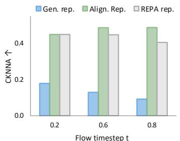  
(a) CKNNA comparison

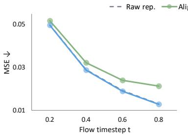  
(b) Reconstruction MSE

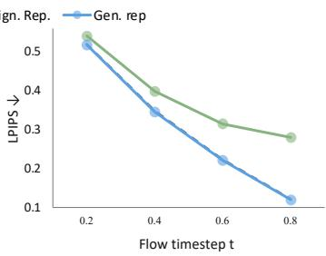  
(c) Reconstruction LPIPS  
Figure 4: Analysis of generation and alignment representations. (a) Alignment-routed represen tations align with DINOv2 even better than REPA. (b, c) Generation-routed representations better preserve decodable information for image structure and local appearance, while such reconstruction-(c) Image↓related information is suppressed in alignment-routed representations.

How Does Routing Evolve? We next examine how representation routing evolves across training stages, network depths, and flow timesteps. Figure 5 shows that the learned routers progressively 0.01favor the generation branch at later training stages across timesteps at both layers. At earlier stages, routers at layers 4 and 6 both assign relatively larger routing weights to the alignment branch in the highly noisy and ambiguous timestep region. This timestep-dependent variation becomes less pronounced as training proceeds, while the overall routing preference shifts toward generation. The routers at two layers also exhibit distinct channel-allocation patterns: the router at layer 4 increasingly concentrates alignment on a relatively small subset of channels, whereas the router at layer 6 maintains broader alignment participation. Together, these observations show that the learned channel-allocation preferences vary with training progress, network depth, and flow timestep.

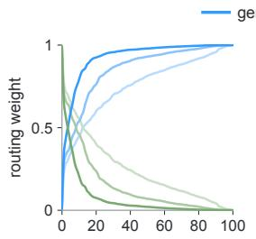  
Sorted channel percentile (%)  
(a) routing distribution (L4)

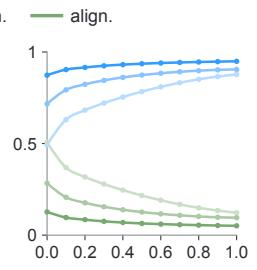  
Flow timestep t  
(b) routing vs. timestep (L4)

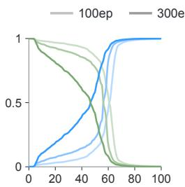  
Sorted channel percentile (%)

(c) routing distribution (L6)  
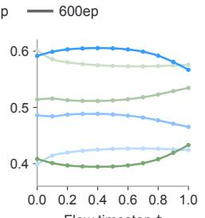  
Flow timestep t  
(d) routing vs. timestep (L6)  
Figure 5: Learned routing dynamics at layers 4 and 6. Blue denotes routing for generation and green for alignment; darker shades indicate later epochs. Channels are sorted by routing weight.

## 4.5 COMPUTATIONAL EFFICIENCY (RQ4)

Table 4 compares the computational cost of REPA and RouteREPA on JiT-H/16. RouteREPA adds only 0.3% parameters and less than 0.1% analytical computation, while all measured overheads remain below 2%. Full results and the measurement protocol are provided in Appendix B.

Table 4: Computational cost on JiT-H/16. RouteREPA adds negligible computational overhead compared with REPA.
<table><tr><td>Method</td><td>Params (M)</td><td>Train GFLOPs</td><td>Infer. GFLOPs</td><td>Peak mem. (GiB)</td><td>Train step (ms)</td><td>Infer. forward (ms)</td></tr><tr><td>REPA</td><td>953</td><td>1,146</td><td>364</td><td>113</td><td>583</td><td>48.6</td></tr><tr><td>RouteREPA</td><td></td><td>956 (+0.3%) 1,146 (&lt; 0.1%) 364 (&lt; 0.1%)|</td><td></td><td></td><td></td><td>114 (+0.8%) 592 (+1.6%) 49.5 (+1.7%)</td></tr></table>

## 4.6 ROUTEREPA IN LATENT-SPACE ALIGNMENT (RQ5)

We further examine whether representation routing generalizes beyond pixel-space JiT by applying RouteREPA to the latent-space diffusion Transformer SiT-B/2. All variants are trained for 400K iterations under the same official SiT training setting. As shown in Table 5, RouteREPA substantially improves the vanilla SiT baseline, reducing FID from 33.0 to 21.85. It also consistently improves upon standard REPA, reducing FID from 24.40 to 21.85 while increasing IS from 59.90 to 67.04. These results demonstrate that the benefit of task-specific representation routing extends to latent-space diffusion models.

Table 5: RouteREPA improves SiT-B/2 at 400k iterations (CFG 1).
<table><tr><td>Method</td><td>FID↓</td></tr><tr><td>SiT-B/2</td><td>33.00</td></tr><tr><td>+ REPA</td><td>24.40</td></tr><tr><td>+ RouteREPA</td><td>21.85</td></tr></table>

## 5 CONCLUSION

In this paper, we introduced RouteREPA, a simple and efficient framework for representation alignment in Just Image Transformers. Our analysis reveals a pronounced representation conflict between discriminative alignment and pixel-space generation: JiT representations are naturally less aligned with discriminative teachers, while directly enforcing alignment can suppress reconstruction-relevant information. To mitigate this conflict, RouteREPA learns lightweight, taskspecific routing that adaptively allocates intermediate representations to alignment and generation across network depths. Extensive experiments show that RouteREPA consistently improves generation quality and training efficiency across JiT scales, while our analyses further demonstrate meaningful representation specialization and adaptive routing behavior across training stages, noise levels, and network depths.

Limitation. Our current study remains empirical, and the task-dependent routing of intermediate representations still lacks a theoretical understanding. In addition, due to computational constraints, we have not yet evaluated RouteREPA on substantially larger model scales or more challenging text-to-image generation tasks. We regard these limitations as important directions for future work and plan to further investigate both the theoretical foundations of representation routing and its scalability to larger and more complex generative settings.

## REFERENCES

Mathilde Caron, Hugo Touvron, Ishan Misra, Hervé Jégou, Julien Mairal, Piotr Bojanowski, and Armand Joulin. Emerging properties in self-supervised vision transformers. In Proceedings of the IEEE/CVF International Conference on Computer Vision, pp. 9650–9660, 2021.

Shoufa Chen, Chongjian Ge, Shilong Zhang, Peize Sun, and Ping Luo. PixelFlow: Pixel-space generative models with flow. arXiv preprint arXiv:2504.07963, 2025.

Zhennan Chen, Junwei Zhu, Xu Chen, Jiangning Zhang, Xiaobin Hu, Hanzhen Zhao, Chengjie Wang, Jian Yang, and Ying Tai. DiP: Taming diffusion models in pixel space. In Proceedings of the IEEE/CVF Conference on Computer Vision and Pattern Recognition, pp. 36136–36146, 2026.

Jia Deng, Wei Dong, Richard Socher, Li-Jia Li, Kai Li, and Li Fei-Fei. ImageNet: A large-scale hierarchical image database. In 2009 IEEE Conference on Computer Vision and Pattern Recognition, pp. 248–255, 2009.

Prafulla Dhariwal and Alexander Nichol. Diffusion models beat GANs on image synthesis. In Advances in Neural Information Processing Systems, volume 34, 2021.

Kaiming He, Xinlei Chen, Saining Xie, Yanghao Li, Piotr Dollár, and Ross Girshick. Masked autoencoders are scalable vision learners. In Proceedings ofthe IEEE/CVF Conference on Computer Vision and Pattern Recognition, pp. 16000–16009, 2022.

Martin Heusel, Hubert Ramsauer, Thomas Unterthiner, Bernhard Nessler, and Sepp Hochreiter. GANs trained by a two time-scale update rule converge to a local nash equilibrium. In Advances in Neural Information Processing Systems, volume 30, 2017.

Jonathan Ho and Tim Salimans. Classifier-free diffusion guidance. arXiv preprint arXiv:2207.12598, 2022.

Jonathan Ho, Ajay N. Jain, and Pieter Abbeel. Denoising diffusion probabilistic models. In Advances in Neural Information Processing Systems, volume 33, pp. 6840–6851, 2020.

Diederik P. Kingma and Ruiqi Gao. Understanding diffusion objectives as the ELBO with simple data augmentation. In Advances in Neural Information Processing Systems, volume 36, 2023.

Xingjian Leng, Jaskirat Singh, Yunzhong Hou, Zhenchang Xing, Saining Xie, and Liang Zheng. REPA-E: Unlocking VAE for end-to-end tuning of latent diffusion transformers. In Proceedings of the IEEE/CVF International Conference on Computer Vision, pp. 18262–18272, 2025.

Tianhong Li and Kaiming He. Back to basics: Let denoising generative models denoise. arXiv preprint arXiv:2511.13720, 2025.

Yaron Lipman, Ricky T. Q. Chen, Heli Ben-Hamu, Maximilian Nickel, and Matt Le. Flow matching for generative modeling. In International Conference on Learning Representations, 2023.

Nanye Ma, Mark Goldstein, Michael S. Albergo, Nicholas M. Boffi, Eric Vanden-Eijnden, and Saining Xie. SiT: Exploring flow and diffusion-based generative models with scalable interpolant transformers. In European Conference on Computer Vision, 2024.

Zehong Ma, Longhui Wei, Shuai Wang, Shiliang Zhang, and Qi Tian. DeCo: Frequency-decoupled pixel diffusion for end-to-end image generation. In Proceedings ofthe IEEE/CVF Conference on Computer Vision and Pattern Recognition, pp. 43600–43610, 2026.

Maxime Oquab, Timothée Darcet, Théo Moutakanni, Huy Vo, Marc Szafraniec, Vasil Khalidov, Pierre Fernandez, Daniel Haziza, Francisco Massa, Alaaeldin El-Nouby, Mahmoud Assran, Nicolas Ballas, Wojciech Galuba, Russell Howes, Po-Yao Huang, Shang-Wen Li, Ishan Misra, Michael Rabbat, Vasu Sharma, Gabriel Synnaeve, Hu Xu, Hervé Jégou, Julien Mairal, Patrick Labatut, Armand Joulin, and Piotr Bojanowski. DINOv2: Learning robust visual features without supervision. arXiv preprint arXiv:2304.07193, 2023.

William Peebles and Saining Xie. Scalable diffusion models with transformers. In Proceedings of the IEEE/CVF International Conference on Computer Vision, pp. 4195–4205, 2023.

Alec Radford, Jong Wook Kim, Chris Hallacy, Aditya Ramesh, Gabriel Goh, Sandhini Agarwal, Girish Sastry, Amanda Askell, Pamela Mishkin, Jack Clark, Gretchen Krueger, and Ilya Sutskever. Learning transferable visual models from natural language supervision. In Proceedings of the 38th International Conference on Machine Learning, volume 139 of Proceedings of Machine Learning Research, pp. 8748–8763. PMLR, 2021.

Robin Rombach, Andreas Blattmann, Dominik Lorenz, Patrick Esser, and Björn Ommer. Highresolution image synthesis with latent diffusion models. In Proceedings of the IEEE/CVF Conference on Computer Vision and Pattern Recognition, pp. 10684–10695, 2022.

Olga Russakovsky, Jia Deng, Hao Su, Jonathan Krause, Sanjeev Satheesh, Sean Ma, Zhiheng Huang, Andrej Karpathy, Aditya Khosla, Michael Bernstein, Alexander C. Berg, and Li Fei-Fei. ImageNet large scale visual recognition challenge. International Journal of Computer Vision, 115 (3):211–252, 2015.

Tim Salimans, Ian Goodfellow, Wojciech Zaremba, Vicki Cheung, Alec Radford, and Xi Chen. Improved techniques for training GANs. In Advances in Neural Information Processing Systems, volume 29, 2016.

Jaeyo Shin, Jiwook Kim, and Hyunjung Shim. Representation alignment for just image transformers is not easier than you think. arXiv preprint arXiv:2603.14366, 2026.

Jaskirat Singh, Xingjian Leng, Zongze Wu, Liang Zheng, Richard Zhang, Eli Shechtman, and Saining Xie. What matters for representation alignment: Global information or spatial structure? In International Conference on Learning Representations, 2026a.

Jaskirat Singh, Boyang Zheng, Zongze Wu, Richard Zhang, Eli Shechtman, and Saining Xie. Im proved baselines with representation autoencoders. arXiv preprint arXiv:2605.18324, 2026b.

Jiaming Song, Chenlin Meng, and Stefano Ermon. Denoising diffusion implicit models. In International Conference on Learning Representations, 2021.

Shuai Wang, Zhi Tian, Weilin Huang, and Limin Wang. DDT: Decoupled diffusion transformer. arXiv preprint arXiv:2504.05741, 2025.

Shuai Wang, Ziteng Gao, Chenhui Zhu, Weilin Huang, and Limin Wang. PixNerd: Pixel neural field diffusion. In International Conference on Learning Representations, 2026.

Ge Wu, Shen Zhang, Ruijing Shi, Shanghua Gao, Zhenyuan Chen, Lei Wang, Zhaowei Chen, Hongcheng Gao, Yao Tang, Jian Yang, Ming-Ming Cheng, and Xiang Li. Representation entanglement for generation: Training diffusion transformers is much easier than you think. In Advances in Neural Information Processing Systems, volume 38, 2025.

Sihyun Yu, Sangkyung Kwak, Huiwon Jang, Jongheon Jeong, Jonathan Huang, Jinwoo Shin, and Saining Xie. Representation alignment for generation: Training diffusion transformers is easier than you think. In International Conference on Learning Representations, 2025.

Yongsheng Yu, Wei Xiong, Weili Nie, Yichen Sheng, Shiqiu Liu, and Jiebo Luo. PixelDiT: Pixel diffusion transformers for image generation. In Proceedings of the IEEE/CVF Conference on Computer Vision and Pattern Recognition, pp. 14273–14282, 2026.

Xiaohua Zhai, Basil Mustafa, Alexander Kolesnikov, and Lucas Beyer. Sigmoid loss for language image pre-training. In Proceedings of the IEEE/CVF International Conference on Computer Vision, pp. 11975–11986, 2023.

Boyang Zheng, Nanye Ma, Shengbang Tong, and Saining Xie. Diffusion transformers with representation autoencoders. In International Conference on Learning Representations, volume 2026, pp. 35791–35820, 2026.

## A ADDITIONAL EXPERIMENTAL SETTINGS

This appendix provides the architecture, optimization, alignment, and evaluation settings used in our experiments. Unless stated otherwise, all configurations follow the JiT recipe (Li & He, 2025); the settings specific to representation alignment and routing are summarized separately below.

## A.1 ARCHITECTURE, TRAINING AND EVALUATION CONFIGURATIONS

Table 6: Architecture, training, sampling, and alignment configurations. The JiT settings follow the public recipe (Li & He, 2025); the final block lists the RouteREPA and standard REPA configurations.
<table><tr><td>Setting</td><td>JiT-B</td><td>JiT-L</td><td>JiT-H</td></tr><tr><td colspan="4">Architecture</td></tr><tr><td>Depth</td><td>12</td><td>24</td><td>32</td></tr><tr><td>Hidden dimension</td><td>768</td><td>1,024</td><td>1,280</td></tr><tr><td>Attention heads</td><td>12</td><td>16</td><td>16</td></tr><tr><td>Image size</td><td colspan="3"> $2 5 6 \times 2 5 6$ </td></tr><tr><td>Patch size</td><td></td><td> $1 6 \times 1 6$ </td><td></td></tr><tr><td>Patch bottleneck</td><td>128</td><td>128</td><td>256</td></tr><tr><td>Dropout</td><td>0</td><td>0</td><td>0.2</td></tr><tr><td>In-context class tokens</td><td></td><td>32</td><td></td></tr><tr><td>In-context start block</td><td>4</td><td>8</td><td>10</td></tr><tr><td colspan="4">Training</td></tr><tr><td>Warm-up epochs</td><td colspan="3">5</td></tr><tr><td>Optimizer</td><td colspan="3">AdamW,  $( \beta _ { 1 } , \beta _ { 2 } ) = ( 0 . 9 , 0 . 9 5 )$ </td></tr><tr><td>Global batch size</td><td colspan="3"> $1 { , } 0 2 4$ </td></tr><tr><td>Learning rate</td><td colspan="3"> $2 \times 1 0 ^ { - 4 }$ </td></tr><tr><td>Learning-rate schedule</td><td colspan="3">constant after warm-up</td></tr><tr><td>Weight decay</td><td colspan="3">0</td></tr><tr><td>EMA decay</td><td colspan="3">{0.9996, 0.9999}</td></tr><tr><td>Time sampler</td><td colspan="3"> $\mathrm { l o g i t } \dot { ( t ) } \sim \mathcal { N } ( - 0 . 8 , \stackrel { \circ } { 0 . 8 } ^ { 2 } )$ </td></tr><tr><td>Noise scale</td><td colspan="3">1.0</td></tr><tr><td>Clip of (1 − t)</td><td colspan="3">0.05</td></tr><tr><td>Class-token drop</td><td colspan="3">0.1</td></tr><tr><td colspan="3">Sampling</td><td></td></tr><tr><td>ODE solver</td><td colspan="3">Heun</td></tr><tr><td>ODE steps</td><td colspan="3">50</td></tr><tr><td>Time steps</td><td colspan="3">linear in [0, 1]</td></tr><tr><td>CFG interval</td><td colspan="3">[0.1, 1.0] when used</td></tr><tr><td colspan="3">Representation alignment</td><td></td></tr><tr><td colspan="3">RouteREPA</td><td> $1 0 + 1 6$ </td></tr><tr><td>Alignment layers</td><td colspan="3"> $4 + 6$ </td></tr><tr><td>Frozen teacher</td><td colspan="3">DINOv2-B</td></tr><tr><td>Alignment coefficient</td><td colspan="3">0.05</td></tr><tr><td>Projector</td><td colspan="3">shared 3-layer MLP, hidden width 2C</td></tr><tr><td>Standard REPA</td><td colspan="3"></td></tr><tr><td>Alignment layer</td><td colspan="3">4 8</td></tr><tr><td></td><td colspan="3"></td></tr><tr><td>Frozen teacher</td><td colspan="3">DINOv2-B</td></tr><tr><td>Alignment coefficient</td><td colspan="3">0.05</td></tr><tr><td>Projector</td><td colspan="3">shared 3-layer MLP, hidden width 2C</td></tr></table>

Alignment coefficient. We use an alignment coefficient of 0.05 for both standard REPA and RouteREPA. Empirically, the JiT generation loss is approximately one order of magnitude smaller than the SiT generation loss under the standard REPA setup. To keep the generation and alignment objectives on comparable scales, we therefore reduce the standard REPA coefficient of 0.5 used for SiT (Yu et al., 2025) by the same factor of ten, yielding 0.05 for JiT.

Image preprocessing. We exactly follow JiT’s preprocessing: images are downsampled, centercropped to $2 5 6 \times 2 5 6 .$ , randomly horizontally flipped, and mapped to [−1, 1].

Metrics. We assess generation quality using 50,000 generated images, reporting Fréchet Inception Distance (FID) (Heusel et al., 2017) and Inception Score (IS) (Salimans et al., 2016) following the settings of JiT (Li & He, 2025). For our evaluations, FID and IS use torch-fidelity toolkit. We also report parameter counts (Params, in millions), including the generator and any VAE decoder used at inference, but excluding training-only alignment modules.

Optimization. We use AdamW with $( \beta _ { 1 } , \beta _ { 2 } ) = ( 0 . 9 , 0 . 9 5 )$ and zero weight decay, which is equivalent to Adam under this setting. The global batch contains 1,024 images. The learning rate increases linearly over the first five epochs to $\overline { { 2 } } \times 1 0 ^ { - 4 }$ and remains constant thereafter. Following JiT, the flow timestep is sampled from a logit-normal distribution with $\mu = - 0 . 8$ and $\sigma = 0 . 8$

Performance of compared methods. For comparisons with other state-of-the-art methods in Table 2, we directly adopt the results reported in their original papers. For the unguided comparisons with JiT and JiT+PixelREPA in Table 1, we evaluate the official 600-epoch checkpoints of JiT-B/L/H and JiT-B/L/H+PixelREPA using exactly the same evaluation pipeline as RouteREPA. For the corresponding 100- and 200-epoch results, we reproduce these models using their official code and evaluate them under the same protocol. For JiT+REPA, we use the same training protocol as RouteREPA, train the models for 200 epochs, and compare them with RouteREPA under an identical training epochs.

## A.2 ORTHOGONAL-DECOMPOSITION BASELINE

The orthogonal baseline in Table 3 replaces channel-wise gating with a learnable rank-r subspace at layer 4 of JiT-B/16, where $r = 1 2 8$ . Let $\boldsymbol { B } \in \mathbb { R } ^ { C \times r }$ be a trainable matrix. At every forward pass, we compute a reduced QR decomposition and use its orthonormal factor $Q ,$ such that $Q ^ { \top } Q \stackrel { \cdot } { = } I$ . For patch features $\pmb { h } \in \bar { \mathbb { R } } ^ { N \times C }$ , the alignment coordinates, their reconstruction in the original channel space, and the complementary generation features are

$$
h ^ { \mathrm { a l i g n } } = h Q , \qquad h ^ { \parallel } = h Q Q ^ { \top } , \qquad h ^ { \mathrm { g e n } } = h - h ^ { \parallel } .\tag{7}
$$

The alignment projector receives the r-dimensional coordinates $\pmb { h } ^ { \mathrm { a l i g n } }$ , while the subsequent JiT blocks receive $\pmb { h } ^ { \mathrm { g e n } }$ . The basis is initialized orthogonally and optimized jointly by the generation and alignment objectives. This construction enforces an exact orthogonal split, in contrast to RouteREPA’s soft, overlapping channel reweighting.

## B COMPUTATIONAL OVERHEAD

We compare the computational cost of REPA and RouteREPA across the JiT-B, JiT-L, and JiT-H backbones in Table 7.

All measurements use the same node with four NVIDIA H200 GPUs and PyTorch 2.10.0+cu128. Training uses four-rank distributed data parallelism, a batch size of 128 per GPU (512 in total), BF16 autocast, and FP32 parameters and AdamW states. Each timed training step includes the teacher forward pass, model forward and backward passes, distributed gradient synchronization, the optimizer update, and two EMA updates. Inference uses a batch size of 32 per GPU and measures one network forward pass. We use three warm-up iterations followed by eight measured training steps or 20 measured inference forwards. Peak memory is the maximum allocated memory on one GPU, FLOPs are analytical estimates, and latency and memory are measured values. Across all three model scales, RouteREPA adds only 0.3–0.9% inference-time parameters, less than 0.1% analytical computation, and at most 2.0% peak training memory. The measured training-step overhead ranges from 1.6% to 4.8%, while single-forward inference overhead ranges from 1.7% to 7.0% and decreases with model scale. These results show that RouteREPA is a lightweight addition to REPA.

## C ADDITIONAL ANALYSIS

We provide additional analyses of the representations selected by RouteREPA, their semantic content, the behavior of single-layer routers, and model behavior on subsets defined by DINOv2 feature neighborhoods.

Table 7: Computational cost of REPA and RouteREPA. Params follow the inference-generator convention of the main tables and exclude the training-only teacher and alignment projector. Parentheses report the relative overhead of RouteREPA over REPA. Inference latency measures one network forward rather than a complete sampling step. FLOPs are analytical estimates; memory and latency are measured on four NVIDIA H200 GPUs.  
(a) Inference-time parameters and analytical compute
<table><tr><td>Backbone</td><td>Method</td><td>Params (M)</td><td>Train GFLOPs</td><td>Infer. GFLOPs</td></tr><tr><td>JiT-B</td><td>REPA</td><td>131</td><td>205</td><td>50</td></tr><tr><td>JiT-B</td><td>RouteREPA</td><td>132 (+0.9%)</td><td>205 (&lt; 0.1%)</td><td>50 (&lt; 0.1%)</td></tr><tr><td>JiT-L</td><td>REPA</td><td>459</td><td>582</td><td>176</td></tr><tr><td>JiT-L</td><td>RouteREPA</td><td>461 (+0.5%)</td><td>582 (&lt; 0.1%)</td><td>176 (&lt; 0.1%)</td></tr><tr><td>JiT-H</td><td>REPA</td><td>953</td><td>1,146</td><td>364</td></tr><tr><td>JiT-H</td><td>RouteREPA</td><td>956 (+0.3%)</td><td>1,146 (&lt; 0.1%)</td><td>364 (&lt; 0.1%)</td></tr></table>

(b) Measured memory and latency
<table><tr><td>Backbone</td><td>Method</td><td>Peak mem. (GiB)</td><td>Train step (ms)</td><td>Infer. forward (ms)</td></tr><tr><td>JiT-B</td><td>REPA</td><td>26</td><td>121</td><td>9.8</td></tr><tr><td>JiT-B</td><td>RouteREPA</td><td>27 (+2.0%)</td><td>127 (+4.8%)</td><td>10.4 (+7.0%)</td></tr><tr><td>JiT-L</td><td>REPA</td><td>70</td><td>324</td><td>30.5</td></tr><tr><td>JiT-L</td><td>RouteREPA</td><td>71 (+1.0%)</td><td>330 (+2.0%)</td><td>31.3 (+2.7%)</td></tr><tr><td>JiT-H</td><td>REPA</td><td>113</td><td>583</td><td>48.6</td></tr><tr><td>JiT-H</td><td>RouteREPA</td><td>114 (+0.8%)</td><td>592 (+1.6%)</td><td>49.5 (+1.7%)</td></tr></table>

## C.1 FEATURE-TO-PIXEL RECONSTRUCTIONS

To assess the relative difficulty of reconstructing images from each representation, we quantify the reconstruction performance of the raw, generation-routed, and alignment-routed representations. For each representation, we freeze the RouteREPA backbone and routing parameters and train a decoder block as in Fig. 4(b, c). Figure 6 shows the same fixed validation examples at three flow timesteps; lower t corresponds to a more heavily corrupted input in the JiT convention. The generation-routed representation can be decoded into pixel-space images more easily than the alignment-routed representation, while the raw and generation-routed reconstructions remain visually closer, consistent with the MSE and LPIPS results in Fig. 4(b, c).

## C.2 SINGLE-LAYER ROUTING DYNAMICS

We additionally analyze models in which RouteREPA is applied only at layer 4 or only at layer 6. Figure 7 compares their routing weights at epochs 100, 300, and 500. In both single-layer settings, the learned routing weights progressively favor the generation branch as training proceeds. At earlier checkpoints, the alignment-branch weights are relatively larger for noisier timesteps, while this timestep-dependent variation becomes less pronounced at later checkpoints.

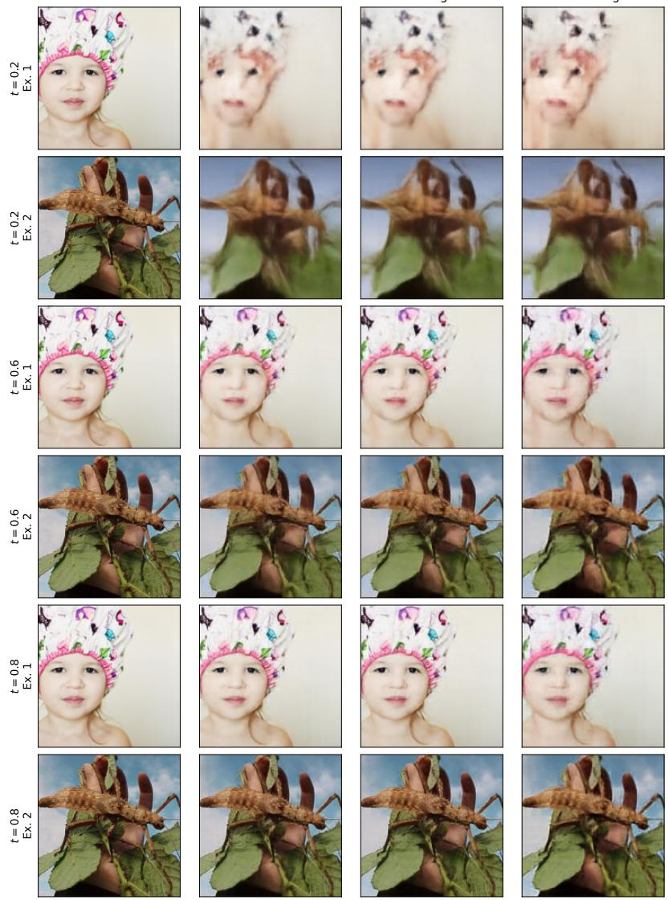  
Ground truth  
Route raw  
Route gen  
Route align  
Figure 6: Feature-to-pixel reconstructions at three flow timesteps. Lower t corresponds to a more heavily corrupted input. As more clean-image signal becomes available, the generation route retains more object structure and local appearance than the alignment route.

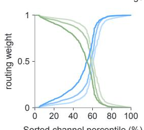

(a) routing distribution (L4)  
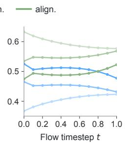  
(b) routing vs. timestep (L4)

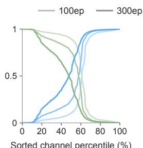  
(c) routing distribution (L6)

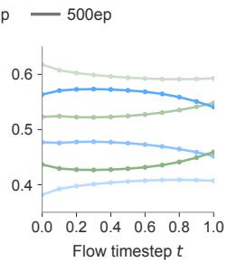  
(d) routing vs. timestep (L6)  
Figure 7: Single-layer routing dynamics in JiT-B/16 models. (a,b) L4-only routing; (c,d) L6-only routing. Blue denotes generation and green alignment.

## C.3 AN EXPLORATORY EVALUATION OF THE FEATURE-HACKING HYPOTHESIS

PixelREPA (Shin et al., 2026) proposes the feature-hacking hypothesis to characterize a related challenge in representation alignment for JiT. Specifically, the hypothesis suggests that alignment with semantically compressed teacher representations may suppress distinctions between images that are similar in representation space but differ in visual details. PixelREPA evaluates this hypothesis by measuring generation performance drop of REPA on images that are semantically similar in the teacher representation space. Following its setting, we conduct an exploratory evaluation of this hypothesis using subsets defined by DINOv2 feature similarity. For each of 100 evaluated ImageNet classes, we compute the class centroid and select the 100 nearest and 100 farthest samples, yielding two 10,000-image subsets. Each image is perturbed as $x _ { 0 . 2 } = 0 . 2 x _ { 0 } + 0 . 8 \epsilon$ and restored over 50 Heun intervals from $t = 0 . 2 \mathrm { t o } t = 1$ using the same image subset and noise across methods. FID is computed against the corresponding clean subset.

Table 8: FID on DINOv2-neighborhood subsets across guidance scales. We report subset-reference FID after perturbing images at t = 0.2 and denoising with 50 Heun intervals. Lower is better.
<table><tr><td>CFG</td><td>Method</td><td>Nearest 100</td><td>Farthest 100</td></tr><tr><td>1.0</td><td>JiT</td><td>34.7</td><td>23.9</td></tr><tr><td rowspan="6"></td><td>REPA</td><td>24.5</td><td>20.2</td></tr><tr><td>PixelREPA</td><td>27.5</td><td>20.6</td></tr><tr><td>RouteREPA</td><td>23.1</td><td>18.6</td></tr><tr><td>JiT</td><td>20.0</td><td>18.0</td></tr><tr><td>REPA</td><td>15.2</td><td>15.9</td></tr><tr><td>PixelREPA</td><td>16.1</td><td>16.0</td></tr><tr><td rowspan="4">2.5</td><td>RouteREPA</td><td>14.5</td><td>14.7</td></tr><tr><td>JiT</td><td>10.2</td><td>15.1</td></tr><tr><td>REPA</td><td>9.22</td><td>13.3</td></tr><tr><td>PixelREPA</td><td>8.76</td><td>13.9</td></tr><tr><td rowspan="5">3.5</td><td>RouteREPA</td><td>8.50</td><td>12.6</td></tr><tr><td>JiT</td><td>8.08</td><td>17.4</td></tr><tr><td>REPA</td><td>8.33</td><td>14.1</td></tr><tr><td>PixelREPA</td><td>7.20</td><td>15.4</td></tr><tr><td>RouteREPA</td><td>7.11</td><td>13.3</td></tr></table>

Table 8 reports the results across guidance scales. As the CFG scale increases, REPA exhibits different relative behavior on the two subsets. At CFG 3.5, REPA obtains an FID of 8.33 on the Nearest-100 subset, compared with 8.08 for JiT, while it obtains 14.1 on the Farthest-100 subset, compared with 17.4 for JiT. Across all evaluated CFG scales, RouteREPA achieves the lowest FID on both subsets. Figure 8 presents representative samples from the two subsets.

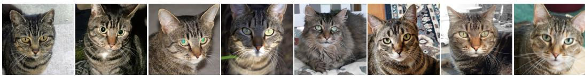  
(a) Most Similar 100

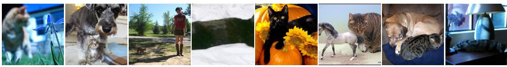  
(b) Least Similar 100  
Figure 8: Representative images from the 100 most similar and 100 least similar samples in the DINOv2 feature space for the ImageNet tabby class.

## D QUALITATIVE RESULTS

Figures 9–15 present uncurated samples from ImageNet. All images use JiT-H/16 + RouteREPA, a 50-step Heun solver, and CFG 3 throughout the sampling trajectory.

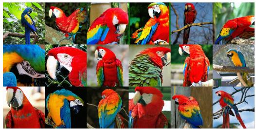  
class n01818515

  
class n01664065

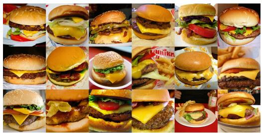  
class n07697313

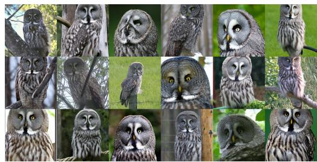  
class n01622779

  
class n02980441

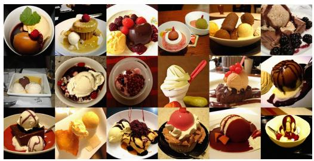  
class n07614500

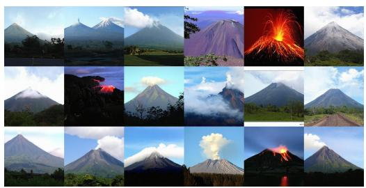  
class n09472597

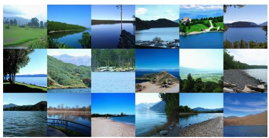  
class n09332890

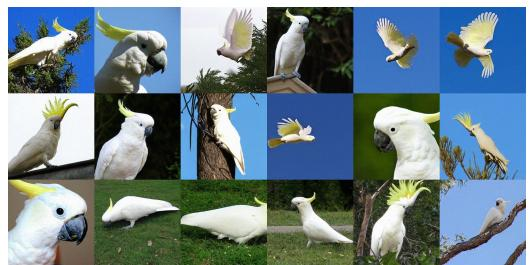  
class n01819313  
Figure 9: Uncurated samples from JiT-H/16 + RouteREPA on ImageNet 256 × 256.

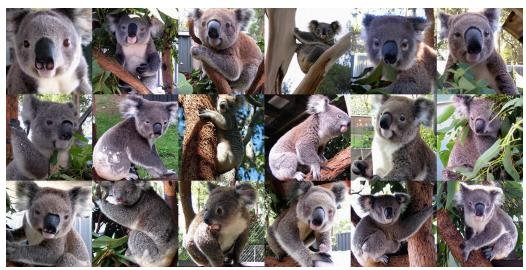  
class n01882714

  
class n09229709

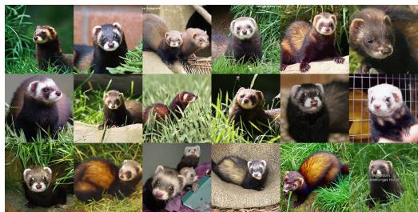  
class n02443114

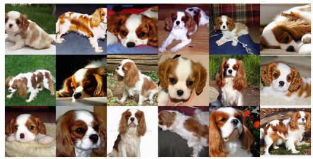  
class n02086646

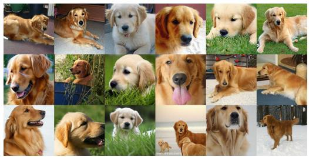  
class n02099601

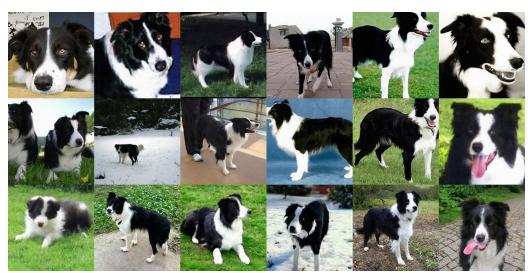  
class n02106166

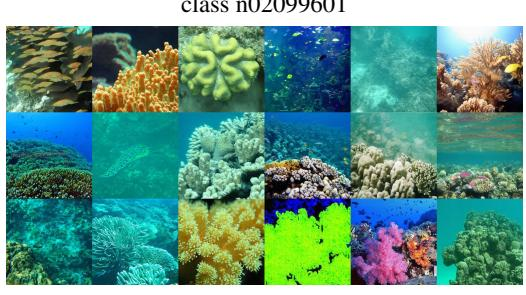  
class n09256479

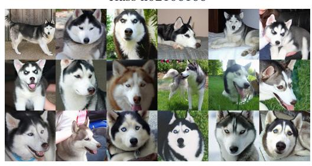  
class n02110185

  
class n02782093  
Figure 10: Uncurated samples from JiT-H/16 + RouteREPA on ImageNet $2 5 6 \times 2 5 6$

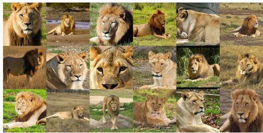  
class n02129165

  
class n03018349

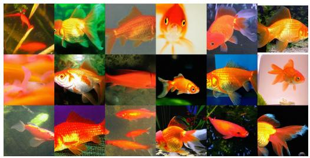  
class n01443537

  
class n01491361

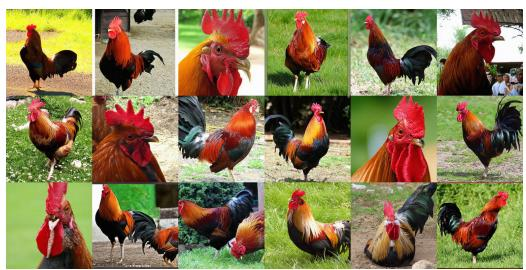  
class n01514668

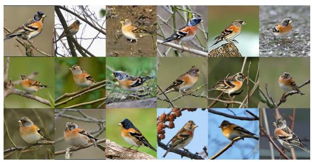  
class n01530575

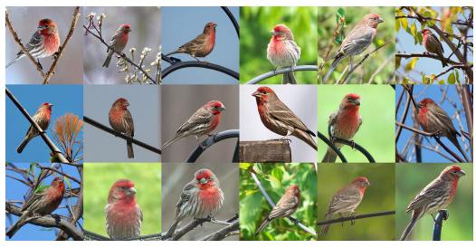  
class n01532829

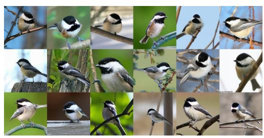  
class n01592084

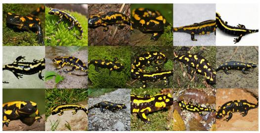  
class n01629819  
Figure 11: Uncurated samples from JiT-H/16 + RouteREPA on ImageNet $2 5 6 \times 2 5 6$

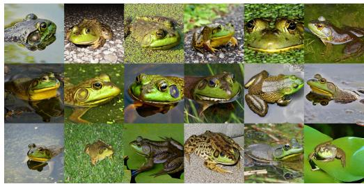  
class n01641577

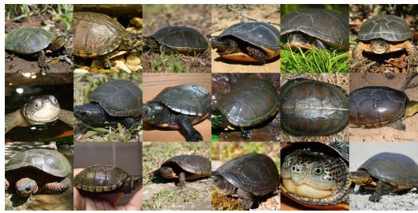  
class n01667114

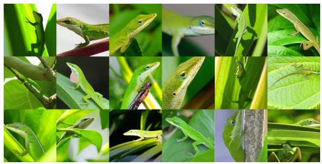  
class n01682714

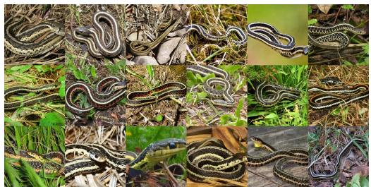  
class n01735189

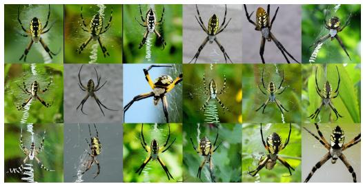  
class n01773157

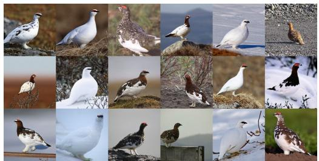  
class n01796340

  
class n01910747

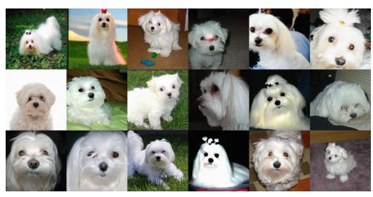  
class n02085936

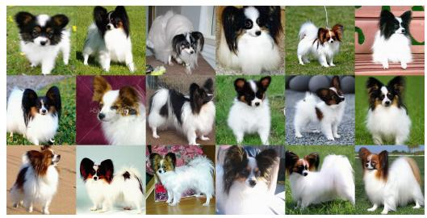  
class n02086910  
Figure 12: Uncurated samples from JiT-H/16 + RouteREPA on ImageNet $2 5 6 \times 2 5 6$

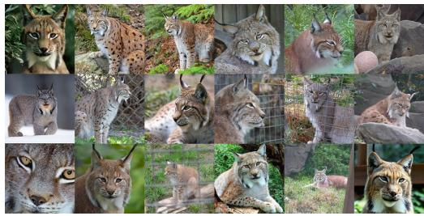  
class n02127052

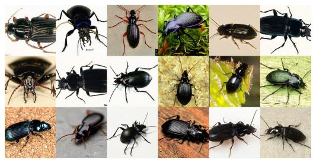  
class n02167151

  
class n02280649

  
class n02317335

  
class n02326432

  
class n02437616

  
class n02497673

class n02699494  
  
class n02795169  
Figure 13: Uncurated samples from JiT-H/16 + RouteREPA on ImageNet $2 5 6 \times 2 5 6$

  
class n02814860

  
class n03042490

  
class n03095699

  
class n03160309

  
class n03207743

  
class n03220513

  
class n03443371

  
class n03717622

  
class n03781244  
Figure 14: Uncurated samples from JiT-H/16 + RouteREPA on ImageNet 256 × 256.

  
class n03877845

  
class n04487081

  
class n04552348

  
class n07745940

  
class n07831146

  
class n02206856

  
class n01614925

  
class n02510455

  
class n02114367  
Figure 15: Uncurated samples from JiT-H/16 + RouteREPA on ImageNet 256 × 256.