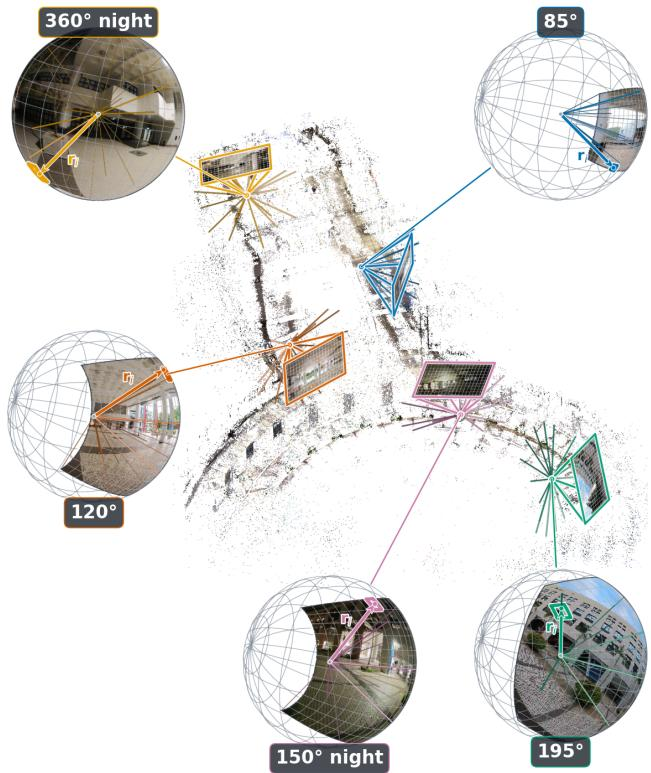
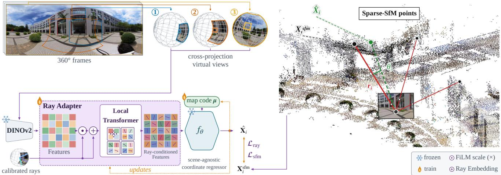
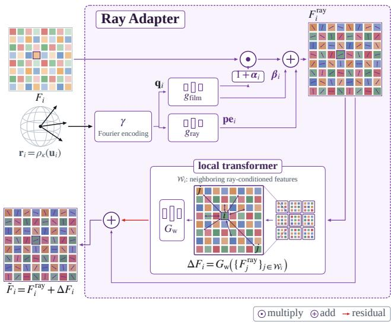
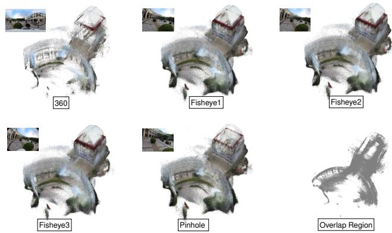
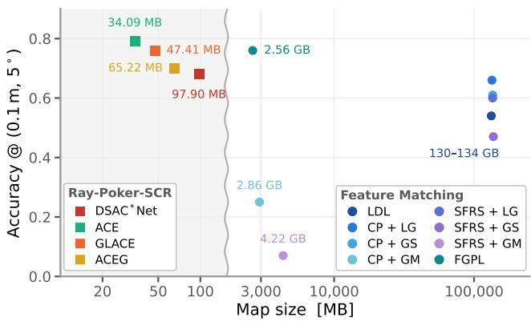
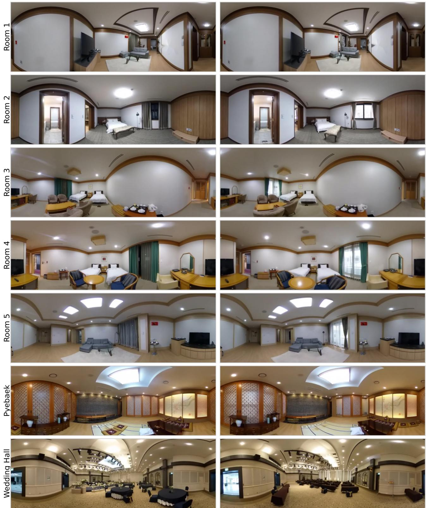

# Ray-SCR: Generalizing Scene Coordinate Regression Across Camera Models

Jaemin Cho1 Oleksii Nasypanyi1 Francois Rameau2

1Stony Brook University 2SUNY Korea

{jaemin.cho,oleksii.nasypanyi}@stonybrook.edu francois.rameau@sunykorea.ac.kr

## Abstract

Among visual localization strategies, scene coordinate regression (SCR) has emerged as an attractive approach for its compactness, accuracy, and speed. Despite these advantages, SCR models generalize poorly across substantially different camera models, such as omnidirectional or strongly rectified imagery. This limitation arises because, changes in field of view, lens distortion, or rectificationinduced resampling can make the same scene content appear differently depending on its pixel position, degrad ing localization accuracy. To cope with this limitation, we introduce Ray-SCR, a lightweight extension to existing SCR architectures that conditions local visual features on their calibrated viewing rays and refines neighboring rayconditionedfeatures with a shallow local Transformer. We furtherformulate supervision directly in ray space and use sparse SfM points as metric anchors that link observations across views and camera models. Taken together, these components enable a single scene representation builtfrom a panoramic mapping sequence to accurately localize query images captured with very different cameras, including pinhole,fisheye, and omnidirectional cameras.

We evaluate Ray-SCR across multiple SCR architectures and on datasets with pinhole, fisheye, and omnidirectional cameras. The proposed ray conditioning substantially improves generalization across cameras and leads to state-ofthe-art localization performance in these challenging crosscamera settings. The project page is available at here.

## 1. Introduction

Visual localization techniques allow to estimate the pose of a query image within a known scene. This process is central to many applications in robotics [30], mapping [35], and augmented reality [32]. Scene coordinate regression (SCR) [5, 6] approaches this task by learning, for each scene, a mapping from local image descriptors to 3D scene coordinates. Recently, SCR techniques have become particularly attractive for their fast training and inference, compact scene representation, and high localization accuracy.

  
Figure 1. Cross-camera localization with Ray-SCR. A scene mapped from panoramic images is queried using pinhole, fisheye, and 360◦ cameras with substantially different fields of view and image distortions. Ray-SCR uses calibrated viewing rays associated with local image features to enable localization across these heterogeneous cameras.

Despite these advantages, existing SCR solutions have been designed primarily for perspective cameras, or rectified images, and do not explicitly account for the strong distortions and non-uniform image resolution induced by omnidirectional imaging systems. As a result, the same local scene structure can produce substantially different image features depending on the camera geometry, which limits the ability of SCR models to generalize across heterogeneous cameras.

To mitigate that limitation, one can train SCR with images rendered from different camera configurations, exposing the network to a wider range of distortions. However, SCR relies on local image features, while the distortion affecting each patch depends on its position in the camera field of view. Therefore, without access to the corresponding viewing direction, the network has no explicit information about where a local feature lies within the camera projection. As shown in Table 5, such augmentation significantly improves cross-camera localization, but remains insufficient on its own.

Building on this observation, we propose Ray-SCR, which augments each local visual feature with its corresponding calibrated camera ray, providing the network with the viewing direction associated with that observation. A shallow local transformer further refines neighboring features to capture projection-dependent local patterns. Beyond feature conditioning, we formulate the training objective directly in ray space, using the angular distance between predicted and observed viewing directions. Unlike image-plane reprojection, this measure is independent of the camera projection model and can therefore be applied consistently across pinhole, fisheye, and omnidirectional cameras. In addition, we exploit sparse SfM points as metric 3D anchors, linking observations across views and camera models to a common scene coordinate.

We validate Ray-SCR primarily on 360Loc [14], where scenes mapped from panoramic sequences are queried using five different camera configurations under both day and night conditions. Across several SCR backbones, Ray-SCR consistently improves cross-camera localization and outperforms existing cross-device methods, including CDG-Loc [40]. We further evaluate the approach on OmniScenes [18], where it surpasses scan-based localization methods [21] while retaining a compact scene representation, and on Aachen [33] to assess its behavior in a largescale perspective setting with heterogeneous camera intrinsics.

## Our main contributions are:

• We introduce Ray-SCR, which conditions local visual features on calibrated camera rays and jointly refines neighboring features to improve scene coordinate regression across heterogeneous cameras.

• We formulate SCR supervision directly in ray space and complement it with sparse SfM anchors, providing metric 3D supervision while promoting consistent scenecoordinate predictions across views and camera models.

• We demonstrate the generality of Ray-SCR across several SCR architectures and three benchmarks, achieving stateof-the-art localization on 360Loc and OmniScenes, while substantially improving the corresponding SCR baseline on Aachen.

## 2. Related Work

In this section, we review scene coordinate regression and omnidirectional and cross-device localization.

## 2.1. Scene Coordinate Regression

Visual localization estimates the camera pose of a query image with respect to a pre-built map. A common approach is structure-based localization, which typically follows a hierarchical pipeline: it first retrieves database images depicting similar parts of the scene, then establishes local feature matches between the query and retrieved images to obtain 2D–3D correspondences with an SfM map, from which the camera pose is recovered geometrically [31, 34]. Recently, FastForward [1] represents posed mapping images as a collection of features anchored in 3D space and localizes a query in a single feed-forward pass.

An alternative is to encode the scene implicitly in network weights, avoiding an explicit geometric map. For instance, absolute pose regression follows this paradigm by training a scene-specific network on images with known camera poses and directly regressing the pose of a new query from its learned representation [17, 36]. While such methods offer a compact and efficient localization pipeline, they lack the geometric grounding of correspondence-based estimation, leading to poor accuracy [34]. Camera Ray Regression [41] instead predicts world-coordinate rays from image patches and recovers camera pose geometrically.

SCR bridges these two paradigms by encoding the scene in a network. Because this avoids storing an explicit scene representation at inference time, SCR has often been regarded as comparatively privacy-preserving, although recent work has challenged this assumption [26]. Rather than predicting the camera pose directly, the network predicts, for each pixel, the corresponding 3D scene coordinate, thereby producing dense 2D–3D correspondences from which the camera pose is recovered with a robust PnP algorithm. The seminal SCR approach of Shotton et al.[38] learns to predict dense scene coordinates from RGB-D training data, providing 2D–3D correspondences that can be used for geometric pose estimation. To remove the reliance on ground-truth depth, DSAC\*[4] proposes to use a CNN to learn scene coordinates directly from posed RGB images. More recently, ACE [6] then substantially accelerates this scene-specific training by combining a shared visual encoder with a lightweight coordinate regressor. Building on this pipeline, GLACE [39] incorporates an image-level global encoding to improve scalability to larger scenes, while ACE-G [7] introduces compact scene-specific map codes to reduce the mapping-to-query domain gap. FocusTune [27] further improves training by adapting the sampling of observations, while R-SCoRe [16] targets robustness at larger scale and under challenging illumination. Despite these advances, existing SCR methods do not condition scene-coordinate prediction on the camera model. Camera geometry is only introduced afterward, through the reprojection objective and pose solver. Ray-SCR instead conditions the regressor directly on calibrated per-pixel viewing rays and uses the same ray representation for scoring and pose estimation, removing the assumption of a fixed perspective image plane. Unlike predicting coordinate rays [41] and pose-dependent mapping rays [1], Ray-SCR uses camera-coordinate rays to condition scenecoordinate prediction. This makes a substantial difference in cross-camera settings, where the same scene may be observed through perspective, fisheye, or omnidirectional projections with very different pixel-to-ray mappings.

## 2.2. Omnidirectional and Cross-Device Localization

While hierarchical localization [31] is particularly effective on perspective imagery, its extension to cross-camera settings is not straightforward, as it requires retrieval strategies [37] and keypoint descriptors [9, 11] invariant to changes in projection model and field of view.

These limitations have led to omnidirectional localization methods that simplify the problem through stronger scene priors. PICCOLO and CPO localize panoramas directly in coloured point clouds through pose sampling and colour consistency [18, 19], while LDL and FGPL further reduce the search space using dominant line directions and intersections [20, 21]. A complementary line of work replaces the 3D map with stronger indoor priors. For instance, LaLaLoc and LASER localize against floorplans [13, 25], while SPVLoc uses a coarse semantic 3D model [10]. While effective indoors, these approaches rely on strong assumptions about scene structure or map availability, limiting their applicability to more general environments. Moreover, they apply mostly to panoramic images and are often not suitable for fisheye or perspective cameras.

Cross-device localization, where the map is built with one device and queried with another, has so far been driven mainly by benchmarks. For instance, LaMAR [32] evaluates localization across phone and HoloLens 2 captures, while CroCoDL [3] extends this setting to a legged robot. In both cases, however, the images remain perspective, and the domain gap mainly arises from changes in viewpoint, motion, and sensing platform. 360Loc [14] instead explicitly studies changes in camera projection, mapping from $3 6 0 ^ { \circ }$ images and querying with pinhole, fisheye, and $3 6 0 ^ { \circ }$ cameras. Existing solutions typically handle such cross-device variations through input transformation or additional training data: 360Loc renders virtual perspective views to reuse conventional localization pipelines, SPR [42] learns scene-agnostic relative pose, and CDG-Loc [40] reconstructs scenes with 3DGS to synthesize additional training views. These approaches improve robustness to device changes, but do not provide a representation inherently shared across camera models. Ray-SCR instead uses viewing rays as a common geometric representation across projections. Note that such invariance could also be obtained on the feature side, through spherical convolutions or distortion-aware descriptors. Doing so, however, means abandoning the strong pretrained encoders, for which no fisheye or 360 counterpart exists.

## 3. Method

Background & Rationale SCR encodes the geometry of a scene implicitly in the weights of a scene-specific network $f ,$ which maps an image I to a field of 3D points. The resulting 2D-3D correspondences are passed to a robust PnP solver to recover the camera pose. Early SCR formulations trained $f$ entirely per scene [4, 38], while subsequent methods decompose it into a scene-agnostic feature extractor $f _ { \mathrm { e n c } }$ and a scene-specific prediction head h [6, 39]. Given an image $I , f _ { \mathrm { e n c } }$ produces a set of patch embeddings

$$
{ \mathcal { F } } = \{ F _ { i } \in \mathbb { R } ^ { d } \} ,\tag{1}
$$

where $F _ { i }$ corresponds to the patch centered at pixel $\mathbf { u } _ { i } ,$ , and the head maps each embedding to a 3D point,

$$
\mathbf { y } _ { i } = h ( F _ { i } ; \mathbf { w } ) ,\tag{2}
$$

where w denotes the scene-specific parameters of h. More recently, ACE-G [7] pushes this decomposition one step further and keeps h fixed and shared across scenes, storing the scene in a trainable map code $\pmb { \mu }$ instead,

$$
\mathbf { y } _ { i } = h ( F _ { i } , \pmb { \mu } ; \mathbf { w } ) .\tag{3}
$$

Ray-SCR acts before the prediction head, replacing $F _ { i }$ by a ray-conditioned feature. It is therefore compatible with any of these backbones, regardless of how they store the scene.

While effective for perspective cameras, none of SCR formulations account for the viewing geometry, treating local features identically regardless of their viewing direction. This becomes a problem for fisheye and panoramic images, where the appearance and sampling of a neighborhood depend strongly on its viewing direction. Note that undistortion, as shown in Table 6, does not fully resolve this problem, as it introduces spatially varying resampling and stretching near the image boundaries. Ray-SCR addresses this by associating each feature with its calibrated viewing ray (3.1). The ray modulates the feature, and a lightweight local transformer then adapts each neighborhood into a representation shared across perspective, fisheye, and panoramic cameras (Sec. 3.3). We further use sparse SfM points, already available from scene reconstruction, as direct 3D anchors (Sec. 3.4). Since a point is observed from several viewpoints and camera models, these anchors push different observations of the same structure toward a consistent 3D coordinate.

  
Figure 2. Ray-SCR scene-training pipeline.We first extract encoder features from the training images, optionally augmented with sampled virtual views. SfM points are projected into each view, and features whose angular distance θi from the corresponding viewing ray ri is below a predefined threshold are retained in the training buffer. The Ray Adapter then injects camera-geometry information by encoding the associated viewing rays into the features and locally processing groups of neighboring features with a lightweight Transformer. The adapted features are subsequently passed through the standard SCR pipeline. Here, ACE-G is shown as an example, using a DINO encoder together with trainable scene-specific map codes.

## 3.1. Problem Setting and Ray Representation

We consider a scene M represented by a posed image sequence, $\mathcal { M } = ( I _ { j } , \mathbf { T } _ { w  c } ^ { j } ) j = 1 ^ { N }$ , where $\mathbf { T } _ { w  c } ^ { j }$ denotes the camera-to-world pose associated with image $I _ { j }$ . Given a query image $I _ { q } ,$ potentially captured using a different camera model, our goal is to estimate its pose in the scene coordinate defined by M. For each pixel location $\begin{array} { r l } { \mathbf { u } _ { i } } & { { } = } \end{array}$ $( u _ { i } , v _ { i } ) ^ { \top }$ , the corresponding camera calibration κ defines a unit viewing ray

$$
\mathbf { r } _ { i } = \rho _ { \kappa } ( \mathbf { u } _ { i } ) \in \mathbb { S } ^ { 2 } ,\tag{4}
$$

where $\rho _ { \kappa }$ denotes the inverse projection model of camera $\kappa .$ Since the ray field depends only on the camera calibration and the feature-grid resolution, it is computed once for each camera configuration. Each feature $F _ { i }$ is then directly associated with the ray $\mathbf { r } _ { i }$ passing through the center of its corresponding image patch.

## 3.2. Training Buffer Construction

Following ACE[6], we precompute encoder features in a training buffer, but sample 8×8 spatial tiles rather than individual features so that neighboring ray-conditioned features can be jointly processed by the lightweight Transformer described in Sec. 3.3. Tiles are shuffled across the buffer before training, retaining the randomized training strategy of ACE. Since each optimization batch contains several thousand features, preserving groups of only 64 neighboring features has little effect on the overall sampling diversity.

Additionally, we optionally sample virtual perspective and fisheye views from the 360◦ images to populate the training buffer. For simplicity, we use the known camera calibrations provided by the dataset and randomly sample camera orientations around the original camera center. We then generate each virtual view by reprojecting the panoramic image according to the sampled orientation and the corresponding camera model, following the procedure described in [14].

Finally, we associate sparse SfM observations with the feature grid. For each mapping image, we retain the top $N _ { \mathrm { s f m } }$ most reliable SfM observations, ranked by increasing reprojection error, and assign each observation to the closest feature according to angular distance. An association is accepted only when their angular distance is below $\tau _ { \mathrm { s f m } } = 2 ^ { \circ }$ ; otherwise the feature is marked as having no SfM supervision. As a result, only a sparse subset of feature locations, approximately 5% in our setup, receives a direct 3D target. Yet this sparse supervision provides geometric links between observations across different views and camera models.

## 3.3. Ray-Conditioned Feature Adaptation

Given a feature $F _ { i }$ sampled from the training buffer and its corresponding calibrated unit ray $\mathbf { r } _ { i }$ , we encode the viewing direction using a Fourier feature mapping γ(·),

$$
\mathbf { q } _ { i } = \gamma ( \mathbf { r } _ { i } ) \in \mathbb { R } ^ { 6 4 } ,\tag{5}
$$

where $\mathbf { q } _ { i }$ denotes the resulting ray embedding. This ray embedding is injected into the visual feature through two complementary branches. First, a lightweight $\mathrm { { M L P } } ~ g _ { \mathrm { { f i l m } } }$ $\mathbb { R } ^ { 6 4 } \xrightarrow { } \mathbb { R } ^ { 2 d }$ predicts feature-wise FiLM [29] scale and shift

  
Figure 3. Ray Adapter Architecture. Feature tiles sampled from the training buffer are paired viewing rays. Each ray is encoded and used to condition the visual feature through FiLM modulation and an additive ray embedding. The resulting features are then jointly refined within each local tile using a local Transformer before being passed to the SCR prediction head.

parameters,

$$
[ \alpha _ { i } , \beta _ { i } ] = g _ { \mathrm { f i l m } } ( \mathbf { q } _ { i } ) .\tag{6}
$$

In parallel, a learned projection $g _ { \mathrm { r a y } } : \mathbb { R } ^ { 6 4 } \to \mathbb { R } ^ { d }$ maps the ray embedding directly into the visual feature space,

$$
{ \mathbf { e } } _ { i } ^ { \mathrm { { r a y } } } = g _ { \mathrm { r a y } } ( { \mathbf { q } } _ { i } ) .\tag{7}
$$

The first branch modulates the visual feature, while the second provides an additive ray-dependent embedding. Together, they yield

$$
F _ { i } ^ { \mathrm { r a y } } = F _ { i } \odot ( 1 + \alpha _ { i } ) + \beta _ { i } + \mathbf { e } _ { i } ^ { \mathrm { r a y } } .\tag{8}
$$

Applying this conditioning independently to all 64 features within a sampled $8 \times 8$ neighborhood yields a rayconditioned feature tile. We then process this tile with a shallow local transformer, allowing neighboring features to interact and thereby account for projection-dependent variations in local feature patterns. The transformer operates only within each tile, keeping the additional computation lightweight and preserving compatibility with existing SCR prediction heads(Fig. 3). At inference, the feature map is processed in non-overlapping $8 \times 8$ tiles with a stride of 8.

## 3.4. Training Objective

Ray-SCR is trained using two complementary losses. Given a predicted scene coordinate Xb i and the known mapping pose $\mathbf { T } _ { w  c } ~ = ~ ( \mathbf { R } _ { w  c } , \mathbf { t } _ { w } )$ , where $\mathbf { R } _ { w  c }$ denotes the camera-to-world rotation and $\mathbf { t } _ { w }$ the camera center expressed in world coordinates, the viewing direction induced by the prediction is

$$
\widehat { \mathbf { r } } _ { i } = \frac { \mathbf { R } _ { w  c } ^ { \top } ( \widehat { \mathbf { X } } _ { i } - \mathbf { t } _ { w } ) } { | \mathbf { R } _ { w  c } ^ { \top } ( \widehat { \mathbf { X } } _ { i } - \mathbf { t } _ { w } ) | _ { 2 } } .\tag{9}
$$

We supervise its alignment with the calibrated observation ray using the angular residual

$$
\theta _ { i } = \mathrm { a t a n 2 } \left( | | \mathbf { r } _ { i } \times \widehat { \mathbf { r } } _ { i } | | _ { 2 } , \mathbf { r } _ { i } ^ { \top } \widehat { \mathbf { r } } _ { i } \right) ,\tag{10}
$$

yielding the loss

$$
\mathcal { L } _ { \mathrm { r a y } } = \frac { 1 } { | \mathcal { V } | } \sum _ { i \in \mathcal { V } } \theta _ { i } .\tag{11}
$$

We complement the dense ray-space supervision with sparse SfM anchors, which provide direct metric targets and link observations of the same scene structure across different views and camera models. At locations with an associated SfM point $\mathbf { X } _ { i } ^ { \mathrm { s f m } }$ , we therefore apply

$$
\mathcal { L } _ { \mathrm { s f m } } = \frac { 1 } { | \cal { S } | } \sum _ { i \in \cal { S } } w _ { i } , \mathrm { S m o o t h L 1 } \left( \widehat { \mathbf { X } } _ { i } - \mathbf { X } _ { i } ^ { \mathrm { s f m } } \right) ,\tag{12}
$$

where $w _ { i }$ denotes the SfM confidence. The final mapping objective is

$$
{ \mathcal { L } } _ { \mathrm { m a p } } = { \mathcal { L } } _ { \mathrm { r a y } } + \lambda _ { \mathrm { s f m } } { \mathcal { L } } _ { \mathrm { s f m } } .\tag{13}
$$

## 3.5. Pose Estimation

Each image location is first mapped through the given camera model to a unit bearing vector on the viewing sphere. This bearing is paired with the 3D coordinate predicted by the SCR model, forming a set of bearing–3D correspondences. We estimate the camera pose using a bearingvector P3P solver within RANSAC, as implemented in OpenGV [15], and then refine the resulting pose with robust nonlinear least squares by minimizing the angular error between the observed bearing vectors and the directions of the predicted 3D points under the estimated pose.

## 4. Experiments

## 4.1. Experimental Setup

Datasets. We evaluate Ray-SCR on three complementary benchmarks covering different scales, camera configurations, and localization settings. 360Loc [14], our primary benchmark, covers campus-scale indoor and outdoor environments with symmetric structures, repetitive appearance, and dynamic pedestrians. Each scene is mapped from a posed 360◦ sequence and queried using pinhole, fisheye, and 360◦ cameras under day and night conditions. We further evaluate on OmniScenes [18], a room-scale indoor benchmark with panoramas captured from handheld and mobile robot-mounted cameras before and after scene rearrangement; we use its joint-space setting to evaluate localization between handheld and robot-mounted captures under scene rearrangement. Aachen [33] complements these experiments with a city-scale outdoor setting, where mapping and query images exhibit varied camera intrinsics and fields of view.

Table 1. Cross-camera localization on 360Loc Day. Median translation/rotation errors (m/◦). Best results are shown in bold and second best results are underlined.
<table><tr><td></td><td>Scene</td><td colspan="6">Atrium Day</td><td colspan="6">Concourse Day</td></tr><tr><td></td><td>Camera</td><td>Pinhole</td><td>Fisheye1</td><td>Fisheye2</td><td>Fisheye3</td><td>360</td><td>Average</td><td>Pinhole</td><td>Fisheye1</td><td>Fisheye2</td><td>Fisheye3</td><td>360</td><td>Average</td></tr><tr><td rowspan="7">APR</td><td>PN [17]</td><td>15.5/85.5</td><td>11.8/79.9</td><td>11.3/80.4</td><td>10.1/79.8</td><td>4.5/82.6</td><td>10.6/81.6</td><td>18.6/95.0</td><td>10.7/88.7</td><td>10.1/87.7</td><td>7.7/85.9</td><td>2.6/39.0</td><td>9.9/79.3</td></tr><tr><td>MS-T [36]</td><td>20.1/77.7</td><td>14.5/73.7</td><td>14.0/71.7</td><td>12.5/65.6</td><td>13.2/54.7</td><td>14.9/68.7</td><td>17.0/69.1</td><td>11.0/60.8</td><td>10.5/59.6</td><td>9.9/63.4</td><td>4.9/34.6</td><td>10.7/57.5</td></tr><tr><td>PN-VC2 [14]</td><td>11.5/31.2</td><td>9.1/19.5</td><td>8.9/19.3</td><td>8.4/18.1</td><td>7.7/17.1</td><td>9.1/21.0</td><td>7.0/18.9</td><td>4.7/11.5</td><td>4.4/11.2</td><td>3.9/9.9</td><td>3.2/6.9</td><td>4.6/11.7</td></tr><tr><td>MS-T-VC2 [14]</td><td>10.0/46.7</td><td>6.3/36.3</td><td>6.2/36.5</td><td>4.9/28.1</td><td>5.2/47.6</td><td>6.5/39.0</td><td>3.5/19.6</td><td>1.9/12.7</td><td>1.8/12.8</td><td>1.7/12.7</td><td>1.6/13.5</td><td>2.1/14.3</td></tr><tr><td>CDG-Loc [40]</td><td>5.2/21.8</td><td>2.2/12.7</td><td>2.1/12.3</td><td>1.8/11.5</td><td>1.6/14.1</td><td>2.6/14.5</td><td>2.7/9.7</td><td>1.5/5.7</td><td>1.3/5.5</td><td>1.1/5.4</td><td>1.0/5.7</td><td>1.5/6.4</td></tr><tr><td>Ray-ACEG (Ours)</td><td>1.9/4.3</td><td>1.2/2.9</td><td>1.2/3.0</td><td>1.1/2.7</td><td>0.9/2.3</td><td>1.3/3.0</td><td>1.4/6.0</td><td>0.9/4.4</td><td>1.0/4.5</td><td>0.8/4.1</td><td>0.7/3.5</td><td>1.0/4.5</td></tr><tr><td>Scene</td><td colspan="4">Hall Day</td><td></td><td></td><td colspan="4"></td><td></td><td></td></tr><tr><td></td><td>Camera</td><td>Pinhole</td><td>Fisheye1</td><td>Fisheye2</td><td>Fisheye3</td><td>360</td><td>Average</td><td>Pinhole</td><td>Fisheye1</td><td>Piatrium Day Fisheye2</td><td>Fisheye3</td><td>360</td><td>Average</td></tr><tr><td rowspan="5">APR</td><td>PN [17]</td><td>19.8/90.8</td><td>11.1/95.7</td><td>10.4/95.9</td><td>7.5/92.3</td><td>2.7/97.3</td><td>10.1/96.1</td><td>21.3/88.0</td><td>13.8/86.5</td><td>13.0/87.1</td><td></td><td>5.7/69.8</td><td>12.9/83.2</td></tr><tr><td>MS-T [36]</td><td>21.8/96.0</td><td>14.1/94.0</td><td></td><td></td><td></td><td></td><td></td><td></td><td></td><td>10.9/84.4</td><td></td><td>21.3/69.4</td></tr><tr><td>PN-VC2 [14]</td><td>7.0/26.4</td><td>4.4/15.5</td><td>13.5/92.7</td><td>11.2/91.7</td><td>11.4/88.5</td><td>14.4/92.6</td><td>30.0/78.5</td><td>23.4/71.3</td><td>22.7/72.7</td><td>19.3/72.6</td><td>11.3/52.0</td><td></td></tr><tr><td>MS-T-VC2 [14]</td><td>4.0/36.9</td><td>2.2/25.8</td><td>4.3/14.7 2.1/25.2</td><td>3.9/14.2 1.8/26.2</td><td>3.2/12.2 1.7/26.9</td><td>4.6/16.6 2.4/28.2</td><td>10.4/24.5 8.1/32.7</td><td>6.9/13.3 4.0/24.5</td><td>6.8/12.8</td><td>6.8/11.5</td><td>5.0/9.8 3.3/22.1</td><td>7.2/14.4 4.6/25.4</td></tr><tr><td>CDG-Loc [40]</td><td>2.3/17.4</td><td>1.0/8.9</td><td>1.0/8.6</td><td>0.9/8.4</td><td>0.7/7.5</td><td>1.2/10.2</td><td>4.4/18.0</td><td>2.5/11.3</td><td>3.9/23.6 2.4/10.5</td><td>3.8/24.1 2.4/10.1</td><td>2.3/10.1</td><td>2.8/12.0</td></tr><tr><td>SCR</td><td>Ray-ACEG (Ours)</td><td>1.5/6.8</td><td>1.1/4.4</td><td>1.0/4.2</td><td>0.9/4.4</td><td>0.9/4.1</td><td>1.1/4.8</td><td>4.2/8.5</td><td>2.8/5.1</td><td>2.6/4.9</td><td>2.7/5.2</td><td>2.4/5.7</td><td>2.9/5.9</td></tr></table>

Table 2. Cross-camera localization on 360Loc Night. Median translation/rotation errors (m/◦). Best results are shown in bold and second-best results are underlined.
<table><tr><td></td><td>Scene</td><td colspan="6">Atrium Night</td><td colspan="6">Concourse Night</td></tr><tr><td></td><td>Camera</td><td>Pinhole</td><td>Fisheye1</td><td>Fisheye2</td><td>Fisheye3</td><td>360</td><td>Average</td><td>Pinhole</td><td>Fisheye1</td><td>Fisheye2</td><td>Fisheye3</td><td>360</td><td>Average</td></tr><tr><td rowspan="6">APR</td><td>PN[17]</td><td>19.8/90.8</td><td>16.4/87.3</td><td>16.1/86.7</td><td>15.7/83.5</td><td>8.7/22.8</td><td>15.3/74.2</td><td>19.8/96.2</td><td>13.3/85.5</td><td>13.0/88.4</td><td>11.1/87.5</td><td>5.5/45.6</td><td>12.5/80.6</td></tr><tr><td>MS-T [36]</td><td>24.8/84.7</td><td>17.8/80.5</td><td>17.0/80.1</td><td>15.1/80.0</td><td>5.0/46.3</td><td>15.9/74.3</td><td>22.1/74.7</td><td>17.7/69.5</td><td>17.0/68.3</td><td>17.2/72.7</td><td>8.4/57.3</td><td>16.5/68.5</td></tr><tr><td>PN-VC2 [14]</td><td>13.6/50.2</td><td>11.5/38.1</td><td>11.6/38.3</td><td>11.4/37.8</td><td>9.7/45.7</td><td>11.6/42.0</td><td>10.7/25.4</td><td>8.3/16.4</td><td>8.4/15.7</td><td>8.1/14.7</td><td>5.5/13.5</td><td>8.2/17.1</td></tr><tr><td>MS-T-VC2 [14]</td><td>13.5/70.6</td><td>9.1/64.1</td><td>9.0/63.8</td><td>8.6/64.4</td><td>7.3/61.5</td><td>9.5/64.9</td><td>5.5/28.7</td><td>4.0/20.1</td><td>3.9/20.3</td><td>3.5/20.9</td><td>3.4/23.7</td><td>4.1/22.7</td></tr><tr><td>CDG-Loc [40]</td><td>4.6/25.3</td><td>1.8/11.0</td><td>1.7/10.1</td><td>1.6/10.1</td><td>1.4/7.3</td><td>2.2/12.8</td><td>3.3/11.4</td><td>1.7/6.6</td><td>1.6/6.3</td><td>1.4/6.9</td><td>1.1/6.1</td><td>1.8/7.5</td></tr><tr><td>Ray-ACEG (Ours)</td><td>4.2/10.9</td><td>2.4/6.5</td><td>2.3/6.2</td><td>2.2/6.5</td><td>2.1/6.0</td><td>2.7/7.2</td><td>1.7/8.0</td><td>1.2/5.8</td><td>1.2/5.9</td><td>1.2/5.5</td><td>1.2/5.0</td><td>1.3/6.0</td></tr><tr><td>Scene</td><td colspan="5">Hall Night</td><td colspan="5"></td><td></td><td></td></tr><tr><td rowspan="6">APR</td><td>Camera</td><td>Pinhole</td><td>Fisheye1</td><td>Fisheye2</td><td>Fisheye3</td><td>360</td><td>Average</td><td>Pinhole</td><td>Fisheye1</td><td>Fisheye2</td><td>Piatrium Night Fisheye3</td><td>360</td><td>Average</td></tr><tr><td>PN[17]</td><td>22.8/95.6</td><td>18.3/93.8</td><td>17.9/93.6</td><td>16.8/91.3</td><td>10.9/100.1</td><td>17.3/94.9</td><td>33.2/89.7</td><td>29.3/89.6</td><td>28.8/90.4</td><td>29.2/89.8</td><td>30.6/98.5</td><td>30.2/91.6</td></tr><tr><td>MS-T [36]</td><td>32.1/96.1</td><td>29.9/94.2</td><td>29.7/93.6</td><td>31.8/93.1</td><td>22.3/94.4</td><td>29.2/94.3</td><td>37.7/91.3</td><td>37.3/89.1</td><td>36.2/89.0</td><td>35.7/85.6</td><td>37.2/83.0</td><td>36.8/87.6</td></tr><tr><td>PN-VC2 [14]</td><td>13.1/56.1</td><td>10.5/43.7</td><td>10.1/43.0</td><td>9.7/40.5</td><td>7.5/34.7</td><td>10.2/43.6</td><td>15.8/51.9</td><td>13.2/34.9</td><td>12.8/34.8</td><td>12.5/32.6</td><td>10.6/30.9</td><td>13.0/37.0</td></tr><tr><td>MS-T-VC2 [14]</td><td>8.9/73.1</td><td>5.6/67.6</td><td>5.3/66.3</td><td>4.8/68.9</td><td>3.8/67.2</td><td>5.7/68.6</td><td>16.0/63.9</td><td>13.0/53.8</td><td>12.4/53.7</td><td>11.9/49.9</td><td>11.9/49.9</td><td>13.0/54.2</td></tr><tr><td>CDG-Loc [40]</td><td>4.2/32.5</td><td>2.2/18.5</td><td>2.1/17.5</td><td>1.9/15.7</td><td>1.5/18.0</td><td>2.4/20.4</td><td>7.2/27.9</td><td>4.6/16.1</td><td>4.3/16.1</td><td>3.7/14.1</td><td>2.6/9.6</td><td>4.5/16.8</td></tr><tr><td>SCR</td><td>Ray-ACEG (Ours)</td><td>2.6/12.1</td><td>1.6/6.8</td><td>1.6/7.3</td><td>1.6/7.0</td><td>1.1/5.2</td><td>1.7/7.7</td><td>6.2/13.2</td><td>3.3/7.1</td><td>3.2/7.1</td><td>3.1/7.2</td><td>2.7/8.5</td><td>3.7/8.6</td></tr></table>

Implementation Details. We implement Ray-SCR in Py-Torch and optimize its trainable components with mixedprecision AdamW. On 360Loc, mapping images are resized to a maximum long edge of 1024 pixels, and each scene is trained for 70,000 iterations on NVIDIA RTX A5000 GPUs. For Ray-ACEG, we use a training buffer size of 9M and learning rates of 1e−4 for the Ray Adapter and 3e−4 for the scene-specific map code. The ray reprojection and SfM anchor losses use equal unit weights; the latter uses Smooth-L with β = 0.25 and at most 4096 SfM observations per mapping image. The Ray adapter uses 10 Fourier frequencies and a low-rank width of 64, followed by a single-layer, 4-head local Transformer with 256-dimensional tokens operating on 8×8 windows. The final projections of the FiLM, additive ray embedding, and Transformer residual branches are zero-initialized, so that the adapter initially preserves the pretrained features. Settings for the other SCR backbones, OmniScenes, and Aachen are provided in the supplementary material.

## 4.2. Cross-Camera Localization

On 360Loc, we compare Ray-ACEG with the absolute pose regression baselines PoseNet (PN) [17] and MS-Transformer (MS-T) [36], their virtual-camera variants PN-VC2 and MS-T-VC2 [14], and the cross-device localization method CDG-Loc [40]. We use the baseline results reported by CDG-Loc under the same evaluation protocol. For each scene and query camera, we report the median translation and rotation errors.

Day and night localization. For the main comparison, we instantiate Ray-SCR with ACE-G, using a single scene model to localize all five query cameras. Following CDG-Loc[40], each scene map additionally includes 10–20 nighttime frames. Tables 1 and 2 show that Ray-ACEG achieves the lowest rotation error for every camera type and scene under both illumination conditions, as well as the lowest scene-average translation error in six of eight settings. Compared with the previous best method, CDG-Loc, Ray-

Table 3. Compatibility across SCR models on 360Loc Day. In addition to the Ray-ACEG results, we instantiate Ray-SCR with DSAC\*, ACE, and GLACE. All four models are evaluated on the five query camera types. Values are median translation/rotation errors $( \mathrm { m } / ^ { \circ } )$ , with the best results shown in bold.  
Atrium Day
<table><tr><td>Camera</td><td>Pinhole</td><td>Fisheye1</td><td>Fisheye2</td><td>Fisheye3</td><td>360</td><td>Avg</td></tr><tr><td>Ray-DSAC*Net</td><td>14.2/28.1</td><td>5.0/10.8</td><td>4.5/9.8</td><td>5.8/13.1</td><td>7.2/12.1</td><td>7.3/14.8</td></tr><tr><td>Ray-ACE</td><td>13.5/23.3</td><td>5.2/11.5</td><td>4.9/11.8</td><td>6.0/13.5</td><td>7.9/8.1</td><td>7.5/13.6</td></tr><tr><td>Ray-GLACE</td><td>7.5/18.1</td><td>2.8/6.8</td><td>2.7/7.0</td><td>3.7/11.6</td><td>4.3/8.0</td><td>4.2/10.3</td></tr><tr><td>Ray-ACEG</td><td>1.9/4.3</td><td>1.2/2.9</td><td>1.2/3.0</td><td>1.1/2.7</td><td>0.9/2.3</td><td>1.3/3.0</td></tr></table>

Concourse Day
<table><tr><td>Camera</td><td>Pinhole</td><td>Fisheye1</td><td>Fisheye2</td><td>Fisheye3</td><td>360</td><td>Avg</td></tr><tr><td>Ray-DSAC*Net</td><td>8.8/33.8</td><td>3.2/15.7</td><td>2.9/13.2</td><td>2.8/14.9</td><td>2.6/14.6</td><td>4.1/18.4</td></tr><tr><td>Ray-ACE</td><td>6.9/26.8</td><td>2.6/12.6</td><td>2.3/12.1</td><td>3.4/15.8</td><td>5.0/14.5</td><td>4.0/16.4</td></tr><tr><td>Ray-GLACE</td><td>5.5/22.1</td><td>2.5/13.6</td><td>2.7/13.7</td><td>2.8/16.6</td><td>2.7/12.0</td><td>3.3/15.6</td></tr><tr><td>Ray-ACEG</td><td>1.4/6.0</td><td>0.9/4.4</td><td>1.0/4.5</td><td>0.8/4.1</td><td>0.7/3.5</td><td>1.0/4.5</td></tr></table>

Hall Day
<table><tr><td>Camera</td><td>Pinhole</td><td>Fisheye1</td><td>Fisheye2</td><td>Fisheye3</td><td>360</td><td>Avg</td></tr><tr><td>Ray-DSAC*Net</td><td>9.8/39.6</td><td>2.2/10.2</td><td>2.1/9.6</td><td>2.1/11.2</td><td>3.0/11.0</td><td>3.8/16.3</td></tr><tr><td>Ray-ACE</td><td>7.5/28.9</td><td>1.9/9.9</td><td>1.7/8.6</td><td>1.9/10.6</td><td>3.0/9.6</td><td>3.2/13.5</td></tr><tr><td>Ray-GLACE</td><td>4.0/20.3</td><td>1.5/7.8</td><td>1.4/7.4</td><td>1.7/12.6</td><td>1.7/6.4</td><td>2.0/10.9</td></tr><tr><td>Ray-ACEG</td><td>1.5/6.8</td><td>1.1/4.4</td><td>1.0/4.2</td><td>0.9/4.4</td><td>0.9/4.1</td><td>1.1/4.8</td></tr></table>

Piatrium Day
<table><tr><td>Camera</td><td>Pinhole</td><td>Fisheye1</td><td>Fisheye2</td><td>Fisheye3</td><td>360</td><td>Avg</td></tr><tr><td>Ray-DSAC*Net</td><td>19.7/32.1</td><td>6.0/10.1</td><td>5.3/9.2</td><td>6.1/12.1</td><td>5.5/8.8</td><td>8.5/14.5</td></tr><tr><td>Ray-ACE</td><td>20.7/30.6</td><td>6.9/11.7</td><td>6.5/11.6</td><td>8.2/15.2</td><td>10.2/13.7</td><td>10.5/16.6</td></tr><tr><td>Ray-GLACE</td><td>9.0/18.8</td><td>3.9/7.4</td><td>3.9/6.9</td><td>4.2/11.6</td><td>3.7/8.1</td><td>5.0/10.6</td></tr><tr><td>Ray-ACEG</td><td>4.2/8.5</td><td>2.8/5.1</td><td>2.6/4.9</td><td>2.7/5.2</td><td>2.4/5.7</td><td>2.9/5.9</td></tr></table>

  
Figure 4. Cross-camera consistency of predicted scene coordinates on Piatrium-Day. Ray-SCR produces substantially overlapping 3D scene points from all five camera types.

ACEG reduces the average rotation error by more than 2× across the eight scene–illumination settings. The largest gains are observed for narrow-FoV pinhole queries, with the advantage retained at night.

Compatibility across SCR architectures. We generalize Ray-SCR across SCR backbones by applying the same ray conditioning, training objective, and pose estimation to DSAC\* [4], ACE [6], and GLACE [39] (Table 3). Unlike ACE-G, these backbones encode each scene in a scenespecific prediction head, with DSAC\* additionally learning its encoder per scene. Despite this architectural difference, all three Ray-SCR variants localize the five camera types and outperform the original baselines in most 360Loc Day settings. Among them, Ray-GLACE provides the strongest results, indicating that the benefits of Ray-SCR are not tied to the ACE-G architecture.

  
Figure 5. Map size and localization accuracy on OmniScenes. Explicit-map methods (circles) use a pre-captured 3D point-cloud map at query time, whereas Ray-Poker-SCR (squares) represents each scene implicitly in network weights. Ray-Poker-ACE achieves the highest accuracy with 77× less storage than FGPL [21].

## 4.3. Omnidirectional and Perspective Localization

OmniScenes. We compare against LDL [20] and FGPL [21], and retrieval-and-matching pipelines combining CosPlace (CP) [2] or SFRS [12] with LightGlue (LG) [23], GlueStick (GS) [28], or GoMatch (GM) [43]; all use explicit 3D maps. Since OmniScenes provides no mapping split, we instead learn an implicit neural map for each space from posed “unchanged” panoramas and localize “changed” queries through predicted 2D–3D correspondences on the joint seven-space Extreme split, where all seven spaces form a single localization problem.

To deal with this multi-space setting, we follow ACE’s Poker strategy [6]: Ray-Poker-ACE estimates poses with all seven per-space regressors, selects the hypothesis with the strongest geometric support, and refines it. The same procedure is used for GLACE, DSAC\*, and ACE-G. Unlike LDL and FGPL, which process perspective crops rendered from the panorama, all four Ray-Poker-SCR variants directly consume each 360◦ query without cubemap conversion. Across the seven spaces, the four Ray-Poker-SCR variants achieve competitive recall accuracy. Among them, Ray-Poker-ACE improves recall by 3.9% over FGPL while using 77× less scene-specific storage (Fig. 5).

Aachen. We train Ray-ACE and Ray-GLACE directly on calibrated perspective images, following the ACE multimap setup [6] and the GLACE single-map setup [39], respectively. For Ray-ACE, we share a single Ray Adapter across all heads and select the pose with the greatest inlier support at inference. Table 4 shows that both Ray-SCR variants outperform their respective baselines at all three pose thresholds. Ray-SCR maintains its advantage, with Ray-

Table 4. Localization on Aachen Day. ACE and Ray-ACE use N spatially clustered scene-coordinate maps. We report their scenespecific storage and the percentage of queries localized within each pose threshold.
<table><tr><td></td><td>N</td><td>Map [MB]</td><td> $( 0 . 2 5 \mathrm { m } , 2 ^ { \circ } )$ </td><td> $\overline { { ( 0 . 5 \mathrm { m } , 5 ^ { \circ } ) } }$ </td><td> $\overline { { ( 5 \mathrm { m } , 1 0 ^ { \circ } ) } }$ </td></tr><tr><td rowspan="2">ACE [6]</td><td>4</td><td>16</td><td>0.0</td><td>0.5</td><td>3.8</td></tr><tr><td>50</td><td>205</td><td>6.9</td><td>17.2</td><td>50.0</td></tr><tr><td>GLACE [39]</td><td>1</td><td>27</td><td>8.6</td><td>20.8</td><td>64.0</td></tr><tr><td rowspan="2">Ray-ACE</td><td>4</td><td>19</td><td>0.4</td><td>1.5</td><td>41.0</td></tr><tr><td>50</td><td>213</td><td>14.7</td><td>35.8</td><td>80.1</td></tr><tr><td>Ray-GLACE</td><td>1</td><td>29</td><td>14.0</td><td>31.7</td><td>72.3</td></tr></table>

Table 5. Virtual-view augmentation on 360Loc Concourse-Day. ACE-G and Ray-ACEG are trained with augmented mapping views from the rendered cross cameras and evaluated on all five query cameras. Values are median translation/rotation errors $( \mathrm { m } / ^ { \circ } )$
<table><tr><td rowspan="2"></td><td rowspan="2">Augmented views 360 Fish.</td><td rowspan="2">Pin.</td><td rowspan="2"></td><td colspan="6">Query camera</td></tr><tr><td>Pinhole</td><td>Fisheye1</td><td>Fisheye2</td><td>Fisheye3</td><td>360</td><td>Avg</td></tr><tr><td></td><td>√</td><td>√</td><td>√</td><td>4.7/9.9</td><td>4.1/11.2</td><td>4.1/12.2</td><td>4.5/11.9</td><td>8.1/33.5</td><td>5.1/15.7</td></tr><tr><td></td><td>√</td><td>X</td><td>√</td><td>3.6/8.8</td><td>4.9/13.7</td><td>4.9/14.6</td><td>5.9/18.6</td><td>8.0/34.1</td><td>5.5/18.0</td></tr><tr><td></td><td>√</td><td>√</td><td>X</td><td>9.8/17.2</td><td>4.6/12.5</td><td>4.5/12.7</td><td>4.6/13.0</td><td>7.7/32.9</td><td>6.2/17.7</td></tr><tr><td></td><td>√</td><td>X</td><td>X</td><td>42.9/70.9</td><td>42.5/76.0</td><td>40.7/75.5</td><td>47.0/68.0</td><td>7.6/31.9</td><td>36.1/64.5</td></tr><tr><td></td><td>√</td><td>√</td><td>√</td><td>1.4/6.0</td><td>0.9/4.4</td><td>1.0/4.5</td><td>0.8/4.1</td><td>0.7/3.5</td><td>1.0/4.5</td></tr><tr><td>RaC-CCEGCEC-C L ]</td><td>√</td><td>X</td><td>√</td><td>1.4/6.8</td><td>1.0/4.7</td><td>1.1/5.0</td><td>1.0/5.2</td><td>0.9/4.0</td><td>1.1/5.2</td></tr><tr><td></td><td>√</td><td>√</td><td>X</td><td>2.8/10.7</td><td>1.1/5.0</td><td>1.0/4.5</td><td>0.9/4.6</td><td>0.6/3.3</td><td>1.3/5.6</td></tr><tr><td></td><td>√</td><td>X</td><td>X</td><td>6.3/16.9</td><td>2.3/10.1</td><td>1.9/9.0</td><td>1.5/8.4</td><td>1.0/4.1</td><td>2.6/9.7</td></tr></table>

Table 6. Cubemap-based SCR on 360Loc Concourse-Day. Standard ACE and ACE-G are trained and evaluated on perspective cubemap faces, whereas their Ray-SCR counterparts operate directly on native calibrated queries. Values are median translation/rotation errors (m/◦).

<table><tr><td rowspan="2"></td><td colspan="6">Query camera</td></tr><tr><td>Pinhole</td><td>Fisheye1</td><td>Fisheye2</td><td>Fisheye3</td><td>360</td><td> $\underline { { \mathbf { A v g } } }$ </td></tr><tr><td rowspan="2">Cubemap-ACE [6] Ray-ACE</td><td>18.8/36.1</td><td>10.1/18.7</td><td>8.7/13.1</td><td>6.8/11.2</td><td>3.1/4.4</td><td>9.5/16.7</td></tr><tr><td>6.9/26.8</td><td>2.6/12.6</td><td>2.3/12.1</td><td>3.4/15.8</td><td>5.0/14.5</td><td>4.0/16.4</td></tr><tr><td rowspan="2">Cubemap-ACEG [7] Ray-ACEG</td><td>14.5/14.4</td><td>9.6/13.8</td><td>9.7/13.1</td><td>10.0/13.1</td><td>7.2/8.9</td><td>10.2/12.7</td></tr><tr><td>1.4/6.0</td><td>0.9/4.4</td><td>1.0/4.5</td><td>0.8/4.1</td><td>0.7/3.5</td><td>1.0/4.5</td></tr></table>

ACE (N = 50) achieving the highest localization accuracy among the evaluated configurations. These results support conditioning local visual features on calibrated viewing rays for city-scale localization across varying camera intrinsics and fields of view.

## 4.4. Ablation Experiments

Virtual-view augmentation. Ray-SCR augments the posed 360◦ mapping sequence with calibrated pinhole, fisheye, and 360◦ views (Fig. 2). As shown in Table 5, expanding Ray-ACEG training from only 360◦ views to all three camera families reduces both errors. Standard ACE-G also benefits substantially from camera-diverse augmentation, but Ray-ACEG remains more accurate under every matched configuration, showing further gains from explicit ray conditioning.

Cubemap-based SCR. A practical alternative for heterogeneous cameras is to resample calibrated images into perspective cubemap faces and apply standard SCR on these pinhole views. We train Cubemap-ACE and Cubemap-ACEG on six 512×512 perspective faces per mapping panorama, each with a 90◦ field of view. Queries use the same conversion, discarding faces below 35% valid coverage, whereas Ray-SCR directly processes native queries (Table 6). Cubemap-ACE outperforms Ray-ACE on 360◦ queries but has larger translation errors on pinhole and fisheye queries. In contrast, Ray-ACEG outperforms Cubemap-ACEG in both translation and rotation for every query camera, highlighting the limits of perspective resampling alone.

Table 7. Component analysis on 360Loc Concourse. Values are camera-averaged median translation/rotation errors $( \mathrm { m } / ^ { \circ } )$ for Day and Night queries.
<table><tr><td></td><td>w/o Attention</td><td>w/o  $\overline { { \mathcal { L } _ { \mathrm { { r a y } } } } }$ </td><td>w/o  $\overline { { \mathcal { L } _ { \mathrm { s f m } } } }$ </td><td>Full</td></tr><tr><td>Day Avg.</td><td>1.32/5.89</td><td>1.74/9.16</td><td>1.53/8.39</td><td>0.96/4.54</td></tr><tr><td>Night Avg.</td><td>1.54/6.95</td><td>2.37/11.83</td><td>1.75/9.28</td><td>1.28/5.98</td></tr></table>

Component analysis. Table 7 evaluates the local Transformer and the two training losses on Concourse under the same training data and budget. Removing $\mathcal { L } _ { \mathrm { r a y } }$ leads to the largest increases in translation and rotation errors under both day and night conditions, highlighting the importance of dense angular supervision. Removing ${ \mathcal { L } } _ { \mathrm { s f m } }$ also degrades performance, showing the benefit of metric anchors that link observations across views to consistent scene coordinates. The full model performs best under both day and night conditions. Additional experiments investigating the impact of the number of input tokens in the local Transformer are provided in the supplementary material.

## 5. Conclusion

We presented Ray-SCR, which uses calibrated camera rays to make scene coordinate regression explicitly aware of camera geometry. Our method conditions and locally refines visual features using their viewing rays and formulates scene-coordinate learning directly in ray space. Sparse SfM anchors further provide metric 3D supervision while linking observations across views and camera models to consistent scene coordinates. Across several SCR architectures, Ray-SCR substantially improves cross-camera localization, achieving state-of-the-art results on 360Loc and OmniScenes while also improving the corresponding SCR baseline on Aachen. These results establish calibrated ray conditioning as a practical way to extend compact SCR localization beyond perspective cameras.

## Acknowledgements

This work was supported by the National Research Foundation of Korea (RS-2024-0035-8054) and by IITP-2026-RS-2023-00259678.

## References

[1] Axel Barroso-Laguna, Tommaso Cavallari, Victor Prisacariu, and Eric Brachmann. A scene is worth a thousand features: Feed-forward camera localization from a collection of image features. In International Conference on Learning Representations (ICLR), 2026. 2, 3

[2] Gabriele Berton, Carlo Masone, and Barbara Caputo. Rethinking visual geo-localization for large-scale applications. In Proceedings of the IEEE/CVF Conference on Computer Vision and Pattern Recognition (CVPR), pages 4878–4888, 2022. 7

[3] Hermann Blum, Alessandro Mercurio, Joshua O’Reilly, Tim Engelbracht, Mihai Dusmanu, Marc Pollefeys, and Zuria Bauer. Crocodl: Cross-device collaborative dataset for localization. In Proceedings of the IEEE/CVF Conference on Computer Vision and Pattern Recognition, pages 27424– 27434, 2025. 3

[4] Eric Brachmann and Carsten Rother. Visual camera relocalization from RGB and RGB-D images using DSAC. IEEE Transactions on Pattern Analysis and Machine Intelligence, 44(9):5847–5865, 2022. 2, 3, 7, 1

[5] Eric Brachmann, Alexander Krull, Sebastian Nowozin, Jamie Shotton, Frank Michel, Stefan Gumhold, and Carsten Rother. Dsac-differentiable ransac for camera localization. In CVPR, 2017. 1

[6] Eric Brachmann, Tommaso Cavallari, and Victor Adrian Prisacariu. Accelerated coordinate encoding: Learning to relocalize in minutes using rgb and poses. In Proceedings of the IEEE/CVF Conference on Computer Vision and Pattern Recognition, pages 5044–5053, 2023. 1, 2, 3, 4, 7, 8

[7] Leonard Bruns, Axel Barroso-Laguna, Tommaso Cavallari, Aron Monszpart, Sowmya Munukutla, Victor Adrian Prisacariu, and Eric Brachmann. Ace-g: Improving generalization of scene coordinate regression through query pretraining. In Proceedings of the IEEE/CVF International Conference on Computer Vision (ICCV), pages 26751– 26761, 2025. 2, 3, 8, 1

[8] Daniel DeTone, Tomasz Malisiewicz, and Andrew Rabinovich. Superpoint: Self-supervised interest point detection and description. In Proceedings of the IEEE conference on computer vision and pattern recognition workshops, pages 224–236, 2018. 1

[9] Marc Eder, Mykhailo Shvets, John Lim, and Jan-Michael Frahm. Tangent images for mitigating spherical distortion. In Proceedings of the IEEE/CVF Conference on Computer Vision and Pattern Recognition (CVPR), pages 12423–12431, 2020. 3

[10] Niklas Gard, Anna Hilsmann, and Peter Eisert. Spvloc: Semantic panoramic viewport matching for 6d camera localization in unseen environments. In European Conference on Computer Vision, pages 398–415. Springer, 2024. 3

[11] Christiano Gava, Vishal Mukunda, Tewodros Habtegebrial, Federico Raue, Sebastian Palacio, and Andreas Dengel. Sphereglue: Learning keypoint matching on high resolution spherical images. In 2023 IEEE/CVF Conference on Computer Vision and Pattern Recognition Workshops (CVPRW), pages 6134–6144. IEEE, 2023. 3

[12] Yixiao Ge, Haibo Wang, Feng Zhu, Rui Zhao, and Hong sheng Li. Self-supervising fine-grained region similarities for large-scale image localization. In European Conference on Computer Vision (ECCV), pages 369–386, 2020. 7

[13] Henry Howard-Jenkins and Victor Adrian Prisacariu. Lalaloc++: Global floor plan comprehension for layout localisation in unvisited environments. In European Confer ence on Computer Vision, pages 693–709. Springer, 2022. 3

[14] Huajian Huang, Changkun Liu, Yipeng Zhu, Hui Cheng, Tristan Braud, and Sai-Kit Yeung. 360Loc: A dataset and benchmark for omnidirectional visual localization with cross-device queries. In Proceedings of the IEEE/CVF Conference on Computer Vision and Pattern Recognition (CVPR), pages 22314–22324, 2024. 2, 3, 4, 5, 6

[15] Kun Huang, Yifu Wang, Si’ao Zhang, Zhirui Wang, Zhanpeng Ouyang, Zhenghua Yu, and Laurent Kneip. Opengv 2.0: Motion prior-assisted calibration and slam with vehicle-mounted surround-view systems. arXiv preprint arXiv:2503.03230, 2025. 5

[16] Xudong Jiang, Fangjinhua Wang, Silvano Galliani, Christoph Vogel, and Marc Pollefeys. R-score: Revisiting scene coordinate regression for robust large-scale visual localization. In Proceedings of the IEEE/CVF Conference on Computer Vision and Pattern Recognition (CVPR), pages 11536–11546, 2025. 2

[17] Alex Kendall, Matthew Grimes, and Roberto Cipolla. Posenet: A convolutional network for real-time 6-dof camera relocalization. In Proceedings of the IEEE International Conference on Computer Vision (ICCV), pages 2938–2946, 2015. 2, 6

[18] Junho Kim, Changwoon Choi, Hojun Jang, and Young Min Kim. Piccolo: Point cloud-centric omnidirectional localization. In Proceedings ofthe IEEE/CVF International Confer ence on Computer Vision (ICCV), pages 3313–3323, 2021. 2, 3, 5

[19] Junho Kim, Hojun Jang, Changwoon Choi, and Young Min Kim. Cpo: Change robust panorama to point cloud localiza tion. In Proceedings of the European Conference on Com puter Vision (ECCV), 2022. 3

[20] Junho Kim, Changwoon Choi, Hojun Jang, and Young Min Kim. Ldl: Line distance functions for panoramic localization. In Proceedings of the IEEE/CVF International Conference on Computer Vision (ICCV), 2023. 3, 7

[21] Junho Kim, Jiwon Jeong, and Young Min Kim. Fully geometric panoramic localization. In Proceedings of the IEEE/CVF Conference on Computer Vision and Pattern Recognition (CVPR), 2024. 2, 3, 7

[22] Laurent Kneip, Davide Scaramuzza, and Roland Siegwart. A novel parametrization of the perspective-three-point prob lem for a direct computation of absolute camera position and orientation. In Proceedings ofthe IEEE Conference on Computer Vision and Pattern Recognition (CVPR), pages 2969– 2976, 2011. 1

[23] Philipp Lindenberger, Paul-Edouard Sarlin, and Marc Pollefeys. Lightglue: Local feature matching at light speed. In Proceedings of the IEEE/CVF International Conference on Computer Vision, pages 17627–17638, 2023. 7, 1

[24] David G Lowe. Distinctive image features from scaleinvariant keypoints. International journal of computer vision, 60(2):91–110, 2004. 1

[25] Zhixiang Min, Naji Khosravan, Zachary Bessinger, Manjunath Narayana, Sing Bing Kang, Enrique Dunn, and Ivaylo Boyadzhiev. Laser: Latent space rendering for 2d visual localization. In 2022 IEEE/CVF Conference on Computer Vision and Pattern Recognition (CVPR), pages 11112–11121. IEEE, 2022. 3

[26] Oleksii Nasypanyi, Jaemin Cho, Utku Ozbulak, Byungkon Kang, and Francois Rameau. Seeing through the weights: Privacy leakage in scene coordinate regression. In ECCV, 2026. 2

[27] Son Tung Nguyen, Alejandro Fontan, Michael Milford, and Tobias Fischer. Focustune: Tuning visual localization through focus-guided sampling. In Proceedings of the IEEE/CVF Winter Conference on Applications of Computer Vision (WACV) Workshops, 2024. 2

[28] Remi Pautrat, D´ aniel Barath, Viktor Larsson, Martin R. Os-´ wald, and Marc Pollefeys. Gluestick: Robust image matching by sticking points and lines together. In Proceedings of the IEEE/CVF International Conference on Computer Vision (ICCV), pages 9706–9716, 2023. 7

[29] Ethan Perez, Florian Strub, Harm de Vries, Vincent Dumoulin, and Aaron Courville. Film: Visual reasoning with a general conditioning layer. In Proceedings of the AAAI Conference on Artificial Intelligence, 2018. 4

[30] Francois Rameau, Oleksandr Bailo, Jinsun Park, Kyungdon Joo, and In So Kweon. Real-time multi-car localization and see-through system. International Journal of Computer Vision, 130(2):384–404, 2022. 1

[31] Paul-Edouard Sarlin, Cesar Cadena, Roland Siegwart, and Marcin Dymczyk. From coarse to fine: Robust hierarchical localization at large scale. In Proceedings of the IEEE/CVF Conference on Computer Vision and Pattern Recognition (CVPR), pages 12716–12725, 2019. 2, 3

[32] Paul-Edouard Sarlin, Mihai Dusmanu, Johannes L Schonberger, Pablo Speciale, Lukas Gruber, Viktor Larsson,¨ Ondrej Miksik, and Marc Pollefeys. Lamar: Benchmarking localization and mapping for augmented reality. In ECCV, 2022. 1, 3

[33] Torsten Sattler, Will Maddern, Carl Toft, Akihiko Torii, Lars Hammarstrand, Erik Stenborg, Daniel Safari, Masatoshi Okutomi, Marc Pollefeys, Josef Sivic, et al. Benchmarking 6dof outdoor visual localization in changing conditions. In 2018 IEEE/CVF Conference on Computer Vision and Pattern Recognition, pages 8601–8610. IEEE, 2018. 2, 6

[34] Torsten Sattler, Qunjie Zhou, Marc Pollefeys, and Laura Leal-Taixe. Understanding the limitations of cnn-based absolute camera pose regression. In Proceedings of the IEEE/CVF conference on computer vision and pattern recognition, pages 3302–3312, 2019. 2

[35] Johannes L. Schonberger and Jan-Michael Frahm. Structure-¨ from-motion revisited. In Proceedings of the IEEE Conference on Computer Vision and Pattern Recognition, pages 4104–4113, 2016. 1

[36] Yoli Shavit, Ron Ferens, and Yosi Keller. Learning multiscene absolute pose regression with transformers. In Pro-

ceedings of the IEEE/CVF International Conference on Computer Vision (ICCV), pages 2733–2742, 2021. 2, 6

[37] Ze Shi, Hao Shi, Kailun Yang, Zhe Yin, Yining Lin, and Kaiwei Wang. Panovpr: Towards unified perspective-toequirectangular visual place recognition via sliding windows across the panoramic view. In 2023 IEEE 26th International Conference on Intelligent Transportation Systems (ITSC), pages 1333–1340. IEEE, 2023. 3

[38] Jamie Shotton, Ben Glocker, Christopher Zach, Shahram Izadi, Antonio Criminisi, and Andrew Fitzgibbon. Scene coordinate regression forests for camera relocalization in rgb-d images. In Proceedings of the IEEE conference on computer vision and pattern recognition, pages 2930–2937, 2013. 2, 3

[39] Fangjinhua Wang, Xudong Jiang, Silvano Galliani, Christoph Vogel, and Marc Pollefeys. Glace: Global local accelerated coordinate encoding. In Proceedings of the IEEE/CVF Conference on Computer Vision and Pattern Recognition, pages 21562–21571, 2024. 2, 3, 7, 8, 1

[40] Yuanze Wang, Yichao Yan, Shiming Song, Songchang Jin, Yilan Huang, Xingdong Sheng, and Dianxi Shi. Enhancing visual localization with cross-domain image generation. In Proceedings of the 42nd International Conference on Machine Learning, pages 65075–65090. PMLR, 2025. 2, 3, 6

[41] Yesheng Zhang and Xu Zhao. Semantic-guided camera ray regression for visual localization. In Proceedings of the IEEE/CVF International Conference on Computer Vision (ICCV), pages 25639–25648, 2025. 2, 3

[42] Junwei Zheng, Ruiping Liu, Yufan Chen, Zhenfang Chen, Kailun Yang, Jiaming Zhang, and Rainer Stiefelhagen. Scene-agnostic pose regression for visual localization. In Proceedings of the IEEE/CVF Conference on Computer Vision and Pattern Recognition (CVPR), pages 27092–27102, 2025. 3

[43] Qunjie Zhou, Sergio Agostinho, Aljo´ sa Oˇ sep, and Lauraˇ Leal-Taixe. Is geometry enough for matching in visual lo-´ calization? In European Conference on Computer Vision, pages 407–425. Springer, 2022. 7

[44] Sijie Zhu, Linjie Yang, Chen Chen, Mubarak Shah, Xiaohui Shen, and Heng Wang. R2former: Unified retrieval and reranking transformer for place recognition. In Proceedings of the IEEE/CVF Conference on Computer Vision and Pat tern Recognition, pages 19370–19380, 2023. 1

# Ray-SCR: Generalizing Scene Coordinate Regression Across Camera Models

Supplementary Material

## A. SCR Backbone

Ray-ACE and Ray-GLACE [39] use ACE’s [6] frozen pretrained encoder and prediction head, an MLP of 1×1 convolutions with residual blocks. Ray-DSAC∗ [4] instead trains its encoder end-to-end per scene and uses a head of three 1×1 convolutions with ReLU activations. Ray Adapter uses the same configuration across backbones and differs only in the width of the features it adapts. It contains 0.9M parameters for 512-D features and 1.54M parameters for the 1024-D features of Ray-ACEG [7]. For Ray-GLACE, the R2Former [44] global descriptor is computed once per mapping view and concatenated to the adapted local feature before the head. On 360Loc, Ray-ACE, Ray-GLACE, and Ray-DSAC∗ are optimized with AdamW at fixed learning rates of 2e−3, 3e−3, and 1e−3, respectively. Ray-ACE and Ray-GLACE each cache 8M feature vectors for training, whereas Ray-DSAC∗ uses no feature buffer. All three follow the 70,000-iteration training budget and the data preparation and supervision settings described for 360Loc in Sec. 4.1.

## B. Dataset Protocols

## B.1. OmniScenes

Each of the seven spaces is mapped from its posed robotmounted panoramas of the unchanged scene (676–923 frames per space) and queried with the handheld panoramas of the Extreme split captured after rearrangement (44– 186 frames per space), as illustrated in Fig. 6. Sparse SfM points are obtained by triangulating SIFT [24] tracks from the mapping frames. Each space is trained for 170k iterations with Ray-ACE, 110k with Ray-GLACE, 70k with Ray-DSAC∗, and 40k with Ray-ACEG, with all other settings following the 360Loc implementation details.

## B.2. Aachen

Mapping and query images are resampled using their calibrations to a common focal length of 480 pixels, standardizing the perspective scale while retaining fields of view. Virtual views are sampled by random rotations within ±8◦ about each mapping camera. We use the sparse SfM points provided in the Aachen reference reconstruction as scenecoordinate anchors. Ray-ACE and Ray-GLACE are trained for 30k and 100k iterations per map, with buffer sizes of 32M and 64M, respectively.

## C. Additional Method Details C.1. Sparse-SfM Anchor on 360Loc

We construct sparse SfM points by matching SuperPoint [8] features with LightGlue [23] across perspective views sampled from the mapping panoramas (95◦ field of view, 1024 × 768 resolution). Matching uses the 16 nearest mapping frames. After retaining the most reliable observations based on reprojection error as described in Sec. 3.2, each triangulated point $\mathbf { X } _ { p }$ is assigned a confidence that increases with the angular spread and the number of supporting views. When several points fall on the same feature location, their confidence-weighted average defines the anchor target $\mathbf { X } _ { i } ^ { \mathrm { s f m } }$ . We sum their confidences to obtain $w _ { i }$ in Eq. 12, and normalize the weights to unit mean over the valid anchors of each image.

## C.2. Pose Estimation

We provide the explicit angular-error and pose-refinement formulations used in Sec. 3.5. For a pose $\mathbf { T } _ { w  c } =$ $( \mathbf { R } _ { w  c } , \mathbf { t } _ { w } )$ , the angular error of the bearing–3D correspondence $( \mathbf { r } _ { i } , \hat { \mathbf { X } } _ { i } )$ is

$$
e _ { i } ( \mathbf { T } _ { w  c } ) = \mathscr { L } ( \mathbf { r } _ { i } , \frac { \mathbf { R } _ { w  c } ^ { \top } ( \hat { \mathbf { X } } _ { i } - \mathbf { t } _ { w } ) } { \| \mathbf { R } _ { w  c } ^ { \top } ( \hat { \mathbf { X } } _ { i } - \mathbf { t } _ { w } ) \| _ { 2 } } ) .\tag{14}
$$

The RANSAC estimate is refined over its inlier correspondences $\mathcal { T }$ as

$$
\mathbf { T } _ { w  c } ^ { * } = \arg \operatorname* { m i n } _ { \mathbf { T } _ { w  c } } \sum _ { i \in \mathcal { T } } \rho \big ( e _ { i } ( \mathbf { T } _ { w  c } ) ^ { 2 } \big ) ,\tag{15}
$$

where $\rho ( \cdot )$ is a Huber loss used for nonlinear refinement. Hypotheses are generated with the P3P solver [22] inside RANSAC, using an angular inlier threshold of 0.5◦ and 1,000 iterations.

## D. Transformer Window Size Ablation

Table 8 varies the window size w of the local Transformer on Concourse. Accuracy improves as the window grows from w=1 to w=8. The main setting w=8 achieves the lowest Day error, while w=16 achieves the lowest Night error.

Table 8. Transformer window size ablation on 360Loc Concourse. Values are camera-averaged median translation/rotation errors $( \mathrm { m } / ^ { \circ } )$ for Day and Night queries.
<table><tr><td></td><td> $w = 1$ </td><td>w = 2</td><td>w = 4</td><td>w = 8 (main)</td><td>w = 16</td></tr><tr><td>Day Avg.</td><td>1.26/5.72</td><td>1.25/6.00</td><td>1.11/5.60</td><td>0.96/4.54</td><td>0.98/4.77</td></tr><tr><td>Night Avg.</td><td>1.52/6.68</td><td>1.48/6.82</td><td>1.39/6.49</td><td>1.28/5.98</td><td>1.20/5.60</td></tr></table>

## E. Limitations

Ray-SCR requires calibrated cameras. Since ray field is computed from the intrinsic calibration, calibration errors bias the mapping and camera pose estimation. Furthermore, the ray-conditioning modules add an inference overhead of 1 ms per image for Ray-ACE and 7 ms for Ray-ACEG.

Mapping (unchanged scene)  
Query (changed scene)  
  
Figure 6. OmniScenes mapping and query examples. The mapping panoramas are captured by a robot-mounted camera, while the query panoramas are captured by a handheld camera after rearrangement of the scene.