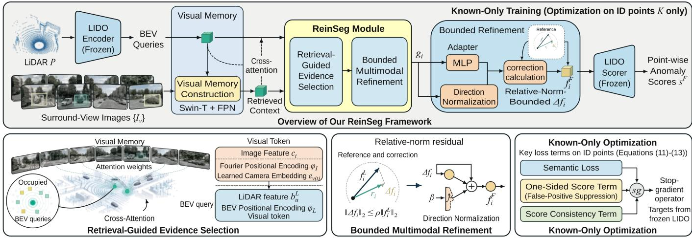
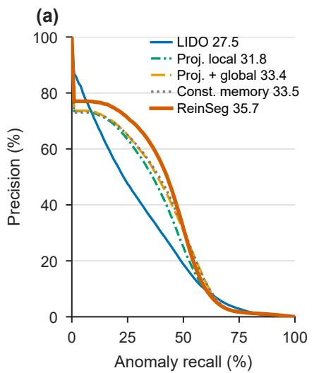
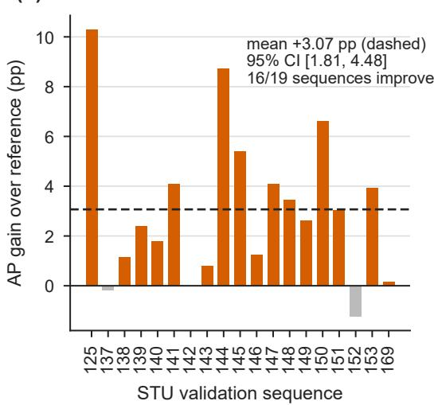
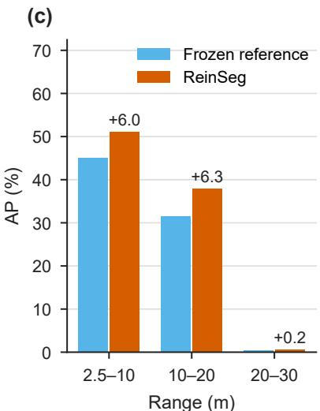
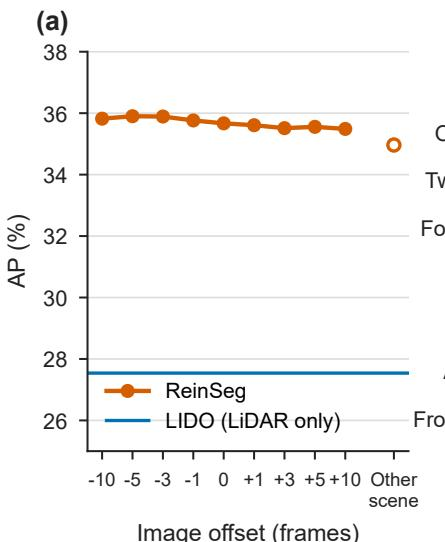
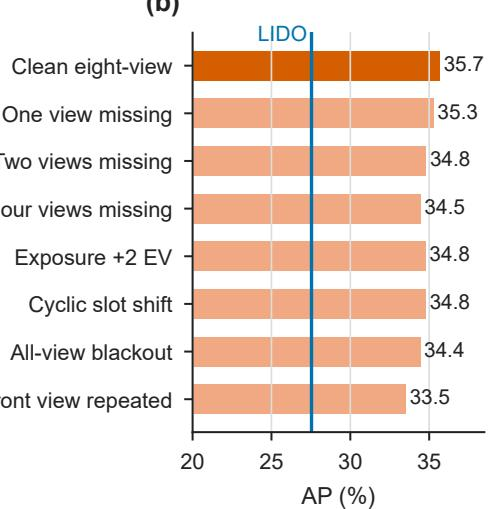
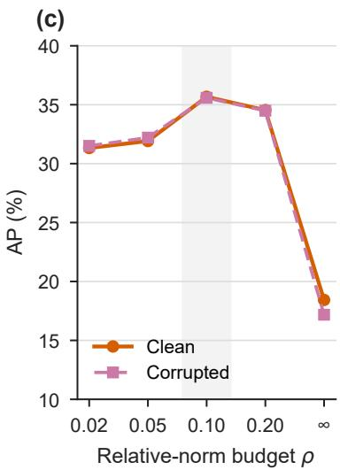
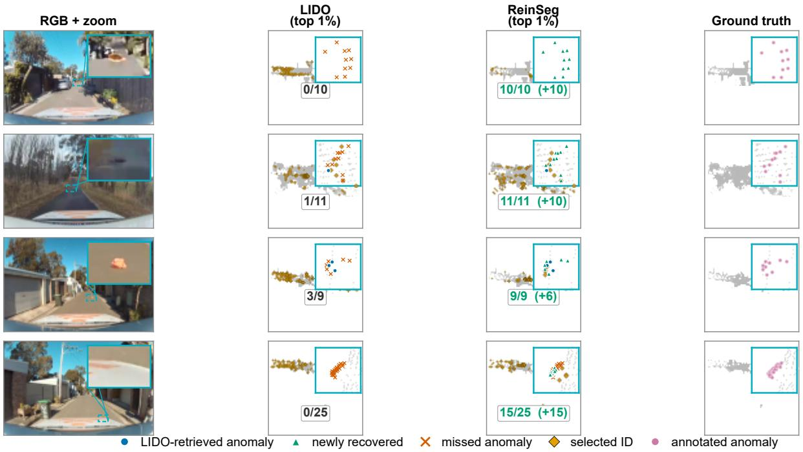

# ReinSeg: Retrieval-Guided Bounded Multimodal Refinement for 3-D Road Anomaly Segmentation

Haifa Zhang, Yijing Wang, and Zhiqiang Zuo

Abstract—3-D road anomaly segmentation is essential for riskaware perception in autonomous driving. Its central challenge is to rank sparsely observed hazards ahead of abundant normal road structures while preserving point-wise metric localization. LiDAR provides accurate 3-D point support, whereas surroundview imagery offers complementary semantic context for separating unexpected hazards from challenging normal structures. We propose ReinSeg, a retrieval-guided bounded multimodal refinement framework for point-wise road anomaly segmentation. Occupied LiDAR bird’s-eye-view cells retrieve scene-specific context from a shared memory of eight surround-view images without supplying calibration variables to the retrieval module. A relative-norm-bounded residual returns this context to the LiDAR point features, so the frozen LIDO anomaly-scoring interface is preserved, and the refinement is optimized with indistribution semantic labels only. On the Spotting the Unexpected (STU) benchmark, ReinSeg improves validation average precision from 27.54% to 35.67% and reduces the false-positive rate at 95% anomaly recall from 34.85% to 10.61%, shrinking the high-recall screening set from 67.54 to 20.55 million points. Relative to REL, AP is 24.99 percentage points higher and FPR95 is 0.99 points lower. Matched interfaces and component isolation show that retrieved scene imagery and the relative-norm bound are both essential, and ReinSeg stays above LiDAR-only performance under missing, corrupted, or misaligned camera inputs while running at 21.8 frames per second. These results establish bounded retrieval of scene-specific visual evidence as an effective route to reliable 3-D road-hazard perception.

Index Terms—Autonomous driving, risk-aware perception, road anomaly segmentation, LiDAR, multimodal sensor fusion, surround-view cameras, intelligent transportation systems.

## I. INTRODUCTION

HREE-dimensional (3-D) road anomaly segmentation enables autonomous vehicles to identify previously unseen road hazards while preserving their metric locations. Fallen cargo, detached vehicle parts, and unusual debris may occupy only a small region and produce few LiDAR returns. Reliable point-wise perception therefore requires ranking these sparse anomalous observations ahead of millions of normal road points, including challenging road boundaries, sidewalks, and terrain transitions. For safety-critical intelligent transportation systems, risk-aware perception must recover such hazards at high recall while keeping the number of normal points that a downstream monitor or planner has to screen small.

The Spotting the Unexpected (STU) benchmark [1] establishes a representative evaluation setting for 3-D road anomaly segmentation, providing densely annotated LiDAR points, synchronized surround-view imagery, and sequential observations of unexpected road objects. LiDAR-only anomaly rankers preserve the metric point support and provide a direct interface for point-wise hazard localization. LIDO [2], for example, models known-class feature distributions and scores individual LiDAR points without target-domain anomaly supervision. On STU validation, LIDO still retains 67.54 million in-distribution points at the threshold that recovers 95% of anomaly points, most of them on the road surface. This high-recall screening burden motivates bringing complementary scene semantics into point-wise LiDAR anomaly ranking.

Surround-view cameras complement LiDAR with dense appearance and scene context. Existing camera–LiDAR systems commonly associate the modalities through calibrated projection, depth lifting, or a jointly learned prediction head [3]–[5]. Point-wise anomaly segmentation poses a different interface problem: LiDAR already defines where predictions are evaluated, and the anomaly scorer already defines how point features become anomaly scores in a carefully structured feature space. Effective refinement must therefore answer two questions together: which visual evidence is relevant to each occupied LiDAR region, and how far that evidence may move each point feature while the scorer remains reliable.

We introduce ReinSeg, which couples visual evidence retrieval with point-wise influence control. Occupied LiDAR bird’s-eye-view (BEV) cells query a shared token memory built from all eight surround-view images through calibrationinput-free retrieval. The selected context is returned to each point through a residual whose norm is bounded by a fixed fraction of the LiDAR feature norm, and the refined features are scored by the original LIDO function. Only the visual retrieval and refinement modules are optimized, using indistribution semantic labels, while the LiDAR encoder and scorer remain frozen. ReinSeg thus determines both what image evidence enters the LiDAR ranking pipeline and how strongly it may change each point feature.

On STU, ReinSeg raises validation average precision from 27.54% for LIDO to 35.67% and reduces the false-positive rate at 95% anomaly recall (FPR95) from 34.85% to 10.61%, shrinking the high-recall screening set from 67.54 to 20.55 million points. It also exceeds REL [6] by 24.99 AP points while reducing FPR95 by 0.99 points. Against a frozen LiDAR reference with the same encoder and scorer, the retrieved evidence adds 5.65 AP points and improves 16 of the 19 evaluation sequences. Controlled ablations attribute this gain to retrieved scene imagery and to the relative-norm bound, and ReinSeg remains above the LiDAR-only baseline under missing, corrupted, or misaligned camera inputs while running at 21.8 frames per second.

The main contributions are as follows:

• We formulate camera-assisted point-wise road anomaly segmentation through two coupled requirements: selecting scene-relevant visual evidence for each occupied LiDAR region and bounding its influence on the point features consumed by a frozen anomaly scorer.

• We develop ReinSeg, which combines calibration-inputfree retrieval from a surround-view visual memory with relative-norm-bounded feature refinement. The framework preserves LiDAR-defined metric support and the original anomaly-scoring interface and is optimized with known-class labels only.

• We show on STU that ReinSeg substantially improves point-wise hazard ranking and reduces the high-recall false-alarm burden, and we verify through matched interfaces, component isolation, and sensor interventions that the gain stems from retrieved scene evidence, that the bound is essential, and that degraded cameras never push the system below LiDAR-only performance.

## II. RELATED WORK

## A. Road Anomaly Segmentation

Image-level out-of-distribution detection has developed confidence-, energy-, and outlier-exposure-based scoring methods [7]–[12]. Dense road-scene benchmarks subsequently extended this objective to pixel-wise localization of unexpected regions [13]–[19]. DetSeg adds object-level structure to this camera-only setting by detecting open-world objects and temporally stabilizing the retained regions [20], and likelihood-ratio segmentation separates unknown regions from closed-set predictions [21]. Point-wise 3-D perception additionally requires each anomaly score to retain the metric location of an observed LiDAR return under extreme class imbalance.

SemanticKITTI established dense closed-set semantics for sequential LiDAR perception [22], whereas STU provides synchronized sensor data and dense point labels for real unexpected road objects [1]. LIDO models the feature geometry of known semantic classes and combines semantic and contrastive cues to score point-wise anomalies without real anomaly samples [2]. REL strengthens LiDAR anomaly learning through pseudo-outlier construction [6]. LIDO’s knownclass feature geometry and point-wise scoring rule provide the reference interface for camera-assisted refinement in this work.

## B. Multimodal 3-D Road-Hazard Perception

Camera–LiDAR systems exploit complementary appearance and geometry for small obstacle segmentation, unknownobject filtering, multimodal anomaly benchmarks, and pointwise out-of-distribution detection [23]–[26]. Detection architectures have explored point decoration, proposal or voxel fusion, cross-view aggregation, and repeated modality interaction [27], [28]. Related occupancy methods further study fused or anomalous voxels in multimodal road scenes [29]– [31]. Among box-, voxel-, and point-level outputs, only the last ties every anomaly score directly to a measured LiDAR return.

Recent T-ITS studies improve autonomous-driving perception through robust data augmentation, compact multi-sensor learning, explicit LiDAR–camera alignment, and task-specific cross-modal interaction [32]–[35]. Complementary work on point-cloud ground segmentation and camera-based semantic occupancy further illustrates the importance of uncertaintyaware metric reasoning and dense scene semantics [36], [37].

Multimodal industrial anomaly detection has shown that cross-modal retrieval can expose evidence that is weak in a single modality [38], [39]. This retrieval perspective motivates the use of surround-view context to enrich sparse LiDAR evidence in road scenes.

Table I summarizes representative visual and 3-D anomaly formulations through their output representations and association mechanisms.

## C. Camera–LiDAR Fusion Interfaces

Conventional fusion constructs an explicit spatial correspondence. Automotive perception surveys frame this design space through what, when, and how sensor features are combined [40]. PointPainting projects image predictions onto LiDAR points [3], Lift-Splat-Shoot lifts perspective features through depth distributions [4], and BEVFusion combines independently encoded modalities in a common BEV [5], [41]. Query-based fusion such as TransFusion and CMT shows that attention can transfer complementary evidence between sensor representations [42], [43]. Learned Fusion and CFT further show that cross-modal or multi-camera mappings can be learned without supplying calibration parameters to the fusion module [44], [45].

These systems suggest three fusion interfaces. Projectionbased methods attach image features to selected 3-D elements through known geometry. Lift-based methods first construct a camera-derived spatial representation. Query-based methods instead let one representation select information from another through content-dependent weights. A query-based interface suits point-wise anomaly ranking because occupied LiDAR cells already define the metric query locations. ReinSeg adopts it and adds what anomaly scoring requires: an explicit bound on how far the retrieved evidence may move each point feature before the original scorer is applied.

## III. METHOD

## A. Problem Formulation and Design Principles

ReinSeg is a retrieval-guided bounded multimodal refinement framework built around the point-wise LIDO anomaly scorer. The evaluated LiDAR points remain the query and output domain, while images refine the intermediate point features before the original LiDAR scoring rule is applied.

For one synchronized sample, the input is a LiDAR point cloud $\mathcal { P } ~ = ~ \{ ( \mathbf { x } _ { i } , \mathbf { r } _ { i } ) \} _ { i = 1 } ^ { N _ { p } }$ and eight RGB images $\{ \mathbf { I } _ { v } \} _ { v = 1 } ^ { 8 }$ where $\mathbf { x } _ { i } ~ \in ~ \mathbb { R } ^ { 3 }$ is a metric coordinate and $\mathbf { r } _ { i }$ contains the remaining LiDAR attributes. The model assigns a continuous anomaly score $s _ { i } ~ \in ~ [ 0 , 1 ]$ to every evaluated point. During optimization, ${ \cal K } \subseteq \{ 1 , \ldots , N _ { p } \}$ denotes the points with indistribution semantic labels, hereafter called ID points. Targetdomain anomaly annotations are used only for final evaluation.

TABLE I  
POSITIONING OF REPRESENTATIVE VISUAL AND 3-D ANOMALY FORMULATIONS. “ASSOC.” DENOTES HOW VISUAL EVIDENCE IS ASSOCIATED WITH THE 3-D REPRESENTATION; “BOUNDED UPDATE” DENOTES AN EXPLICIT POINT-WISE CONSTRAINT ON THE MULTIMODAL FEATURE UPDATE.
<table><tr><td>Method</td><td>Scene</td><td>Output</td><td>Inference input</td><td>Assoc.</td><td>Bounded update</td></tr><tr><td>M3DM [38]</td><td>Industrial</td><td>3-D region</td><td>RGB + point cloud</td><td>Registered RGB-3-D</td><td>No</td></tr><tr><td>Unknown-road detection [24]</td><td>Road</td><td>3-D object</td><td>RGB + LiDAR</td><td>Calibrated projection</td><td>No</td></tr><tr><td>DetSeg [20]</td><td>Road</td><td>2-D object</td><td>RGB sequence</td><td>Temporal boxes</td><td>No</td></tr><tr><td>Feature Mixing [26]</td><td>Road</td><td>3-D point</td><td>RGB + LiDAR</td><td>Calibrated point fusion</td><td>No</td></tr><tr><td>OccOoD [30]</td><td>Road</td><td>3-D voxel</td><td>Multi-camera</td><td>Camera occupancy</td><td>No</td></tr><tr><td>LIDO [2]</td><td>Road</td><td>3-D point</td><td>LiDAR</td><td>n/a</td><td>No</td></tr><tr><td>ReinSeg</td><td>Road</td><td>3-D point</td><td>RGB + LiDAR</td><td>Content retrieval</td><td>Yes</td></tr></table>

  
Fig. 1. Overview of ReinSeg. Occupied LiDAR BEV queries retrieve scene-relevant context from an eight-view visual memory. The retrieved evidence is returned through a relative-norm-bounded residual, known-only objectives optimize the visual path, and the frozen LIDO scorer preserves the point-wis anomaly-scoring interface.

The framework couples two stages. Retrieval-guided evidence selection obtains scene-specific visual context for occupied LiDAR BEV cells. Bounded multimodal refinement returns this context to each point through a residual whose norm is limited relative to the LiDAR feature norm. Together, they determine what visual evidence enters the point-wise ranking pipeline and how strongly it may change the LiDAR representation. Figure 1 maps both stages onto one forward path, and the complete scan-level mapping is

$$
\begin{array} { r } { \mathbf { s } ^ { F } = g _ { \mathrm { L I D O } } \big ( \mathbf { F } _ { p } ^ { L } + \Delta \mathbf { F } ( \mathcal { P } , \{ \mathbf { I } _ { v } \} _ { v = 1 } ^ { 8 } ; \boldsymbol { \theta } ) \big ) , } \\ { \| \Delta \mathbf { f } _ { i } \| _ { 2 } \leq \rho \| \mathbf { f } _ { i } ^ { L } \| _ { 2 } , \qquad } \end{array}\tag{1}
$$

where $\mathbf { F } _ { p } ^ { L }$ stacks the reference point features and $\Delta \mathbf { F }$ is the learned multimodal correction, whose point-wise norm never exceeds the fraction $\rho$ of the LiDAR feature norm.

## B. LiDAR Reference Scoring Interface

The LiDAR reference interface follows LIDO’s point representation and scoring rule. The encoder $E _ { L }$ uses sparse convolutions [46] to map the voxelized point cloud to ${ \bf F } _ { v } ^ { L } =$ $E _ { L } ( \mathcal { P } ) \in \mathbb { R } ^ { N _ { v } \times 9 6 }$ , where $N _ { v }$ is the number of non-empty voxels. The voxel index $\nu ( i )$ assigns each evaluated point the feature $\mathbf { f } _ { i } ^ { L } ~ = ~ \mathbf { F } _ { v , \nu ( i ) } ^ { L } ~ \in ~ \mathbb { R } ^ { 9 6 }$ of its voxel, and every output score is written back to the original point index, so the evaluated point set of the STU evaluator is unchanged. The LIDO semantic and contrastive projections, class mean activation vectors, and anomaly equation are denoted together by gLIDO, giving the reference scores

$$
\mathbf { s } ^ { L } = g _ { \mathrm { L I D O } } ( \mathbf { F } _ { p } ^ { L } ) , \qquad s _ { i } ^ { L } = [ \mathbf { s } ^ { L } ] _ { i } .\tag{2}
$$

Reference adaptation. Before refinement, $E _ { L }$ and the LIDO projections are adapted to the STU training scans, starting from the public LIDO weights. A first stage trains them jointly with the visual path of Sections III-C–III-D under LIDO’s known-class objectives, i.e., weighted cross-entropy, Lovasz,´ class-prototype, contrastive, and objectosphere losses, distilled from the public model. A second stage sharpens the reference ranking with class-conditional virtual outliers sampled from the low-likelihood tails of the ID feature distributions [47] through an auxiliary outlier head that is discarded afterwards. Both stages use ID labels only. The adapted $E _ { L }$ and gLIDO are then frozen as the reference interface, and the visual path is initialized from the first stage.

To form metric queries, voxel features are averaged along height and scattered onto a 400 × 400 BEV grid with 0.25-m cells. For an occupied cell u with voxel set $\mathcal { V } ( u )$ , the LiDAR BEV feature is

$$
\mathbf { b } _ { u } ^ { L } = \frac { 1 } { \vert \mathcal { V } ( u ) \vert } \sum _ { j \in \mathcal { V } ( u ) } \mathbf { F } _ { v , j } ^ { L } \in \mathbb { R } ^ { 9 6 } , \qquad u \in \mathcal { U } ,\tag{3}
$$

where U contains the M occupied cells and $\mathbf { p } _ { u } \in [ - 1 , 1 ] ^ { 2 }$ is the normalized cell coordinate. Empty cells are omitted, so the query count follows the occupied LiDAR support rather than the area of the BEV canvas.

## C. Calibration-Input-Free Visual Retrieval

The retrieval module maps all eight images to a shared visual memory and lets occupied BEV cells select scenerelevant content. It receives no camera intrinsics, camera– LiDAR extrinsics, ego-pose transforms, rays, depth lifts, or projected point coordinates; camera identity and image position organize the visual tokens of the fixed synchronized rig.

One shared Swin-T encoder [48], initialized from ImageNet-1K, provides stages at strides 8, 16, and 32. A feature pyramid network (FPN) [49] maps them to 64 channels with $1 \times 1$ lateral convolutions, upsamples them to stride 8, sums them, and applies a $3 \times 3$ output convolution. The fused map is adaptively pooled to an $8 \times 1 4$ grid, which preserves the image aspect ratio and yields 112 tokens per view and $T \ = \ 8 9 6$ tokens in total. For token t of camera $v ( t )$ at normalized image position $\xi _ { t }$

$$
\begin{array} { r } { \mathbf { m } _ { t } = \mathbf { W } _ { I } \mathbf { c } _ { t } + \phi _ { I } ( \pmb { \xi } _ { t } ) + \mathbf { e } _ { v ( t ) } , } \end{array}\tag{4}
$$

where $\mathbf { c } _ { t }$ is the pooled image feature, ϕI is a twodimensional Fourier position encoding, and ${ \bf e } _ { v ( t ) }$ is a learned camera-identity embedding. Stacking all tokens gives ${ \bf { M } } _ { I } \in$ $\mathbb { R } ^ { T \times 6 4 }$ . Each occupied cell forms the query $\mathbf { q } _ { u } = \mathbf { W } _ { L } \mathbf { b } _ { u } ^ { L } +$ $\phi _ { L } ( \mathbf { p } _ { u } )$ with a BEV Fourier position encoding $\phi _ { L }$ . Four-head scaled dot-product cross-attention [50] retrieves visual context from the complete memory,

$$
\mathbf { o } _ { u } ^ { ( k ) } = \mathrm { s o f t m a x } \left( \frac { ( \mathbf { q } _ { u } \mathbf { W } _ { Q } ^ { ( k ) } ) ( \mathbf { M } _ { I } \mathbf { W } _ { K } ^ { ( k ) } ) ^ { \top } } { \sqrt { d _ { k } } } \right) \mathbf { M } _ { I } \mathbf { W } _ { V } ^ { ( k ) } ,\tag{5}
$$

with $k \in \{ 1 , \ldots , 4 \}$ and $d _ { k } \ = \ 1 6 .$ , where the softmax runs over the $T$ image tokens. The concatenated heads are projected, normalized, and refined by a feed-forward network,

$$
\begin{array} { r l } & { \widehat { \mathbf { h } } _ { u } = \mathrm { L N } \Big ( \big [ \mathbf { o } _ { u } ^ { ( 1 ) } ; \ldots ; \mathbf { o } _ { u } ^ { ( 4 ) } \big ] \mathbf { W } _ { O } \Big ) , } \\ & { \widetilde { \mathbf { b } } _ { u } ^ { I } = \mathbf { W } _ { R } \mathrm { L N } \Big ( \widehat { \mathbf { h } } _ { u } + \mathrm { F F N } ( \widehat { \mathbf { h } } _ { u } ) \Big ) \in \mathbb { R } ^ { 6 4 } . } \end{array}\tag{6}
$$

Each occupied cell thus compares its LiDAR content against all camera slots and image regions and aggregates the evidence relevant to it into a cell-specific visual representation.

The retrieved features and the LiDAR BEV features are scattered to $\widetilde { \mathbf { B } } ^ { I }$ and $\mathbf { B } ^ { L }$ on the same grid, with zeros at unoccupied cells, and a convolutional fuser exploits local BEV neighborhoods,

$$
\mathbf { G } = G _ { \psi } \left( [ \widetilde { \mathbf { B } } ^ { I } ; \mathbf { B } ^ { L } ] \right) , \qquad \mathbf { g } _ { u } = \mathbf { G } [ u ] \in \mathbb { R } ^ { 9 6 } .\tag{7}
$$

$G _ { \psi }$ applies a $3 \times 3$ convolution with batch normalization and ReLU to the 160-channel concatenation, followed by a residual block of two $3 \times 3 .$ , 96-channel convolutions. Each point gathers the fused feature of the cell $\mu ( i )$ that contains its voxel, $\mathbf { g } _ { i } = \mathbf { g } _ { \mu ( i ) }$ , so points in one cell share visual context while keeping their distinct LiDAR features.

## D. Bounded Multimodal Refinement

Bounded multimodal refinement regulates how strongly retrieved evidence changes each LiDAR feature. A two-layer adapter $h _ { \theta }$ with a 96-D hidden layer, layer normalization, and GELU activation proposes a correction direction from the reference feature and its retrieved context, $\delta _ { i } = h _ { \theta } ( [ \mathbf { f } _ { i } ^ { L } ; \mathbf { g } _ { i } ] ) \in$ $\mathbb { R } ^ { 9 6 }$ . Its magnitude is set relative to the reference feature through the budget utilization $\beta = \rho \operatorname { t a n h } ( a )$

$$
\Delta \mathbf { f } _ { i } = \beta \| \mathbf { f } _ { i } ^ { L } \| _ { 2 } \frac { \delta _ { i } } { \operatorname* { m a x } ( \| \delta _ { i } \| _ { 2 } , 1 0 ^ { - 3 } ) } , \qquad \mathbf { f } _ { i } ^ { F } = \mathbf { f } _ { i } ^ { L } + \Delta \mathbf { f } _ { i } .\tag{8}
$$

Because | tanh(a)| < 1, every correction satisfies

$$
\| \Delta \mathbf { f } _ { i } \| _ { 2 } \leq \rho \| \mathbf { f } _ { i } ^ { L } \| _ { 2 }\tag{9}
$$

for any point, scene, and camera condition. We use $\rho =$ 0.10. The scalar a is initialized to zero, so the first forward pass reproduces the reference features exactly while $\partial \beta / \partial a = \rho$ activates the residual path from the first update; $\beta / \rho$ reports the budget utilization. The refined features $\mathbf { F } _ { p } ^ { F }$ are scored by the unchanged LIDO function,

$$
\begin{array} { r } { { \mathbf { s } ^ { F } } = g _ { \mathrm { L I D O } } ( \mathbf { F } _ { p } ^ { F } ) , \qquad s _ { i } ^ { F } = [ { \bf s } ^ { F } ] _ { i } . } \end{array}\tag{10}
$$

The bound keeps the refined features in the neighborhood of the feature geometry in which the class mean activation vectors and the anomaly equation are defined. Visual evidence can therefore re-rank difficult normal structures and sparse hazards without overriding the metric LiDAR representation on which the scorer relies.

## E. Known-Only Optimization

Anomaly-label-free optimization updates only the visual path: the image encoder, retrieval block, BEV fuser, residual adapter, and $a .$ With $\mathbf { z } _ { i } ^ { F }$ the semantic logits of the refined features under the LIDO semantic projection, the semantic objective is

$$
\begin{array} { r } { \mathcal { L } _ { \mathrm { s e m } } = \mathrm { C E } _ { w } ( \mathbf { z } _ { K } ^ { F } , \mathbf { y } _ { K } ) + 1 . 5 \mathcal { L } _ { \mathrm { L o v } } ( \mathbf { z } _ { K } ^ { F } , \mathbf { y } _ { K } ) , } \end{array}\tag{11}
$$

where $\mathrm { C E } _ { w }$ uses LIDO’s inverse-frequency class weights and $\mathcal { L } _ { \mathrm { { L o v } } }$ is the Lovasz–Softmax loss [51]. A one-sided term´ discourages increased anomaly responses on ID points, and a consistency term keeps refined ID scores close to the reference ranking:

$$
\begin{array} { c l } { \mathcal { L } _ { \mathrm { f p } } = \displaystyle \frac { 1 } { | \mathcal { K } | } \sum _ { i \in \mathcal { K } } \operatorname* { m a x } \left( 0 , s _ { i } ^ { F } - \mathrm { s g } ( s _ { i } ^ { L } ) \right) , } \\ { \mathcal { L } _ { \mathrm { c o n s } } = \displaystyle \frac { 1 } { | \mathcal { K } | } \sum _ { i \in \mathcal { K } } \mathrm { S m o o t h L } 1 \left( s _ { i } ^ { F } , \mathrm { s g } ( s _ { i } ^ { L } ) \right) , } \end{array}\tag{12}
$$

where sg denotes stop-gradient. The complete objective is

$$
\mathcal { L } = \mathcal { L } _ { \mathrm { s e m } } + 2 \mathcal { L } _ { \mathrm { f p } } + 0 . 1 \mathcal { L } _ { \mathrm { c o n s } } .\tag{13}
$$

Gradients flow through $\mathbf { f } _ { i } ^ { F }$ to the adapter, fuser, retrieval block, and image encoder, while the LiDAR encoder and the scoring interface stay frozen. The semantic term organizes

ID points with the retrieved appearance, and the two score terms hold ID responses at or below the reference level. The unchanged scorer then operates on a clearer ID representation, which reduces normal-point competition near the top of the anomaly ranking.

## IV. EXPERIMENTS

## A. Protocol and Metrics

We evaluate on STU [1], using synchronized high-resolution LiDAR and all eight surround-view cameras. The two released known-only sequences, 201 and 206, are divided by a fixed frame-index rule: the 227 scans whose index is a multiple of five form the model-selection split, and the remaining 904 scans form the training split. The official STU anomaly validation split is the held-out evaluation set. We follow the released validity and ignore masks, retain points from 2.5 to 50 m, and evaluate 1,960 scans containing 193,879,969 points, of which 87,499 are anomalous.

Average precision (AP) is the primary metric because it emphasizes the top of the highly imbalanced ranking. AUROC measures global anomaly–ID ordering, and FPR95 is the fraction of ID points retained at 95% anomaly recall, which we also report as the absolute ID-point screening burden. Scores are pooled over all valid points and evaluated with the official STU point-level evaluator. Known-class mIoU is measured on the 227 selection scans. To isolate the visual path, we also report the frozen LiDAR reference of Eq. (2), which shares the encoder and scorer of ReinSeg and differs only by the absence of retrieved visual evidence. Per-sequence AP is computed independently on each of the 19 evaluation sequences, and its mean change is bootstrapped over sequences so that a long sequence cannot dominate the interval.

## B. Implementation Details

LiDAR points are voxelized at 5 cm, and the 100 × 100 m BEV uses 0.25-m cells. Images are resized to 256 × 448 without geometric augmentation. The visual path is trained for 30 epochs with AdamW, batch size 4, automatic mixed precision, weight decay $1 0 ^ { - 4 }$ , and global-gradient clipping at 5.0. The retrieval, fusion, and adapter modules use a learning rate of $1 0 ^ { - 4 } ;$ the Swin stages are frozen for the first five epochs and then updated at $5 \times 1 0 ^ { - 7 }$ . The checkpoint with the lowest known-only selection loss, Eq. (13) on the selection scans, is evaluated once on the held-out split. The reference adaptation stages each run for 128 epochs. All experiments use a single NVIDIA GeForce RTX 4090 GPU, and every ablation shares the training budget, initialization, and checkpoint rule of the full model.

## C. Hazard Prioritization

Table II compares ReinSeg with LiDAR-only anomaly segmentation methods on STU validation. ReinSeg achieves the strongest point ranking, raising AP from 27.54% for LIDO to 35.67% and reducing FPR95 from 34.85% to 10.61%. Compared with REL, which trains with synthesized auxiliary outliers, AP increases from 10.68% to 35.67% (+24.99 percentage points), AUROC increases from 97.12% to 97.24% (+0.12 points), and FPR95 decreases from 11.60% to 10.61% (−0.99 points).

The gain is produced by the retrieved visual evidence. Against the frozen reference, which uses the same encoder and scorer without images, ReinSeg raises AP from 30.02% to 35.67%, AUROC from 97.09% to 97.24%, and knownclass mIoU from 47.62% to 53.42%, while FPR95 falls from 12.87% to 10.61%. The improvement is consistent across the evaluation data (Fig. 2): the mean per-sequence AP gain is 3.07 points with a sequence-bootstrap 95% interval of [1.81, 4.48], 16 of the 19 sequences improve, and every range bin gains, with +6.0 and +6.3 AP points at 2.5–10 m and 10–20 m.

Lower FPR95 directly reduces the number of normal points that must be screened before most hazards are found. At 95% anomaly recall, LIDO retains 67.54 million ID points, the frozen reference 24.94 million, and ReinSeg 20.55 million. Road-surface points dominate this burden and fall from 65.52 to 19.84 million, so the high-recall operating regime of a safety monitor becomes far more selective.

The matched interfaces in Table III isolate how image evidence should reach the LiDAR scorer. Projected local bilinearly samples FPN features at the projections of each point into the two calibrated front cameras, after positivedepth, in-frame, and nearest-depth tests, and pools them into the occupied BEV cells. Projected + global appends a pooled eight-view context token to that local evidence. All interfaces share the visual backbone, BEV fuser, relative-norm bound, losses, initialization, and training budget, and differ only in how cells obtain visual context. Calibration-free retrieval yields the highest AP, exceeding projected local and projected + global evidence by 3.91 and 2.29 points, respectively.

## D. Mechanism Analysis of Retrieval and Bounded Refinement

Table IV traces where the improvement originates. All rows share the frozen reference, training budget, initialization, and checkpoint rule. The LiDAR adapter control trains the same fuser and adapter without image context; constant visual memory replaces image tokens with learned scene-independent tokens; global pooled RGB broadcasts one pooled eightview vector to every occupied cell without retrieval; and the unbounded row applies $\Delta \mathbf { f } _ { i } = \operatorname { t a n h } ( a ) \delta _ { i }$ in place of Eq. (8).

Retrieved scene imagery is the decisive ingredient. With the same bounded interface, retrieving real surround-view content raises AP by 2.68 points over the image-free adapter, by 2.19 points over learned scene-independent memory, and by 2.91 points over a globally pooled image vector. FPR95 also drops by 0.97, 0.10, and 0.82 points, respectively. Content that matches the current scene and is selected per occupied cell therefore carries the information that re-ranks hazards. The relative-norm bound is equally essential: removing it lets the residual override the LiDAR representation, so AP collapses to 18.43% and FPR95 rises to 77.77%. Scaling the bounded residual additionally by the reference anomaly score restricts the correction to points that the reference already ranks high and lowers AP to 32.02%; applying the bounded correction to every point lets retrieved context also reorganize the normal structures that compete with hazards.

TABLE II  
POINT-WISE ANOMALY SEGMENTATION ON STU VALIDATION (%). RESULTS OF THE M4F3D AND MINKNET VARIANTS ARE REPORTED IN [2] AND THOSE OF REL IN [6]; LIDO AND REINSEG ARE EVALUATED ON THE IDENTICAL POINT SUPPORT WITH THE OFFICIAL STU EVALUATOR. BEST RESULTS ARE BOLD. †FEATURE-SPACE VIRTUAL OUTLIERS ARE USED ONLY IN THE REFERENCE ADAPTATION OF THE LIDAR INTERFACE (SECTION III-B); THE MULTIMODAL REFINEMENT USES ID LABELS ONLY.
<table><tr><td>Method</td><td>Input</td><td>AP↑</td><td>AUROC ↑</td><td>FPR95↓</td></tr><tr><td colspan="5">LiDAR only; no auxiliary-OOD supervision</td></tr><tr><td>M4F3D + MC Dropout [52]</td><td>LiDAR</td><td>0.17</td><td>65.76</td><td>79.82</td></tr><tr><td>M4F3D + RbA [52]</td><td>LiDAR</td><td>1.64</td><td>73.00</td><td>100.00</td></tr><tr><td>M4F3D + Max Logit [52]</td><td>LiDAR</td><td>2.02</td><td>87.27</td><td>68.76</td></tr><tr><td>M4F3D + Void Classifier [52]</td><td>LiDAR</td><td>2.62</td><td>89.77</td><td>79.50</td></tr><tr><td>M4F3D + Deep Ensemble [52]</td><td>LiDAR</td><td>6.94</td><td>90.93</td><td>37.34</td></tr><tr><td>MinkNet + RbA [46]</td><td>LiDAR</td><td>0.05</td><td>53.93</td><td>92.07</td></tr><tr><td>MinkNet + Void Classifier [46]</td><td>LiDAR</td><td>0.11</td><td>70.24</td><td>100.00</td></tr><tr><td>MinkNet + Max Logit [46]</td><td>LiDAR</td><td>0.97</td><td>90.92</td><td>43.49</td></tr><tr><td>MinkNet + MC Dropout [46]</td><td>LiDAR</td><td>1.41</td><td>91.98</td><td>35.64</td></tr><tr><td>MinkNet + Deep Ensemble [46]</td><td>LiDAR</td><td>2.72</td><td>93.32</td><td>29.67</td></tr><tr><td>LIDO [2]</td><td>LiDAR</td><td>27.54</td><td>95.05</td><td>34.85</td></tr><tr><td colspan="5">LiDAR only; synthesized auxiliary-OOD training REL [6]</td></tr><tr><td></td><td>LiDAR</td><td>10.68</td><td>97.12</td><td>11.60</td></tr><tr><td colspan="5">LiDAR with surround-view imagery ReinSeg (ours)†</td></tr><tr><td></td><td>LiDAR + 8 RGB</td><td>35.67</td><td>97.24</td><td>10.61</td></tr></table>

(b)  

  
Fig. 2. Operational performance on STU validation. (a) Point precision–recall of LIDO, the calibrated projection interfaces, constant visual memory, and ReinSeg; legend values are AP (%). (b) Per-sequence AP gain of ReinSeg over the frozen LiDAR reference, which shares its encoder and scorer; the dashed line marks the mean. (c) AP by object range for the frozen reference and ReinSeg.

TABLE III  
MATCHED VISUAL INTERFACES ON STU VALIDATION (%). ALL VARIANTS SHARE THE BOUNDED REFINEMENT AND TRAINING BUDGET OF REINSEG.
<table><tr><td>Interface</td><td>Calib.</td><td>AP↑</td><td>AUROC ↑</td><td>FPR95↓</td></tr><tr><td>LIDO (no images)</td><td>n/a</td><td>27.54</td><td>95.05</td><td>34.85</td></tr><tr><td>Projected local</td><td>Yes</td><td>31.76</td><td>97.35</td><td>9.96</td></tr><tr><td>Projected + global</td><td>Yes</td><td>33.38</td><td>97.26</td><td>10.18</td></tr><tr><td>ReinSeg retrieval</td><td>No</td><td>35.67</td><td>97.24</td><td>10.61</td></tr></table>

Table V examines the training objectives and the frozen scoring interface. The complete objective achieves the highest AP, and removing the convolutional fuser lowers AP by 2.54 points, confirming the value of local BEV context. Unfreezing the LIDO encoder and scorer converts the visual path into a semantic segmentation refinement: mIoU rises to 79.34%, but the anomaly equation loses its calibrated ID feature geometry, AUROC drops to 91.00%, and FPR95 increases to 51.81%. Freezing the reference interface is therefore what keeps the high-recall operating point selective.

TABLE IV  
COMPONENT ISOLATION ON STU VALIDATION (%). BEST AP AND FPR95 VALUES ARE BOLD.
<table><tr><td>Variant</td><td>RGB</td><td></td><td></td><td>Ret. Bound AP ↑</td><td>FPR95↓</td></tr><tr><td>Frozen LiDAR reference</td><td></td><td></td><td>一</td><td>30.02</td><td>12.87</td></tr><tr><td>LiDAR adapter control</td><td></td><td></td><td>√</td><td>32.99</td><td>11.58</td></tr><tr><td>Constant visual memory</td><td>一</td><td>√</td><td>√</td><td>33.48</td><td>10.71</td></tr><tr><td>Global pooled RGB</td><td>√</td><td>一</td><td>√</td><td>32.76</td><td>11.43</td></tr><tr><td>Retrieval, unbounded</td><td>√</td><td>√</td><td>一</td><td>18.43</td><td>77.77</td></tr><tr><td>Retrieval + bound + score gate</td><td>√</td><td>√</td><td>√</td><td>32.02</td><td>12.33</td></tr><tr><td>ReinSeg</td><td>√</td><td>√</td><td>√</td><td>35.67</td><td>10.61</td></tr></table>

We further probe the trained model with sensor-input interventions at fixed weights (Fig. 3). Temporal offsets shift the full synchronized image set by up to ±10 frames relative to LiDAR, and sequence-local shuffling supplies all eight views from another frame of the same drive at least 5 s and 25 m away. Camera tests apply balanced missing-view masks, +2-EV exposure, a cyclic shift of camera slots, allview blackout, and a repeated front view. The budget sweep retrains the model for each $\rho$ and evaluates it on clean images and under composite corruption, the mean over four-view dropout, Gaussian blur $\sigma = 5$ , and +2-EV exposure.

(b)  

  
Fig. 3. Mechanism and robustness analysis on STU validation. (a) AP under image–LiDAR offsets and with images from another scene of the same drive (open marker); the blue line is LiDAR-only LIDO. (b) Camera interventions at fixed weights. (c) Relative-norm budget ρ on clean and corrupted images; the shaded column marks the adopted $\rho = 0 . 1 0 .$

TABLE V  
OBJECTIVE, FUSION, AND FREEZING CONTROLS ON STU VALIDATION (%). “ALL” DENOTES EQ. (13).
<table><tr><td>Variant</td><td>AP↑</td><td>FPR95↓ mIoU ↑</td></tr><tr><td> $\mathcal { L } _ { \mathrm { s e m } } \ \mathrm { o n l y }$ </td><td>34.62</td><td>10.93 53.45</td></tr><tr><td> $\mathcal { L } _ { \mathrm { s e m } } + \mathcal { L } _ { \mathrm { f p } }$ </td><td>34.90</td><td>10.82 53.40</td></tr><tr><td> $\mathcal { L } _ { \mathrm { s e m } } + \mathcal { L } _ { \mathrm { c o n s } }$ </td><td>33.88</td><td>10.68 53.45</td></tr><tr><td>All; no BEV fuser</td><td>33.13</td><td>10.60 53.35</td></tr><tr><td>All; LIDO unfrozen</td><td>39.98</td><td>51.81 79.34</td></tr><tr><td>All; LIDO frozen</td><td>35.67</td><td>10.61 53.42</td></tr></table>

The interventions connect the gain to scene-specific visual evidence. Offsets of up to one second keep the images within the same scene and leave AP between 35.49% and 35.90%, whereas images from another scene of the same drive lower AP to 34.96%. Removing one, two, or four views lowers AP monotonically to 35.28%, 34.80%, and 34.46%, and repeating the front view in all slots yields 33.52%, so the full surround-view memory contributes beyond any single camera. Under every camera intervention, including complete blackout, ReinSeg stays 6.0–7.7 AP points above LiDAR-only LIDO; a degraded camera input thus never reduces the system below its LiDAR-only counterpart.

The relative-norm budget governs this behavior (Fig. 3(c)). AP rises from 31.33% at $\rho = 0 . 0 2$ and 31.92% at $\rho = 0 . 0 5$ to 35.67% at $\rho = 0 . 1 0$ , decreases to 34.54% at $\rho = 0 . 2 0 \ : \mathrm { \Omega }$ and collapses to 18.43% without a bound. Under composite corruption the adopted budget retains 35.58% AP, against 17.18% for unbounded refinement. The learned utilization is $\beta / \rho = 0 . 5 6 ,$ i.e., every correction uses 5.6% of the reference feature norm. A small, explicitly bounded update is thus sufficient to inject the selected visual evidence while keeping the native LiDAR representation intact.

## E. Screening Behavior and Efficiency

Table VI positions ReinSeg on the accuracy–cost frontier. The full eight-camera model runs at 45.9 ms per scan (21.8 frames/s) with 0.93 GiB of inference memory, 15.0 ms above LiDAR-only LIDO. Reducing the memory to 56 tokens per view retains 35.34% AP. A stride-8 ResNet-18 image encoder lowers the trainable parameters to 1.07 M and the latency to 41.0 ms while retaining 34.20% AP, and four cameras reach 32.12%. Every configuration remains well above LiDAR-only ranking, and the 112-token, eight-camera configuration is the operating point used throughout the paper.

Figure 4 presents representative cases at a fixed top-1% review budget. For small, sparsely sampled hazards that are clearly visible in the camera images, LIDO places only a few of their returns within the budget. Under the same budget, ReinSeg promotes additional returns on the same hazards while the surrounding road surface stays below the budget, consistent with the reduced road-surface screening burden.

## V. CONCLUSION

We presented ReinSeg, a retrieval-guided bounded multimodal refinement framework for point-wise road anomaly segmentation. Occupied LiDAR BEV cells retrieve scenespecific context from a surround-view visual memory without calibration input, and a relative-norm-bounded residual returns this context to the point features consumed by the frozen LIDO scorer. On STU, ReinSeg raises average precision from 27.54% to 35.67%, lowers FPR95 from 34.85% to 10.61%, and reduces the high-recall screening burden by more than a factor of three. Relative to REL, it also improves AP by 24.99 points and lowers FPR95 by 0.99 points. Matched interfaces, component isolation, and sensor interventions trace these gains to retrieved scene evidence and the explicit bound, and show that degraded cameras never push the system below LiDARonly performance. Because the retrieval module consumes no calibration variables and runs at 21.8 frames per second, the camera path acts as a safe, deployable augmentation of a LiDAR safety monitor. Bounded retrieval of visual evidence thus offers a reliable and efficient path to risk-aware 3-D roadhazard perception in intelligent transportation systems.

TABLE VI  
ACCURACY–EFFICIENCY TRADE-OFF AT BATCH SIZE ONE ON ONE NVIDIA GEFORCE RTX 4090 GPU. BEST AP AND FPR95 VALUES ARE BOLD.
<table><tr><td>Configuration</td><td>Cameras</td><td>Tokens/view</td><td>Trainable (M)</td><td>AP↑</td><td>FPR95↓</td><td>Latency (ms) ↓</td><td>FPS ↑</td><td>Memory (GiB) ↓</td></tr><tr><td>LIDO</td><td>0</td><td></td><td></td><td>27.54</td><td>34.85</td><td>30.9</td><td>32.3</td><td>0.52</td></tr><tr><td>ReinSeg, 4 cameras</td><td>4</td><td>112</td><td>28.02</td><td>32.12</td><td>9.53</td><td>45.0</td><td>22.2</td><td>0.92</td></tr><tr><td>ReinSeg, ResNet-18</td><td>8</td><td>112</td><td>1.07</td><td>34.20</td><td>9.23</td><td>41.0</td><td>24.4</td><td>0.83</td></tr><tr><td>ReinSeg, 56 tokens</td><td>8</td><td>56</td><td>28.02</td><td>35.34</td><td>10.70</td><td>47.1</td><td>21.2</td><td>0.93</td></tr><tr><td>ReinSeg, 224 tokens</td><td>8</td><td>224</td><td>28.02</td><td>34.08</td><td>10.48</td><td>46.1</td><td>21.7</td><td>0.93</td></tr><tr><td>ReinSeg, 112 tokens</td><td>8</td><td>112</td><td>28.02</td><td>35.67</td><td>10.61</td><td>45.9</td><td>21.8</td><td>0.93</td></tr></table>

  
Fig. 4. Qualitative comparison at a fixed top-1% review budget. Each row shows a representative case with the RGB frame and three views of the evaluated LiDAR scan: LIDO’s top-1% selection, ReinSeg’s top-1% selection, and ground truth. Cyan locators connect every overview to the same magnified hazard region. Blue circles and green triangles denote LIDO-retrieved and newly recovered anomaly points, orange crosses mark missed anomalies, amber diamonds mark selected ID points, and magenta circles mark annotated anomalies. Badges report retrieved/annotated points and the green increment.

## REFERENCES

[1] A. Nekrasov, M. Burdorf, S. Worrall, B. Leibe, and J. S. B. Perez, “Spotting the unexpected (STU): A 3D LiDAR dataset for anomaly segmentation in autonomous driving,” in IEEE/CVF Conference on Computer Vision and Pattern Recognition, 2025, pp. 11 875–11 885.

[2] S. Mosco, D. Fusaro, and A. Pretto, “Learning to identify out-ofdistribution objects for 3D LiDAR anomaly segmentation,” in IEEE/CVF Conference on Computer Vision and Pattern Recognition, 2026, pp. 17 204–17 214.

[3] S. Vora, A. H. Lang, B. Helou, and O. Beijbom, “Pointpainting: Sequential fusion for 3D object detection,” in IEEE/CVF Conference on Computer Vision and Pattern Recognition, 2020, pp. 4604–4612.

[4] J. Philion and S. Fidler, “Lift, splat, shoot: Encoding images from arbitrary camera rigs by implicitly unprojecting to 3D,” in European Conference on Computer Vision, 2020, pp. 194–210.

[5] Z. Liu, H. Tang, A. Amini, X. Yang, H. Mao, D. Rus, and S. Han, “BEVFusion: Multi-task multi-sensor fusion with unified bird’s-eye view representation,” in IEEE International Conference on Robotics and Automation, 2023.

[6] Z. Li, Z. Xiang, J. Ao, J. West, and K. Khoshelham, “Relative energy learning for LiDAR out-of-distribution detection,” ISPRS Journal of Photogrammetry and Remote Sensing, vol. 239, pp. 334–346, 2026.

[7] D. Hendrycks and K. Gimpel, “A baseline for detecting misclassified and out-of-distribution examples in neural networks,” in International Conference on Learning Representations, 2017.

[8] S. Liang, Y. Li, and R. Srikant, “Enhancing the reliability of outof-distribution image detection in neural networks,” in International Conference on Learning Representations, 2018.

[9] W. Liu, X. Wang, J. Owens, and Y. Li, “Energy-based out-of-distribution detection,” in Advances in Neural Information Processing Systems, vol. 33, 2020, pp. 21 464–21 475.

[10] D. Hendrycks, M. Mazeika, and T. Dietterich, “Deep anomaly detection with outlier exposure,” in International Conference on Learning Representations, 2019.

[11] J. Yang, K. Zhou, Y. Li, and Z. Liu, “Generalized out-of-distribution detection: A survey,” International Journal of Computer Vision, vol.

132, no. 12, pp. 5635–5662, Dec. 2024.

[12] A. Wu and C. Deng, “TIB: Detecting unknown objects via two-stream information bottleneck,” IEEE Transactions on Pattern Analysis and Machine Intelligence, vol. 46, no. 1, pp. 611–625, Jan. 2024.

[13] P. Pinggera, S. Ramos, S. Gehrig, U. Franke, C. Rother, and R. Mester, “Lost and found: Detecting small road hazards for self-driving vehicles,” in IEEE/RSJ International Conference on Intelligent Robots and Systems, 2016, pp. 1099–1106.

[14] K. Lis, K. K. Nakka, P. Fua, and M. Salzmann, “Detecting the unexpected via image resynthesis,” in IEEE/CVF International Conference on Computer Vision, 2019, pp. 2152–2161.

[15] H. Blum, P.-E. Sarlin, J. Nieto, R. Siegwart, and C. Cadena, “The fishyscapes benchmark: Measuring blind spots in semantic segmentation,” International Journal of Computer Vision, vol. 129, pp. 3119– 3135, 2021.

[16] R. Chan, K. Lis, S. Uhlemeyer, H. Blum, S. Honari, R. Siegwart, M. Salzmann, P. Fua, and M. Rottmann, “Segmentmeifyoucan: A benchmark for anomaly segmentation,” in Advances in Neural Information Processing Systems: Datasets and Benchmarks Track, 2021.

[17] G. D. Biase, H. Blum, R. Siegwart, and C. Cadena, “Pixel-wise anomaly detection in complex driving scenes,” in IEEE/CVF Conference on Computer Vision and Pattern Recognition, 2021, pp. 16 913–16 922.

[18] Y. Tian, Y. Liu, G. Pang, F. Liu, Y. Chen, and G. Carneiro, “Pixelwise energy-biased abstention learning for anomaly segmentation on complex urban driving scenes,” in European Conference on Computer Vision, 2022, pp. 246–263.

[19] N. Nayal, M. Yavuz, J. F. Henriques, and F. Guney, “RbA: Segmenting¨ unknown regions rejected by all,” in IEEE/CVF International Conference on Computer Vision, 2023, pp. 711–722.

[20] H. Zhu, Z. Liu, Z. Sun, Y. Zou, G.-S. Xia, and Y. Xu, “Beyond pixel uncertainty: Bounding the OoD objects in road scenes,” in IEEE/CVF International Conference on Computer Vision, 2025, pp. 8472–8481.

[21] N. Nayal, Y. Shoeb, and F. Guney, “A likelihood ratio-based approach¨ to segmenting unknown objects,” International Journal of Computer Vision, vol. 133, no. 10, pp. 6860–6872, Oct. 2025.

[22] J. Behley, M. Garbade, A. Milioto, J. Quenzel, S. Behnke, C. Stachniss, and J. Gall, “SemanticKITTI: A dataset for semantic scene understanding of LiDAR sequences,” in IEEE/CVF International Conference on Computer Vision, 2019, pp. 9297–9307.

[23] A. Singh, A. Kamireddypalli, V. Gandhi, and K. M. Krishna, “LiDAR guided small obstacle segmentation,” in IEEE/RSJ International Conference on Intelligent Robots and Systems, 2020, pp. 8513–8520.

[24] D. Bogdoll, E. Eisen, M. Nitsche, C. Scheib, and J. M. Zollner, “Multi-¨ modal detection of unknown objects on roads for autonomous driving,” in IEEE International Conference on Systems, Man, and Cybernetics, 2022, pp. 325–332.

[25] D. Bogdoll, I. Hamdard, L. N. Roßler, F. Geisler, M. Bayram, F. Wang,¨ J. Imhof, M. de Campos, A. Tabarov, Y. Yang, M. Gontscharow, H. Gottschalk, and J. M. Zollner, “AnoVox: A benchmark for multi-¨ modal anomaly detection in autonomous driving,” in European Conference on Computer Vision Workshops, 2024, pp. 206–223.

[26] M. Liu, H. Dong, J. Kelly, O. Fink, and M. Trapp, “Extremely simple multimodal outlier synthesis for out-of-distribution detection and segmentation,” in Advances in Neural Information Processing Systems, vol. 38, 2025, pp. 133 585–133 613.

[27] Y. Li, A. W. Yu, T. Meng, B. Caine, J. Ngiam, D. Peng, J. Shen, Y. Lu, D. Zhou, Q. V. Le, A. Yuille, and M. Tan, “DeepFusion: LiDARcamera deep fusion for multi-modal 3D object detection,” in IEEE/CVF Conference on Computer Vision and Pattern Recognition, 2022, pp. 17 161–17 170.

[28] Z. Yang, J. Chen, Z. Miao, W. Li, X. Zhu, and L. Zhang, “DeepInteraction: 3D object detection via modality interaction,” in Advances in Neural Information Processing Systems, vol. 35, 2022, pp. 1992–2005.

[29] Z. Ming, J. S. Berrio, M. Shan, and S. Worrall, “OccFusion: Multisensor fusion framework for 3D semantic occupancy prediction,” IEEE Transactions on Intelligent Vehicles, vol. 10, no. 5, pp. 3421–3433, May 2025.

[30] Y. Zhang, M. Duan, K. Peng, Y. Wang, R. Liu, F. Teng, K. Luo, Z. Li, and K. Yang, “Out-of-distribution semantic occupancy prediction,” arXiv preprint arXiv:2506.21185, 2025.

[31] Y. Zhang, M. Duan, K. Peng, Y. Wang, D. Wen, D. P. Paudel, L. V. Gool, and K. Yang, “ProOOD: Prototype-guided out-of-distribution 3D occupancy prediction,” in IEEE/CVF Conference on Computer Vision and Pattern Recognition, 2026, pp. 14 241–14 252.

[32] Z. Zheng, Y. Cheng, Z. Xin, Z. Yu, and B. Zheng, “Robust perception under adverse conditions for autonomous driving based on data aug-

mentation,” IEEE Transactions on Intelligent Transportation Systems, vol. 24, no. 12, pp. 13 916–13 929, Dec. 2023.

[33] O. Natan and J. Miura, “Towards compact autonomous driving perception with balanced learning and multi-sensor fusion,” IEEE Transactions on Intelligent Transportation Systems, vol. 23, no. 9, pp. 16 249–16 266, Sep. 2022.

[34] A. Zhu, Y. Xiao, C. Liu, M. Tan, and Z. Cao, “Lightweight LiDARcamera alignment with homogeneous local-global aware representation,” IEEE Transactions on Intelligent Transportation Systems, vol. 25, no. 11, pp. 15 922–15 933, Nov. 2024.

[35] W. Liu, Y. Wang, G. Yu, Z. Wang, and P. Chen, “RailFusion: A LiDARcamera data interaction network for 3-d railway object detection,” IEEE Transactions on Intelligent Transportation Systems, vol. 26, no. 8, pp. 12 761–12 773, Aug. 2025.

[36] Y. Li and V. Schwieger, “FugSeg: Fast uncertainty-aware ground segmentation for 3-d point cloud,” IEEE Transactions on Intelligent Transportation Systems, vol. 27, no. 8, pp. 9288–9301, Aug. 2026.

[37] N. Fang, Z. Zhou, K. Wang, R. Li, L. Qiu, S. Zhang, Z. Wang, and G. Lin, “DSOcc: Leveraging depth awareness and semantic aid to boost camera-based 3-d semantic occupancy prediction,” IEEE Transactions on Intelligent Transportation Systems, pp. 1–12, 2026, early Access.

[38] Y. Wang, J. Peng, J. Zhang, R. Yi, Y. Wang, and C. Wang, “Multimodal industrial anomaly detection via hybrid fusion,” in IEEE/CVF Conference on Computer Vision and Pattern Recognition, 2023, pp. 8032–8041.

[39] A. Costanzino, P. Z. Ramirez, G. Lisanti, and L. D. Stefano, “Multimodal industrial anomaly detection by crossmodal feature mapping,” in IEEE/CVF Conference on Computer Vision and Pattern Recognition, 2024, pp. 17 234–17 243.

[40] D. Feng, C. Haase-Schutz, L. Rosenbaum, H. Hertlein, C. Gl¨ aser,¨ F. Timm, W. Wiesbeck, and K. Dietmayer, “Deep multi-modal object detection and semantic segmentation for autonomous driving: Datasets, methods, and challenges,” IEEE Transactions on Intelligent Transportation Systems, vol. 22, no. 3, pp. 1341–1360, Mar. 2021.

[41] T. Liang, H. Xie, K. Yu, Z. Xia, Z. Lin, Y. Wang, T. Tang, B. Wang, and Z. Tang, “BEVFusion: A simple and robust LiDAR-camera fusion framework,” in Advances in Neural Information Processing Systems, vol. 35, 2022, pp. 10 421–10 434.

[42] X. Bai, Z. Hu, X. Zhu, Q. Huang, Y. Chen, H. Fu, and C.-L. Tai, “TransFusion: Robust LiDAR-camera fusion for 3D object detection with transformers,” in IEEE/CVF Conference on Computer Vision and Pattern Recognition, 2022, pp. 1090–1099.

[43] J. Yan, Y. Liu, J. Sun, F. Jia, S. Li, T. Wang, and X. Zhang, “Cross modal transformer: Towards fast and robust 3D object detection,” in IEEE/CVF International Conference on Computer Vision, 2023, pp. 18 222–18 232.

[44] M. Furst, R. Jakkamsetty, R. Schuster, and D. Stricker, “Learned fusion:¨ 3D object detection using calibration-free transformer feature fusion,” arXiv preprint arXiv:2312.09082, 2023.

[45] H. Jiang, W. Meng, H. Zhu, Q. Zhang, and J. Yin, “Multi-camera calibration free BEV representation for 3D object detection,” arXiv preprint arXiv:2210.17252, 2022.

[46] C. Choy, J. Gwak, and S. Savarese, “4d spatio-temporal convnets: Minkowski convolutional neural networks,” in IEEE/CVF Conference on Computer Vision and Pattern Recognition, 2019, pp. 3075–3084.

[47] X. Du, Z. Wang, M. Cai, and Y. Li, “VOS: Learning what you don’t know by virtual outlier synthesis,” in International Conference on Learning Representations, 2022.

[48] Z. Liu, Y. Lin, Y. Cao, H. Hu, Y. Wei, Z. Zhang, S. Lin, and B. Guo, “Swin transformer: Hierarchical vision transformer using shifted windows,” in IEEE/CVF International Conference on Computer Vision, 2021, pp. 10 012–10 022.

[49] T.-Y. Lin, P. Dollar, R. Girshick, K. He, B. Hariharan, and S. Belongie,´ “Feature pyramid networks for object detection,” in IEEE Conference on Computer Vision and Pattern Recognition, 2017, pp. 936–944.

[50] A. Vaswani, N. Shazeer, N. Parmar, J. Uszkoreit, L. Jones, A. N. Gomez, Ł. Kaiser, and I. Polosukhin, “Attention is all you need,” in Advances in Neural Information Processing Systems, vol. 30, 2017, pp. 5998–6008.

[51] M. Berman, A. R. Triki, and M. B. Blaschko, “The lovasz-softmax loss:´ A tractable surrogate for the optimization of the intersection-over-union measure in neural networks,” in IEEE/CVF Conference on Computer Vision and Pattern Recognition, 2018, pp. 4413–4421.

[52] K. Yilmaz, J. Schult, A. Nekrasov, and B. Leibe, “Mask4Former: Mask transformer for 4D panoptic segmentation,” in IEEE International Conference on Robotics and Automation, 2024.