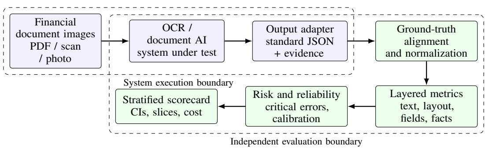

# Risk-Constrained Evaluation of Financial Document Recognition: A Formal Framework for Evidence, Critical Errors, and Selective Automation

Subodh Lonkar

Independent Researcher

Abstract—Financial document recognition is commonly evaluated using character and word error rates, which do not adequately represent the consequences of errors in financial workflows. This paper formalizes financial document recognition as a risk-constrained evidence-recovery problem. It defines typed, evidence-linked financial facts and a multi-layer quality model spanning text, layout, tables, fields, semantic relations, calibration, robustness, and operational performance. It introduces noncompensatory acceptance gates based on upper confidence bounds for critical-field errors, and formulates selective automation as a constrained risk–coverage problem with review-capacity limits. The paper also specifies annotation requirements, leakage-resistant benchmark splits, statistical estimands, and a reproducibility card. Formal propositions establish why aggregate scores cannot certify critical-field reliability and why zero observed errors do not imply zero risk. A synthetic example illustrates the decision rule. The work is theoretical; no empirical benchmark or modelperformance claim is presented.

Index Terms—Financial document processing, optical character recognition, document AI, information extraction, table structure recognition, risk-aware evaluation, calibration, selective prediction, financial data quality.

## I. INTRODUCTION

Financial institutions and enterprises process documents whose content is both visually heterogeneous and semantically consequential. A bank statement may contain transaction dates, descriptions, debit and credit columns, balances, account identifiers, and running-balance relationships. An invoice may contain supplier identity, tax identifiers, line items, tax rates, discounts, currency, payment terms, and a payable total. A financial report may combine narrative disclosures, multi-level tables, footnotes, units, comparative periods, and negative values represented with parentheses. OCR is frequently the first machine-readable transformation in these workflows.

The common practice of reporting a single character error rate (CER) or word error rate (WER) is insufficient for this domain. Edit-distance metrics treat all character substitutions similarly, whereas the operational impact of an error depends on its semantic role and downstream use. Confusing a letter in a narrative paragraph is not equivalent to changing ‘1,250.00 to ‘12,500.00’, dropping a minus sign, shifting a value from the debit column to the credit column, or associating a tax amount with the wrong invoice. Document understanding research has established the importance of layout, relations, and visual context in addition to text recognition [2], [5]–[7]. Recent financial-specific work has also highlighted fact-level evaluation for numerical, temporal, entity, and financial-concept fidelity [22].

This paper argues that financial OCR should be evaluated as an evidence-recovery system, not merely a text transcription engine. A system is useful only to the extent that it faithfully recovers information visible in the source, preserves the structure that gives the information meaning, expresses uncertainty when evidence is inadequate, and supports safe downstream processing. The proposed framework therefore evaluates a sequence of increasingly semantic capabilities while retaining component-level diagnostics.

## A. Research questions

The framework is designed to answer six questions:

1) How accurately does a system detect and transcribe all visible text, including financial symbols and low-frequency identifiers?

2) Does it preserve spatial and logical structure, particularly tables, merged headers, row associations, and reading order?

3) Does it recover typed financial fields with correct values, units, signs, dates, currencies, and entity associations?

4) Can it distinguish what is visually supported from what is inferred, normalised, or unavailable?

5) Are its confidence estimates meaningful enough to support abstention, escalation, and human review?

6) Does its quality remain acceptable across document categories, acquisition conditions, languages, institutions, and operational loads?

## B. Contributions and scope

The paper makes five methodological contributions. First, it specifies a typed, evidence-linked representation of financial facts that separates what is visible from what is normalized or inferred. Second, it defines a layered evaluation vector and a risk functional that preserve diagnostic information rather than collapsing all errors into a single lexical score. Third, it formalizes a non-compensatory acceptance rule based on prespecified critical-field constraints and uncertainty bounds. Fourth, it casts abstention and human review as a selectiveautomation problem with explicit risk, coverage, and reviewcapacity constraints. Fifth, it specifies a benchmark protocol designed to make these quantities estimable and reproducible. These are formalizations and design principles, not claims of a new OCR model or a validated empirical benchmark.

The framework applies to OCR-dependent pipelines and OCRfree document models; both must provide output that can be evaluated against the same visual evidence contract [7].

The paper does not prescribe one universal weighting scheme. Weights, criticality classes, tolerance thresholds, and acceptance limits are application risk decisions that must be fixed before test results are examined. The framework also does not claim that a benchmark score certifies regulatory compliance, fraud detection, or correctness on all future documents.

## II. FINANCIAL DOCUMENT LANDSCAPE AND EVALUATION UNITS

## A. Document taxonomy

Financial data is not one homogeneous OCR domain. The benchmark should explicitly represent document families and their distinguishing visual and semantic characteristics. Table I proposes a taxonomy. Categories may overlap: for example, an invoice can be scanned, multilingual, handwritten, and tableheavy.

## B. Evaluation units and hierarchy

A benchmark must retain the hierarchy of the source material. Let a corpus contain documents $d \in { \mathcal { D } } .$ , pages $p \in \mathcal { P } _ { d } ,$ regions $r \in \mathcal { R } _ { d p } .$ , and semantic fields or facts $f \in \mathcal { F } _ { d }$ . Each field is associated with a source region or set of regions, a field type, a canonical value where applicable, and a criticality class. The hierarchy matters statistically: pages from one document, statements from one account, or invoices from one supplier are not necessarily independent observations.

Definition 1 (Evidence-grounded annotation). An annotation for field f is evidence-grounded if it records (a) the exact visible source span or region, (b) the verbatim transcription when text is visible, (c) a typed canonical value when normalization is permitted, (d) the semantic role and unit, and (e) an explicit status for illegible, absent, ambiguous, or not-applicable content.

Verbatim transcription and canonical interpretation must be stored separately. For example, the visible string ‘1.250,00 EUR’ may be transcribed exactly and separately normalized to a decimal amount and ISO currency code under a declared locale convention. Normalization must not silently repair uncertain source text. The annotation should preserve provenance so that evaluators can distinguish recognition from interpretation.

## C. Existing benchmark resources and coverage gaps

No single public dataset spans the full financial OCR problem. Table II summarizes complementary resources and the role they can play in a benchmark portfolio. These datasets should not be treated as interchangeable or assumed to provide all required annotations. In particular, a text-only financial reasoning dataset is not an OCR test set, and a table-only dataset does not evaluate document-level field association or operational reliability.

A robust benchmark should combine these public resources where their licenses and annotation schemas permit, and supplement them with a governed, representative corpus of real financial documents. The real-world corpus should include multiple institutions, vendors, jurisdictions, languages, and acquisition channels. Public data should be used for reproducibility and component diagnostics; enterprise data is needed to estimate performance on the actual target population. Dataset licenses, privacy conditions, redistribution rights, and source-document permissions must be checked independently before release or commercial use.

## III. REFERENCE ARCHITECTURE AND OUTPUT CONTRACT

Figure 1 presents a reference evaluation architecture. It supports conventional OCR pipelines, layout-aware models, and OCR-free document models. Each system receives the same image and must produce a standardized output contract. An adapter converts native outputs into the contract without adding information that the system did not produce.

A minimum output contract should include document and page identifiers; detected text spans; verbatim text; polygon or bounding box; reading-order index; table and cell identifiers; extracted field name and typed value; currency, unit, sign, and date interpretation where relevant; confidence or uncertainty if available; source-region references; and explicit abstention or error states. Missing confidence must be reported as unavailable, not imputed. An OCR-free model may emit fields directly, but it must still provide visual evidence references for auditable evaluation.

## A. Separation of recognition and normalization

The evaluator should score at least three representations:

1) Visual transcript: characters and tokens as visibly printed, preserving punctuation, signs, separators, and symbols.

2) Canonical field: typed representation after deterministic, declared normalization, such as date parsing or currency normalization.

3) Business interpretation: a semantic relation, such as whether an amount is debit, credit, tax, gross pay, or closing balance.

A system should not receive credit for a correct canonical value if the visible transcription is wrong in a way that matters for auditability, nor should benign formatting differences be counted as semantic failures when the canonical value is equivalent. Both levels should be reported.

## IV. A MULTI-LAYER QUALITY MODEL

I define quality as a vector rather than a single primitive score:

$$
\begin{array} { r } { { \bf Q } ( s ) = ( Q _ { \mathrm { d e t } } , Q _ { \mathrm { t x t } } , Q _ { \mathrm { l a y } } , Q _ { \mathrm { t a b } } , Q _ { \mathrm { f l d } } , \quad } \\ { Q _ { \mathrm { f a c t } } , Q _ { \mathrm { e v d } } , Q _ { \mathrm { c a l } } , Q _ { \mathrm { r o b } } , Q _ { \mathrm { o p s } } ) . ^ , } \end{array}\tag{1}
$$

where s denotes a system. The components measure text-region detection, transcription, layout and reading order, table structure, typed field extraction, financial fact correctness, evidence grounding, uncertainty calibration, robustness, and operational performance. Reporting this vector prevents a strong result on one layer from concealing a weakness in another.

TABLE I  
FINANCIAL DOCUMENT CATEGORIES AND CATEGORY-SPECIFIC EVALUATION EMPHASIS
<table><tr><td>Category</td><td>Representative content</td><td>High-priority evaluation dimensions</td></tr><tr><td>Bank statements</td><td>Account identifiers, opening/closing balances, transaction dates, descriptions, debit/credit, running balances</td><td>Sign and decimal fidelity; row-to-column association; transaction completeness; balance continuity; date and amount normalization</td></tr><tr><td>Invoices and credit notes</td><td>Supplier/buyer, invoice number, line items, tax, discounts, totals, payment terms</td><td>Key-field exact match; line-item table structure; tax arithmetic; currency and unit fidelity; credit-note sign semantics</td></tr><tr><td>Receipts and expense claims</td><td>Merchant, date/time, items, subtotal, tax, tip, total, payment method</td><td>Low-resolution robustness; total extraction; item/quantity association; locale- specific separators; cropped or curved images</td></tr><tr><td>Purchase orders and re- mittance advices</td><td>PO references, quantities, unit prices, remit-</td><td>Cross-document identifier matching; row alignment; partial payment semantics; quantity and unit precision</td></tr><tr><td>Tax and payroll docu-</td><td>ted amounts, invoice references Taxpayer/employer IDs, periods, gross/net</td><td>Identifier exactness; period and jurisdiction; negative/withheld values; sensitive-</td></tr><tr><td>ments Loan, credit, and insur-</td><td>pay, deductions, rates, statutory fields Principal, interest rate, repayment schedule,</td><td>field completeness and access controls Decimal and percentage fidelity; schedule/table reconstruction; term association;</td></tr><tr><td>ance documents Trade finance</td><td>fees, collateral, coverage, dates Bills of lading, letters of credit, packing</td><td>unit and effective-date semantics Multi-document entity consistency; quantities and units; dates; reference numbers;</td></tr><tr><td>Financial statements and</td><td>lists, certificates, invoices Balance sheets, income/cash-flow state-</td><td>stamps and handwriting Multi-level headers; signs and scale (thousands/millions); period alignment;</td></tr><tr><td>regulatory disclosures Market and investment</td><td>ments, notes, comparative tables, footnotes Contract notes, statements, holdings, corpo-</td><td>footnote linkage; cross-page table continuation Instrument identifiers; quantity/price; currency; event dates; percentage and</td></tr></table>

TABLE II  
REPRESENTATIVE PUBLIC DATASETS AND THEIR APPROPRIATE ROLE IN A FINANCIAL OCR EVALUATION PORTFOLIO
<table><tr><td>Resource</td><td>Domain / modality</td><td>Useful annotations or tasks</td><td>Important limitation for the proposed evaluation</td></tr><tr><td>SROIE [3]</td><td>Scanned receipts</td><td>Text localization, OCR, key information ex- traction</td><td>Receipt-focused; does not represent the full range of statements, disclosures, or multi-page finance documents</td></tr><tr><td>CORD [4]</td><td>Indonesian receipts</td><td>Word boxes, text, hierarchical semantic receipt labels</td><td>Strong receipt parsing resource, but nar- row document and language coverage</td></tr><tr><td>FUNSD [2]</td><td>Noisy scanned forms</td><td>Text, entities, semantic relations, layout</td><td>General forms rather than a finance- specific corpus</td></tr><tr><td>DocVQA [5]</td><td>General document images</td><td>Document visual question answering with image-grounded questions</td><td>QA accuracy is not a direct substitute for exhaustive OCR transcription</td></tr><tr><td>FinTabNet / GTE [10]</td><td>Financial-report tables</td><td>Table detection and cell-structure annotations</td><td>Table-centric; does not alone test full- page reading order, field extraction, or operational routing</td></tr><tr><td>PubTables-1M [9]</td><td>Scientific-document tables</td><td>Table structure, cells, headers, canonicalized structure</td><td>Valuable for structural methods, but its domain differs from financial statements</td></tr><tr><td>FinQA [23]</td><td>Financial reports, text and tables</td><td>Numerical reasoning questions with supporting facts and programs</td><td>Primarily a reasoning dataset; source text availability does not make it an image OCR benchmark</td></tr><tr><td>FinCriticalED [22]</td><td>Financial document images</td><td>Expert-annotated financial facts and context- sensitive visual evaluation</td><td>Directly relevant; still one benchmark resource and not a complete substitute for workflow, calibration, robustness.</td></tr><tr><td>SynFinTabs [24]</td><td>Synthetic financial tables</td><td>Table images with structured ground truth and spatial annotations</td><td>and cost evaluation Useful for controlled stress testing; synthetic distributions may not match naturally occurring documents</td></tr></table>

  
Fig. 1. Reference architecture for reproducible financial OCR evaluation. The system adapter standardizes outputs; the evaluation boundary independently aligns them to annotated visual evidence and computes metrics.

## A. Text recognition: CER and WER

For a reference string y and hypothesis yˆ, let $S , D ,$ , and I denote the minimum number of substitutions, deletions, and insertions under Levenshtein alignment. Then

$$
\mathrm { C E R } = \frac { S _ { c } + D _ { c } + I _ { c } } { N _ { c } } , \qquad \mathrm { W E R } = \frac { S _ { w } + D _ { w } + I _ { w } } { N _ { w } } ,\tag{2}
$$

where $N _ { c }$ and $N _ { w }$ are the numbers of reference characters and words, respectively. Corpus-level micro-averaged CER is total edit operations divided by total reference characters; macro-averaged document CER is the arithmetic mean of per-document CERs. Both should be reported because microaveraging gives long documents greater influence. The tokenization policy, Unicode normalization, whitespace handling, and treatment of punctuation must be fixed in advance. CER and WER remain diagnostic metrics, not sufficient measures of financial correctness [1].

## B. Detection and localization

For ground-truth regions $G$ and predicted regions $P ,$ define intersection-over-union as

$$
\operatorname { I o U } ( P , G ) = { \frac { | P \cap G | } { | P \cup G | } } .\tag{3}
$$

Region detection can be evaluated using precision, recall, and F1 at prespecified IoU thresholds. A matched region should also be scored for transcription. Detection-only scores can otherwise reward boxes that cover text without correctly reading it. Report localization metrics separately for text lines, words, tables, and non-text financial marks such as stamps or handwritten annotations.

## C. Layout and reading order

Let $E ^ { * }$ be the set of precedence relations in the annotated reading-order graph and $\hat { E }$ the predicted relations. A pairwise reading-order F1 can be calculated from precision and recall over ordered region pairs. For multi-column statements and reports, this is more informative than comparing a single flattened transcript. Layout classes should include title, paragraph, table, header, footer, footnote, signature, stamp, and marginal note where applicable. Layout-aware document benchmarks motivate evaluating both spatial and semantic structure [2], [6].

## D. Table reconstruction

A table is represented as a grid graph with cells, row and column indices, spans, headers, and cell text. Let $C ^ { * }$ and $\hat { C }$ be the ground-truth and predicted cell sets after canonicalization and matching. Report cell detection precision/recall/F1, row/column boundary accuracy, span accuracy, header association accuracy, and cell-text accuracy. A tree-edit or structure-similarity measure may supplement these metrics, but must not replace exact cell-level evaluation for critical amounts. Table extraction datasets such as PubTables-1M illustrate the importance of canonicalized structural annotations and cell-level consistency [9]; financial table data such as FinTabNet is a useful complementary source [10].

## E. Typed field extraction

For each field type $k ,$ define exact canonical match:

$$
M _ { f } = \mathbb { I } \{ \mathrm { c a n o n } ( \hat { v } _ { f } ) = \mathrm { c a n o n } ( v _ { f } ^ { * } ) \} .\tag{4}
$$

The canonicalization function must be type-specific and versioned. For amounts, equality should be evaluated using decimal arithmetic at a declared scale, not binary floating-point tolerance chosen after observing errors. For identifiers, exact string match is generally appropriate after only explicitly permitted normalization. For dates, equivalence may be evaluated across declared formats only if day/month ambiguity is resolved by metadata or source convention. Report field precision, recall, F1, exact-match accuracy, and missing/extra-field rates. Macroaverage across field types and micro-average across instances.

## F. Financial fact correctness

A financial fact is a typed tuple, for example

$$
f = ( { \mathrm { e n t i t y , a t t r i b u t e , v a l u e , u n i t , p e r i o d , p o l a r i t y , e v i d e n c e } } ) .\tag{5}
$$

Fact correctness requires agreement on all applicable components. A value match without the correct unit, period, entity, or polarity is not a correct fact. This representation captures common high-impact failures: amount-scale mismatch, date-period shift, debit/credit inversion, incorrect reporting entity, and detached footnote. Financial fact-level evaluation is consistent with the direction of recent financial OCR benchmarking [22].

## V. RISK-AWARE ERROR MEASUREMENT

## A. Criticality classes

Each field type is assigned a criticality class before evaluation. One possible taxonomy is: C0, cosmetic/non-semantic; C1, lowimpact descriptive; C2, operationally relevant; C3, financially material or identity-critical; and C4, safety-, compliance-, or legally critical. The class depends on the intended workflow, not solely on the field name. For example, a date may be C2 in a search index but C4 when it determines a filing deadline. A customer identifier may be C4 in payment routing.

Let $w _ { f } > 0$ be a prespecified severity weight for field $f ,$ and let $e _ { f } \in [ 0 , 1 ]$ be a normalized error indicator or loss. A weighted loss is

$$
L _ { \mathrm { c r i t } } = \frac { \sum _ { f \in \mathcal { F } } w _ { f } e _ { f } } { \sum _ { f \in \mathcal { F } } w _ { f } } .\tag{6}
$$

This quantity is useful for ranking and monitoring, but it is compensatory: many correct low-risk fields can dilute a single critical error. Therefore, it must be accompanied by separate critical-error rates and hard acceptance gates.

## B. Critical error rate and severity-weighted risk

Let $H _ { f } = 1$ indicate an error in a field designated critical under the workflow policy. The financial-critical error rate (FCR) is

$$
F C R _ { \mathrm { c r i t } } = \frac { \sum _ { f } H _ { f } \mathbb { I } \{ \hat { f } \neq f ^ { * } \} } { \sum _ { f } H _ { f } } ,\tag{7}
$$

where a missing, extra, wrongly associated, or unsupported critical field is counted as an error; report the denominator, eligible-field coverage, and ambiguity exclusions explicitly. For document $d ,$ let $\ell _ { d }$ be the application-defined loss associated with its OCR output. The expected operational loss is

$$
\operatorname { R i s k } ( s ) = \mathbb { E } _ { d \sim { \mathcal { D } } } [ \ell _ { d } ( s ) ] .\tag{8}
$$

The loss function should be defined with business, control, and risk owners. It may incorporate severity, probability of downstream use, reversibility, and detectability. Monetary loss estimates should only be used where empirically supportable; otherwise report ordinal severity classes and event rates.

## C. Non-compensatory acceptance gates

A system should not pass solely because its weighted average is high. Define gates for critical identifiers, monetary amounts, sign/polarity, currency/unit, reporting period, table association, and evidence grounding. A benchmark-level acceptance rule can be written:

$$
\operatorname { P a s s } ( s ) = \mathbb { I } \{ Q _ { \mathrm { a g g r e g a t e } } \ge \tau \} \prod _ { g \in \mathcal { G } } \mathbb { I } \{ U _ { g } ( s ) \le \eta _ { g } \} ,\tag{9}
$$

where $U _ { g }$ is the measured error rate for gate $g , \eta _ { g }$ is its prespecified maximum, and τ is a minimum aggregate threshold. In practice, the gate should use an upper confidence bound for error rates rather than only the point estimate. If a gate has zero observed errors, the upper confidence bound is not zero; sample size must be sufficient to support the desired assurance.

## D. Financial consistency checks

Consistency checks are document-type-specific validators, not substitutes for visual evidence. Examples include:

$$
\mathrm { I n v o i c e : } ~ | T - ( S + \mathrm { T a x } + \mathrm { F e e s } - \mathrm { D i s c o u n t } ) | \leq \epsilon _ { T } ,\tag{10}
$$

$$
\mathrm { S t a t e m e n t : ~ } B _ { t } = B _ { t - 1 } + C _ { t } - D _ { t } + J _ { t } ,\tag{11}
$$

$$
\mathrm { P a y r o l l : } \ N = G - \sum _ { i } W _ { i } + A ,\tag{12}
$$

$$
\mathrm { L o a n \ s c h e d u l e } ; B _ { t + 1 } = B _ { t } + I _ { t } - P _ { t } .\tag{13}
$$

Here $T$ is invoice total, S subtotal, $B _ { t }$ running balance, $C _ { t }$ credits, $D _ { t }$ debits, $J _ { t }$ adjustments, N net pay, $G$ gross pay, $W _ { i }$ employee-side withholdings/deductions, and A employee-side additions or adjustments, $I _ { t }$ accrued interest, and $P _ { t }$ payment applied to principal and interest according to the schedule convention. These equations are illustrative; real documents may include rounding, tax-specific rules, fees, reversals, value dates, or nonstandard accounting conventions. A validator must encode the applicable convention and tolerance. A failed arithmetic check indicates inconsistency, not necessarily OCR error: the source document itself may be inconsistent. The evaluator should distinguish source inconsistency from systeminduced inconsistency.

## VI. EVIDENCE GROUNDING, HALLUCINATION, AND UNCERTAINTY

## A. Evidence grounding

For every extracted field, the system should identify the image region supporting the value. Define evidence coverage as the proportion of required extracted fields with a valid sourceregion link. Define evidence precision as the proportion of supplied links that overlap the correct annotated evidence region above a declared threshold. A field with no visible support should be marked absent, illegible, or inferred according to the output contract. A plausible value inferred from context is not a successful OCR transcription.

## B. Confidence calibration

If a system provides confidence $p _ { i }$ for correctness indicator $y _ { i } \in \{ 0 , 1 \}$ , the Brier score is

$$
\mathrm { B S } = \frac { 1 } { N } \sum _ { i = 1 } ^ { N } ( p _ { i } - y _ { i } ) ^ { 2 } .\tag{14}
$$

Expected calibration error (ECE) can be estimated by partitioning predictions into bins $B _ { m }$ :

$$
\mathrm { E C E } = \sum _ { m = 1 } ^ { M } \frac { | B _ { m } | } { N } \left| \operatorname { a c c } ( B _ { m } ) - \operatorname { c o n f } ( B _ { m } ) \right| .\tag{15}
$$

ECE depends on binning and can conceal subgroup miscalibration; report reliability diagrams, Brier score, and calibration by criticality class and document category. Confidence must be evaluated at the unit where it is used operationally (token, field, table, or document). A high token confidence does not imply a high probability that a debit/credit relation is correct.

## C. Selective prediction and review routing

An operational OCR system may abstain or route uncertain cases to human review. Let $c ( x ) \in [ 0 , 1 ]$ be a confidence score and accept predictions when $c ( x ) \geq t$ . Define coverage and selective risk:

$$
\operatorname { C o v } ( t ) = \mathbb { P } ( c ( X ) \geq t ) ,\tag{16}
$$

$$
\mathrm { R i s k } ( t ) = \mathbb { E } [ \ell ( X , \hat { Y } ) \mid c ( X ) \geq t ] .\tag{17}
$$

Plot risk against coverage and report the area under the risk– coverage curve with a clearly specified numerical integration rule. Also report the fraction routed to review, residual criticalerror rate among auto-accepted items, review workload, and end-to-end latency. The operating threshold should be selected on a calibration set and evaluated once on a held-out test set. Selective accuracy is not meaningful unless coverage is reported alongside it.

## VII. FORMAL PROBLEM DEFINITION AND THEORETICALPROPERTIES

## A. Document population, outputs, and target estimands

Let X denote a document sampled from a target population ${ \mathcal P } ,$ and let $s \in \mathcal { S }$ be a recognition system. The system produces an output $Z _ { s } ( X )$ , which may contain text regions, table structures, typed fields, confidence values, and evidence links. Let $Y ( X )$ denote the adjudicated reference annotation. I distinguish the observable image $X ,$ , the reference facts $F ^ { * } ( X )$ , and the system’s predicted facts $\widehat { F } _ { s } ( X )$ . The distinction is important: the image is the evidence; the annotation is a measurement of that evidence; and the predicted fact is the system’s claim.

For each field instance i, define a reference tuple

$$
f _ { i } ^ { * } = ( e _ { i } , a _ { i } , v _ { i } , u _ { i } , t _ { i } , p _ { i } , r _ { i } ) ,\tag{18}
$$

where $e _ { i }$ is the entity, $a _ { i }$ the attribute, $v _ { i }$ the verbatim visible value, $u _ { i }$ the unit or currency, $t _ { i }$ the applicable time or reporting period, $p _ { i }$ the polarity or semantic role, and $r _ { i }$ the supporting image region. A predicted tuple is correct only when all components required by the field schema agree under a declared equivalence relation $\equiv _ { k }$ . The relation may permit harmless formatting equivalence (for example, a declared date-format conversion) but must not silently equate semantically distinct values (for example, debit and credit, parentheses and positive values, or dollars and thousands of dollars).

Define the field loss $\ell _ { i } ( s ; X ) \in [ 0 , 1 ]$ using a field-typespecific loss function fixed before evaluation. For a critical field, a binary loss is usually appropriate: $\ell _ { i } = 1$ if the required fact is absent, incorrect, attached to the wrong entity/row, or unsupported by its cited evidence; otherwise 0. For non-critical descriptive fields, graded losses may be used. The primary population estimand is

$$
R _ { \mathcal { P } } ( s ) = \mathbb { E } _ { X \sim \mathcal { P } } \left[ \frac { \sum _ { i \in I ( X ) } w _ { i } \ell _ { i } ( s ; X ) } { \sum _ { i \in I ( X ) } w _ { i } } \right] ,\tag{19}
$$

where $I ( X )$ is the set of in-scope field instances and $w _ { i }$ are prespecified policy weights. This is a document-first estimand: each document contributes one normalized loss, preventing documents with many fields from automatically dominating. A field-first estimand can also be reported, but it answers a different question and must be labelled accordingly.

For a criticality class $c ,$ define the conditional critical error probability

$$
p _ { c } ( s ) = \mathbb { P } _ { X \sim \mathcal { P } , \ i \sim I _ { c } ( X ) } \{ \ell _ { i } ( s ; X ) = 1 \} ,\tag{20}
$$

where the sampling of a field instance is specified explicitly (uniform over documents then fields, or uniform over all eligible fields). The sampling convention is part of the estimand, not an implementation detail.

## B. Why a single average cannot certify financial reliability

Proposition 1 (Compensatory masking). For any weighted arithmetic score $\textstyle S = \sum _ { k = 1 } ^ { K } { \dot { w } } _ { k } q _ { k }$ with $\begin{array} { r } { w _ { k } > 0 , \sum _ { k } w _ { k } = 1 } \end{array}$ and $q _ { k } \in [ 0 , 1 ]$ , there exist two systems A and B such that $S ( A ) > S ( B )$ while a designated critical dimension satisfies $q _ { j } ( A ) < q _ { j } ( B )$

Proof. Choose any j with $w _ { j } ~ < ~ 1$ . Set all non-critical dimensions of A to 1 and its critical dimension to 0. Set all dimensions of B to a common value b with $0 < b < 1$ Then $S ( A ) = 1 - w _ { j }$ and $S ( B ) = b .$ . Choosing $b < 1 - w _ { j }$ gives $S ( A ) > S ( B )$ although $q _ { j } ( A ) = 0 < b = q _ { j } ( B )$ . Thus the aggregate ordering does not preserve the ordering on a critical dimension. □

This proposition does not imply that composite scores are useless. It establishes that a composite score cannot, by itself, certify a safety-relevant constraint. A score may rank systems after feasibility has been established; it should not determine feasibility.

## C. Risk-constrained acceptance

Let $\mathcal { G }$ be a set of critical gates, such as amount exactness, identifier exactness, polarity, currency/unit, period association, table-cell association, and evidence validity. For each gate $^ { g , }$ let $p _ { g } ( s )$ be its target-population error probability and let $\eta _ { g }$ be the maximum tolerable rate chosen by the workflow owner. Let $U _ { g } ( s ; \alpha _ { g } )$ be a one-sided upper confidence bound with nominal non-coverage probability $\alpha _ { g }$ . The system is eligible for automatic processing only if

$$
{ \mathrm { E l i g i b l e } } ( s ) = \mathbb { I } \{ S ( s ) \geq \tau \} \prod _ { g \in { \mathcal { G } } } \mathbb { I } \{ U _ { g } ( s ; \alpha _ { g } ) \leq \eta _ { g } \} .\tag{21}
$$

If simultaneous coverage across gates is required, the confidence procedure must control the family-wise non-coverage probability, for example through a prespecified Bonferroni allocation $\textstyle \sum _ { g } \alpha _ { g } \leq \alpha$ or a justified joint procedure. Reporting separate nominal 95% bounds for many gates does not yield a joint 95% guarantee.

Proposition 2 (Zero observed errors do not imply a zero risk bound). Under independent Bernoulli sampling of n eligible critical field instances, if zero errors are observed, the exact one-sided (1 − α) Clopper–Pearson upper confidence limit is

$$
U = 1 - \alpha ^ { 1 / n } .\tag{22}
$$

Consequently, demonstrating $p \leq \eta$ with zero observed errors requires

$$
n \geq { \frac { \log \alpha } { \log ( 1 - \eta ) } } .\tag{23}
$$

Proof. For a binomial random variable with success interpreted as an error, the probability of observing zero errors at error probability p is $( 1 - p ) ^ { n }$ . The one-sided exact upper limit solves $( 1 - U ) ^ { n } = \alpha$ , yielding the first expression. Rearranging $1 - \alpha ^ { 1 / n } \leq \eta$ gives the second. □

For illustration only, if a policy requires a one-sided 95% upper bound below $1 0 ^ { - 3 }$ and the independent-trial assumptions hold, the zero-error sample requirement is approximately 2,995 critical instances. This is not a recommended universal sample size. Clustering, unequal inclusion probabilities, annotation uncertainty, and multiple gates increase the design requirements. In particular, treating pages from one statement or invoices from one supplier template as independent trials can materially understate uncertainty.

## D. Selective automation as a constrained decision problem

Let $c _ { s } ( X )$ be a confidence score calibrated for the event that the complete critical fact set for document X is correct. For threshold t, the auto-accept set is $A _ { t } = \{ X : c _ { s } ( X ) \geq t \}$ Define coverage $\gamma ( t ) = \mathbb { P } ( X \in A _ { t } )$ and selective risk $R _ { A } ( t ) =$ $\mathbb { E } [ \ell ( X , s ) \mid X \in { \dot { A } } _ { t } ]$ . Let $C _ { R } ( t )$ be expected human-review cost per incoming document, and let B be the available review budget. A deployment policy can be posed as

$$
\operatorname* { m i n } _ { t \in \mathcal T } \quad R _ { A } ( t ) + \lambda C _ { R } ( t )\tag{24}
$$

$$
\begin{array} { r } { \mathrm { s u b j e c t ~ t o ~ } \quad U _ { g } ( s , t ; \alpha _ { g } ) \le \eta _ { g } , \quad g \in \mathcal { G } , } \end{array}\tag{25}
$$

$$
C _ { R } ( t ) \leq B ,\tag{26}
$$

where λ converts review effort to the chosen operational objective. The feasible threshold set must be determined on a calibration/validation partition, then evaluated on an untouched test partition. If no threshold satisfies all constraints, the correct outcome is that the system is not qualified for autonomous processing under the stated policy; the threshold must not be relaxed after observing test errors.

Proposition 3 (Monotonicity of coverage). For any fixed confidence function $c _ { s } ,$ coverage $\gamma ( t ) \ = \ \mathbb { P } ( c _ { s } ( X ) \ \geq \ t )$ is non-increasing in t.

Proof. For $t _ { 2 } ~ \geq ~ t _ { 1 }$ , the set $\{ X \ : \ c _ { s } ( X ) \ \geq \ t _ { 2 } \}$ is a subset of $\{ X : c _ { s } ( X ) \geq t _ { 1 } \}$ . Taking probabilities yields $\gamma ( t _ { 2 } ) ~ \leq$ $\gamma ( t _ { 1 } )$ □

Selective risk need not be monotone in the threshold without assumptions on the relationship between confidence and loss. Therefore, a risk–coverage curve is an empirical property to estimate, not a theorem implied by thresholding. Calibration must also be assessed at the decision unit: a well-calibrated token score is not automatically a calibrated document-level probability.

## E. Annotation uncertainty and reference disagreement

The reference annotation is itself a measurement. Let $Y ^ { ( 1 ) }$ and $Y ^ { ( 2 ) }$ be independent annotations of the same critical field. Disagreement should be classified as (i) annotator error, (ii) genuinely ambiguous visual evidence, (iii) schema ambiguity, or (iv) source-document inconsistency. An adjudication protocol should retain the original annotations and the adjudicated state. For irreducibly ambiguous fields, the target label should be a set or an explicit state such as illegible/ambiguous, not a fabricated single value. Evaluation should report the proportion of ambiguous fields and the rate at which systems appropriately abstain on them.

## VIII. BENCHMARK SPECIFICATION FOR REPRODUCIBLE EVALUATION

## A. Annotation schema

Each document record should contain a stable document identifier, page identifiers, source family, language/script, acquisition metadata, template family, and privacy-preserving provenance. Each region record should contain polygon coordinates, region type, reading-order relation, and annotation status. Each field record should contain field name, document-level entity, verbatim transcription, canonical typed value, unit/currency, sign/polarity, period, table coordinates where relevant, criticality class, evidence-region identifiers, normalization rule identifier, and adjudication status. Missing, illegible, not-applicable, and not-present are distinct states and must not be collapsed into an empty string.

## B. Split construction and leakage controls

The split unit should be the highest practical unit that prevents correlated examples crossing partitions. Depending on the data, this may be customer, account, supplier, issuer, statement, invoice series, template family, or time period. A benchmark should publish at least three evaluation partitions: (i) in-distribution held-out examples from known template families; (ii) template- or institution-held-out examples; and (iii) temporal or acquisition-condition holdouts. The same source document, near-duplicate scan, or template-specific synthetic derivative must not cross partitions. When privacy or licensing prevents release of images, publish hashes, schema, split manifests where permitted, and an executable evaluator with a documented access procedure.

## C. Minimum benchmark reporting card

Table III specifies the minimum information needed to interpret a reported result.

## D. Worked decision example (synthetic, not empirical)

Consider two hypothetical systems evaluated on the same held-out sample. System A has a higher overall normalized score than system B, but its upper confidence bound for polarity errors exceeds the workflow limit. System B has a lower aggregate score, but all critical gates pass. Under Eq. 21, A is ineligible for automatic processing and B may proceed to the next operational qualification stage. This example demonstrates the logic of the framework only; it does not represent measured performance, an observed dataset, or a recommendation about any commercial system. The evaluator should report, for each system, the point estimate, numerator and denominator, confidence bound, subgroup, and gate decision. A system that fails a gate may still be useful in a human-reviewed workflow, but its auto-accept threshold must be re-evaluated under Eq. 26.

## IX. ROBUSTNESS AND GENERALIZATION PROTOCOL

Financial OCR quality must be sliced across acquisition and document conditions. The benchmark should include controlled or naturally occurring variations in resolution, blur, skew, perspective, compression, background noise, faint printing, photocopy generations, stamps, handwriting, overlapping marks, multi-column layout, dense tables, small fonts, mixed scripts, and locale-specific numeric formats. Synthetic perturbations are useful for controlled stress tests but cannot replace naturally degraded samples.

TABLE III  
MINIMUM REPRODUCIBILITY CARD FOR A FINANCIAL DOCUMENT RECOGNITION BENCHMARK
<table><tr><td>Item</td><td>Required disclosure</td></tr><tr><td>Population</td><td>Target workflow, document families, jurisdictions/languages, sampling frame, collection period, inclusion/exclusion criteria</td></tr><tr><td>Sampling</td><td>Sampling unit, strata, inclusion probabilities, oversampling policy, target deployment weights</td></tr><tr><td>Ground truth</td><td>Annotation manual/version, annotator training, independent double-annotation fraction, adjudication, ambiguity policy, agreement by field type</td></tr><tr><td>Schema</td><td>Field ontology, typed-value representation, units/currencies, polarity, periods, table relations, missingness states, evidence-</td></tr><tr><td>Partitions</td><td>link rules Document/customer/template/time grouping, duplicate detection, holdout rationale, contamination checks</td></tr><tr><td>Systems Metrics</td><td>Model and software versions, prompts/configuration, preprocessing, normalization, decoding settings, failure handling</td></tr><tr><td></td><td>Metric implementation/version, matching thresholds, micro/macro estimands, criticality weights, gates, confidence procedures</td></tr><tr><td>Operations</td><td>Hardware, concurrency, latency percentiles, throughput, memory, cost boundary, human-review assumptions</td></tr><tr><td>Governance</td><td>Data license/permissions, privacy controls, retention, access controls, benchmark versioning, incident process</td></tr></table>

## A. Distributional slices

At minimum, report performance by document category, institution/template, language/script, scan source, page quality, table density, handwriting presence, amount magnitude, negativevalue representation, and field criticality. Avoid allowing a large easy category to dominate the aggregate. Let strata be indexed by h with target population proportions $\pi _ { h } .$ . The target-weighted estimate of a metric is

$$
\hat { \theta } _ { \mathrm { s t r a t } } = \sum _ { h = 1 } ^ { H } \pi _ { h } \hat { \theta } _ { h } , \sum _ { h } \pi _ { h } = 1 .\tag{27}
$$

If deployment proportions are unknown or unstable, report macro-average across strata and each stratum separately rather than inventing a population mix.

## B. Out-of-distribution and template generalization

Split design should prevent leakage across near-duplicate pages, account holders, vendors, statement periods, and template families where feasible. A random page split can overestimate generalization if pages from the same statement or template occur in both train and test sets. Include temporal holdout and institution/template holdout evaluations. Report performance on known templates and unseen templates separately. If the system is adapted using a test institution’s samples, those samples no longer constitute an untouched generalization test.

## X. STATISTICAL EVALUATION DESIGN

## A. Sampling and annotation

The benchmark should be sampled from the intended deployment population using a documented frame. Use stratified sampling to ensure representation of rare but consequential categories. Oversampling rare critical fields is appropriate for diagnostic power, but estimates of population-level performance must be reweighted using known inclusion probabilities. Anno tation should be performed by trained annotators using a written schema, with independent double annotation for critical fields and adjudication of disagreements. Report agreement separately for transcription, region localization, canonicalization, and semantic role. The ground-truth process itself is a measurement system and should be audited.

## B. Paired system comparison

When two systems process the same documents, compare document-level paired outcomes. For a scalar document loss $L _ { d } ( s )$ , define $\Delta _ { d } = L _ { d } ( s _ { A } ) - L _ { d } ( s _ { B } )$ . Estimate the mean paired difference $\bar { \Delta }$ and construct a confidence interval using a document-cluster bootstrap or another method compatible with the sampling design. If multiple pages belong to a document, resample documents, not pages independently. For highly clustered sources, resample at the highest independent sampling unit, such as customer, supplier, or template family. Report effect sizes and confidence intervals, not only p-values.

## C. Rare critical errors

For a critical error probability $p ,$ an observed zero count in n independent trials does not establish $p = 0 .$ . An approximate one-sided 95% upper bound is $3 / n$ (the rule of three) under a binomial model. For exact reporting, use a binomial confidence interval such as Clopper–Pearson, and account for clustering or unequal sampling where necessary. To demonstrate a target upper bound $p _ { 0 } ,$ sample size must be planned before testing; the required size can be large for very small $p _ { 0 }$ . No universal sample size is appropriate without a target error rate, confidence level, design effect, and expected prevalence.

## D. Multiplicity and model selection

If many systems, categories, and metrics are compared, distinguish confirmatory endpoints from exploratory analyses. Pre-register primary metrics and acceptance gates. For multiple confirmatory comparisons, use a prespecified family-wise error procedure such as Holm’s step-down method, or control false discovery rate for explicitly exploratory analyses. Do not select the best system on the same test set and then report its unadjusted confidence interval as if the choice had been prespecified. Maintain a final sealed test set for model selectionindependent confirmation.

## E. Benchmark protocol

A reproducible evaluation run should record: dataset version and licensing; sampling frame and inclusion probabilities; document hashes; annotation schema version; system/model version; inference parameters; preprocessing; hardware; batch size; concurrency; output schema; normalization rules; metric implementation version; random seeds; and all exclusions. Failed, timed-out, or malformed outputs must be counted and categorized rather than silently dropped. Report both quality conditional on successful output and end-to-end success rate.

## XI. OPERATIONAL EVALUATION: COST, LATENCY, ANDTHROUGHPUT

Accuracy alone does not determine enterprise suitability. Measure page-level and document-level latency at p50, p90, p95, and p99; throughput under stated concurrency; CPU/GPU and memory consumption; failure rate; retry rate; and cost per 1,000 pages. Separate preprocessing, OCR inference, postprocessing, validation, and human-review time. For systems with asynchronous queues, report queueing delay and service time separately. Cost comparisons must use equivalent hardware, batch settings, image resolution, and output requirements, or clearly disclose differences.

Define end-to-end cost per successfully processed document as

$$
C _ { \mathrm { s u c c e s s } } = \frac { C _ { \mathrm { i n f e r e n c e } } + C _ { \mathrm { s t o r a g e } } + C _ { \mathrm { r e v i e w } } + C _ { \mathrm { r e t r y } } } { N _ { \mathrm { s u c c e s s f u l } } } .\tag{28}
$$

This metric should be reported with its accounting boundary. A cheaper OCR engine may be more expensive overall if it creates more manual review or downstream correction. Operational reporting should therefore include the auto-accept rate, review rate, correction rate, and cost of residual errors where estimable.

## XII. COMPOSITE SCORECARD AND DECISION FRAMEWORK

A composite score can support concise comparison, but should remain subordinate to the quality vector and hard gates. Let $q _ { k } \in [ 0 , 1 ]$ be normalized dimension scores and $w _ { k } \geq 0$ with $\textstyle \sum _ { k } w _ { k } = 1$ . A weighted score is

$$
S _ { \mathrm { w e i g h t e d } } = \sum _ { k = 1 } ^ { K } w _ { k } q _ { k } .\tag{29}
$$

This is transparent but compensatory. A geometric alternative,

$$
S _ { \mathrm { g e o } } = \prod _ { k = 1 } ^ { K } \left( \frac { q _ { k } + \varepsilon } { 1 + \varepsilon } \right) ^ { w _ { k } } ,\tag{30}
$$

penalizes very low dimensions more strongly, but depends on the offset ε and still does not encode absolute safety requirements. I recommend reporting both only as secondary summaries, alongside all component scores and non-compensatory gates. Weights must be elicited from the intended use case, pub lished before evaluation, and sensitivity-tested over plausible alternatives.

## A. Recommended decision tiers

The framework supports four deployment decision tiers:

1) Research/benchmark only: quality is measured, but one or more critical gates are not met or confidence intervals are too wide.

2) Human-assisted: outputs are presented with evidence and uncertainty; a human verifies designated critical fields before downstream use.

3) Restricted automation: only prespecified low-risk document categories or fields are auto-accepted; uncertain and critical cases are escalated.

4) Production automation within scope: all category-specific gates, statistical assurance requirements, monitoring controls, and operational criteria are satisfied for a defined use case.

These tiers are evaluation outcomes, not certifications. Production scope must name the document population, fields, downstream actions, and operating conditions covered.

## XIII. IMPLEMENTATION BLUEPRINT FOR ENTERPRISE SYSTEMS

A practical programme can be implemented in six workstreams.

1) Document inventory and risk mapping. Catalogue document families, source channels, languages, critical fields, downstream consumers, and error consequences. Map each field to a criticality class and validation rule.

2) Ground-truth engineering. Build a versioned annotation schema with polygons, verbatim text, typed values, semantic relations, evidence links, and ambiguity states. Doubleannotate critical fields and adjudicate.

3) System adapter and reproducible harness. Normalize outputs from commercial OCR, open-source engines, layoutaware systems, and OCR-free models into one contract. Freeze versions and inference settings.

4) Metric and validator service. Compute lexical, spatial, structural, field, fact, risk, calibration, and operational metrics. Keep source inconsistency separate from extraction error.

5) Statistical reporting. Produce stratified estimates, confidence intervals, paired comparisons, rare-event bounds, and subgroup reports. Seal the final test set.

6) Production monitoring. Monitor document mix, image quality, template drift, field-level confidence, abstention, correction rates, and critical incidents. Trigger re-evaluation when the input distribution or system version changes.

## A. Monitoring and requalification

A model update, OCR engine version change, preprocessing change, new document template, or material shift in language or scan quality should trigger a defined requalification policy. Monitoring should distinguish input drift from performance drift. Unlabelled drift indicators can trigger sampling and review but cannot establish accuracy. Periodic labelled audits are needed to estimate current error rates. Critical errors should have incident handling, root-cause classification, and correctiveaction tracking.

## XIV. THREATS TO VALIDITY AND LIMITATIONS

First, ground truth is not infallible. Ambiguous handwriting, poor scans, source inconsistencies, and differing accounting conventions can create annotation disagreement. The framework therefore requires explicit ambiguity states and adjudication rather than forcing a single answer. Second, risk weights are context-dependent. A universal weighting scheme would create false precision; institutions must map errors to their own workflows and controls. Third, consistency rules may be invalid when the document uses special accounting treatments, round ing, reversals, or jurisdiction-specific conventions. Validators must be scoped and versioned.

TABLE IV  
PROPOSED ENTERPRISE SCORECARD: DIMENSIONS, PRIMARY METRICS, AND MANDATORY DIAGNOSTICS
<table><tr><td>Dimension</td><td>Primary metrics</td><td></td><td>Required diagnostics</td><td></td><td></td></tr><tr><td rowspan="4">Text fidelity Detection/localization Layout/order Tables Fields/facts</td><td rowspan="4">Precision, recall, F1 at IoU thresholds Pairwise reading-order F1; layout-class F1 Cell F1; row/column/span accuracy; header</td><td rowspan="4">association Typed exact match; precision/recall/F1</td><td rowspan="4">Text-line/word/table region slices; missed-region rate Multi-column and cross-page continuation; header/footer confusion Cell text exactness; numeric column assignment; merged cells</td><td rowspan="4"></td><td rowspan="4"></td></tr><tr><td rowspan="3"></td></tr><tr><td>Amount, date, currency, sign, entity, period, identifier slices Error counts by C0–C4; upper confidence bounds; gate violations</td></tr><tr><td rowspan="3">Critical error rate; severity-weighted loss Evidence coverage and precision Brier score; ECE; risk-coverage Degradation under stress; unseen-template</td><td rowspan="2">Unsupported extraction and ungrounded inference rates Calibration by category and criticality; review rate</td></tr><tr><td rowspan="2">performance p50/p95/p99 latency; throughput; cost/1,000 pages</td><td rowspan="2"></td><td rowspan="2">Quality strata; language and scan condition slices</td></tr><tr><td colspan="2">Success/failure rate; retry; human review; resource profile</td></tr></table>

Fig. 2. Illustrative enterprise processing and control flow. Feedback from monitoring may trigger re-evaluation or controlled system updates; it must not silently rewrite the sealed benchmark labels.

Fourth, benchmark data may not represent future deployment distributions. Template holdouts and temporal tests reduce, but do not eliminate, this risk. Fifth, aggregate scores can conceal subgroup failures; all critical slices should be reported. Sixth, confidence calibration can deteriorate after model or distribution changes. Seventh, an OCR benchmark cannot by itself establish that a downstream financial action is legally or operationally appropriate. Human authorization, access control, audit trails, and transaction controls remain outside the OCR metric layer.

Finally, the framework is proposed theoretically and methodologically. It has not been empirically validated in this paper; the worked decision example is synthetic and is included only to clarify the acceptance logic. A future study should instantiate the benchmark across multiple financial document families, evaluate representative OCR and document AI systems, measure annotation cost and inter-annotator agreement, and test whether risk-aware metrics better predict downstream correction and incident rates than CER/WER alone.

## XV. RESEARCH AGENDA

Several empirical questions follow directly. (i) Does criticality-weighted evaluation correlate more strongly with downstream correction cost than lexical error? (ii) Which evidence-grounding protocol is reliable across OCR-dependent and OCR-free models? (iii) How well do token- and field-level confidence estimates predict critical financial errors? (iv) What sample sizes are needed to bound rare critical errors under realistic clustering? (v) How should multi-document consistency be evaluated for invoices, purchase orders, remittance advice, and bank statements? (vi) Can a common benchmark schema support multilingual and jurisdiction-specific financial formats without erasing local conventions? These questions define a testable programme rather than an unsupported claim of a solved problem.

## XVI. CONCLUSION

Financial OCR must be evaluated according to the information and relationships it preserves, not only the characters it reproduces. This paper proposed a layered evaluation framework spanning visual recognition, transcription, layout, tables, typed fields, financial facts, evidence grounding, uncertainty, robustness, and operational performance. It formalized criticality-weighted loss while emphasizing non-compensatory gates for high-impact fields; defined risk–coverage analysis for selective automation; and specified a statistically defensible benchmark protocol that accounts for stratification, paired comparisons, clustering, rare events, and multiplicity. The framework is intended to be implementable in enterprise document-processing systems and adaptable across financial document categories. Its central principle is that high average OCR accuracy is not sufficient evidence of financial reliability:

critical values must be correct, structurally associated, visually grounded, and appropriately routed when uncertain.

## REFERENCES

[1] C. Neudecker, K. Baierer, C. Clausner, A. Antonacopoulos, and S. Pletschacher, “A survey of OCR evaluation tools and metrics,” in Proc. 6th Int. Workshop on Historical Document Imaging and Processing (HIP), 2021, pp. 13–18, doi: 10.1145/3476887.3476888.

[2] G. Jaume, H. K. Ekenel, and J.-P. Thiran, “FUNSD: A dataset for form understanding in noisy scanned documents,” in Proc. ICDAR Workshops, 2019, doi: 10.1109/ICDARW.2019.10029.

[3] Z. Huang, K. Chen, J. He, X. Bai, S. Lu, C. V. Jawahar, and D. Karatzas, “ICDAR2019 competition on scanned receipt OCR and information extraction,” arXiv:2103.10213, 2021.

[4] S. Park et al., “CORD: A consolidated receipt dataset for post-OCR parsing,” in Proc. NeurIPS Workshop on Document Intelligence, 2019.

[5] M. Mathew, D. Karatzas, and C. V. Jawahar, “DocVQA: A dataset for VQA on document images,” in Proc. IEEE/CVF WACV, 2021, pp. 2200–2209.

[6] Y. Huang, T. Lv, L. Cui, Y. Lu, and F. Wei, “LayoutLMv3: Pre-training for document AI with unified text and image masking,” in Proc. ACM Int. Conf. Multimedia, 2022, pp. 4083–4091, doi: 10.1145/3503161.3548112.

[7] G. Kim et al., “OCR-free document understanding transformer,” in Proc. European Conf. Computer Vision (ECCV), 2022, pp. 498–517, doi: 10.1007/978-3-031-19815-1\_29.

[8] M. Li et al., “TrOCR: Transformer-based optical character recognition with pre-trained models,” in Proc. AAAI Conf. Artificial Intelligence, vol. 37, no. 11, 2023, pp. 13094–13102, doi: 10.1609/aaai.v37i11.26538.

[9] B. Smock, R. Pesala, and R. Abraham, “PubTables-1M: Towards comprehensive table extraction from unstructured documents,” in Proc. IEEE/CVF CVPR, 2022, pp. 4634–4642, doi: 10.1109/CVPR52688.2022.00459.

[10] X. Zheng, D. Burdick, L. Popa, X. Zhong, and N. X. R. Wang, “Global table extractor (GTE): A framework for joint table identification and cell structure recognition using visual context,” in Proc. IEEE/CVF Winter Conf. Applications of Computer Vision (WACV), 2021, pp. 697–706. This work introduces FinTabNet.

[11] Y. Xu et al., “LayoutLM: Pre-training of text and layout for document image understanding,” in Proc. ACM SIGKDD, 2020, pp. 1192–1200.

[12] Y. Xu et al., “LayoutLMv2: Multi-modal pre-training for visually-rich document understanding,” in Proc. ACL-IJCNLP, 2021, pp. 2579–2591.

[13] V. I. Levenshtein, “Binary codes capable of correcting deletions, insertions, and reversals,” Soviet Physics Doklady, vol. 10, pp. 707–710, 1966.

[14] E. B. Wilson, “Probable inference, the law of succession, and statistical inference,” J. Amer. Statistical Association, vol. 22, no. 158, pp. 209–212, 1927.

[15] C. J. Clopper and E. S. Pearson, “The use of confidence or fiducial limits illustrated in the case of the binomial,” Biometrika, vol. 26, no. 4, pp. 404–413, 1934.

[16] B. Efron and R. J. Tibshirani, An Introduction to the Bootstrap. Chapman & Hall/CRC, 1994.

[17] S. Holm, “A simple sequentially rejective multiple test procedure,” Scandinavian J. Statistics, vol. 6, no. 2, pp. 65–70, 1979.

[18] G. W. Brier, “Verification of forecasts expressed in terms of probability,” Monthly Weather Review, vol. 78, no. 1, pp. 1–3, 1950.

[19] C. Guo, G. Pleiss, Y. Sun, and K. Q. Weinberger, “On calibration of modern neural networks,” in Proc. ICML, PMLR, vol. 70, 2017, pp. 1321–1330.

[20] Y. Geifman and R. El-Yaniv, “Selective classification for deep neural networks,” in Proc. NeurIPS, 2017, pp. 4878–4887.

[21] A. N. Angelopoulos and S. Bates, “A gentle introduction to conformal prediction and distribution-free uncertainty quantification,” arXiv:2107.07511, 2021, revised 2022.

[22] Y. He et al., “FinCriticalED: A visual benchmark for financial fact-level OCR evaluation,” arXiv:2511.14998, 2025.

[23] Z. Chen et al., “FinQA: A dataset of numerical reasoning over financial data,” in Proc. Conf. Empirical Methods in Natural Language Processing (EMNLP), 2021, pp. 3697–3711, doi: 10.18653/v1/2021.emnlp-main.300.

[24] E. Bradley, M. Roman, K. Rafferty, and B. Devereux, “SynFinTabs: A dataset of synthetic financial tables for information and table extraction,” arXiv:2412.04262, 2024.

[25] International Organization for Standardization, ISO 15489-1:2016: Infor mation and Documentation—Records Management—Part 1: Concepts and Principles. ISO, 2016.