# Scaling Action-Free Video Latent Prediction for Transferable Representations in End-to-End Autonomous Driving

Xingtai Gui1\*† Xubin Zhou2\* Yucheng Zhou1\* Dongqian Guo1 Jiahao Gong

Feiyang Tan3 Jianbing Shen1‡

1SKL-IOTSC, Department of AI, University of Macau 2Harbin Institute of Technology 3Afari Intelligent Drive

## Abstract

End-to-end autonomous driving policies require efective visual representations that capture both spatial scene structure and temporal dynamics. Video latent prediction has emerged as an efective paradigm for learning spatiotemporal visual representations, yet it remains unclear whether scaling this objective with action-free driving videos can yield representations that benefit end-to-end planning. We study action-free video latent prediction as a scalable pretraining objective and introduce ScaleDrive, a driving-oriented framework pretrained exclusively on large-scale internet open-world driving videos, without action annotations or benchmark-specific data. We keep the pretrained video encoder frozen during downstream end-to-end planning training to isolate the transferability of representations learned from internet driving videos. Ego-motion and depth probes show that scaling action-free video pretraining progressively strengthens the temporal and geometric information encoded in the frozen representation. We systematically study the visual representation transfer across diferent end-to-end driving policies and closed-loop benchmarks, where ScaleDrive consistently improves downstream performance and demonstrates that scaling action-free video latent prediction yields representations that generalize across both planning policy architectures and evaluation scenarios and protocols. Project: https://um-lab.github.io/ScaleDrive

## 1 Introduction

Learning generalizable visual representations is a central challenge for end-to-end autonomous driving. A strong representation should capture not only scene appearance, but also spatial structure, interactions among trafic participants, and temporal evolution. Existing driving representations are often learned through task-specific objectives, including object detection (Huang et al., 2021; Li et al., 2024b; Liu et al., 2022), online mapping (Liao et al., 2022; Liu et al., 2024; Liao et al., 2025b), occupancy prediction (Tian et al., 2023; Huang et al., 2023; Zhang et al., 2023), and vision-language-action modeling (Wang et al., 2025; Zhou et al., 2026a;b). Although efective within their respective task formulations, these objectives primarily encourage representations to capture information required by predefined semantic, geometric, or planning targets, rather than broadly modeling the general structure and dynamics of the driving world.

Self-supervised video learning provides a complementary paradigm by learning directly from how visual scenes are structured and evolve over time, without requiring task-specific supervision (Tong et al., 2022; Wang et al., 2024b; Assran et al., 2025). In particular, video latent prediction learns spatiotemporal representations by predicting masked content in representation space (Bardes et al., 2024; Assran et al., 2025). This paradigm is particularly attractive for autonomous driving: raw driving videos naturally capture road geometry, trafic participants, interactions, and scene dynamics without requiring additional detection, mapping, occupancy, reasoning, or action annotations. They can therefore support large-scale representation pretraining without additional task-specific labeling. Although prior works have explored self-supervised pretraining from driving videos (Shi et al., 2025; Bartoccioni et al., 2025; Wang et al., 2026b; Strong et al., 2026), an important question remains underexplored: does driving representation quality continue to improve as raw driving video pretraining data scales? More importantly, do these representation gains translate into better downstream planning and transfer across diferent planning policies and driving scenarios?

To study this question, we introduce ScaleDrive, a scalable self-supervised video representation learning framework for autonomous driving, as illustrated in Fig. 1. ScaleDrive learns solely from raw driving videos, without action or task-specific supervision. It follows a joint-embedding predictive architecture (JEPA) (Bardes et al., 2024; Assran et al., 2025), where visible video regions are encoded by a context encoder, and the latent representations of masked regions are predicted under the supervision of targets produced by the momentum target encoder. To strengthen temporal modeling, we augment conventional patch-level masking with complete temporal-slice masking, encouraging the model to capture both spatial scene structure and temporal dynamics. For downstream evaluation, we freeze the pretrained video encoder and train only the planning module, helping isolate the contribution of the learned representation from downstream representation adaptation.

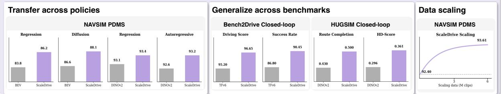

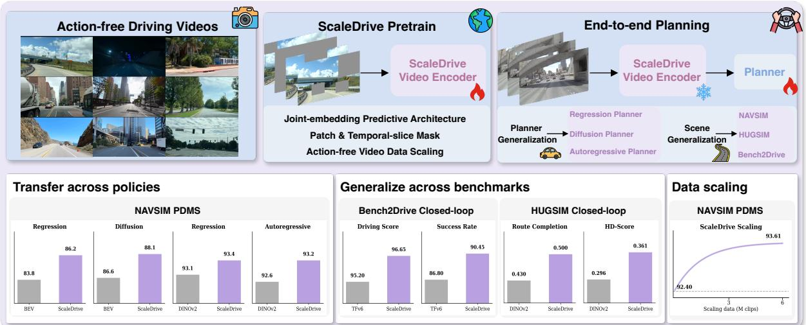  
Figure 1: ScaleDrive learns transferable driving representations through self-supervised predictive pretraining on large-scale raw driving videos. The pretrained encoder is kept frozen and transferred across heterogeneous end-to-end planners and closed-loop driving environments, consistently improving downstream planning performance.

Our experiments reveal a consistent representation scaling trend. As pretraining data increases, downstream planning performance improves while the visual encoder remains frozen. Ego-motion and monocular depth probing further show that temporal-motion and spatial-geometric information becomes increasingly accessible from the learned representation. Together, these results indicate that scaling video latent prediction pretraining produces increasingly useful driving representations.

We further evaluate whether these gains transfer beyond a single downstream planning configuration. The same frozen ScaleDrive representation consistently improves regression, difusion, and autoregressive planners, and remains efective across distinct closed-loop benchmarks including HUGSIM (Zhou et al., 2025) and Bench2Drive (Jia et al., 2024). These results show that scaling self-supervised predictive pretraining on raw driving videos can progressively strengthen transferable driving representations and improve downstream planning across heterogeneous policy architectures and driving environments.

## The main contributions are summarized as follows:

• We introduce ScaleDrive, a scalable self-supervised pretraining framework that learns transferable driving representations solely from large-scale raw driving videos, without action annotations or task-specific supervision.

• We develop a driving-oriented predictive pretraining strategy that combines patch-level masking with temporal-slice masking to capture both spatial scene structure and temporal dynamics.

• We conduct a systematic study of representation scaling. As video pretraining data increases, downstream planning performance improves, while ego-motion and depth probing reveal progressively stronger temporal-motion and spatial-geometric information in the frozen representation.

• ScaleDrive achieves competitive end-to-end planning performance with a frozen visual encoder and consistently improves regression, difusion, and autoregressive planners and generalizes across distinct benchmarks including NAVSIM, HUGSIM and Bench2Drive.

## 2 Related Works

Existing studies on visual representation learning for autonomous driving span task-specific intermediate representations such as BEV and occupancy (Li et al., 2024b; Huang et al., 2021; Tian et al., 2023; Zhang et al., 2023), generic foundation-model features from large-scale pretrained vision and vision-language models (Oquab et al., 2023; Yang et al., 2025; Wang et al., 2024a; Kirby et al., 2026; Zhang et al., 2025;

Gui et al., 2026a; Zhou et al., 2026b; Jiang et al., 2026), and video-based joint-embedding predictive learning (Assran et al., 2025; Wang et al., 2026b; Yang et al., 2026). In parallel, scaling studies show that driving policies benefit from more action-supervised data (Naumann et al., 2025; Zheng et al., 2024; Tian et al., 2026; Li et al., 2026c), and representation learning benefits from larger-scale data and models (Kong et al., 2025; Li et al., 2026b). However, whether action-free driving representations can be systematically scaled and transferred to end-to-end planning remains underexplored. The full version of related works can be found in Appendix B.

## 3 ScaleDrive

ScaleDrive learns transferable driving representations from action-free videos through self-supervised latent prediction. It builds upon the joint-embedding predictive architecture, using raw driving videos without trajectory or perception annotations for pretraining. After pretraining, the predictor is discarded and the video encoder is frozen for downstream end-to-end driving policies, allowing downstream performance to more directly reflect the quality of the learned representation. A key design challenge is that conventional patch-level prediction may exploit same-frame spatial redundancy without suficiently modeling temporal dynamics. We therefore introduce complete temporal-slice masking to complement patch-level masking, encouraging prediction from temporally distributed visual context. We next provide the theoretical motivation for this design and describe the resulting spatiotemporal latent prediction framework.

## 3.1 Dynamics-Guided Temporal Prediction

We first analyze latent prediction for driving videos from a dynamic-system perspective. The purpose of this analysis is not to model the full complexity of real driving dynamics, but to characterize a suficient condition under which patch-level prediction admits a same-frame shortcut and to explain why complete temporal masking provides a stronger temporal learning signal.

Driving dynamic system. A driving video can be viewed as a sequence of partial observations generated by an underlying dynamic scene state. Let $\mathbf { s } _ { t } \in \mathbb { R } ^ { d _ { s } }$ denote the latent physical state of the driving scene, including ego motion, surrounding-agent states, and local scene geometry. Its temporal evolution and visual observation can be abstracted as

$$
\mathbf { s } _ { t + 1 } = F ( \mathbf { s } _ { t } ) + \mathbf { w } _ { t } , \qquad \mathbf { y } _ { t } = G ( \mathbf { s } _ { t } ) + \mathbf { v } _ { t } ,\tag{1}
$$

where $\mathbf { w } _ { t }$ and $\mathbf { v } _ { t }$ denote process and observation noise, respectively, and $\mathbf { y } _ { t }$ denotes a temporally indexed latent observation corresponding to the predictive-learning target. Here, st is an abstract physical latent introduced only for analysis and we do not assume that a neural encoder explicitly recovers this state.

Local linearization. Over a suficiently short video clip, we analyze the local behavior of the nonlinear system through a first-order linearization around the observed trajectory:

$$
\delta \mathbf { s } _ { t + 1 } = \mathbf { A } _ { t } \delta \mathbf { s } _ { t } + \mathbf { w } _ { t } , \qquad \delta \mathbf { y } _ { t } = \mathbf { H } _ { t } \delta \mathbf { s } _ { t } + \mathbf { v } _ { t } .\tag{2}
$$

For analytical clarity, we consider a short local window in which the Jacobians vary slowly and can be approximated as ${ \bf A } _ { t } \approx { \bf A }$ and Ht ≈ H. This local time-invariant approximation is used only for the following analysis. The complete nonlinear-to-linear formulation and assumptions are provided in Appendix $\mathrm { A } \mathrm { . } \overset { \smile } { 1 }$

Proposition 1 (Existence of a same-frame shortcut under spatial redundancy). Let the latent observation at time t be partitioned into visible and masked components,

$$
\delta \mathbf { y } _ { t } ^ { V } = \mathbf { H } _ { V } \delta \mathbf { s } _ { t } + \mathbf { v } _ { t } ^ { V } , \qquad \delta \mathbf { y } _ { t } ^ { M } = \mathbf { H } _ { M } \delta \mathbf { s } _ { t } + \mathbf { v } _ { t } ^ { M } .\tag{3}
$$

If there exists a mapping C such that

$$
\begin{array} { r } { \| \mathbf { H } _ { M } - \mathbf { C } \mathbf { H } _ { V } \| _ { 2 } \le \epsilon _ { s } , } \end{array}\tag{4}
$$

then the same-frame predictor $\widehat { \delta \mathbf { y } _ { t } } ^ { M } = \mathbf { C } \delta \mathbf { y } _ { t } ^ { V }$ achieves

$$
\left\| \delta \mathbf { y } _ { t } ^ { M } - \mathbf { C } \delta \mathbf { y } _ { t } ^ { V } \right\| \leq \epsilon _ { s } \left\| \delta \mathbf { s } _ { t } \right\| + \left\| \mathbf { v } _ { t } ^ { M } - \mathbf { C } \mathbf { v } _ { t } ^ { V } \right\| .\tag{5}
$$

Proposition 1 provides a suficient condition under which masked latent regions can be predicted from visible regions at the same temporal instant. Importantly, neither the predictor nor its error bound depends on the temporal transition operator A. Therefore, when strong spatial redundancy exists, low patch-prediction error can be achieved without explicitly exploiting temporal transition dynamics. We refer to this possible solution as a same-frame spatial shortcut. The proposition does not imply that every patch-level prediction problem admits such a shortcut, rather, it characterizes when such a solution can exist. The proof is provided in Appendix A.2.

Proposition 2 (Temporal recoverability under complete temporal masking). Suppose the complete latent observation at time t is unavailable. For the preceding K observations, define

$$
\mathbf { Y } _ { K } = \left[ \begin{array} { c } { \delta \mathbf { y } _ { t - K } } \\ { \vdots } \\ { \delta \mathbf { y } _ { t - 1 } ^ { \phantom { } } } \end{array} \right] , \qquad \mathbf { O } _ { K } = \left[ \begin{array} { c } { \mathbf { H } } \\ { \mathbf { H } \mathbf { A } } \\ { \vdots } \\ { \mathbf { H } \mathbf { A } ^ { K - 1 } } \end{array} \right] , \qquad \mathbf { Y } _ { K } = \mathbf { O } _ { K } \delta \mathbf { s } _ { t - K } + \boldsymbol { \eta } ,\tag{6}
$$

where η collects process, observation, and local-linearization residuals. Ifthe local system is observable, rank $( \mathbf { O } _ { K } ) =$ $d _ { s } ,$ and

$$
\delta \mathbf { y } _ { t } = \mathbf { H } \mathbf { A } ^ { K } \delta \mathbf { s } _ { t - K } + \mathbf { r } _ { t } , \qquad \| \mathbf { r } _ { t } \| \le \epsilon _ { \mathrm { d y n } } ,\tag{7}
$$

then the predictor $\widehat { \delta \mathbf { y } } _ { t } = \mathbf { H } \mathbf { A } ^ { K } \mathbf { O } _ { K } ^ { \dagger } \mathbf { Y } _ { K }$ satisfies

$$
\left\| \widehat { \delta \mathbf { y } } _ { t } - \delta \mathbf { y } _ { t } \right\| \leq \frac { \| \mathbf { H } \mathbf { A } ^ { K } \| _ { 2 } } { \sigma _ { \operatorname* { m i n } } ( \mathbf { O } _ { K } ) } \| \pmb { \eta } \| + \epsilon _ { \mathrm { d y n } } .\tag{8}
$$

The past-only formulation in Proposition 2 is used for analytical clarity and the actual predictor can exploit context from both temporal directions. Complete temporal masking removes the direct same-frame shortcut characterized in Proposition 1. Under local observability, however, the masked observation remains recoverable from temporally distributed context through the local transition dynamics. This is a recoverability result rather than a guarantee that a finite-capacity neural network explicitly reconstructs the physical state. The proof is provided in Appendix A.3.

Design implication. The two propositions motivate complementary masking strategies. Patch-level masking provides dense spatial supervision but may admit same-frame shortcuts under strong spatial redundancy. Temporal-slice masking removes all observations at selected temporal indices, eliminating this direct same-frame evidence and increasing reliance on temporally distributed context. ScaleDrive therefore combines patch-level and temporal-slice masking to jointly strengthen spatial and temporal representation learning.

## 3.2 Spatial-Temporal Latent Prediction

Guided by the above analysis, we instantiate ScaleDrive using a joint-embedding predictive architecture on action-free driving videos.

Input and latent prediction. Given an action-free driving video $\mathbf { V } = \{ \mathbf { I } _ { t } \} _ { t = 1 } ^ { T } \in \mathbb { R } ^ { T \times H \times W \times 3 }$ , we partition it into non-overlapping spatiotemporal patches and project them into visual tokens $\mathbf { X } = [ \mathbf { x } _ { 1 } , \ldots , \mathbf { x } _ { N } ] \in$ $\mathbb { R } ^ { N \times D }$ , where N and D denote the number and dimension of tokens, respectively. The temporal and spatial coordinates are encoded using 3D RoPE Su et al. (2024).

Rather than reconstructing RGB pixels, ScaleDrive predicts latent representations of masked spatiotemporal regions. Given a mask set $\mathcal { M }$ , the context encoder $E _ { \theta }$ processes only the visible tokens, while a predictor $P _ { \phi }$ infers the representations at masked positions. The prediction targets are obtained from the complete token sequence using a momentum target encoder $E _ { \bar { \theta } } { \mathrm { : } }$

$$
\begin{array} { r } { \mathbf { Z } ^ { \mathrm { c o n } } = E _ { \boldsymbol { \theta } } ( \mathbf { X } _ { \setminus \boldsymbol { \mathcal { M } } } ) , \qquad \hat { \mathbf { Z } } _ { \mathcal { M } } = P _ { \boldsymbol { \phi } } ( \mathbf { Z } ^ { \mathrm { c o n } } , \boldsymbol { \mathcal { M } } ) , \qquad \mathbf { Z } ^ { \mathrm { t a r } } = E _ { \bar { \boldsymbol { \theta } } } ( \mathbf { X } ) . } \end{array}\tag{9}
$$

The target encoder shares the same architecture as the context encoder and is updated by an exponential moving average, $\bar { \theta }  \mu \bar { \theta } + ( 1 - \mu ) \theta$ , with gradients stopped.

Patch-level spatial masking. Following V-JEPA2, we sample spatially contiguous groups of spatiotemporal tokens, denoted by $\bar { \mathcal { M } } _ { p } \subseteq \{ 1 , \dots , N \}$ , and remove them from the context encoder input. The predictor then infers their target representations from the remaining visible visual context. This provides dense spatial supervision but, as characterized by Proposition 1, may admit solutions that rely heavily on same-frame spatial redundancy.

Temporal-slice masking. To complement spatial masking, we additionally remove complete temporal slices. Let $T ^ { \prime }$ denote the temporal resolution after patchification and ${ \mathcal { T } } _ { f } ^ { \mathsf { ^ { \prime } } } \subseteq \{ 1 , \dots , T ^ { \prime } \}$ the sampled temporal indices. The corresponding temporal mask is

$$
\begin{array} { r } { \mathcal { M } _ { f } = \{ i \vert \tau ( i ) \in \mathcal { T } _ { f } \} , } \end{array}\tag{10}
$$

where $\tau ( i )$ maps token i to its post-patchification temporal index. Because all spatial tokens at the selected temporal indices are removed, the predictor cannot directly exploit visible observations from the same temporal slice and must rely more strongly on temporally distributed context. During pretraining, the two masking strategies are combined as

$$
\mathcal { M } = \mathcal { M } _ { p } \cup \mathcal { M } _ { f } .\tag{11}
$$

Latent prediction objective. For each masked position $i \in \mathcal { M } _ { \ast }$ , the predicted latent $\hat { \mathbf { z } } _ { i }$ is optimized to match the corresponding target representation $\mathbf { z } _ { i } ^ { \mathrm { { t a r } } }$ . Following ${ \mathrm { V - J E P } } ^ { \mathrm { { } } } \mathrm { A } 2 , $ , we minimize an $\boldsymbol { L _ { 1 } ^ { \mathrm { ~ 2 ~ } } }$ regression loss over masked tokens:

$$
\mathcal { L } _ { \mathrm { V L P } } = \frac { 1 } { \left| \mathcal { M } \right| } \sum _ { i \in \mathcal { M } } \left\| \hat { \mathbf { z } } _ { i } - \mathrm { s g } \left( \mathbf { z } _ { i } ^ { \mathrm { t a r } } \right) \right\| _ { 1 } ,\tag{12}
$$

where sg(·) denotes the stop-gradient operator. The context encoder and predictor are optimized jointly, while the target encoder is updated only through the momentum update.

ScaleDrive therefore retains the standard joint-embedding prediction objective and momentum-target mechanism, while modifying the masking strategy: patch-level prediction provides dense spatial supervision, whereas complete temporal-slice prediction reduces reliance on same-frame spatial shortcuts and strengthens temporal predictive learning.

## 3.3 Scaling and Frozen Representation Transfer

Fixed-compute data scaling. ScaleDrive scales representation learning along the data dimension using raw action-free driving videos. Across diferent pretraining data scales, we keep the encoder architecture, masking formulation, optimization configuration, and overall training budget fixed, while varying only the size of the sampled driving-video pool. This controlled protocol isolates whether increasing the diversity and coverage of raw driving observations improves the quality of the learned representation under a comparable optimization budget.

Frozen representation transfer. After pretraining, we discard the predictor and retain the target encoder, denoted by $E _ { \mathrm { v i s } } ,$ as the visual representation model. Given an observed driving video V, the encoder produces a sequence of spatiotemporal latent representations:

$$
\mathbf { Z } = E _ { \mathrm { v i s } } ( \mathbf { V } ) \in \mathbb { R } ^ { N \times D } .\tag{13}
$$

The parameters of $E _ { \mathrm { v i s } }$ remain frozen throughout downstream policy training. This design is deliberate: if the visual encoder is jointly fine-tuned with the planner, improvements in downstream planning performance could arise from representation adaptation during policy training. Freezing the encoder makes the downstream performance a more direct measure of the information already learned during action-free video pretraining.

Planning interface. Given the frozen video representation Z and the current ego status e, the downstream planner models

$$
p _ { \omega } \left( \mathbf { Y } \mid \mathbf { Z } , \mathbf { e } \right) ,\tag{14}
$$

where Y denotes the future ego trajectory and ω contains only the trainable parameters of the planning module. With a set of learnable ego queries $\mathbf { Q } _ { e } \in \mathbb { R } ^ { M \times D }$ , the trajectory decoder predicts

$$
\hat { \bf Y } = D _ { \omega } \left( { \bf Q } _ { e } , { \bf Z } , { \bf e } \right) .\tag{15}
$$

The downstream decoder follows established end-to-end planning objectives (Yao et al., 2026; Kirby et al., 2026; Wang et al., 2026c). The architectural and optimization details are provided in Appendix C.2. This deliberately simple interface reduces architectural confounding and allows downstream performance to more directly reflect the quality of the pretrained driving representation.

Heterogeneous planner integration. ScaleDrive is not tied to the primary trajectory decoder. Its frozen visual encoder can serve as a plug-in module and be integrated into heterogeneous planners through simple planner-specific interfaces. BEV-based policies fuse ScaleDrive representation with the native BEV features, whereas camera-view-based policies replace the native visual representation with ScaleDrive. The detailed integration strategies are provided in Appendix C.3.

## 4 Experiment

## 4.1 Experimental Setup

We pretrain ScaleDrive with OpenDV-YouTube (Yang et al., 2024), a large-scale collection of internet driving videos without action or task-specific annotations. The raw driving videos are segmented into 4-second clips sampled at 2 Hz, yielding a total of 6M video clips for video latent prediction pretraining. We use NAVSIMv1 (Dauner et al., 2024) and NAVSIMv2 (Cao et al., 2025) as the primary end-to-end planning benchmarks. Beyond the main planning evaluation, we assess the ScaleDrive representation quality through ego-motion and monocular depth probing, evaluate cross-policy transfer with diferent planner architectures, and study cross-benchmark generalization on HUGSIM (Zhou et al., 2025) and Bench2Drive (Jia et al., 2024). Details on the training configurations and evaluation protocols are provided in Appendix C.

Table 1: Planning performance on NAVSIMv1. “Enc. Frozen” indicates whether the visual encoder is kept frozen during downstream planner training. † denotes training without perception-task labels.
<table><tr><td>Method</td><td>Inputs</td><td>Enc. Frozen</td><td>NC</td><td>DAC</td><td>EP</td><td>TTC</td><td>Comf.</td><td>PDMS</td></tr><tr><td>Transfuser Chitta et al. (2022)</td><td>L&amp;C</td><td>x</td><td>97.7</td><td>92.8</td><td>79.2</td><td>92.8</td><td>100.0</td><td>84.0</td></tr><tr><td>HydraMDP Li et al. (2024a)</td><td>L&amp;C</td><td>x</td><td>98.3</td><td>96.0</td><td>78.7</td><td>94.6</td><td>100.0</td><td>86.5</td></tr><tr><td>DiffusionDrive Liao et al. (2025a)</td><td>L&amp;C</td><td>x</td><td>98.2</td><td>96.2</td><td>82.2</td><td>94.7</td><td>100.0</td><td>88.1</td></tr><tr><td>World4Drive † Zheng et al. (2025)</td><td>C</td><td>x</td><td>97.4</td><td>94.3</td><td>79.9</td><td>92.8</td><td>100.0</td><td>85.1</td></tr><tr><td>Drive-JEPA † Wang et al. (2026b)</td><td>C</td><td>x</td><td>98.7</td><td>96.2</td><td>82.9</td><td>95.5</td><td>100.0</td><td>89.0</td></tr><tr><td>ScaleDrive†</td><td>C</td><td>√</td><td>99.0</td><td>96.3</td><td>83.0</td><td>96.1</td><td>100.0</td><td>89.1</td></tr><tr><td>ReCogDrive Li et al. (2026d)</td><td>C</td><td>√</td><td>97.9</td><td>97.3</td><td>87.3</td><td>94.9</td><td>100.0</td><td>90.8</td></tr><tr><td>SGDrive Li et al. (2026a)</td><td>C</td><td>√</td><td>98.6</td><td>97.8</td><td>85.8</td><td>96.2</td><td>100.0</td><td>91.1</td></tr><tr><td>iPad Guo et al. (2026)</td><td>C</td><td>x</td><td>98.6</td><td>98.3</td><td>88.0</td><td>94.9</td><td>99.9</td><td>91.7</td></tr><tr><td>DrivoR Kirby et al. (2026)</td><td>C</td><td>x</td><td>98.9</td><td>98.3</td><td>89.1</td><td>96.2</td><td>100.0</td><td>93.1</td></tr><tr><td>Drive-JEPA Wang et al. (2026b)</td><td>CC</td><td>x</td><td>99.1</td><td>98.2</td><td>91.4</td><td>96.2</td><td>100.0</td><td>93.7</td></tr><tr><td>ChainFlow-VLA Wang et al. (2026c)</td><td></td><td>x</td><td>98.8</td><td>98.6</td><td>90.8</td><td>96.1</td><td>100.0</td><td>93.6</td></tr><tr><td>ScaleDrive</td><td>C</td><td>√</td><td>99.3</td><td>98.4</td><td>90.6</td><td>97.0</td><td>100.0</td><td>93.8</td></tr></table>

Table 2: Planning performance on NAVSIMv2. ScaleDrive achieves strong overall performance under the more comprehensive closed-loop evaluation metrics.
<table><tr><td>Method</td><td>NC</td><td>DAC</td><td>DDC</td><td>TLC</td><td>EP</td><td>TTC</td><td>LK</td><td>HC</td><td>EC</td><td>EPDMS</td></tr><tr><td>DiffusionDrive Liao et al. (2025a)</td><td>98.2</td><td>95.9</td><td>99.4</td><td>99.8</td><td>87.5</td><td>97.3</td><td>96.8</td><td>98.3</td><td>87.7</td><td>84.5</td></tr><tr><td>DiffusionDriveV2 Zou et aì. (2025)</td><td>97.7</td><td>96.6</td><td>99.2</td><td>99.8</td><td>88.9</td><td>97.2</td><td>96.0</td><td>97.8</td><td>91.0</td><td>87.5</td></tr><tr><td>SparseDriveV2 Sun et al. (2026)</td><td>98.1</td><td>98.1</td><td>99.6</td><td>99.8</td><td>91.1</td><td>97.3</td><td>96.9</td><td>98.2</td><td>78.4</td><td>90.1</td></tr><tr><td>Latent-WAM Wang et al. (2026a)</td><td>98.1</td><td>97.3</td><td>99.6</td><td>99.8</td><td>87.7</td><td>97.3</td><td>97.6</td><td>98.1</td><td>87.3</td><td>89.3</td></tr><tr><td>ScaleDrive</td><td>99.3</td><td>98.9</td><td>99.7</td><td>99.6</td><td>85.4</td><td>98.9</td><td>95.9</td><td>98.2</td><td>82.1</td><td>90.5</td></tr></table>

Table 3: Transfer across end-to-end driving policies. Downstream training and evaluation settings are kept fixed within each policy.
<table><tr><td rowspan=1 colspan=1>Method</td><td rowspan=1 colspan=1>Trajectory Modeling</td><td rowspan=1 colspan=1>Representation</td><td rowspan=1 colspan=1>NC   DAC   TTC   EP</td><td rowspan=1 colspan=1>PDMS</td></tr><tr><td rowspan=2 colspan=1>LTFLTF(V-JEPA2)</td><td rowspan=2 colspan=1>Regression</td><td rowspan=2 colspan=1>BEVw. V-JEPA2</td><td rowspan=1 colspan=1>97.4   92.8   92.4   79.0</td><td rowspan=1 colspan=1>83.8</td></tr><tr><td rowspan=1 colspan=1>97.8   91.7   92.4   78.8</td><td rowspan=1 colspan=1>83.2(-0.6)</td></tr><tr><td rowspan=1 colspan=1>LTF(ScaleDrive)</td><td rowspan=1 colspan=1></td><td rowspan=1 colspan=1>w. ScaleDrive</td><td rowspan=1 colspan=1>98.2   94.0   93.6   81.6</td><td rowspan=1 colspan=1>86.2(+2.4)</td></tr><tr><td rowspan=1 colspan=1>DiffusionDriveDiffusionDrive(V-JEPA2)</td><td rowspan=1 colspan=1>Diffusion</td><td rowspan=1 colspan=1>BEVw. V-JEPA2</td><td rowspan=1 colspan=1>98.1   94.8   94.1   81.198.6   95.1   95.1   81.8</td><td rowspan=1 colspan=1>86.687.4(+0.8)</td></tr><tr><td rowspan=1 colspan=1>DiffusionDrive(ScaleDrive)</td><td rowspan=1 colspan=1></td><td rowspan=1 colspan=1>w. ScaleDrive</td><td rowspan=1 colspan=1>98.6   95.8   95.3   82.3</td><td rowspan=1 colspan=1>88.1(+1.5)</td></tr><tr><td rowspan=2 colspan=1>DrivoRDrivoR(V-JEPA2)</td><td rowspan=2 colspan=1>Regression</td><td rowspan=2 colspan=1>DINOv2w. V-JEPA2</td><td rowspan=1 colspan=1>98.9   98.3   96.2   89.1</td><td rowspan=1 colspan=1>93.1</td></tr><tr><td rowspan=1 colspan=1>99.1   97.9   96.5   87.9</td><td rowspan=1 colspan=1>92.3(-0.8)</td></tr><tr><td rowspan=1 colspan=1>DrivoR(ScaleDrive)</td><td rowspan=1 colspan=1></td><td rowspan=1 colspan=1>w. ScaleDrive</td><td rowspan=1 colspan=1>99.2   98.0   96.7   89.8</td><td rowspan=1 colspan=1>93.4(+0.3)</td></tr><tr><td rowspan=2 colspan=1>ChainFlowChainFlow(V-JEPA2)</td><td rowspan=2 colspan=1>Autoregressive</td><td rowspan=2 colspan=1>DINOv2w. V-JEPA2</td><td rowspan=1 colspan=1>98.9   98.1   96.2   88.9</td><td rowspan=1 colspan=1>92.6</td></tr><tr><td rowspan=1 colspan=1>98.8   97.5   95.6   89.2</td><td rowspan=1 colspan=1>92.1(-0.5)</td></tr><tr><td rowspan=1 colspan=1>ChainFlow(ScaleDrive)</td><td rowspan=1 colspan=1></td><td rowspan=1 colspan=1>w. ScaleDrive</td><td rowspan=1 colspan=1>99.0   98.3   96.2   90.5</td><td rowspan=1 colspan=1>93.2(+0.6)</td></tr></table>

## 4.2 Main Planning Results

Tables 1 and 2 report the planning performance of ScaleDrive on NAVSIMv1 and NAVSIMv2. ScaleDrive achieves strong planning performance on both benchmarks, reaching a PDMS of 93.8 on NAVSIMv1 and an EPDMS of 90.5 on NAVSIMv2. The pretrained video encoder remains frozen throughout downstream policy training, indicating that the resulting performance primarily reflects the quality and transferability of the ScaleDrive representation.

We study how ScaleDrive scales with action-free driving videos for downstream planning. Fig. 2 (A) illustrates how planning performance scales with the amount of action-free driving-video pretraining. As the number of video clips increases from 0.5M to 6M, PDMS consistently improves from 92.77 to 93.61, compared with 92.40 using the oficial V-JEPA2 representation. The gain trend empirically shows that increasing the diversity and coverage of driving videos improves the quality of the frozen representation under a fixed training budget. Beyond data scaling, we introduce temporal-slice masking to strengthen temporal modeling during pretraining, following Proposition 2. At the same data scale, the additional temporal-slice masking further improves planning performance.

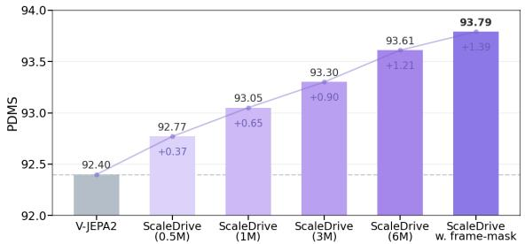  
(A)

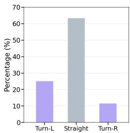

(B)  
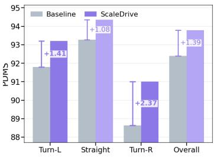  
Figure 2: (A) Data scaling performance of ScaleDrive. (B) Command-wise gains under the imbalanced training driving action distribution.

Table 4: Cross-benchmark generalization on HUGSIM.
<table><tr><td rowspan="2">Planner</td><td rowspan="2">Representation</td><td colspan="5">Route Completion ↑</td><td colspan="5">HD-Score ↑</td></tr><tr><td>Easy</td><td>Medium</td><td>Hard</td><td>Extreme</td><td>Avg.</td><td>Easy</td><td>Medium</td><td>Hard</td><td>Extreme</td><td>Avg.</td></tr><tr><td>LTF</td><td>BEV</td><td>0.684</td><td>0.407</td><td>0.369</td><td>0.255</td><td>0.410</td><td>0.528</td><td>0.246</td><td>0.198</td><td>0.081</td><td>0.246</td></tr><tr><td>LTF</td><td>w. V-JEPA2</td><td>0.738</td><td>0.400</td><td>0.298</td><td>0.279</td><td>0.412</td><td>0.630</td><td>0.228</td><td>0.141</td><td>0.113</td><td>0.251</td></tr><tr><td>LTF</td><td>w. ScaleDrive</td><td>0.742</td><td>0.496</td><td>0.329</td><td>0.259</td><td>0.448</td><td>0.638</td><td>0.361</td><td>0.180</td><td>0.119</td><td>0.315</td></tr><tr><td>ChainFlow</td><td>DINOv2</td><td>0.834</td><td>0.433</td><td>0.258</td><td>0.273</td><td>0.430</td><td>0.705</td><td>0.313</td><td>0.116</td><td>0.122</td><td>0.296</td></tr><tr><td>ChainFlow</td><td>w. V-JEPA2</td><td>0.782</td><td>0.443</td><td>0.315</td><td>0.252</td><td>0.432</td><td>0.640</td><td>0.342</td><td>0.168</td><td>0.108</td><td>0.302</td></tr><tr><td>ChainFlow</td><td>w. ScaleDrive</td><td>0.843</td><td>0.561</td><td>0.362</td><td>0.274</td><td>0.500</td><td>0.693</td><td>0.442</td><td>0.210</td><td>0.123</td><td>0.361</td></tr></table>

Table 5: Cross-benchmark generalization on Bench2Drive.
<table><tr><td>Planner</td><td>Representation</td><td>Driving Score↑</td><td>Success Rate↑</td><td>Efficiency↑</td><td>Comfort↑</td></tr><tr><td>TFv6</td><td>BEV</td><td>95.20</td><td>86.80</td><td></td><td></td></tr><tr><td>TFv6</td><td>w. V-JEPA2</td><td>95.00</td><td>85.91</td><td>202.33</td><td>15.45</td></tr><tr><td>TFv6</td><td>w. ScaleDrive</td><td>96.65(+1.45)</td><td>90.45(+3.65)</td><td>210.22</td><td>18.03</td></tr></table>

A key motivation for scaling action-free video pretraining is to expose the model to a broader diversity of driving scenes. We investigate whether this broader scene coverage translates into planning gains in long-tail driving scenes. We analyze performance across diferent driving commands in Fig. 2 (B). The downstream training distribution is highly imbalanced, with turning commands following a clear long-tail distribution. ScaleDrive improves planning performance across all commands, with more pronounced gains on long-tail turning maneuvers. These results suggest that the broader scene coverage provided by large-scale video pretraining is particularly beneficial for long-tail driving situations that are less frequently observed during downstream policy training.

## 4.3 Does ScaleDrive Transfer Across Driving Policies?

A transferable driving representation should provide consistent benefits across diferent policy designs. We evaluate the frozen ScaleDrive representation with four end-to-end driving policies while keeping the training settings fixed within each policy. These policies span regression, difusion, and autoregressive trajectory modeling, with native visual representations ranging from BEV (Chitta et al., 2022) to DI-NOv2 (Oquab et al., 2023). As shown in Table 3, ScaleDrive consistently improves planning performance across all architectures. In contrast, V-JEPA2 does not yield similarly consistent improvements. This comparison indicates that scaling action-free pretraining on driving videos yields representations that transfer across heterogeneous downstream policies.

## 4.4 Does ScaleDrive Transfer to Diferent Driving Scenarios?

A central motivation of ScaleDrive is to investigate whether action-free driving videos can induce transferable driving representations that generalize beyond the downstream training distribution. We evaluate ScaleDrive on HUGSIM (Zhou et al., 2025) and Bench2Drive (Jia et al., 2024), two closed-loop benchmarks with distinct scenario distributions and evaluation protocols. Table 4 evaluates cross-benchmark generalization on HUGSIM. ScaleDrive improves the average Route Completion and HD-Score with diferent planner architectures and original representations, with clear benefits in the Medium and Hard scenarios. Table 5 further shows consistent improvements over the strong TFv6 (Nguyen et al., 2026) planner across closed-loop metrics on Bench2Drive. These results indicate that the learned representation generalizes across distinct driving environments, scenario distributions, and evaluation protocols.

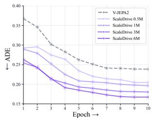  
(A)

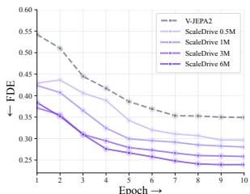  
(B)

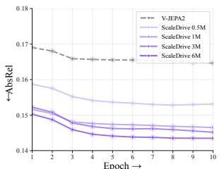  
(C)

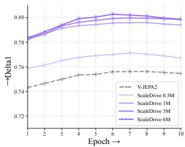  
(D)

Figure 3: Video representation probing. (A–B) Ego-motion estimation with ADE ↓ and FDE ↓; (C–D) monocular depth estimation with AbsRel ↓ and $\delta _ { 1 }$ ↑.  
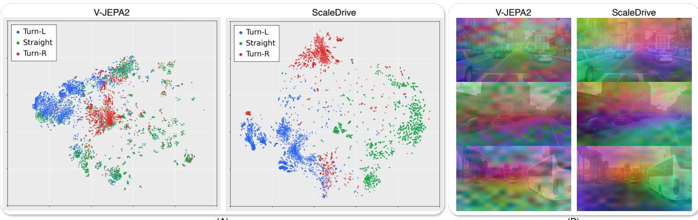  
(A)  
(B)  
Figure 4: Qualitative result of representations. (A) t-SNE visualization. (B) PCA visualization of dense video features across representative driving scenes.

## 4.5 Does Action-Free Video Latent Prediction Improve Driving Representations?

Proposition 2 suggests that temporal-slice prediction places stronger requirements on representing temporally evolving scene states. We therefore directly probe whether motion information becomes more accessible from the frozen representation through ego-motion estimation. As a complementary assessment of spatial representation quality, we further use monocular depth probing on KITTI (Geiger et al., 2012) to assess whether scaling action-free pretraining also strengthens spatial-geometric information. In both settings, the pretrained video encoder remains frozen and only the task-specific probe is optimized. Detailed architectures and optimization settings are provided in the Appendix C.5. As shown in Fig. 3, performance consistently improves as the amount of driving-video pretraining increases for both ego motion and depth estimation. This trend indicates that scaling video latent prediction progressively strengthens the temporal and geometric information encoded in the frozen representation.

## 4.6 Qualitative results

Visual representation. Fig. 4 provides qualitative comparisons of the spatiotemporal representations learned by V-JEPA2 and ScaleDrive. In the t-SNE visualizations shown in Fig. 4 (A), ScaleDrive exhibits more clearly separated feature distributions across diferent driving behaviors. The PCA visualizations in Fig. 4 (B) further show more organized spatial feature patterns across representative driving scenes. These observations suggest that scaling action-free video latent prediction pretraining yields more structured representations.

End-to-end Planning. Fig. 5 shows representative planning cases on NAVSIM, HUGSIM, and Bench2Drive. On NAVSIM, the predicted trajectories more closely follow the reference expert behavior across diverse road geometries and intersection scenarios. On HUGSIM and Bench2Drive, ScaleDrive exhibits safer closed-loop behavior, including appropriate responses to approaching vehicles and potentially unsafe interactions. These examples illustrate that stronger spatiotemporal representations can translate into more reliable downstream planning across driving environments.

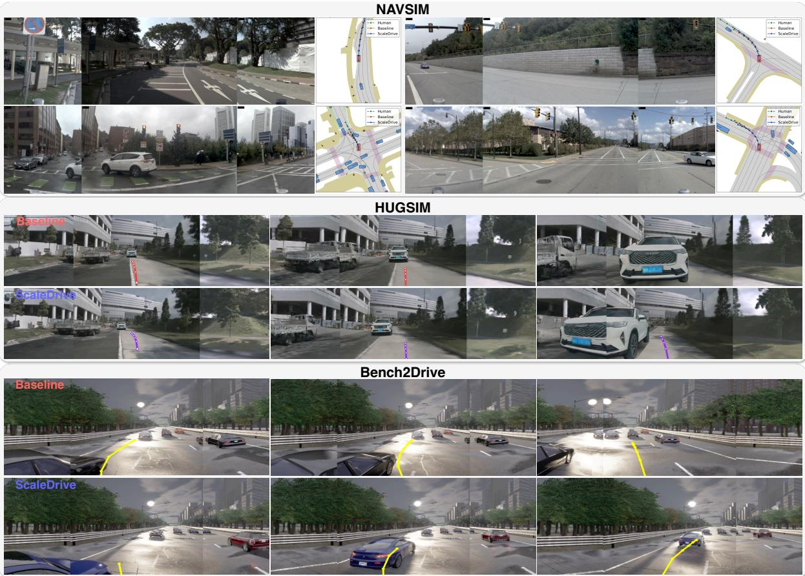  
Figure 5: Planning results on NAVSIM, HUGSIM and Bench2Drive.

## 5 Conclusion

We present ScaleDrive, a scalable representation-learning framework that learns driving representations from action-free videos through video latent prediction. By scaling pretraining data while keeping the downstream encoder frozen, we show that larger collections of driving videos consistently improve representation quality and translate into stronger planning performance. The learned representations capture increasingly useful motion and geometric cues, and generalize across diferent planning architectures and driving benchmarks. These results suggest that action-free video pretraining provides a promising direction for scaling autonomous driving beyond the availability of action-annotated data.

## References

Mido Assran, Adrien Bardes, David Fan, Quentin Garrido, Russell Howes, Matthew Muckley, Ammar Rizvi, Claire Roberts, Koustuv Sinha, Artem Zholus, et al. V-jepa 2: Self-supervised video models enable understanding, prediction and planning. arXiv preprint arXiv:2506.09985, 2025.

Shuai Bai, Yuxuan Cai, Ruizhe Chen, Keqin Chen, Xionghui Chen, Zesen Cheng, Lianghao Deng, Wei Ding, Chang Gao, Chunjiang Ge, et al. Qwen3-vl technical report. arXiv preprint arXiv:2511.21631, 2025.

Adrien Bardes, Quentin Garrido, Jean Ponce, Xinlei Chen, Michael Rabbat, Yann LeCun, Mahmoud Assran, and Nicolas Ballas. Revisiting feature prediction for learning visual representations from video. arXiv preprint arXiv:2404.08471, 2024.

Florent Bartoccioni, Elias Ramzi, Victor Besnier, Shashanka Venkataramanan, Tuan-Hung Vu, Yihong Xu, Loick Chambon, Spyros Gidaris, Serkan Odabas, David Hurych, et al. Vavim and vavam: Autonomous driving through video generative modeling. arXiv preprint arXiv:2502.15672, 2025.

Wei Cao, Marcel Hallgarten, Tianyu Li, Daniel Dauner, Xunjiang Gu, Caojun Wang, Yakov Miron, Marco Aiello, Hongyang Li, Igor Gilitschenski, et al. Pseudo-simulation for autonomous driving. arXiv preprint arXiv:2506.04218, 2025.

Li Chen, Penghao Wu, Kashyap Chitta, Bernhard Jaeger, Andreas Geiger, and Hongyang Li. End-to-end autonomous driving: Challenges and frontiers. IEEE Transactions on Pattern Analysis and Machine Intelligence, 46(12):10164–10183, 2024a.

Zhe Chen, Jiannan Wu, Wenhai Wang, Weijie Su, Guo Chen, Sen Xing, Muyan Zhong, Qinglong Zhang, Xizhou Zhu, Lewei Lu, et al. Internvl: Scaling up vision foundation models and aligning for generic visual-linguistic tasks. In Proceedings of the IEEE/CVF conference on computer vision and pattern recognition, pp. 24185–24198, 2024b.

Pranav Singh Chib and Pravendra Singh. Recent advancements in end-to-end autonomous driving using deep learning: A survey. IEEE Transactions on Intelligent Vehicles, 9(1):103–118, 2023.

Kashyap Chitta, Aditya Prakash, Bernhard Jaeger, Zehao Yu, Katrin Renz, and Andreas Geiger. Transfuser: Imitation with transformer-based sensor fusion for autonomous driving. IEEE transactions on pattern analysis and machine intelligence, 45(11):12878–12895, 2022.

Daniel Dauner, Marcel Hallgarten, Tianyu Li, Xinshuo Weng, Zhiyu Huang, Zetong Yang, Hongyang Li, Igor Gilitschenski, Boris Ivanovic, Marco Pavone, et al. Navsim: Data-driven non-reactive autonomous vehicle simulation and benchmarking. Advances in Neural Information Processing Systems, 37:28706–28719, 2024.

Andreas Geiger, Philip Lenz, and Raquel Urtasun. Are we ready for autonomous driving? the kitti vision benchmark suite. In 2012 IEEE conference on computer vision and pattern recognition, pp. 3354–3361. IEEE, 2012.

Xingtai Gui, Tengteng Huang, Haonan Shao, Haotian Yao, and Chi Zhang. Fiptr: A simple yet efective transformer framework for future instance prediction in autonomous driving. In European conference on computer vision, pp. 19–35. Springer, 2024.

Xingtai Gui, Jianbo Zhao, Wencheng Han, Jikai Wang, Jiahao Gong, Feiyang Tan, Cheng-zhong Xu, and Jianbing Shen. Trajdif: End-to-end autonomous driving without perception annotation. arXiv preprint arXiv:2512.00723, 2025.

Xingtai Gui, Meijie Zhang, Tianyi Yan, Wencheng Han, Jiahao Gong, Feiyang Tan, Cheng-zhong Xu, and Jianbing Shen. Bridging scene generation and planning: Driving with world model via unifying vision and motion representation. arXiv preprint arXiv:2603.14948, 2026a.

Xingtai Gui, Yucheng Zhou, Dongqian Guo, Jiahao Gong, Feiyang Tan, and Jianbing Shen. Explicit geometric chain-of-thought for vision-language-action in autonomous driving. arXiv preprint arXiv:2610.10390, 2026b.

Ke Guo, Haochen Liu, Xiaojun Wu, Jia Pan, and Chen Lv. ipad: Iterative proposal-centric end-to-end autonomous driving. IEEE Robotics and Automation Letters, 2026.

Junjie Huang, Guan Huang, Zheng Zhu, Yun Ye, and Dalong Du. Bevdet: High-performance multi-camera 3d object detection in bird-eye-view. arXiv preprint arXiv:2112.11790, 2021.

Yuanhui Huang, Wenzhao Zheng, Yunpeng Zhang, Jie Zhou, and Jiwen Lu. Tri-perspective view for vision-based 3d semantic occupancy prediction. In 2023 IEEE/CVF Conference on Computer Vision and Pattern Recognition (CVPR), pp. 9223–9232. IEEE, 2023.

Xiaosong Jia, Zhenjie Yang, Qifeng Li, Zhiyuan Zhang, and Junchi Yan. Bench2drive: Towards multiability benchmarking of closed-loop end-to-end autonomous driving. Advances in Neural Information Processing Systems, 37:819–844, 2024.

Bo Jiang, Shaoyu Chen, Bencheng Liao, Xingyu Zhang, Wei Yin, Qian Zhang, Chang Huang, Wenyu Liu, and Xinggang Wang. Senna: Bridging large vision-language models and end-to-end autonomous driving. International Journal of Computer Vision, 134(9):407, 2026.

Ellington Kirby, Alexandre Boulch, Yihong Xu, Yuan Yin, Gilles Puy, Eloi Zablocki, Andrei Bursuc, Spyros´ Gidaris, Renaud Marlet, Florent Bartoccioni, et al. Driving on registers. In Proceedings of the IEEE/CVF Conference on Computer Vision and Pattern Recognition, pp. 32058–32069, 2026.

Lingdong Kong, Xiang Xu, Youquan Liu, Jun Cen, Runnan Chen, Wenwei Zhang, Liang Pan, Kai Chen, and Ziwei Liu. Largead: Large-scale cross-sensor data pretraining for autonomous driving. IEEE Transactions on Pattern Analysis and Machine Intelligence, 2025.

Jingyu Li, Junjie Wu, Dongnan Hu, Xiangkai Huang, Bin Sun, Zhihui Hao, Xianpeng Lang, Xiatian Zhu, and Li Zhang. Sgdrive: Scene-to-goal hierarchical world cognition for autonomous driving. arXiv preprint arXiv:2601.05640, 2026a.

Yingwei Li, Xin Huang, Yang Liu, Yang Fu, Alex Zihao Zhu, Chen Song, Junwen Yao, Anant Subramanian, Hao Xiang, Weijing Shi, et al. Stellar: Scaling 3d perception large models for autonomous driving. arXiv preprint arXiv:2605.20390, 2026b.

Yingyan Li, Shuyao Shang, Weisong Liu, Bing Zhan, Haochen Wang, Yuqi Wang, Yuntao Chen, Xiaoman Wang, Yasong An, Chufeng Tang, et al. Drivevla-w0: World models amplify data scaling law in autonomous driving. In International Conference on Learning Representations, volume 2026, pp. 7890–7911, 2026c.

Yongkang Li, Kaixin Xiong, Xiangyu Guo, Fang Li, Sixu Yan, Gangwei Xu, Lijun Zhou, Long Chen, Haiyang Sun, BING WANG, Kun Ma, Guang Chen, Hangjun Ye, Wenyu Liu, and Xinggang Wang. Recogdrive: A reinforced cognitive framework for end-to-end autonomous driving. In The Fourteenth International Conference on Learning Representations, 2026d. URL https://openreview.net/forum?id=JoXwhGbuMi.

Zhenxin Li, Kailin Li, Shihao Wang, Shiyi Lan, Zhiding Yu, Yishen Ji, Zhiqi Li, Ziyue Zhu, Jan Kautz, Zuxuan Wu, et al. Hydra-mdp: End-to-end multimodal planning with multi-target hydra-distillation. arXiv preprint arXiv:2406.06978, 2024a.

Zhiqi Li, Wenhai Wang, Hongyang Li, Enze Xie, Chonghao Sima, Tong Lu, Qiao Yu, and Jifeng Dai. Bevformer: learning bird’s-eye-view representation from lidar-camera via spatiotemporal transformers. IEEE Transactions on Pattern Analysis and Machine Intelligence, 47(3):2020–2036, 2024b.

Bencheng Liao, Shaoyu Chen, Xinggang Wang, Tianheng Cheng, Qian Zhang, Wenyu Liu, and Chang Huang. Maptr: Structured modeling and learning for online vectorized hd map construction. arXiv preprint arXiv:2208.14437, 2022.

Bencheng Liao, Shaoyu Chen, Haoran Yin, Bo Jiang, Cheng Wang, Sixu Yan, Xinbang Zhang, Xiangyu Li, Ying Zhang, Qian Zhang, et al. Difusiondrive: Truncated difusion model for end-to-end autonomous driving. In 2025 IEEE/CVF Conference on Computer Vision and Pattern Recognition (CVPR), pp. 12037– 12047. IEEE, 2025a.

Bencheng Liao, Shaoyu Chen, Yunchi Zhang, Bo Jiang, Qian Zhang, Wenyu Liu, Chang Huang, and Xinggang Wang. Maptrv2: An end-to-end framework for online vectorized hd map construction. International Journal ofComputer Vision, 133(3):1352–1374, 2025b.

Xiaolu Liu, Song Wang, Wentong Li, Ruizi Yang, Junbo Chen, and Jianke Zhu. Mgmap: Mask-guided learning for online vectorized hd map construction. In 2024 IEEE/CVF Conference on Computer Vision and Pattern Recognition (CVPR), pp. 14812–14821. IEEE, 2024.

Yingfei Liu, Tiancai Wang, Xiangyu Zhang, and Jian Sun. Petr: Position embedding transformation for multi-view 3d object detection. In European conference on computer vision, pp. 531–548. Springer, 2022.

Yuexin Ma, Tai Wang, Xuyang Bai, Huitong Yang, Yuenan Hou, Yaming Wang, Yu Qiao, Ruigang Yang, and Xinge Zhu. Vision-centric bev perception: A survey. IEEE Transactions on Pattern Analysis and Machine Intelligence, 46(12):10978–10997, 2024.

Alexander Naumann, Xunjiang Gu, Tolga Dimlioglu, Mariusz Bojarski, Alperen Degirmenci, Alexander Popov, Devansh Bisla, Marco Pavone, Urs Muller, and Boris Ivanovic. Data scaling laws for end-toend autonomous driving. In Proceedings of the IEEE/CVF Conference on Computer Vision and Pattern Recognition, pp. 2596–2607, 2025.

Long Nguyen, Micha Fauth, Bernhard Jaeger, Daniel Dauner, Maximilian Igl, Andreas Geiger, and Kashyap Chitta. Lead: Minimizing learner-expert asymmetry in end-to-end driving. In Proceedings of the IEEE/CVF Conference on Computer Vision and Pattern Recognition, pp. 39775–39785, 2026.

Maxime Oquab, Timothee Darcet, Th´ eo Moutakanni, Huy Vo, Marc Szafraniec, Vasil Khalidov, Pierre´ Fernandez, Daniel Haziza, Francisco Massa, Alaaeldin El-Nouby, et al. Dinov2: Learning robust visual features without supervision. arXiv preprint arXiv:2304.07193, 2023.

Chen Shi, Shaoshuai Shi, Kehua Sheng, Bo Zhang, and Li Jiang. Drivex: Omni scene modeling for learning generalizable world knowledge in autonomous driving. In 2025 IEEE/CVF International Conference on Computer Vision (ICCV), pp. 28599–28609. IEEE, 2025.

Oriane Simeoni, Huy V Vo, Maximilian Seitzer, Federico Baldassarre, Maxime Oquab, Cijo Jose, Vasil Khali-´ dov, Marc Szafraniec, Seungeun Yi, Michael Ramamonjisoa, et al. Dinov3.¨ arXiv preprint arXiv:2508.10104, 2025.

Matthew Strong, Wei-Jer Chang, Quentin Herau, Jiezhi Yang, Yihan Hu, Chensheng Peng, and Wei Zhan. Learning to drive is a free gift: Large-scale label-free autonomy pretraining from unposed in-the-wild videos. arXiv preprint arXiv:2602.22091, 2026.

Jianlin Su, Murtadha Ahmed, Yu Lu, Shengfeng Pan, Wen Bo, and Yunfeng Liu. Roformer: Enhanced transformer with rotary position embedding. Neurocomputing, 568:127063, 2024.

Wenchao Sun, Xuewu Lin, Keyu Chen, Zixiang Pei, Xiang Li, Yining Shi, and Sifa Zheng. Sparsedrivev2: Scoring is all you need for end-to-end autonomous driving. arXiv preprint arXiv:2603.29163, 2026.

Haochen Tian, Tianyu Li, Haochen Liu, Jiazhi Yang, Yihang Qiu, Guang Li, Junli Wang, Yinfeng Gao, Zhang Zhang, Liang Wang, et al. Simscale: Learning to drive via real-world simulation at scale. In Proceedings of the IEEE/CVF Conference on Computer Vision and Pattern Recognition, pp. 36365–36374, 2026.

Xiaoyu Tian, Tao Jiang, Longfei Yun, Yucheng Mao, Huitong Yang, Yue Wang, Yilun Wang, and Hang Zhao. Occ3d: A large-scale 3d occupancy prediction benchmark for autonomous driving. Advances in neural information processing systems, 36:64318–64330, 2023.

Zhan Tong, Yibing Song, Jue Wang, and Limin Wang. Videomae: Masked autoencoders are data-eficient learners for self-supervised video pre-training. Advances in neural information processing systems, 35: 10078–10093, 2022.

Michael Tschannen, Alexey Gritsenko, Xiao Wang, Muhammad Ferjad Naeem, Ibrahim Alabdulmohsin, Nikhil Parthasarathy, Talfan Evans, Lucas Beyer, Ye Xia, Basil Mustafa, et al. Siglip 2: Multilingual vision-language encoders with improved semantic understanding, localization, and dense features. arXiv preprint arXiv:2502.14786, 2025.

Team Wan, Ang Wang, Baole Ai, Bin Wen, Chaojie Mao, Chen-Wei Xie, Di Chen, Feiwu Yu, Haiming Zhao, Jianxiao Yang, et al. Wan: Open and advanced large-scale video generative models. arXiv preprint arXiv:2503.20314, 2025.

Linbo Wang, Yupeng Zheng, Qiang Chen, Shiwei Li, Yichen Zhang, Zebin Xing, Qichao Zhang, Xiang Li, Deheng Qian, Pengxuan Yang, et al. Latent-wam: Latent world action modeling for end-to-end autonomous driving. arXiv preprint arXiv:2603.24581, 2026a.

Linhan Wang, Zichong Yang, Chen Bai, Guoxiang Zhang, Xiaotong Liu, Xiaoyin Zheng, Xiao-Xiao Long, Chang-Tien Lu, and Cheng Lu. Drive-jepa: Video jepa meets multimodal trajectory distillation for end-to-end driving. arXiv preprint arXiv:2601.22032, 2026b.

Peng Wang, Shuai Bai, Sinan Tan, Shijie Wang, Zhihao Fan, Jinze Bai, Keqin Chen, Xuejing Liu, Jialin Wang, Wenbin Ge, et al. Qwen2-vl: Enhancing vision-language model’s perception of the world at any resolution. arXiv preprint arXiv:2409.12191, 2024a.

Xiyang Wang, Xinlin Wang, Tingguang Zhou, Gong Chen, Xingtai Gui, Zhi Xu, Xiaolei Wu, Feiyang Tan, Hangning Zhou, and Mu Yang. Chainflow-vla: Causal flow planning with vision-language models. arXiv preprint arXiv:2605.23270, 2026c.

Yan Wang, Wenjie Luo, Junjie Bai, Yulong Cao, Tong Che, Ke Chen, Yuxiao Chen, Jenna Diamond, Yifan Ding, Wenhao Ding, et al. Alpamayo-r1: Bridging reasoning and action prediction for generalizable autonomous driving in the long tail. arXiv preprint arXiv:2511.00088, 2025.

Yi Wang, Kunchang Li, Xinhao Li, Jiashuo Yu, Yinan He, Guo Chen, Baoqi Pei, Rongkun Zheng, Zun Wang, Yansong Shi, et al. Internvideo2: Scaling foundation models for multimodal video understanding. In European conference on computer vision, pp. 396–416. Springer, 2024b.

Yi Wei, Linqing Zhao, Wenzhao Zheng, Zheng Zhu, Jie Zhou, and Jiwen Lu. Surroundocc: Multi-camera 3d occupancy prediction for autonomous driving. In 2023 IEEE/CVF International Conference on Computer Vision (ICCV), pp. 21672–21683. IEEE, 2023.

Tianyi Yan, Tao Tang, Xingtai Gui, Yongkang Li, Jiasen Zheng, Weiyao Huang, Lingdong Kong, Wencheng Han, Xia Zhou, Xueyang Zhang, et al. Ad-r1: Closed-loop reinforcement learning for end-to-end autonomous driving with impartial world models. In Proceedings ofthe IEEE/CVF Conference on Computer Vision and Pattern Recognition, pp. 1085–1095, 2026a.

Tianyi Yan, Huan Zheng, Dubing Chen, Meizhi Qu, Yingying Shen, Lijun Zhou, Mingfei Tu, Bing Wang, Guang Chen, Hangjun Ye, et al. Causaldrive: Real-time causal world models for autonomous driving. In European Conference on Computer Vision, pp. 134–151. Springer, 2026b.

Chenyu Yang, Yuntao Chen, Hao Tian, Chenxin Tao, Xizhou Zhu, Zhaoxiang Zhang, Gao Huang, Hongyang Li, Yu Qiao, Lewei Lu, et al. Bevformer v2: Adapting modern image backbones to bird’seye-view recognition via perspective supervision. In 2023 IEEE/CVF Conference on Computer Vision and Pattern Recognition (CVPR), pp. 17830–17839. IEEE, 2023.

Jiazhi Yang, Shenyuan Gao, Yihang Qiu, Li Chen, Tianyu Li, Bo Dai, Kashyap Chitta, Penghao Wu, Jia Zeng, Ping Luo, et al. Generalized predictive model for autonomous driving. In 2024 IEEE/CVF Conference on Computer Vision and Pattern Recognition (CVPR), pp. 14662–14672. IEEE, 2024.

Jiwei Yang, Zhengxian Chen, Chaosheng Huang, and Jun Li. Auto-jepa: A latent world model of continuous intent for end-to-end autonomous driving. arXiv preprint arXiv:2607.29031, 2026.

Zhuoyi Yang, Jiayan Teng, Wendi Zheng, Ming Ding, Shiyu Huang, Jiazheng Xu, Yuanming Yang, Wenyi Hong, Xiaohan Zhang, Guanyu Feng, et al. Cogvideox: Text-to-video difusion models with an expert transformer. In International Conference on Learning Representations, volume 2025, pp. 83048–83077, 2025.

Wenhao Yao, Zhenxin Li, Shiyi Lan, Zi Wang, Xinglong Sun, Jose M Alvarez, and Zuxuan Wu. Drivesuprim: Towards precise trajectory selection for end-to-end planning. In Proceedings of the AAAI Conference on Artificial Intelligence, volume 40, pp. 11910–11918, 2026.

Kaiwen Zhang, Zhenyu Tang, Xiaotao Hu, Xingang Pan, Xiaoyang Guo, Yuan Liu, Jingwei Huang, Li Yuan, Qian Zhang, Xiao-Xiao Long, et al. Epona: Autoregressive difusion world model for autonomous driving. In 2025 IEEE/CVF International Conference on Computer Vision (ICCV), pp. 27220–27230. IEEE, 2025.

Yunpeng Zhang, Zheng Zhu, and Dalong Du. Occformer: Dual-path transformer for vision-based 3d semantic occupancy prediction. In 2023 IEEE/CVF International Conference on Computer Vision (ICCV), pp. 9399–9409. IEEE, 2023.

Yupeng Zheng, Pengxuan Yang, Zhongpu Xia, Qichao Zhang, Yuhang Zheng, Songen Gu, Bu Jin, Teng Zhang, Ben Lu, Chao Han, et al. Data scaling laws for imitation learning-based end-to-end autonomous driving. arXiv preprint arXiv:2412.02689, 2024.

Yupeng Zheng, Pengxuan Yang, Zebin Xing, Qichao Zhang, Yuhang Zheng, Yinfeng Gao, Pengfei Li, Teng Zhang, Zhongpu Xia, Peng Jia, et al. World4drive: End-to-end autonomous driving via intention-aware physical latent world model. In 2025 IEEE/CVF International Conference on Computer Vision (ICCV), pp. 28632–28642. IEEE, 2025.

Hongyu Zhou, Longzhong Lin, Jiabao Wang, Yichong Lu, Dongfeng Bai, Bingbing Liu, Yue Wang, Andreas Geiger, and Yiyi Liao. Hugsim: A real-time, photo-realistic and closed-loop simulator for autonomous driving. IEEE Transactions on Pattern Analysis and Machine Intelligence, 2025.

Xingcheng Zhou, Xuyuan Han, Feng Yang, Yunpu Ma, Volker Tresp, and Alois Knoll. Opendrivevla: Towards end-to-end autonomous driving with large vision language action model. In Proceedings ofthe AAAI Conference on Artificial Intelligence, volume 40, pp. 13782–13790, 2026a.

Zewei Zhou, Tianhui Cai, Seth Zhao, Yun Zhang, Zhiyu Huang, Bolei Zhou, and Jiaqi Ma. Autovla: A vision-language-action model for end-to-end autonomous driving with adaptive reasoning and reinforcement fine-tuning. Advances in Neural Information Processing Systems, 38:27920–27956, 2026b.

Jialv Zou, Shaoyu Chen, Bencheng Liao, Zhiyu Zheng, Yuehao Song, Lefei Zhang, Qian Zhang, Wenyu Liu, and Xinggang Wang. Difusiondrivev2: Reinforcement learning-constrained truncated difusion modeling in end-to-end autonomous driving. arXiv preprint arXiv:2512.07745, 2025.

## A Theoretical Analysis

## A.1 Dynamic-System Formulation and Assumptions

The main-text analysis abstracts a driving video as a sequence of observations generated by an underlying latent dynamic system,

$$
\mathbf { s } _ { t + 1 } = F ( \mathbf { s } _ { t } ) + \mathbf { w } _ { t } , \qquad \mathbf { y } _ { t } = G ( \mathbf { s } _ { t } ) + \mathbf { v } _ { t } ,\tag{16}
$$

where $\mathbf { s } _ { t } \in \mathbb { R } ^ { d _ { s } }$ denotes the latent physical state of the driving scene, including ego motion, surroundingagent states, and local scene geometry and $\mathbf { y } _ { t }$ denotes a temporally indexed latent observation corresponding to the predictive-learning target, and $\mathbf { w } _ { t }$ and $\mathbf { v } _ { t }$ denote process and observation noise, respectively. This formulation is an analytical abstraction rather than an exact model of the neural architecture: in particular, we do not assume that the learned representation explicitly corresponds to $\mathbf { s } _ { t }$ or that the Transformer target representation depends exclusively on the physical state at a single instant.

For a state perturbation $\delta \mathbf { s } _ { t }$ around the observed trajectory, a first-order Taylor expansion gives

$$
F ( \mathbf { s } _ { t } + \delta \mathbf { s } _ { t } ) \approx F ( \mathbf { s } _ { t } ) + \left. \frac { \partial F } { \partial \mathbf { s } } \right| _ { \mathbf { s } _ { t } } \delta \mathbf { s } _ { t } , \qquad G ( \mathbf { s } _ { t } + \delta \mathbf { s } _ { t } ) \approx G ( \mathbf { s } _ { t } ) + \left. \frac { \partial G } { \partial \mathbf { s } } \right| _ { \mathbf { s } _ { t } } \delta \mathbf { s } _ { t } .\tag{17}
$$

Defining

$$
\mathbf { A } _ { t } = \left. \frac { \partial F } { \partial \mathbf { s } } \right| _ { \mathbf { s } _ { t } } , \qquad \mathbf { H } _ { t } = \left. \frac { \partial G } { \partial \mathbf { s } } \right| _ { \mathbf { s } _ { t } } ,\tag{18}
$$

yields the local linear model used in the main text,

$$
\delta \mathbf { s } _ { t + 1 } = \mathbf { A } _ { t } \delta \mathbf { s } _ { t } + \mathbf { w } _ { t } , \qquad \delta \mathbf { y } _ { t } = \mathbf { H } _ { t } \delta \mathbf { s } _ { t } + \mathbf { v } _ { t } .\tag{19}
$$

The analysis relies on the following local assumptions.

Assumption A1 (Local smoothness). F and G are suficiently smooth in a neighborhood of the observed trajectory over a short video clip, such that the first-order Taylor approximation is locally valid. Higherorder approximation residuals are absorbed into the disturbance terms used in the subsequent analysis.

Assumption A2 (Local time invariance). Over the short temporal window considered in Proposition 2, the Jacobians vary suficiently slowly that A ≈ A and $\mathbf { H } _ { t }$ ≈ H. This assumption is introduced only to obtain a compact local observability analysis using powers of A and it does not imply that real driving dynamics are globally linear or time invariant.

Assumption A3 (Local spatial redundancy). Proposition 1 assumes the existence of a mapping C such that $\| \hat { \mathbf { H } } _ { M } - \mathbf { C H } _ { V } \| _ { 2 } \leq \dot { \epsilon } _ { s }$ for the analyzed frame. This is a suficient local condition under which the masked component can be approximately inferred from the visible component of the same temporal observation. It does not assume that every masked region in every driving scene can be reconstructed from same-frame information.

Assumption A4 (Local temporal observability). For the local linear system in Proposition 2, the observability matrix satisfies rank $( \mathbf { O } _ { K } ) = d _ { s }$ over the analyzed temporal window. This does not require global observability of all driving scenes and it only states that the state directions relevant to the local analysis are suficiently constrained by the available temporal observations.

## A.2 Proof of Proposition 1

Let the visible and masked components of the latent observation at time t be

$$
\delta \mathbf { y } _ { t } ^ { V } = \mathbf { H } _ { V } \delta \mathbf { s } _ { t } + \mathbf { v } _ { t } ^ { V } , \qquad \delta \mathbf { y } _ { t } ^ { M } = \mathbf { H } _ { M } \delta \mathbf { s } _ { t } + \mathbf { v } _ { t } ^ { M } .\tag{20}
$$

Consider the same-frame predictor $\widehat { \delta \mathbf { y } _ { t } } ^ { M } = \mathbf { C } \delta \mathbf { y } _ { t } ^ { V }$ . The prediction residual can be written as

$$
\delta { \bf y } _ { t } ^ { M } - { \bf C } \delta { \bf y } _ { t } ^ { V } = \left( { \bf H } _ { M } - { \bf C } { \bf H } _ { V } \right) \delta { \bf s } _ { t } + \left( { \bf v } _ { t } ^ { M } - { \bf C } { \bf v } _ { t } ^ { V } \right) .\tag{21}
$$

Applying the triangle inequality and the induced matrix norm gives

$$
\left\| \delta \mathbf { y } _ { t } ^ { M } - \mathbf { C } \delta \mathbf { y } _ { t } ^ { V } \right\| \leq \left\| \mathbf { H } _ { M } - \mathbf { C } \mathbf { H } _ { V } \right\| _ { 2 } \left\| \delta \mathbf { s } _ { t } \right\| + \left\| \mathbf { v } _ { t } ^ { M } - \mathbf { C } \mathbf { v } _ { t } ^ { V } \right\| .\tag{22}
$$

Under Assumption $\begin{array} { r } { \mathsf { A } 3 , \| \mathbf { H } _ { M } - \mathbf { C } \mathbf { H } _ { V } \| _ { 2 } \leq \epsilon _ { s } , } \end{array}$ and therefore

$$
\left\| { \delta \mathbf { y } _ { t } ^ { M } - \mathbf { C } \delta \mathbf { y } _ { t } ^ { V } } \right\| \le \epsilon _ { s } \left\| { \delta \mathbf { s } _ { t } } \right\| + \left\| \mathbf { v } _ { t } ^ { M } - \mathbf { C } \mathbf { v } _ { t } ^ { V } \right\| ,\tag{23}
$$

which is the bound stated in Proposition 1.

Crucially, neither the same-frame predictor nor its error bound contains the temporal transition operator A. Therefore, whenever the spatial-redundancy condition in Assumption A3 approximately holds, a low masked-prediction error can in principle be achieved without explicitly exploiting temporal transition dynamics. Proposition 1 should therefore be interpreted as establishing the existence of a possible sameframe shortcut under spatial redundancy, rather than claiming that all patch-level prediction is solved through such a shortcut.

## A.3 Proof of Proposition 2

Under Assumptions A1 and A2, consider the local linear dynamics over the temporal window $[ t - K , t ] .$

$$
\delta { \bf s } _ { \ell + 1 } = { \bf A } \delta { \bf s } _ { \ell } + { \bf w } _ { \ell } , \qquad \delta { \bf y } _ { \ell } = { \bf H } \delta { \bf s } _ { \ell } + { \bf v } _ { \ell } .\tag{24}
$$

Starting from $\delta \mathbf { s } _ { t - K }$ , recursively applying the transition dynamics gives, for $j = 0 , \ldots , K - 1$

$$
\delta \mathbf { s } _ { t - K + j } = \mathbf { A } ^ { j } \delta \mathbf { s } _ { t - K } + \pmb { \xi } _ { j } ,\tag{25}
$$

where $\xi _ { j }$ aggregates the accumulated process disturbances and local approximation residuals up to the j-th step. The corresponding observations satisfy

$$
\delta \mathbf { y } _ { t - K + j } = \mathbf { H } \mathbf { A } ^ { j } \delta \mathbf { s } _ { t - K } + \mathbf { H } \pmb { \xi } _ { j } + \mathbf { v } _ { t - K + j } .\tag{26}
$$

Stacking the K preceding observations yields

$$
\begin{array} { r } { \mathbf { Y } _ { K } = \left[ \begin{array} { l } { \delta \mathbf { y } _ { t - K } } \\ { \delta \mathbf { y } _ { t - K + 1 } } \\ { \qquad \vdots } \\ { \delta \mathbf { y } _ { t - 1 } } \end{array} \right] = \mathbf { O } _ { K } \delta \mathbf { s } _ { t - K } + \pmb { \eta } , } \end{array}\tag{27}
$$

where

$$
\begin{array} { r } { \mathbf { O } _ { K } = \left[ \begin{array} { c } { \mathbf { H } } \\ { \mathbf { H } \mathbf { A } } \\ { \vdots } \\ { \mathbf { H } \mathbf { A } ^ { K - 1 } } \end{array} \right] , } \end{array}\tag{28}
$$

and η aggregates process disturbances, observation noise, and local-linearization residuals.

Under Assumption A4, rank $( \mathbf { O } _ { K } ) = d _ { s } ,$ , so $\mathbf { O } _ { K }$ has full column rank and ${ \bf O } _ { K } ^ { \dagger } { \bf O } _ { K } = { \bf I } .$ . The least-squares estimate of the initial state in the local window is therefore

$$
\hat { \mathbf { s } } _ { t - K } = \mathbf { O } _ { K } ^ { \dagger } \mathbf { Y } _ { K } .\tag{29}
$$

Substituting the stacked observation model gives

$$
\hat { \mathbf { s } } _ { t - K } - \delta \mathbf { s } _ { t - K } = \mathbf { O } _ { K } ^ { \dagger } \pmb { \eta } .\tag{30}
$$

Taking norms and using $\| \mathbf { O } _ { K } ^ { \dagger } \| _ { 2 } = 1 / \sigma _ { \operatorname* { m i n } } ( \mathbf { O } _ { K } )$ yields

$$
\lVert \hat { \mathbf { s } } _ { t - K } - \delta \mathbf { s } _ { t - K } \rVert \leq \frac { \lVert \pmb { \eta } \rVert } { \sigma _ { \operatorname* { m i n } } ( \mathbf { O } _ { K } ) } .\tag{31}
$$

For the completely masked target instant t, write the local target observation as

$$
\delta \mathbf { y } _ { t } = \mathbf { H } \mathbf { A } ^ { K } \delta \mathbf { s } _ { t - K } + \mathbf { r } _ { t } ,\tag{32}
$$

where $\mathbf { r } _ { t }$ collects accumulated process disturbances, target-observation noise, and local-linearization residuals, and satisfies $\lvert \lvert \mathbf { r } _ { t } \rvert \rvert \leq \epsilon _ { \mathrm { d y n } }$

Using the recovered state, define

$$
\widehat { \delta \mathbf { y } } _ { t } = \mathbf { H } \mathbf { A } ^ { K } \hat { \mathbf { s } } _ { t - K } .\tag{33}
$$

The prediction residual is then

$$
\widehat { \delta \mathbf { y } } _ { t } - \delta \mathbf { y } _ { t } = \mathbf { H } \mathbf { A } ^ { K } \left( \widehat { \mathbf { s } } _ { t - K } - \delta \mathbf { s } _ { t - K } \right) - \mathbf { r } _ { t } .\tag{34}
$$

Applying the triangle inequality and the state-estimation bound gives

$$
\left\| \widehat { \delta \mathbf { y } } _ { t } - \delta \mathbf { y } _ { t } \right\| \leq \frac { \| \mathbf { H } \mathbf { A } ^ { K } \| _ { 2 } } { \sigma _ { \operatorname* { m i n } } ( \mathbf { O } _ { K } ) } \| \pmb { \eta } \| + \epsilon _ { \mathrm { d y n } } ,\tag{35}
$$

which is the bound stated in Proposition 2.

This result establishes a recoverability statement rather than a learning guarantee. Once the complete observation at the target temporal index is removed, the direct same-frame solution characterized by Proposition 1 is unavailable. Under local observability, the missing observation can nevertheless be inferred from information distributed across preceding temporal observations through the local transition dynamics. The analysis therefore motivates temporal-slice masking rather than guaranteeing that a finite-capacity neural network recovers the complete physical state.

## B Extended Related Works

## B.1 Vision Representation for Autonomous Driving

Visual representation learning is a central component of end-to-end autonomous driving (Chen et al., 2024a; Chib & Singh, 2023; Ma et al., 2024). Early approaches typically construct task-specific intermediate representations, such as bird’s-eye-view (BEV) features (Li et al., 2024b; Huang et al., 2021; Gui et al., 2024; Yang et al., 2023; Liao et al., 2025a; Gui et al., 2025) for spatially aligned scene understanding and occupancy representations (Tian et al., 2023; Zhang et al., 2023; Wei et al., 2023) for modeling dense 3D structure and free-space geometry. More recently, the emergence of large-scale pretrained vision and video foundation models (Oquab et al., 2023; Tschannen et al., 2025; Simeoni et al.´ , 2025; Wan et al., 2025; Yang et al., 2025) and vision-language models (Wang et al., 2024a; Chen et al., 2024b; Bai et al., 2025) have motivated the use of generic foundation-model features as stronger visual priors for downstream driving (Kirby et al., 2026; Gui et al., 2026a; Yan et al., 2026b; Zhang et al., 2025; Li et al., 2026d; Yan et al., 2026a; Jiang et al., 2026; Gui et al., 2026b). Along this direction, video-based joint-embedding predictive architecture (Bardes et al., 2024; Assran et al., 2025) has recently been adapted to autonomous driving. Drive-JEPA (Wang et al., 2026b) uses self-supervised pretraining on driving videos to learn planning-oriented visual representations, while Auto-JEPA (Yang et al., 2026) extends joint-embedding prediction toward action-oriented future-intent modeling. However, it remains underexplored whether video representation learning with only action-free driving video itself can be systematically scaled and transferred to end-to-end planning.

## B.2 Scaling in Autonomous Driving

Recent works have investigated how autonomous driving policies scale with increasing amounts of actionsupervised driving data (Naumann et al., 2025; Zheng et al., 2024), showing that larger training sets can yield consistent gains in end-to-end driving performance. Subsequent studies further improve this scaling behavior through large-scale simulation and world-model supervision (Tian et al., 2026; Li et al., 2026c), but the resulting policies still rely on action supervision during training. In parallel, several works explore scaling representation learning for autonomous driving (Kong et al., 2025; Li et al., 2026b), demonstrating the benefits of larger-scale data and models for perception tasks. However, whether action-free driving representations exhibit similar scaling behavior, and whether such gains transfer to downstream planning, remains underexplored. We address this gap by scaling video latent prediction on large-scale action-free driving videos and evaluating the resulting frozen representations across diverse planning architectures and benchmarks.

## C Implementation Details

## C.1 ScaleDrive Video latent prediction pretraining.

ScaleDrive follows the general video latent prediction framework of V-JEPA2. The encoder adopts a ViT-Large architecture with 3D RoPE and is initialized from the oficial V-JEPA2 ViT-L checkpoint. Each input consists of eight frames sampled at 2 Hz and resized to 256 × 256 pixels, with a spatial patch size of 16 × 16 and a temporal tubelet size of 2. Multi-group patch masking is combined with temporal-slice masking during video latent prediction, while the target encoder is updated by exponential moving average with a momentum coeficient of 0.99925. Pretraining uses AdamW with a starting learning rate of $5 . 2 \breve { 5 } \times 1 0 ^ { - 4 }$ and a global batch size of 4096. After pretraining, the EMA target encoder is retained as the visual representation encoder for representation probing and downstream end-to-end planning.

Table 6: ScaleDrive video latent prediction pretraining configuration.
<table><tr><td>Category</td><td>Hyperparameter</td><td>Value</td></tr><tr><td rowspan="6">Model</td><td>Backbone</td><td>ViT-Large with 3D RoPE</td></tr><tr><td>Resolution</td><td> $2 5 6 \times 2 5 6$ </td></tr><tr><td>Frames per clip</td><td>8</td></tr><tr><td>Patch size</td><td> $1 6 \times 1 6$ </td></tr><tr><td>Tubelet size</td><td>2</td></tr><tr><td>Predictor dimension</td><td>256</td></tr><tr><td></td><td>Downstream checkpoint</td><td>EMA target encoder Multi-group patch + temporal-slice</td></tr><tr><td rowspan="4">Masking</td><td>Masking strategy Small-patch mask</td><td>8 groups, spatial scale 0.15</td></tr><tr><td></td><td></td></tr><tr><td>Large-patch mask</td><td>2 groups, spatial scale 0.70</td></tr><tr><td>Temporal-slice mask</td><td>1 frame</td></tr><tr><td rowspan="9">Training</td><td>Trainable parameters</td><td>304.148M</td></tr><tr><td>Optimizer</td><td>AdamW</td></tr><tr><td>Start learning rate</td><td> $5 . 2 5 \times 1 0 ^ { - 4 }$ </td></tr><tr><td>Final learning rate</td><td> $1 \times 1 0 ^ { - 6 }$ </td></tr><tr><td>Number of GPUs</td><td>16 × NVIDIA A800</td></tr><tr><td>Global batch size</td><td>4096</td></tr><tr><td>Training epochs</td><td>20</td></tr><tr><td>Iterations per epoch</td><td>300</td></tr><tr><td>EMA momentum</td><td>0.99925</td></tr><tr><td rowspan="2">Data</td><td>Dataset</td><td>OpenDV-YouTube</td></tr><tr><td>Dataset size</td><td>0.5M / 1M / 3M / 6M</td></tr></table>

The action-free pretraining data are constructed from the OpenDV-YouTube subset introduced by (Yang et al., 2024). Each raw video is segmented using a 4-second sliding window with a temporal stride of 0.5 seconds, resulting in a 3.5-second overlap between consecutive clips. Each clip is subsequently sampled at 2 Hz to obtain eight input frames. For data-scaling experiments, we construct four pretraining subsets containing 0.5M, 1M, 3M, and 6M video clips. The 6M-clip subset is derived from approximately 1157 hours of raw driving videos, while the 0.5M-, 1M-, and 3M-clip subsets span 72, 131, and 587 raw driving videos, respectively. The model architecture, optimization configuration, and training budget are kept identical across all scales, providing a controlled setting where the amount of pretraining data is the only experimental variable. Table 6 summarizes the detailed pretraining configuration.

## C.2 Downstream planning on NAVSIM.

We keep the pretrained video encoder frozen during downstream planning training. The visual input consists of four history frames from the front camera and the current frame from each surround camera, with all images resized to 256 × 256 pixels. We evaluate two planner variants. The single-modal variant uses a single learnable trajectory query to predict one trajectory. The multimodal variant uses 64 learnable proposal queries to predict 64 candidate trajectories. Each predicted trajectory comprises eight poses over a 4-second planning horizon. The single-modal and multimodal variants achieve PDMS scores of 89.0 and 93.8 on NAVSIM, respectively. The single-modal planner is trained solely with an L1 trajectory loss:

$$
{ \mathcal { L } } _ { \mathrm { s i n g l e } } = { \mathcal { L } } _ { \mathrm { t r a j } } .\tag{36}
$$

The multimodal planner additionally uses a score loss to supervise candidate scoring:

$$
\mathcal { L } _ { \mathrm { m u l t i } } = \mathcal { L } _ { \mathrm { t r a j } } + \mathcal { L } _ { \mathrm { s c o r e } }\tag{37}
$$

Both variants are trained on 85K NAVSIM navtrain trainset using AdamW with a base learning rate of $2 . 0 \times 1 0 ^ { - 4 }$ . The single-modal model is trained with 100 epochs, while the multimodal model is trained with 20 epochs. Training is performed on eight NVIDIA A800 GPUs with a global batch size of 64. Table 7 summarizes the training configurations.

Table 7: ScaleDrive planning training configuration on NAVSIM.
<table><tr><td>Category</td><td>Hyperparameter</td><td>Value</td></tr><tr><td rowspan="6">Model</td><td>Backbone Resolution</td><td>ViT-Large with 3D RoPE 256 × 256</td></tr><tr><td>Front-view frames</td><td>4</td></tr><tr><td></td><td></td></tr><tr><td>Surround-view frames</td><td>1</td></tr><tr><td>Patch size</td><td> $1 6 \times 1 6$ </td></tr><tr><td>Tubelet size</td><td>2</td></tr><tr><td>Planning</td><td>Predicted poses Planning horizon</td><td>8 4s</td></tr><tr><td rowspan="6">Training</td><td>Trainable parameters</td><td>17.575M</td></tr><tr><td>Optimizer</td><td>AdamW</td></tr><tr><td></td><td>2.0 × 10−4</td></tr><tr><td>Learning rate</td><td></td></tr><tr><td>Number of GPUs</td><td>8 × NVIDIA A800</td></tr><tr><td>Global batch size</td><td>64</td></tr><tr><td rowspan="2">Data</td><td>Dataset</td><td>NAVSIM navtrain</td></tr><tr><td>Dataset size</td><td>85K</td></tr></table>

Table 8: Cross-planner configurations. V-JEPA2 and ScaleDrive use the same integration strategy within each planner.
<table><tr><td>Planner</td><td>Backbone</td><td>Decoder</td><td>Video representation integration</td></tr><tr><td>LTF</td><td>TransFuser</td><td>Regression</td><td>Attention keys and values</td></tr><tr><td>DiffusionDrive</td><td>TransFuser</td><td>Diffusion</td><td>Attention keys and values</td></tr><tr><td>DrivoR</td><td>DINOv2</td><td>Regression</td><td>Front-view feature replacement</td></tr><tr><td>ChainFlow</td><td>DINOv2</td><td>Autoregressive</td><td>Front-view feature replacement</td></tr></table>

## C.3 Cross-Planner Configurations

We evaluate video representation transfer with four downstream planners: LTF Chitta et al. (2022), DifusionDrive Liao et al. (2025a), DrivoR Kirby et al. (2026), and ChainFlow Wang et al. (2026c). All configurations use multi-view images. For each planner architecture, we compare its original baseline with V-JEPA2 and ScaleDrive variants. Table 8 summarizes the native architecture and the shared video representation integration strategy. For each planner, we retain the training losses, optimizer, learning-rate schedule, and training data used in its original paper. These settings are kept identical across the original baseline, V-JEPA2, and ScaleDrive variants within each planner.

Additional feature fusion: LTF and DifusionDrive. LTF and DifusionDrive use a Latent TransFuser backbone to encode multi-view images into a BEV representation, followed by regression and difusion trajectory decoders. For both planners, the video-enhanced variants retain the native backbone features and introduce video representations as additional attention keys and values in the planner. This allows the planner to attend to the video representation alongside its original visual features.

Front-view feature replacement: DrivoR and ChainFlow. DrivoR and ChainFlow use a fine-tuned DINOv2 backbone to encode multi-view images, with regression and autoregressive trajectory decoders, respectively. For these planners, we replace only the front-view DINOv2 features with corresponding video representations. For these two planners, video features replace the native front-view representation rather than serving as an additional feature branch.

## C.4 Cross-Benchmark Configurations

HUGSIM. We directly evaluate the LTF and ChainFlow planners trained with the NAVSIM training set, including their original, V-JEPA2, and ScaleDrive variants, on HUGSIM without additional training or fine-tuning. All variants are evaluated under the same HUGSIM protocol. This setting assesses the crossbenchmark generalization of the trained driving policies without adaptation to the target environment.

Bench2Drive. We evaluate ScaleDrive on Bench2Drive using TFv6 Nguyen et al. (2026) as the downstream planner. The pretrained ScaleDrive encoder remains frozen and processes four-frame clips at a resolution of 256 × 256. TFv6 uses RegNetY-032 backbones for both image and LiDAR inputs, with camera images resized to $3 8 4 \times 3 8 4$ . We train the planner on the LEAD dataset for 30 epochs using AdamW with a learning rate of $3 . 0 \times 1 0 ^ { - 4 } .$ , a weight decay of 0.01, and a global batch size of 48. Table 9 summarizes the detailed training configuration.

Table 9: Training configuration on Bench2Drive.
<table><tr><td>Category</td><td>Hyperparameter</td><td>Value</td></tr><tr><td rowspan="5">Model</td><td>Backbone</td><td>ViT-Large with 3D RoPE</td></tr><tr><td>Resolution</td><td> $2 5 6 \times 2 5 6$ </td></tr><tr><td>Frames per clip</td><td>4</td></tr><tr><td>Patch size</td><td> $1 6 \times 1 6$ </td></tr><tr><td>Tubelet size</td><td>2</td></tr><tr><td rowspan="4">Planning</td><td>Planner architecture</td><td>TFv6</td></tr><tr><td>Image backbone</td><td>RegNetY-032</td></tr><tr><td>LiDÅR backbone</td><td>RegNetY-032</td></tr><tr><td>Input resolution per camera</td><td>384 × 384</td></tr><tr><td rowspan="5">Training</td><td>Optimizer</td><td>AdamW</td></tr><tr><td>Learning rate</td><td>3.0 × 10−4</td></tr><tr><td>Weight decay</td><td>0.01</td></tr><tr><td>Global batch size</td><td>48</td></tr><tr><td>Training epochs</td><td>30</td></tr><tr><td rowspan="2">Data</td><td>Dataset</td><td>LEAD</td></tr><tr><td>Dataset size</td><td>960K</td></tr></table>

Table 10: Training configuration for ScaleDrive representation probing.
<table><tr><td></td><td>Category Hyperparameter</td><td>Depth Estimation</td><td>Ego-Motion Estimation</td></tr><tr><td rowspan="4">Model</td><td>Backbone</td><td>ViT-Large with 3D RoPE</td><td>ViT-Large with 3D RoPE</td></tr><tr><td>Resolution</td><td> $2 5 6 \times 2 5 6$ </td><td> $2 5 6 \times 2 5 6$ </td></tr><tr><td>Tubelet size</td><td>2</td><td>2</td></tr><tr><td>Encoder token grid</td><td> $2 \times 1 6 \times 1 6$ </td><td> $2 \times 1 6 \times 1 6$ </td></tr><tr><td rowspan="4">Probe</td><td>Prediction target</td><td>Depth map</td><td>Waypoints</td></tr><tr><td>Feature aggregation</td><td>Temporal mean pooling</td><td>3 learnable queries</td></tr><tr><td>Probe architecture</td><td>BatchNorm + Linear 1024 → 1</td><td>Cross-attention block</td></tr><tr><td>Output head</td><td></td><td>Bilinear upsampling + Softplus LayerNorm + MLP 1024 → 1024 → 2</td></tr><tr><td rowspan="5">Training</td><td>Optimizer</td><td>AdamW</td><td>AdamW</td></tr><tr><td>Learning rate</td><td>3.0 × 10</td><td>3.0 × 10 -4</td></tr><tr><td>Weight decay</td><td>0.05</td><td>0.05</td></tr><tr><td>Global batch size</td><td>16</td><td>16</td></tr><tr><td>Training epochs</td><td>10</td><td>10</td></tr><tr><td>Data</td><td>Dataset</td><td>KITTI</td><td>NAVSIM</td></tr></table>

## C.5 ScaleDrive representation probing

The pretrained visual representation is evaluated through two complementary probing tasks: monocular depth estimation for spatial geometry and inverse-dynamics ego-motion estimation for temporal dynamics. Both tasks use the same pretrained ViT-Large video encoder. The encoder remains frozen throughout probe training, while only the task-specific probe is optimized.

Depth Estimation. We evaluate spatial representation quality through monocular depth estimation on KITTI. The frozen spatiotemporal features are first aggregated along the temporal dimension by mean pooling. The resulting spatial features are passed through a shallow depth head consisting of BatchNorm and a linear projection, followed by bilinear upsampling and a Softplus activation to produce dense depth predictions at the input resolution. Table 10 summarizes the probe architectures and optimization settings.

Ego-Motion Estimation. We evaluate temporal dynamics through inverse-dynamics ego-motion estimation on NAVSIM. Learnable queries aggregate the frozen spatiotemporal tokens through a cross-attention block. The resulting query features are normalized and decoded by an MLP to predict the ego trajectory

Table 11: Comparison with NAVSIM navtrain dataset pretraining.
<table><tr><td>Pretraining Data</td><td>NC↑</td><td>DAC ↑</td><td>EP↑</td><td>TTC ↑</td><td>PDMS↑</td></tr><tr><td>w/o. Pretrain</td><td>99.0</td><td>98.0</td><td>88.4</td><td>96.5</td><td>92.4</td></tr><tr><td>NAVSIM</td><td>98.6</td><td>98.1</td><td>90.4</td><td>95.2</td><td>92.7</td></tr><tr><td>OpenDV</td><td>99.3</td><td>98.4</td><td>90.6</td><td>97.0</td><td>93.8</td></tr></table>

Table 12: Detailed data-scaling results on NAVSIM.
<table><tr><td>Method</td><td>Pretraining Data</td><td>NC↑</td><td>DAC ↑</td><td>EP↑</td><td>TTC ↑</td><td>PDMS↑</td></tr><tr><td>V-JEPA2</td><td>一</td><td>99.03</td><td>98.18</td><td>88.62</td><td>96.10</td><td>92.40</td></tr><tr><td rowspan="4">ScaleDrive</td><td>0.5M</td><td>98.99</td><td>97.92</td><td>89.65</td><td>96.12</td><td>92.77</td></tr><tr><td>1M</td><td>99.10</td><td>97.99</td><td>89.78</td><td>96.57</td><td>93.05</td></tr><tr><td>3M</td><td>99.14</td><td>98.10</td><td>90.32</td><td>96.51</td><td>93.30</td></tr><tr><td>6M</td><td>99.16</td><td>98.28</td><td>90.67</td><td>96.58</td><td>93.61</td></tr></table>

associated with the observed video sequence. This probe assesses how readily motion information can be extracted from the frozen video representation.

Table 13: Ablation on temporal-slice masking. All configurations share the same pretraining data and training settings. Ego ADE/FDE are measured with the frozen-encoder ego-motion probe.
<table><tr><td>Masking</td><td>PDMS↑ </td><td>EPDMS↑</td><td>Ego ADE↓</td><td>Ego FDE↓</td></tr><tr><td>Patch only</td><td>93.61</td><td>89.96</td><td>0.193</td><td>0.284</td></tr><tr><td>Patch + Temporal-slice</td><td>93.79</td><td>90.48</td><td>0.172</td><td>0.246</td></tr></table>

## D More Experiments

Comparison with NAVSIM pretraining. To further disentangle the efect of large-scale action-free pretraining, ScaleDrive is additionally pretrained on NAVSIM driving videos under the same model architecture, optimization configuration, and downstream planning protocol. This comparison directly contrasts broad open-world driving-video pretraining with benchmark-specific driving data. As shown in Table 11, pretraining on NAVSIM achieves a PDMS of 92.7, whereas scaling pretraining to 6M OpenDV clips improves overall planning performance. These results show that the benefit of ScaleDrive does not depend on pretraining with downstream benchmark data, but instead increases with large-scale action-free driving-video pretraining.

Detailed scaling results Table 12 provides the complete metric breakdown across diferent pretraining data scales. As the amount of pretraining data increases from 0.5M to 6M clips, PDMS improves monotonically from 92.77 to 93.61. The improvement is accompanied by a consistent increase in EP and generally stronger TTC, while NC and DAC remain at a similarly high level. These detailed results further show that the planning benefit from scaling action-free video pretraining is reflected across multiple components of the closed-loop evaluation rather than a single aggregate metric.

Ablations on temporal-slice masking. Table 13 compares patch-only masking with the full patch- and temporal-slice masking under identical pretraining data, backbone, training steps, and optimization configuration, evaluated with the same downstream planner. Beyond closed-loop planning (PDMS), we report the frozen-encoder ego-motion probe, since Proposition 2 concerns temporal state inference rather than planning performance alone.

Additional qualitative visualizations Additional qualitative results are provided to complement the visual analyses in the main paper. Fig. 6 presents more PCA visualizations of the learned visual representations across diverse driving scenes, providing a broader view of the feature patterns produced by ScaleDrive. Fig. 7 further presents additional planning examples across diferent driving environments in NAVSIM and HUGSIM.

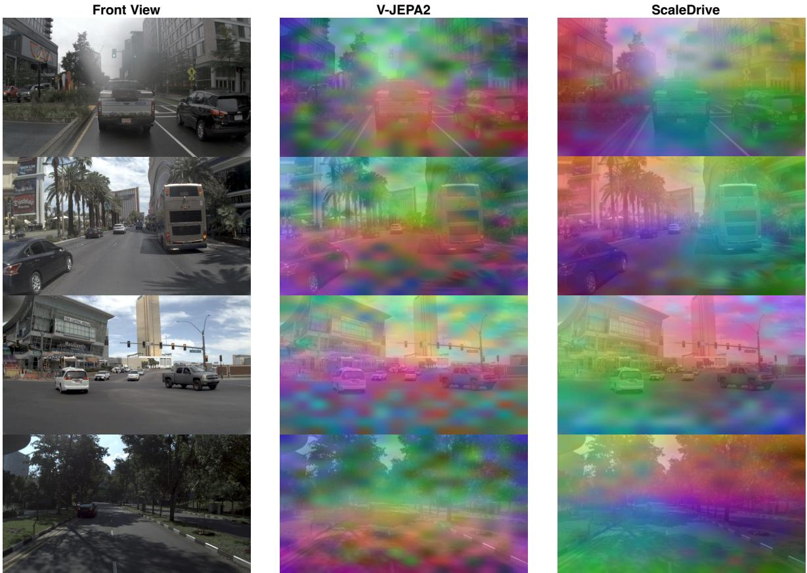  
Figure 6: Visual representation comparison.

## E Limitations

ScaleDrive focuses on learning transferable representations from monocular driving videos and does not explicitly model cross-view correspondences during pretraining. Although the frozen representations can be integrated into multi-camera planners, extending latent prediction to synchronized views may further improve spatial consistency across cameras. In addition, our experiments use a fixed temporal sampling rate and clip length, leaving adaptive temporal sampling and longer-context pretraining unexplored.

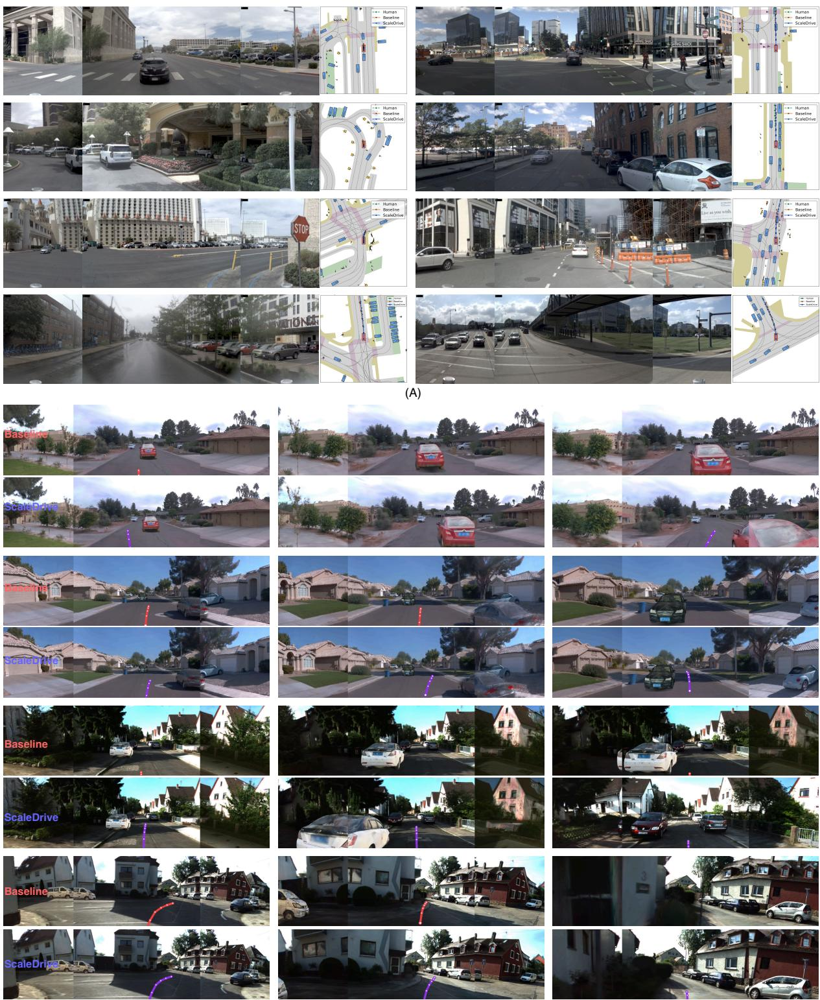  
(B)  
Figure 7: ScaleDrive planning results.(A) NAVSIM and (B) HUGSIM.