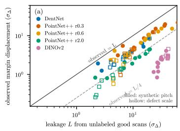
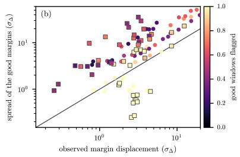
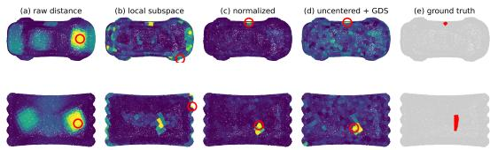

# Subspace Representations for Synthetic-to-Real Transfer in 3-D Surface Inspection

Abdulla Nasir Chowdhury1, Naish Ibrahim1, Gulpi Qorik Oktagalu Pratamasunu1, and Kazuhiro Fukui2

1 Department of Computer Science, University of Tsukuba, Japan {abdullah.nasir,naish,gulpi}@cvlab.cs.tsukuba.ac.jp Tsukuba Institute for Advanced Research, Department of Computer Science, University of Tsukuba, Japan kfukui@cs.tsukuba.ac.jp

Abstract. This paper studies what subspace representations contribute to synthetic-to-real transfer in 3-D surface inspection, where models learn from synthetic defects and the only real data before deployment are scans of good parts. We use three classical constructions as instruments: the nearest-subspace classifier, one-class template subspaces and the generalized diference subspace (GDS). On 1,197 MVTec 3D-AD scans without target annotation we find that every decision rule ranks real defects at a similar window AUC, that image-level detection stays at chance, and that no rule keeps its in-domain threshold. We show that the margin of a nearest-subspace rule moves by at most the part of the feature shift outside its class subspaces, and that this leakage, measured from unlabeled good scans, bounds the displacement observed on unseen scans. On 597 Real3D-AD objects, a one-class subspace of registered templates evaluated at every location on frozen features reaches point AUROC 0.957 on pre-registered scans and a category-mean object AUROC of 78 to 81 with no training on the benchmark. Our results suggest that a subspace helps under shift in proportion to the shift it spans, and that in reference-based inspection the reference and its registration matter more than the subspace.

Keywords: Subspace methods · Synthetic-to-real transfer · Anomaly detection · 3-D surface inspection · Generalized diference subspace

## 1 Introduction

In this paper, we ask what subspace representations contribute to synthetic-toreal transfer. We study the question in 3-D surface inspection, where models are trained on synthetic defects because real defects are rare and costly to annotate, and where the only real data available before deployment are scans of good parts. DentNet [1], for example, segments dents on residual images, the deviation from a fitted quadric, and reaches near-perfect IoU on its synthetic benchmark, but its behavior on real scans of other objects has not been measured.

A subspace suppresses the variation inside its span and leaks the rest, so what it contributes to the transfer depends on where the synthetic-to-real variation lies. A subspace can enter the transfer in two places. It can classify the features of an encoder trained on synthetic data, and then the variation it must absorb is the feature shift between the synthetic and the real domain. It can also model the real good parts directly, and then the variation is the disagreement among good templates and the error of registering a scan to them. We study both cases with the same classical constructions, the nearest-subspace classifier, a one-class subspace of good templates and the generalized diference subspace (GDS) [21], used as instruments rather than as new methods.

We hold the synthetic training fixed and vary the encoder and the decision rule. Three learned families are compared: DentNet [1], an end-to-end U-Net on residual images, PointNet++ [4] trained from scratch on the identical windows as point sets, and patch-based subspace segmentation (PBSS), which classifies DentNet’s frozen features by nearest PCA subspace, with frozen DI-NOv2 [23] features as a foundation-model representation and a training-free surface-variation statistic [30] as the geometric baseline. Two public benchmarks supply the real scans. MVTec 3D-AD [2] provides no registered reference and tests the subspace as a classifier, under a protocol that uses no target annotation. Real3D-AD [3] provides registered good templates and tests the subspace as a model of the good parts. In both, we measure the variation itself and where it lies relative to the subspace, and we separate what a ranking metric shows from what a fixed threshold shows, since the two answer the question diferently.

Our main contributions are summarized as follows:

– As a classifier on synthetic-trained features, a subspace does not rank real defects better than other rules, but it makes the threshold less sensitive to the part of the shift it spans. We show that its margin moves by at most the leakage of the shift outside its class subspaces, a quantity measurable from unlabeled good scans, and that on MVTec 3D-AD this leakage bounds and ranks the displacement observed on unseen scans of every class.

– As a model of the real good parts, a one-class subspace of registered templates turns a frozen synthetic-trained encoder into a detector of real defects on Real3D-AD, where the classifier fails, with no training on the benchmark. We attribute the result step by step and find that the reference and its registration contribute more than the choice of subspace construction.

– We show that a fixed threshold, the window scale and the object aggregation rule can each invert a method ordering, and we report every result under controls that make the ordering visible.

The rest of this paper is organized as follows. Section 2 reviews related work. Section 3 describes the data, the representations, and the subspace as a classifier and as a model of the good parts, and states the leakage bound. Section 4 gives the evaluation protocol. Section 5 reports the in-domain results, the subspace as a classifier on MVTec 3D-AD and Real3D-AD, and the subspace as a model of the good parts on Real3D-AD. Section 6 answers the question and discusses its limitations, and Sec. 7 concludes the paper.

## 2 Related Work

Subspace methods. Classification by subspace distances dates to CLAFIC [16, 17] and Eigenfaces [18]. The mutual subspace method compares two subspaces by their canonical angles [19, 20], and the generalized diference subspace [21] isolates the directions on which a set of subspaces difer. Subspace classifiers over deep features appear in few-shot recognition [22], and a PCA subspace of frozen DINOv2 [23] patch features scored by reconstruction residual is a strong training-free few-shot anomaly detector on images [24]. Both places where we use a subspace come from this line of work: the classifier of Sec. 3.3 is the subspace method itself, and the nominal subspace of Sec. 3.4 is its one-class form placed at a location.

Synthetic-to-real transfer. Domain randomization [25] and adversarial adaptation [26] enlarge or align training distributions. Subspace alignment [27], the geodesic flow kernel [28] and CORAL [29] rest on the shift between domains being carried by leading principal directions. We measure that observation from the classifier’s side with training fixed, and the leakage of Eq. (3) is its quantitative form for a nearest-subspace rule.

3-D surface inspection and anomaly detection. Hand-crafted curvature features [5] preceded DentNet [1]. Point-based architectures [4, 6] consume raw point sets. MVTec 3D-AD [2] and Real3D-AD [3] provide real scans with perpixel masks and per-point labels. The Real3D-AD baseline registers each test scan to a nominal template and scores distances to feature memory banks. The later methods that lead its table either register as well [7, 11] or learn from synthetic anomalies [8–10], and the current best trains PO3AD on the pseudoanomalies of a synthesis framework [13]. Template3D-AD [12] matches curvature features of the test scan against the template at matched center points, the closest published relative of our reference-based construction. All of them use the benchmark’s own templates, as training set or as the reference. Zero-shot methods built on CLIP, PointAD [14] and GS-CLIP [15], detect anomalies on categories they never trained on, with a few annotated auxiliary categories as their supervision. Our learned encoders see neither a Real3D-AD category nor a real defect.

## 3 Data, Representations and Subspace Rules

In this section, we describe the data, the representations in which the transfer is studied, and the two places a subspace enters it: as a classifier on synthetictrained features (Sec. 3.3) and as a model of the real good parts (Sec. 3.4).

## 3.1 Data

Synthetic training data. A scan is a grid of $( x , y , z )$ samples. Following [1], the height is a quadric base $z _ { s } = \alpha x ^ { 2 } + \beta y ^ { 2 }$ plus a dent $z _ { d }$ and noise of 0.15 mm, and the residual $r = z - \hat { z }$ from a least-squares quadric is the input. Dents follow the parametric model of [1] with radius 10 to 45 mm and depth 0.2 to 1.8 mm. We regenerated 30,000 samples on a structured-light scanner’s grid (640 × 760 at 0.187 mm per pixel), seeded by index, with the quadric fitted on all points. IDs 0 to 23,999 train and the rest validate.

Real3D-AD. Twelve categories of small scanned objects [3]: four complete good templates per category and, after removing cut and duplicate items, 597 single-sided test scans, 302 good and 295 with a bulge or sink annotated per point. Defects span a median of 4.5 mm with a median peak relief of 0.6 mm, on objects whose own curvature dominates every window. In five categories (seahorse, candybar, fish, tofees, car) every test scan is pre-registered to a template within 0.05 mm and the templates agree to within 0.17 mm. The other seven we register ourselves (Sec. 4).

MVTec 3D-AD. Ten classes of real structured-light scans [2], organized 800 × 800 height grids at 0.20 to 0.23 mm pitch with per-pixel defect masks: 1,197 test scans, 948 defective (holes, cuts, cracks, contamination, bent parts), median defect extent 10.7 mm.

## 3.2 Representations

Every representation is either trained on synthetic data only or not trained at all, and is frozen before it sees a real scan. All of them operate on the same 64 × 64 residual windows (stride 32, boundary band excluded).

DentNet. A U-Net-style FCN with a 1024-channel bottleneck at 1/16 scale, a mirrored decoder with skips, and a softmax over {normal, dent}, trained with cross-entropy on the synthetic split. We use the archived checkpoint, which reproduces its logged IoU on independent hardware. Its probability is the end-toend detector, and its bottleneck, average-pooled over a window, gives the frozen feature $\mathbf { f } \in \mathbb { R } ^ { 1 0 2 4 }$

PointNet++. A set-abstraction classifier [4] trained from scratch on the identical windows under the identical label rule. Each window becomes a point set $( x , y , r )$ subsampled to 1024 points, centered and divided by its mean radius. Two set-abstraction stages (32 centroids, 16 neighbors, widths 32-32-64, then a global stage 64-128-128) feed a two-layer head, trained with Adam under classbalanced cross-entropy. The grouping radius is selected on held-out training IDs, and all three trained encoders (radius 2.0, 0.6, 0.3) are kept as frozen 128-D representations.

DINOv2. A foundation-model representation that never saw a residual image. Following [24], each window is clipped to ±2 mm, mapped to gray and resized to 224 pixels, the hidden states of layers −12 to −18 of DINOv2 [23] are averaged, and the window’s feature is the mean of its $1 6 \times 1 6$ patch tokens.

Training-free baseline. On raw points, the surface is divided into metric patches, each resampled to a fixed $1 0 \times 1 0$ lattice, which removes point ordering and density. The smallest singular value $S _ { [ 2 ] }$ of the centered $1 0 0 \times 3$ coordinate matrix measures out-of-plane variance, and the surface variation $S _ { [ 2 ] } ^ { 2 } / \sum _ { k } S _ { [ k ] } ^ { 2 }$ [30] is its scale-invariant form. A second statistic is the signed skewness of the plane-fit residual.

## 3.3 The subspace as a classifier

Patch-based subspace segmentation (PBSS) classifies the frozen features of an encoder by nearest subspace. From synthetic training windows labeled dent above a 0.1 dent-pixel fraction, class subspaces are built by PCA with mean $\pmb { \mu } _ { c }$ and basis $\mathbf { V } _ { c } \in \mathbb { R } ^ { K \times d }$ , and a window is classified by nearest reconstruction,

$$
e _ { c } ( \mathbf { f } ) = \big \| ( \mathbf { f } - \pmb { \mu } _ { c } ) - \mathbf { V } _ { c } ^ { \top } \mathbf { V } _ { c } ( \mathbf { f } - \pmb { \mu } _ { c } ) \big \| _ { 2 } , \qquad \hat { y } = \arg \operatorname* { m i n } _ { c } e _ { c } ( \mathbf { f } ) ,\tag{1}
$$

with signed margin $\varDelta = e _ { \mathrm { n o r m a l } } - e _ { \mathrm { d e n t } }$ . Pixel masks come from overlap voting. Two further rules on the same features serve as controls throughout: nearest class mean, which $\mathrm { i s \ E q . \ ( 1 ) }$ with $K { = } 0$ , and a logistic head on standardized features, whose margin is the logit.

Proposition (margin stability under a feature shift). Let $\mathbf { P } _ { c } = \mathbf { V } _ { c } ^ { \top } \mathbf { V } _ { c }$ be the two class projectors. For any feature f and any shift $\delta ,$ each $e _ { c }$ moves by at most $\| ( \mathbf { I } - \mathbf { P } _ { c } ) \delta \| _ { 2 }$ , so

$$
\begin{array} { r } { \left| \Delta ( \mathbf { f } + \pmb { \delta } ) - \Delta ( \mathbf { f } ) \right| \leq \| ( \mathbf { I } - \mathbf { P } _ { \mathrm { n } } ) \pmb { \delta } \| _ { 2 } + \| ( \mathbf { I } - \mathbf { P } _ { \mathrm { d } } ) \pmb { \delta } \| _ { 2 } , } \end{array}\tag{2}
$$

and $\varDelta ( \mathbf { f } + \delta ) = \varDelta ( \mathbf { f } )$ whenever δ lies in both class subspaces. The proof is the triangle inequality, since $e _ { c }$ is the norm of an afine function of f whose linear part is $\mathbf { I } - \mathbf { P } _ { c } .$ The nearest-mean margin obeys the same bound with $\mathbf { P } _ { c } = \mathbf { 0 }$ and the logistic margin moves by exactly $\mathbf { w } ^ { \top } \pmb { \delta }$ , which no subspace bounds. The margin of a nearest-subspace rule is therefore invariant to the part of a shift inside both class subspaces and moves by at most the part they leak.

Leakage diagnostic. Whether a threshold survives depends on that move against the margin’s own spread. We therefore report the bound in units of the in-domain standard deviation $\sigma _ { \varDelta }$ of the margin,

$$
L ( \pmb \delta ) = \frac { \| ( \mathbf { I } - \mathbf P _ { \mathrm { n } } ) \pmb \delta \| _ { 2 } + \| ( \mathbf I - \mathbf P _ { \mathrm { d } } ) \pmb \delta \| _ { 2 } } { \sigma _ { \varDelta } } ,\tag{3}
$$

and call it the leakage of the shift. With δ taken as the mean feature diference between unlabeled good target scans and the synthetic background, L needs no real defect and can be computed before deployment. L below one says the in-domain threshold moves by less than the margin’s spread on the target.

GDS of the class subspaces. A fourth rule projects the features onto a generalized diference subspace [21]. On unit-norm features each class subspace $\mathbf { U } _ { c }$ is built by PCA without centering, $\begin{array} { r } { \mathbf G = \sum _ { c } \mathbf U _ { c } ^ { \top } \mathbf U _ { c } , } \end{array}$ , and the GDS is spanned by the eigenvectors of G after the R with the largest eigenvalues are removed. Features are projected onto it, the class subspaces are rebuilt there, and the margin is the diference of the two projection energies. K, R and the dimension Q kept inside the GDS are selected on held-out training samples only.

## 3.4 The subspace as a model of the good parts

When a registered reference of the good surface is available, a subspace can model the real good parts directly. At every seed of a lattice on the registered test scan (Sec. 4), the templates within tolerance give a nominal set: the template window at the seed and at four quarter-radius in-plane jitters. The windows are encoded by the same frozen encoder, and their K-dimensional PCA subspace is the local nominal subspace, a one-class subspace [16] placed at a location. The score of a test window is the reconstruction error of its feature in that subspace. A score is reported raw and, where marked normalized, divided by the median leaveone-out reconstruction error of the nominal set itself, so that locations where the templates disagree are discounted. Two variants change only the subspace: one is built by PCA without centering, and the other projects the uncentered local subspaces onto the GDS of all local subspaces of a category, built from the templates only, with the R directions of largest eigenvalue removed. The same construction applies to the height-field patches of Sec. 3.2. Nothing in a nominal set comes from a test scan.

## 4 Evaluation Protocol

Synthetic. We report pixel IoU, window ROC-AUC and F1 on the same validation samples, with windows labeled dent above a 0.1 dent-pixel fraction. Every interval is a 95% percentile bootstrap over samples, since windows within a sample are correlated.

Real3D-AD. Every choice below was fixed before any method was scored. Two of them rest on one dataset-level statistic of the test annotations. A probe on a 23-item subsample measured the largest bounding-box side of the annotated defect points at a median of 5.17 mm (4.51 mm over all 295 defects). The primary radius, 3.6 mm, is 1.4 times half the probe value, never tuned on a score, and sets the seed lattice, the tangent frame and the localization tolerance. The similarity factor 6.6 maps the probe value onto 34 mm, the scale of the smallest synthetic dents, and sets the physical size of the 64 × 64 window. No per-item annotation enters any score, threshold, nominal set or rule. Both constants are varied: heightfield statistics at 2.5, 3.6 and 5.0 mm, the learned rules under the metric pitch, and the reference-based stage of Sec. 5.4 at the annotation-free scales 1, 2, 4 and 8. Seeds lie on a voxel lattice at stride half the radius, on the 10 × 10 grid of Sec. 3.2, with a slab of half the radius around the tangent plane applied before resampling, since templates are two-sheeted and test scans single-sided. Object AUROC uses the maximum over seeds and point AUROC the nearest seed’s score. Localization is the argmax seed’s distance to the defect, counted a hit within one radius. Intervals are item-clustered bootstraps (2,000 item-level draws, 300 at point level). The learned methods run zero-shot from the synthetic checkpoints on the 64 × 64 residual window each seed defines, detrended by a ring-fitted quadric, under the metric pitch and the similarity transform above, with rules fitted on synthetic training features only.

MVTec 3D-AD. The primary protocol uses no annotation. The grid is resampled to the synthetic scanner’s pitch of 0.1875 mm, so a 64 × 64 window covers 12 mm on the object as it does in training. As the control we also resample to the pitch that maps the median defect extent of the test masks onto 34 mm (factor 3.19), the defect scale, a dataset-level statistic fixed before any method was scored. Overlapping windows with at least 95% valid pixels are detrended by a ring-fitted quadric, with the residual sign that gives a hole the sign of a synthetic dent. A defect window has more than 0.1 annotated pixels, a normal window none. Every rule’s a-priori threshold is its own decision boundary, margin zero, and the end-to-end probabilities use 0.5. The metrics of Tab. 1 are means over the ten classes, with each pixel scored by the maximum over the windows covering it. The shift δ is the mean feature diference between the windows of ten good training scans per class and the synthetic background, and its prediction is checked on the good test scans of the same class.

Registration and nominal sets. Every test scan is registered to its category’s templates by trimmed point-to-point ICP from 241 initializations per template. The median residual after registration is 0.03 to 0.05 mm in six categories and 0.14 to 0.24 mm in the other six. Six items register at 0.61 to 0.73 mm and are kept (Sec. 5.5). Registration is the cost of the construction, a median of 460 s per item on 20 cores (90th percentile 1,281 s), where the encoder and the subspace scores of a scan take under 0.1 s each. Nominal sets are taken in the tangent frame of each seed. Object scores use the published convention, the maximum over every window, and a coverage rule fixed before any label was read, the maximum over windows whose grid nodes are all sampled (largest nodeto-sample gap at most 0.25 mm). Every constant of this stage was fixed before any label was read and none tuned afterwards: K=3 for the local subspace (the afine dimension of four templates), K=6 for the height field from the declared set {0, 1, 3, 6}, K=50 at category level as in domain, R=1, the quarter-radius jitter, the 1.0 mm tolerance and the 0.25 mm coverage gap. The sweeps of K, R and the template count in Sec. 5.4 were run afterwards.

## 5 Results

We first confirm that every representation and rule works on synthetic data (Sec. 5.1). We then answer the two parts of the question in turn: what a subspace contributes as a classifier on synthetic-trained features (Secs. 5.2 and 5.3), and what it contributes as a model of the real good parts (Secs. 5.4 and 5.5).

## 5.1 In domain

On the validation split DentNet’s dent-class IoU is 96.8% over 4,835 dented samples with window AUC 1.00 and F1 0.866. On its frozen features PBSS at K=50 reaches AUC 0.986 (F1 0.910, IoU 74.8%), the logistic head 0.992 (F1 0.952, IoU 76.2%) and the nearest mean 0.954 (F1 0.714). PointNet++ reaches 0.948 (F1 0.852, IoU 69.7%) and the training-free $S _ { [ 2 ] }$ 0.878 on the 6 × 5 grid.

Sample-clustered 95% half-widths are at most 0.007 in AUC and 0.014 in F1 (0.03 in AUC for $S _ { [ 2 ] } )$ ). The grouping radius is the setting that matters most for PointNet++ (AUC 0.89 at radius 2.0, 0.93 at 0.6, 0.95 at 0.3). Retraining each radius with two further initializations gives a standard deviation over the three seeds of at most 0.001 in AUC and 0.007 in F1, so the ordering of the radii does not come from initialization. The logistic head is the best rule in domain, with a paired F1 gain over PBSS of +0.041 [0.036, 0.047].

## 5.2 The subspace as a classifier: synthetic to MVTec 3D-AD

In this subsection, we ask what a subspace contributes when it classifies the features of an encoder trained on synthetic data. Table 1 applies the representations and rules of Secs. 3.2 and 3.3, fitted on the synthetic training windows, to the 1,197 MVTec 3D-AD scans.

Ranking transfers, calibration does not. We find that every rule separates defect windows from normal ones on objects that share nothing with the synthetic panels, with window AUC between 0.79 and 0.84 and pixel AUROC between 0.74 and 0.82. At the same time every rule flags between 40 and 100% of the good windows at its in-domain threshold, where the end-to-end DentNet probability flags 24%. On the same encoder the rules difer by up to 45 points in that fraction, and the rule that flags least changes from encoder to encoder. A fixed-threshold comparison would therefore read Tab. 1 as a robustness ranking of the decision geometry that the ranking metrics do not support.

The mechanism. Let δ be the mean feature diference between the windows of the good training scans and the synthetic validation background windows. We add δ to every synthetic background feature and record how far each rule’s margin moves, in units of its in-domain standard deviation, and how much of $\| \delta \| ^ { 2 }$ lies inside the class subspaces. On the DentNet encoder the shift is 15.5 feature standard deviations, of which the normal and dent subspaces span 85 and 98%. The leakage L of Eq. (3) therefore allows the margin at most 10.2 of its in-domain standard deviations, and it moves by 4.8, where the logistic margin, with no subspace to absorb the shift, moves by 14.9. The bound holds on every encoder at both window scales (Tab. 1). The ordering of the rules, however, depends on the shift. At the defect scale the nearest subspace moves least of the three rules on every task-trained encoder, whereas at the synthetic pitch, where the shift on the two finest PointNet++ encoders is larger and less of it lies inside the normal subspace, it moves most. How stable a rule is therefore depends on where the shift lies relative to its class subspaces.

The leakage predicts the displacement, class by class. We next test Eq. (3) as a diagnostic (Fig. 1). For each class, δ is estimated on its ten good training scans alone, and L is compared with the displacement of the mean margin on the good test scans of the same class, in 100 encoder, class and scale combinations. The displacement stays below L in every case, at a median of 0.38 of it, and within each task-trained encoder L ranks the classes by their displacement (Spearman 0.93 to 0.99 at both scales). On DINOv2 the bound is loose by an order of magnitude and the ranking weaker (0.87 and 0.38). The spread of the shifted margins matters as well. The good test features carry far more variance than the synthetic background, so the good margins spread over 3 to 51 in-domain standard deviations on the task-trained encoders (Fig. 1b), and where that spread exceeds the displacement the flagged fraction is set by both. Before deployment, the leakage gives the displacement of the operating point and the covariance part of the shift gives its spread.

  
Fig. 1: The leakage diagnostic on MVTec 3D-AD, one point per encoder and class at the synthetic pitch (filled) and the defect scale (hollow), nearest-subspace rule. (a) The label-free leakage L of Eq. (3) from the good training scans of a class against the displacement of the mean margin on its good test scans, both in in-domain standard deviations of the margin. (b) Displacement against the spread of the good test margins, colored by the flagged fraction of good windows.

A diferent subspace construction. The GDS rows of Tab. 1 test whether projecting onto the GDS of the class subspaces (Sec. 3.3) absorbs more of the shift. It helps only where the class subspaces span little of it. On the four tasktrained encoders, whose subspaces already span most of the shift, the GDS lowers the window AUC slightly and flags more good windows. On DINOv2 features almost half of the shift lies outside the sum of the class subspaces, the GDS discards that part, and it has the smallest margin shift of all rules at both window scales. At the defect scale it is also the best ranker of all rules (window AUC 0.881, image AUROC 0.621), while at the synthetic pitch the logistic head ranks 0.02 higher. The gain comes from the projection itself: the uncentered subspace method at the same K without the projection shifts by 9.37, and whitening the sum space by $\varLambda ^ { - 1 / 2 }$ [20] instead of removing its top lowers the window AUC to 0.75.

Scope. Image-level detection stays at chance for every method, since the object’s own geometry (threads, rims, edges) takes the maximum over windows, so these numbers measure zero-shot transfer and not detection on the benchmark’s terms. The defect scale, which uses the test masks, moves every window AUC by at most 0.08 (Tab. 1), and the ranking and calibration findings and the bound hold under both scales.

Table 1: Synthetic training to MVTec 3D-AD, means over the ten classes, rules fitted on synthetic windows only: window AUC, pixel AUROC, image AUROC from the maximum over windows, good test windows flagged at the a-priori threshold, and the margin shift under the measured mean feature shift (in-domain standard deviations), at the synthetic pitch and at the defect scale. K=50 on DentNet and DINOv2, K=25 on PointNet++, R and the GDS dimension Q (25, 25 and 5) selected on held-out training samples.
<table><tr><td rowspan="2">Encoder</td><td rowspan="2">Rule</td><td colspan="5">synthetic pitch, no annotation</td><td colspan="3">defect scale (factor 3.19)</td></tr><tr><td>Window Pixel</td><td></td><td>Image</td><td>Good % Shift</td><td>(σ)</td><td>Window</td><td>Good % Shift (σ)</td><td></td></tr><tr><td>DentNet, end to end probability</td><td></td><td>0.830</td><td>0.807</td><td>0.512</td><td>24</td><td></td><td>0.852</td><td>19</td><td></td></tr><tr><td rowspan="4">DentNet 1024-D</td><td>nearest subspace</td><td>0.837</td><td>0.808</td><td>0.495</td><td>72</td><td>+4.75</td><td>0.852</td><td>98</td><td>+2.99</td></tr><tr><td>nearest mean</td><td>0.829</td><td>0.814</td><td>0.548</td><td>54</td><td>+3.08</td><td>0.834</td><td>93</td><td>+3.06</td></tr><tr><td>logistic</td><td>0.837</td><td>0.808</td><td>0.514</td><td>99</td><td>+14.90</td><td>0.853</td><td>100</td><td>+9.37</td></tr><tr><td>GDS, R=5</td><td>0.823</td><td>0.818</td><td>0.534</td><td>77</td><td>+2.71</td><td>0.812</td><td>99</td><td>+2.59</td></tr><tr><td rowspan="4">PointNet++ r0.3</td><td>nearest subspace</td><td>0.836</td><td>0.795</td><td>0.459</td><td>48</td><td>+9.79</td><td>0.857</td><td>64</td><td>+2.33</td></tr><tr><td>nearest mean</td><td>0.830</td><td>0.806</td><td>0.561</td><td>54</td><td>+3.33</td><td>0.856</td><td>93</td><td>+3.39</td></tr><tr><td>logistic</td><td>0.840</td><td>0.795</td><td>0.460</td><td>58</td><td>+4.93</td><td>0.863</td><td>96</td><td>+3.23</td></tr><tr><td>GDS, R=1</td><td>0.816</td><td>0.788</td><td>0.471</td><td>59</td><td>+3.39</td><td>0.786</td><td>88</td><td>+2.82</td></tr><tr><td rowspan="4">PointNet++ r0.6</td><td>nearest subspace</td><td>0.838</td><td>0.795</td><td>0.460</td><td>46</td><td>+7.30</td><td>0.857</td><td>60</td><td>+1.77</td></tr><tr><td>nearest mean</td><td>0.837</td><td>0.819</td><td>0.558</td><td>45</td><td>+3.67</td><td>0.866</td><td>76</td><td>+3.53</td></tr><tr><td>logistic</td><td>0.839</td><td>0.794</td><td>0.471</td><td>49</td><td>+6.00</td><td>0.867</td><td>84</td><td>+2.75</td></tr><tr><td>GDS, R=1</td><td>0.820</td><td>0.788</td><td>0.536</td><td>62</td><td>+3.23</td><td>0.812</td><td>84</td><td>+3.17</td></tr><tr><td rowspan="4">PointNet++ r2.0</td><td>nearest subspace</td><td>0.837</td><td>0.797</td><td>0.497</td><td>40</td><td>+1.94</td><td>0.848</td><td>43</td><td>+0.56</td></tr><tr><td>nearest mean</td><td>0.834</td><td>0.795</td><td>0.508</td><td>43</td><td>+2.94</td><td>0.867</td><td>64</td><td>+2.58</td></tr><tr><td>logistic</td><td>0.837</td><td>0.796</td><td>0.456</td><td>40</td><td>+1.39</td><td>0.863</td><td>46</td><td>+0.93</td></tr><tr><td>GDS, R=1</td><td>0.793</td><td>0.736</td><td>0.461</td><td>72</td><td>+1.90</td><td>0.788</td><td>77</td><td>+1.90</td></tr><tr><td rowspan="4">DINOv2 1024-D</td><td>nearest subspace</td><td>0.814</td><td>0.785</td><td>0.479</td><td>100</td><td>+1.53</td><td>0.860</td><td>100</td><td>+2.95</td></tr><tr><td>nearest mean</td><td>0.811</td><td>0.777</td><td>0.539</td><td>68</td><td>+1.43</td><td>0.880</td><td>100</td><td>+1.67</td></tr><tr><td>logistic</td><td>0.825</td><td>0.794</td><td>0.513 0.526</td><td>100</td><td>+2.96</td><td>0.789</td><td>100</td><td>+5.65</td></tr><tr><td>GDS, R=1</td><td>0.805</td><td>0.774</td><td></td><td>81</td><td>+1.09</td><td>0.881</td><td>100</td><td>+1.58</td></tr></table>

## 5.3 The subspace as a classifier on Real3D-AD

On Real3D-AD the same classifiers do not transfer. The learned methods, zeroshot from the synthetic checkpoints, stay at chance at object level (0.50 to 0.54 at the pre-declared scale) and flag 49 to 100% of the windows on good objects, and the training-free statistics S[2] and the signed skew sit at 0.52 and 0.55. The defects here span a median of 4.5 mm with a relief of 0.6 mm on strongly curved objects, and no statistic of a window alone separates them from the object’s own shape. The scale moves every learned method by 0.14 to 0.23 in point AUROC, the choice of rule by 0.02. A subspace on synthetic-trained features therefore contributes nothing here, which leads to the second part of the question.

## 5.4 The subspace as a model of the good parts: Real3D-AD

In this subsection, we ask what a subspace contributes when it models the real good parts directly. We give the subspace methods the reference that Real3D-AD’s own baseline uses. In the five registered categories (249 items, 124 defective) every seed has a nominal set (Sec. 3.4). Feature statistics are evaluated at the primary 3.6 mm radius under the scale-6.6 protocol, height-field statistics at 2.5 mm, since the grid’s interpolation error grows with its pitch (normalized nominal subspace 0.76, 0.67 and 0.57 point AUROC at 2.5, 3.6 and 5.0 mm on this subset). Item-clustered half-widths are at most 0.04 at point level and 0.07 at object level.

  
Fig. 2: Two pre-registered Real3D-AD items with a sink (car, top, and tofees, bottom), each point colored by the score of its nearest seed: (a) the raw point-to-template distance, (b) the local nominal subspace on DentNet features, (c) the same normalized by the templates’ leave-one-out disagreement, (d) the uncentered subspace projected onto the GDS (R=1) on PointNet++ features, and (e) the ground truth. The red circle marks the argmax seed, 5 to 19 mm from the defect under (a) and (b), within 0.6 mm under (c) and (d). The raw distance peaks where the scan departs from the templates as a whole, the unnormalized subspace on the rim where the templates disagree, the normalized forms on the sink.

Geometric statistics. Given the reference, a CLAFIC subspace of the nominal set’s height-field patches reaches point AUROC 0.835 at K=6 (no referencefree statistic exceeds 0.64), below the raw point-to-template distance (0.975), since interpolation adds error of the order of the defect.

Frozen learned features plus the reference. The local nominal subspace on frozen features (K=3, Sec. 3.4) reaches point AUROC 0.957 [0.950, 0.962] on DentNet features and 0.948 on PointNet++ features, and places the argmax within one radius of the defect for 70 and 78% of defective objects. The locationspecific reference produces this result: the same features under the in-domain PBSS rule give 0.695, and a category-level one-class subspace of all nominal windows gives 0.80. The raw point-to-template distance ranks as well at point level (0.975), but the local subspace localizes ten times more sharply (a median argmax error of 0.16 against 1.6 mm), because the subspace absorbs the variation among the templates that a raw distance counts as signal. At object level the aggregation rule decides: the maximum over all windows is taken by windows that run of the object (0.71 and 0.75), whereas the maximum over fully sampled windows gives 0.948 [0.913, 0.976] and 0.910, against 0.909 for the raw distance (Fig. 2).

All twelve categories, on the published footing. Table 2 places our statistics beside the published Real3D-AD results, every item under the published maximum over all windows, with the coverage rule of Sec. 4 beside it. The published methods train on the templates and the zero-shot methods on annotated auxiliary categories, while ours use the templates only as the reference, so the table compares object AUROC under one aggregation convention and does not match training conditions. Under that convention the local nominal subspace on DentNet features reaches a category mean of 72.1, below the raw point-to-template distance at 76.4, and its normalized form 78.2 [74.8, 81.5], with 78.7 on PointNet++ features. The gain over the raw distance therefore comes from normalizing by the templates’ own disagreement. The weak categories are those with a registration residual of 0.14 to 0.24 mm, the scale of the defect relief (Sec. 5.5).

What the subspace construction adds. The local subspace above is centered on its own nominal windows with the pre-declared K=3 (a sweep run afterwards peaks at K=9, so K=3 was not tuned). Built without centering, it raises the raw category mean from 72.1 to 77.4, since the direction of the mean carries the defect amplitude that centering removes. Projecting the uncentered local subspaces onto their GDS and removing the one direction common to every location (R=1, fixed before scoring) gives 78.8 on DentNet features and 81.0 [77.8, 84.1] on PointNet++ features, and every R from 1 to 20 stays within 1.1 points. The eight feature rows of Tab. 2 thus lie between 72.1 and 81.0 with overlapping intervals: the choice of subspace construction moves the result by a few points, while the reference moves it from chance to above 70. SubspaceAD [24], one normal subspace per category without a location, sits at 49.1 on DINOv2 features. The best row lies above the zero-shot methods and the learned methods of the PO3AD table, and below Template3D-AD [12] and PO3AD trained on AF3AD pseudo-anomalies [13].

Window scale without annotation. The scale 6.6 of Tab. 2 rests on a statistic of the test annotations (Sec. 4). Rerunning the stage at scales fixed without annotation, every statistic is at chance at the metric pitch, scale 1, where a window covers 12 mm of the object. The normalized GDS rows reach 70.5 and 65.3 at scale 2, 79.1 and 80.3 at scale 4, and 80.9 and 80.2 at scale 8. The construction therefore needs a window within a factor of two of the defect scale the inspection targets, which is part of the inspection specification, and the annotation-derived scale adds nothing over a power of two.

## 5.5 What the nominal subspace absorbs and what it leaks

The nominal subspace suppresses the variation its templates span, so the remaining question is which variation of a real scan it does not span. We answer it by measuring what the registration does to the reference-based scores. The Spearman correlation between a category’s residual and its object AUROC is −0.27 for the DentNet-feature subspace under the published convention and −0.52 under the coverage rule, and pooled item AUROC falls from 0.76 to 0.34 from the residual bin below 0.05 mm to the one above 0.3 mm. On the five pre-registered categories we perturb the registered pose by a translation (0.1 to 1.0 mm) and a rotation (0.25 to 2 degrees) about the centroid and rescore against this set’s own baseline of 0.952 point and 0.80 object AUROC. The largest translation takes point AUROC to 0.77 and object AUROC to 0.64, the largest rotation to 0.90 and 0.68. Point AUROC first falls below 0.90 at a translation of 0.5 mm, the scale of the relief. A translation of 0.1 mm, well inside the in-plane jitter the nominal set contains, costs 0.003. One at the scale of the relief is the variation the subspace does not span.

Table 2: Real3D-AD object-level AUROC (%), mean over the twelve categories and over the five pre-registered ones. Published rows from [10] and the later papers, and two zero-shot methods fine-tuned on annotated auxiliary categories. Ours: every test item (597), no training on the benchmark, under the published object score (maximum over all windows) and the coverage rule of Sec. 4, item-clustered 95% intervals in brackets.
<table><tr><td>Method</td><td>12 cat., max</td><td>12 cat., covered</td><td>5 pre-reg., max</td></tr><tr><td>BTF (raw) [3]</td><td>63.5</td><td></td><td>61.7</td></tr><tr><td>Reg3D-AD [3]</td><td>70.4</td><td></td><td>77.7</td></tr><tr><td>IMRNet [8]</td><td>72.5</td><td></td><td>74.5</td></tr><tr><td>R3D-AD [9]</td><td>73.4</td><td></td><td>70.4</td></tr><tr><td>Group3AD [7]</td><td>75.1</td><td></td><td>83.8</td></tr><tr><td>PO3AD [10]</td><td>76.6</td><td></td><td>76.5</td></tr><tr><td>Reg2Inv [11]</td><td>78.0</td><td></td><td></td></tr><tr><td>Template3D-AD [12]</td><td>84.4</td><td></td><td></td></tr><tr><td>PO3AD + AF3AD [13]</td><td>85.2</td><td></td><td></td></tr><tr><td>PointAD, zero-shot [14]</td><td>74.8</td><td></td><td></td></tr><tr><td>GS-CLIP, zero-shot [15]</td><td>76.4</td><td></td><td></td></tr><tr><td>Point-to-template distance, 2.5 mm</td><td>76.4</td><td>72.6</td><td>93.6</td></tr><tr><td>Nominal subspace, height field, norm., 2.5 mm</td><td>74.4</td><td>79.1</td><td>87.9</td></tr><tr><td>Local nominal subspace, DentNet features</td><td>72.1</td><td>82.1</td><td>80.3</td></tr><tr><td>normalized</td><td>78.2 [74.8, 81.5]</td><td>80.7</td><td>99.0</td></tr><tr><td>uncentered</td><td>77.4 [73.8, 80.9]</td><td>84.6</td><td>92.5</td></tr><tr><td>uncentered, GDS R=1, normalized</td><td>78.8 [75.7, 82.0]</td><td>80.3</td><td>99.1</td></tr><tr><td>Local nominal subspace, PointNet++ features</td><td>74.7</td><td>80.9</td><td>89.3</td></tr><tr><td>normalized</td><td>78.7 [75.2, 82.1]</td><td>79.5</td><td>96.4</td></tr><tr><td>uncentered</td><td>78.3 [74.8, 81.8]</td><td>81.8</td><td>91.9</td></tr><tr><td>uncentered, GDS R=1, normalized</td><td>81.0 [77.8, 84.1]</td><td>80.7</td><td>97.7</td></tr></table>

## 6 Discussion

Findings. We asked what subspace representations contribute to synthetic-toreal transfer, and the answer depends on where the subspace enters. As a classifier on synthetic-trained features, a subspace ranks real defects no better than a nearest mean or a logistic head, and every rule ranks them at window AUC 0.79 to 0.84 on MVTec 3D-AD. Its contribution is a margin that is less sensitive to the part of the shift inside its class subspaces, and the leakage outside them, measured on unlabeled good scans, bounds and ranks how far the threshold moves (Eq. (3)). The shift measured here is too large for any threshold to survive, and its covariance part spreads the good margins further. On frozen DI-NOv2 features, where the class subspaces span under half of the shift, a GDS of them is the least sensitive rule. As a model of the real good parts, a subspace of registered templates turns a frozen encoder into a detector on Real3D-AD, where the classifier fails. There the reference and its registration contribute most, the normalization by template disagreement next, and the choice of subspace construction a few points.

Limitations. For the subspace as a classifier, we measured the shift of one benchmark on five representations of one training task, and its class-conditional part, the shift of real defect features, is not measured. One foundation model was tested, on a representation it was not trained for. For the subspace as a model of the good parts, MVTec 3D-AD has no registered references, so the construction was tested on Real3D-AD only. There the seed radius and the primary window scale are dataset-level statistics of the test annotations, fixed before scoring. Annotation-free scales reproduce Tab. 2 within 1.5 points, but the radius was not swept. The result is bounded by registration, which is also its computational cost.

Implications for subspace methods. A subspace is invariant only to the variation it spans, so its value under synthetic-to-real shift can be read from the geometry of the shift before deployment. For a classifier, the leakage and the spread of the shifted margins, both measurable from unlabeled good scans, decide whether its threshold survives. For a model of the good parts, the variation it spans is the disagreement among templates and the jitter of the nominal set, and the variation it leaks is a pose error at the scale of the defect relief, which is why the registration bounds the result. On Real3D-AD the oldest construction, a few good examples at the same location compared by reconstruction error on a frozen representation, carried most of the result, and the uncentered and GDS variants moved it by a few points. One-class subspaces of normal data have long served as anomaly detectors with fixed, untrained features, on ECG signals [31] and histopathological images [32], and our result places the same construction at a location on 3-D surfaces.

Open directions. For the classifier, the leakage and the spread of Fig. 1 can recalibrate the threshold, or choose R for the GDS, before a real defect is labeled, and comparing a window and its neighbors to the class subspaces by canonical angles, the setting of the mutual subspace method, would replace a single feature with a set. For the model of the good parts, a seed radius fixed from the templates alone and a registered reference for MVTec 3D-AD would remove the remaining use of test annotations and test the construction on a second benchmark. A kernel GDS, convex cones for the sign every reconstruction score discards, a second 2-D foundation model and a point-cloud pretrained encoder would extend both parts.

## 7 Conclusion

We asked what subspace representations contribute to synthetic-to-real transfer, using 1,197 MVTec 3D-AD scans and 597 Real3D-AD objects. A subspace contributes in two places and in diferent ways. As a classifier on synthetic-trained features it ranks real defects no better than other rules, and its contribution is a threshold whose displacement is bounded by the leakage of the shift outside its class subspaces, a quantity measurable before deployment from unlabeled good scans. As a model of the real good parts it makes a frozen encoder detect real defects, with point AUROC 0.957 on the pre-registered scans and a category-mean object AUROC of 78 to 81 on every item, with no training on the benchmark. In that setting the reference and its registration set what the detector can reach.

## References

1. Lafiosca, P., Fan, I.S., Avdelidis, N.P.: Automatic segmentation of aircraft dents in point clouds. SAE Technical Paper 2022-01-0022 (2022)

2. Bergmann, P., Jin, X., Sattlegger, D., Steger, C.: The MVTec 3D-AD dataset for unsupervised 3D anomaly detection and localization. In: VISAPP. pp. 202–213 (2022)

3. Liu, J., Xie, G., Chen, R., Li, X., Wang, J., Liu, Y., Wang, C., Zheng, F.: Real3D-AD: A dataset of point cloud anomaly detection. In: NeurIPS Datasets and Benchmarks (2023)

4. Qi, C.R., Yi, L., Su, H., Guibas, L.J.: PointNet++: Deep hierarchical feature learning on point sets in a metric space. In: NeurIPS (2017)

5. Jovančević, I., Pham, H.H., Orteu, J.J., Gilblas, R., Harvent, J., Maurice, X., Brèthes, L.: 3D point cloud analysis for detection and characterization of defects on airplane exterior surface. J. Nondestructive Evaluation 36(4), 74 (2017)

6. Thomas, H., Qi, C.R., Deschaud, J.E., Marcotegui, B., Goulette, F., Guibas, L.J.: KPConv: Flexible and deformable convolution for point clouds. In: ICCV (2019)

7. Zhu, H., Xie, G., Hou, C., Dai, T., Gao, C., Wang, J., Shen, L.: Towards highresolution 3D anomaly detection via group-level feature contrastive learning. In: ACM Multimedia. pp. 4680–4689 (2024)

8. Li, W., Xu, X., Gu, Y., Zheng, B., Gao, S., Wu, Y.: Towards scalable 3D anomaly detection and localization: A benchmark via 3D anomaly synthesis and a selfsupervised learning network. In: CVPR. pp. 22207–22216 (2024)

9. Zhou, Z., Wang, L., Fang, N., Wang, Z., Qiu, L., Zhang, S.: R3D-AD: Reconstruction via difusion for 3D anomaly detection. In: ECCV (2024)

10. Ye, J., Zhao, W., Yang, X., Cheng, G., Huang, K.: PO3AD: Predicting point ofsets toward better 3D point cloud anomaly detection. In: CVPR (2025)

11. Yu, Y., Chen, Z., Xu, X., Zhang, L., Yang, H., Nie, Y., He, S.: Registration is a powerful rotation-invariance learner for 3D anomaly detection. arXiv:2510.16865 (2025)

12. Liu, Y., Zhang, C., Yang, Y.: Template3D-AD: Point cloud template matching method based on center points for 3D anomaly detection. In: IJCAI. pp. 1630– 1638 (2025)

13. Balapour, A., Hach, F.: Anomaly Factory 3D: A modular framework for diverse pseudo-anomaly synthesis in unsupervised 3D anomaly detection. In: ECCV (2026)

14. Zhou, Q., Yan, J., He, S., Meng, W., Chen, J.: PointAD: Comprehending 3D anomalies from points and pixels for zero-shot 3D anomaly detection. In: NeurIPS (2024)

15. Deng, Z., Liu, A., Wang, Y.: GS-CLIP: Zero-shot 3D anomaly detection by geometry-aware prompt and synergistic view representation learning. In: CVPR (2026)

16. Watanabe, S., Pakvasa, N.: Subspace method of pattern recognition. In: Proc. 1st Int. Joint Conf. on Pattern Recognition. pp. 25–32 (1973)

17. Oja, E.: Subspace Methods of Pattern Recognition. Research Studies Press (1983)

18. Turk, M., Pentland, A.: Eigenfaces for recognition. J. Cognitive Neuroscience 3(1), 71–86 (1991)

19. Yamaguchi, O., Fukui, K., Maeda, K.: Face recognition using temporal image sequence. In: IEEE Int. Conf. on Automatic Face and Gesture Recognition. pp. 318–323 (1998)

20. Fukui, K., Yamaguchi, O.: The kernel orthogonal mutual subspace method and its application to 3D object recognition. In: ACCV 2007. LNCS, vol. 4844, pp. 467–476. Springer (2007)

21. Fukui, K., Sogi, N., Kobayashi, T., Xue, J.H., Maki, A.: Discriminant feature extraction by generalized diference subspace. IEEE TPAMI 45(2), 1618–1635 (2023)

22. Simon, C., Koniusz, P., Nock, R., Harandi, M.: Adaptive subspaces for few-shot learning. In: CVPR (2020)

23. Oquab, M., Darcet, T., Moutakanni, T., Vo, H., Szafraniec, M., Khalidov, V., Fernandez, P., Haziza, D., Massa, F., El-Nouby, A., Assran, M., Ballas, N., Galuba, W., Howes, R., Huang, P.Y., Li, S.W., Misra, I., Rabbat, M., Sharma, V., Synnaeve, G., Xu, H., Jegou, H., Mairal, J., Labatut, P., Joulin, A., Bojanowski, P.: DINOv2: Learning robust visual features without supervision. TMLR (2024)

24. Lendering, C., Akdag, E., Bondarev, E.: SubspaceAD: Training-free few-shot anomaly detection via subspace modeling. In: CVPR. pp. 28557–28566 (2026)

25. Tobin, J., Fong, R., Ray, A., Schneider, J., Zaremba, W., Abbeel, P.: Domain randomization for transferring deep neural networks from simulation to the real world. In: IROS (2017)

26. Ganin, Y., Ustinova, E., Ajakan, H., Germain, P., Larochelle, H., Laviolette, F., Marchand, M., Lempitsky, V.: Domain-adversarial training of neural networks. JMLR 17(59), 1–35 (2016)

27. Fernando, B., Habrard, A., Sebban, M., Tuytelaars, T.: Unsupervised visual domain adaptation using subspace alignment. In: ICCV (2013)

28. Gong, B., Shi, Y., Sha, F., Grauman, K.: Geodesic flow kernel for unsupervised domain adaptation. In: CVPR (2012)

29. Sun, B., Feng, J., Saenko, K.: Return of frustratingly easy domain adaptation. In: AAAI (2016)

30. Pauly, M., Gross, M., Kobbelt, L.P.: Eficient simplification of point-sampled surfaces. In: IEEE Visualization. pp. 163–170 (2002)

31. Ye, J., Kobayashi, T., Murakawa, M., Higuchi, T., Otsu, N.: Anomaly detection using multi-channel FLAC for supporting diagnosis of ECG. IEEJ Trans. Electronics, Information and Systems 132(1), 111–119 (2012)

32. Nosato, H., Kurihara, T., Sakanashi, H., Murakawa, M., Kobayashi, T., Furuya, T., Higuchi, T., Otsu, N., Terai, K., Hiruta, N.: An extended method of higherorder local autocorrelation feature extraction for classification of histopathological images. IPSJ Trans. Computer Vision and Applications 3, 211–221 (2011)