# TERA: Task-Evidence Restoration for Underwater Object Detection under Bandwidth-Constrained Transmission

Heejin Kim   
Sungkyunkwan University   
Seoul, Republic of Korea   
hijin1998@skku.edu   
Joon-Seok Song   
Sungkyunkwan University   
Seoul, Republic of Korea   
jundol@skku.edu   
Eunil Park\*   
Sungkyunkwan University   
Seoul, Republic of Korea   
Jaume I University   
Castellon, Spain   
eunilpark@skku.edu

## Abstract

Underwater object detectors are typically evaluated on pre-transmission images, overlooking additional degradation from bandwidth-constrained downscaling and compression. We introduce AquaTX, a controlled benchmark built from real underwater detection datasets with seen and held-out codecs. We also propose TERA, a metadatablind receiver-side framework combining task-guided pixel restoration and dual-state feature correction while keeping the detector frozen. Under seen compound degradation, TERA improves mean average precision (mAP50:95, averaged over IoU thresholds from 0.50 to 0.95) from 37.7 to 50.0 on DUO-TX and from 31.5 to 41.3 on RUOD-TX relative to the frozen detector without restoration. TERA also preserves clean-input performance and remains competitive with detector fine-tuning under the held-out AVIF codec. These findings support transmission-aware evaluation and task-guided restoration for underwater object detection. Code is available at https://github.com/ hijinkim/TERA.

## 1. Introduction

Underwater robots are increasingly used for marine ecosystem monitoring, fishery resource management, and infrastructure inspection, where object detection is essential for automatically analyzing collected imagery [9, 11, 17, 28, 42]. In bandwidth-constrained underwater monitoring systems, spatial downscaling and lossy compression can be applied to reduce the amount of transmitted image data [4, 24, 44]. Consequently, detectors encounter transmissioninduced degradation in addition to the optical degradation inherent to underwater imaging [40, 48]. We focus on degradation introduced by resizing and lossy coding rather than channel-level corruption such as packet loss or bit errors. Spatial downscaling reduces the spatial support of small objects, while lossy compression can suppress local structures relevant to detection. As transmission settings vary, these effects can alter detection outcomes even for the same underlying scene [10, 14, 35, 46]. This motivates a controlled evaluation that isolates transmission-induced performance loss from pre-existing underwater degradation.

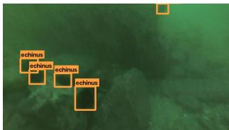

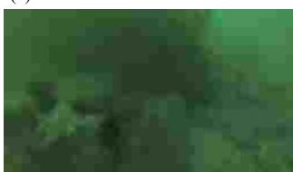

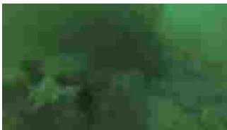

(b) Transmitted image  
(c) Frozen detector  
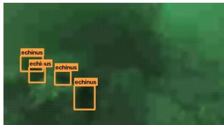  
(d) TERA  
Figure 1. Detection under bandwidth-constrained transmission. (a) Pre-transmission image with ground truth. (b) Transmitted image after downscaling and compression. (c) Missed detections by the frozen detector. (d) TERA restores task evidence and recovers the missed detections without updating the detector.

Unlike conventional underwater enhancement, receiverside restoration targets task-relevant information lost during transmission rather than remove the underwater appearance already present in the detector’s training data.

Existing Underwater Image Enhancement (UIE) methods primarily target optical degradation [47], while some compression-aware restoration methods assume known degradation parameters [23]. Underwater low-bit-rate methods instead modify or jointly optimize the codec, requiring control over both transmitter and receiver [40]. These approaches do not directly address restoration under varying standard codecs with a fixed detector. Moreover, existing underwater detection benchmarks lack controlled transmission degradations for isolating their impact on detection performance.

We address these gaps with AquaTX and TERA. AquaTX applies controlled resize–compression operators to real underwater detection datasets and provides fixed, hash-verified assets for reproducible evaluation across seen and unseen codecs. TERA restores transmission-damaged task evidence through image and detector-feature restoration while keeping the detector frozen and requiring no transmission metadata at inference.

The main contributions of this work are:

• We introduce AquaTX, a benchmark that isolates transmission-induced degradation in real underwater detection data through controlled resizing and standardcodec compression, with unseen-codec evaluation and fixed assets for reproducible comparison.

• We propose TERA, a metadata-blind framework that restores transmission-damaged task evidence in both image and detector-feature spaces while keeping the detector fully frozen. Its dual-state feature restoration jointly exploits degraded and pixel-restored detector features to recover residual task evidence.

• We demonstrate on DUO-TX and RUOD-TX that TERA recovers substantial detection performance under compound transmission while preserving clean-input performance and remaining competitive under an unseen codec.

## 2. Related Work

## 2.1. Underwater Image Enhancement and Taskdriven Restoration

Underwater image enhancement (UIE) mitigates optical degradation such as color distortion, contrast loss, and blur [6]. While conventional UIE focuses primarily on perceptual quality [3, 20, 22, 34], recent task-driven methods optimize enhancement for downstream recognition. DTI-UIE [26] introduces task-aware attention and perceptual supervision for detection and segmentation, TACL [29] uses task-aware feedback, and detection-perceptor [7] approaches propagate recognition supervision to the enhancer. Related task-driven restoration has also been explored for adverse imaging conditions [19, 30] and recognitionoriented super-resolution [16].

These methods demonstrate the benefit of optimizing restoration for machine perception, but do not specifically address receiver-side degradation caused by bandwidthconstrained underwater transmission. In contrast, TERA targets information lost through spatial reduction and lossy compression during transmission, without adapting the detector or requiring transmission metadata.

## 2.2. Feature-space Restoration and Compressionaware Perception

Feature-space approaches denoise corrupted activations [41, 43] or transfer clean representations to networks operating on degraded inputs, while some compressionaware restoration methods exploit codec information such as quality factors or quantization parameters [23]. Underwater low-bit-rate methods jointly design learned codecs to preserve perceptual or machine-vision quality [40].

These approaches either adapt the recognition model, rely on known degradation information, or require control over the transmission codec. TERA instead operates entirely at the receiver: it keeps the detector frozen, uses only decoded RGB inputs, and combines image restoration with direct refinement of the detector’s late task features across both seen and unseen codecs.

## 2.3. Underwater Object Detection Benchmarks

Datasets such as DUO [27] and RUOD [12], along with the Brackish [33] and TrashCan [13] datasets, provide real underwater imagery for evaluating object detection, but primarily capture degradation present at image acquisition. They do not explicitly model the additional resolution loss and compression introduced during bandwidth-constrained transmission. AquaTX extends DUO and RUOD with controlled resize–compression operators while preserving their original content and annotations, enabling reproducible evaluation of receiver-side restoration under both seen and unseen codec conditions.

## 3. The AquaTX Benchmark

Existing underwater object-detection benchmarks capture degradation arising from underwater image formation but generally evaluate detectors on the originally captured images. In bandwidth-constrained deployment, however, images may be spatially reduced and compressed before reaching the receiver, introducing additional degradation that is absent from existing evaluation protocols. This makes it difficult to isolate the effect of transmission or to compare receiver-side restoration methods under controlled conditions. To address this gap, we introduce AquaTX, a benchmark that applies controlled transmission degradation to real underwater object-detection datasets while preserving their original underwater content and annotations.

<table><tr><td>Dataset</td><td>Split</td><td>Images</td><td>Boxes</td></tr><tr><td rowspan="3">DUO-TX</td><td>Train</td><td>6,003</td><td>57,574</td></tr><tr><td>Val</td><td>668</td><td>6,424</td></tr><tr><td>Test</td><td>1,111</td><td>10,517</td></tr><tr><td rowspan="3">RUOD-TX</td><td>Train</td><td>2,712</td><td>21,619</td></tr><tr><td>Val</td><td>301</td><td>2,275</td></tr><tr><td>Test</td><td>1,255</td><td>10,553</td></tr></table>

Table 1. Statistics of the underwater source datasets used in AquaTX. DUO-TX uses the original four-class DUO dataset, while RUOD-TX uses the four-class RUOD-4C subset. Both are evaluated independently under the same transmission protocol.

## 3.1. Underwater Sources and Splits

AquaTX is constructed from two real-world underwater object-detection datasets, DUO [27] and RUOD [12]. Both contain imagery acquired in real underwater environments and thus naturally include degradation caused by attenuation, scattering, turbidity, and color distortion [2]. We do not synthesize or modify these image-formation effects; AquaTX introduces only the additional digital degradation associated with transmission.

We construct two dataset-specific benchmarks, DUO-TX and RUOD-TX, using the same transmission protocol. DUO contains four object categories (holothurian, echinus, scallop, and starfish), whereas the original RUOD contains ten categories. For RUOD-TX, we use the four-class subset RUOD-4C [39], comprising the same target categories as DUO. This allows us to evaluate transmission-induced degradation and recovery across two underwater datasets using a consistent set of object categories. The two datasets are trained and evaluated independently rather than merged.

For DUO, we retain the official 1,111-image test set and split its 6,671 training images into 6,003 training and 668 validation images. For RUOD-4C, we use 1,255 test images and split its 3,013 training images into 2,712 training and 301 validation images. Validation data are derived exclusively from the corresponding training sets, and the test sets are never used for checkpoint selection, hyperparameter tuning, or ablation decisions. Table 1 summarizes the resulting dataset statistics.

## 3.2. Transmission Degradation Model

AquaTX models the digital degradation introduced when an underwater image is transmitted over a bandwidthconstrained link [1]. Given a source image x, the received image is defined as

$$
x _ { d } = T ( x ; L , r , \kappa ) ,\tag{1}
$$

where L denotes the transmitted raster size, r the target coding rate, and κ the codec. The receiver observes only the decoded RGB image $x _ { d }$ and is not provided with any transmission metadata.

<table><tr><td>Condition group</td><td>Factors</td><td>Validation</td><td>Test</td></tr><tr><td>Clean reference</td><td></td><td>1</td><td>1</td></tr><tr><td>Resize-only</td><td>3 sizes</td><td>3</td><td>3</td></tr><tr><td>Codec-only</td><td>codecs×3 rates</td><td>9</td><td>12</td></tr><tr><td>Compound</td><td>codecs×3 sizes×3 rates</td><td>27</td><td>36</td></tr><tr><td>Total</td><td></td><td>40</td><td>52</td></tr></table>

Table 2. AquaTX evaluation conditions. Validation uses the three seen codecs, whereas test evaluation additionally includes the unseen AVIF codec.

Let $( c _ { w } , c _ { h } )$ denote the aspect-ratio-preserving content dimensions obtained by scaling the original image to a long side of 640 pixels. The transmitted raster $( t _ { w } , t _ { h } )$ is obtained by scaling $( c _ { w } , c _ { h } )$ by $L / 6 4 0 .$ . For compound degradation, each sample is generated as follows:

1. Downsample. The source image is directly resized, while preserving aspect ratio, to the transmitted raster whose long side is L.

2. Encode and decode. The resized image is compressed and decoded using codec κ at target rate r.

3. Upsample. The decoded raster is resized back to $( c _ { w } , c _ { h } )$

4. Letterbox. The content is centered on a 640 × 640 canvas and stored losslessly.

Resize-only and codec-only conditions omit the compression or downscaling operation, respectively.

Codec-only controls use $L \ = \ 6 4 0 .$ , thereby isolating compression without spatial reduction. Downsampling is performed directly from the original source using INTER AREA, rather than from an intermediate 640-pixe image. Letterbox padding is never transmitted or codecencoded, avoiding artificial bitrate allocation to padding. The final decoded image is stored losslessly to prevent an additional uncontrolled coding pass.

## 3.3. Operator Family and Evaluation Conditions

AquaTX varies three transmission factors: raster size, coding rate, and codec.

• Raster size. The transmitted long side is $L \in$ {256, 384, 512}, corresponding to {0.4, 0.6, 0.8} of the canonical 640-pixel long side. Although the transmitted resolution varies, all decoded images are resized and letterboxed to the same 640×640 detector input.

• Coding rate. The target coding rates are $r \_ { \mathrm { ~ \scriptsize ~ \in ~ } }$ {0.30, 0.60, 1.00} encoded bits per transmitted-raster pixel. Prior underwater compression studies likewise evaluate low-rate operating points along a bits-per-pixel axis [36]. Because codec quality parameters are not directly comparable across coding standards, a per-image parameter search selects the nearest achievable rate.

• Codec. JPEG 4:2:0 [38], lossy WebP [45], and irreversible JPEG2000 [37] are used as training codecs. AVIF [5] is excluded from training and validation and used at test time to assess unseen-codec generalization.

For auditing, AquaTX records the target rate, achieved rate, encoded size, and selected codec parameter for every generated image. Every evaluation image is processed under every applicable transmission condition, enabling paired comparison across degradation levels without confounding image content with transmission severity. The evaluation protocol contains a clean reference, resizeonly controls, codec-only controls, and compound resize– compression conditions, as summarized in Table 2. The same protocol is applied to DUO-TX and RUOD-TX. Reporting along an achieved-bitrate axis rather than nominal codec quality factors makes conditions comparable across coding standards. A fixed quality factor corresponds to different rate–distortion operating points across JPEG, WebP, and JPEG2000, so matching nominal settings would con found codec identity with degradation severity. The per image parameter search instead drives each codec toward the same target bits per transmitted pixel, while the recorded achieved rate, encoded size, and selected parameter allow residual rate mismatch to be audited. Supplementary Sec. S3 audits this rate matching in detail, showing that the mean achieved rate remains within 0.02 bpp of the target across all codec–rate pairs.

## 3.4. Frozen Evaluation and Training Protocol

All validation and test degradations are generated once and frozen. The same degradation-generation implementation, codec versions, and rate-matching procedure are used for DUO-TX and RUOD-TX. We provide fixed evaluation assets with per-image transmission settings, achieved rates, and content hashes, enabling comparisons on identical decoded inputs and detection of changes to these assets.

Training degradation is generated online. For each source dataset, training samples are drawn from a fixed mixture of 10% clean, 10% resize-only, 10% codec-only, and 70% compound conditions using only the three seen codecs. AVIF is never used for training, validation, model selection, or hyperparameter tuning. No transmission metadata is provided to TERA or any metadata-blind comparison method during either training or inference.

## 4. Method

In AquaTX (Sec. 3), an object detector receives a transmission-degraded RGB image $x _ { d }$ without information about the transmitted resolution, coding rate, or codec. The detector is trained on pre-transmission underwater images and remains frozen throughout TERA training. Our goal is to improve detection performance on transmissiondegraded inputs without modifying the detector.

Given $x _ { d } ,$ , we extract $P _ { 3 } / P _ { 4 }$ features from the frozen detector backbone and use them to guide pixel restoration:

$$
E _ { d } = { \mathcal { B } } _ { P _ { 3 } , P _ { 4 } } ( x _ { d } ) , \qquad x _ { r } = R _ { \theta } ( x _ { d } , E _ { d } ) ,\tag{2}
$$

where $x _ { r }$ is the pixel-restored image. Here, $E _ { d }$ denotes intermediate backbone guidance and is distinct from the late neck features used below. Let $F ^ { l } ( x )$ denote the feature at pyramid level l produced by the frozen backbone and neck. The degraded and restored paths yield

$$
Z _ { d } ^ { l } = F ^ { l } ( x _ { d } ) , \quad Z _ { r } ^ { l } = F ^ { l } ( x _ { r } ) , \quad l \in \{ N _ { 3 } , N _ { 4 } , N _ { 5 } \} .\tag{3}
$$

The evidence restorer jointly corrects the $N _ { 3 }$ and $N _ { 4 }$ levels, while $N _ { 5 }$ follows the restored path unchanged:

$$
\begin{array} { r l } & { \left( Z _ { c } ^ { N _ { 3 } } , Z _ { c } ^ { N _ { 4 } } \right) = E _ { \phi } \left( Z _ { d } ^ { N _ { 3 } } , Z _ { d } ^ { N _ { 4 } } , Z _ { r } ^ { N _ { 3 } } , Z _ { r } ^ { N _ { 4 } } \right) , } \\ & { \qquad Z _ { c } ^ { N _ { 5 } } = Z _ { r } ^ { N _ { 5 } } . } \end{array}\tag{4}
$$

The corrected pyramid $Z _ { c } = \{ Z _ { c } ^ { N _ { 3 } } , Z _ { c } ^ { N _ { 4 } } , Z _ { c } ^ { N _ { 5 } } \}$ is passed to the frozen detection head to obtain ${ \hat { y } } .$ Only θ and $\phi$ are optimized; all detector parameters and BatchNorm statistics remain fixed.

## 4.1. Pixel Restoration

The pixel restorer $R _ { \theta }$ is a task-guided encoder–decoder that predicts a gated RGB residual. Its spatial gate, correction amplitude, and RGB residual are all conditioned on the degraded image and the frozen backbone guidance $E _ { d } \mathbf { : }$

$$
\begin{array} { r l } & { x _ { r } = \mathrm { c l i p } \Big ( x _ { d } + g _ { s } ( x _ { d } , E _ { d } ) \odot a ( x _ { d } , E _ { d } ) } \\ & { \qquad \odot \Delta _ { \mathrm { r g b } } ( x _ { d } , E _ { d } ) , 0 , 1 \Big ) . } \end{array}\tag{5}
$$

The spatial gate satisfies $g _ { s } \in [ 0 , 1 ]$ . We parameterize the correction amplitude as $a = a _ { \mathrm { m a x } } \sigma ( \cdot )$ with $a _ { \mathrm { m a x } } = 0 . 2$ and $\Delta _ { \mathrm { r g b } } = \mathrm { t a n h } ( \cdot ) \in [ - 1 , 1 ]$ , bounding the per-channel RGB correction by 0.2 before clipping. This conditioning allows detector features to guide restoration toward taskrelevant image regions, while the residual formulation limits unnecessary changes to the received input.

$R _ { \theta }$ targets spatial and coding distortions introduced during transmission rather than explicitly removing the underwater appearance already present before transmission. Because image-space restoration may still leave discrepancies in the detector representation, TERA subsequently corrects the late task features directly.

## 4.2. Dual-State Evidence Restoration

TERA refines the late $N _ { 3 }$ and $N _ { 4 }$ pyramid levels and passes the coarsest $N _ { 5 }$ level unchanged from the restored path. The evidence restorer $E _ { \phi }$ compares the degraded state $Z _ { d }$ with the restored state $Z _ { r }$ and predicts bounded residual corrections to the latter. The restored state compensates for transmission degradation but remains imperfect, as pixel restoration may alter structures relevant to the detector. Meanwhile, the degraded state may retain complementary evidence that is changed or suppressed by restoration. By jointly encoding both states and their differences, $E _ { \phi }$ conditions its correction on restoration-induced changes rather than relying on either state alone.

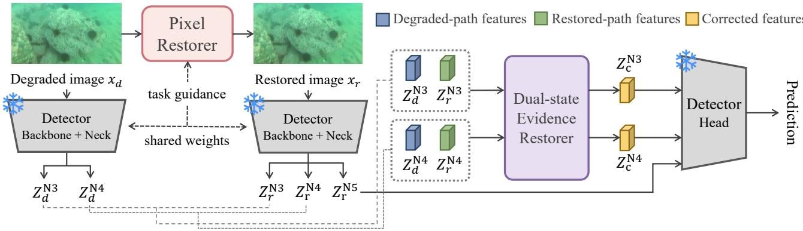  
(a) Overall TERA Pipeline

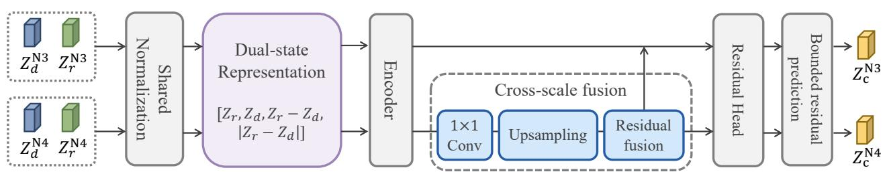  
(b) Dual-state Evidence Restorer  
Figure 2. Overview of TERA. The pixel restorer uses intermediate backbone $P _ { 3 } / P _ { 4 }$ features from the degraded path for task-guided RGB restoration, whereas the evidence restorer operates on later neck features $N _ { 3 } / N _ { 4 }$ . The degraded and restored images are forwarded through the same frozen backbone and neck to obtain two late feature states. A dual-state evidence restorer jointly exploits these states to refine the $N _ { 3 }$ and $N _ { 4 }$ pyramid levels, while $N _ { 5 }$ follows the restored-image path unchanged. Only the pixel and evidence restorers are trainable.

Dual-state representation with shared normalization. For each $l \in \{ N _ { 3 } , N _ { 4 } \}$ , level-specific per-channel statistics $( \mu ^ { l } , \sigma ^ { l } )$ are precomputed once from restored-state training features at the pixel-restoration initialization and kept fixed during joint optimization and inference. The same statistics are applied to both states:

$$
\tilde { Z } _ { d } ^ { l } = \frac { Z _ { d } ^ { l } - \mu ^ { l } } { \sigma ^ { l } } , \qquad \tilde { Z } _ { r } ^ { l } = \frac { Z _ { r } ^ { l } - \mu ^ { l } } { \sigma ^ { l } } .\tag{6}
$$

Applying the same normalization to both states allows their feature differences to be measured on a consistent channelwise scale. Their level-wise representation is

$$
\boldsymbol { U } ^ { l } = \left[ \tilde { Z } _ { r } ^ { l } , ~ \tilde { Z } _ { d } ^ { l } , ~ \tilde { Z } _ { r } ^ { l } - \tilde { Z } _ { d } ^ { l } , ~ \left| \tilde { Z } _ { r } ^ { l } - \tilde { Z } _ { d } ^ { l } \right| \right] ,\tag{7}
$$

where the signed and absolute differences encode the direction and magnitude of the change from pixel restoration.

Cross-scale encoding. Each $U ^ { l }$ is projected to 96 channels and processed by two residual blocks, producing $h _ { 3 }$ and $h _ { 4 } .$ . A one-way $N _ { 4 }  N _ { 3 }$ fusion projects and upsamples $h _ { 4 }$ before combining it with $h _ { 3 }$ . We denote the fused representation by $\bar { h } _ { N _ { 3 } }$ and set $\bar { h } _ { N _ { 4 } } = h _ { 4 }$ , without feeding the fused $N _ { 3 }$ representation back into $N _ { 4 }$

Bounded residual prediction. A level-specific head $H _ { l }$ predicts a correction in normalized feature units:

$$
r ^ { l } = b \operatorname { t a n h } \bigl ( H _ { l } ( \bar { h } _ { l } ) \bigr ) , \qquad l \in \{ N _ { 3 } , N _ { 4 } \} .\tag{8}
$$

where $b = 3$ bounds the correction magnitude. The normalized residual is converted to the detector’s native perchannel scale and added to the restored state:

$$
Z _ { c } ^ { l } = Z _ { r } ^ { l } + \sigma ^ { l } \odot r ^ { l } , \qquad l \in \{ N _ { 3 } , N _ { 4 } \} .\tag{9}
$$

This bounded residual formulation corrects rather than replaces the restored detector representation.

## 4.3. Training Objective

Let D denote the frozen detector and $D _ { \mathrm { h e a d } }$ its detection head. TERA is trained with detector supervision and a pre-transmission teacher. Let $Y _ { c }$ and $Y _ { T }$ denote the raw detection-head responses before box decoding and NMS for the corrected and pre-transmission reference paths, respectively. Here, $\gamma ^ { \mathrm { { \dot { c } l s } } }$ denotes classification logits and $Y ^ { \mathrm { d f } }$ the raw distributional box-regression response. The teacher is used only during training and introduces no separately trained network. The pre-transmission path provides a content-matched target representing the detector response before transmission-induced information loss. It therefore guides recovery of task evidence lost during transmission rather than encouraging removal of the original underwater appearance. The overall objective is

$$
\begin{array} { r } { \mathcal { L } = \mathcal { L } _ { \mathrm { G T } } + \lambda _ { \mathrm { K D } } \mathcal { L } _ { \mathrm { K D } } + \lambda _ { \mathrm { i d } } \mathcal { L } _ { \mathrm { i d } } + \lambda _ { \mathrm { r e s } } \mathcal { L } _ { \mathrm { r e s } } . } \end{array}\tag{10}
$$

Detection supervision. $\mathcal { L } _ { \mathrm { G T } }$ is the detector’s boxregression, classification, and distribution-focal loss [25] computed against ground truth. Although the detector is frozen, gradients propagate through it to the restorers.

Foreground-restricted teacher distillation. Rather than densely matching $Y _ { T }$ , we restrict distillation to the foreground set $\mathcal { F }$ obtained by applying the task-aligned assigner to detached corrected predictions and ground truth:

$$
\begin{array} { r l } {  { \mathcal { L } _ { \mathrm { K D } } = \frac { 1 } { | \mathcal { F } | } \sum _ { i \in \mathcal { F } } \Big [ \mathrm { B C E } \big ( Y _ { c , i } ^ { \mathrm { c l s } } , \mathrm { s g } \big ( \sigma ( Y _ { T , i } ^ { \mathrm { c l s } } ) \big ) \big ) } \quad } & { } \\ & { + \lambda _ { \mathrm { d f } } \mathrm { S L } 1 \big ( Y _ { c , i } ^ { \mathrm { d f } } , \mathrm { s g } ( Y _ { T , i } ^ { \mathrm { d f } } ) \big ) \Big ] , } \end{array}\tag{11}
$$

where BCE denotes binary cross-entropy with logits, SL1 denotes the smooth L1 loss, and sg(·) denotes stop-gradient. This focuses the teacher signal on object-related responses without forcing dense reproduction of the pre-transmission detector output. This avoids allowing the large number of background locations to dominate the distillation objective.

Identity and residual regularization. To discourage unnecessary feature correction when no transmission degradation is present, we regularize the residual $r _ { \mathrm { r e f } } ^ { l }$ predicted for transmission-free inputs:

$$
\mathcal { L } _ { \mathrm { i d } } = \sum _ { l \in \{ N _ { 3 } , N _ { 4 } \} } \left. r _ { \mathrm { r e f } } ^ { l } \right. _ { 1 } .\tag{12}
$$

We additionally regularize the magnitude of feature corrections on degraded inputs:

$$
\mathcal { L } _ { \mathrm { r e s } } = \sum _ { l \in \{ N _ { 3 } , N _ { 4 } \} } \left\| r ^ { l } \right\| _ { 1 } .\tag{13}
$$

These terms bias the evidence restorer toward small corrections while allowing the detector-driven objectives to determine their task-relevant direction. The pixel residual is not explicitly regularized; its magnitude is controlled structurally by the bounded amplitude term, spatial gating, and zero-initialized residual head.

The pixel and evidence restorers are optimized jointly while the detector remains frozen. At inference time, the teacher and all training losses are removed; TERA requires only the received degraded image and the frozen detector.

## 5. Experiments

## 5.1. Implementation Details

Detector and baselines. All experiments use YOLOv8s [18] (11.1M parameters) at $6 4 0 ~ \times ~ 6 4 0$ resolution. We train Clean-YOLO on the pre-transmission images for 100 epochs and keep its weights and BatchNorm statistics frozen for TERA and receiver-side restoration baselines. The degradation-fine-tuned baseline (DegFT-YOLO) is initialized from Clean-YOLO and fine-tuned for 50 epochs using the same AquaTX training degradation distribution as TERA. Clean-YOLO uses mosaic, geometric (scaling and translation), color (HSV), and horizontal-flip augmentations, whereas DegFT-YOLO uses only horizontal flipping. We report mAP50:95, averaged over IoU thresholds from 0.50 to 0.95 in steps of 0.05.

TERA training. TERA contains a 6.52M-parameter pixel restorer based on a NAFNet encoder–decoder [8] and a 1.05M-parameter evidence restorer. The evidence restorer operates on $N _ { 3 } / N _ { 4 }$ with width-96 dual-state encoders and one-way $N _ { 4 }  N _ { 3 }$ fusion, while $N _ { 5 }$ remains unchanged. Joint TERA optimization is initialized from a pretrained pixel-restoration checkpoint. The pixel and evidence restorers are then optimized together with AdamW [32] and cosine annealing [31] for 6,000 steps on DUO-TX and 5,000 steps on RUOD-TX. We set $\lambda _ { \mathrm { K D } } ~ = ~ 1 . 0 , ~ \lambda _ { \mathrm { d f } } ~ = ~ 0 . 1$ $\lambda _ { \mathrm { r e s } } ~ = ~ 1 0 ^ { - 3 }$ , and $\lambda _ { \mathrm { i d } } ~ = ~ 0 . 5$ . Additional training details are provided in the supplementary material.

Computational profiling. Full TERA uses two frozen backbone/neck passes for the degraded and restored inputs and runs at 25.81 ms/image for 640 × 640 inputs with batch size 1 on an NVIDIA H200. For comparison, the frozen detector alone requires 4.99 ms/image, while pixelonly restoration takes 23.28 ms/image, indicating that the additional dual-state feature stage incurs approximately 2.5 ms. This cost reflects a receiver-side compute–robustness trade-off and does not increase the transmitted data volume. Detailed comparisons of parameter count, FLOPs, latency, peak GPU memory, and the accuracy–compute trade-off are provided in the supplementary material.

<table><tr><td>Strategy</td><td>Method</td><td>(1) (3)</td><td>Clean Resize-only Codec-only Seen comp. Unseen AVIF</td><td>(9)</td><td>(27)</td><td>(9)</td><td>∆Clean</td></tr><tr><td colspan="2">DUO-TX</td><td></td><td></td><td></td><td></td><td></td><td></td></tr><tr><td rowspan="2">No adaptation</td><td>Clean-YOLO</td><td>65.7</td><td>60.3</td><td>57.0</td><td>37.7</td><td>42.2</td><td>0.0</td></tr><tr><td>UWCNN [21] (FT)</td><td>63.4</td><td>59.6</td><td>56.0</td><td>38.3</td><td>43.0</td><td>-2.3</td></tr><tr><td rowspan="2">Image restoration</td><td>NU2Net [15] (FT)</td><td>64.2</td><td>60.4</td><td>56.5</td><td>38.9</td><td>43.4</td><td>-1.5</td></tr><tr><td>EDTR (FT) [19]</td><td>33.6</td><td>33.2</td><td>32.4</td><td>27.3</td><td>28.7</td><td>-32.1</td></tr><tr><td>Detector adaptation</td><td>DegFT-YOLO</td><td>61.4</td><td>59.9</td><td>58.2</td><td>48.1</td><td>50.8</td><td>-4.3</td></tr><tr><td>Task-evidence restoration</td><td>TERA (Ours)</td><td>66.4</td><td>65.7</td><td>61.9</td><td>50.0</td><td>53.2</td><td>+0.7</td></tr><tr><td>RUOD-TX</td><td></td><td></td><td></td><td></td><td></td><td></td><td></td></tr><tr><td>No adaptation</td><td>Clean-YOLO</td><td>51.5</td><td>48.4</td><td>46.0</td><td>31.5</td><td>35.7</td><td>0.0</td></tr><tr><td rowspan="2">Image restoration</td><td>UWCNN (FT)</td><td>40.8</td><td>37.6</td><td>36.2</td><td>24.9</td><td>28.1</td><td>-10.7</td></tr><tr><td>NU2Net (FT)</td><td>50.6</td><td>48.7</td><td>45.8</td><td>32.4</td><td>36.1</td><td>-0.9</td></tr><tr><td></td><td>EDTR (FT)</td><td>24.1</td><td>23.9</td><td>23.7</td><td>20.1</td><td>20.8</td><td>-27.4</td></tr><tr><td>Detector adaptation</td><td>DegFT-YOLO</td><td>48.6</td><td>48.0</td><td>47.0</td><td>41.4</td><td>43.1</td><td>-2.9</td></tr><tr><td>Task-evidence restoration</td><td>TERA (Ours)</td><td>52.1</td><td>51.0</td><td>49.2</td><td>41.3</td><td>43.2</td><td>+0.6</td></tr></table>

Table 3. Main detection results on AquaTX in m $\mathrm { \Omega _ { \mathrm { 1 } } P _ { 5 0 : 9 5 } }$ (%). Clean-YOLO is trained on the original pre-transmission images and directly evaluated without restoration or degradation adaptation. Image-restoration methods operate in front of the same frozen Clean-YOLO detector, whereas DegFT-YOLO adapts the detector itself. Resize-only, codec-only, and seen-compound results are macro-averaged over 3, 9, and 27 conditions, respectively. Unseen AVIF denotes the nine compound conditions generated using the held-out AVIF codec; the three AVIF codec-only controls are excluded from the main aggregate. ∆Clean is the clean-input change relative to Clean-YOLO. Best and second-best results are shown in bold and underline, respectively. Zero-shot results and additional enhancement baselines are reported in the supplementary material.

## 5.2. Main Comparison

Transmission degradation substantially reduces detection performance on both datasets. Under the primary compound setting, $\mathrm { m A P _ { 5 0 : 9 5 } }$ drops from 65.7 to 37.7 on DUO-TX and from 51.5 to 31.5 on RUOD-TX.

Comparison with detector adaptation. DegFT recovers substantial robustness but reduces clean-input performance from 65.7 to 61.4 on DUO-TX and from 51.5 to 48.6 on RUOD-TX. TERA instead keeps the detector frozen, outperforming DegFT by 1.9 points on DUO-TX and achieving essentially identical compound performance on RUOD-TX.

Under the isolated transmission factors, TERA outperforms DegFT under both resize-only and codec-only degradation on DUO-TX (65.7/61.9 vs. 59.9/58.2) and RUOD-TX (51.0/49.2 vs. 48.0/47.0).

Comparison with receiver-side restoration. Even after task-specific fine-tuning, conventional receiver-side restoration baselines remain limited under compound transmission. For example, NU2Net-FT reaches 38.9 and 32.4 $\mathrm { m A P _ { 5 0 : 9 5 } }$ on DUO-TX and RUOD-TX, respectively, compared with 50.0 and 41.3 for TERA. Zero-shot application of existing enhancement and restoration methods consistently performs below the raw transmitted input; detailed results are provided in the supplementary material.

Full TERA Gains over Pixel-only Restoration  
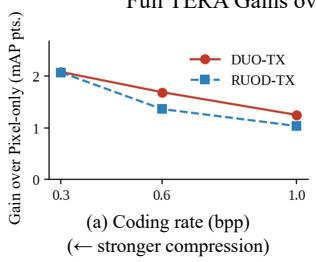

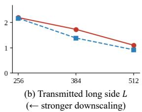  
Figure 3. Incremental gain of full TERA over pixel-only restoration under varying transmission severity. When averaged over the remaining transmission factors, the gain over pixel-only restoration is larger at lower coding rates (left) and smaller transmitted rasters (right) on both datasets.

Generalization to an unseen codec. TERA achieves 53.2 on DUO-TX and 43.2 on RUOD-TX under the unseen AVIF codec, compared with 50.8 and 43.1 for DegFT. Since DegFT also generalizes, TERA demonstrates comparable or better robustness under codec shift.

## 5.3. Ablation Study

We ablate the main components of TERA on DUO-TX in Table 4. Pixel restoration provides the largest single improvement, increasing seen-compound m $\mathrm { A P _ { 5 0 : 9 5 } }$ from 37.67 to 48.33 and unseen-codec performance from 42.19 to 51.58. This establishes image-space restoration as the primary stage while maintaining clean-input performance.

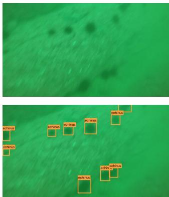  
(a) Clean + Ground Truth

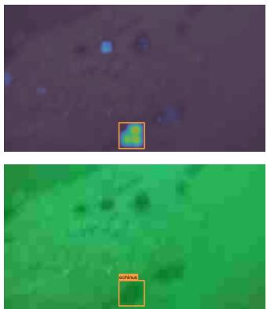  
(b) Transmitted Input

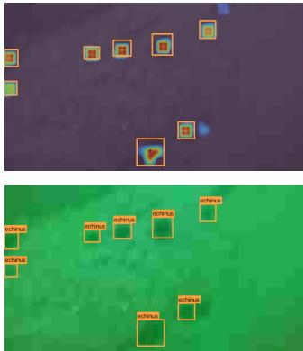  
(c) Pixel-only

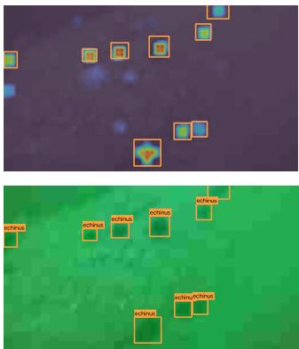  
(d) Full TERA

Figure 4. Qualitative ablation of TERA. Columns (a)–(d) show the clean reference with ground truth, the transmitted input, the result after pixel-only restoration, and the final detection result obtained using full TERA, respectively. The first row visualizes detector response maps before box decoding, where warmer colors indicate stronger object evidence. The second row shows the corresponding detection results. Compared with pixel-only restoration, full TERA strengthens object responses and recovers additional detections.
<table><tr><td>Configuration</td><td>Seen Comp.</td><td>Clean</td><td>Unseen AVIF</td></tr><tr><td>Raw</td><td>37.7</td><td>65.7</td><td>42.2</td></tr><tr><td>Pixel only</td><td>48.3</td><td>66.0</td><td>51.6</td></tr><tr><td>+ Dual-state restoration</td><td>49.6</td><td>66.6</td><td>52.8</td></tr><tr><td>+ Foreground KD (TERA)</td><td>50.0</td><td>66.4</td><td>53.2</td></tr><tr><td>Feature-L1 objective</td><td>45.9</td><td>65.5</td><td>49.9</td></tr></table>

Table 4. Ablation of TERA on DUO-TX in $\mathrm { m A P _ { 5 0 : 9 5 } }$ (%). Seen Comp. and Unseen AVIF are macro-averaged over 27 and 9 conditions, respectively.

Adding dual-state evidence restoration further improves the two settings to 49.58 and 52.81, respectively, indicating that detector-space correction recovers residual task evidence not recovered by pixel restoration alone. Figure 3 further shows that, when averaged by transmission factor, the gain of full TERA over pixel-only restoration increases with transmission severity. The average gain over pixel-only restoration is larger at lower coding rates and smaller transmitted rasters on both datasets, reaching 2.07 and 2.17 mAP points on RUOD-TX at 0.30 bpp and L = 256, respectively. Notably, full TERA outperforms pixel-only restoration in all 27 seen-compound conditions on both datasets, supporting the effectiveness of the complete refinement approach under diverse transmission conditions. This improvement comes at an additional inference cost of 2.53 ms/image over pixel-only restoration (25.81 vs. 23.28 ms on an H200). Foreground-restricted teacher distillation provides a smaller additional gain, improving seen-compound performance from 49.58 to 50.0. Because the teacher is used only during training, this gain introduces no additional inference-time computation.

We further compare the task-driven objective with direct L1 reconstruction of the pre-transmission detector features. Feature-L1 matching reaches only 45.94 under seen compound degradation and 49.86 on the unseen codec, performing below pixel restoration alone. Thus, minimizing a generic distance to the pre-transmission representation is not sufficient for recovering features useful to the detection head, supporting task-driven evidence restoration.

## 6. Conclusion

We introduced AquaTX and TERA to study underwater object detection under bandwidth-constrained transmission. AquaTX enables controlled evaluation of transmission-induced degradation through independent underwater datasets, factor-isolated controls, and a held-out codec. TERA restores task evidence without modifying the detector or requiring transmission metadata. It uses frozen backbone guidance for pixel restoration and combines degraded and restored detector features to recover residual evidence in the late feature pyramid. Across DUO-TX and RUOD-TX, TERA substantially recovers detection performance while preserving clean-input performance and remaining competitive under a held-out codec. Unlike detector fine-tuning, TERA does not require sacrificing cleaninput accuracy. Ablation results show image-space restoration provides the primary recovery, while feature refinement and foreground distillation provide additional gains, particularly under stronger transmission degradation. These results highlight the importance of restoring task-relevant representations rather than image appearance alone.

This study is limited to a single detector architecture, leaving its generalizability to other detector families unverified. Moreover, AquaTX does not model packet loss or time-varying channel conditions. Additionally, TERA introduces inference overhead that may limit deployment on resource-constrained hardware. Future work will explore efficient restoration and broader evaluation across detectors, codecs, and transmission conditions.

## Acknowledgements

This work was supported by the National Research Foundation of Korea (NRF) grant funded by the Korea government (MSIT) (RS-2026-25617165). This work also was supported by the Institute of Information & Communications Technology Planning & Evaluation (IITP) grant funded by the Korea government (MSIT) (RS-2026-25616928, AI Star Fellowship Support Program (Ulsan National Institute of Science and Technology, Inter-University); RS-2024- 00436936, the ITRC (Information Technology Research Center) grant; RS-2023-00259497, the ICAN (ICT Challenge and Advanced Network of HRD) support program).

## References

[1] Jonghyun Ahn, Shinsuke Yasukawa, Takashi Sonoda, Yuya Nishida, Kazuo Ishii, and Tamaki Ura. An optical image transmission system for deep sea creature sampling missions using autonomous underwater vehicle. IEEE Journal ofOceanic Engineering, 45(2):350–361, 2018. 3

[2] Derya Akkaynak and Tali Treibitz. A revised underwater image formation model. In Proceedings ofthe IEEE Conference on Computer Vision and Pattern Recognition (CVPR), 2018. 3

[3] Derya Akkaynak and Tali Treibitz. Sea-thru: A method for removing water from underwater images. In Proceedings of 2019 IEEE/CVF Conference on Computer Vision and Pattern Recognition (CVPR), pages 1682–1691. IEEE, 2019. 2

[4] Ian F Akyildiz, Dario Pompili, and Tommaso Melodia. Underwater acoustic sensor networks: research challenges. Ad hoc networks, 3(3):257–279, 2005. 1

[5] Alliance for Open Media. AV1 image file format (AVIF). https://aomediacodec.github.io/ av1-avif/, 2019. Accessed: 2026-08-27. 4

[6] Saeed Anwar and Chongyi Li. Diving deeper into underwater image enhancement: A survey. Signal Processing: Image Communication, 89:115978, 2020. 2

[7] Long Chen, Zheheng Jiang, Lei Tong, Zhihua Liu, Aite Zhao, Qianni Zhang, Junyu Dong, and Huiyu Zhou. Perceptual underwater image enhancement with deep learning and physical priors. IEEE Transactions on Circuits and Systems for Video Technology, 31(8):3078–3092, 2020. 2

[8] Liangyu Chen, Xiaojie Chu, Xiangyu Zhang, and Jian Sun. Simple baselines for image restoration. In Computer Vision – ECCV 2022: 17th European Conference, Tel Aviv, Israel, October 23–27, 2022, Proceedings, Part VII, pages 17–33. Springer, 2022. 6

[9] Ellen M Ditria, Sebastian Lopez-Marcano, Michael Sievers, Eric L Jinks, Christopher J Brown, and Rod M Connolly. Automating the analysis of fish abundance using object detection: optimizing animal ecology with deep learning. Fron tiers in Marine Science, 7:429, 2020. 1

[10] Samuel Dodge and Lina Karam. Understanding how image quality affects deep neural networks. In 2016 eighth in ternational conference on quality of multimedia experience (QoMEX), pages 1–6. IEEE, 2016. 1

[11] Meng Joo Er, Jie Chen, Yani Zhang, and Wenxiao Gao. Research challenges, recent advances, and popular datasets in deep learning-based underwater marine object detection: A review. Sensors, 23(4):1990. 1

[12] Chenping Fu, Risheng Liu, Xin Fan, Puyang Chen, Hao Fu, Wanqi Yuan, Ming Zhu, and Zhongxuan Luo. Rethinking general underwater object detection: Datasets, challenges, and solutions. Neurocomputing, 517:243–256, 2023. 2, 3

[13] Michael S. Fulton, Jungseok Hong, and Junaed Sattar. Trash-Can 1.0: An instance-segmentation labled dataset of trash observations. Data Repository for the University of Min nesota, 2020. doi:10.13020/g1gx-y834. 2

[14] Tomasz Gandor and Jakub Nalepa. First gradually, then suddenly: understanding the impact of image compression on object detection using deep learning. Sensors, 22(3):1104, 2022. 1

[15] Chunle Guo, Ruiqi Wu, Xin Jin, Linghao Han, Weidong Zhang, Zhi Chai, and Chongyi Li. Underwater ranker: Learn which is better and how to be better. In Proceedings of the AAAI conference on artificial intelligence, pages 702–709, 2023. 7

[16] Muhammad Haris, Greg Shakhnarovich, and Norimichi Ukita. Task-driven super resolution: Object detection in lowresolution images. In International conference on neural in formation processing, pages 387–395. Springer, 2021. 2

[17] Muwei Jian, Nan Yang, Chen Tao, Huixiang Zhi, and Hanjiang Luo. Underwater object detection and datasets: a survey. Intelligent Marine Technology and Systems, 2(1):9, 2024. 1

[18] Glenn Jocher, Ayush Chaurasia, and Jing Qiu. Ultralytics YOLOv8, 2023. 6

[19] Jaeha Kim, Junghun Oh, and Kyoung Mu Lee. Exploiting diffusion prior for task-driven image restoration. In Proceedings of the IEEE/CVF International Conference on Com puter Vision (ICCV), pages 10151–10161, 2025. 2, 7

[20] Chongyi Li, Chunle Guo, Wenqi Ren, Runmin Cong, Junhui Hou, Sam Kwong, and Dacheng Tao. An underwater image enhancement benchmark dataset and beyond. IEEE transac tions on image processing, 29:4376–4389, 2019. 2

[21] Chongyi Li, Saeed Anwar, and Fatih Porikli. Underwater scene prior inspired deep underwater image and video enhancement. Pattern recognition, 98:107038, 2020. 7

[22] Chongyi Li, Saeed Anwar, Junhui Hou, Runmin Cong, Chunle Guo, and Wenqi Ren. Underwater image enhancement via medium transmission-guided multi-color space embedding. IEEE Transactions on Image Processing, 30:4985– 5000, 2021. 2

[23] Hantang Li, Qiang Zhu, Xiandong Meng, Lei Xiong, Shuyuan Zhu, and Xiaopeng Fan. HPGN: Hybrid priorsguided network for compressed low-light image enhancement. In 2026 IEEE International Conference on Image Processing (ICIP), pages 1–6. IEEE, 2026. 2

[24] Mengyao Li, Liquan Shen, Peng Ye, Guorui Feng, and Zheyin Wang. RFD-ECNet: Extreme underwater image compression with reference to feature dictionary. In Proceedings of the IEEE/CVF International Conference on Computer Vision (ICCV), pages 12980–12989, 2023. 1

[25] Xiang Li, Wenhai Wang, Lijun Wu, Shuo Chen, Xiaolin Hu, Jun Li, Jinhui Tang, and Jian Yang. Generalized focal loss: Learning qualified and distributed bounding boxes for dense object detection. Advances in neural information processing systems, 33:21002–21012, 2020. 6

[26] Bosen Lin, Feng Gao, Yanwei Yu, Junyu Dong, and Qian Du. Downstream task inspired underwater image enhancement: a perception-aware study from dataset construction to network design. IEEE Transactions on Image Processing, 35:2873– 2888, 2026. 2

[27] Chongwei Liu, Haojie Li, Shuchang Wang, Ming Zhu, Dong Wang, Xin Fan, and Zhihui Wang. A dataset and benchmark of underwater object detection for robot picking. In Proceedings ofthe IEEE International Conference on Multimedia & Expo Workshops (ICMEW), pages 1–6. IEEE, 2021. 2, 3

[28] Chongwei Liu, Zhihui Wang, Shijie Wang, Tao Tang, Yulong Tao, Caifei Yang, Haojie Li, Xing Liu, and Xin Fan. A new dataset, Poisson GAN and AquaNet for underwater object grabbing. IEEE Transactions on Circuits and Systems for Video Technology, 32(5):2831–2844, 2021. 1

[29] Risheng Liu, Zhiying Jiang, Shuzhou Yang, and Xin Fan. Twin adversarial contrastive learning for underwater image enhancement and beyond. IEEE Transactions on Image Processing, 31:4922–4936, 2022. 2

[30] Wenyu Liu, Gaofeng Ren, Runsheng Yu, Shi Guo, Jianke Zhu, and Lei Zhang. Image-adaptive yolo for object detection in adverse weather conditions. In Proceedings of the AAAI conference on artificial intelligence, pages 1792–1800, 2022. 2

[31] Ilya Loshchilov and Frank Hutter. SGDR: Stochastic gradient descent with warm restarts. In International Conference on Learning Representations, 2017. 6

[32] Ilya Loshchilov and Frank Hutter. Decoupled weight decay regularization. In International Conference on Learning Representations, 2019. 6

[33] Malte Pedersen, Joakim Bruslund Haurum, Rikke Gade, and Thomas B. Moeslund. Detection of marine animals in a new underwater dataset with varying visibility. In Proceedings of the IEEE/CVF Conference on Computer Vision and Pattern Recognition (CVPR) Workshops, pages 18–26, 2019. 2

[34] Lintao Peng, Chunli Zhu, and Liheng Bian. U-shape transformer for underwater image enhancement. IEEE transactions on image processing, 32:3066–3079, 2023. 2

[35] Matt Poyser, Amir Atapour-Abarghouei, and Toby P Breckon. On the impact of lossy image and video compression on the performance of deep convolutional neural network architectures. In 2020 25th international conference on

pattern recognition (ICPR), pages 2830–2837. IEEE, 2021. 1

[36] Eduardo M Rubino, Diego Centelles, Jorge Sales, Jose V Marti, Raul Marin, Pedro J Sanz, and Alberto J Alvares. Underwater radio frequency image sensor using progressive image compression and region of interest. Journal ofthe Brazil ian Society ofMechanical Sciences and Engineering, 39(10): 4115–4134, 2017. 3

[37] Athanassios Skodras, Charilaos Christopoulos, and Touradj Ebrahimi. The jpeg 2000 still image compression standard. IEEE Signal processing magazine, 18(5):36–58, 2001. 4

[38] Gregory K Wallace. The jpeg still picture compression stan dard. Communications ofthe ACM, 34(4):30–44, 1991. 4

[39] Melanie Wille, Tobias Fischer, and Scarlett Raine. Are all marine species created equal? performance disparities in underwater object detection. In Proceedings of the IEEE/CVF Winter Conference on Applications of Computer Vision (WACV), pages 4556–4565, 2026. 3

[40] Jianhao Wu, Zhanhong Lu, Yudong Mao, Shanshan Wang, and Qiuping Jiang. Underwater image compression for hu man and machine visions with hybrid priors embedding. Pat tern Recognition, 172:112754, 2026. 1, 2

[41] Cihang Xie, Yuxin Wu, Laurens van der Maaten, Alan L Yuille, and Kaiming He. Feature denoising for improving adversarial robustness. In Proceedings of the IEEE/CVF conference on computer vision and pattern recognition, pages 501–509, 2019. 2

[42] Shubo Xu, Minghua Zhang, Wei Song, Haibin Mei, Qi He, and Antonio Liotta. A systematic review and analysis of deep learning-based underwater object detection. Neurocomput ing, 527:204–232, 2023. 1

[43] Zhou Yang, Weisheng Dong, Xin Li, Jinjian Wu, Leida Li, and Guangming Shi. Self-feature distillation with uncer tainty modeling for degraded image recognition. In Computer Vision – ECCV 2022: 17th European Conference, Tel Aviv, Israel, October 23–27, 2022, Proceedings, Part XXIV, pages 552–569. Springer, 2022. 2

[44] Fei Yuan, Lihui Zhan, Panwang Pan, and En Cheng. Low bit-rate compression of underwater image based on human visual system. Signal Processing: Image Communication, 91:116082, 2021. 1

[45] J. Zern, P. Massimino, and J. Alakuijala. WebP Image For mat. RFC 9649, 2024. 4

[46] Hanshu Zhang, Suzhen Fan, Shuo Zou, Zhibin Yu, and Bing Zheng. Deep underwater image compression for enhanced machine vision applications. Frontiers in Marine Science, 11:1411527, 2024. 1

[47] Ying Zheng, Yifan Feng, Ran Liu, Miao Yu, Songlin Jin, Zheng Liang, Deguang Li, and Weidong Zhang. A compre hensive review of underwater image enhancement methods. Neural Networks, 205:109527, 2027. 2

[48] Rongxin Zhu, Lei Sheng, Kaitao Wu, Azzedine Boukerche, Libo Long, and Qiuling Yang. Toward efficient underwater visual perception through image enhancement, compression, and understanding. ACM Computing Surveys, 58(8):1–46, 2026. 1