# TRACE4D: GROUNDED SPATIOTEMPORAL REASONING VIA 4D STATE SEQUENCES

Wooseok Jang1 Seungryong Kim1 Yan Lu2 Lei Ji2 1KAIST AI 2Microsoft Research Asia https://cvlab-kaist.github.io/Trace4D

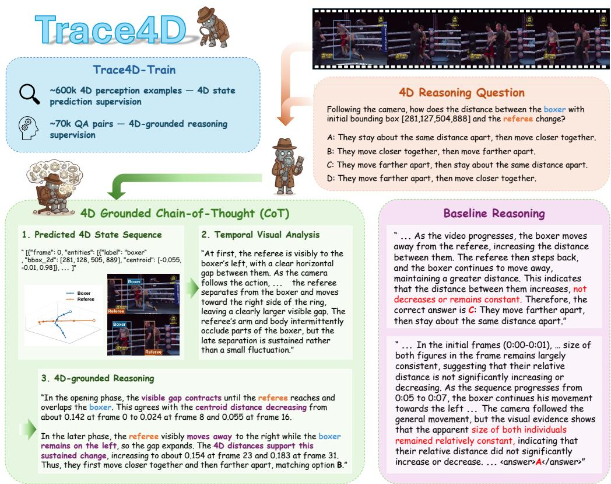  
Figure 1: Trace4D connects structured 4D states with temporal visual observations for video reasoning. In the boxer–referee example, centroid-distance changes are matched to the visible approach and subsequent separation, supporting answer B. Baseline reasoning is from Qwen3-VL (top) and MLLM-4D (bottom).

## ABSTRACT

Understanding how objects and their spatial relationships evolve in 3D space over time remains challenging for vision-language models (VLMs), particularly under changing viewpoints. Recent approaches incorporate geometric information into reasoning, but explicit supervision for temporally ordered 4D state evolution and its use as intermediate evidence remains limited. We introduce Trace4D, which trains VLMs to predict 4D state sequences and reason over their intertimestep changes alongside temporal visual observations. Its 4D-grounded chainof-thought (CoT) explicitly represents 4D states, analyzes temporal visual context, and connects both as evidence for the answer. We construct Trace4D-Train from in-the-wild videos with 600K 4D perception examples and approximately 70K grounded QA examples, and train with joint supervised fine-tuning followed by geometry-aware GRPO. At inference, Trace4D predicts 4D states and reasoning directly from video without reference annotations or an external geometric model. Experiments on Trace4D-Bench and VLM4D show improved QA accuracy over the base VLMs and benefits from reasoning over 4D state changes and temporal visual observations.

## 1 INTRODUCTION

Understanding how objects and their spatial relationships evolve in 3D space over time is an important capability for video understanding, which we refer to as 4D understanding. Spatial relationships at a single moment provide only a partial account of an event; understanding its development requires relating observations across time. Videos capture only 2D projections of the 3D world, making changes in 3D position and spatial relationships difficult to infer directly. This makes 4D reasoning challenging for vision-language models (VLMs) (Yang et al., 2025; Zhou et al., 2025).

To address this challenge, recent approaches have equipped VLMs with geometric knowledge in different ways. Some incorporate pretrained geometric features or outputs (Liu et al., 2026; Zhou et al., 2026; Gao et al., 2026), providing spatial references that complement the VLM’s visual representations. Others transfer 4D knowledge through QA supervision (Zhou et al., 2026; Cho et al., 2026), sometimes complemented by perception and tracking tasks. Recent approaches also extend chainof-thought (CoT) reasoning (Wei et al., 2022) with geometric states, relations, and temporal visual evidence (Yin et al., 2026; Wang et al., 2025c). However, explicit supervision for predicting a temporally ordered 4D state sequence remains limited. Such a sequence makes inter-timestep changes explicit, allowing the model to compare states across time and use these changes as intermediate evidence for reasoning.

Grounded reasoning methods link intermediate reasoning steps to identifiable visual evidence. Image-based approaches localize relevant object regions and connect them to reasoning steps (Wu et al., 2026; Wang et al., 2026a), while video methods extend this principle to specific objects and timestamps (Han et al., 2025; Meng et al., 2025). For 4D understanding, the relevant evidence includes both how 3D states change over time and the visual context in which those changes occur. A 4D state sequence provides a basis for comparing states across time, while temporal visual observations describe actions, interactions, and occlusions that geometric states alone do not fully capture. This motivates grounded temporal reasoning that connects state changes to their visual context and uses both sources of evidence to support the final answer.

We introduce Trace4D, which learns to predict a 4D state sequence as an explicit intermediate representation for video reasoning. The sequence describes object and, when required, camera states across annotated timesteps. Our 4D-grounded CoT uses this sequence to interpret state changes alongside temporal visual observations and derive an answer (Figure 1). We construct Trace4D Train with 600K 4D perception examples and approximately 70K grounded QA examples from in-the-wild videos to supervise state prediction and its use in reasoning. Joint supervised fine tuning (SFT) learns both tasks together. Geometry-aware GRPO further rewards agreement with reference positions and inter-timestep displacements. At inference, the model generates its own state sequence and reasoning from the video and QA prompt without an external geometric model. Trace4D achieves the highest overall accuracy among evaluated models on our held-out Trace4D-Bench and improves overall accuracy over its base VLMs on VLM4D.

Our contributions are summarized as follows:

• We introduce Trace4D, which predicts temporally ordered 4D state sequences as explicit intermediate representations and grounds reasoning over their changes in temporal visual observations.

• We construct Trace4D-Train with 600K 4D perception and approximately 70K grounded QA examples from in-the-wild videos, supervising state prediction and its use in reasoning.

• Ablations show that reasoning over 4D state changes and geometry-aware GRPO improve performance, while temporal visual analysis provides complementary evidence for spatiotemporal reasoning.

## 2 RELATED WORKS

VLMs for 3D and 4D Understanding. General-purpose VLMs support video QA (Zhang et al., 2024; Bai et al., 2025b;a), but evaluations of spatial and dynamic scene understanding reveal persistent challenges (Yang et al., 2025; Zhou et al., 2025; 2026). To strengthen these capabilities, geometry-derived QA provides supervision for spatial relations in images (Chen et al., 2024a; Cheng et al., 2024) and kinematic changes along object trajectories (Ko et al., 2025). Multitask supervi sion further covers depth, correspondence, and camera/object motion (Xu et al., 2026), as well as 4D QA, tracking, and camera-pose tasks (Zhou et al., 2026; Cho et al., 2026; Yang et al., 2026). Geometric knowledge can also be supplied through pretrained features (Liu et al., 2026; Miao et al., 2026) or constructed as explicit evidence at inference time (Gao et al., 2026). Several works also use geometry as an explicit intermediate representation for reasoning: 3D locations and orientations enable spatial computation (Ma et al., 2026), while generated scene-layout maps guide reasoning through rewards for spatial accuracy (Ouyang et al., 2025). For video reasoning, relation graphs make inter-object geometry explicit (Wang et al., 2025c). MLLM-4D (Yin et al., 2026) predicts explicit 3D states at query-relevant start and end frames, analyzes the intervening visual progression, and rewards coordinate accuracy at those anchors. In contrast, Trace4D predicts a multi-timestep 4D state sequence as an explicit intermediate representation and uses its inter-timestep changes as reasoning evidence alongside temporal visual observations.

Grounded reasoning for VLMs. Chain-of-thought (CoT) prompting elicits intermediate reasoning before an answer (Wei et al., 2022). Early studies extend rationale supervision to multimodal QA (Lu et al., 2022; Zhang et al., 2023), while LLaVA-CoT (Xu et al., 2025) separates visual interpretation and reasoning into stages. Grounded reasoning links these steps to identifiable visual evidence. At the image level, VisCoT (Shao et al., 2024a) selects informative regions, while VoCoT (Li et al., 2025) incorporates localized object information into the reasoning sequence. This connection can be learned through stepwise grounding supervision (Wu et al., 2026) or joint localization and reasoning rewards (Wang et al., 2026a), with further visual feedback obtained by revisiting selected or zoomed regions (Wang et al., 2026b; Sarch et al., 2026). For video, evidence must also be associated with temporal locations: VideoEspresso (Han et al., 2025) annotates frames, objects, and textual evidence, while Open-o3-Video (Meng et al., 2025) links reasoning to timestamps, objects, and bounding boxes. Related settings ground motion reasoning through segmentation outputs (Deng et al., 2025) or connect 3D scene entities to reasoning steps and subproblems (Chen et al., 2026a; Linghu et al., 2026). Existing video-grounding approaches localize supporting evidence in space and time. Trace4D additionally supervises reasoning over predicted 4D state changes alongside the corresponding temporal visual observations.

## 3 METHODOLOGY

We present Trace4D, a pipeline for learning to predict 4D state sequences and use their changes together with temporal visual observations for video reasoning. We first construct reference state sequences and QA pairs from in-the-wild videos (Section 3.1). A multimodal teacher then produces 4D-grounded CoT that relates these state changes to temporal visual observations and uses both as evidence for the answer (Section 3.2). Finally, we jointly train the VLM on state prediction and grounded QA, followed by geometry-aware GRPO using answer correctness and geometric rewards (Section 3.3).

## 3.1 DATASET GENERATION PIPELINE

Our data pipeline uses the geometric perception components and selected answer-derivation rules of DSR-Suite (Zhou et al., 2026). We further filter the resulting tracks and adapt the question and option templates to our clip-level setting.

Video and entity curation. We curate source videos from Koala-36M (Wang et al., 2025a) using its motion and video-training-suitability metadata to identify videos with observable scene or object dynamics. We identify candidate agents and foreground objects from the captions and use the Grounded SAM pipeline (Ren et al., 2024), with Grounding DINO (Liu et al., 2024) for localization and SAM 2 (Ravi et al., 2025) for mask tracking across frames.

Reference 4D state construction. Pi3 (Wang et al., 2026c) estimates 3D point maps and camera poses. We obtain object centroids by averaging reconstructed points within each tracked mask and derive camera positions from the estimated poses. These estimates form our reference 4D states (Figure 3), distinct from student predictions.

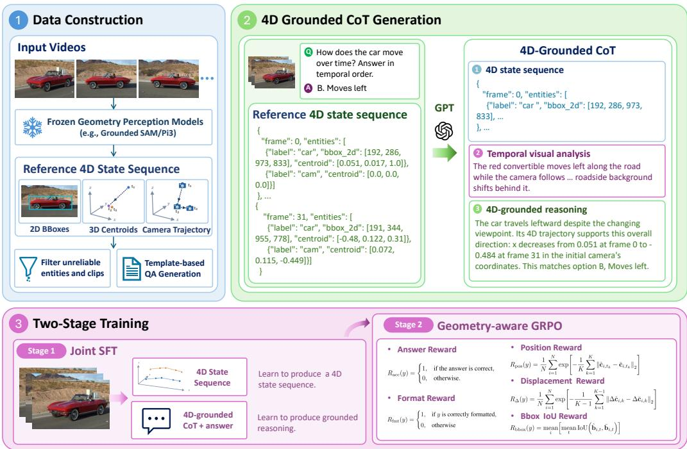  
Figure 2: Overview of Trace4D. Reference 4D states support template-based QA construction and teacher-generated CoT that connects state changes with temporal visual observations. Joint SFT learns state prediction and grounded QA together, followed by geometry-aware GRPO using answer, format, position, displacement, and bounding-box rewards.

For a clip represented by T sampled frames, $V = ( I _ { t } ) _ { t = 0 } ^ { T - 1 }$ , let $\mathcal { K } = \{ t _ { 1 } , \dots , t _ { K } \} \subseteq \{ 0 , \dots , T - 1 \}$ denote its $\bar { K }$ annotated frame indices, ordered as $t _ { 1 } < \cdots < t _ { K }$ . Each state $( t , \mathcal { E } _ { t } )$ describes the target entities at timestep t, and the 4D state sequence is

$$
\begin{array} { r l } & { \mathcal { P } = \left[ \left( t , \mathcal { E } _ { t } \right) \right] _ { t \in \mathcal { K } } , } \\ & { \mathcal { E } _ { t } = \big \{ ( \ell _ { i } , \mathbf { b } _ { i , t } , \mathbf { c } _ { i , t } ) \big \} _ { i \in \mathcal { O } _ { t } } . } \end{array}\tag{1}
$$

Here, ${ \mathcal { O } } _ { t }$ indexes the annotated entities and $\ell _ { i }$ is the label of entity i. The index i refers to the same entity across timesteps. For an object, $\mathbf { b } _ { i , t } \in \mathbb { R } ^ { 4 }$ is its normalized 2D box and $\mathbf { c } _ { i , t } \in \mathbb { R } ^ { 3 }$ its normalized 3D centroid. Camera entries use $\ell _ { i } = \mathrm { c a m } , \mathbf { c } _ { i , t }$ for position, and $\mathbf { b } _ { i , t } = \varnothing$ to denote an omitted box.

Appendix A.1 defines the serialized fields, frame indexing, and coordinate normalization.

Quality filtering and clip selection. We filter the resulting object tracks using bounding-box size checks and a multimodal verifier that rejects empty, background, or incorrectly labeled target regions. We then select temporal windows with identifiable targets and valid required bounding boxes and 3D centroids, ensuring that their anno-

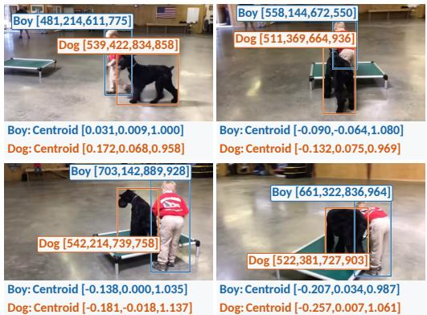  
Figure 3: Example of 4D reference annotations. Colored boxes identify the same two entities across four frames; labels report their boundingbox coordinates and 3D centroids.

tations are indexed to the sampled clip timeline. Unreadable clips that cannot support the required frame sampling are excluded. The retained states serve as references for perception and QA supervision.

Template-based QA construction. We construct QA pairs under two coordinate-frame conventions. Relative questions express spatial relations and their changes in the camera frame at each timestep, while Absolute questions express them in a fixed anchor-camera frame for comparison over time. Here, absolute refers to a fixed reference frame rather than metric world coordinates.

For each question, we transform the reference 4D states into the required coordinate frame, yielding the task-specific reference sequence P¯. An overbar denotes a training target. We then derive the answer from the resulting temporal state changes using selected geometric rules adopted from DSR-Suite (Zhou et al., 2026). We revise the question and option templates for our clip-level setting and additionally construct motion questions within the Absolute group for object and camera translation over time. For task-specific distractors, we give priority to candidates with the same number of temporal phases as the reference answer to reduce answer-length cues. Appendix A.2 gives question templates, answer criteria, and distractor rules. Each resulting QA pair is retained with its source clip and aligned reference 4D states for subsequent CoT generation.

## 3.2 4D-GROUNDED COT GENERATION

We next augment the QA pairs with 4D-grounded CoT annotations, keeping the questions, answer options, and reference answers fixed. Let q denote the complete QA prompt, including the question, answer options, and task instruction. A multimodal teacher receives $V , q ,$ , the reference 4D state sequence $\mathcal { \\\bar { P } } .$ , and the reference option label $a _ { \mathrm { r e f } } \in \{ \mathrm { A } , \mathrm { B } , \mathrm { C } , \mathrm { D } \}$ obtained during QA construction. The teacher constructs the following three-part CoT to connect visual observations with state changes in support of the reference answer.

Step 1: Structured 4D state sequence. The teacher copies the task-specific reference states unchanged into the $\textless 4 \mathrm { d } >$ block at every annotated timestep in K, providing the student’s stateprediction target.

Step 2: Temporal visual analysis. The ${ < } 4 \mathrm { d } >$ block represents geometry but does not fully capture visual cues such as actions, interactions, and occlusion. The <visual> block therefore records question-relevant observations across temporal phases.

Step 3: 4D-grounded reasoning. Question-type-specific instructions require the teacher to connect a temporal visual observation with the relevant 4D state change for the same target, interval, and coordinate frame, then explain how this correspondence supports the answer. When the two sources differ, the teacher is instructed to re-examine relevant viewpoint or occlusion effects without forcing agreement.

Let $s , \ o , \ r .$ , and a denote the token spans for the structured 4D state sequence, temporal visual analysis, 4D-grounded reasoning, and final answer. Each span includes its associated formatting tokens, so their concatenation forms the complete response $y = [ s ; o ; r ; a ]$

The teacher-generated target is $\bar { y } = [ \bar { s } ; \bar { o } ; \bar { r } ; \bar { a } ]$ , where s¯ serializes $\bar { \mathcal P }$ and a¯ encodes $a _ { \mathrm { r e f } }$ . It is paired with $( V , q )$ for student training; the reference state sequence and correct-option label are not added as extra student inputs. We retain traces that preserve the reference states and answer and satisfy the required response structure. Appendix A.3 describes the teacher inputs and provides an example generation prompt.

Training–evaluation splits and statistics. Our data construction yields 600K 4D perception examples from approximately 362K unique clips and 69,331 grounded QA examples (approximately 70K) from approximately 64K unique clips. A clip may contribute to either form of supervision or both. We call the training corpus Trace4D-Train. Splits are defined at the parent source-video level, with held-out sources excluded from all training, including GRPO and ablations. Trace4D-Bench is the held-out evaluation set of 1,200 QA pairs: 600 Relative and 600 Absolute questions, with 100 questions per type.

Figure 4 summarizes object–camera dynamics, question-type coverage, and reasoning length in the constructed dataset. Joint object and camera motion forms the largest dynamics category, while speed-comparison questions have the longest mean reasoning traces in both coordinate settings.

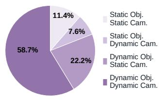  
(a) Dynamics distribution

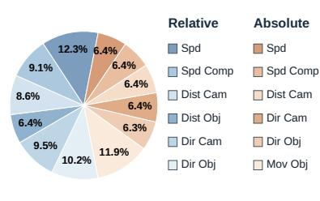  
(b) Question-type distribution

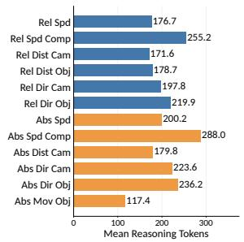  
(c) Mean reasoning length  
Figure 4: Dataset statistics. (a) Joint distribution of object and camera dynamics. (b) Question-type proportions for relative and absolute QA. (c) Mean reasoning token counts by question type.

## 3.3 TWO-STAGE TRAINING

We train Trace4D in two stages: joint supervised fine-tuning (SFT) on 4D perception and grounded QA, followed by geometry-aware GRPO.

Stage 1: Joint SFT. Starting from the base VLM, we jointly train on Trace4D-Train’s 600K perception and approximately 70K grounded QA examples. A perception example provides a clip $V$ and an instruction u specifying the targets and coordinate convention. The target serializes the reference 4D states $\bar { \mathcal P }$ within ${ < } 4 \mathrm { d } >$ , without visual analysis or an answer. A grounded QA example provides $( V , q )$ and supervises the full response y¯. Appendix B.4 shows both task instructions; Section 4.4 compares joint SFT with separate perception pretraining.

Stage 2: Geometry-aware GRPO. Starting from the joint-SFT checkpoint, we apply Group Relative Policy Optimization (GRPO) (Shao et al., 2024b) on approximately 7K QA examples to reward answer correctness and geometric consistency. Reference states and answer labels are used only for reward computation. The position reward $R _ { \mathrm { p o s } }$ rewards position accuracy. The displacement reward $R _ { \Delta }$ compares coordinate-change vectors between consecutive annotated timesteps, accounting for direction and magnitude. Both rewards are computed from predicted states in the generated <4d> block. For N entities, including the camera when required, matched across $K \geq 2$ valid annotated timesteps, these rewards are

$$
\begin{array} { l } { { \displaystyle R _ { \mathrm { p o s } } ( y ) = \frac { 1 } { N } \sum _ { i = 1 } ^ { N } \exp \left[ - \frac { 1 } { \tau _ { \mathrm { p o s } } K } \sum _ { k = 1 } ^ { K } \| \hat { \mathbf { c } } _ { i , t _ { k } } - \bar { \mathbf { c } } _ { i , t _ { k } } \| _ { 2 } \right] , } } \\ { { \displaystyle R _ { \Delta } ( y ) = \frac { 1 } { N } \sum _ { i = 1 } ^ { N } \exp \left[ - \frac { 1 } { \tau _ { \Delta } ( K - 1 ) } \sum _ { k = 1 } ^ { K - 1 } \| \Delta \hat { \mathbf { c } } _ { i , k } - \Delta \bar { \mathbf { c } } _ { i , k } \| _ { 2 } \right] , } } \end{array}\tag{2}
$$

where $\hat { \mathbf { c } }$ and c¯ are predicted and reference positions under the same coordinate and normalization conventions, $\Delta \mathbf { c } _ { i , k } = \mathbf { c } _ { i , t _ { k + 1 } } - \mathbf { c } _ { i , t _ { k } }$ , and $\tau _ { \mathrm { p o s } } = \tau _ { \Delta } = 1$ . Absolute displacements use the fixed anchor-camera frame; relative displacements use camera-relative coordinates.

The binary rewards $R _ { \mathrm { a c c } }$ and $R _ { \mathrm { f m t } }$ score answer correctness and response format; $R _ { \mathrm { b b o x } }$ averages bounding-box IoU over matched objects. The combined reward is

$$
R ( y ) = w _ { \mathrm { a c c } } R _ { \mathrm { a c c } } ( y ) + w _ { \mathrm { f m t } } R _ { \mathrm { f m t } } ( y ) + w _ { \mathrm { p o s } } R _ { \mathrm { p o s } } ( y ) + w _ { \Delta } R _ { \Delta } ( y ) + w _ { \mathrm { b b o x } } R _ { \mathrm { b b o x } } ( y ) ,\tag{3}
$$

where the weights sum to one. Appendix B.3 specifies the reward weights, format criteria, and optimization settings.

Inference. Given $( V , q )$ , Trace4D generates $y = [ s ; o ; r ; a ]$ autoregressively. The predicted 4D state sequence remains in the context for subsequent temporal visual analysis and 4D-grounded reasoning. Reference 4D states and answer labels are not supplied at inference, and no external geometric model is invoked. Appendix D shows examples of the generated responses.

<table><tr><td rowspan="2">Models</td><td colspan="6">Relative Spatial Relations</td><td colspan="6">Absolute Spatial Relations</td><td rowspan="2"></td><td rowspan="2">Overall</td></tr><tr><td>| Spd Spd Comp</td><td></td><td>DistCam</td><td>Distobj DirCam</td><td></td><td>Dirobj</td><td>Avg.</td><td>| Spd Spd Comp</td><td>DistCam</td><td> $\operatorname { D i r } _ { \operatorname { C a m } }$ </td><td> $\operatorname { D i r } _ { \mathrm { O b j } }$ </td><td>Motion</td><td>Avg.</td></tr><tr><td colspan="10">Proprietary Models</td><td></td><td></td><td></td><td></td><td>37.67</td><td></td></tr><tr><td>GPT-4o (Hurst et al., 2024)</td><td>33.0</td><td>32.0</td><td>21.0</td><td>13.0</td><td>47.0</td><td>32.0</td><td>29.67 31.0</td><td>32.0</td><td></td><td>36.0</td><td>38.0</td><td>35.0</td><td>54.0</td><td></td><td>33.67</td></tr><tr><td>GPT-5 (Singh et al., 2025)</td><td>32.0</td><td>37.0</td><td>58.0</td><td>47.0</td><td>68.0</td><td>54.0</td><td>49.33</td><td>35.0</td><td>36.0</td><td>50.0</td><td>40.0</td><td>43.0</td><td>60.0</td><td>44.00</td><td>46.67</td></tr><tr><td colspan="10">General VLMs</td><td></td><td></td><td></td><td></td><td></td><td></td></tr><tr><td>Qwen2.5-VL-3B (Bai et al., 2025b)</td><td>40.0</td><td>47.0</td><td>25.0</td><td>35.0</td><td>21.0</td><td>22.0</td><td>31.67</td><td>42.0</td><td>49.0</td><td>31.0</td><td>24.0</td><td>29.0</td><td>33.0</td><td>34.67</td><td>33.17</td></tr><tr><td>Qwen3-VL-4B (Bai et al., 2025a)</td><td>26.0</td><td>38.0</td><td>30.0</td><td>41.0</td><td>41.0</td><td>53.0</td><td>38.17</td><td>29.0</td><td>33.0</td><td>41.0</td><td>38.0</td><td>47.0</td><td>50.0</td><td>39.67</td><td>38.92</td></tr><tr><td>Qwen2.5-VL-7B</td><td>39.0</td><td>48.0</td><td>32.0</td><td>26.0</td><td>40.0</td><td>32.0</td><td>36.17</td><td>33.0</td><td>40.0</td><td>35.0</td><td>49.0</td><td>26.0</td><td>55.0</td><td>39.67</td><td>37.92</td></tr><tr><td>Qwen3-VL-8B</td><td>32.0</td><td>43.0 41.0</td><td>36.0 21.0</td><td>31.0</td><td>55.0</td><td>44.0</td><td>40.17</td><td>37.0</td><td>41.0</td><td>31.0</td><td>49.0</td><td>39.0</td><td>55.0</td><td>42.00</td><td>41.08</td></tr><tr><td>InternVL2.5-4B (Chen et al., 2024b)</td><td>27.0</td><td>43.0</td><td>30.0</td><td>30.0</td><td>35.0</td><td>46.0</td><td>33.33</td><td>39.0</td><td>41.0</td><td>24.0</td><td>37.0</td><td>40.0</td><td>36.0</td><td>36.17</td><td>34.75</td></tr><tr><td>InternVL3.5-4B (Wang et al., 2025b)</td><td>41.0</td><td>38.0</td><td>43.0</td><td>43.0</td><td>40.0</td><td>39.0</td><td>39.33</td><td>42.0</td><td>36.0</td><td>37.0</td><td>41.0</td><td>42.0</td><td>46.0</td><td>40.67</td><td>40.00</td></tr><tr><td>InternVL2.5-8B</td><td>41.0</td><td>45.0</td><td></td><td>38.0</td><td>49.0</td><td>37.0</td><td>41.00</td><td>39.0</td><td>37.0</td><td>28.0</td><td>50.0</td><td>37.0</td><td>42.0</td><td>38.83</td><td>39.92</td></tr><tr><td>InternVL3.5-8B</td><td>34.0</td><td>43.0</td><td>33.0 26.0</td><td>32.0</td><td>33.0 34.0</td><td>48.0</td><td>37.50</td><td>37.0</td><td>39.0</td><td>28.0</td><td>50.0</td><td>37.0</td><td>55.0</td><td>41.00</td><td>39.25</td></tr><tr><td>LLaVA-OneVision1.5-4B (An et al., 2025) LLaVA-OneVision1.5-8B</td><td>30.0 25.0</td><td>38.0</td><td>20.0</td><td>29.0 30.0</td><td>31.0</td><td>42.0 48.0</td><td>34.00 32.00</td><td>22.0 21.0</td><td>35.0 32.0</td><td>29.0 26.0</td><td>38.0 34.0</td><td>54.0</td><td>43.0 52.0</td><td>36.83 34.33</td><td>35.42 33.17</td></tr><tr><td colspan="10"></td><td>41.0</td><td></td><td></td><td></td><td></td><td></td></tr><tr><td colspan="10">3D/4D Specialized Models</td><td></td><td></td><td></td><td></td><td></td><td></td></tr><tr><td>VG-LLM-8B (Zheng et al., 2026) VLM-3R-7B (Fan et al., 2026)</td><td>39.0 40.0</td><td>45.0 45.0</td><td>36.0</td><td>43.0</td><td>87.0 32.0</td><td>18.0 21.0</td><td>44.67 33.83</td><td>44.0 40.0</td><td>47.0 46.0</td><td>38.0 32.0</td><td>91.0 44.0</td><td>25.0 31.0</td><td>44.0 51.0</td><td>48.17</td><td>46.42</td></tr><tr><td>MLLM-4D-8B (Yin et al., 2026)</td><td>35.0</td><td>43.0</td><td>27.0 51.0</td><td>38.0 46.0</td><td>69.0</td><td>41.0</td><td>47.50</td><td>34.0</td><td>50.0</td><td>41.0</td><td>62.0</td><td>31.0</td><td>61.0</td><td>40.67 46.50</td><td>37.25 47.00</td></tr><tr><td>GSM-7B (Zhou et al., 2026)</td><td>43.0</td><td>45.0</td><td>33.0</td><td>34.0</td><td>74.0</td><td>28.0</td><td>42.83</td><td>42.0</td><td>46.0</td><td>33.0</td><td>77.0</td><td>30.0</td><td>47.0</td><td>45.83</td><td>44.33</td></tr><tr><td>4DThinker-3B (Chen et al., 2026b)</td><td>43.0</td><td>42.0</td><td>61.0</td><td>52.0</td><td>32.0</td><td>34.0</td><td>44.00</td><td>50.0</td><td>37.0</td><td>56.0</td><td>41.0</td><td>29.0</td><td>26.0</td><td>39.83</td><td>41.92</td></tr><tr><td>Trace4D (Qwen3-VL-4B)</td><td>79.0</td><td>71.0</td><td></td><td></td><td></td><td>93.0</td><td>81.00</td><td>73.0</td><td></td><td>75.0</td><td>95.0</td><td>93.0</td><td></td><td></td><td></td></tr><tr><td>Trace4D (Qwen3-VL-8B)</td><td>79.0</td><td>69.0</td><td>85.0 89.0</td><td>61.0 68.0</td><td>97.0 96.0</td><td>86.0</td><td>81.17</td><td>68.0</td><td>59.0 63.0</td><td>77.0</td><td>96.0</td><td>92.0</td><td>70.0 65.0</td><td>77.50 76.83</td><td>79.25 79.00</td></tr></table>

Table 1: Comparison of vision-language models on Trace4D-Bench, covering relative and absolute spatial and motion understanding.

## 4 EXPERIMENTS

We evaluate whether Trace4D can use predicted 4D state changes and temporal visual observations to answer spatiotemporal questions. We evaluate the trained model on our held-out Trace4D-Bench and examine transfer to the external VLM4D benchmark. Our ablations study the effects of statechange reasoning, temporal visual evidence, joint SFT, and GRPO. We further analyze the relationship between 4D perception quality and QA accuracy. Detailed GRPO reward ablations are provided in Appendix C.

## 4.1 EXPERIMENTAL SETTINGS

We adapt Qwen3-VL-4B-Instruct and Qwen3-VL-8B-Instruct (Bai et al., 2025a) using LoRA (Hu et al., 2021) on the language model and multimodal projector, while keeping the vision backbone frozen. Trace4D results use joint SFT followed by geometry-aware GRPO. We evaluate multiplechoice QA accuracy on Trace4D-Bench and VLM4D. All ablations use the 4B model; CoT ablations use matched QA adaptation without GRPO, while the training-strategy ablation compares different SFT recipes and their GRPO continuation. Further details on data mixtures, optimization, task instructions, and decoding settings are provided in Appendix B.

## 4.2 RESULTS ON TRACE4D-BENCH

Trace4D-Bench evaluates distance, direction, speed, and translation under specified relative and absolute coordinate frames. Its questions use the same task formulation as Trace4D-Train, with source videos held out from training.

We compare three baseline groups: proprietary models GPT-4o (Hurst et al., 2024) and GPT-5 (Singh et al., 2025); general-purpose VLMs Qwen2.5-VL (Bai et al., 2025b), Qwen3- VL (Bai et al., 2025a), InternVL2.5/3.5 (Chen et al., 2024b; Wang et al., 2025b), and LLaVA-OneVision1.5 (An et al., 2025); and 3D/4D-specialized models VG-LLM (Zheng et al., 2026), VLM-3R (Fan et al., 2026), MLLM-4D (Yin et al., 2026), GSM (Zhou et al., 2026), and 4DThinker (Chen et al., 2026b). Table 1 reports task-wise QA accuracy (%) across the spatial and motion reasoning categories.

Trace4D achieves overall accuracies of 79.25% and 79.00% with the 4B and 8B models, respectively, outperforming the evaluated proprietary, general-purpose, and 3D/4D-specialized baselines. Both models improve over their corresponding base VLMs by more than 37 percentage points. Each model also outperforms the evaluated baselines across all 12 question types, covering both relative and absolute reasoning on unseen videos. The ablations in Section 4.4 further examine the roles of reasoning over 4D state changes and incorporating temporal visual observations.

## 4.3 RESULTS ON VLM4D

VLM4D (Zhou et al., 2025) evaluates spatiotemporal reasoning in real and synthetic videos, including first- and third-person views. Its multiple-choice questions target motion, perspective, and temporal continuity in the videos, while Trace4D-Bench constructs questions from tracked 4D states under specified coordinate conventions. Their distinct video collections and question formulations provide complementary evaluations of 4D understanding.

As shown in Table 2, Trace4D reaches 64.32% with the 4B model and 61.29% with the 8B model, exceeding their respective base VLMs by 8.92 and 2.15 percentage points. Both models outperform the evaluated general-purpose VLMs in overall accuracy. The gains over the base VLMs are larger on synthetic videos, while real-video accuracy improves for 4B but decreases for 8B. These results indicate transfer to a different video collection and question formulation, with gains that vary across model sizes and video subsets. Notably, the 4B model outperforms the 8B model on VLM4D and achieves a substantially larger improvement over its base VLM. One possible explanation is a ca-

<table><tr><td>Model</td><td>Syn.</td><td>Real.</td><td>Avg.</td></tr><tr><td>Proprietary Models</td><td></td><td></td><td></td></tr><tr><td>GPT-4o (Hurst et al., 2024)</td><td>54.38</td><td>56.02</td><td>55.62</td></tr><tr><td>GPT-5 (Singh et al., 2025)</td><td>62.70</td><td>74.69</td><td>71.75</td></tr><tr><td>General VLMs</td><td></td><td></td><td></td></tr><tr><td>Qwen2.5-VL-3B (Bai et al., 2025b)</td><td>35.96</td><td>47.34</td><td>44.55</td></tr><tr><td>Qwen3-VL-4B (Bai et al., 2025a)</td><td>48.76</td><td>57.55</td><td>55.40</td></tr><tr><td>Qwen2.5-VL-7B</td><td>48.31</td><td>51.79</td><td>50.94</td></tr><tr><td>Qwen3-VL-8B</td><td>55.73</td><td>60.25</td><td>59.14</td></tr><tr><td>InternVL2.5-4B (Chen et al., 2024b)</td><td>32.81</td><td>50.84</td><td>46.42</td></tr><tr><td>InternVL3.5-4B (Wang et al., 2025b)</td><td>42.24</td><td>56.38</td><td>52.92</td></tr><tr><td>InternVL2.5-8B</td><td>40.45</td><td>55.80</td><td>52.04</td></tr><tr><td>InternVL3.5-8B</td><td>46.07</td><td>55.87</td><td>53.47</td></tr><tr><td>LLaVA-OneVision1.5-4B (An et al., 2025)</td><td>40.00</td><td>44.42</td><td>43.34</td></tr><tr><td>LLaVA-OneVision1.5-8B</td><td>40.45</td><td>45.22</td><td>44.05</td></tr><tr><td>3D/4D VLMs</td><td></td><td></td><td></td></tr><tr><td>VG-LLM-8B (Zheng et al., 2026)</td><td>34.83</td><td>48.87</td><td>45.43</td></tr><tr><td>VLM-3R-7B (Fan et al., 2026)</td><td>35.28</td><td>52.88</td><td>48.57</td></tr><tr><td>MLLM-4D-8B (Yin et al., 2026)</td><td>55.05</td><td>63.09</td><td>61.12</td></tr><tr><td>GSM-7B (Zhou et al., 2026)</td><td>50.11</td><td>47.56</td><td>48.18</td></tr><tr><td>4DThinker-3B (Chen et al., 2026b)</td><td>24.72</td><td>38.95</td><td>35.46</td></tr><tr><td>Trace4D (Qwen3-VL-4B)</td><td>77.30</td><td>60.10</td><td>64.32</td></tr><tr><td>Trace4D (Qwen3-VL-8B)</td><td>68.09</td><td>59.08</td><td>61.29</td></tr></table>

Table 2: Performance on VLM4D. Bold and underline denote the best and second-best scores among non-proprietary models.

pacity–data mismatch: the fixed amount of task-specific supervision may not fully exploit the larger model’s capacity, with this limitation becoming more apparent under the distribution shift in VLM4D.

## 4.4 ABLATION AND ANALYSIS

CoT ablation. We compare four response formulations to examine the roles of reasoning over 4D state changes and incorporating temporal visual observations. All variants start from the same perception-pretrained 4B checkpoint and undergo matched QA adaptation without GRPO. Only the QA response supervision and task instructions differ; QA pairs, perception replay, and optimization settings are fixed. This con-

<table><tr><td>CoT Variant</td><td>Trace4D-Bench</td><td>VLM4D</td></tr><tr><td>State-only</td><td>74.83</td><td>52.86</td></tr><tr><td>4D-state CoT</td><td>79.42</td><td>54.68</td></tr><tr><td>Visual-only CoT</td><td>73.75</td><td>59.25</td></tr><tr><td>4D + Visual CoT</td><td>77.25</td><td>60.52</td></tr></table>

Table 3: CoT ablation. Bold and underlined values indicate the best and second-best results, respectively.

trolled setting is distinct from the final method’s joint SFT. State-only predicts the structured state sequence within <4d> and directly answers. 4D-state CoT adds reasoning over the predicted state changes, without explicit visual analysis. Visual-only CoT reasons from video observations without generating a <4d> block. Our 4D + Visual CoT connects predicted 4D state changes with temporal visual observations of the queried entities over matching time intervals. Table 3 reports both benchmarks; Appendix B.2 describes the shared SFT schedule and perception replay.

Supervising reasoning over 4D state changes improves QA accuracy beyond state prediction alone. Compared with State-only, 4D-state CoT improves accuracy by 4.59 percentage points on Trace4D-Bench and 1.82 points on VLM4D. This comparison supports supervising how state changes lead to an answer, in addition to supervising the states themselves.

Combining state-based reasoning with temporal visual analysis yields the highest VLM4D accuracy among the four variants. Our 4D + Visual CoT achieves 77.25% on Trace4D-Bench and 60.52% on VLM4D, improving over Visual-only CoT on both benchmarks. While 4D-state CoT performs best on Trace4D-Bench (79.42%), adding temporal visual analysis raises VLM4D accuracy from 54.68% to 60.52%. These results suggest that temporal visual observations provide complementary evidence for interpreting 4D state changes.

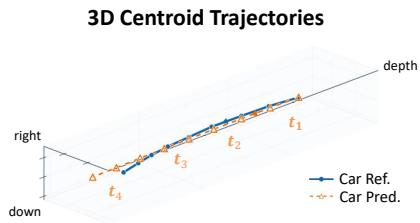  
2D Bounding Boxes

<table><tr><td>Training Strategy</td><td>Rel.</td><td>Abs.</td><td>VLM4D</td></tr><tr><td>Adaptation-only SFT</td><td>76.33</td><td>67.50</td><td>57.54</td></tr><tr><td>Perception-first SFT</td><td>79.17</td><td>75.33</td><td>60.52</td></tr><tr><td>Joint SFT</td><td>79.33</td><td>76.33</td><td>62.39</td></tr><tr><td>Joint SFT + GRPO (Trace4D)</td><td>81.00</td><td>77.50</td><td>64.32</td></tr></table>

Table 4: Training strategy comparison.

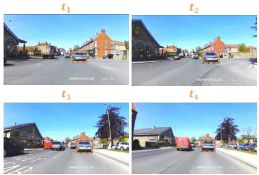  
Figure 5: Predicted 3D centroid trajectories and 2D bounding boxes across timesteps.

<table><tr><td>Setting</td><td>IoU ↑</td><td>Centroid Error ↓ Trajectory L2 ↓</td><td></td></tr><tr><td>Relative</td><td>0.7556</td><td>0.0994</td><td>0.0852</td></tr><tr><td>Absolute</td><td>0.7176</td><td>0.2654</td><td>0.1428</td></tr></table>

Table 5: Trace4D (4B) state prediction.
<table><tr><td>Setting</td><td>Low L2</td><td>Mid L2</td><td>High L2</td></tr><tr><td>Relative</td><td>89.90</td><td>81.37</td><td>71.72</td></tr><tr><td>Absolute</td><td>91.92</td><td>75.00</td><td>65.66</td></tr></table>

Table 6: QA accuracy (%) by L2 error group.

Training strategy. Table 4 compares three SFT recipes and the GRPO continuation of Joint SFT. Adaptation-only SFT performs QA adaptation from the base model without perception supervision. Perception-first SFT first performs one epoch of perception pretraining, followed by QA adaptation with perception replay. Joint SFT jointly mixes perception and grounded QA supervision from the base model. Details are provided in Appendix B.2.

Adding perception supervision substantially improves over Adaptation-only SFT. Joint SFT further improves over Perception-first SFT across all three evaluation settings, indicating a benefit from jointly learning perception and grounded QA. Continuing Joint SFT with GRPO on 7,008 QA examples further improves performance in both coordinate settings and on VLM4D.

Perception and reasoning analysis. We evaluate 4D perception on clips held out at the sourcevideo level. Table 5 reports bounding-box IoU, centroid error, and trajectory L2, defined in Appendix B.5. Absolute evaluation, in which object states must be expressed relative to a fixed anchor viewpoint, yields larger centroid and trajectory errors than Relative evaluation. Figure 5 shows a predicted car trajectory following the reference with deviations at individual timesteps.

We examine the association between trajectory L2 error and QA accuracy. Within each question type, we divide responses into three approximately equal-sized groups by error and then average QA accuracy across question types. Table 6 shows that QA accuracy decreases as trajectory error increases in both settings, with a larger low-to-high error gap in the Absolute setting (26.26 vs. 18.18 percentage points). This pattern suggests a connection between 4D perception quality and downstream reasoning performance.

## 5 CONCLUSION

We presented Trace4D, a framework for grounded spatiotemporal reasoning via predicted 4D state sequences. Trace4D predicts temporally ordered 4D states and uses their inter-timestep changes together with temporal visual observations as intermediate evidence for reasoning. Experiments on Trace4D-Bench and VLM4D show improved spatiotemporal reasoning, while ablations demonstrate the benefits of explicit 4D state-change reasoning, complementary temporal visual evidence, and geometry-aware optimization. Our analysis further reveals a connection between 4D perception quality and downstream QA performance, highlighting the role of explicit 4D states in bridging perception and reasoning.

## AI USE STATEMENT

In this work, we used generative AI tools to generate chain-of-thought (CoT) annotations for our training data. We have not used generative AI tools for other research tasks requiring disclosure, including proposing or refining hypotheses or interpreting results. Additionally, we used generative AI tools to improve the grammar, readability, and flow of the manuscript. All AI-assisted work was reviewed and verified by the authors, and we take full responsibility for the final content of this work, including all text, claims, code, and other artifacts produced with the aid of generative AI.

## REPRODUCIBILITY STATEMENT

We describe dataset construction, coordinate normalization, and chain-of-thought generation in Appendix A. Training hyperparameters, geometry-aware GRPO rewards, and evaluation protocols are detailed in Appendix B, including the model-specific reward weights and decoding settings. Training and inference prompts are provided in Appendix B.4. We plan to publicly release our code and trained model checkpoints upon publication to facilitate reproduction of our results.

## REFERENCES

Xiang An, Yin Xie, Kaicheng Yang, Wenkang Zhang, Xiuwei Zhao, Zheng Cheng, Yirui Wang, Songcen Xu, Changrui Chen, Didi Zhu, et al. Llava-onevision-1.5: Fully open framework for democratized multimodal training. arXiv preprint arXiv:2509.23661, 2025.

Shuai Bai, Yuxuan Cai, Ruizhe Chen, Keqin Chen, Xionghui Chen, Zesen Cheng, Lianghao Deng, Wei Ding, Chang Gao, Chunjiang Ge, et al. Qwen3-vl technical report. arXiv preprint arXiv:2511.21631, 2025a.

Shuai Bai, Keqin Chen, Xuejing Liu, Jialin Wang, Wenbin Ge, Sibo Song, Kai Dang, Peng Wang, Shijie Wang, Jun Tang, Humen Zhong, Yuanzhi Zhu, Mingkun Yang, Zhaohai Li, Jianqiang Wan, Pengfei Wang, Wei Ding, Zheren Fu, Yiheng Xu, Jiabo Ye, Xi Zhang, Tianbao Xie, Zesen Cheng, Hang Zhang, Zhibo Yang, Haiyang Xu, and Junyang Lin. Qwen2.5-vl technical report. arXiv preprint arXiv:2502.13923, 2025b.

Boyuan Chen, Zhuo Xu, Sean Kirmani, Brian Ichter, Dorsa Sadigh, Leonidas Guibas, and Fei Xia. Spatialvlm: Endowing vision-language models with spatial reasoning capabilities. In Proceedings of the IEEE/CVF conference on computer vision and pattern recognition, pp. 14455–14465, 2024a.

Yiming Chen, Zekun Qi, Wenyao Zhang, Xin Jin, Li Zhang, and Peidong Liu. Reasoning in space via grounding in the world. In International Conference on Learning Representations, volume 2026, pp. 65549–65570, 2026a.

Zhangquan Chen, Manyuan Zhang, Xinlei Yu, Xiang An, Bo Li, Xin Xie, ZiDong Wang, Mingze Sun, Shuang Chen, Hongyu Li, et al. 4dthinker: Thinking with 4d imagery for dynamic spatial understanding. arXiv preprint arXiv:2605.05997, 2026b.

Zhe Chen, Weiyun Wang, Yue Cao, Yangzhou Liu, Zhangwei Gao, Erfei Cui, Jinguo Zhu, Shenglong Ye, Hao Tian, Zhaoyang Liu, et al. Expanding performance boundaries of open-source multimodal models with model, data, and test-time scaling. arXiv preprint arXiv:2412.05271, 2024b.

An-Chieh Cheng, Hongxu Yin, Yang Fu, Qiushan Guo, Ruihan Yang, Jan Kautz, Xiaolong Wang, and Sifei Liu. Spatialrgpt: Grounded spatial reasoning in vision-language models. Advances in Neural Information Processing Systems, 37:135062–135093, 2024.

Seokju Cho, Abhishek Badki, Hang Su, Jindong Jiang, Ziyao Zeng, Seungryong Kim, Sifei Liu, and Orazio Gallo. 4dp-qa: Scalable qa for 4d perception in vision language models. arXiv preprint arXiv:2606.11568, 2026.

Andong Deng, Tongjia Chen, Shoubin Yu, Taojiannan Yang, Lincoln Spencer, Yapeng Tian, Ajmal Saeed Mian, Mohit Bansal, and Chen Chen. Motion-grounded video reasoning: Understanding and perceiving motion at pixel level. In 2025 IEEE/CVF Conference on Computer Vision and Pattern Recognition (CVPR), pp. 8625–8636. IEEE, 2025.

Zhiwen Fan, Jian Zhang, Renjie Li, Junge Zhang, Runjin Chen, Hezhen Hu, Kevin Wang, Peihao Wang, Huaizhi Qu, Shijie Zhou, et al. Vlm-3r: Vision-language models augmented with instruction-aligned 3d reconstruction. In Proceedings ofthe IEEE/CVF Conference on Computer Vision and Pattern Recognition, pp. 31054–31065, 2026.

Rongxin Gao, Yuzhi Huang, Dongxuan Liu, Chu Li, Zhenye Wang, Jie Wu, Shuzhao Xie, Jingyan Jiang, Xinghao Ding, Xiaotong Tu, et al. Dyntrace: Tracking dynamic object evidence for 4d spatio-temporal reasoning in mllms. arXiv preprint arXiv:2607.12503, 2026.

Songhao Han, Wei Huang, Hairong Shi, Le Zhuo, Xiu Su, Shifeng Zhang, Xu Zhou, Xiaojuan Qi, Yue Liao, and Si Liu. Videoespresso: A large-scale chain-of-thought dataset for fine-grained video reasoning via core frame selection. In 2025 IEEE/CVF Conference on Computer Vision and Pattern Recognition (CVPR), pp. 26181–26191. IEEE, 2025.

Edward J Hu, Yelong Shen, Phillip Wallis, Zeyuan Allen-Zhu, Yuanzhi Li, Shean Wang, Lu Wang, and Weizhu Chen. Lora: Low-rank adaptation of large language models. arXiv preprint arXiv:2106.09685, 2021.

Aaron Hurst, Adam Lerer, Adam P Goucher, Adam Perelman, Aditya Ramesh, Aidan Clark, AJ Ostrow, Akila Welihinda, Alan Hayes, Alec Radford, et al. GPT-4o System Card. arXiv preprint arXiv:2410.21276, 2024.

Dohwan Ko, Sihyeon Kim, Yumin Suh, Minseo Yoon, Manmohan Chandraker, Hyunwoo J Kim, et al. St-vlm: Kinematic instruction tuning for spatio-temporal reasoning in vision-language models. arXiv preprint arXiv:2503.19355, 2025.

Zejun Li, Ruipu Luo, Jiwen Zhang, Minghui Qiu, Xuan-Jing Huang, and Zhongyu Wei. Vocot: Unleashing visually grounded multi-step reasoning in large multi-modal models. In Proceedings of the 2025 Conference of the Nations of the Americas Chapter of the Association for Computational Linguistics: Human Language Technologies (Volume 1: Long Papers), pp. 3769–3798, 2025.

Xiongkun Linghu, Jiangyong Huang, Ziyu Zhu, Baoxiong Jia, and Siyuan Huang. Scenecot: Eliciting grounded chain-of-thought reasoning in 3d scenes. In International Conference on Learning Representations, volume 2026, pp. 2754–2779, 2026.

Shilong Liu, Zhaoyang Zeng, Tianhe Ren, Feng Li, Hao Zhang, Jie Yang, Qing Jiang, Chunyuan Li, Jianwei Yang, Hang Su, et al. Grounding dino: Marrying dino with grounded pre-training for open-set object detection. In European conference on computer vision, pp. 38–55. Springer, 2024.

Zhaochen Liu, Limeng Qiao, Guanglu Wan, and Tingting Jiang. Geoalign: Geometric feature realignment for mllm spatial reasoning. arXiv preprint arXiv:2604.12630, 2026.

Pan Lu, Swaroop Mishra, Tanglin Xia, Liang Qiu, Kai-Wei Chang, Song-Chun Zhu, Oyvind Tafjord, Peter Clark, and Ashwin Kalyan. Learn to explain: Multimodal reasoning via thought chains for science question answering. Advances in neural information processing systems, 35:2507–2521, 2022.

Wufei Ma, Yu-Cheng Chou, Qihao Liu, Xingrui Wang, Celso de Melo, Jianwen Xie, and Alan Yuille. Spatialreasoner: Towards explicit and generalizable 3d spatial reasoning. Advances in Neural Information Processing Systems, 38:140751–140774, 2026.

Jiahao Meng, Xiangtai Li, Haochen Wang, Yue Tan, Tao Zhang, Lingdong Kong, Yunhai Tong, Anran Wang, Zhiyang Teng, Yujing Wang, et al. Open-o3-video: Grounded video reasoning with explicit spatio-temporal evidence. arXiv preprint arXiv:2510.20579, 2025.

Deshui Miao, Xingsen Huang, Yameng Gu, Xin Li, Haijun Zhang, and Ming-Hsuan Yang. Geoweaver: Grounding visual tokens with geometric evidence before scene reasoning. arXiv preprint arXiv:2605.22558, 2026.

Kun Ouyang, Yuanxin Liu, Haoning Wu, Yi Liu, Hao Zhou, Jie Zhou, Fandong Meng, and Xu Sun. Spacer: Reinforcing mllms in video spatial reasoning. arXiv preprint arXiv:2504.01805, 2025.

Nikhila Ravi, Valentin Gabeur, Yuan-Ting Hu, Ronghang Hu, Chaitanya Ryali, Tengyu Ma, Haitham Khedr, Roman Radle, Chloe Rolland, Laura Gustafson, et al. Sam 2: Segment anything in images¨ and videos. In International Conference on Learning Representations, volume 2025, pp. 28085– 28128, 2025.

Tianhe Ren, Shilong Liu, Ailing Zeng, Jing Lin, Kunchang Li, He Cao, Jiayu Chen, Xinyu Huang, Yukang Chen, Feng Yan, et al. Grounded sam: Assembling open-world models for diverse visual tasks. arXiv preprint arXiv:2401.14159, 2024.

Gabriel Sarch, Snigdha Saha, Naitik Khandelwal, Ayush Jain, Michael Tarr, Aviral Kumar, and Katerina Fragkiadaki. Grounded reinforcement learning for visual reasoning. Advances in Neural Information Processing Systems, 38:150977–151013, 2026.

Hao Shao, Shengju Qian, Han Xiao, Guanglu Song, Zhuofan Zong, Letian Wang, Yu Liu, and Hongsheng Li. Visual cot: Advancing multi-modal language models with a comprehensive dataset and benchmark for chain-of-thought reasoning. Advances in Neural Information Processing Systems, 37:8612–8642, 2024a.

Zhihong Shao, Peiyi Wang, Qihao Zhu, Runxin Xu, Junxiao Song, Xiao Bi, Haowei Zhang, Mingchuan Zhang, YK Li, Yang Wu, et al. Deepseekmath: Pushing the limits of mathematical reasoning in open language models. arXiv preprint arXiv:2402.03300, 2024b.

Aaditya Singh, Adam Fry, Adam Perelman, Adam Tart, Adi Ganesh, Ahmed El-Kishky, Aidan McLaughlin, Aiden Low, AJ Ostrow, Akhila Ananthram, et al. OpenAI GPT-5 System Card. arXiv preprint arXiv:2601.03267, 2025.

Haochen Wang, Xiangtai Li, Zilong Huang, Anran Wang, Jiacong Wang, Tao Zhang, Sule Bai, Zijian Kang, Jiashi Feng, Zhuochen Wang, et al. Traceable evidence enhanced visual grounded reasoning: Evaluation and method. In International Conference on Learning Representations, volume 2026, pp. 148769–148794, 2026a.

Jiacong Wang, Zijian Kang, Haochen Wang, Xiao Liang, Ya Wang, Jiawen Li, Bohong Wu, Jiao Ran, Haiyong Jiang, Chao Feng, et al. Vgr: Visual grounded reasoning. In International Conference on Learning Representations, volume 2026, pp. 89506–89528, 2026b.

Qiuheng Wang, Yukai Shi, Jiarong Ou, Rui Chen, Ke Lin, Jiahao Wang, Boyuan Jiang, Haotian Yang, Mingwu Zheng, Xin Tao, et al. Koala-36m: A large-scale video dataset improving consistency between fine-grained conditions and video content. In 2025 IEEE/CVF Conference on Computer Vision and Pattern Recognition (CVPR), pp. 8428–8437. IEEE, 2025a.

Weiyun Wang, Zhangwei Gao, Lixin Gu, Hengjun Pu, Long Cui, Xingguang Wei, Zhaoyang Liu, Linglin Jing, Shenglong Ye, Jie Shao, et al. Internvl3.5: Advancing open-source multimodal models in versatility, reasoning, and efficiency. arXiv preprint arXiv:2508.18265, 2025b.

Wentao Wang, Heqing Zou, Tianze Luo, Rui Huang, Yutian Zhao, Zhuochen Wang, Hansheng Zhang, Chengwei Qin, Yan Wang, Lin Zhao, et al. Video-str: Reinforcing mllms in video spatiotemporal reasoning with relation graph. arXiv preprint arXiv:2510.10976, 2025c.

Yifan Wang, Jianjun Zhou, Haoyi Zhu, Wenzheng Chang, Yang Zhou, Zizun Li, Junyi Chen, Jiangmiao Pang, Chunhua Shen, and Tong He. π3: Permutation-equivariant visual geometry learning. In International Conference on Learning Representations, volume 2026, pp. 10481–10497, 2026c.

Jason Wei, Xuezhi Wang, Dale Schuurmans, Maarten Bosma, Fei Xia, Ed Chi, Quoc V Le, Denny Zhou, et al. Chain-of-thought prompting elicits reasoning in large language models. Advances in neural information processing systems, 35:24824–24837, 2022.

Qiong Wu, Xiangcong Yang, Yiyi Zhou, Chenxin Fang, Baiyang Song, Xiaoshuai Sun, and Rongrong Ji. Grounded chain-of-thought for multimodal large language models. In Proceedings of the IEEE/CVF Conference on Computer Vision and Pattern Recognition, pp. 33577–33587, 2026.

Guowei Xu, Peng Jin, Ziang Wu, Hao Li, Yibing Song, Lichao Sun, and Li Yuan. Llava-cot: Let vision language models reason step-by-step. In 2025 IEEE/CVF International Conference on Computer Vision (ICCV), pp. 2087–2098. IEEE, 2025.

Runsen Xu, Weiyao Wang, Hao Tang, Xingyu Chen, Xiaodong Wang, Fu-Jen Chu, Matt Feiszli, and Kevin J Liang. Multi-spatialmllm: Multi-frame spatial understanding with multi-modal large language models. In Proceedings ofthe IEEE/CVF Conference on Computer Vision and Pattern Recognition, pp. 31078–31088, 2026.

Jihan Yang, Shusheng Yang, Anjali W Gupta, Rilyn Han, Li Fei-Fei, and Saining Xie. Thinking in space: How multimodal large language models see, remember, and recall spaces. In 2025 IEEE/CVF Conference on Computer Vision and Pattern Recognition (CVPR), pp. 10632–10643. IEEE, 2025.

Jihan Yang, Zifan Zhao, Xichen Pan, Shusheng Yang, Junyi Zhang, Bingyi Kang, Hu Xu, Shang-Wen Li, and Saining Xie. Cambrian-p: Pose-grounded video understanding. arXiv preprint arXiv:2605.22819, 2026.

Xingyilang Yin, Chengzhengxu Li, Jiahao Chang, Chi-Man Pun, and Xiaodong Cun. Mllm-4d: Towards visual-based spatial-temporal intelligence. arXiv preprint arXiv:2603.00515, 2026.

Yuanhan Zhang, Jinming Wu, Wei Li, Bo Li, Zejun Ma, Ziwei Liu, and Chunyuan Li. Llava-video: Video instruction tuning with synthetic data. arXiv preprint arXiv:2410.02713, 2024.

Zhuosheng Zhang, Aston Zhang, Mu Li, Hai Zhao, George Karypis, and Alex Smola. Multimodal chain-of-thought reasoning in language models. arXiv preprint arXiv:2302.00923, 2023.

Duo Zheng, Yanyang Li, Liwei Wang, et al. Learning from videos for 3d world: Enhancing mllms with 3d vision geometry priors. Advances in neural information processing systems, 38:20560– 20586, 2026.

Shengchao Zhou, Yuxin Chen, Yuying Ge, Wei Huang, Jiehong Lin, Ying Shan, and Xiaojuan Qi. Learning to reason in 4d: Dynamic spatial understanding for vision language models. In Proceedings ofthe IEEE/CVF Conference on Computer Vision and Pattern Recognition, pp. 9637–9646, 2026.

Shijie Zhou, Alexander Vilesov, Xuehai He, Ziyu Wan, Shuwang Zhang, Aditya Nagachandra, Di Chang, Dongdong Chen, Xin Eric Wang, and Achuta Kadambi. Vlm4d: Towards spatiotemporal awareness in vision language models. In 2025 IEEE/CVF International Conference on Computer Vision (ICCV), pp. 8600–8612. IEEE, 2025.

## APPENDIX

## A DATA GENERATION AND DATASET DETAILS

## A.1 STATE REPRESENTATION AND COORDINATE NORMALIZATION

Each video input contains 32 sampled frames, indexed from 0 to 31. Reference states may cover a subset of these timesteps; state and anchor frame indices use the same sampled timeline. The reference 4D state sequence is serialized as a time-ordered JSON array within <4d>, with frame and entities fields. Object entries contain label, bbox 2d, and centroid. Camera entries, when required for absolute tasks, use the label cam and omit the bbox 2d field.

Bounding-box coordinates are normalized by image width and height and scaled to [0, 1000]. The 3D axes point right, down, and forward. For perception examples and spatial QA, 3D positions are divided by the largest positive depth of the referenced objects at the first clip frame. Motion QA uses the median valid positive object depth within the selected window. Each example uses one scale across all targets and annotated timesteps, yielding dimensionless 3D coordinates.

## A.2 QA CONSTRUCTION

Table 7 lists the templates. [Prefix] and [Camera] are “Following the camera,” and “the camera” for relative questions, and “Anchored to frame {anchor} of the clip,” and “the anchor camera” for absolute spatial questions. Objects are identified by category and, when needed, an initial box in [0, 1000]. Object-motion questions use separate paraphrases; their instructions specify the fixed anchor-camera frame. Table 8 gives geometric quantities and answer forms.

Figure 6 illustrates the two coordinate frames.

Reference-answer derivation. Table 9 defines the quantities and answer criteria in the question’s reference frame. Answers combine one or two ordered phases; directions may combine axes (e.g., “front-left”).

Filtering. Spatial QA retains tracks whose box area averages at least 1% across frames and never exceeds 50% of the image. A multimodal verifier rejects empty or background regions and clear label mismatches. We require valid target boxes and 3D centroids and readable clips. Two-target candidates require initial bounding-box IoU at most 0.5. Selected windows within each video and QA collection have pairwise temporal IoU at most 0.5.

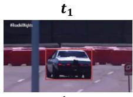

��  
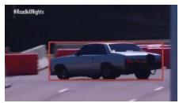

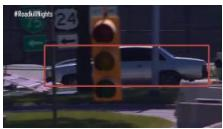  
Absolute Type

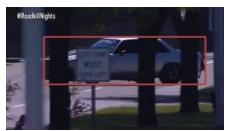  
Relative Type

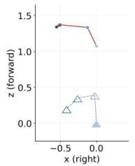

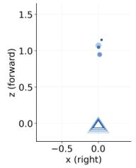  
Q. (illustrative) Anchored to the frame 1 of the clip, how does the car move? Answer: Moves left  
Q. (illustrative) Following the camera, how does the car move? Answer: Remains stationary

Figure 6: Relative vs. Absolute frames for the same clip and car (top-down view). Relative uses each frame’s own camera as the origin; Absolute fixes the origin at the camera of $t _ { 1 }$

Distractors. We favor the reference answer’s phase count and exclude duplicate or equivalent options. For motion QA, we replace distractors consistent with the reference trajectory to retain one correct answer.

Missing-entity augmentation. We rewrite training questions to refer to objects verified by a multimodal model as absent throughout the clip. These objects have bbox 2d and centroid set to null at each annotated timestep; the video and other states are unchanged. Template responses select an absence option.

<table><tr><td>Question type</td><td>Setting</td><td>Question template</td></tr><tr><td>Camera-object distance</td><td>Rel./Abs.</td><td>[Prefix] how does the distance between [Object 1] and [Camera] change?</td></tr><tr><td>Object-object distance</td><td>Rel.</td><td>[Prefix] how does the distance between [Object 1] and [Object 2] change?</td></tr><tr><td>Camera-object direction</td><td>Rel./Abs.</td><td>[Prefix] how does the direction from [Camera] to [Object 1] change?</td></tr><tr><td>Object-object direction</td><td>Rel./Abs.</td><td>[Prefix] how does the direction from [Object 1] to [Object 2] change?</td></tr><tr><td>Speed</td><td>Rel./Abs.</td><td>[Prefix] how does the speed of [Object 1] change?</td></tr><tr><td>Speed comparison Object motion</td><td>Rel./Abs. Abs.</td><td>[Prefx] compare the speed between [Object 1] and [Object 2]. How does [Object 1] move over time? Answer in temporal order.</td></tr></table>

Table 7: Question templates for the 12 benchmark categories. Shared templates are grouped across coordinate settings. The object-motion row shows one of six paraphrases used in the data.
<table><tr><td>Question family</td><td>Reference quantity</td><td>Example choice text</td></tr><tr><td>Camera-object distance</td><td>Distance from the object to the current or anchor-camera origin.</td><td>It moves closer to the camera, then moves farther from the camera.</td></tr><tr><td>Object-object distance</td><td>Distance between two object centroids.</td><td>They move closer together, then move farther apart.</td></tr><tr><td>Direction</td><td>Directed 3D offset from the first entity to the second.</td><td>It is to the front, then to the front-right.</td></tr><tr><td>Speed</td><td>Magnitude of consecutive</td><td>It slows down, then moves at a steady pace.</td></tr><tr><td>Speed comparison</td><td>coordinate increments. Two objects&#x27; increment magnitudes</td><td>The first is faster, then the second is faster.</td></tr><tr><td>Object motion</td><td>over corresponding intervals. Translation along the fixed anchor camera&#x27;s forward and lateral axes.</td><td>First moves toward the camera, then left</td></tr></table>

Table 8: Geometric quantities and example answer-option forms. Each option describes one or two ordered phases; the reference answer identifies one of the four options. The examples are drawn from the stored QA records.
<table><tr><td>Question type</td><td>How the answer is determined</td></tr><tr><td>Distance 3D separation between the queried entities.</td><td>Nearly constant: within 20% of the phase&#x27;s starting distance. Increasing: each distance exceeds the preceding one by more than 20%. Decreasing: each distance is more than 20% below the preceding one.</td></tr><tr><td>Speed 3D displacement</td><td>Steady pace: within 20% of the phase&#x27;s starting displacement. Speeding up: each displacement exceeds the preceding one by more than 20%.</td></tr><tr><td>magnitude per interval. Speed comparison Two objects over the same</td><td>Slowing down: each displacement is more than 20% below the preceding one. Faster: an object&#x27;s displacement is more than 1.2 times the other&#x27;s. Nearly equal: neither object meets this condition.</td></tr><tr><td>interval. Direction</td><td>Front / left / above: forward / left / up component above 0.3.</td></tr><tr><td>Unit direction: first to</td><td>Behind / right / below: that component is below —0.3.</td></tr><tr><td>second entity. Moving Scene-normalized path in</td><td>Combine directions when multiple axes qualify. Stationary: both forward–lateral and vertical path lengths are at most 0.04.</td></tr></table>

Table 9: Main criteria for determining reference answers. Distance, speed, speed comparison, and direction criteria are adapted from DSR-Suite (Zhou et al., 2026) (Table 8 and implementation). Moving questions use our additional criteria for fixed-frame translation.

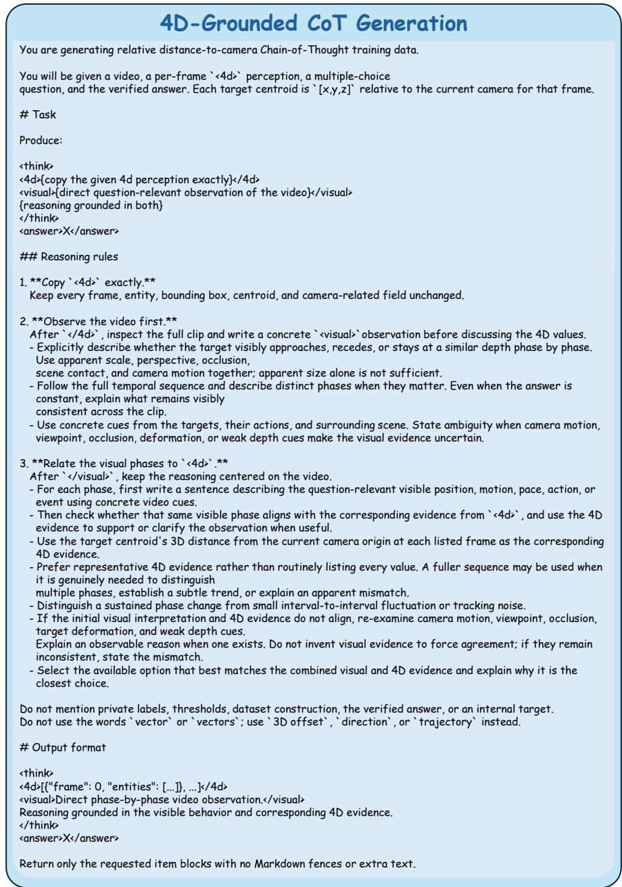  
Figure 7: Teacher prompt for generating 4D-grounded CoT supervision, shown for relative distanceto-camera questions.

## A.3 COT GENERATION SETTINGS

Teacher and inputs. GPT-5.6 (gpt-5.6-sol) receives the question, four options, reference states, correct answer, and 32 uniformly sampled frames. Frames are indexed, ordered temporally, and resized to fit 384 × 216 pixels while preserving aspect ratio. Task-specific prompts specify coordinate conventions and link visual observations to state changes (Figure 7).

Validation. We regenerate outputs from the same inputs if they alter reference states or the answer, lack a nonempty <visual> block, or violate the response format.

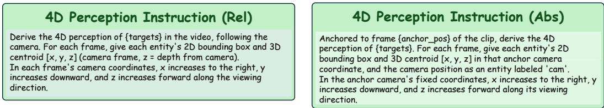  
Figure 8: Instructions for 4D perception supervision: relative (left) and absolute (right).

## B TRAINING AND EVALUATION DETAILS

## B.1 OPTIMIZATION SETTINGS

Joint SFT trains for one epoch on Trace4D-Train: 600K 4D perception examples and approximately 70K grounded QA examples, mixed from the outset.

LoRA uses rank $r \ = \ 1 2 8$ , scaling factor $\alpha = 2 5 6 ,$ , and dropout 0.05. The language model and multimodal projector use cosine learning-rate decay from 1e−4 to 1e−5 with $3 \%$ warmup. SFT runs on eight H100 GPUs with an effective batch size of 128.

## B.2 ABLATION SETTINGS

Perception-first SFT uses one epoch of perception pretraining and one of QA adaptation. Adaptation uses all grounded QA examples and resamples 28% of each relative and absolute perception pool per epoch for replay; this is the pool sampling rate, not the proportion in the training mixture.

All CoT variants, including Visual-only CoT, share this schedule without GRPO and differ only in QA supervision and instructions. Adaptation-only SFT runs the adaptation phase from the base VLM, whereas Joint SFT mixes perception and QA from the outset. Their budgets and data exposure differ. Table 4 also reports Joint SFT followed by GRPO.

## B.3 GEOMETRY-AWARE GRPO

GRPO trains on 7,008 QA examples for one epoch with eight responses per input, cosine learningrate decay from 1e−5, 3% warmup, and KL coefficient $\beta = 0 . 1$ . In Equation 3, 4B uses $w _ { \mathrm { a c c } } = 0 . 5$ and $w _ { \mathrm { p o s } } = w _ { \Delta } = 0 . 1 5$ , whereas 8B uses $w _ { \mathrm { a c c } } = 0 . 3$ and $w _ { \mathrm { p o s } } = w _ { \Delta } = 0 . 2 5$ . Both use $w _ { \mathrm { f m t } } =$ $w _ { \mathrm { b b o x } } = 0 . 1$

The answer-accuracy reward checks the final option against $a _ { \mathrm { r e f } }$ . The format reward requires valid 4D JSON and nonempty temporal visual analysis and 4D-grounded reasoning:

$$
R _ { \mathrm { a c c } } ( y ) = { \left\{ \begin{array} { l l } { 1 , } & { { \mathrm { i f ~ t h e ~ a n s w e r ~ i s ~ c o r r e c t } } , } \\ { 0 , } & { { \mathrm { o t h e r w i s e } } , } \end{array} \right. } \qquad R _ { \mathrm { f m t } } ( y ) = { \left\{ \begin{array} { l l } { 1 , } & { { \mathrm { i f ~ } } y { \mathrm { ~ i s ~ c o r r e c t l y ~ f o r m a t t e d } } , } \\ { 0 , } & { { \mathrm { o t h e r w i s e } } . } \end{array} \right. }\tag{4}
$$

For non-null object boxes, the IoU reward is

$$
R _ { \mathrm { b b o x } } ( y ) = \underset { i } { \mathrm { m e a n } } \Bigl [ \underset { t } { \mathrm { m e a n ~ I o U } } \Bigl ( \hat { \mathbf { b } } _ { i , t } , \bar { \mathbf { b } } _ { i , t } \Bigr ) \Bigr ] ,\tag{5}
$$

averaging over matched timesteps t within each object track i, then across objects, excluding cameras. Matching uses exact entity labels and frame indices. Invalid predictions contribute zero to the corresponding geometric reward. Reference-null entries receive reward for matching absence. Displacements require valid matches at consecutive reference timesteps; entities without such intervals use position reward alone.

## B.4 TRAINING AND INFERENCE PROMPTS

Figure 8 shows the relative and absolute instructions for state prediction; these examples contain no visual analysis or QA answer. Figure 9 shows the suffixes appended to questions and options during grounded QA training and inference. They specify the coordinate convention and request the full 4D-grounded CoT and answer. Reference states and answer labels are training targets, not extra student inputs. The teacher prompt used to construct CoT supervision is shown in Figure 7.

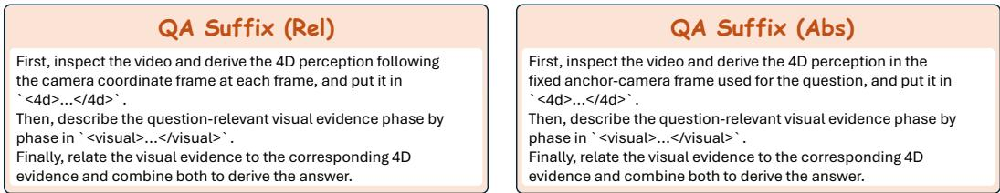  
Figure 9: QA suffixes for grounded QA training and inference: relative (left) and absolute (right).

## B.5 EVALUATION PROTOCOL

QA evaluation. Trace4D uses 32 sampled video frames and greedy decoding with a maximum of 4,096 generated tokens. We extract the option letter from the final <answer> block; responses without a valid answer are counted as incorrect. Trace4D-Bench contains 1,200 questions over 1,178 distinct temporal clips, with 600 questions in each coordinate setting. VLM4D contains 1,816 questions over 1,000 videos (600 real and 400 synthetic). Overall accuracy is computed over all questions in each benchmark.

Perception metrics. We evaluate predicted states from 600 Relative and 600 Absolute spatial QA responses at exact matching frames (Tables 5 and 10). IoU excludes supplied initial boxes; centroid and trajectory L2 measure position and consecutive-matched-frame displacement errors. We average within each valid object track, then across tracks, excluding cameras. For Relative, all reference coordinates are divided by the largest positive depth of the referenced objects at the first clip frame, shared across objects and timesteps. Absolute references are already normalized and evaluated as stored. Predictions are unchanged; no alignment is fitted.

## C GRPO ABLATION

Table 10 compares different reward configurations and their effects on QA accuracy and 4D state prediction.
<table><tr><td>Training / feedback</td><td colspan="2">QA accuracy (%)</td><td colspan="3">4D state prediction</td></tr><tr><td></td><td>Overall</td><td>VLM4D</td><td>Centroid L2↓</td><td>Trajectory L2 ↓</td><td>IoU ↑</td></tr><tr><td>Joint SFT</td><td>77.83</td><td>62.39</td><td>0.1873</td><td>0.1178</td><td>0.7353</td></tr><tr><td>+ GRPO: accuracy only</td><td>78.33</td><td>62.67</td><td>0.1831</td><td>0.1164</td><td>0.7362</td></tr><tr><td>+ GRPO: position only</td><td>78.83</td><td>63.11</td><td>0.1805</td><td>0.1151</td><td>0.7403</td></tr><tr><td>Trace4D (Joint SFT + GRPO)</td><td>79.25</td><td>64.32</td><td>0.1775</td><td>0.1123</td><td>0.7377</td></tr></table>

Table 10: QA accuracy and 4D state prediction in the GRPO ablation. State metrics use all 1,200 Trace4D-Bench questions, with valid-track averaging.

Settings. All variants use the same 7,008 QA examples and optimization settings (Appendix B.3). Accuracy-only sets $w _ { \mathrm { a c c } } = 0 . 9$ and $w _ { \mathrm { f m t } } = 0 . 1$ , with all geometric reward weights set to zero. Position-only and Trace4D share $w _ { \mathrm { a c c } } = 0 . 5$ and $w _ { \mathrm { f m t } } = w _ { \mathrm { b b o x } } = 0 . 1$ . Position-only uses $w _ { \mathrm { p o s } } =$ 0.3 and $w _ { \Delta } = 0$ , while Trace4D uses $w _ { \mathrm { p o s } } = w _ { \Delta } = 0 . 1 5$

State evaluation. We score 4D states in saved QA responses, averaging first within and then across object tracks. Cameras and initial-frame boxes are excluded. Models use their own matched timesteps.

Results. Trace4D outperforms Accuracy-only by 0.92 and 1.65 percentage points on Trace4D-Bench and VLM4D, respectively. Relative to Position-only, Trace4D also improves QA accuracy and reduces both centroid and trajectory L2 errors, though with slightly lower IoU. These results indicate that incorporating geometric rewards can improve QA accuracy while reducing coordinate and trajectory errors in the predicted 4D states.

## D QUALITATIVE EXAMPLES

Figures 10, 11, and 12 show Trace4D predictions on relative QA, absolute QA, and VLM4D.

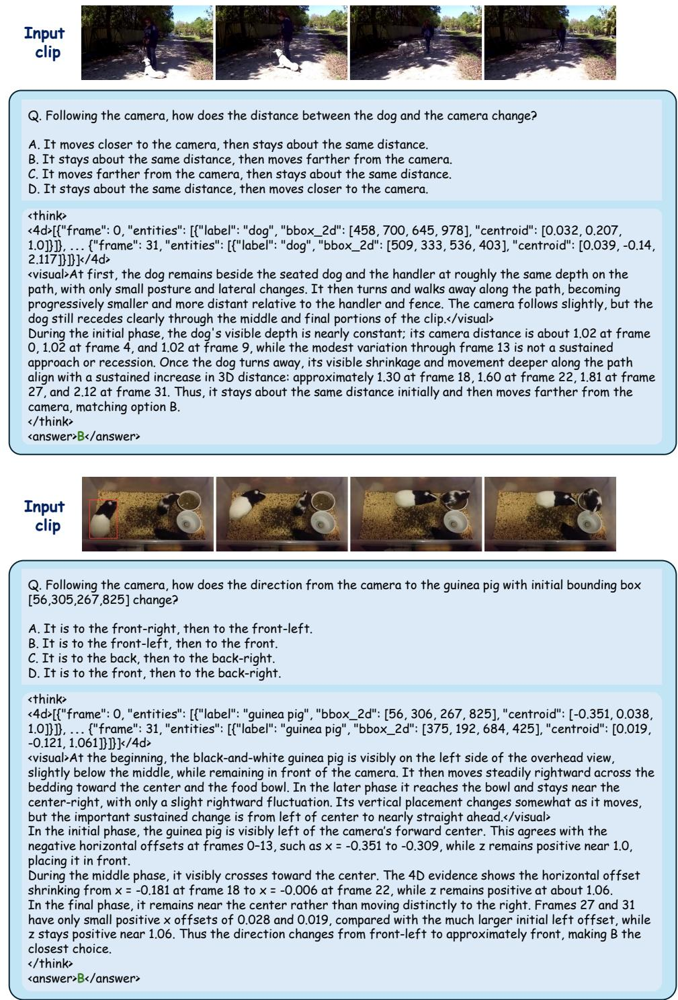  
Figure 10: Trace4D predictions for camera-relative distance (top) and direction (bottom). Each example connects temporal visual observations with 4D state changes to support the answer. The displayed <4d> blocks are abbreviated.

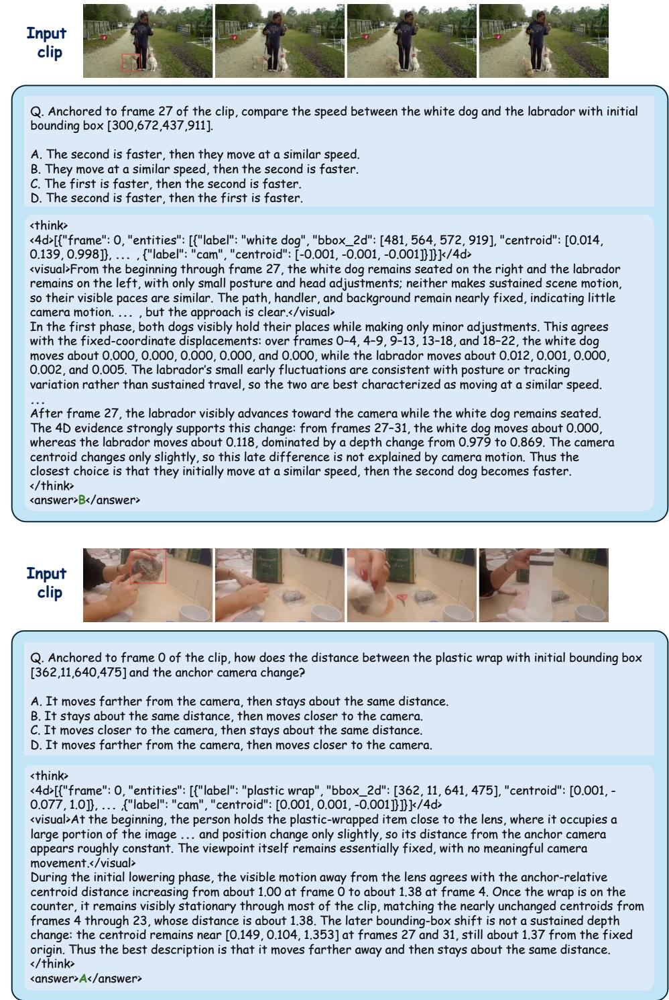  
Figure 11: Trace4D predictions for absolute speed comparison (top) and distance to the anchor camera (bottom). Both examples use the fixed anchor-camera frame specified in the question. Ellipses indicate omitted portions of the responses.

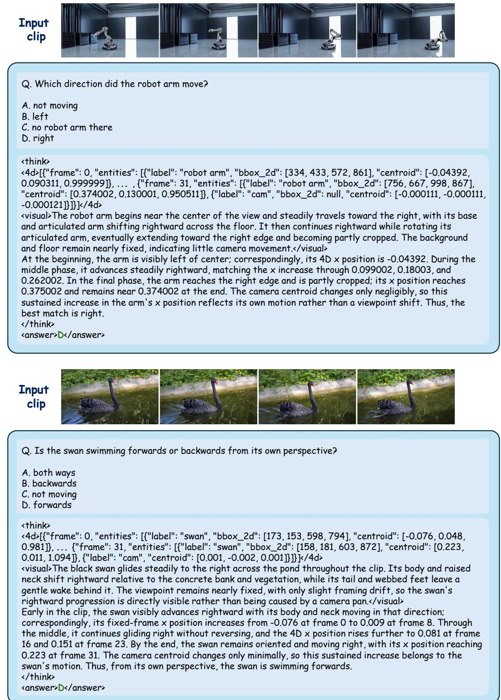  
Figure 12: Trace4D predictions on VLM4D: robot-arm movement direction (top) and swan motion from its own perspective (bottom). The displayed <4d> blocks are abbreviated.