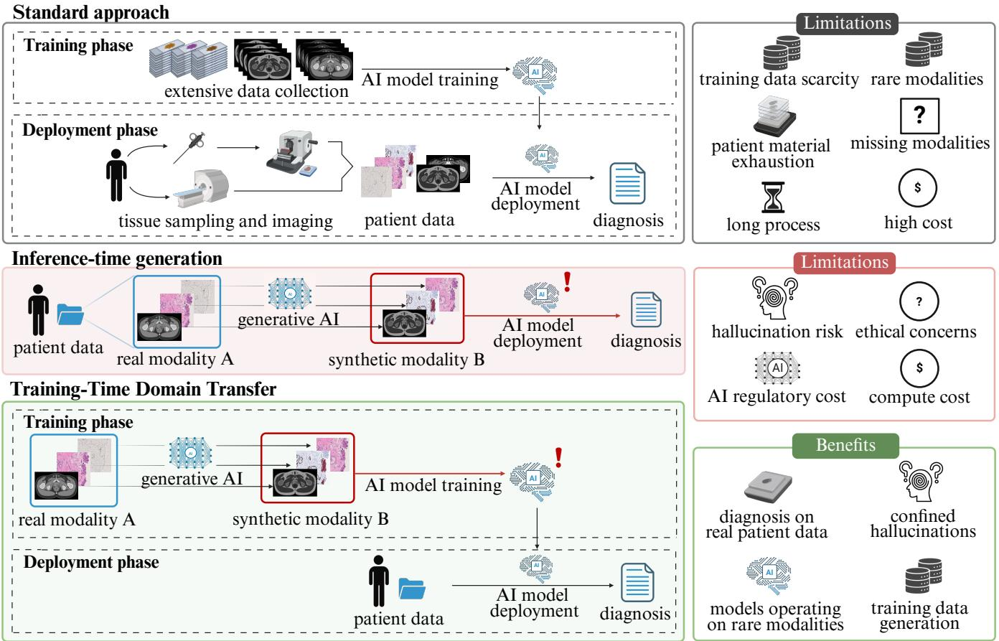
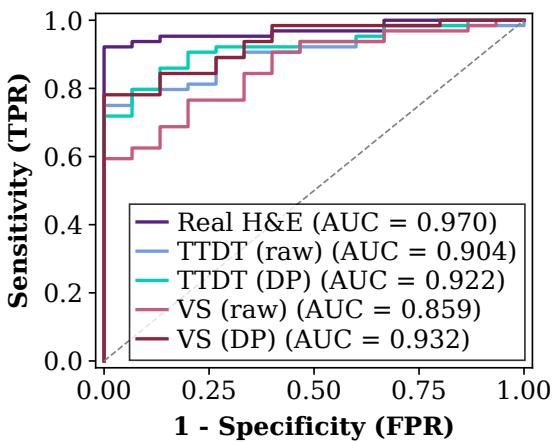
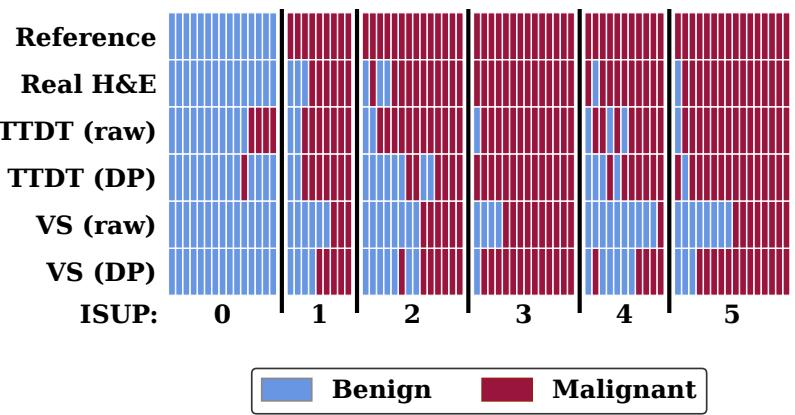

# TRAINING-TIME DOMAIN TRANSFER FOR GENERATOR-FREE DIAGNOSTICS ON NOVEL MODALITIES IN COMPUTATIONAL PATHOLOGY

Julia A. Mielcarz1 Andrea Camilloni1 Nita Mulliqi1 Jessica A. Frank1,2 Anders Blilie3 Emilius A.M. Janssen3,4,5 Martin Eklund1 Kimmo Kartasalo6,7,1,8

1Department of Medical Epidemiology and Biostatistics, Karolinska Institutet, Sweden 2Harvard Medical School, USA 3Department of Pathology, Stavanger University Hospital, Norway 4Department of Chemistry, Bioscience and Environmental Engineering, University of Stavanger, Norway 5Institute for Biomedicine and Glycomics, Griffith University, Australia 6ELLIS Institute Finland 7Department of Computing, Faculty of Technology, University of Turku, Finland 8Science for Life Laboratory (SciLifeLab), Karolinska Institutet, Stockholm, Sweden

## ABSTRACT

Novel imaging modalities promise improved diagnostics, but AI development is constrained by scarce training data. Inference-time domain transfer can address this by mapping novel modalities to established ones, enabling reuse of existing diagnostic models. However, this introduces hallucination risks, computational overhead, and regulatory complexity. Inspired by sim-to-real transfer, we propose training-time domain transfer, generating synthetic target-domain training data from archived routine samples to enable direct diagnosis on real inputs without inference-time generation. Using unstained prostate histopathology as a proof-of-concept, we compare this approach with inference-time virtual staining and conventional H&E-based cancer detection. Training-time transfer achieved higher concordance with the conventional benchmark than virtual staining for both raw (Cohen’s κ=0.59 vs. 0.37; Gwet’s AC1=0.73 vs. 0.29) and deparaffinized tissue (κ=0.66 vs. 0.61; AC1=0.73 vs. 0.64), supporting its potential for emerging diagnostic modalities.

Index Terms— Computational pathology, sim-to-real, domain transfer, virtual staining, stain-free histopathology

## 1. INTRODUCTION

Robust diagnostic AI requires large, annotated datasets, which are scarce for emerging imaging modalities. In pathology, e.g., unstained slides, spatial multiplex proteomics, or µ-CT lack large clinical datasets, whereas archives of conventional hematoxylin and eosin (H&E)-stained slides enable large-scale AI studies. Computer vision addresses similar data scarcity through sim-to-real transfer, training models on synthetic data for direct deployment on real inputs, as demonstrated in autonomous driving [1] and robotics [2]. If a simulated domain, however imperfect, captures sufficient structure of the real target domain, a downstream model can be trained without real data. In medical imaging, this paradigm has been used to, e.g., synthesize MRI training data from annotated CT scans for radiotherapy contouring [3]. In pathology, the dominant response has been to deploy generative AI models to synthesize data. A prominent example is virtual staining [4], enabled by image-to-image translation [5] and explored, e.g., for prostate biopsies [6]. These approaches operate at inference time, translating images from a novel modality into a familiar one so that existing diagnostic models can be applied. However, generative AI models can hallucinate, and realistic hallucinations such as an incorrect number of nuclei can mislead diagnosis [7]. Combining generative and diagnostic models also increases regulatory complexity, requiring separate validation and revalidation after updates. We propose reversing this paradigm by restricting generative AI to training (training-time domain transfer, TTDT), following a sim-to-real approach (Fig. 1). As a proof-of-concept, we generate synthetic unstained training images from archived H&E slides for prostate cancer detection, while performing inference directly on real unstained tissue. To our knowledge, this approach is novel in computational pathology.

## 2. MATERIALS AND METHODS

## 2.1. Dataset and preprocessing

Prostate biopsy blocks from the STHLM3 trial [8] were re-sectioned and sequentially scanned at three processing stages: raw, deparaffinized (DP) and H&E-stained. The original ISUP grades were retained as reference. The resulting stain-free histopathology (STHLM3-SFH) dataset comprises paired scans for training the generative models (250 raw/H&E and 117 DP/H&E slide pairs) and a test split of 79 slides from 67 patients scanned at all three stages (Table 1). WSIs were tiled (1024×1024 px, 0.5 µm/px) and to correct minor spatial shifts from sequential scanning, raw and DP images of the training set were each registered to their H&E counterparts in Fiji by template matching [9] on random patch pairs.

  
Fig. 1. Comparison of conventional diagnostic AI, inference-time generation, and the proposed training-time domain transfer.

## 2.2. Generative models

We used Pix2Pix [5] with a UNet## generator [10]. Four models were trained: virtual staining (raw or DP to H&E) and virtual unstaining (H&E to raw or DP), on 19,831 (raw) or 9,238 (DP) paired tiles, with adversarial, L1 (λ=100) and Pearson correlation (γ=10) losses, using Adam (learning rate $2 \times 1 0 ^ { - 4 } )$ for up to 50 epochs, with the checkpoint chosen from the training curves and visual inspection at validation. Implementation: https://github.com/ JAMielcarz/training-time-domain-transfer

## 2.3. Diagnostic model

The model follows a prior multiple instance learning approach [11], adjusted to benign vs. malignant classification: an EfficientNet-V2-S feature extractor followed by gated attention [12]. It was trained on 37,447 H&E WSIs from three cohorts (STHLM3; Stavanger University Hospital, SUH; S:t Goran Hospital, STG), either directly (H&E benchmark and¨ inference-time virtual staining), or after virtual unstaining to each unstained stage (TTDT), with each model trained solely on synthetic data (Table 1). Ten cross-validation models were ensembled, and the threshold was optimized for F1 on a multi-cohort tuning set (STHLM3; Karolinska University Hospital, KUH; Radboud University Medical Center, RUMC). Diagnostic training and tuning cohorts (details in [11]) share no patients with the STHLM3-SFH test set.

## 2.4. Evaluation

Five scenarios were compared: real H&E (benchmark), synthetic H&E from raw or DP tissue (virtual staining), and real raw or DP tissue (TTDT). Each approach was compared with the H&E benchmark by DeLong’s test [13] on AUCs against the pathologist’s diagnosis, and by Cohen’s κ and Gwet’s AC1 [14] (robust to the high malignancy prevalence).

## 3. RESULTS

Evaluated against the pathologist on the test set (n=79), real H&E achieved the highest AUC for cancer detection (0.970; Table 2, Fig. 2). Virtual staining reached AUCs of 0.932 (DP) and 0.859 (raw), and TTDT reached 0.922 and 0.904. Only virtual staining from raw input had a significantly lower AUC (p=0.016) than the benchmark and a low sensitivity (0.44). TTDT showed higher concordance with the H&E benchmark AI than virtual staining did for both raw (κ=0.59 vs. 0.37; AC1=0.73 vs. 0.29) and DP input (κ=0.66 vs. 0.61; AC1=0.73 vs. 0.64).

Table 1. Patient and slide characteristics of the generative and diagnostic model datasets (N, (%)).
<table><tr><td></td><td colspan="3">STHLM3-SFH</td><td colspan="3">Diagnostic training</td><td colspan="3">Diagnostic tuning</td></tr><tr><td></td><td>Train raw</td><td>Train DP</td><td>Test</td><td>STHLM3</td><td>SUH</td><td>STG</td><td>STHLM3</td><td>KUH</td><td>RUMC</td></tr><tr><td>Patients</td><td>250</td><td>117</td><td>67</td><td>2,711</td><td>710</td><td>70</td><td>24</td><td>73</td><td>72</td></tr><tr><td>Slides</td><td>250</td><td>117</td><td>79</td><td>29,527</td><td>4,589</td><td>247</td><td>276</td><td>330</td><td>195</td></tr><tr><td>WSIs</td><td>250</td><td>117</td><td>79</td><td>32,609</td><td>4,591</td><td>247</td><td>276</td><td>330</td><td>195</td></tr><tr><td>Age ≤ 49</td><td>0 (0.0)</td><td>0 (0.0)</td><td>0 (0.0)</td><td>4 (0.1)</td><td>13 (1.8)</td><td>0 (0.0)</td><td>0 (0.0)</td><td>2 (2.7)</td><td>1</td></tr><tr><td>Age 50–54</td><td>15 (6.0)</td><td>6 (5.1)</td><td>8 (11.9)</td><td>216 (8.0)</td><td>35 (4.9)</td><td>1 (1.4)</td><td>1 (4.2)</td><td>5 (6.8)</td><td></td></tr><tr><td>Age 55–59</td><td>26 (10.4)</td><td>11 (9.4)</td><td>10 (14.9)</td><td>430 (15.9)</td><td>94 (13.2)</td><td>2 (2.9)</td><td>2 (8.3)</td><td>10 (13.7)</td><td></td></tr><tr><td>Age 60–64</td><td>68 (27.2)</td><td>34 (29.1)</td><td>14 (20.9)</td><td>701 (25.9)</td><td>137 (19.3)</td><td>4 (5.7)</td><td>8 (33.3)</td><td>12 (16.4)</td><td></td></tr><tr><td>Age 65–69</td><td>134 (53.6)</td><td>62 (53.0)</td><td>29 (43.3)</td><td>1,208 (44.6)</td><td>191 (26.9)</td><td>6 (8.6)</td><td>13 (54.2)</td><td>15 (20.5)</td><td></td></tr><tr><td>Age ≥ 70</td><td>7 (2.8)</td><td>4 (3.4)</td><td>6 (9.0)</td><td>152 (5.6)</td><td>240 (33.8)</td><td>37 (52.9)</td><td>0 (0.0)</td><td>29 (39.7)</td><td></td></tr><tr><td>Unknown</td><td>0 (0.0)</td><td>0 (0.0)</td><td>0 (0.0)</td><td>0 (0.0)</td><td>0 (0.0)</td><td>20 (28.6)</td><td>0 (0.0)</td><td>0 (0.0)</td><td>72 (100.0)</td></tr><tr><td>Benign</td><td>38 (15.2)</td><td>26 (22.2)</td><td>15 (19.0)</td><td>23,521 (79.7)</td><td>3,423 (74.6)</td><td>1 (0.4)</td><td>192 (69.6)</td><td>108 (32.7)</td><td>95 (48.7)</td></tr><tr><td>ISUP 1</td><td>35 (14.0)</td><td>7 (6.0)</td><td>9 (11.4)</td><td>3,571 (12.1)</td><td>682 (14.9)</td><td>1 (0.4)</td><td>28 (10.1)</td><td>65 (19.7)</td><td>24 (12.3)</td></tr><tr><td>ISUP 2</td><td>41 (16.4)</td><td>12 (10.3)</td><td>14 (17.7)</td><td>1,265 (4.3)</td><td>239 (5.2)</td><td>1 (0.4)</td><td>18 (6.5)</td><td>63 (19.1)</td><td>15 (7.7)</td></tr><tr><td>ISUP 3</td><td>60 (24.0)</td><td>39 (33.3)</td><td>14 (17.7)</td><td>494 (1.7)</td><td>129 (2.8)</td><td>2 (0.8)</td><td>13 (4.7)</td><td>49 (14.8)</td><td>15 (7.7)</td></tr><tr><td>ISUP 4</td><td>24 (9.6)</td><td>17 (14.5)</td><td>11 (13.9)</td><td>377 (1.3)</td><td>54 (1.2)</td><td>32 (13.0)</td><td>13 (4.7)</td><td>19 (5.8)</td><td>19 (9.7)</td></tr><tr><td>ISUP 5</td><td>52 (20.8)</td><td>16 (13.7)</td><td>16 (20.3)</td><td>299 (1.0)</td><td>62 (1.4)</td><td>210 (85.0)</td><td>12 (4.3)</td><td>26 (7.9)</td><td>27 (13.8)</td></tr></table>

Table 2. Diagnostic performance against pathologist labels and agreement with the H&E model (κ, AC1). DeLong’s pvalues compare AUCs with real H&E. VS: virtual staining; TTDT: training-time domain transfer.
<table><tr><td>Approach</td><td>AUC F1 Sens. Spec.</td><td>p</td><td>κ</td><td>AC1</td></tr><tr><td>Real H&amp;E</td><td>0.970 0.933 0.875 1.000</td><td>一</td><td></td><td></td></tr><tr><td>VS (raw) VS (DP)</td><td>0.859 0.609 0.438 1.000 0.932 0.804 0.672 1.000</td><td>0.016 0.161</td><td>0.368 0.606</td><td>0.294 0.643</td></tr><tr><td></td><td></td><td></td><td></td><td></td></tr><tr><td>TTDT (raw) TTDT (DP)</td><td>0.904 0.894 0.859 0.733 0.922 0.8600.7660.933</td><td>0.079</td><td>0.585 0.728</td><td>0.1420.6580.728</td></tr></table>

## 4. DISCUSSION

Training-time domain transfer achieved diagnostic agreement comparable or superior to inference-time virtual staining without real unstained training data. Unlike domain adaptation [15], which typically requires target domain data to train the task model, our diagnostic model receives none at any stage, making the transfer zero-shot. The generative model needs paired data, but once trained it enables the diagnostic model training at scale from vast source domain archives. The viability of this paradigm rests on the hypothesis that fewer paired samples are needed to train a sufficient generative model than real target samples to train a diagnostic model from scratch. As in sim-to-real learning, synthetic training data need not perfectly reproduce the target domain [2], only capture sufficient structure for the downstream task.

Pixel-wise metrics such as SSIM or PSNR are sensitive to misalignment and may not reflect the preservation of diagnostically relevant features. Thus, rather than evaluating visual similarity alone, we focus on diagnostic utility of synthetic images as training data. Across both tissue processing stages, the generator-free approach showed higher agreement with the H&E benchmark than virtual staining did, suggesting that avoiding inference-time generation may improve diagnostic consistency. Limitations of the study include data from a single laboratory and reference grading from the original collection; we therefore focused on concordance with the H&E benchmark AI. Closing the remaining sim-to-real gap through larger datasets or improved generators remains future work. In conclusion, training-time domain transfer removes generative AI from the diagnostic inference pipeline and enables zero-shot deployment on emerging modalities, where large training datasets are infeasible to collect.

## 5. COMPLIANCE WITH ETHICAL STANDARDS

The study was approved by the Swedish Ethical Review Authority (2019-05220, 2025-07557-02).

## 6. ACKNOWLEDGMENTS

Funding: SciLifeLab & Wallenberg DDLS (KAW 2024.0159), Cancer Research KI. Computing: NAISS (funded by the

  
Fig. 2. Test set (n=79): ROC curves (left) and slide-level predictions vs. the pathologist reference (right).

Swedish Research Council), Berzelius (funded by KAW).   
Disclosures: A.C. received honoraria from Astellas Pharma;   
A.C., N.M., K.K., and M.E. hold shares in Clinsight AB;   
M.E. holds shares and patents in A3P Biomedical AB.

## 7. REFERENCES

[1] A. Dosovitskiy, G. Ros, F. Codevilla, A. Lopez, and V. Koltun, “CARLA: An open urban driving simulator,” in Proc. 1st Annu. Conf. Robot Learn., 2017, pp. 1–16.

[2] J. Tobin, R. Fong, A. Ray, J. Schneider, W. Zaremba, and P. Abbeel, “Domain randomization for transferring deep neural networks from simulation to the real world,” in Proc. IEEE/RSJ Int. Conf. Intell. Robots Syst., 2017, pp. 23–30.

[3] J. P. Kieselmann, C. D. Fuller, O. J. Gurney-Champion, and U. Oelfke, “Cross-modality deep learning: Contouring of MRI data from annotated CT data only,” Med. Phys., vol. 48, no. 4, pp. 1673–1684, 2021.

[4] L. Latonen, S. Koivukoski, U. Khan, and P. Ruusuvuori, “Virtual staining for histology by deep learning,” Trends Biotechnol., vol. 42, no. 9, pp. 1177–1191, 2024.

[5] P. Isola, J.-Y. Zhu, T. Zhou, and A. A. Efros, “Imageto-image translation with conditional adversarial networks,” in Proc. IEEE Conf. Comput. Vis. Pattern Recognit., 2017, pp. 1125–1134.

[6] A. Rana et al., “Use of deep learning to develop and analyze computational hematoxylin and eosin staining of prostate core biopsy images for tumor diagnosis,” JAMA Netw. Open, vol. 3, no. 5, 2020, Art. no. e205111.

[7] L. Huang, Y. Li, N. Pillar, T. Keidar Haran, W. D. Wallace, and A. Ozcan, “A robust and scalable framework

for hallucination detection in virtual tissue staining and digital pathology,” Nat. Biomed. Eng., vol. 9, pp. 2196– 2214, 2025.

[8] H. Gronberg et al., “Prostate cancer screening in men¨ aged 50–69 years (STHLM3): a prospective populationbased diagnostic study,” Lancet Oncol., vol. 16, no. 16, pp. 1667–1676, 2015.

[9] L. S. V. Thomas and J. Gehrig, “Multi-template matching: a versatile tool for object-localization in microscopy images,” BMC Bioinformatics, vol. 21, 2020, Art. no. 44.

[10] F. Korkmaz, “U-Net##: A powerful novel architecture for medical image segmentation,” in Med. Imaging Comput.-Aided Diagnosis, 2023, pp. 231–241.

[11] N. Mulliqi et al., “Comparative analysis of end-toend learning and foundation models for clinical-grade prostate pathology,” Nat. Commun., 2026, doi: 10.1038/s41467-026-78996-7.

[12] M. Ilse, J. Tomczak, and M. Welling, “Attention-based deep multiple instance learning,” in Proc. 35th Int. Conf. Mach. Learn., 2018, pp. 2127–2136.

[13] E. R. DeLong, D. M. DeLong, and D. L. Clarke-Pearson, “Comparing the areas under two or more correlated receiver operating characteristic curves: a nonparametric approach,” Biometrics, vol. 44, no. 3, pp. 837–845, 1988.

[14] K. L. Gwet, “Computing inter-rater reliability and its variance in the presence of high agreement,” Br. J. Math. Stat. Psychol., vol. 61, no. 1, pp. 29–48, 2008.

[15] H. Guan and M. Liu, “Domain adaptation for medical image analysis: A survey,” IEEE Trans. Biomed. Eng., vol. 69, no. 3, pp. 1173–1185, 2022.