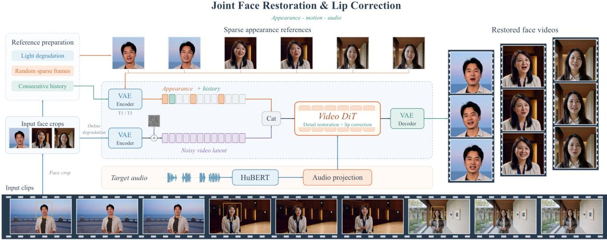
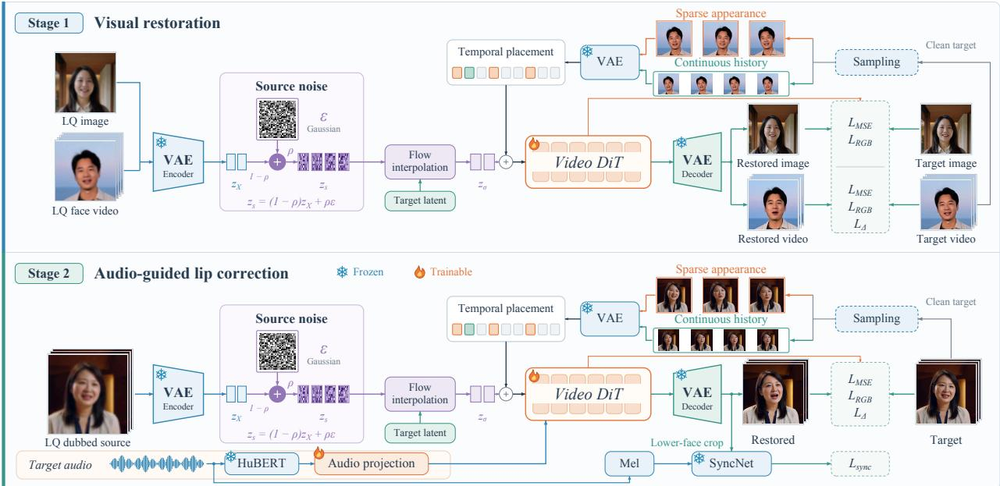
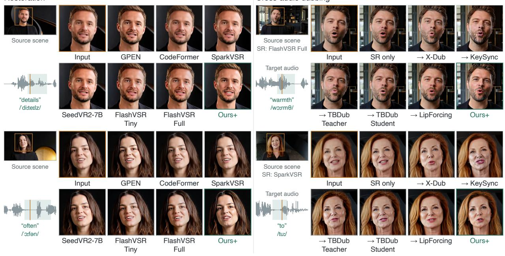
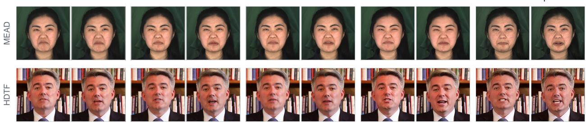

# TaoMate-FVSR: Audio-Guided Facial Video Restoration

Xinyang Li, Zeran Xu, Qijun Gan, Chenwei Zhang, Meiguang Jin\*, Junfeng Ma

Alibaba Group

lyon.lxy@taobao.com xuzeran.xzr@taobao.com meiguang.jmg@taobao.com

## ABSTRACT

AI-generated videos often depict people within detailed scenes while leaving their small facial regions poorly resolved. Visual super-resolution can sharpen these regions without resolving whether the recovered lips and teeth agree with the spoken audio. We present an audio-guided facial video restoration framework that addresses this ambiguity within a reference-guided video flow model. Source–noise mixing initializes reconstruction from a partially preserved observation, and structured reference injection separates appearance anchors from continuous motion context. Training combines restoration of degraded images and videos with correction of degraded dubbed sources under target audio. Appearance and synchronization supervision allow the model to recover facial detail and support visual dubbing when the audio is replaced. On talking-head restoration benchmarks, our method achieves the best paired perceptual similarity and synchronization scores among the compared restoration methods. Component comparisons examine audio conditioning, the reconstruction formulation, and reference injection. Native AIGC examples further illustrate the recovery of lip contours, dental structure, and surrounding facial texture in scene-level footage.

Project page: https://taoliveaigc.github.io/TaoMate-FVSR/

## 1 Introduction

Video generation models can synthesize detailed scenes and coordinated character motion [1], yet a highresolution frame does not necessarily contain a high-resolution face. In medium shots and full-body compositions, faces occupy only a small fraction of the image. Lip contours, individual teeth, and the oral cavity can remain blurred or poorly separated even when the surrounding scene is convincing. These defects become prominent during close viewing and reframing. Improving facial quality without regenerating an otherwise satisfactory shot is therefore an important step in downstream AIGC production.

Video super-resolution addresses missing visual detail. SeedVR2 [2] uses generative priors for reconstruction, FlashVSR [3] targets eficient streaming restoration, and SparkVSR [4] introduces sparse high-quality keyframes for appearance control. For a speaking face, the desired detail also depends on articulation: lip contact determines tooth visibility, while mouth opening changes oral boundaries and occlusion. A plausible dental pattern can therefore disagree with the spoken sound. The restoration target must account for audio as well as visual appearance.

Audio provides information that can constrain this otherwise ambiguous reconstruction. Extreme-scale talkingface upsampling [5] combines audio with a high-resolution identity image; MDVD-Net [6] exploits multimodal cues for compressed face video; and GAVN [7] models temporal and identity information. We focus on low-quality AIGC faces whose observed oral structures or articulation may be unreliable. In this setting, restoring a sharp version of the source mouth is not always suficient. The recovered lips and teeth must remain compatible with the accompanying audio throughout the reconstructed sequence.

  
Figure 1. Audio-guided facial restoration from AIGC footage. Small facial regions provide limited evidence for lip and teeth structure. The model restores these regions using reference frames and accompanying audio. The three clips illustrate the source scenes and reconstructed heads; the reference bank depicts training-time conditioning. Quantitative references originate from the GT first frame. “Cat” denotes channel-wise fusion implemented by separate linear projections and summation.

We address this problem with a reference-guided video flow model that uses audio during restoration. Its reconstruction trajectory begins from a source–noise mixture, preserving useful observations without making the source mouth a fixed target. Training first pairs degraded images and videos with clean targets. Audio-guided training additionally uses degraded dubbed sources whose mouth configuration difers from the target, requiring the model to follow the supplied speech rather than copy the input lips. Figure 1 illustrates the workflow, and Figure 2 details the learning objectives.

Reference guidance presents a second challenge: a reference frame carries a particular pose and mouth configuration that may conflict with the current video. We assign independently encoded references and sequenceencoded history to distinct temporal slots. This structured injection provides a persistent appearance anchor while retaining recent motion context. It also avoids treating the reference mouth as a frame that the output must reproduce. In the quantitative evaluation, the reference source is the GT first frame; the enhanced-reference setting edits this same image.

Visual dubbing tests this articulation-control capability under replacement audio. X-Dub [8] develops mask-free mouth editing, while VideoReTalking [9] combines lip editing with identity-aware enhancement. A conventional cascade restores appearance and then changes the mouth through a separate model. We evaluate whether our restoration framework retains recovered detail while following new audio, comparing it with super-resolution followed by released dubbing models. This complements the original-audio evaluation of facial restoration.

The contributions are threefold:

▶ An audio-guided facial video restoration framework that uses target speech to resolve ambiguous oral structure in low-quality footage, supporting both original-audio restoration and replacement-audio dubbing.

▶ A source–noise reconstruction formulation trained with visual-restoration and cross-articulation objectives. The latter uses mismatched source and target mouth configurations to supervise articulation correction.

▶ Structured reference injection with separate temporal slots for appearance anchors and continuous history. Component comparisons examine its role alongside audio conditioning and the source–noise formulation.

## 2 Related Work

Facial and video restoration. Learned facial priors recover detail from degraded observations. GFP-GAN [10] and GPEN [11] use GAN priors, while CodeFormer [12] uses discrete high-quality representations. BSRGAN [13] and Real-ESRGAN [14] provide synthetic degradations for blind super-resolution. Image restoration methods such as StableSR [15], DifBIR [16], and SUPIR [17] adapt difusion priors to balance perceptual quality against fidelity to the observed image. Temporal propagation extends restoration to video: BasicVSR++ [18] uses recurrent propagation, RealBasicVSR [19] pre-cleans inputs, and KEEP [20] uses Kalman-inspired propagation.

Generative video restoration and reference control. Upscale-A-Video [21] combines temporal difusion with flow-guided latent propagation. SeedVR [22] uses a window-based video difusion transformer, and SeedVR2 [2] studies one-step adversarial post-training. FlashVSR [3] targets eficient streaming restoration, while SparkVSR [4] propagates sparse high-quality keyframe guidance through low-resolution videos. We instead couple facial-detail recovery with target-audio control and cross-articulation supervision.

Visual dubbing. Wav2Lip [23] uses an expert synchronization objective, DINet [24] deforms reference features, and VideoReTalking [9] combines lip editing with identity-aware enhancement. LatentSync [25] and MuseTalk [26] operate in latent space; X-Dub [8] develops mask-free dubbing through generative bootstrapping. Unlike portrait animation such as AniPortrait [27] and EMO [28], editing an existing video requires articulation changes while preserving source pose and non-articulatory motion.

Audio-assisted restoration. Audio can also constrain restoration. Extreme-scale talking-face upsampling [5] combines low-resolution video, audio, and an identity image. MDVD-Net [6] uses audio, geometry, and codec cues; GAVN [7] models complementary temporal and identity information. We focus on restoration when the observed mouth is unreliable or incompatible with replacement audio, and evaluate both original-audio reconstruction and cross-audio dubbing within the same framework.

## 3 Method

Given a low-quality facial video �, audio �, and appearance references �, we reconstruct a facial video in a latent flow model. Quantitative references originate from the GT first frame; training supports multiple sparse frames from the clean target. Figure 2 summarizes visual restoration followed by audio-guided lip correction. The model uses the same reconstruction interface for original and replacement audio.

## 3.1 Visual Restoration Objective

The visual restoration objective pairs a high-quality image or video � with its degraded observation $X = { \mathcal { D } } ( Y )$ Inputs are resized back to the target’s grid before encoding, so restoration recovers missing detail at a common spatial resolution. A frozen causal video autoencoder $( E , D )$ maps images and videos to a shared latent space, and a Wan [1] video DiT predicts their reconstruction. Image examples supervise appearance; video examples additionally supervise temporal changes.

Source-noise mixing. Source-mouth copying is unsuitable when the observation is blurred or the target audio requires a diferent articulation. We initialize reconstruction by mixing the source latent $z _ { X } = E ( X )$ with Gaussian noise of matching dimensions:

$$
z _ { s } = ( 1 - \rho ) z _ { X } + \rho \epsilon , \quad \epsilon \sim N ( 0 , I ) ,\tag{1}
$$

$$
z _ { \sigma } = ( 1 - \sigma ) z _ { Y } + \sigma z _ { s } , \quad \nu ^ { \star } = z _ { s } - z _ { Y } ,\tag{2}
$$

where $z _ { Y } = E ( Y )$ . Flow matching [29] trains the DiT to predict $\nu ^ { \star }$ from $z _ { \sigma }$ and its conditions. Source-noise strength $\rho \in [ 0 . 8 0 , 0 . 9 5 ]$ controls retained source evidence; the separate flow time $\sigma$ locates a point on the target-to-source trajectory. Unlike the image degradation operator, this mixing defines the latent reconstruction trajectory: source structure remains available, while the output need not reproduce unreliable mouth details. Inference integrates from the noisy source toward the reconstructed video.

  
Figure 2. Audio-guided facial video restoration. Stage 1 jointly trains on degraded images and videos with their corresponding targets. Images use only flow-matching MSE $\left( \mathcal { L } _ { \mathrm { M S E } } \right)$ and RGB losses; videos additionally use temporal supervision. Stage 2 uses degraded dubbed sources and target audio for lip correction. Sparse references and continuous history occupy distinct conditioning slots. The VAE, HuBERT, and SyncNet are frozen; the video DiT and conditioning projections are trainable. AIGC thumbnails illustrate the input and target roles.

Temporally structured reference injection. A reference may depict a pose or mouth configuration that conflicts with the current motion. We therefore inject it as an appearance condition, not a prescribed output frame. Sparse clean frames anchor identity and texture, while a separate sequence of four adjacent frames supplies local motion context. Each sparse frame is encoded independently, and history is encoded as a sequence. Their features occupy disjoint temporal positions in a reference canvas; unused positions are zero. A shared projection adds this canvas to the DiT input features without replacing the denoising state with reference or history latents. The reference is thus available throughout reconstruction without forcing the output to copy its mouth configuration. Section 3.3 specifies how the GT first frame and generated history populate these conditions during quantitative inference.

Multiple sparse references provide coverage of appearance changes. Training uses 77-frame windows corresponding to 20 temporal latents. Appearance and history conditions are independently dropped with probabilities 0.1 and 0.4; audio-conditioned training additionally drops audio with probability 0.1. This conditioning dropout discourages dependence on a single cue.

Reconstruction supervision. For video examples, flow supervision learns the latent reconstruction trajectory while decoded losses constrain appearance and temporal changes:

$$
\mathcal { L } _ { \mathrm { r e c } } = \mathcal { L } _ { \mathrm { f l o w } } + 0 . 1 \mathcal { L } _ { \mathrm { R G B } } + 0 . 1 \mathcal { L } _ { \Delta } + 0 . 1 \mathcal { L } _ { \mathrm { L P I P S } } .\tag{3}
$$

The flow term is time-weighted velocity MSE, denoted $\mathcal { L } _ { \mathrm { M S E } }$ in Figure 2, with twice the weight in the mouth region. RGB MSE preserves image structure, LPIPS [30] supervises perceptual appearance, and $\mathcal { L } _ { \Delta }$ matches adjacent-frame diferences. Still images use only $\mathcal { L } _ { \mathrm { f l o w } } + 0 . 1 \mathcal { L } _ { \mathrm { R G B } }$ , without perceptual or temporal losses. Video decoding samples a four-latent window, using detached preceding predictions as causal context for temporal continuity.

## 3.2 Audio-Guided Lip Correction

Restoring an unreliable mouth requires reconstruction beyond the observed source pixels. The articulationcorrection objective uses a dubbed source $X ^ { \mathrm { d u b } }$ and a clean target � that share the person and scene but difer in articulation. We degrade the dubbed source to obtain $X = \mathcal { D } ( X ^ { \mathrm { d u b } } )$ and condition reconstruction on the audio of �. Reproducing the source mouth is therefore insuficient: the target requires both detail recovery and a change in oral configuration. With source–noise mixing, oral configuration is reconstructed rather than fixed by the input.

Frozen HuBERT [31] features pass through a trainable audio projection and condition the DiT on the video timeline. The projection aligns speech features with the reconstruction windows, providing an audio condition alongside the visual inputs.

Synchronization complements the paired losses:

$$
\mathcal { L } _ { \mathrm { s t a g e 2 } } = \mathcal { L } _ { \mathrm { r e c } } + \lambda _ { \mathrm { s y n c } } \mathcal { L } _ { \mathrm { s y n c } } .\tag{4}
$$

We use a frozen SyncNet for synchronization supervision, following Wav2Lip [23]. The audio-guided configuration uses $\lambda _ { \mathrm { s y n c } } = 1 0 ^ { - 4 }$

## 3.3 Temporally Conditioned Inference

Videos are reconstructed in overlapping temporal windows with a fixed appearance reference �. For quantitative evaluation, Ours uses the GT first frame, whereas Ours+ uses its GPT-Image-enhanced version. Both configurations use $5 1 2 \times 5 1 2$ references and the same sampler, without output post-processing. For native AIGC footage without GT, the reference is prepared from the input first frame.

Appearance and motion conditioning. For a subsequent window �, let � denote the index of the last retained output frame from the preceding window. We combine the fixed appearance reference with the four most recent reconstructed frames to form the next window’s conditioning sequence:

$$
P _ { k } = \left[ r , \hat { y } _ { \tau - 3 } , \hat { y } _ { \tau - 2 } , \hat { y } _ { \tau - 1 } , \hat { y } _ { \tau } \right] .\tag{5}
$$

The reference is encoded independently to provide appearance guidance, while the second temporal latent of $E ( P _ { k } )$ supplies recent motion context. These features populate their respective conditioning slots. The initial window uses five copies of � because no generated history is available. Subsequent windows use only previously reconstructed frames, without future target frames.

Boundary conditioning and latent continuation. The last retained RGB frame is also encoded independently as $E ( \hat { y } _ { \tau } )$ , providing an additional appearance condition at the transition to new content. Although this frame is part of $P _ { k } ,$ , its independent encoding serves a diferent role from the sequence-encoded motion context. Within the overlapping region, the preceding window’s latent trajectory is replayed at matching flow times. Source observations, noise, and audio conditions remain aligned to the same video timeline.

Stateful decoding and output assembly. The causal-VAE decoder processes the first window and preserves its internal state when decoding newly retained latents from subsequent windows. Each window contains five conditioning frames and 72 payload frames; stride 56 gives 16 overlapping payload frames. Discarding the conditioning prefix and duplicated overlap yields the original video duration. No RGB cross-fading or histogram matching is applied.

## 4 Experiments

We evaluate facial restoration under original audio, articulation control under replacement audio, and native AIGC footage. Ablations examine audio conditioning, source–noise mixing, and structured reference injection.

Implementation. Both quantitative comparisons use seed 42, source noise 0.8, ten Euler steps, shift 5, audio guidance 4, and reference guidance 1.5.

Table 1. Facial restoration under original audio. Results on the 150-video benchmark, averaged equally over common valid clips. Darker and lighter green mark the best and second-best results, respectively.
<table><tr><td></td><td colspan="4">Reference-based fidelity</td><td colspan="2">Audio-visual sync.</td><td colspan="4">No-reference quality</td></tr><tr><td>Method</td><td>[37]</td><td>[38]</td><td>[30]</td><td>[39]</td><td>PSNR↑ SSIM↑ LPIPS↓ DISTS↓ Sync-C↑ [40]</td><td>[40]</td><td>Sync-D↓ MUSIQ↑ CLIP-IQA↑ FasterVQA↑ DOVER↑ [41]</td><td>[42]</td><td>[43]</td><td>[44]</td></tr><tr><td>GT</td><td></td><td></td><td></td><td></td><td>6.959</td><td>7.863</td><td>62.70</td><td>0.4525</td><td>0.7735</td><td>0.6148</td></tr><tr><td>GPEN</td><td></td><td>26.77 0.7970</td><td>0.2267</td><td>0.1825</td><td>6.309</td><td>8.288</td><td>76.47</td><td>0.7032</td><td>0.8931</td><td>0.8505</td></tr><tr><td>CodeFormer</td><td>27.38 0.8045</td><td></td><td>0.2195</td><td>0.1876</td><td>5.856</td><td>8.693</td><td>74.42</td><td>0.6649</td><td>0.8854</td><td>0.7954</td></tr><tr><td>InstantRestore</td><td>27.42 0.8283</td><td></td><td>0.1380</td><td>0.1421</td><td>6.209</td><td>8.403</td><td>68.11</td><td>0.5166</td><td>0.8562</td><td>0.7704</td></tr><tr><td>SparkVSR</td><td>30.62</td><td>0.8863</td><td>0.1755</td><td>0.1586</td><td>6.545</td><td>8.170</td><td>65.66</td><td>0.4417</td><td>0.8459</td><td>0.7467</td></tr><tr><td>RG-FVR</td><td>26.69 0.8308</td><td></td><td>0.1645</td><td>0.1461</td><td>5.685</td><td>9.024</td><td>70.51</td><td>0.5246</td><td>0.8688</td><td>0.7407</td></tr><tr><td>SeedVR2-3B</td><td>27.49 0.8456</td><td></td><td>0.2227</td><td>0.1630</td><td>6.377</td><td>8.339</td><td>57.36</td><td>0.4412</td><td>0.7548</td><td>0.5601</td></tr><tr><td>SeedVR2-7B</td><td></td><td>28.60 0.8584</td><td>0.2046</td><td>0.1525</td><td>6.359</td><td>8.319</td><td>54.30</td><td>0.3939</td><td>0.7433</td><td>0.5212</td></tr><tr><td>FlashVSR-Tiny</td><td></td><td>27.74 0.8497</td><td>0.1563</td><td>0.1428</td><td>6.490</td><td>8.275</td><td>70.19</td><td>0.5395</td><td>0.8810</td><td>0.7709</td></tr><tr><td>FlashVSR-Full</td><td></td><td>27.52 0.8435</td><td>0.1652</td><td>0.1458</td><td>6.468</td><td>8.316</td><td>71.23</td><td>0.5776</td><td>0.8820</td><td>0.7729</td></tr><tr><td>FlashVSR+</td><td>26.68 0.8379</td><td></td><td>0.1652</td><td>0.1473</td><td>6.524</td><td>8.230</td><td>69.83</td><td>0.4947</td><td>0.8775</td><td>0.7851</td></tr><tr><td>Ours</td><td>28.67</td><td>0.8836</td><td>0.0793</td><td>0.0858</td><td>7.413</td><td>7.561</td><td>66.84</td><td>0.4908</td><td>0.8245</td><td>0.7178</td></tr><tr><td>Ours⁺</td><td></td><td>23.520.7525</td><td>0.2402</td><td>0.1902</td><td>7.453</td><td>7.520</td><td>77.62</td><td>0.7081</td><td>0.8997</td><td>0.8823</td></tr></table>

Reference-capable baselines and Ours use the same GT first frame; + denotes GPT-Image-assisted enhancement of that frame for Ours+. Quantitative results use fixed-reference motion conditioning. GT uses undegraded source frames and original audio; paired self-comparisons are omitted, and GT is excluded from rankings. Scores use complete prepared 512 × 512 frames (Section 4.1).

## 4.1 Facial Restoration under Original Audio

Evaluation setting. The benchmark contains 150 videos from MEAD [32], HDTF [33], TalkVid [34], and our internal talking-head dataset. All methods receive the same training-style degradation, including 4× downsampling and resizing back to 512 × 512. Table 1 reports equal-video means over the common valid clips. Metrics are computed on complete prepared frames using native uncompressed RGB outputs.

The baselines span face restoration with GPEN [11] and CodeFormer [12]; reference-guided restoration with InstantRestore [35], SparkVSR [4], and RG-FVR [36]; and video restoration with SeedVR2 [2] and three FlashVSR [3] variants. Baselines retain their released interfaces and sampling budgets.

Reference protocol. In Table 1, all baselines that support an external reference and Ours receive the same undegraded GT first frame, not the first frame of the degraded input. Ours+ uses a GPT-Image-enhanced version of that frame, with the model and sampler unchanged. This additional row examines the efect of reference enhancement. Methods without a reference interface use only their supported inputs.

Metrics. We report the metrics shown in Tables 1 and 2. PSNR [37] and SSIM [38] measure pixel and structural fidelity; LPIPS [30] and DISTS [39] measure paired perceptual similarity. Sync-C↑ and Sync-D↓ assess audiovisual agreement with frozen SyncNet-v2 [40]. MUSIQ [41] and CLIP-IQA [42] estimate no-reference frame quality, while FasterVQA [43] and DOVER [44] estimate no-reference video quality. Paired metrics are used only when a corresponding target video is available.

Perceptual reconstruction and synchronization. Table 1 shows that Ours achieves Sync-C/D of 7.413/7.561, compared with 6.545/8.170 for SparkVSR [4], the strongest restoration baseline on these synchronization measures. Ours also has the lowest LPIPS (0.0793) and DISTS (0.0858), improving on InstantRestore [35] at 0.1380/0.1421. SparkVSR retains the highest PSNR (30.62) and SSIM (0.8863), exceeding Ours by 1.95 dB and 0.0027. The results therefore favor diferent methods under diferent criteria: SparkVSR leads pixel fidelity, whereas Ours leads paired perceptual similarity and synchronization among the compared restoration models.

Table 2. Visual dubbing under replacement audio. Equal-video means on the same 30 clips and replacement-audio pairs. Darker and lighter green mark the best and second-best method results.
<table><tr><td rowspan="2">Method</td><td colspan="2">Audio-visual sync.</td><td colspan="4">No-reference quality</td></tr><tr><td>Sync-C↑ [40]</td><td>Sync-D↓ [40]</td><td>MUSIQ↑ [41]</td><td>CLIP-IQA↑ [42]</td><td>FasterVQA↑ [43]</td><td>DOVER↑ [44]</td></tr><tr><td>FlashVSR Full → dubbing</td><td></td><td></td><td></td><td></td><td></td><td></td></tr><tr><td>X-Dub</td><td>6.137</td><td>9.332</td><td>73.25</td><td>0.6582</td><td>0.8750</td><td>0.7845</td></tr><tr><td>KeySync</td><td>7.347</td><td>7.840</td><td>68.07</td><td>0.4908</td><td>0.8736</td><td>0.7647</td></tr><tr><td>TBDub Teacher</td><td>7.736</td><td>7.543</td><td>70.18</td><td>0.6208</td><td>0.8650</td><td>0.7179</td></tr><tr><td>TBDub Student</td><td>7.469</td><td>8.196</td><td>69.72</td><td>0.5834</td><td>0.8641</td><td>0.7309</td></tr><tr><td>LipForcing</td><td>7.917</td><td>7.186</td><td>66.18</td><td>0.4973</td><td>0.8476</td><td>0.6958</td></tr><tr><td>SparkVSR → dubbing</td><td></td><td></td><td></td><td></td><td></td><td></td></tr><tr><td>X-Dub</td><td>5.853</td><td>9.409</td><td>74.12</td><td>0.6335</td><td>0.8596</td><td>0.7822</td></tr><tr><td>KeySync</td><td>7.175</td><td>7.964</td><td>62.17</td><td>0.4271</td><td>0.8318</td><td>0.7199</td></tr><tr><td>TBDub Teacher</td><td>7.208</td><td>7.817</td><td>67.94</td><td>0.5383</td><td>0.8389</td><td>0.7030</td></tr><tr><td>TBDub Student</td><td>7.090</td><td>8.401</td><td>67.25</td><td>0.4987</td><td>0.8412</td><td>0.7174</td></tr><tr><td>LipForcing</td><td>7.858</td><td>7.224</td><td>60.70</td><td>0.4270</td><td>0.8079</td><td>0.6517</td></tr><tr><td>Ours⁺</td><td>8.175</td><td>7.083</td><td>77.56</td><td>0.7070</td><td>0.8958</td><td>0.8709</td></tr></table>

+ denotes GPT-Image-assisted enhancement of the GT first frame. SparkVSR and Ours+ use the same enhanced reference. Arrows indicate execution order. Motion conditioning follows Table 1.

The perceptual gains occur without the enhanced reference used by Ours+. With the GT first frame, Ours reconstructs the sequence at 28.67 dB PSNR and 0.8836 SSIM while reducing perceptual error. This separates the reconstruction model’s performance from the additional appearance changes introduced by reference editing.

Effect of reference enhancement. Ours+ achieves the highest MUSIQ (77.62), CLIP-IQA (0.7081), FasterVQA (0.8997), and DOVER (0.8823), with GPEN [11] second on all four. Its Sync-C/D is 7.453/7.520. Relative to Ours with the GT first frame, reference enhancement shifts the fidelity–quality balance: PSNR decreases from 28.67 to 23.52 and LPIPS increases from 0.0793 to 0.2402. The enhanced reference favors visually detailed reconstruction, while the unenhanced reference better preserves the target appearance. The GT row serves as an undegraded source reference and is excluded from method rankings.

## 4.2 Cross-audio Dubbing

Replacement-audio dubbing tests whether the restoration model can follow new audio without a separate mouth-editing stage. We compare its reconstruction with FlashVSR Full [3] or SparkVSR [4] followed by X-Dub [8], KeySync [45], TBDub [46] (Teacher or Student), or LipForcing [47]. All pipelines use the same degraded source and replacement audio, with no additional degradation between stages. SparkVSR and Ours+ receive the same GPT-Image-enhanced GT first frame. Table 2 reports synchronization and no-reference quality because replacement audio has no paired target-mouth video.

Advantages over cascaded restoration and dubbing. Ours+ leads all ten cascades on the six metrics in Table 2. Its Sync-C/D of 8.175/7.083 improves on the strongest synchronization cascade, FlashVSR Full followed by LipForcing (7.917/7.186), by 0.258 and 0.103, respectively. MUSIQ reaches 77.56, exceeding the best cascade score of 74.12 from SparkVSR followed by X-Dub by 3.44. DOVER reaches 0.8709 versus 0.7845 for FlashVSR Full followed by X-Dub, a gain of 0.0864. Ours+ also ranks first in CLIP-IQA and FasterVQA. The strongest cascade depends on the criterion: LipForcing leads synchronization, whereas X-Dub leads several quality measures. Ours+ retains both advantages within a single reconstruction pipeline.

Cross-audio dubbing  
  
Figure 3. Facial detail and articulation in AIGC scenes. Four MiniMax-H3 [48] clips are shown with matched-time head crops located by orange boxes. Left: restoration under original audio. Right: FlashVSR Full (top) or SparkVSR (bottom) is followed by the arrow-marked dubbing methods; Input and SR-only outputs provide visual controls. Ours+ jointly reconstructs detail and articulation with a GPT-Image-enhanced reference, without an external SR frontend. Waveforms and word-level IPA labels identify the audio segments. Displayed predictions are unretouched.

## 4.3 Native AIGC Restoration and Dubbing

Figure 3 complements the two quantitative comparisons with four native MiniMax-H3 [48] text-to-audio-video clips, without additional synthetic input degradation or paired clean targets. Source-scene views locate the matched-time head crops, and word-level IPA annotations identify the corresponding audio segments. Here the input first frame, rather than a GT first frame, is edited with GPT-Image; the resulting reference is shared by reference-capable methods and Ours+.

Facial-detail restoration. GPEN [11] produces sharp facial detail in individual frames, but its framewise formulation does not explicitly enforce temporal consistency. Sharpness alone also does not resolve dental structure: in the male example, FlashVSR Tiny and Full retain soft tooth boundaries, while SparkVSR shows weak separation between adjacent teeth. Ours+ delineates the upper teeth and lip–skin boundary more clearly while recovering detailed beard texture. In the female example, it combines distinct lip contours and visible upper teeth with fine hair strands.

Appearance under replacement audio. The right half exposes how dubbing changes an already restored face. With FlashVSR Full as the frontend, KeySync visibly deforms the beard and chin boundary; with SparkVSR, it changes lip geometry and color, while LipForcing leaves the lower face comparatively soft. Ours+ preserves beard texture around the male subject’s mouth and produces a distinct lip contour and exposed upper teeth for the female subject. These matched-time crops show where the pipelines difer spatially, complementing the video-level measurements in Table 2.

## 4.4 Ablation Study

We compare four configurations on the same 30 videos to examine audio conditioning, source–noise mixing, and structured reference injection. All receive identical degraded inputs and original audio, where used, with the corresponding unenhanced GT first frame as the reference. Table 3 reports their scores, and Figure 4 shows matched-frame outputs with GT. Reference enhancement is disabled throughout this study so that the comparisons focus on reconstruction components.

  
Figure 4. Qualitative ablation comparison. Each row shows two selected frames from one clip: MEAD [32] (top) and HDTF [33] (bottom). The same frame pair is displayed for GT and each model variant, with ten images per row. All variants use the GT first frame, and predictions are extracted directly from native RGB outputs.

Table 3. Ablation comparison on the same 30 videos: 15 from MEAD [32] and 15 from HDTF [33]. All variants use the GT first frame. X-Dub [8] and DirectMotion provide alternatives to source–noise mixing and structured reference injection, respectively. Values are video-wise means; GT is excluded from rankings. Dark and light green mark the best and second-best model results.
<table><tr><td>Metric</td><td>GT</td><td>Ours</td><td>w/o Audio</td><td>Direct Motion</td><td>X-Dub (adapted)</td></tr><tr><td>PSNR ↑</td><td></td><td>29.10</td><td>29.36</td><td>28.24</td><td>26.63</td></tr><tr><td>SSIM↑</td><td></td><td>0.8852</td><td>0.8889</td><td>0.8600</td><td>0.8415</td></tr><tr><td>LPIPS ↓</td><td></td><td>0.0850</td><td>0.0856</td><td>0.1341</td><td>0.1523</td></tr><tr><td>MUSIQ↑</td><td>63.26</td><td>68.19</td><td>69.09</td><td>69.49</td><td>70.08</td></tr><tr><td>CLIP-IQA ↑</td><td>0.4971</td><td>0.5591</td><td>0.5709</td><td>0.5807</td><td>0.6145</td></tr><tr><td>FasterVQA ↑</td><td>0.7880</td><td>0.8352</td><td>0.8432</td><td>0.8595</td><td>0.8354</td></tr><tr><td>DOVER↑</td><td>0.6392</td><td>0.7367</td><td>0.7567</td><td>0.7602</td><td>0.7232</td></tr><tr><td>Sync-C ↑</td><td>7.762</td><td>7.621</td><td>4.283</td><td>7.254</td><td>7.407</td></tr><tr><td>Sync-D ↓</td><td>7.374</td><td>7.560</td><td>10.524</td><td>7.875</td><td>8.144</td></tr></table>

w/o Audio. This variant restores the degraded video using visual and reference conditions without audio. In Figure 4, row 2, column 6, its mouth opening is narrower than GT in column 2; Ours in column 4 reconstructs the open-mouth configuration. Although the visual-only variant attains slightly higher PSNR, its Sync-C/D of 4.283/10.524 is worse than 7.621/7.560 for Ours. Its fidelity advantage is limited to 0.26 dB in PSNR and 0.0037 in SSIM, while LPIPS remains nearly unchanged (0.0856 versus 0.0850). The larger synchronization diference, together with the visible mouth-opening error, distinguishes articulation recovery from overall pixel fidelity. Audio supplies complementary information for reconstructing mouth configurations that degraded visual evidence alone leaves ambiguous.

Replacing source–noise mixing: X-Dub (adapted). We compare our reconstruction formulation with restorationadapted X-Dub [8]. This variant incorporates our reference-frame injection logic: the GT first frame is encoded independently and placed in the appearance-conditioning slot, while motion history occupies a separate temporal slot. It receives the same GT first frame and audio as Ours. Instead of source–noise mixing, reconstruction starts from Gaussian noise, with the degraded video supplied through dense latent conditions. The appearance reference thus remains explicitly available while the source enters through a diferent conditioning route. This comparison examines an alternative source-conditioning strategy for recovering the target face from a degraded observation.

GT

Ours

w/o audio

DirectMotion

X-Dub adapted

Despite higher MUSIQ and CLIP-IQA scores, the adapted model matches the reference appearance less closely. Figure 4, row 1, columns 9–10, shows over-emphasized skin texture; row 2, column 10, exhibits coarse facial detail and hard dental edges. Its PSNR/LPIPS of 26.63/0.1523, versus 29.10/0.0850 for Ours, reflects greater reconstruction error. Sync-C/D is also worse, at 7.407/8.144. These results favor our source–noise formulation over the adapted dubbing formulation for preserving facial appearance while following audio. Stronger apparent sharpness alone does not recover the reference’s skin texture or dental boundaries.

Replacing structured reference injection: DirectMotion. DirectMotion replaces the structured reference canvas with direct motion-frame conditioning. The first window repeats the GT first frame five times; subsequent windows use the preceding output’s last five frames. Thus, later windows carry forward generated appearance instead of receiving a persistent, independently injected GT first frame. This changes how the model accesses the fixed reference as reconstruction proceeds.

In Figure 4, row 1, columns 7–8, facial texture becomes overly smooth, while row 2, columns 7–8, exhibits artificial dot patterns. Both are consistent with errors accumulating through generated history and weakening the reference condition. DirectMotion obtains PSNR/LPIPS of 28.24/0.1341, compared with 29.10/0.0850 for Ours. Its Sync-C/D of 7.254/7.875 also trails Ours at 7.621/7.560. The results support structured reference injection: an appearance anchor remains directly accessible in later windows, instead of being inherited only through previously generated frames.

## 5 Conclusion

We present a facial video restoration framework in which target audio participates directly in reconstruction. The original-audio comparison yields lower paired perceptual error and better synchronization scores than the evaluated restoration baselines. Replacement-audio experiments examine visual dubbing without a separate mouth-editing model, and native AIGC examples illustrate recovery of facial regions within larger scenes. Component comparisons connect the observed behavior to audio conditioning, source–noise mixing, and structured reference injection. Together, these results support a reference-guided approach to downstream facial restoration and dubbing.

Reconstructed facial detail is a generative estimate, not evidence of true appearance. Because audio-driven editing can facilitate impersonation, applications should obtain appropriate permission and clearly disclose edited content.

## References

[1] Wan Team et al. Wan: Open and advanced large-scale video generative models. arXiv preprint arXiv:2503.20314, 2025. URL https://arxiv.org/abs/2503.20314.

[2] Jianyi Wang, Shanchuan Lin, Zhijie Lin, Yuxi Ren, Meng Wei, Zongsheng Yue, Shangchen Zhou, Hao Chen, Yang Zhao, Ceyuan Yang, Xuefeng Xiao, Chen Change Loy, and Lu Jiang. SeedVR2: One-step video restoration via difusion adversarial post-training. arXiv preprint arXiv:2506.05301v1, 2025. URL https://arxiv.org/abs/2506.05301v1.

[3] Junhao Zhuang, Shi Guo, Xin Cai, Xiaohui Li, Yihao Liu, Chun Yuan, and Tianfan Xue. FlashVSR: Towards real-time difusion-based streaming video super-resolution. arXiv preprint arXiv:2510.12747v1, 2025. URL https://arxiv.org/abs/2510.12747v1.

[4] Jiongze Yu, Xiangbo Gao, Pooja Verlani, Akshay Gadde, Yilin Wang, Balu Adsumilli, and Zhengzhong Tu. SparkVSR: Interactive video super-resolution via sparse keyframe propagation. arXiv preprint arXiv:2603.16864, 2026. URL https://arxiv.org/abs/2603.16864.

[5] Sindhu B. Hegde, Rudrabha Mukhopadhyay, Vinay P. Namboodiri, and C. V. Jawahar. Extreme-scale talking face video upsampling with audio-visual priors. In Proceedings of the 30th ACM International Conference on Multimedia, 2022. doi: 10.1145/3503161.3548080. URL https://doi.org/10.1145/3503161.3548080.

[6] Xi Zhang and Xiaolin Wu. Multi-modality deep restoration of extremely compressed face videos. IEEE Transactions on Pattern Analysis and Machine Intelligence, 45(2):2024–2037, 2023. doi: 10.1109/TPAMI. 2022.3157388. URL https://doi.org/10.1109/TPAMI.2022.3157388.

[7] Yuqin Cao, Yixuan Gao, Wei Sun, Xiaohong Liu, Yulun Zhang, and Xiongkuo Min. Audio-assisted face video restoration with temporal and identity complementary learning. In Proceedings ofthe AAAI Conference on Artificial Intelligence, volume 40, pages 2661–2669, 2026. doi: 10.1609/aaai.v40i4.37254. URL https://ojs.aaai.org/index.php/AAAI/article/view/37254.

[8] Xu He, Haoxian Zhang, Hejia Chen, Changyuan Zheng, Liyang Chen, Songlin Tang, Jiehui Huang, Xiaoqiang Liu, Pengfei Wan, and Zhiyong Wu. From inpainting to editing: Unlocking robust mask-free visual dubbing via generative bootstrapping. arXiv preprint arXiv:2512.25066v2, 2026. URL https://arxiv.org/abs/2512.250 66v2.

[9] Kun Cheng, Xiaodong Cun, Yong Zhang, Menghan Xia, Fei Yin, Mingrui Zhu, Xuan Wang, Jue Wang, and Nannan Wang. VideoReTalking: Audio-based lip synchronization for talking head video editing in the wild. arXiv preprint arXiv:2211.14758, 2022. URL https://arxiv.org/abs/2211.14758.

[10] Xintao Wang, Yu Li, Honglun Zhang, and Ying Shan. Towards real-world blind face restoration with generative facial prior. In Proceedings of the IEEE/CVF Conference on Computer Vision and Pattern Recognition, 2021. URL https://openaccess.thecvf.com/content/CVPR2021/papers/Wang\_Towards\_Real-World\_Blind\_Face\_Restoration\_With\_Generative\_Facial\_Prior\_CVPR\_2021\_paper.pdf.

[11] Tao Yang, Peiran Ren, Xuansong Xie, and Lei Zhang. GAN prior embedded network for blind face restoration in the wild. In Proceedings of the IEEE/CVF Conference on Computer Vision and Pattern Recognition, pages 672–681, 2021. URL https://openaccess.thecvf.com/content/CVPR2021/html/Yang\_GAN\_Prior\_E mbedded\_Network\_for\_Blind\_Face\_Restoration\_in\_the\_CVPR\_2021\_paper.html.

[12] Shangchen Zhou, Kelvin Chan, Chongyi Li, and Chen Change Loy. Towards robust blind face restoration with codebook lookup transformer. In Advances in Neural Information Processing Systems, volume 35, pages 30599–30611, 2022. URL https://proceedings.neurips.cc/paper\_files/paper/2022/hash/c573258c38d 0a3919d8c1364053c45df-Abstract-Conference.html.

[13] Kai Zhang, Jingyun Liang, Luc Van Gool, and Radu Timofte. Designing a practical degradation model for deep blind image super-resolution. In Proceedings ofthe IEEE/CVF International Conference on Computer Vision, pages 4791–4800, 2021. URL https://openaccess.thecvf.com/content/ICCV2021/html/Zhang\_Designing\_a\_ Practical\_Degradation\_Model\_for\_Deep\_Blind\_Image\_Super-Resolution\_ICCV\_2021\_paper.html.

[14] Xintao Wang, Liangbin Xie, Chao Dong, and Ying Shan. Real-ESRGAN: Training real-world blind superresolution with pure synthetic data. In Proceedings ofthe IEEE/CVF International Conference on Computer Vision Workshops, pages 1905–1914, 2021. URL https://openaccess.thecvf.com/content/ICCV2021W/AIM/ html/Wang\_Real-ESRGAN\_Training\_Real-World\_Blind\_Super-Resolution\_With\_Pure\_Synthetic\_Data\_ ICCVW\_2021\_paper.html.

[15] Jianyi Wang, Zongsheng Yue, Shangchen Zhou, Kelvin C. K. Chan, and Chen Change Loy. Exploiting difusion prior for real-world image super-resolution. International Journal ofComputer Vision, 2024. URL https://github.com/IceClear/StableSR.

[16] Xinqi Lin, Jingwen He, Ziyan Chen, Zhaoyang Lyu, Bo Dai, Fanghua Yu, Yu Qiao, Wanli Ouyang, and Chao Dong. DifBIR: Toward blind image restoration with generative difusion prior. In European Conference on Computer Vision, 2024. URL https://www.ecva.net/papers/eccv\_2024/papers\_ECCV/papers/07690.pdf.

[17] Fanghua Yu, Jinjin Gu, Zheyuan Li, Jinfan Hu, Xiangtao Kong, Xintao Wang, Jingwen He, Yu Qiao, and Chao Dong. Scaling up to excellence: Practicing model scaling for photo-realistic image restoration in the wild. In Proceedings of the IEEE/CVF Conference on Computer Vision and Pattern Recognition, pages 25669–25680, 2024. URL https://openaccess.thecvf.com/content/CVPR2024/html/Yu\_Scaling\_Up\_to\_Exc ellence\_Practicing\_Model\_Scaling\_for\_Photo-Realistic\_Image\_CVPR\_2024\_paper.html.

[18] Kelvin C. K. Chan, Shangchen Zhou, Xiangyu Xu, and Chen Change Loy. BasicVSR++: Improving video super-resolution with enhanced propagation and alignment. In Proceedings of the IEEE/CVF Conference on Computer Vision and Pattern Recognition, pages 5972–5981, 2022. URL https://openaccess.thecvf.com/co ntent/CVPR2022/html/Chan\_BasicVSR\_Improving\_Video\_Super-Resolution\_With\_Enhanced\_Propagati on\_and\_Alignment\_CVPR\_2022\_paper.html.

[19] Kelvin C. K. Chan, Shangchen Zhou, Xiangyu Xu, and Chen Change Loy. Investigating tradeofs in real-world video super-resolution. In Proceedings of the IEEE/CVF Conference on Computer Vision and Pattern Recognition, pages 5962–5971, 2022. URL https://openaccess.thecvf.com/content/CVPR2022/html/Chan\_I nvestigating\_Tradeoffs\_in\_Real-World\_Video\_Super-Resolution\_CVPR\_2022\_paper.html.

[20] Ruicheng Feng, Chongyi Li, and Chen Change Loy. Kalman-inspired FEaturE propagation for video face superresolution. In European Conference on Computer Vision, 2024. URL https://jnjaby.github.io/projects/KEEP/.

[21] Shangchen Zhou, Peiqing Yang, Jianyi Wang, Yihang Luo, and Chen Change Loy. Upscale-A-Video: Temporal-consistent difusion model for real-world video super-resolution. In Proceedings ofthe IEEE/CVF Conference on Computer Vision and Pattern Recognition, 2024. URL https://openaccess.thecvf.com/co ntent/CVPR2024/papers/Zhou\_Upscale-A-Video\_Temporal-Consistent\_Diffusion\_Model\_for\_Real-World\_Video\_Super-Resolution\_CVPR\_2024\_paper.pdf.

[22] Jianyi Wang, Zhijie Lin, Meng Wei, Yang Zhao, Ceyuan Yang, Chen Change Loy, and Lu Jiang. SeedVR: Seeding infinity in difusion transformer towards generic video restoration. In Proceedings ofthe IEEE/CVF Conference on Computer Vision and Pattern Recognition, pages 2161–2172, 2025. URL https://openaccess.t hecvf.com/content/CVPR2025/html/Wang\_SeedVR\_Seeding\_Infinity\_in\_Diffusion\_Transformer\_Towar ds\_Generic\_Video\_Restoration\_CVPR\_2025\_paper.html.

[23] K R Prajwal, Rudrabha Mukhopadhyay, Vinay P. Namboodiri, and C. V. Jawahar. A lip sync expert is all you need for speech to lip generation in the wild. In Proceedings of the 28th ACM International Conference on Multimedia, pages 484–492, 2020. doi: 10.1145/3394171.3413532. URL https://doi.org/10.1145/3394171. 3413532.

[24] Zhimeng Zhang, Zhipeng Hu, Wenjin Deng, Changjie Fan, Tangjie Lv, and Yu Ding. DINet: Deformation inpainting network for realistic face visually dubbing on high resolution video. In Proceedings ofthe AAAI Conference on Artificial Intelligence, volume 37, pages 3543–3551, 2023. doi: 10.1609/aaai.v37i3.25464. URL https://ojs.aaai.org/index.php/AAAI/article/view/25464.

[25] Chunyu Li, Chao Zhang, Weikai Xu, Jingyu Lin, Jinghui Xie, Weiguo Feng, Bingyue Peng, Cunjian Chen, and Weiwei Xing. LatentSync: Taming audio-conditioned latent difusion models for lip sync with SyncNet supervision. arXiv preprint arXiv:2412.09262v2, 2025. URL https://arxiv.org/abs/2412.09262v2.

[26] Yue Zhang, Zhizhou Zhong, Minhao Liu, Zhaokang Chen, Bin Wu, Yubin Zeng, Chao Zhan, Yingjie He, Junxin Huang, and Wenjiang Zhou. MuseTalk: Real-time high-fidelity video dubbing via spatio-temporal sampling. arXiv preprint arXiv:2410.10122v3, 2025. URL https://arxiv.org/abs/2410.10122v3.

[27] Huawei Wei, Zejun Yang, and Zhisheng Wang. AniPortrait: Audio-driven synthesis of photorealistic portrait animation. arXiv preprint arXiv:2403.17694, 2024. URL https://arxiv.org/abs/2403.17694.

[28] Linrui Tian, Qi Wang, Bang Zhang, and Liefeng Bo. EMO: Emote portrait alive—generating expressive portrait videos with Audio2Video difusion model under weak conditions. In Proceedings ofthe European Conference on Computer Vision, 2024. URL https://www.ecva.net/papers/eccv\_2024/papers\_ECCV/html/1 1028\_ECCV\_2024\_paper.php.

[29] Yaron Lipman, Ricky T. Q. Chen, Heli Ben-Hamu, Maximilian Nickel, and Matt Le. Flow matching for generative modeling. arXiv preprint arXiv:2210.02747v1, 2022. URL https://arxiv.org/abs/2210.02747v1.

[30] Richard Zhang, Phillip Isola, Alexei A. Efros, Eli Shechtman, and Oliver Wang. The unreasonable efectiveness of deep features as a perceptual metric. In Proceedings ofthe IEEE Conference on Computer Vision and Pattern Recognition, pages 586–595, 2018. URL https://openaccess.thecvf.com/content\_cvpr\_2018/html/Z hang\_The\_Unreasonable\_Effectiveness\_CVPR\_2018\_paper.html.

[31] Wei-Ning Hsu, Benjamin Bolte, Yao-Hung Hubert Tsai, Kushal Lakhotia, Ruslan Salakhutdinov, and Abdelrahman Mohamed. HuBERT: Self-supervised speech representation learning by masked prediction of hidden units. IEEE/ACM Transactions on Audio, Speech, and Language Processing, 29:3451–3460, 2021. doi: 10.1109/TASLP.2021.3122291. URL https://doi.org/10.1109/TASLP.2021.3122291.

[32] Kaisiyuan Wang, Qianyi Wu, Linsen Song, Zhuoqian Yang, Wayne Wu, Chen Qian, Ran He, Yu Qiao, and Chen Change Loy. MEAD: A large-scale audio-visual dataset for emotional talking-face generation. In Proceedings ofthe European Conference on Computer Vision, 2020. URL https://wywu.github.io/projects/ MEAD/MEAD.html.

[33] Zhimeng Zhang, Lincheng Li, Yu Ding, and Changjie Fan. Flow-guided one-shot talking face generation with a high-resolution audio-visual dataset. In Proceedings of the IEEE/CVF Conference on Computer Vision and Pattern Recognition, pages 3661–3670, 2021. URL https://openaccess.thecvf.com/content/CVPR 2021/html/Zhang\_Flow-Guided\_One-Shot\_Talking\_Face\_Generation\_With\_a\_High-Resolution\_Audio-Visual\_Dataset\_CVPR\_2021\_paper.html.

[34] Shunian Chen, Hejin Huang, Yexin Liu, Zihan Ye, Pengcheng Chen, Chenghao Zhu, Michael Guan, Rongsheng Wang, Junying Chen, Guanbin Li, Ser-Nam Lim, Harry Yang, and Benyou Wang. TalkVid: A large-scale diversified dataset for audio-driven talking head synthesis. arXiv preprint arXiv:2508.13618, 2025. URL https://arxiv.org/abs/2508.13618.

[35] Howard Zhang, Yuval Alaluf, Sizhuo Ma, Achuta Kadambi, Jian Wang, and Kfir Aberman. InstantRestore: Single-step personalized face restoration with shared-image attention. Oficial SIGGRAPH implementation, 2025. URL https://github.com/snap-research/InstantRestore.

[36] Cem Eteke, Batuhan Tosun, and Eckehard Steinbach. RGFVR: Reference-guided face video restoration with flow matching, 2026. URL https://arxiv.org/abs/2606.16401.

[37] Zhou Wang and Alan C. Bovik. Mean squared error: Love it or leave it? a new look at signal fidelity measures. IEEE Signal Processing Magazine, 26(1):98–117, 2009. doi: 10.1109/MSP.2008.930649. URL https://doi.org/10.1109/MSP.2008.930649.

[38] Zhou Wang, Alan C. Bovik, Hamid R. Sheikh, and Eero P. Simoncelli. Image quality assessment: From error visibility to structural similarity. IEEE Transactions on Image Processing, 13(4):600–612, 2004. doi: 10.1109/TIP.2003.819861. URL https://doi.org/10.1109/TIP.2003.819861.

[39] Keyan Ding, Kede Ma, Shiqi Wang, and Eero P. Simoncelli. Image quality assessment: Unifying structure and texture similarity. IEEE Transactions on Pattern Analysis and Machine Intelligence, 44(5):2567–2581, 2022. doi: 10.1109/TPAMI.2020.3045810. URL https://doi.org/10.1109/TPAMI.2020.3045810.

[40] Joon Son Chung and Andrew Zisserman. Out of time: Automated lip sync in the wild. In Workshop on Multi-view Lip-reading, ACCV, 2016. URL https://www.robots.ox.ac.uk/\~vgg/publications/2016/Chung16a/.

[41] Junjie Ke, Qifei Wang, Yilin Wang, Peyman Milanfar, and Feng Yang. MUSIQ: Multi-scale image quality transformer. In Proceedings of the IEEE/CVF International Conference on Computer Vision, pages 5148–5157, 2021. URL https://openaccess.thecvf.com/content/ICCV2021/html/Ke\_MUSIQ\_Multi-Scale\_Image\_Quality\_Transformer\_ICCV\_2021\_paper.html.

[42] Jianyi Wang, Kelvin C. K. Chan, and Chen Change Loy. Exploring CLIP for assessing the look and feel of images. In Proceedings ofthe AAAI Conference on Artificial Intelligence, volume 37, pages 2555–2563, 2023. doi: 10.1609/aaai.v37i2.25353. URL https://doi.org/10.1609/aaai.v37i2.25353.

[43] Haoning Wu, Chaofeng Chen, Liang Liao, Jingwen Hou, Wenxiu Sun, Qiong Yan, Jinwei Gu, and Weisi Lin. Neighbourhood representative sampling for eficient end-to-end video quality assessment. IEEE Transactions on Pattern Analysis and Machine Intelligence, 45(12):15185–15202, 2023. doi: 10.1109/TPAMI.2023.331 9332. URL https://doi.org/10.1109/TPAMI.2023.3319332.

[44] Haoning Wu, Erli Zhang, Liang Liao, Chaofeng Chen, Jingwen Hou, Annan Wang, Wenxiu Sun, Qiong Yan, and Weisi Lin. Exploring video quality assessment on user generated contents from aesthetic and technical perspectives. In Proceedings of the IEEE/CVF International Conference on Computer Vision, pages 20144–20154, 2023. URL https://openaccess.thecvf.com/content/ICCV2023/html/Wu\_Exploring\_V ideo\_Quality\_Assessment\_on\_User\_Generated\_Contents\_from\_Aesthetic\_ICCV\_2023\_paper.html.

[45] Antoni Bigata, Rodrigo Mira, Stella Bounareli, Michał Stypułkowski, Konstantinos Vougioukas, Stavros Petridis, and Maja Pantic. KeySync: A robust approach for leakage-free lip synchronization in high resolution. arXiv preprint arXiv:2505.00497, 2025. URL https://arxiv.org/abs/2505.00497.

[46] Bihan Li, Xinyang Li, Zeran Xu, Meiguang Jin, and Junfeng Ma. TBDub: Production-oriented visual dubbing, 2026. URL https://arxiv.org/abs/2609.06144.

[47] Paul Hyunbin Cho, Jinhyuk Jang, SeokYoung Lee, Joungbin Lee, Siyoon Jin, Heeseong Shin, Jung Yi, Yunjin Park, Chulmin Park, and Seungryong Kim. Lip forcing: Few-step autoregressive difusion for real-time lip synchronization. arXiv preprint arXiv:2606.11180, 2026. URL https://arxiv.org/abs/2606.11180.

[48] MiniMax. MiniMax H3: An open model breaking the boundaries between tasks and modalities. MiniMax Research, July 2026. URL https://www.minimax.io/blog/minimax-h3. https://www.minimax.io/blog/mini max-h3.