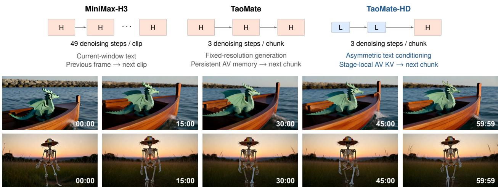
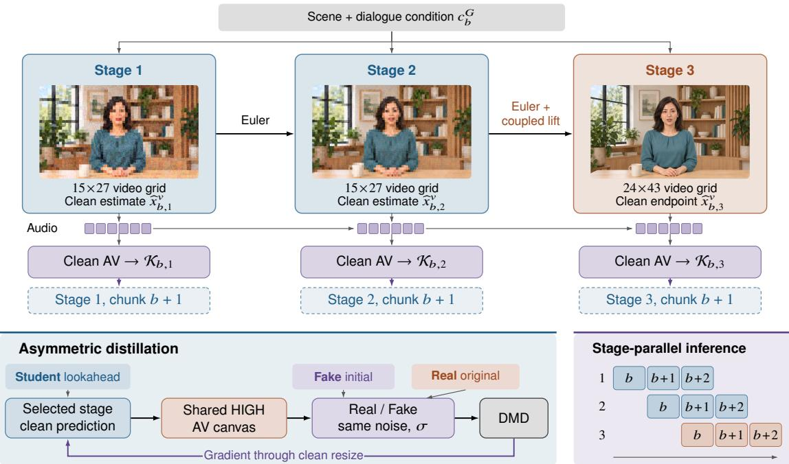
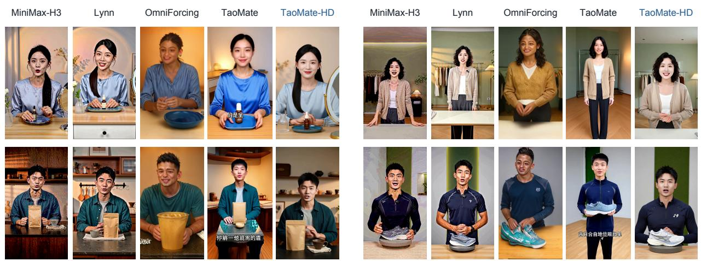
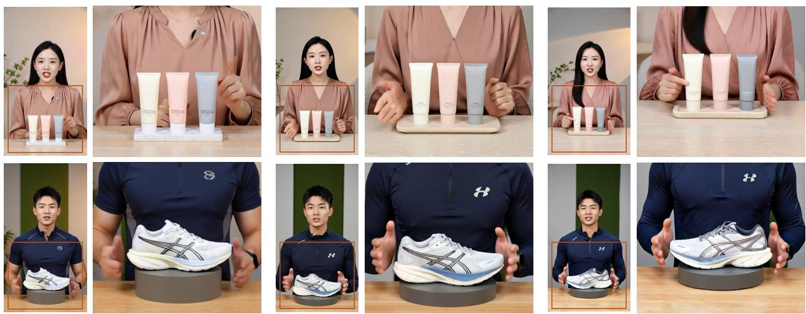
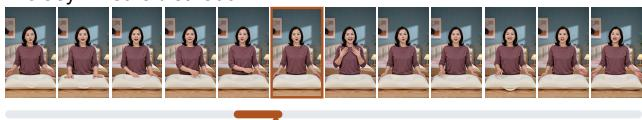
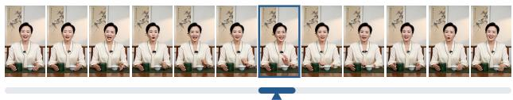
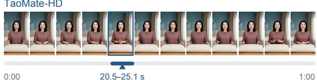

# TaoMate-HD:

# Progressive-Resolution Autoregressive Audio-Video Generation

Qijun Gan1,\*, Chenwei Zhang1,\*, Xinyang Li1, Meiguang Jin1,†, Junfeng Ma1, Shen Qiu2

1Alibaba Group 2Nanjing University

{ganqijun.gqj, meiguang.jmg}@taobao.com

## ABSTRACT

Streaming digital humans produce detailed video while continuing speech as new text arrives. High-resolution denoising is costly, and text updates can cause repeated or interrupted speech. We present TaoMate-HD, an autoregressive model for high-resolution audio-video streaming. For each short segment, or chunk, two denoising steps establish coarse video structure at low resolution. A final step refines the video to high resolution, with audio generated throughout the same trajectory. Each stage passes its audiovisual predictions to the same stage of the next chunk as history. Across text updates, the model retains this history to infer what has already been spoken. Continuation training utilizes asymmetric text conditioning, with separate text windows for generation and distillation. Experiments show a 1.6× speedup over direct high-resolution generation with the same model and hardware. Optimized stage-parallel deployment provides a further 1.9× overall speedup over serial progressive generation. Our continuation training reduces character error rate by 11.18 percentage points relative to the baseline. The model also supports hour-long audiovisual generation. Our project page is https://taoliveaigc.github.io/TaoMate-HD.

## 1 Introduction

Interactive digital humans need to sustain speech and visual motion as new dialogue arrives. Joint audio-video models generate both modalities from text [1–4]. Recent streaming systems extend this process over successive short segments, or chunks [5–7]. These streams must preserve fine details in faces, hands, and foreground objects while keeping speech continuous. Meeting both requirements is dificult: high-resolution synthesis is expensive, and text updates can disrupt ongoing speech.

Direct high-resolution generation processes a dense video-token grid at every denoising step. Even early steps use this grid when they mainly establish scene layout and motion. Few-step distillation reduces the number of steps [8, 9]. Progressive-resolution methods further reduce spatial computation by using coarser grids early in denoising [10, 11]. However, faster processing of one chunk does not remove the wait between chunks. If a chunk needs the previous chunk’s final output as history, it must wait for all refinement to finish. Stage-parallel inference overlaps denoising across chunks [12], but requires usable audiovisual context before that final output.

Speech continuity poses a related challenge when text changes during generation. Streaming models retain audiovisual context across chunks [5–7]. To continue speech, they must relate incoming text to the words already spoken. Text-window boundaries need not coincide with sentence endings, so an update may arrive mid-sentence and include words already spoken. Restarting from the first word repeats content, while stopping at the window boundary interrupts speech. The model therefore needs recent audio to distinguish spoken context from upcoming dialogue.

  
Figure 1. Progressive audiovisual generation sustained over an hour. Top: MiniMax-H3 denoises high-resolution clips and passes a frame to the next clip, while TaoMate uses few-step fixed-resolution generation with persistent audiovisual memory. TAOMATE-HD refines each chunk through two low-resolution evaluations and one high-resolution evaluation, passing each stage’s audiovisual prediction to the next chunk. Retained history supports speech continuation as text windows advance. L/H denote low/high video grids. Bottom: full frames from two 60-minute, 1376 × 768 audiovisual streams at the labeled times (minutes:seconds). The sampled frames preserve character appearance and scene composition across the hour.

We present TaoMate-HD, an autoregressive model for high-resolution audio-video streaming (Figure 1). Its central idea is to reuse audiovisual predictions before final spatial refinement is complete. Each chunk first undergoes two denoising steps at low resolution to establish coarse video structure. One final step refines the video to high resolution, while audio is generated throughout the joint trajectory. Each stage estimates clean audio and video without waiting for the remaining denoising steps. These estimates provide history for the same stage of the next chunk. The next chunk can thus begin coarse generation before the previous chunk finishes high-resolution refinement.

When the text window changes, we retain the audiovisual history and use overlapping text to provide continuation context. The model infers speech progress from the retained audio, without an explicit text pointer or online speech recognizer. We train this behavior on the model’s own generated sequences, including text-window changes and speech completion. Training uses asymmetric text conditioning to separate generation from sequence-level supervision. The generator receives upcoming dialogue, while distillation uses the opening text context to evaluate the full audiovisual sequence.

Experiments show that progressive generation is 1.60× faster than direct high-resolution generation with the same model and hardware. Compared with the baseline, our continuation training reduces character error rate from 30.75% to 19.57%. We also demonstrate hour-long audiovisual generation.

Our contributions are threefold:

• A progressive audio-video generator that concentrates denoising on a coarse grid. Stage-local audiovisual history enables overlapping generation across chunks.

• Continuation training with asymmetric text conditioning and student-generated history to support speech across overlapping text windows.

• Hour-long high-resolution audiovisual demonstrations and quantitative comparisons of spatial eficiency, deployment throughput, and transcript accuracy.

## 2 Related Work

Few-step autoregressive audio-video generation. Joint difusion and flow models couple visual motion with speech and other acoustic content [1–4]. Progressive distillation, consistency training, and distribution matching reduce sampling to a small number of evaluations [13–16]. For streaming generation, these few-step trajectories must also learn to condition on previously generated content. CausVid uses distribution matching to distill a bidirectional teacher into a causal generator, with teacher ODE trajectories for initialization [8]. Self Forcing trains on student-generated histories and samples denoising exits for gradient computation [9]. Recent AV systems combine such rollouts with multimodal objectives and streaming inference [5, 17–20]. LynnReal-Omni provides Standard and Flash joint-AV generators and extends generation through bounded latent history and boundary overlap [7]. We likewise train on student-generated histories, but allow the generator’s text window to advance while the distillation scores evaluate the sequence from its opening context.

Progressive spatial computation. Few-step sampling still pays for a dense grid at each evaluation. Progressive spatial methods reduce this cost by varying resolution along the trajectory. Matryoshka difusion and pyramidal flow use multiple spatial scales within generation [10, 21]. PyramidalWan first adapts the original-architecture teacher to multiple resolutions through flow matching, then studies distribution matching with this teacher and a refitted pyramidal teacher [11]. Its few-step schedule concentrates target-resolution computation in a single evaluation. Spectral schedules and adaptive patch granularity likewise vary spatial computation with noise level [22, 23]. Video DeltaNet instead changes video-to-video attention through local Softmax, boundary anchors, and bidirectional linear memory, retaining Softmax interactions with text and audio [24]. Causal super-resolution methods such as Ultra Flash take another approach, refining the output of a separate generator [25]. We change resolution within the joint audiovisual trajectory rather than after generation, and make the intermediate audiovisual predictions available as history for subsequent chunks.

Temporal memory and denoising parallelism. Across chunks, eficiency also depends on when history becomes available. Long-video generators retain context through windows of cached features, recurrent state, selected history, or persistent anchors [26–31]. TaoMate separates an immutable visual anchor and adaptive audiovisual memory from the active KV cache, using memory attention and reference-aware modulation for long-form consistency [6]. Its stage-parallel inference operates at a fixed spatial resolution. Ripple also extends recurrent temporal state to joint audio-video generation [32]. Stage-parallel inference organizes chunks and denoising stages into an anti-diagonal pipeline and fuses context writing with the next chunk’s denoising [12]. The stage-specific history in that formulation is represented at the stage’s output noise level. We use this execution organization with paired clean audiovisual predictions on each stage’s native grid. The clean prediction provides a common history representation even though the query noise level and spatial grid difer between stages.

## 3 Method

TaoMate-HD is an autoregressive audio-video model that uses coarse-to-fine denoising and stage-local KV history to generate a continuous stream (Figure 2). Each chunk develops on a coarse video grid before high-resolution refinement, while intermediate audiovisual predictions provide context for subsequent chunks. Training on the model’s own rollouts with asymmetric text conditioning supports speech continuation as the dialogue advances.

## 3.1 Progressive generation

Direct high-resolution generation repeats full-grid attention at every denoising step, including early steps that establish scene layout and large-scale motion. Progressive generation assigns this structural synthesis to a coarse grid and defers fine spatial refinement to the output grid. For an �-step trajectory, we perform the first � − 1 evaluations on a low-resolution video grid � and the final evaluation on a high-resolution grid �. Audio retains the same latent geometry throughout, so video refinement and audio generation remain part of one joint trajectory.

Let $u _ { b , \ell } ^ { m }$ denote the noisy latent of modality $m \in \{ \nu , a \}$ in chunk � at stage $\ell \in \{ 1 , \ldots , N \}$ . Each stage consists of one generator evaluation and a denoising update, with decreasing noise levels $\sigma _ { \ell } ^ { m }$ and terminal level $\sigma _ { N + 1 } ^ { m } = 0$ Conditioned on text $c _ { b } ^ { G }$ and preceding audiovisual history $\mathcal { H } _ { b , \ell } ,$ the generator predicts a denoising velocity $\widehat { \nu } _ { b , \ell } ^ { m } .$ Under the flow parameterization $u _ { \sigma } = ( 1 - \sigma ) x _ { \mathrm { c l e a n } } + \sigma \epsilon$ [33], this velocity estimates $x _ { \mathrm { c l e a n } } - \epsilon$ . On the current grid, it yields both an Euler update and a clean prediction:

  
Figure 2. A chunk’s refinement becomes the next chunk’s history. The $N = 3$ configuration shown here uses two coarse-grid evaluations followed by high-resolution refinement. Each stage estimates a clean AV endpoint and encodes it on its native grid for the same stage of the next chunk, enabling the parallel execution shown at lower right. Audio keeps its latent geometry throughout. The lower-left panel shows training: selected-stage predictions form a high-resolution sequence for the two distillation scores. The generator and scores share scene and speaker conditions, with role-specific dialogue windows.

$$
\begin{array} { r l } & { \widetilde { u } _ { b , \ell + 1 } ^ { m } = u _ { b , \ell } ^ { m } + ( \sigma _ { \ell } ^ { m } - \sigma _ { \ell + 1 } ^ { m } ) \widehat { \nu } _ { b , \ell } ^ { m } , } \\ & { \quad \widehat { x } _ { b , \ell } ^ { m } = u _ { b , \ell } ^ { m } + \sigma _ { \ell } ^ { m } \widehat { \nu } _ { b , \ell } ^ { m } . } \end{array}\tag{1}
$$

The clean prediction estimates the zero-noise endpoint directly from the current velocity, without executing the remaining stages. It supplies history to the next chunk, while the Euler update advances the current chunk. At the final stage, the two coincide because the next noise level is zero.

Before the final evaluation, the video state must move from � to � with its signal and residual noise intact. Direct interpolation correlates the residual noise, whereas the high-resolution trajectory requires standard Gaussian noise. We therefore couple high-grid noise $\epsilon _ { H } \sim { \cal N } ( 0 , I )$ with low-grid noise $\epsilon _ { L } = P \epsilon _ { H }$ , where $P P ^ { \top } = I$ keeps the low-grid noise standard Gaussian. Using bilinear interpolation �, the transition at noise level $\sigma$ is

$$
\Lambda _ { \sigma } ( u _ { L } ) = U ( u _ { L } ) + \sigma \big [ \epsilon _ { H } - U ( \epsilon _ { L } ) \big ] .\tag{2}
$$

The correction replaces interpolated noise with its coupled high-grid counterpart, preserving the signal/noise decomposition. The next stage takes the Euler-updated state, except at the final-stage entrance, where $u _ { b , N } ^ { \nu } =$ $\Lambda _ { \sigma _ { N } ^ { \nu } } ( \widetilde { u } _ { b , N } ^ { \nu } )$ . Audio passes through unchanged at this spatial transition. Concentrating the earlier evaluations on � reduces denoising computation at high resolution. We instantiate this schedule with $N = 3$ , using grids � (480×864) and � (768×1376).

## 3.2 Stage-local KV history

Progressive generation reduces computation within a chunk, but overlapping chunks also requires history before final refinement finishes. We therefore give each stage its own key/value (KV) history bank, built from the preceding chunk’s same-stage video and audio predictions. The clean estimates in Equation 1 are encoded at zero noise $( \sigma = 0 )$ on that stage’s native spatial grid. This encoding turns an intermediate endpoint estimate into reusable context without waiting for later denoising stages. The coarse-stage banks remain separate because they contain predictions at diferent refinement levels, while the final-stage bank stores the high-resolution endpoint.

Let $\mathcal { T } _ { b , \ell }$ denote stage $\ell \in \{ 1 , \ldots , N \}$ of chunk �. It requires the preceding stage of its own chunk and the same stage of the preceding chunk:

$$
\mathcal { T } _ { b , \ell } \gets \{ \mathcal { T } _ { b , \ell - 1 } , \mathcal { T } _ { b - 1 , \ell } \} .\tag{3}
$$

These dependencies permit stage-parallel inference [12]: later chunks can occupy coarse stages while an earlier chunk undergoes final refinement. Each stage keeps its KV history local and passes current-chunk audiovisual latents downstream. Within a text window, coarse stages fuse encoding of the preceding chunk’s clean estimate with denoising of the current noisy chunk [12]. A causal mask lets the noisy chunk read that estimate and earlier history, while the context chunk reads prior history and itself.

For long-stream inference, each bank retains the initial chunk’s video as a visual anchor and the two most recent chunks’ paired video and audio. Initial audio remains available while it lies in this recent window. The fixed-capacity banks preserve appearance and recent speech context without growing with stream duration. KV and cached text projections are stored separately. A text-window change refreshes the latter, leaving retained KV encoded under their original conditions. Before the switch, any pending clean prediction is committed at noise using the old window that generated it. Algorithm 1 summarizes this update for each stage.

Algorithm 1 KV update at a text-window boundary   
1: Commit any pending clean estimate under $c _ { \mathrm { o l d } } ^ { G } .$   
2: Retain initial-video KV and the two most recent AV chunks.   
3: Activate $c _ { \mathrm { n e w } } ^ { G }$ and refresh cached text projections.   
4: Preserve retained KV and their temporal positions.   
5: Denoise the next chunk with $c _ { \mathrm { n e w } } ^ { G }$ and this history.

Thus new text controls future synthesis without re-encoding the generated past. Spatial coordinates remain native to each grid, and temporal positions continue across windows. Training uses the same update order but retains the full causal prefix of its short rollouts.

## 3.3 Asymmetric distillation for continuation

Speech continuation requires relating new dialogue to the retained audio history. We use overlapping text windows because updates can arrive mid-sentence. Let � be earlier text, � the shared span, and � new dialogue. The generator moves from the initial window $W _ { 1 } = A + B$ to $W _ { 2 } = B + C$ while retaining history, using � as context rather than restarting it. At inference, audio history and text indicate speech progress without ASR, text pointers, or alignment modules.

We train this behavior on student-generated rollouts [9]. The student executes all � stages, updates its own history banks, and switches text at a sampled chunk boundary. To construct the windows, we extend source transcripts with same-topic speech while preserving the original wording, language, and speaker assignments. Source speaking rate maps nominal time intervals to character or word spans. The initial window $A + B$ covers the entire nominal rollout horizon even when the switch occurs earlier.

Distribution-matching distillation (DMD) supervises these rollouts by comparing a frozen teacher score with a learned score of the student’s distribution [15, 16]. The generator needs $W _ { 2 }$ to continue the next chunk, whereas both scores evaluate the concatenated sequence from its beginning. The learned fake score therefore retains $W _ { 1 } { : }$ it includes the opening words absent from $W _ { 2 }$ and the extended dialogue conditioning the student’s rollout. The frozen real score instead uses the original source transcript prefix through the rollout duration. This ties the teacher reference to the source segment, while the appended dialogue serves as generation lookahead. Scene descriptions, speaker attributes, and audiovisual alignment instructions are shared across all three roles during training.

The generator uses $W _ { 1 }$ before the switch and $W _ { 2 }$ afterward, with ellipses marking omitted words:

Generator a set offree templates you can download and use right away. These templates are designed to . . . (�2)

Fake this into my own post-processing workflow. . . . a set of free templates you can download and use

(�1) right away. These templates are designed

Real this into my own post-processing workflow. . . . I’ll even give you a set

(source prefix)

Both scores receive the same audiovisual sequence, corruption noise, and noise levels, so their diference defines the DMD update at a common noisy state. The fake score learns from detached student sequences by velocity regression with an independent noise draw.

To supervise every refinement level, we sample one stage per rollout and concatenate its clean predictions across chunks. The selected stage is shared across chunks so the sequence has a consistent refinement level. For a coarse stage, bilinear interpolation enlarges the clean video latents to �, leaving time, channels, and audio unchanged. This gives both scores a common high-resolution supervision canvas. The student continues to denoise on each stage’s native grid. Resizing the predicted clean video for scoring lets the high-resolution teacher supervise coarse stages without changing their computational resolution. All � stages still execute for every chunk, irrespective of the stage selected for supervision.

We first construct the rollout without gradients, then replay the selected evaluation one chunk at a time. Each replayed prediction replaces its region in the otherwise detached canvas, and a chunk mask restricts the update to that region. The scores retain full-sequence context, while gradients flow through the active prediction and its spatial interpolation, excluding other chunks and cached history. An auxiliary teacher target supports final-stage detail refinement. For a sampled noninitial chunk, the frozen base model starts from the student’s lifted state, conditions on preceding final clean audiovisual chunks, and denoises to an endpoint. We regress the student’s final video prediction toward this target, complementing the joint audiovisual DMD objective.

Training also includes speech-completion examples so the model learns when to stop speaking as well as how to continue. We select source clips whose endpoint is confirmed ofline by the transcript, timestamped ASR, and voice activity detection [34], and extend the rollout beyond that endpoint. Here � + � is the full original transcript: the generator first receives � + �, then its final span �, with no added �. Both scores receive the full transcript and an instruction to finish the unspoken remainder and then produce natural nonspeech behavior. Audio history indicates whether words remain to be spoken or the utterance has ended.

## 4 Experiments

## 4.1 Evaluation setup

We evaluate long-form quality, isolate spatial-schedule eficiency, and measure gains from deployment and continuation training.

Model and sequences. We train rank-128 LoRA on 10,000 self-constructed distillation pairs, starting from MiniMax-H3 FL2VA model [35]. We evaluate the methods on 100 self-constructed sequences lasting 1–10 minutes, each comprising successive five-second text requests. Outputs are 768×1376 at 24 FPS with 32-kHz stereo audio. We also generate hour-long audiovisual streams by continuing the autoregressive rollout across successive text windows. Figure 1 shows samples at 1376 × 768, with frames sampled from the opening to 60 seconds to illustrate persistent character appearance and scene composition.

Quality and efficiency metrics. Table 1 uses VABench VisualRealism, AudioAes, LipSync, and Desync for visual quality, audio quality, and audiovisual synchronization [41]. Temporal measures frame-diference stability, while Long-range measures color/brightness continuity across full sequences. CER compares Whisper-small transcripts [42] with the dialogue. SyncNet LSE-C/D [43, 44] average valid five-second windows over each full output. Mel-frequency cepstral coeficients (MFCCs) summarize the short-time spectral envelope. We compare their mean-and-standard-deviation vectors over the first and last five seconds by cosine similarity to measure endpoint acoustic consistency. For the spatial ablation, Video averages normalized sharpness, contrast, exposure, and saturation, while Audio averages loudness, clipping, silence prevalence, and audiovisual-duration agreement. Eficiency is measured by GPUs per stream, generation FPS, and first ordered RGB latency.

Table 1. Long-form quality on the 100-input benchmark and single-stream efficiency. Serial and parallel configurations are reported separately, with timing on eight H20 GPUs. Bold marks the best available quality score within the streaming audio-video group only. Published single-GPU rates are from Gan et al. [6]. VisualRealism, AudioAes, LipSync, and Desync use VABench. S2V LipSync and Desync use the conditioning speech, while AudioAes and CER are not scored as generation metrics. CER excludes methods without Chinese speech support.
<table><tr><td></td><td colspan="2">Continuity proxies↑</td><td colspan="2">AV quality↑</td><td colspan="3">Speech / sync</td><td colspan="2">Efficiency</td></tr><tr><td>Method</td><td>Temporal</td><td>Long- range</td><td>Visual Realism</td><td>AudioAes</td><td>↓</td><td>CER (%) LipSync Desync ↑</td><td>↓</td><td></td><td>GPUs FPS↑</td></tr><tr><td colspan="10">Audio-video foundation and accelerated clip models</td></tr><tr><td>MiniMax-H3 [35]</td><td>0.872</td><td>0.673</td><td>5.00</td><td>4.335</td><td>3.42</td><td>7.569</td><td>0.000</td><td>8</td><td>0.40</td></tr><tr><td>VDN [24]</td><td>0.866</td><td>0.750</td><td>5.00</td><td>4.264</td><td>3.59</td><td>7.844</td><td>0.000</td><td>8</td><td>2.21</td></tr><tr><td>LTX-2.3 [1]</td><td>0.544</td><td>0.453</td><td>2.65</td><td>3.849</td><td>14.51</td><td>4.249</td><td>0.050</td><td>1</td><td>0.301</td></tr><tr><td>JavisDiT++ [2]</td><td>0.095</td><td>0.423</td><td>4.95</td><td>3.068</td><td></td><td>0.899</td><td>1.050</td><td>1</td><td>0.477</td></tr><tr><td>MOVA [4]</td><td>0.184</td><td>0.821</td><td>4.10</td><td>4.317</td><td>87.58</td><td>3.993</td><td>0.060</td><td>1</td><td>0.145</td></tr><tr><td>OVI [3]</td><td>0.773</td><td>0.842</td><td>3.40</td><td>3.347</td><td>72.65</td><td>3.622</td><td>0.120</td><td>1</td><td>0.278</td></tr><tr><td colspan="10">Speech-to-video (S2V)</td></tr><tr><td>OmniAvatar [36]</td><td>0.827</td><td>0.721</td><td>4.80</td><td></td><td></td><td>4.859</td><td>0.010</td><td>1</td><td>1.022</td></tr><tr><td>StableAvatar [37]</td><td>0.835</td><td>0.896</td><td>5.00</td><td>一</td><td></td><td>3.633</td><td>0.130</td><td>1</td><td>0.409</td></tr><tr><td>Wan2.2-S2V [38]</td><td>0.860</td><td>0.885</td><td>4.95</td><td>一</td><td></td><td>5.030</td><td>0.150</td><td>1</td><td>0.080</td></tr><tr><td>LiveAvatar [39]</td><td>0.874</td><td>0.969</td><td>4.90</td><td>1</td><td></td><td>5.425</td><td>0.180</td><td>1</td><td>4.800</td></tr><tr><td>Hallo3 [40]</td><td>0.784</td><td>0.782</td><td>4.95</td><td>一</td><td>一</td><td>4.798</td><td>0.010</td><td>1</td><td>0.169</td></tr><tr><td colspan="10">Streaming audio-video generation</td></tr><tr><td>OmniForcing [5]</td><td>0.786</td><td>0.278</td><td>4.85</td><td>3.571</td><td></td><td>1.756</td><td>0.050</td><td>1</td><td>8.32</td></tr><tr><td>Lynn [7]</td><td>0.367</td><td>0.778</td><td>4.30</td><td>4.207</td><td>86.70</td><td>7.254</td><td>0.030</td><td>1</td><td>1.05</td></tr><tr><td>Lynn-Flash [7]</td><td>0.457</td><td>0.765</td><td>5.00</td><td>4.326</td><td>88.37</td><td>5.909</td><td>0.000</td><td>1</td><td>1.66</td></tr><tr><td>TaoMate [6]</td><td>0.843</td><td>0.983</td><td>4.65</td><td>3.889</td><td>103.74</td><td>5.422</td><td>0.010</td><td>1</td><td>11.1</td></tr><tr><td>TAOMATE-HD (serial)</td><td>0.913</td><td>0.930</td><td>5.00</td><td>4.407</td><td>19.57</td><td>7.061</td><td>0.000</td><td>8</td><td>4.68</td></tr><tr><td>TAoMATE-HD (parallel)</td><td>0.913</td><td>0.928</td><td>5.00</td><td>4.367</td><td>21.28</td><td>6.724</td><td>0.000</td><td>8</td><td>8.99</td></tr></table>

## 4.2 Comparison with audio-video generators

Table 1 organizes the comparison into audio-video foundation and accelerated clip models, speech-to-video (S2V) systems, and streaming audio-video generators. The first group comprises MiniMax-H3 [35], VDN [24], LTX-2.3 [1], JavisDiT++ [2], MOVA [4], and OVI [3]. The S2V group comprises OmniAvatar [36], StableAvatar [37], Wan2.2-S2V [38], LiveAvatar [39], and Hallo3 [40], which animate video from supplied speech. The streaming group comprises OmniForcing [5], Lynn Standard/Flash [7], and TaoMate [6], which jointly generate speech and video across successive temporal blocks.

The models extend generation through diferent forms of context. MiniMax-H3 and VDN extend an opening T2AV clip with successive I2AV clips. Lynn retains persistent media KV, while ours combines retained audiovisual history with overlapping dialogue and evolving scenes. MiniMax-H3 uses 49 denoising evaluations per five-second request, VDN uses eight, and the Lynn variants use four or three per autoregressive window. Our model uses three denoising evaluations and three clean-history encodings per chunk.

Table 1 reports quality for both serial and parallel configurations. Our interval spans prepared input to decoded AV, while the MiniMax-H3, VDN, and Lynn intervals include online conditioning and encoding/mux. All published rates measure denoising on one or eight NVIDIA H20 at 768 × 512 [6]. Under the respective timing intervals above, the reported throughput ratio to MiniMax-H3 is 22.4×.

  
Figure 3. Long-form audio-video generation, shown at 60 seconds. The corresponding quantitative comparison appears in Table 1.

Comparison within streaming audio-video generation. Serial TaoMate-HD has the highest Temporal and AudioAes scores in Table 1: 0.913 and 4.407, compared with 0.786 and 3.571 for OmniForcing and 0.843 and 3.889 for TaoMate. It achieves the lowest reported CER in this group at 19.57%. It also shares the best VisualRealism and Desync values with Lynn-Flash. The parallel configuration retains the same rounded Temporal and VisualRealism scores, with AudioAes of 4.367 and CER of 21.28%. TaoMate has the highest long-range color/brightness score.

Visual comparison. Figure 3 complements the sequence-level measurements with corresponding outputs at 60 seconds. Presenter appearance, hand and product geometry, and background texture show the visual detail near the end of each sequence.

## 4.3 Spatial efficiency and deployment throughput

Direct (480p)  
Direct (768p)  
Progressive (480 → 768p)  
  
Figure 4. Spatial detail across generation resolutions. Representative frames compare direct 480p, direct 768p, and progressive 480-to-768p generation on the same inputs. Enlarged foreground regions reveal hand contours and product surfaces. Progressive generation retains fine detail comparable to direct 768p generation while concentrating denoising on the coarse grid.

Table 2. Resolution, quality, and inference throughput. All experiments are conducted on the same batch of input settings and GPUs. Direct (480p) is a separate low-resolution reference, and TAOMATE-HD is the stage-paralle configuration.
<table><tr><td>Configuration</td><td>FPS↑</td><td>Temporal↑</td><td>Long-range↑</td><td>Video↑</td><td>Audio↑</td><td>LSE-C↑</td></tr><tr><td>Direct (480p)</td><td>13.90</td><td>0.90</td><td>0.99</td><td>0.88</td><td>0.85</td><td>5.98</td></tr><tr><td>Direct (768p)</td><td>2.93</td><td>0.91</td><td>0.92</td><td>0.87</td><td>0.89</td><td>6.62</td></tr><tr><td>Progressive (serial)</td><td>4.68</td><td>0.91</td><td>0.93</td><td>0.85</td><td>0.89</td><td>6.34</td></tr><tr><td>TAOMATE-HD</td><td>8.99</td><td>0.91</td><td>0.93</td><td>0.85</td><td>0.89</td><td>6.39</td></tr></table>

Table 2 compares resolution and execution settings, with direct 480p generation as the low-resolution reference. The middle FPS entries compare spatial schedules, while the final row reports deployment throughput. For the spatial timing comparison, Direct (768p) and serial Progressive share the generator, inputs, request seeds, stage-local AV history, and BF16/SDPA execution, changing the resolution schedule while retaining the temporal schedule and decoding policy. Timing includes generation and audiovisual decoding after warmup and text preencoding.

Averaging wall time equally over inputs and repeated executions, Progressive reduces generation time from 491 to 307 seconds. The ratio of these mean times gives a 1.60× spatial speedup (Table 2). The analytic video-linear work ratio is 0.595, whereas measured wall time additionally includes context encoding, audio computation, communication, and decoding. Figure 4 shows the detail retained under this reduced spatial workload: enlarged views expose hand contours and product surfaces after progressive refinement to 768p.

We next combine the progressive trajectory with the optimized stage-parallel deployment. Mean generation time decreases from 307 seconds for serial progressive to 160 seconds, a 1.92× overall acceleration (Table 2). This is a deployment-level comparison: it combines overlapping stages, low-stage fusion, KV reuse, selective W8A8 projections, a diferent attention implementation, and codec scheduling. The resulting configuration reaches 8.99 FPS, with its quality measurements listed in the final row.

## 4.4 Ablation study of asymmetric distillation

The proposed asymmetric distillation reduces CER from 30.8% to 19.6%, an 11.2-point improvement (Table 3). The two continuation-training configurations share the fixed-resolution initialization and progressive generation, with diferent text conditioning, history construction, rollout settings, augmentation, and auxiliary supervision. The configuration labeled w/o asymmetric distillation shares text between the generator and both scores. Endpoint MFCC cosine increases from 0.971 to 0.979, indicating more consistent acoustic characteristics between the opening and closing speech. LSE-C changes from 6.239 to 6.341 and LSE-D from 9.011 to 9.044.

Table 3. Comparison of distillation training configurations. CER is the mean character-error percentage. MFCC cosine measures endpoint acoustic consistency between the first and last five seconds.
<table><tr><td>Configuration</td><td>CER (%)↓</td><td>MFCC cosine↑</td><td>LSE-C↑</td><td>LSE-D↓</td></tr><tr><td>w/o asymmetric</td><td></td><td></td><td></td><td></td></tr><tr><td>distillation</td><td>30.751</td><td>0.97064</td><td>6.239</td><td>9.011</td></tr><tr><td>TAOMATE-HD</td><td>19.570</td><td>0.97905</td><td>6.341</td><td>9.044</td></tr></table>

The CER breakdown shows decreases of 12.64 and 1.28 percentage points in substitution and deletion errors, alongside a 2.74-point increase in insertion errors.

Figure 5 illustrates deviations from the intended text using TaoMate-HD and a baseline training without asymmetric distillation. The displayed input windows identify the shared words retained when TaoMate-HD advances its text condition. The baseline repeats an upcoming clause or substitutes the intended sentence ending with words from the following sentence.

回弹速度适中，翻身以后，枕面能慢慢恢复平整。

## Input windows

前段清甜，中段有一点回甘…平时口味淡的朋友，可以多加一点水，依然有清楚层次。

Updated B+C

平时口味淡的朋友，可以多加一点水，依然有清楚层次。如果搭配点心，建议选原味…

## Shared span B / reference

Previous A+B

边缘过渡比较缓，不会让…回弹速度适中，翻身以后，枕面能慢慢恢复平整。

回弹速度适中，翻身以后，枕面能慢慢恢复平整。喜欢低枕的人可以先试…

0:00  
w/o asymmetric distillation  
  
29.0–36.1 s

喝完嘴依然有清楚层次，平时口味淡的朋友可以多加一点水， 依然有清楚层次。

TaoMate-HD  
w/o asymmetric distillation  
  
21.5–26.1 s

  
30.0–34.4 s  
回弹速度适中，翻身以后，枕面能开始睡在高边。

0:00  
  
平时口味淡的朋友，可以多加一点水，依然有清楚层次。

Figure 5. Text windows and generated speech. The input strip shows the overlapping windows supplied to TAOMATE-HD, with the shared span � as the reference excerpt. Thumbnail strips span each video, and colored intervals mark the transcribed excerpts. Its transcripts show a repeated clause (left) and an incorrect sentence continuation (right). Orange marks the affected phrases.

## 5 Conclusion

We presented TaoMate-HD to reduce the computational cost of high-resolution audiovisual streaming while maintaining speech continuity. Progressive denoising establishes coarse video structure before final highresolution refinement, while stage-local KV history enables overlapping generation across chunks. Distillation with asymmetric text conditioning teaches the model to use retained audiovisual history as dialogue windows advance. Experiments show that progressive generation achieves a 1.60× speedup over direct generation while retaining fine visual detail. The optimized stage-parallel deployment provides a further 1.92× speedup. Asymmetric distillation reduces CER from 30.8% to 19.6%. Together, these advances support high-resolution audiovisual generation extending to an hour.

## References

[1] Yoav HaCohen, Benny Brazowski, Nisan Chiprut, Yaki Bitterman, Andrew Kvochko, Avishai Berkowitz, Daniel Shalem, Daphna Lifschitz, Dudu Moshe, Eitan Porat, Eitan Richardson, Guy Shiran, Itay Chachy, Jonathan Chetboun, Michael Finkelson, Michael Kupchick, Nir Zabari, Nitzan Guetta, Noa Kotler, Ofir Bibi, Ori Gordon, Poriya Panet, Roi Benita, Shahar Armon, Victor Kulikov, Yaron Inger, Yonatan Shiftan, Zeev Melumian, and Zeev Farbman. LTX-2: Eficient joint audio-visual foundation model. arXiv preprint arXiv:2601.03233, 2026. URL https://arxiv.org/abs/2601.03233.

[2] Kai Liu, Yanhao Zheng, Kai Wang, Shengqiong Wu, Rongjunchen Zhang, Jiebo Luo, Dimitrios Hatzinakos, Ziwei Liu, Hao (Scofield) Fei, and Tat-Seng Chua. JavisDiT++: Unified modeling and optimization for joint audio-video generation. In International Conference on Learning Representations, 2026. URL https://proceedings.iclr.cc/paper\_files/paper/2026/hash/f3c27bd0616d08c5168e18e8deb159c6-Abstract-Conference.html.

[3] Chetwin Low, Weimin Wang, and Calder Katyal. Ovi: Twin backbone cross-modal fusion for audio-video generation. arXiv preprint arXiv:2510.01284, 2025. URL https://arxiv.org/abs/2510.01284.

[4] SII-OpenMOSS Team. MOVA: Towards scalable and synchronized video-audio generation. arXiv preprint arXiv:2602.08794, 2026. URL https://arxiv.org/abs/2602.08794.

[5] Yaofeng Su, Yuming Li, Zeyue Xue, Jie Huang, Siming Fu, Haoran Li, Haoyang Huang, and Nan Duan. OmniForcing: Unleashing real-time joint audio-visual generation. In Computer Vision – ECCV 2026, volume 17013 of Lecture Notes in Computer Science, pages 566–584. Springer, 2026. doi: 10.1007/978-3-032- 37271-0\_31. URL https://link.springer.com/chapter/10.1007/978-3-032-37271-0\_31.

[6] Qijun Gan, Chenwei Zhang, Meiguang Jin, Junfeng Ma, and Qiu Shen. TaoMate: Anchor-guided memory bridging evolving and reference states for real-time audio-video digital human generation. arXiv preprint arXiv:2607.24359, 2026. URL https://arxiv.org/abs/2607.24359.

[7] Xiaofeng Mao, Peijia Lin, Shaohao Rui, Yibo Zhang, Haibin Wan, and Weijie Ma. LynnReal-Omni: Native multi-modal video generation for agentic visual workflows. arXiv preprint arXiv:2609.15863, 2026. doi: 10.48550/arXiv.2609.15863. URL https://arxiv.org/abs/2609.15863v1.

[8] Tianwei Yin, Qiang Zhang, Richard Zhang, William T. Freeman, Fredo Durand, Eli Shechtman, and Xun Huang. From slow bidirectional to fast autoregressive video difusion models. In Proceedings of the IEEE/CVF Conference on Computer Vision and Pattern Recognition, 2025. URL https://openaccess.thecvf. com/content/CVPR2025/html/Yin\_From\_Slow\_Bidirectional\_to\_Fast\_Autoregressive\_Video\_Diffusion \_Models\_CVPR\_2025\_paper.html.

[9] Xun Huang, Zhengqi Li, Guande He, Mingyuan Zhou, and Eli Shechtman. Self forcing: Bridging the train-test gap in autoregressive video difusion. In Advances in Neural Information Processing Systems, volume 38, 2025. doi: 10.52202/085713-5576. URL https://proceedings.neurips.cc/paper\_files/paper/2025/ hash/f4823f831af67a3ef15e41a85434422a-Abstract-Conference.html.

[10] Yang Jin, Zhicheng Sun, Ningyuan Li, Kun Xu, Hao Jiang, Nan Zhuang, Quzhe Huang, Yang Song, Yadong Mu, and Zhouchen Lin. Pyramidal flow matching for eficient video generative modeling. In International Conference on Learning Representations, 2025. URL https://proceedings.iclr.cc/paper\_files/paper/2025/ha sh/3ab228c4703c4459b1a600ebadc5732c-Abstract-Conference.html.

[11] Denis Korzhenkov, Adil Karjauv, Animesh Karnewar, Mohsen Ghafoorian, and Amirhossein Habibian. PyramidalWan: On making pretrained video model pyramidal for eficient inference. In Proceedings ofthe IEEE/CVF Conference on Computer Vision and Pattern Recognition, 2026. URL https://openaccess.thecvf.

com/content/CVPR2026/html/Korzhenkov\_PyramidalWan\_On\_Making\_Pretrained\_Video\_Model\_Pyr amidal\_for\_Eficient\_Inference\_CVPR\_2026\_paper.html.

[12] Kai Zou, Dian Zheng, Hongbo Liu, Tiankai Hang, Bin Liu, and Nenghai Yu. HiAR: Eficient autoregressive long video generation via hierarchical denoising. arXiv preprint arXiv:2603.08703, 2026. doi: 10.48550/arX iv.2603.08703. URL https://arxiv.org/abs/2603.08703.

[13] Tim Salimans and Jonathan Ho. Progressive distillation for fast sampling of difusion models. In International Conference on Learning Representations, 2022. URL https://openreview.net/forum?id=TIdIXIpzhoI.

[14] Yang Song, Prafulla Dhariwal, Mark Chen, and Ilya Sutskever. Consistency models. In Proceedings ofthe 40th International Conference on Machine Learning, volume 202, pages 32211–32252. PMLR, 2023. URL https://proceedings.mlr.press/v202/song23a.html.

[15] Tianwei Yin, Michaël Gharbi, Richard Zhang, Eli Shechtman, Frédo Durand, William T. Freeman, and Taesung Park. One-step difusion with distribution matching distillation. In Proceedings ofthe IEEE/CVF Conference on Computer Vision and Pattern Recognition, 2024. URL https://openaccess.thecvf.com/content/CVPR2024 /html/Yin\_One-step\_Diffusion\_with\_Distribution\_Matching\_Distillation\_CVPR\_2024\_paper.html.

[16] Tianwei Yin, Michaël Gharbi, Taesung Park, Richard Zhang, Eli Shechtman, Frédo Durand, and William T. Freeman. Improved distribution matching distillation for fast image synthesis. In Advances in Neural Information Processing Systems, volume 37, 2024. doi: 10.52202/079017-1505. URL https://proceedings.ne urips.cc/paper\_files/paper/2024/hash/54dcf25318f9de5a7a01f0a4125c541e-Abstract-Conference.html.

[17] Yupeng Zhou, Lianghua Huang, Zhifan Wu, Jiabao Wang, Yupeng Shi, Biao Jiang, Daquan Zhou, Yu Liu, Ming-Ming Cheng, and Qibin Hou. Mutual forcing: Dual-mode self-evolution for fast autoregressive audio-video character generation. arXiv preprint arXiv:2604.25819, 2026. URL https://arxiv.org/abs/2604.25819.

[18] Menglin Han, Yang Ding, Yulei Lu, Haoran Yu, Xin Ma, Junyi Chen, Zhangkai Ni, Lin Ma, and Yaohui Wang. Vorch-Streamer: Extending human audio-visual generation to real-time long-form streaming. arXiv preprint arXiv:2608.05663, 2026. URL https://arxiv.org/abs/2608.05663.

[19] Chunyu Li, Jiaye Li, Ruiqiao Mei, Haoyuan Xia, Hao Zhu, Jingdong Wang, and Siyu Zhu. Hallo-Live: Real-time streaming joint audio-video avatar generation with asynchronous dual-stream and human-centric preference distillation. arXiv preprint arXiv:2604.23632, 2026. URL https://arxiv.org/abs/2604.23632.

[20] Lichen Bai, Tianhao Zhang, Shitong Shao, Dingwei Tan, Qiyu Zhong, Zhengpeng Xie, Haopeng Li, Qinghao Huang, Dandan Shen, Tengjiao Ji, Wei Wang, Peicheng Wu, Yuxuan Zhao, Xiangyu Zhu, Welly Luo, Shurui Yang, and Zeke Xie. MaineCoon: Pursuing a real-time audio-visual social world model. arXiv preprint arXiv:2606.17800, 2026. URL https://arxiv.org/abs/2606.17800.

[21] Jiatao Gu, Shuangfei Zhai, Yizhe Zhang, Joshua M. Susskind, and Navdeep Jaitly. Matryoshka difusion models. In International Conference on Learning Representations, 2024. URL https://proceedings.iclr.cc/pa per\_files/paper/2024/hash/81166fbd9cc5adf14031cdb69d3fd6a8-Abstract-Conference.html.

[22] Howard Xiao, Brian Chao, Lior Yariv, and Gordon Wetzstein. Spectral progressive difusion for eficient image and video generation. arXiv preprint arXiv:2605.18736, 2026. URL https://arxiv.org/abs/2605.18736.

[23] Zekun Li, Xiaoyan Cong, Hongyu Li, Zhiyang Dou, Chuan Guo, Abhay Mittal, Sizhe An, and Srinath Sridhar. Ms. Forcing: Eficient streaming video generation with multi-scale patchification and attention. arXiv preprint arXiv:2607.20940, 2026. URL https://arxiv.org/abs/2607.20940.

[24] Haocheng Xi, Yiming Xie, Hexu Zhao, Yiwen Zhang, Michael Liu, Thomas Creavin, Kurt Keutzer, Xiuyu Li, Zhaoyang Lv, Chenfeng Xu, and Haiwen Feng. Video DeltaNet: A video-native hybrid attention for livestream video generation. arXiv preprint arXiv:2609.20744, 2026. doi: 10.48550/arXiv.2609.20744. URL https://arxiv.org/abs/2609.20744v3.

[25] Luxury, Jie Huang, Zihao Fan, Xiaoxiao Ma, Jun-hao Zhuang, Yuming Li, Zeyue Xue, Siming Fu, Haoran Li, Mingchen Zhong, Guohui Zhang, Shichen Ma, Yijun Liu, Jiaqi Shi, Yanwen Ma, Yaofeng Su, Haoyu Wang, Yaowei Li, Songchun Zhang, Weiyang Jin, Yuxuan Bian, Shiyi Zhang, Haojun Xu, Shuai Lu, Xin Han, Wei Tang, Haoyang Huang, and Nan Duan. Ultra flash: Scaling real-time streaming video generation to high resolutions. arXiv preprint arXiv:2606.09150, 2026. URL https://arxiv.org/abs/2606.09150.

[26] Roberto Henschel,Levon Khachatryan,Hayk Poghosyan,Daniil Hayrapetyan,Vahram Tadevosyan,Zhangyang Wang, Shant Navasardyan, and Humphrey Shi. StreamingT2V: Consistent, dynamic, and extendable long video generation from text. In Proceedings ofthe IEEE/CVF Conference on Computer Vision and Pattern Recognition, 2025. URL https://openaccess.thecvf.com/content/CVPR2025/html/Henschel\_StreamingT2V\_ Consistent\_Dynamic\_and\_Extendable\_Long\_Video\_Generation\_from\_Text\_CVPR\_2025\_paper.html.

[27] Shuai Yang, Wei Huang, Ruihang Chu, Yicheng Xiao, Yuyang Zhao, Xianbang Wang, Muyang Li, Enze Xie, Yingcong Chen, Yao Lu, Song Han, and Yukang Chen. Longlive: Real-time interactive long video generation. In International Conference on Learning Representations, 2026. URL https://proceedings.iclr.c c/paper\_files/paper/2026/hash/91a1610c6ed9e02d33f826b46f472b92-Abstract-Conference.html.

[28] Yifei Yu, Xiaoshan Wu, Xinting Hu, Tao Hu, Yangtian Sun, Xiaoyang Lyu, Bo Wang, Lin Ma, Yuewen Ma, Zhongrui Wang, and Xiaojuan Qi. VideoSSM: Autoregressive long video generation with hybrid state-space memory. arXiv preprint arXiv:2512.04519, 2025. URL https://arxiv.org/abs/2512.04519.

[29] Yusuf Dalva and Pinar Yanardag. Adastate: Self-evolving anchors for streaming video generation. arXiv preprint arXiv:2605.30349, 2026. URL https://arxiv.org/abs/2605.30349.

[30] Weijia Dou, Hui Li, Jiahao Cui, Lei Zhou, Jingdong Wang, and Siyu Zhu. Slotmemory: Object-centric KV memory for streaming long-video generation. arXiv preprint arXiv:2605.31033, 2026. URL https: //arxiv.org/abs/2605.31033.

[31] Yu Meng, Xiangyang Luo, Letian Li, Wenyuan Jiang, Chen Gao, Xinlei Chen, Yong Li, and Xiao-Ping Zhang. Tethercache: Stabilizing autoregressive long-form video generation with gated recall and trusted alignment. arXiv preprint arXiv:2606.13035, 2026. URL https://arxiv.org/abs/2606.13035.

[32] Yanbo Ding, Zhizhi Guo, Quanyue Song, Yishan He, Zhixiang He, Yongxiang Li, and Yali Wang. Ripple: Realtime streaming audio-video generation with cross-modal recurrent memory. arXiv preprint arXiv:2607.26818, 2026. URL https://arxiv.org/abs/2607.26818.

[33] Xingchao Liu, Chengyue Gong, and Qiang Liu. Flow straight and fast: Learning to generate and transfer data with rectified flow. In International Conference on Learning Representations, 2023. URL https: //openreview.net/forum?id=XVjTT1nw5z.

[34] Silero Team. Silero VAD: pre-trained enterprise-grade voice activity detector (VAD), number detector and language classifier. GitHub repository, 2024. URL https://github.com/snakers4/silero-vad. Silero VAD v6 model bundled with faster-whisper 1.2.1. Accessed 2026-10-10.

[35] MiniMax. MiniMax-H3. ModelScope model card, 2026. URL https://www.modelscope.cn/models/MiniM ax/MiniMax-H3/summary.

[36] Qijun Gan, Ruizi Yang, Jianke Zhu, Shaofei Xue, and Steven Hoi. OmniAvatar: Eficient audio-driven avatar video generation with adaptive body animation. arXiv preprint arXiv:2506.18866, 2025. URL https://arxiv.org/abs/2506.18866.

[37] Shuyuan Tu, Yueming Pan, Yinming Huang, Xintong Han, Zhen Xing, Qi Dai, Chong Luo, Zuxuan Wu, and Yu-Gang Jiang. StableAvatar: Infinite-length audio-driven avatar video generation. arXiv preprint arXiv:2508.08248, 2025. URL https://arxiv.org/abs/2508.08248.

[38] Xin Gao, Li Hu, Siqi Hu, Mingyang Huang, Chaonan Ji, Dechao Meng, Jinwei Qi, Penchong Qiao, Zhen Shen, Yafei Song, et al. Wan-S2V: Audio-driven cinematic video generation. arXiv preprint arXiv:2508.18621, 2025. URL https://arxiv.org/abs/2508.18621.

[39] Yubo Huang, Hailong Guo, Fangtai Wu, Weiqiang Wang, Shifeng Zhang, Shijie Huang, Qijun Gan, Lin Liu, Sirui Zhao, Enhong Chen, Jiaming Liu, and Steven Hoi. Live avatar: Streaming real-time audio-driven avatar generation with infinite length. arXiv preprint arXiv:2512.04677, 2025. URL https://arxiv.org/abs/25 12.04677.

[40] Jiahao Cui, Hui Li, Yun Zhan, Hanlin Shang, Kaihui Cheng, Yuqi Ma, Shan Mu, Hang Zhou, Jingdong Wang, and Siyu Zhu. Hallo3: Highly dynamic and realistic portrait image animation with video difusion transformer. In Proceedings ofthe IEEE/CVF Conference on Computer Vision and Pattern Recognition, pages 21086–21095, 2025. URL https://openaccess.thecvf.com/content/CVPR2025/html/Cui\_Hallo3\_Highl y\_Dynamic\_and\_Realistic\_Portrait\_Image\_Animation\_with\_Video\_CVPR\_2025\_paper.html.

[41] Daili Hua, Xizhi Wang, Bohan Zeng, Xinyi Huang, Hao Liang, Junbo Niu, Xinlong Chen, Quanqing Xu, and Wentao Zhang. VABench: A comprehensive benchmark for audio-video generation. In Proceedings of the IEEE/CVF Conference on Computer Vision and Pattern Recognition, 2026. URL https://openac cess.thecvf.com/content/CVPR2026/html/Hua\_VABench\_A\_Comprehensive\_Benchmark\_for\_Audio-Video\_Generation\_CVPR\_2026\_paper.html.

[42] Alec Radford, Jong Wook Kim, Tao Xu, Greg Brockman, Christine Mcleavey, and Ilya Sutskever. Robust speech recognition via large-scale weak supervision. In Proceedings ofthe 40th International Conference on Machine Learning, volume 202 of Proceedings ofMachine Learning Research, pages 28492–28518. PMLR, 2023. URL https://proceedings.mlr.press/v202/radford23a.html.

[43] Joon Son Chung and Andrew Zisserman. Out of time: Automated lip sync in the wild. In Computer Vision – ACCV 2016 Workshops, volume 10117 of Lecture Notes in Computer Science, pages 251–263. Springer, 2017. doi: 10.1007/978-3-319-54427-4\_19. URL https://link.springer.com/chapter/10.1007/978-3-319- 54427-4\_19.

[44] K. R. Prajwal, Rudrabha Mukhopadhyay, Vinay P. Namboodiri, and C. V. Jawahar. A lip sync expert is all you need for speech to lip generation in the wild. In Proceedings ofthe 28th ACM International Conference on Multimedia, 2020. doi: 10.1145/3394171.3413532. URL https://doi.org/10.1145/3394171.3413532.