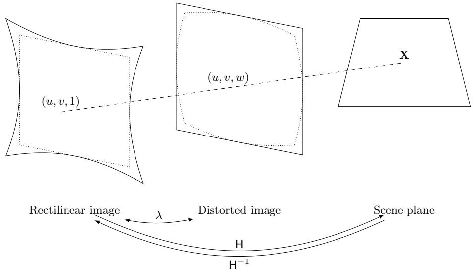
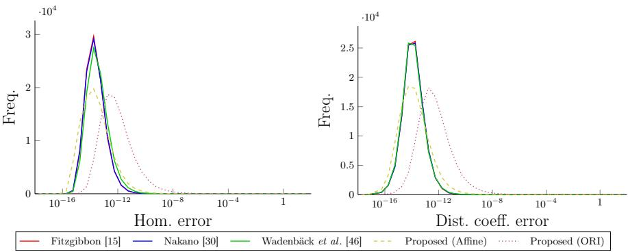
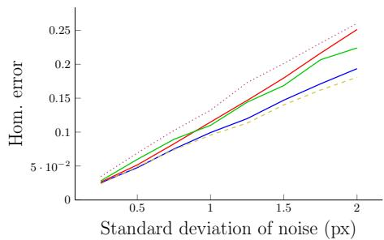
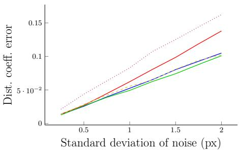
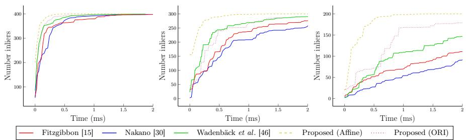
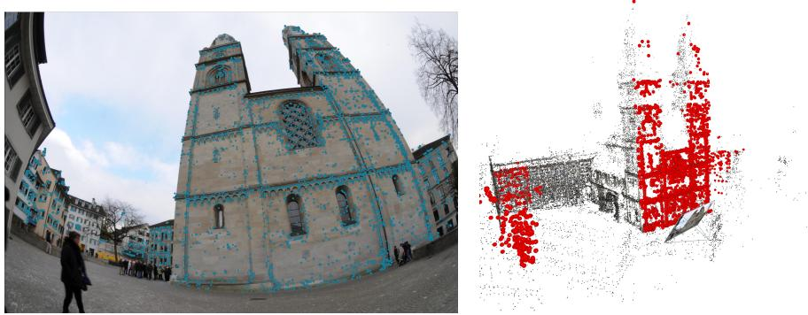
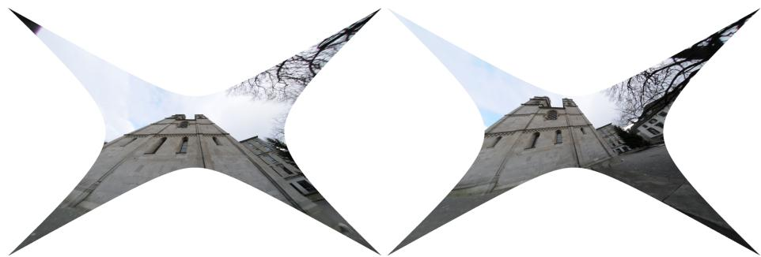

# Radial distortion homography estimation from afine-covariant or orientation-covariant features

Marcus Valtonen Örnhag and Stefan Adalbjörnsson

Ericsson Research, Sweden

{marcus.valtonen.ornhag,stefan.adalbjornsson}@ericsson.com

Abstract. We present minimal solvers for joint homography and radial distortion estimation using afine- or orientation-covariant features. The core contribution is a set of novel constraints that exploit local feature geometry inherent to afine descriptors, enabling solvers that require fewer correspondences than point-based methods. Using modern robust estimation frameworks, we demonstrate that the proposed solvers are advantageous to the current state-of-the-art with a significant speed-up in the presence of outliers while maintaining comparable or superior estimation accuracy. The proposed solvers are tested on both synthetic and real images containing challenging fisheye distortions.1

## 1 Introduction

For more than twenty years [26] afine features have been used in geometric computer vision applications. Early work includes [31], where it was shown how to estimate the epipolar geometry of an uncalibrated pair of cameras from two correspondences of local afine frames (LAFs). Since then, there have been numerous methods that exploit their intrinsically encoded properties. Recent work include homography estimation [2], relative pose estimation [3,14,18], including partially calibrated cameras [20] and generalized relative pose [17], as well as the absolute pose problem [44].

The main theoretical advantage of leveraging afine features in epipolar geometry is the smaller sample size needed in the resulting solver, thus requiring fewer RANSAC iterations in order to to draw an all-inlier subset. The main criticism against using afine solvers has been that they have not been working well in practice; however, Barath et al. [6] provided a framework for improving afine solvers for various camera geometry estimation pipelines, making them robust and reliable for real-world data. Another issue, raised in e.g., [42], is the added computational time for extracting the afine features themselves. To avoid this computational overhead, Barath and Kukelova [4] showed how scale- and orientation-covariant features can be interpreted as local afine features, utilizing the intrinsic geometric properties of the feature descriptors, thus providing more local information than the point correspondences alone, while not having to compute the afine features explicitly. They derived a set of constraints characterizing the relationship between afine feature descriptors and the scaleand orientation-covariant counterpart, from which they constructed a homography solver requiring only two scale- and orientation-covariant features. Ding et al. showed how to incorporate a known reference direction [11] from an IMU using these constraints and further assumptions on the plane normals (e.g., vertical and horizontal walls). In [5], scale- and orientation-covariant features were used for general problems in epipolar geometry. This was later used for the application of autonomous driving in [42], where upright essential matrices were estimated with great computational improvement compared to point-based and afine-based methods. Ventura et al. [45] derived new constraints for the absolute pose problem from two oriented features and the upright case (using IMU data) from a single scale- and orientation-covariant feature. Barath [1] further showed how to leverage any afine-based solver by approximating afine features directly from scale- and orientation-covariant features.

  
Fig. 1. The one-sided radial distortion homography H is a mapping between rectified images. The unknown distortion coeficient λ is applied to one of the images.

Homography estimation is at the core of many computer vision applications, e.g., the famous camera calibration method implemented in OpenCV and many other frameworks, known as Zhang’s method [51], where a planar calibration target with a checkerboard pattern is placed at diferent positions in the field-ofview of the camera. Even in the era of deep learning, homography estimation has not become obsolete, but instead been incorporated as geometric priors [23,9,50]. Due to the computational eficiency of state-of-the-art methods for homography estimation, it is integrated in many modern augmented reality (AR) and mixed reality (MR) platforms, and plays a crucial part for localizing planar surfaces on such devices. Early examples of how to place augmented objects on and subsequently interact with them include [36,52]. Recently, Nakano [30] argued that the one-sided radial distortion homography estimation case is more interesting for AR/MR applications as one image is often anchored in 3D space thus unafected (or already corrected for) lens distortion artifacts, see Fig. 1. Another common scenario for this setup is in cases of relocalization in an existing environment, where the 3D reconstruction has been corrected for distortion artifacts, but the current intrinsic parameters of the devices are unknown. Failure to accurately account for distortion artifacts in such scenarios greatly reduces the homography estimations and the subsequent placement of objects, lowering the quality of the overall user experience.

In this paper, we consider homography estimation using afine features of radially distorted images. Our core contributions consist of the following:

– Theoretical justification and novel geometric constraints for one-sided radially distorted homographies from afine-covariant features and orientationcovariant features,

– Fast and accurate geometric solvers utilizing these new constraints, which are capable of using minimal and non-minimal samples, making it suitable for integration in modern robust estimation frameworks,

– Comparison to the state-of-the-art methods on synthetic and real data, where the proposed solvers are shown to be faster than traditional pointbased solvers while maintaining the same level of accuracy.

## 2 Related work

A homography H, also known as projective transformation, between two point correspondences ${ \pmb x } _ { 1 }  { \pmb x } _ { 2 }$ , where $\pmb { x } _ { 1 } = [ u _ { 1 } , v _ { 1 } , 1 ] ^ { T }$ and $\pmb { x } _ { 2 } = [ u _ { 2 } , v _ { 2 } , 1 ] ^ { T }$ , respectively, obeys the relationship $\pmb { x } _ { 2 } \sim \mathsf { H } \pmb { x } _ { 1 }$ , where ∼ denotes equality up to scale. In order to estimate a homography in the general case, one requires at least four point correspondences—two constraints are given for each point correspondences and there are in total eight degrees of freedom, since the homography is only determined up to scale. A classic algorithm for estimating the homography is the direct linear transformation (DLT) [19]. If additional information is known, the number of degrees of freedom may be reduced, and the geometric information encoded into the governing equations, thus reducing the number of necessary image correspondences. This can be achieved by mechanically constraining the camera [25,47,48,49,40,43,37] which can be extended to the two cameras connected by a rigid body motion [41]. If known, a common reference direction can be used, which can be either obtained by mechanical alignment or by utilizing inertial measurement units (IMUs) to obtain the gravity direction [35,13,39]. Afine features add additional knowledge of the scene, and have been used directly [2] or approximated from scale- and orientation-covariant features [10], where the latter require only a single feature in order to estimate the homography.

Fitzgibbon [15] introduced the division model and developed a solver for simultaneous estimation of a single distortion parameter and homography. This model has been shown very efective, as a single parameter is capable of correcting a vast number of distortion profiles, and has paved way for a multitude of solvers including [21,38,12,30,46]. Given distorted image coordinates $( u _ { d } , v _ { d } )$ ， the undistorted counterpart (u, v) is represented in homogeneous coordinates by

$$
\left[ \begin{array} { c } { u _ { d } } \\ { v _ { d } } \\ { 1 } \end{array} \right] \sim \left[ \begin{array} { c } { u } \\ { v } \\ { 1 + \lambda ( u ^ { 2 } + v ^ { 2 } ) } \end{array} \right] ,\tag{1}
$$

where λ is a distortion parameter.

Despite its recent popularity, afine features have not been used extensively in estimating lens distortion. One reason for this might be that distortion afects the entire image, thus acting globally, and the local nature of afine features are thought to not encoded such phenomena accurately. The work by Pritts et al. [33,32] stands alone in addressing this subject. They proposed a set of solvers to jointly undistort and afinely-rectified an image based on translation directions of coplanar repeated scene texture. This is done by utilizing that an afinerectifying homography transforms the image of the vanishing line of the scene plane to the line at infinity. While demonstrating the feasibility of using afinecovariant features to estimate lens distortions, the method does not estimate the homography between two images and makes specific assumptions on the scene geometry by requiring repeated patterns.

## 3 Theory

An afine correspondence (AC) is a triplet $( \pmb { x } _ { 1 } , \pmb { x } _ { 2 } , \mathsf { A } )$ containing the point correspondences $\pmb { x } _ { 1 }  \pmb { x } _ { 2 } .$ , and a local afine transformation A. We use the definition introduced by [29], later also used by [4,7], where A is the first-order Taylor approximation of the projection from 3D to 2D. Without any distortion artifacts, assuming there is a homography H such that $\pmb { x } _ { 2 } \sim \mathsf { H } \pmb { x } _ { 1 }$ , and ordering the elements of A in row-major order,

$$
{ \begin{array} { r l r l } & { a _ { 1 } = { \cfrac { \partial u _ { 2 } } { \partial u _ { 1 } } } = { \cfrac { h _ { 1 } - h _ { 7 } u _ { 2 } } { s } } } & { \qquad a _ { 2 } } & { = { \cfrac { \partial u _ { 2 } } { \partial v _ { 1 } } } = { \cfrac { h _ { 2 } - h _ { 8 } u _ { 2 } } { s } } } \\ & { a _ { 3 } = { \cfrac { \partial v _ { 2 } } { \partial u _ { 1 } } } = { \cfrac { h _ { 4 } - h _ { 7 } v _ { 2 } } { s } } } & { \qquad a _ { 4 } } & { = { \cfrac { \partial v _ { 2 } } { \partial v _ { 1 } } } = { \cfrac { h _ { 5 } - h _ { 8 } v _ { 2 } } { s } } } \end{array} }\tag{2}
$$

where $s = u _ { 1 } h _ { 7 } + v _ { 1 } h _ { 8 } + h _ { 9 }$ is the projective depth.

## 3.1 Afine constraints

Now, consider the one-sided radial distortion homography

$$
\left[ \begin{array} { c } { u _ { 2 } } \\ { v _ { 2 } } \\ { 1 } \end{array} \right] \sim \mathsf { H } \left[ \begin{array} { c } { u _ { 1 } } \\ { v _ { 1 } } \\ { 1 + \lambda r _ { 1 } ^ { 2 } } \end{array} \right] ,\tag{3}
$$

where $r _ { 1 } ^ { 2 } = u _ { 1 } ^ { 2 } + v _ { 1 } ^ { 2 }$ . Note that the selected side of the distorted image does not matter, as we may instead consider the inverse estimation of H, i.e.

$$
\left[ \begin{array} { c } { u _ { 1 } } \\ { v _ { 1 } } \\ { 1 + \lambda r _ { 1 } ^ { 2 } } \end{array} \right] \sim \mathsf { H } ^ { - 1 } \left[ \begin{array} { c } { u _ { 2 } } \\ { v _ { 2 } } \\ { 1 } \end{array} \right] ,\tag{4}
$$

hence we do not impose any restrictions using this parameterization. Diferentiation of (3) now yields

$$
a _ { 1 } = \frac { \partial u _ { 2 } } { \partial u _ { 1 } } = \frac { h _ { 1 } + 2 u _ { 1 } \lambda h _ { 3 } - ( h _ { 7 } + 2 u _ { 1 } \lambda h _ { 9 } ) u _ { 2 } } { \sigma } ,\tag{5}
$$

$$
a _ { 2 } = \frac { \partial u _ { 2 } } { \partial v _ { 1 } } = \frac { h _ { 2 } + 2 v _ { 1 } \lambda h _ { 3 } - ( h _ { 8 } + 2 v _ { 1 } \lambda h _ { 9 } ) u _ { 2 } } { \sigma } ,\tag{6}
$$

$$
a _ { 3 } = \frac { \partial v _ { 2 } } { \partial u _ { 1 } } = \frac { h _ { 4 } + 2 u _ { 1 } \lambda h _ { 6 } - ( h _ { 7 } + 2 u _ { 1 } \lambda h _ { 9 } ) v _ { 2 } } { \sigma } ,\tag{7}
$$

$$
a _ { 4 } = \frac { \partial v _ { 2 } } { \partial v _ { 1 } } = \frac { h _ { 5 } + 2 v _ { 1 } \lambda h _ { 6 } - ( h _ { 8 } + 2 v _ { 1 } \lambda h _ { 9 } ) v _ { 2 } } { \sigma } ,\tag{8}
$$

where $\sigma = u _ { 1 } h _ { 7 } + v _ { 1 } h _ { 8 } + ( 1 + \lambda r _ { 1 } ^ { 2 } ) h _ { 9 }$ is the radially corrected projective depth. Restructuring these equations we get the following constraints

$$
h _ { 1 } - ( u _ { 2 } + a _ { 1 } u _ { 1 } ) h _ { 7 } - a _ { 1 } v _ { 1 } h _ { 8 } - a _ { 1 } h _ { 9 } + 2 u _ { 1 } \lambda h _ { 3 } - ( 2 u _ { 1 } u _ { 2 } + a _ { 1 } r _ { 1 } ^ { 2 } ) \lambda h _ { 9 } = 0 ,\tag{9}
$$

$$
h _ { 2 } - ( u _ { 2 } + a _ { 2 } v _ { 1 } ) h _ { 8 } - a _ { 2 } u _ { 1 } h _ { 7 } - a _ { 2 } h _ { 9 } + 2 v _ { 1 } \lambda h _ { 3 } - ( 2 v _ { 1 } u _ { 2 } + a _ { 2 } r _ { 1 } ^ { 2 } ) \lambda h _ { 9 } = 0 ,\tag{10}
$$

$$
h _ { 4 } - ( v _ { 2 } + a _ { 3 } u _ { 1 } ) h _ { 7 } - a _ { 3 } v _ { 1 } h _ { 8 } - a _ { 3 } h _ { 9 } + 2 u _ { 1 } \lambda h _ { 6 } - ( 2 u _ { 1 } v _ { 2 } + a _ { 3 } r _ { 1 } ^ { 2 } ) \lambda h _ { 9 } = 0 ,\tag{11}
$$

$$
h _ { 5 } - ( v _ { 2 } + a _ { 4 } v _ { 1 } ) h _ { 8 } - a _ { 4 } u _ { 1 } h _ { 7 } - a _ { 4 } h _ { 9 } + 2 v _ { 1 } \lambda h _ { 6 } - ( 2 v _ { 1 } v _ { 2 } + a _ { 4 } r _ { 1 } ^ { 2 } ) \lambda h _ { 9 } = 0\tag{12}
$$

## 3.2 Orientation-covariant constraints

Scale- and orientation-covariant features include a scale $q _ { i }$ and orientation $\alpha _ { i }$ which are related to the elements of A. In [4], two polynomials relating the afine features to the corresponding scale- and orientation-covariant features were derived. They are given by

$$
q _ { 1 } a _ { 2 } a _ { 3 } - q _ { 1 } a _ { 1 } a _ { 4 } + q _ { 2 } = 0 ,\tag{13}
$$

$$
c _ { 1 } s _ { 2 } a _ { 1 } + s _ { 1 } s _ { 2 } a _ { 2 } - c _ { 1 } c _ { 2 } a _ { 3 } - c _ { 2 } s _ { 1 } a _ { 4 } = 0 ,\tag{14}
$$

where $s _ { i } ~ = ~ \sin \alpha _ { i }$ and $c _ { i } ~ = ~ \cos \alpha _ { i }$ . We cannot directly substitute the constraints $( 1 3 ) - ( 1 4 )$ into $( 9 ) \AA ^ { - } ( 1 2 )$ ; however, we may study the ideal J generated by these six equations, and compute the elimination ideal to uncover the intrinsic relationship between the scale- and orientation-covariant features and the onesided radial homography. To do so we use Macaulay2 [16] to find the generators of $J _ { 1 } = J \cap \mathbb { C } [ h _ { 1 } , \ldots , h _ { 9 } , u _ { 1 } , v _ { 1 } , u _ { 2 } , v _ { 2 } , q _ { 1 } , q _ { 2 } , s _ { 1 } , c _ { 1 } , s _ { 2 } , c _ { 2 } , \lambda ]$ , which are given by two polynomials, one of which is not dependent on the scale:

$$
\begin{array} { r l } & { - h _ { 1 } s _ { 2 } c _ { 1 } - h _ { 2 } s _ { 1 } s _ { 2 } + h _ { 4 } c _ { 1 } c _ { 2 } + h _ { 5 } s _ { 1 } c _ { 2 } + h _ { 7 } u _ { 2 } s _ { 2 } c _ { 1 } - h _ { 7 } v _ { 2 } c _ { 1 } c _ { 2 } + h _ { 8 } u _ { 2 } s _ { 1 } s _ { 2 } } \\ & { \qquad - h _ { 8 } v _ { 2 } s _ { 1 } c _ { 2 } - 2 h _ { 3 } u _ { 1 } s _ { 2 } c _ { 1 } \lambda - 2 h _ { 3 } v _ { 1 } s _ { 1 } s _ { 2 } \lambda + 2 h _ { 6 } u _ { 1 } c _ { 1 } c _ { 2 } \lambda + 2 h _ { 6 } v _ { 1 } s _ { 1 } c _ { 2 } \lambda } \\ & { \qquad + 2 h _ { 9 } u _ { 1 } u _ { 2 } s _ { 2 } c _ { 1 } \lambda - 2 h _ { 9 } u _ { 1 } v _ { 2 } c _ { 1 } c _ { 2 } \lambda + 2 h _ { 9 } v _ { 1 } u _ { 2 } s _ { 1 } s _ { 2 } \lambda - 2 h _ { 9 } v _ { 1 } v _ { 2 } s _ { 1 } c _ { 2 } \lambda = 0 } \end{array}\tag{15}
$$

While the other scale-dependent constraint could be used, one would still require three correspondences. Furthermore, it is of second order in the elements of the homography. For these reasons, we do not pursue this further.

Note that in [5], another set of constraints were derived from further geometric observations; however, when applied in this context, they do not contribute to any constraints other than (15).

## 4 Solvers

We may use the constraints (9)–(12) or (15) together with the point-based constraints

$$
h _ { 3 } + h _ { 1 } u _ { 1 } - h _ { 9 } u _ { 2 } + h _ { 2 } v _ { 1 } + h _ { 3 } r _ { 1 } ^ { 2 } \lambda - h _ { 7 } u _ { 1 } u _ { 2 } - h _ { 8 } u _ { 2 } v _ { 1 } - h _ { 9 } r _ { 1 } ^ { 2 } u _ { 2 } \lambda = 0 ,\tag{16}
$$

$$
h _ { 9 } v _ { 2 } - h _ { 4 } u _ { 1 } - h _ { 5 } v _ { 1 } - h _ { 6 } - h _ { 6 } r _ { 1 } ^ { 2 } \lambda + h _ { 7 } u _ { 1 } v _ { 2 } + h _ { 8 } v _ { 1 } v _ { 2 } + h _ { 9 } r _ { 1 } ^ { 2 } v _ { 2 } \lambda = 0 ,\tag{17}
$$

which yields six equations per afine correspondence and three equations per orientation-covariant correspondences, respectively. We adapt the approach used by Nakano [30] as it has been shown superior to [15]; therefore, let us introduce the lifting matrix

$$
{ \mathsf Q } = \left[ \begin{array} { l l l } { 0 } & { 1 } & { 0 } & { 0 } \\ { 0 } & { 0 } & { 1 } & { 0 } \\ { \lambda } & { 0 } & { 0 } & { 1 } \end{array} \right] ,\tag{18}
$$

and let ${ \mathsf { G } } = { \mathsf { H } } { \mathsf { Q } }$ . We may now write (16)–(17) and (9)–(12) together as

$$
{ \sf M } g = { \bf 0 } ,\tag{19}
$$

where $\pmb { \mathscr { g } } = \mathrm { v e c } ( \mathsf { G } )$ , or, explicitly,

$$
\begin{array} { r } { \pmb { g } = \left[ \lambda h _ { 3 } \ h _ { 1 } \ h _ { 2 } \ h _ { 3 } \ \lambda h _ { 6 } \ h _ { 4 } \ h _ { 5 } \ h _ { 6 } \ \lambda h _ { 9 } \ h _ { 7 } \ h _ { 8 } \ h _ { 9 } \right] ^ { T } , } \end{array}\tag{20}
$$

and

$$
\mathsf { M } = [ \begin{array} { l l l l l l l l l l } { r _ { 1 } ^ { 2 } } & { u _ { 1 } } & { v _ { 1 } } & { 1 } & { 0 } & { 0 } & { 0 } & { 0 } & { - u _ { 2 } r _ { 1 } ^ { 2 } } & { - u _ { 2 } u _ { 1 } } & { - u _ { 2 } v _ { 1 } } & { - u _ { 2 } } \\ { 0 } & { 0 } & { 0 } & { 0 } & { - r _ { 1 } ^ { 2 } - u _ { 1 } - v _ { 1 } } & { - 1 } & { r _ { 1 } ^ { 2 } v _ { 2 } } & { u _ { 1 } v _ { 2 } } & { v _ { 1 } v _ { 2 } } & { v _ { 2 } } \\ { 2 u _ { 1 } } & { 1 } & { 0 } & { 0 } & { 0 } & { 0 } & { 0 } & { - ( 2 u _ { 1 } u _ { 2 } + a _ { 1 } r _ { 1 } ^ { 2 } ) - ( u _ { 2 } + a _ { 1 } u _ { 1 } ) } & { - a _ { 1 } v _ { 1 } } & { - a _ { 1 } } \\ { 2 v _ { 1 } } & { 0 } & { 1 } & { 0 } & { 0 } & { 0 } & { 0 } & { - ( 2 v _ { 1 } u _ { 2 } + a _ { 2 } r _ { 1 } ^ { 2 } ) } & { - a _ { 2 } u _ { 1 } } & { - ( u _ { 2 } + a _ { 2 } v _ { 1 } ) - a _ { 2 } } \\ { 0 } & { 0 } & { 0 } & { 2 u _ { 1 } } & { 1 } & { 0 } & { 0 } & { - ( 2 u _ { 1 } v _ { 2 } + a _ { 3 } r _ { 1 } ^ { 2 } ) - ( v _ { 2 } + a _ { 3 } u _ { 1 } ) } & { - a _ { 3 } v _ { 1 } } & { - a _ { 3 } } \\ { 0 } & { 0 } & { 0 } & { 0 } & { 2 v _ { 1 } } & { 0 } & { 1 } & { 0 } &  - ( 2 v _ { 1 } v _ { 2 } + a _ { 4 } r _ { 1 } ^ { 2 } ) \end{array}\tag{21}
$$

for the case of afine correspondences. Similarly, an expression for the orientationcovariant constraints (15) is derived

$$
\mathsf { M } = \left[ \begin{array} { c c c c c c c c } { r _ { 1 } ^ { 2 } } & { u _ { 1 } } & { v _ { 1 } } & { 1 } & { 0 } & { 0 } & { 0 } & { - u _ { 2 } r _ { 1 } ^ { 2 } - u _ { 2 } u _ { 1 } - u _ { 2 } v _ { 1 } - u _ { 2 } } \\ { 0 } & { 0 } & { 0 } & { - r _ { 1 } ^ { 2 } - u _ { 1 } } & { - v _ { 1 } } & { r _ { 1 } ^ { 2 } v _ { 2 } } & { u _ { 1 } v _ { 2 } } & { v _ { 1 } v _ { 2 } } & { v _ { 2 } } \\ { m _ { 3 , 1 } m _ { 3 , 2 } m _ { 3 , 3 } 0 m _ { 3 , 5 } m _ { 3 , 6 } m _ { 3 , 7 } } & { 0 } & { m _ { 3 , 9 } } & { m _ { 3 , 1 0 } } & { m _ { 3 , 1 1 } } & { 0 } \end{array} \right] ,\tag{22}
$$

where

$$
m _ { 3 , 1 } = - 2 ( u _ { 1 } s _ { 2 } c _ { 1 } + v _ { 1 } s _ { 1 } s _ { 2 } ) ,\tag{23}
$$

$$
m _ { 3 , 2 } = - s _ { 2 } c _ { 1 } ,\tag{24}
$$

$$
m _ { 3 , 3 } = - s _ { 1 } s _ { 2 } , \quad\tag{25}
$$

$$
m _ { 3 , 5 } = 2 ( u _ { 1 } c _ { 1 } c _ { 2 } + v _ { 1 } s _ { 1 } c _ { 2 } ) ,\tag{26}
$$

$$
m _ { 3 , 6 } = c _ { 1 } c _ { 2 } ,\tag{27}
$$

$$
m _ { 3 , 7 } = s _ { 1 } c _ { 2 } ,\tag{28}
$$

$$
m _ { 3 , 9 } = 2 u _ { 1 } ( u _ { 2 } s _ { 2 } c _ { 1 } - v _ { 2 } c _ { 1 } c _ { 2 } ) + 2 v _ { 1 } ( u _ { 2 } s _ { 1 } s _ { 2 } - v _ { 2 } s _ { 1 } c _ { 2 } ) ,\tag{29}
$$

$$
m _ { 3 , 1 0 } = u _ { 2 } s _ { 2 } c _ { 1 } - v _ { 2 } c _ { 1 } c _ { 2 } ,\tag{30}
$$

$$
m _ { 3 , 1 1 } = u _ { 2 } s _ { 1 } s _ { 2 } - v _ { 2 } s _ { 1 } c _ { 2 } ~ .\tag{31}
$$

## 4.1 Minimal solution

Given 1.5 ACs a minimal solver can be constructed. The approach is based on that of Nakano [30] and only the coeficients of the matrix M difer. We reproduce an abridged version for completeness, but refer to [30] for details. The matrix $\mathsf { M } \in \mathbb { R } ^ { 9 \times \bar { 1 } 2 }$ has a three-dimensional nullspace, hence can be expressed as a linear combination of its nullspace vectors

$$
{ \pmb g } = \alpha _ { 1 } { \pmb n } _ { 1 } + \alpha _ { 2 } { \pmb n } _ { 2 } + \alpha _ { 3 } { \pmb n } _ { 3 } \ .\tag{32}
$$

Since the elements of $\textbf {  { g } }$ are linearly dependent, these can be exploited, leading to a generalized eigenvalue problem

$$
\mathsf { A } \alpha = \lambda \mathsf { B } \alpha ,\tag{33}
$$

which has at most three real solutions. Backsubstituting α in (32) one obtains g from which the homography H can be created.

## 4.2 Non-minimal solution

For $\geq 2$ ACs or $\geq 4$ orientation-covariant features a nonminimal solver can be constructed by solving the corresponding least squares problem

$$
\operatorname* { m i n } _ { \| \pmb { g } \| = 1 } \| \mathsf { M } \pmb { g } \| ^ { 2 } ,\tag{34}
$$

which is obtained by finding the smallest singular vector of $\mathsf { M } \in \mathbb { R } ^ { 6 N \times 1 2 }$ , for N afine correspondences, and $\mathsf { M } \in \mathbb { R } ^ { 3 N \times 1 2 }$ , for N orientation-covariant correspondences, respectively. The distortion coeficient can then be obtained by

$$
\lambda = \frac { \pmb { g } _ { 1 } ^ { T } \pmb { g } _ { 4 } } { \lVert \pmb { g } _ { 4 } \rVert ^ { 2 } } ,\tag{35}
$$

where $\mathbf { \pmb { g } } _ { i }$ is the i:th column of $\mathsf { G }$ . This is due to the construction of ${ \mathsf { G } } ,$ , from which   
it follows that $g _ { 1 } = \lambda g _ { 4 }$

  
Fig. 2. Numerical stability. Homography errors (left) and distortion coeficient (right) for 100 000 noise-free randomly generated problem instances.

## 5 Experiments

We compare our proposed solvers to the classic solver by Fitzgibbon [15], and two recent ones by Nakano [30] and Wadenbäck et al. [46]. These all consider the one-sided homography case and rely on point-based correspondences, for which they need 5 (or 4.5) correspondences in the minimal case. Note that in [15], only the two-sided case was treated; however, in [30] it was shown how to apply it to the one-sided case. All solvers are implemented in C++ using Eigen. The results and timings are done on a standard laptop equipped with a 11th Gen Intel(R) Core(TM) i5-1145G7 @2.60GHz CPU. Since our method adapts the approach from [30], modifying only the coeficients of a matrix in the governing equations, the computational times remain comparable.

In all experiments, the homography error is defined as $\mathsf { H } _ { \mathrm { e r r } } : = \| \mathsf { H } _ { \mathrm { g t } } - \mathsf { H } _ { \mathrm { e s t } } \| _ { \mathrm { F } } .$ where both $\mathsf { H } _ { \mathrm { g t } }$ and $\mathsf { H } _ { \mathrm { e s t } }$ are normalized to have unit Frobenius norm and positive determinant. Furthermore, we use the relative distortion coeficient error, defined as $\lambda _ { \mathrm { e r r } } : = | \lambda _ { \mathrm { g t } } - \lambda _ { \mathrm { e s t } } | / | \lambda _ { \mathrm { g t } } |$

## 5.1 Synthetic data

Numerical stability In order to test the numerical stability, we generate a synthetic test scene consisting of two calibrated cameras ${ \sf P } _ { 1 } = [ { \sf I } \ : 0 ]$ and $\mathsf { P } _ { 1 } = [ \mathsf { R } t ]$ Random 3D points $\mathsf { X } _ { i }$ at a fixed random depth within [0.1, 10] are generated, such that they are visible in both cameras assuming a $7 0 ^ { \circ }$ field-of-view. The length of the translation vector t is set to 1 unit, and a random plane normal n is generated, which gives the ground truth homography H $\sim \gamma \mathsf { R } + t \mathsf { n } ^ { T }$ , where the plane equation satisfies $n ^ { T } X _ { i } = \gamma$ for any point $X _ { i }$ belonging to it. For each $X _ { i } ,$ an afine transformation associated with it is generated using (5)–(8). This allows one to add noise to the afine correspondences in a controlled and interpretable manner, as discussed in [5]. In [45], a method for converting afine features to scale- and orientation-covariant features was presented, which we apply to generate synthetic orientation-covariant features (the scale is simply ignored).

  
Fitzgibbon [15] Nakano [30] Wadenbäck et al. [46] Proposed (Afine) Proposed (ORI)  
Fig. 3. Sensitivity to noise. Homography errors (left) and distortion coeficient (right) for diferent noise levels. Each point reports the median error of 10 000 randomly generated problem instances (per noise level).

A distortion coeficient in the range $[ - 0 . 2 , - 0 . 0 1 ]$ was generated, and the image correspondences distorted accordingly. This captures a low to medium level of distortion. The corresponding results are shown in Fig. 2. All methods are numerically stable, and although the proposed solvers are slightly more susceptible to noise, this rarely impact the solvers in real scenarios, where execution time is generally more important.

Noise sensitivity We further examine the robustness of the proposed solvers to Gaussian noise. In a similar synthetic setup, zero-mean Gaussian noise of varying standard deviation is introduced to the normalized point correspondences. In Fig. 3, the median solver error over 10 000 random instances per noise level is shown. We note that the orientation-covariant solver performs worst on both error metrics. This discrepancy may be attributed to the higher complexity inherent to the orientation-covariant constraint (15). In contrast, the afine solver achieves the best homography accuracy and performs comparably to state-ofthe-art methods on distortion estimation.

RANSAC integration Arguably, the main benefit of using afine- or orientationcovariant features is due to eficiently lowering the minimally required sample size, thus reducing the necessary number of RANSAC iterations required to sample an all-inlier subset of the putatively matched image correspondences. To test this, we proceed by generating 500 point correspondences, assuming a focal length of $f = 1 0 0 0$ , and corresponding afine- and orientation-covariant features, per problem instance. Furthermore, we add zero-mean Gaussian image point noise with a standard deviation of $\sigma = 0 . 5$ pixels and corrupt the afine features and orientation-covariant features, equivalently. An inlier threshold of 5 pixels is used. Finally, we inject outliers among the correspondences of varying ratios. The solvers are integrated in a standard RANSAC framework and the experiment is averaged over 1000 test instances for each outlier ratio.

  
Fig. 4. RANSAC integration. The cumulative number of inliers versus time for all evaluated solvers, for 20 % outliers (left), 40 % outliers (center), and 60 % outliers (right).

The results are shown in Fig. 4. We note the orientation-covariant solver converging slowly initially, which may again be due to the complexity of the constraint (15) and the previously observed higher sensitivity to noise, cf . Fig. 2; however, the afine-based method outperforms the state-of-the-art in all cases. This demonstrates a key advantage of requiring fewer correspondences, and the consequential benefit in terms of execution time compared to point-based methods.

## 5.2 Real data experiments

Due to the absence of real-life benchmarks for homography estimation with radial distortion, we use the Grossmünster Church dataset [22], as suggested in [46]. This dataset provides real fisheye-distorted images where the distortion is not well modeled by a simple one-parameter division model, making it a challenging task. The ground truth 3D reconstruction model is generated using RadialSfM [22], see Fig. 5. Following the setup of [46], we select images where a dominant plane is shown, namely the side with two church towers, and fit a plane based on the 3D reconstruction. The resulting dataset contains seven images, creating six consecutive image pairs to be used in the evaluation. The corresponding ground truth homographies are derived from the camera poses obtained from the reconstruction framework. The relative pose ${ \sf R } = { \sf R } _ { 2 } { \sf R } _ { 1 } ^ { T }$ and relative translation $\pmb { t } = \pmb { t } _ { 2 } - \mathsf { R } \pmb { t } _ { 1 }$ are used to compute ${ \sf H } _ { \mathrm { g t } } = { \sf K } ( { \sf R } - { \pmb t } ( { \pmb n } ^ { \prime } ) ^ { T } / \bar { d } ) { \sf K } ^ { - 1 }$ 2 where K is the shared intrinsic parameters across all views, ${ \pmb n } ^ { \prime } = { \sf R } _ { 1 } { \pmb n }$ is the relative plane normal, and d the corresponding depth.

Next, we employ the OpenCV implementation [8] of SIFT to extract image features for the point-based and orientation-covariant solvers. For the case of afine solvers, AfNet [28] was used, executed on top of the Diference of Gaussians detector implemented in OpenCV and HardNet descriptor [27] from Kornia [34]. In all cases, Lowe’s ratio test was carried out to establish putative matches with the default threshold set to 0.9.

  
Fig. 5. Grossmünster Church: (Left:) Location of extracted SIFT correspondences (blue) of a fisheye-distorted input image. (Right:) Corresponding 3D points (red) showing the dominant plane including the two church towers. Note that the 3D model is not notably afected by distortion artifacts, as the rectification has been done during the reconstruction phase.

As a robust estimator, we employed the LOMSAC [24], which is configured to execute a minimum of 500 iterations, applying local optimization and final non-linear refinement. Similarly to what was observed in [46], the average homography error is almost identical for all solvers. The execution time difers, see Table 1, with a much preferable outcome for the afine- and orientationcovariant solvers proposed in this paper, demonstrating their applicability to challenging real-life problems.

Note that this setup is very similar to a mixed-reality setup which was earlier discussed, where the 3D environment is obtained using a calibrated camera (or, as in this case, the calibration profile is simultaneously obtained by the SLAM pipeline). As such, methods like this could likely be incorporated in future AR/MR devices.

Table 1. Grossmünster Church: Results of the solvers in a LOMSAC framework. Best marked in bold and second best in italic.
<table><tr><td>Method</td><td>Hom. error</td><td>Inlier ratio Median Mean Max</td><td>Exec. time (ms)</td></tr><tr><td></td><td>Median Mean Max</td><td></td><td>Median Mean 1 Max</td></tr><tr><td>Fitzgibbon [15]</td><td>0.047 0.053 0.085</td><td>0.48 0.53 0.62</td><td>105.7 88.19 121.4</td></tr><tr><td>Nakano [30]</td><td>0.048 0.053 0.085</td><td>0.48 0.53 0.62</td><td>90.31 80.19 99.98</td></tr><tr><td>Wadenbäck et al. [46]</td><td>0.048 0.053 0.085</td><td>0.47 0.52 0.62</td><td>88.24 78.18 105.4</td></tr><tr><td>Proposed (ORI)</td><td>0.047 0.053 0.085</td><td>0.58 0.59 0.63</td><td>60.70 47.47 61.52</td></tr><tr><td>Proposed (Affine)</td><td>0.046 0.053 0.085</td><td>0.73 0.73 0.78</td><td>20.39 22.89 35.84</td></tr></table>

As the fisheye camera distortion is not accurately modeled by the oneparameter division model, nor is used in the reconstruction framework, we cannot easily compute the error metric of the corresponding distortion coeficient; however, we may get some insights based on ocular inspection. For this reason, we provide two rectified example images from the dataset, where the afine method has been used to estimate the distortion profile, see Fig. 6. In both examples, physically straight lines remain geometrically faithful, with only minor artifacts appearing in the most distorted peripheral regions.

  
Fig. 6. Grossmünster Church: Rectified images using the estimated distortion parameter obtained by the proposed afine solver. Note that the edges of the church appear straight. This is a strong indication that the method performs well for real-life images, despite the severe fisheye distortion.

## 6 Conclusions

We have presented new minimal solvers for simultaneous homography and radial distortion estimation leveraging afine- or orientation-covariant features. This efficiently reduces the minimally required sample sizes compared to point-based methods, leading to significantly faster solvers of up to 5× the state-of-the-art for point-based solvers. The afine-based solver demonstrates robust performance, achieving excellent homography accuracy and competitive distortion estimation. Its minimal sample size provides a decisive eficiency advantage in RANSAC, enabling faster and more reliable estimation in high-outlier scenarios. While the orientation-covariant solver is more noise-sensitive, it establishes the utility of this feature class for minimal solving. Real-world experiments on fisheye images confirm that both solvers match the accuracy of state-of-the-art methods while being significantly faster, proving their practical value for applications like AR/MR and photogrammetry.

## References

1. Barath, D.: Making SIFT features afine covariant. International Journal of Computer Vision (IJCV) 131 (2023)

2. Barath, D., Hajder, L.: A theory of point-wise homography estimation. Pattern Recognition Letters 94, 7–14 (2017)

3. Barath, D., Hajder, L.: Eficient recovery of essential matrix from two afine correspondences. IEEE Transactions on Image Processing 27, 5328–5337 (2018)

4. Barath, D., Kukelova, Z.: Homography from two orientation- and scale-covariant features. In: International Conference on Computer Vision (ICCV) (2019)

5. Barath, D., Kukelova, Z.: Relative pose from SIFT features. In: European Conference on Computer Vision (2022)

6. Barath, D., Polic, M., Förstner, W., Sattler, T., Pajdla, T., Kukelova, Z.: Making afine correspondences work in camera geometry computation. In: European Conference on Computer Vision (ECCV) (2020)

7. Bentolila, J., Francos, J.M.: Conic epipolar constraints from afine correspondences. Computer Vision and Image Understanding 122, 105–114 (2014)

8. Bradski, G.: The OpenCV Library. Dr. Dobb’s Journal of Software Tools (2000)

9. Cao, S.Y., Zhang, R., Luo, L., Yu, B., Sheng, Z., Li, J., Shen, H.L.: Recurrent homography estimation using homography-guided image warping and focus transformer. In: 2023 IEEE/CVF Conference on Computer Vision and Pattern Recognition (CVPR). pp. 9833–9842 (2023)

10. Ding, Y., Astermark, J., Oskarsson, M., Larsson, V.: Noisy one-point homographies are surprisingly good. In: Conference on Computer Vision and Pattern Recognition (CVPR). pp. 5125–5134 (2024)

11. Ding, Y., Barath, D., Kukelova, Z.: Homography-based egomotion estimation using gravity and sift features. In: Asian Conference on Computer Vision (ACCV) (2020)

12. Ding, Y., Barath, D., Kukelova, Z.: Minimal solutions for panoramic stitching given gravity prior. In: International Conference on Computer Vision (ICCV) (2021)

13. Ding, Y., Yang, J., Ponce, J., Kong, H.: An eficient solution to the homographybased relative pose problem with a common reference direction. In: The IEEE International Conference on Computer Vision (ICCV) (October 2019)

14. Eichhardt, I., Chetverikov, D.: Afine correspondences between central cameras for rapid relative pose estimation. In: European Conference on Computer Vision (ECCV) (2018)

15. Fitzgibbon, A.W.: Simultaneous linear estimation of multiple view geometry and lens distortion. In: Conference on Computer Vision and Pattern Recognition (CVPR) (2001)

16. Grayson, D.R., Stillman, M.E.: Macaulay2, a software system for research in algebraic geometry. Available at http://www2.macaulay2.com (2018)

17. Guan, B., Zhao, J., Barath, D., Fraundorfer, F.: Minimal solvers for relative pose estimation of multi-camera systems using afine correspondences. International Journal of Computer Vision (2023)

18. Guan, B., Zhao, J., Li, Z., Sun, F., Fraundorfer, F.: Relative pose estimation with a single afine correspondence. IEEE Transactions on Cybernetics 52(10), 10111– 10122 (2022)

19. Hartley, R.I., Zisserman, A.: Multiple View Geometry in Computer Vision. Cambridge University Press, Cambridge, England, UK, second edn. (2004)

20. Hruby, P., Pollefeys, M., Barath, D.: Semicalibrated relative pose from an afine correspondence and monodepth. In: European Conference on Computer Vision (ECCV). pp. 39–57 (2025)

21. Kukelova, Z., Heller, J., Bujnak, M., Pajdla, T.: Radial distortion homography. In: Conference on Computer Vision and Pattern Recognition (CVPR). pp. 639–647 (June 2015)

22. Larsson, V., Zobernig, N., Taskin, K., Pollefeys, M.: Calibration-free structurefrom-motion with calibrated radial trifocal tensors. In: European Conference on Computer Vision (ECCV) (2020)

23. Le, H., Liu, F., Zhang, S., Agarwala, A.: Deep homography estimation for dynamic scenes. In: Conference on Computer Vision and Pattern Recognition (CVPR). pp. 7649–7658 (2020)

24. Lebeda, K., Matas, J., Chum, O.: Fixing the Locally Optimized RANSAC. In: British Machine Vision Conference (BMVC) (2012)

25. Liang, B., Pears, N.: Visual navigation using planar homographies. In: International Conference on Robotics and Automation (ICRA). pp. 205–210. Washington, DC, USA (May 2002)

26. Matas, J., Obdrzalek, T., Chum, O.: Local afine frames for wide-baseline stereo. In: International Conference on Pattern Recognition (ICPR). vol. 4, pp. 363–366 vol.4 (2002)

27. Mishchuk, A., Mishkin, D., Radenovic, F., Matas, J.: Working hard to know your neighbor’s margins: Local descriptor learning loss. Advances in neural information processing systems 30 (2017)

28. Mishkin, D., Radenović, F., Matas, J.: Repeatability is not enough: Learning afine regions via discriminability. In: Ferrari, V., Hebert, M., Sminchisescu, C., Weiss, Y. (eds.) Computer Vision – ECCV 2018. pp. 287–304. Springer International Publishing, Cham (2018)

29. Molnár, J., Chetverikov, D.: Quadratic transformation for planar mapping of implicit surfaces. J Math Imaging Vis 48, 176–184 (2014)

30. Nakano, G.: Inverse DLT method for one-sided radial distortion homography. In: International Conference on Pattern Recognition (ICPR). p. 448–462 (2024)

31. Perdoch, M., Matas, J., Chum, O.: Epipolar geometry from two correspondences. In: International Conference on Pattern Recognition. p. 215–219 (2006)

32. Pritts, J., Kukelova, Z., Larsson, V., Chum, O.: Rectification from radiallydistorted scales. In: Asian Conference of Computer Vision (ACCV). pp. 36–52 (2018)

33. Pritts, J., Kukelova, Z., Larsson, V., Chum, O.: Radially-distorted conjugate translations. In: Conference on Computer Vision and Pattern Recognition (CVPR) (June 2018)

34. Riba, E., Mishkin, D., Ponsa, D., Rublee, E., Bradski, G.: Kornia: an open source diferentiable computer vision library for pytorch. In: Winter Conference on Applications of Computer Vision (WACV) (2020)

35. Saurer, O., Vasseur, P., Boutteau, R., Demonceaux, C., Pollefeys, M., Fraundorfer, F.: Homography based egomotion estimation with a common direction. IEEE Transactions on Pattern Analysis and Machine Intelligence 39(2), 327–341 (Feb 2017)

36. Simon, G., Fitzgibbon, A., Zisserman, A.: Markerless tracking using planar structures in the scene. In: IEEE and ACM International Symposium on Augmented Reality (ISAR). pp. 120–128 (2000)

37. Valtonen Örnhag, M.: Eficient radial distortion correction for planar motion. In: International Conference on Pattern Recognition Applications and Methods (ICPRAM). p. 46–63 (2020)

38. Valtonen Örnhag, M., Persson, P., Wadenbäck, M., Åström, K., Heyden, A.: Efficient real-time radial distortion correction for uavs. In: Winter Conference on Applications of Computer Vision (WACV) (2021)

39. Valtonen Örnhag, M., Persson, P., Wadenbäck, M., Åström, K., Heyden, A.: Minimal solvers for indoor uav positioning. In: International Conference on Pattern Recognition (ICPR) (2021)

40. Valtonen Örnhag, M.: Fast non-minimal solvers for planar motion compatible homographies. In: International Conference on Pattern Recognition Applications and Methods (ICPRAM). pp. 40–51. Prague, Czech Republic (February 2019)

41. Valtonen Örnhag, M., Heyden, A.: Relative pose estimation in binocular vision for a planar scene using inter-image homographies. In: International Conference on Pattern Recognition Applications and Methods (ICPRAM). pp. 568–575. Funchal, Madeira, Portugal (January 2018)

42. Valtonen Örnhag, M., Jaenal, A.: Leveraging scale- and orientation-covariant features for planar motion estimation. In: European Conference on Computer Vision (ECCV) (September 2024)

43. Valtonen Örnhag, M., Heyden, A.: Generalization of parameter recovery in binocular vision for a planar scene. International Journal of Pattern Recognition and Artificial Intelligence (IJPRAI) 33(11) (2019)

44. Ventura, J., Kukelova, Z., Sattler, T., Barath, D.: P1ac: Revisiting absolute pose from a single afine correspondence. In: International Conference on Computer Vision (ICCV). pp. 19751–19761 (October 2023)

45. Ventura, J., Kukelova, Z., Sattler, T., Baráth, D.: Absolute pose from one or two scaled and oriented features. In: Proceedings of the IEEE/CVF Conference on Computer Vision and Pattern Recognition (CVPR) (June 2024)

46. Wadenbäck, M., Valtonen Örnhag, M., Edstedt, J.: Radially distorted homographies, revisited. In: Proceedings of the International Conference on 3D Vision (3DV) (2026)

47. Wadenbäck, M., Heyden, A.: Planar motion and hand-eye calibration using interimage homographies from a planar scene. International Conference on Computer Vision Theory and Applications (VISAPP) pp. 164–168 (2013)

48. Wadenbäck, M., Heyden, A.: Ego-motion recovery and robust tilt estimation for planar motion using several homographies. International Conference on Computer Vision Theory and Applications (VISAPP) pp. 635–639 (January 2014)

49. Wadenbäck, M., Åström, K., Heyden, A.: Recovering planar motion from homographies obtained using a 2.5-point solver for a polynomial system. International Conference on Image Processing (ICIP) pp. 2966–2970 (August 2016)

50. Ye, N., Wang, C., Fan, H., Liu, S.: Motion basis learning for unsupervised deep homography estimation with subspace projection. In: Proceedings of the IEEE/CVF International Conference on Computer Vision (ICCV). pp. 13117–13125 (October 2021)

51. Zhang, Z.: A flexible new technique for camera calibration. IEEE Transactions on Pattern Analysis and Machine Intelligence 22(11), 1330–1334 (2000)

52. Zhou, Z., Jin, H., Ma, Y.: Robust plane-based structure from motion. In: Conference on Computer Vision and Pattern Recognition (CVPR). pp. 1482–1489 (2012)