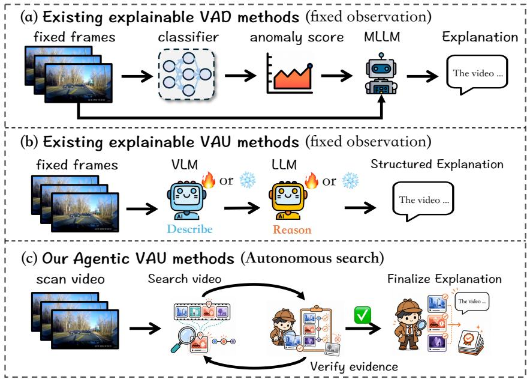
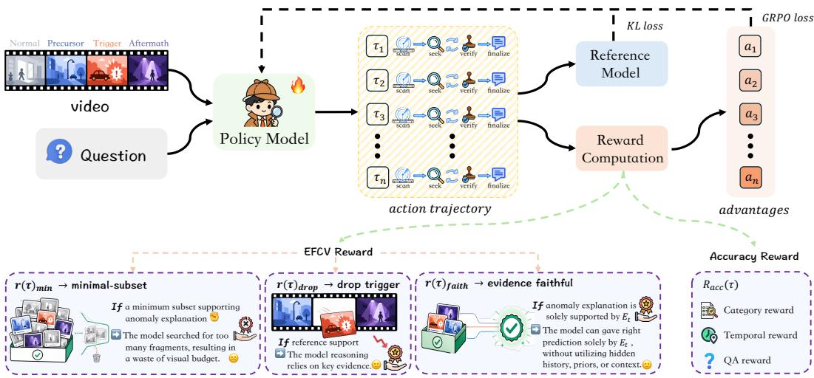
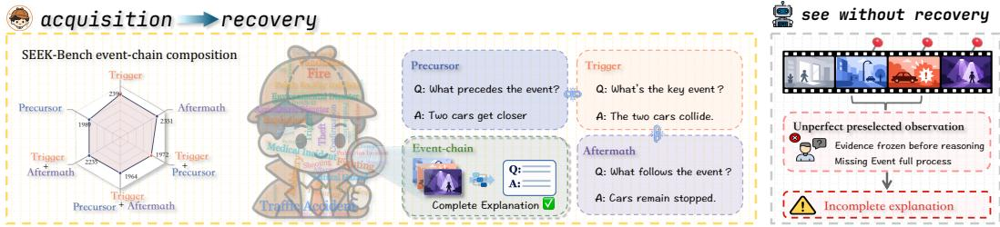
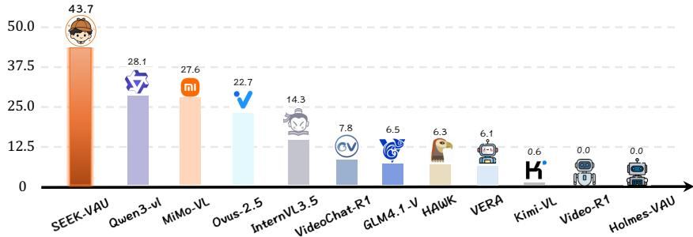
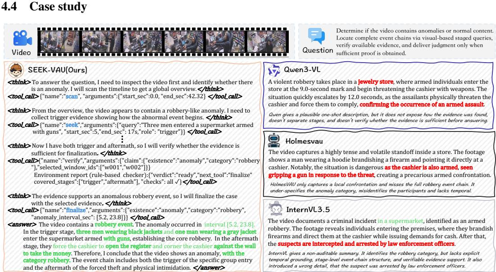

# SEEK-VAU: Towards Evidence-Faithful Video Anomaly Understanding via Agentic Search

Minghe Wang1 Weijun Zeng3 Dapeng Luo4 Xinyue Wang4 Nong Sang2∗ 1 School of Software Engineering, Huazhong University of Science and Technology 2Key Laboratory of Image Processing and Intelligent Control,

School of Artificial Intelligence and Automation, Huazhong University of Science and Technology 3School of Software & Microelectronics, Peking University

4School of Mechanical Engineering and Electronic Information, China University of Geosciences {minghe\_wang, nsang}@hust.edu.cn zengweijun26@stu.pku.edu.cn {luodapeng, wangxinyue}@cug.edu.cn

## Abstract

Most video anomaly understanding (VAU) systems still infer anomaly judgments from evidence collected in a feed-forward way under predefined rules, typically sampled frames, or events clustered from such frames. This protocol fails when the collected evidence is incomplete under imperfect predefined rules, because once reasoning begins the model can no longer search for the missing evidence. We address this limitation with SEEK-VAU, which reframes VAU as an agentic search-and-verify interaction protocol under a bounded search budget: instead of passively reasoning over pre-collected evidence, the policy actively gathers evidence across the three stages of an anomaly event chain (precursor, trigger, and aftermath) and verifies its sufficiency before finalization, turning event-chain completeness into an explicit design rather than an outcome of predefined rules. A bounded budget caps the cost of this search, but does not by itself teach the policy where to look or when to stop. To make this behavior learnable, we introduce evidence-faithful counterfactual verification (EFCV), which rewards selected evidence that remains supportive, compact, and necessary under counterfactual verification. We further introduce SEEK-Bench, featuring video-level episodes with temporal interval annotations, semantic QA and event-chain stage labels. Together, SEEK-VAU and SEEK-Bench establish a strong foundation for evidencefaithful and actively verifiable VAU.

## 1 Introduction

Video anomaly analysis has moved from detecting and localizing abnormal events toward explaining what happened, why it is anomalous, and what visual support justifies the conclusion [5, 22, 16, 28, 26, 20] (Figure 1(a)). This shift has pushed VAU toward longer temporal reasoning, richer context modeling, and more structured decision making, including methods that operate across long videos, multiple temporal granularities, subtle scene and reinforcement-enhanced reasoning [28, 31, 11, 27] (Figure 1(b)). Yet the dominant protocol remains fixed-observation: a feed-forward pipeline driven by imperfect predefined rules, the model receives a prepared bundle of frames or events and then infers an anomaly judgment, explanation, or reasoning from that bundle. Stronger reasoning can improve interpretation over observed evidence, but it does not change when or how evidence is acquired, leaving the model unable to search for missing support once inference has begun.

  
Figure 1: (a) Explainable VAD and (b) reasoning-enhanced VAU explain anomalies from a fixed observation bundle preselected before reasoning, so missed evidence can never be recovered. (c) SEEK-VAU interleaves acquisition with reasoning: it scans, iteratively seeks missing event-chain evidence in a seek–verify loop, and finalizes only when the gathered evidence supports the case, under a bounded search budget.

This interaction-level limitation matters because many anomalies are not defined by a single peak frame or short clip, but by whether the system can recover a coherent chain from precursor cues to a trigger, and then to aftermath. Under this lens of event-chain completeness, fixed-observation VAU becomes structurally limiting: when key evidence is missing, the model must reason over an incomplete observation set rather than search for missing evidence or verify the case’s readiness for closure. Recent agentic systems PANDA [24] show that multi-round tool-augmented reflection can recover useful evidence, but they cap only reflection rounds without bounding per-turn or cumulative context, so inference cost grows with accumulating outputs. SEEK-VAU addresses this gap by reframing VAU as an agentic search-and-verify problem under a bounded search budget, in which the policy acquires evidence, verifies its readiness, and commits to a final anomaly explanation.

Concretely, SEEK-VAU instantiates this search-and-verify view as a tool-using policy, following the reasoning-action-observation paradigm [25], organized around four executable actions: {scan, seek, verify, finalize}. scan builds an initial temporal context over the video, whereas seek uses that context to turn promising regions into committed supporting evidence; verify then tests whether the selected evidence is sufficient, insufficient or redundant before finalize closes the case. This protocol is more than a cleaner interface over existing VAU, as its decomposition allows the policy to search backward for precursors or forward for aftermath, rather than remaining trapped inside a fixed observation bundle chosen before reasoning begins. Without a cost mechanism, however, this freedom would inflate inference cost as the policy revisits the video. SEEK-VAU prevents this with a bounded search budget that imposes two coordinated caps: a per-turn cap on the frame intake of each seek, and a cumulative cap maintained by a rolling active-context window that evicts older frames. Per-step compute therefore stays bounded as turns accumulate, so backtracking improves recovery without significantly inflating inference cost.

Protocol alone, however, does not guarantee that the policy will actually learn to search and stop for evidence-faithful reasons. We therefore pair SEEK-VAU with a learning objective grounded in evidence-faithful counterfactual verification (EFCV). The supervised fine-tuning (SFT) stage trains the policy on prepared protocol trajectories that instantiate the same search-verify-finalize interface used at inference, and the reinforcement learning (RL) stage rewards anomaly trajectories whose committed evidence supports the decision, whose compact subset remains sufficient, and whose trigger evidence is decision-critical. Evidence faithfulness thus becomes part of policy optimization itself, rather than a post-hoc aspiration.

To evaluate whether search-and-verify behavior improves evidence recovery rather than only final answers, we introduce SEEK-Bench. To our knowledge, it is the first benchmark designed for interactive search-and-verify VAU, annotating each episode with temporal intervals, semantic QA and event-chain stages. To this end, we make three contributions:

• We recast VAU as a stage-aware agentic search-and-verify protocol under a bounded search budget, and instantiate it in SEEK-VAU through four executable actions that make event-chain completeness a recoverable behavioral target rather than a passive byproduct of fixed observation, while the budget bounds per-turn input tokens and cumulative visual context so backtracking improves recovery without significantly inflating inference cost.

• We introduce EFCV, which couples protocol-trajectory supervision with counterfactual verification rewards for selected-support sufficiency, compactness, and trigger necessity, training final decisions to rely on committed evidence rather than label correctness alone.

• We introduce SEEK-Bench, a benchmark for interactive search-and-verify VAU, with video episodes annotated for temporal intervals, semantic QA and event-chain stages.

## 2 Related work

## 2.1 From video anomaly detection to richer VAU

Video anomaly research has shifted from detecting and localizing abnormal events to explaining what happened, why it is anomalous, and how it unfolds. CUVA [5] and HAWK [16] emphasize causation-oriented and open-world understanding, Holmes-VAU [28] extends VAU to long videos and multiple temporal granularities, and CueBench [27] highlights context-dependent anomalies that require scene- and attribute-aware interpretation. Prompting-based systems such as AnomalyRuler [22], VERA [26], and AssistPDA [23] further enrich anomaly description and explanation. Together, these works broaden VAU’s semantic scope, but the resulting pipelines still largely reason over prepared frames or hierarchical events, leaving the fixed-observation protocol unchanged.

## 2.2 Reasoning- and RL-enhanced VAU

Recent VAU methods strengthen reasoning over provided video evidence. VAU-R1 [31] organizes perception, grounding, reasoning, and conclusion with reinforcement fine-tuning; SRVAU-R1 [29] and PrismVAU [6] add reflection-aware learning and prompt-refined multimodal inference; Vad-R1 [10] and VADER [3] emphasize chain-of-thought and causal interpretation; and Huang et al. [11] introduce adaptive hierarchical reasoning, risk-aware analysis, and decision-oriented outputs. These methods make VAU more structured and adaptive, but they remain fixed-observation systems: they reason over provided video-question context and cannot actively search for missing precursor, trigger, or aftermath evidence needed to reconstruct complete anomaly event chains.

## 2.3 Agentic Video Anomaly Detection

Beyond fixed-observation VAU, recent work casts video anomaly detection (VAD) itself as an agentic process. PANDA [24] frames generalized anomaly analysis as a training-free VAD agent with planning, tool use, memory, and external evidence tools such as object detection and web search. QVAD [2] remains detection-centric but uses question-driven inquiry and iterative query refinement over the provided visual input. These systems show that anomaly inference can be interactive, yet they do not instantiate agentic VAU: PANDA operationally supports iterative reasoning, but it does not evaluate stage-wise evidence recovery under a matched cumulative visual-context budget, while QVAD remains fixed-input interactive reasoning rather than tool-mediated evidence acquisition.

Taken together, prior VAU work improves semantic understanding and reasoning, while agentic VAD introduces interactive inference. Unlike general agentic VAD agents, SEEK-VAU makes anomaly event-chain evidence the unit of search, verification, optimization, and evaluation. SEEK-VAU closes this gap with an agentic search-and-verify protocol under a bounded search budget. Counterfactual signals have appeared in image-grounded reasoning (DeFacto [21]) and test-timescaled video reasoning (Video-RTS [19]), but neither targets event-chain anomaly understanding; EFCV ties counterfactual perturbations to stage-tagged evidence (precursor, trigger, aftermath), isolating trigger-specific necessity rather than generic evidence sufficiency.

## 3 SEEK-VAU: method

## 3.1 Task formulation

Most VAU systems answer from a fixed observation bundle selected before inference, which is limiting when anomaly meaning depends on evidence outside that bundle. Given a video V and a case-level task query Q, SEEK-VAU frames VAU as a search-and-verify task that returns a structured anomaly case y, including anomaly existence, category, a grounded interval, supporting evidence, and a semantic explanation, rather than a one-shot judgment over precommitted observations.

The central target of this interaction is a coherent anomaly event chain $C = ( C _ { \mathrm { p r e } } , C _ { \mathrm { t r g } } , C _ { \mathrm { a f t } } )$ , where the three components denote evidence recovered for precursor, trigger, and aftermath stages when such stages are observable. Some cases may lack a visible precursor or aftermath, so the objective is not to force every episode into a complete three-stage template. Instead, under a bounded search budget, the policy should recover as much of the relevant event chain as possible and use the selected evidence to produce an evidence-faithful reasoning result.

  
Figure 2: Overview of our proposed SEEK-VAU

## 3.2 Interleaved event-chain search

Fixed-observation VAU separates evidence acquisition from reasoning, as the visual bundle is chosen before inference and remains unchanged while the anomaly hypothesis evolves. This is limiting for event-chain understanding: when a reasoning step exposes a missing stage, the model cannot search for the evidence needed to resolve it. SEEK-VAU therefore treats search as an interleaved evidence acquisition process inside anomaly reasoning. The goal is not simply to inspect more frames, but to recover the missing stage needed for evidence-faithful closure under a bounded search budget.

At turn t, the rollout state is summarized as $h _ { t } = ( M _ { t } , E _ { t } , c _ { t } , H _ { t } , Q )$ , where $M _ { t }$ is the temporal search map, $E _ { t }$ is the dynamic evidence set, $c _ { t }$ is the working anomaly hypothesis, $H _ { t }$ is the interaction history, and $Q$ is the case-level task query, which is fixed throughout the episode. The current event-chain coverage is induced from the dynamic evidence set as $C _ { t } = \Psi ( E _ { t } )$ , so search progress is measured by which precursor, trigger, and aftermath evidence has actually been committed rather than by how many frames have been viewed. Among the four protocol actions {scan, seek, verify, finalize}, scan and seek are responsible for updating the temporal search map $M _ { t }$ and the dynamic evidence set $E _ { t }$ . To make this separation explicit, we decompose the interaction into evidence acquisition and evidence-conditioned finalization:

$$
P _ { \pi } ( y , E _ { T } \mid V , Q ) = \underbrace { P _ { \pi } ( E _ { T } \mid V , Q ) } _ { \mathrm { e v i d e n c e ~ a c q u i s i t i o n } } \cdot \underbrace { P _ { \pi } ( y \mid E _ { T } , V , Q ) } _ { \mathrm { c a s e ~ f i n a l i z a t i o n } }\tag{1}
$$

Here $E _ { T }$ denotes the dynamic evidence set accumulated by the end of the interaction. The first factor corresponds to evidence acquisition: through the first scan and repeated seek calls, the policy builds temporal context, then emits local queries $q _ { t }$ , and commits selected evidence. The second factor corresponds to finalization: the policy predicts the structured anomaly case y conditioned on the gathered evidence rather than on a fixed observation bundle selected before reasoning begins.

SEEK-VAU implements interleaved evidence search through its two evidence-acquisition actions. scan explores a requested interval and logs the returned frames and their timestamps in the temporal search map $M _ { t } .$ , a coarse guide over observed intervals that informs later decisions without itself becoming selected support. seek converts the current temporal context into committed evidence: conditioned on the current state $h _ { t } ,$ the policy emits a search request $a _ { t } = ( q _ { t } , I _ { t } , \rho _ { t } )$ , consisting of a concrete visual query $q _ { t }$ , a temporal interval $I _ { t }$ in seconds, and the event-chain role $\rho _ { t }$ being sought, and commits the returned frames to $E _ { t }$

The environment executes each request $a _ { t }$ through a fixed, query-independent mapping: the requested interval $I _ { t }$ is clipped to the video span, and the tool deterministically returns four uniformly spaced frames over the clipped interval, together with their timestamps. Within-window sampling is therefore deterministic and independent of the query $q _ { t } \colon$ the query and the event-chain role $\rho _ { t }$ record the policy’s targeted evidence need, while the learned decision is which temporal window to inspect. Each return is committed as one evidence window, the interval from its earliest to its latest returned frame. The tool consumes only the input video and the policy-issued interval $I _ { t } ;$ it holds nothing unavailable to a fixed-observation baseline, and learning where to look reduces to choosing $I _ { t }$

The seek query $q _ { t }$ operationalizes the policy’s current evidence need: it specifies the concrete visual event, scene, or stage cue that should be searched next, rather than serving as a post-hoc explanation. SFT demonstrates this action space with prepared trajectories; RL rollouts and inference generate qt online with the identical procedure, differing only in the learning signal.

Figure 1(c) traces one episode: a scan first establishes temporal context, seek calls commit localized evidence at stages flagged by the temporal map, and verification redirects later searches toward missing event-chain stages before finalization, closing the interaction into a seek–verify loop. To bound this multi-turn search within a compact visual context, SEEK-VAU maintains a visible 16-frame active context rather than an unbounded history: the initial 6-frame full-video scan is protected as a global temporal map; each later seek returns 4 frames; and when admitting a seek result would exceed the 16-frame cap, the oldest non-protected seek frames are evicted first.

## 3.3 Policy-internal evidence verification

seek alone can retrieve relevant windows without ensuring that the event chain is complete: the policy might commit a window for the trigger event but never commit any window for a precursor or an aftermath, in which case calling finalize would close the case on partial evidence. SEEK-VAU therefore inserts a self-verification step before finalize, in which the policy reviews its own evidence set and decides whether the case is ready to be closed.

Given a working hypothesis $c _ { t }$ and selected evidence $E _ { t }$ , the policy self-verifier labels the set’s support as sufficient, insufficient, or redundant by checking whether the committed support covers the anomaly stages required by the current case and avoids unnecessary redundancy. The result is a control diagnosis of what the current $E _ { t }$ can justify and what remains missing before finalization. At turn t, we write the self-verification interface as the following action contract:

$$
\mathrm { V e r i f y } ( c _ { t } , E _ { t } ) = \big ( v _ { t } , a _ { t } , s _ { \mathrm { a n o m } } ( c _ { t } , E _ { t } ) , \Delta _ { t } \big ) .\tag{2}
$$

Here, $\boldsymbol { v } _ { t } ~ \in$ {sufficient, insufficient, redundant} is the categorical verdict that labels the support state of the committed evidence, and $a _ { t }$ recommends whether to continue with seek or move toward finalize. $s _ { \mathrm { a n o m } } ( c _ { t } , E _ { t } ) \in [ 0 , 1 ]$ is the anomaly confidence that the policy itself assigns to the current (claim, evidence) pair. $\Delta _ { t }$ summarizes missing stages to resolve before closure.

These outputs make verification an online control gate rather than a post-hoc score: instead of rescoring a completed answer, it reshapes the remaining trajectory. When the case is not yet ready, $\Delta _ { t }$ becomes the next search target and $a _ { t }$ routes the policy back to seek within the remaining search budget to recover the missing precursor, trigger, or aftermath stage. As long as $v _ { t }$ reports an unsupported state, $\Delta _ { t }$ and $a _ { t }$ redirect the policy toward the missing stage, and the policy proceeds to finalize only once $v _ { t }$ reports sufficient. Each such reroute draws on the same search budget, so verification-directed backtracking improves coverage without inflating visual cost.

## 3.4 EFCV learning

The search-and-verify protocol defines what the policy can do, but learning still needs to decide which anomaly trajectories are evidence-faithful. A terminal answer reward can encourage correct labels and plausible temporal grounding, but it cannot tell whether the selected evidence actually supports the anomaly decision, whether redundant windows hide weak support, or whether trigger evidence is decision-critical. EFCV addresses this gap by converting verifier diagnostics into learning-time counterfactual pressure: rather than rewarding a correct answer alone, it rewards trajectories whose final claim remains justified by the evidence the policy actually selected. EFCV thus ties evidence faithfulness to budget thrift, rewarding compact, sufficient evidence subsets.

Formally, the rollout-level reward combines answer correctness with counterfactual verification:

$$
R ( \tau ) = w _ { \mathrm { a c c } } R _ { \mathrm { a c c } } ( \tau ) + w _ { \mathrm { e f c v } } \big ( r _ { \mathrm { f a i t h } } ( \tau ) + r _ { \mathrm { m i n } } ( \tau ) + r _ { \mathrm { d r o p } } ( \tau ) \big ) ,\tag{3}
$$

Here, $w _ { \mathrm { a c c } }$ and $w _ { \mathrm { e f c v } }$ balance answer correctness and counterfactual verification. $R _ { \mathrm { a c c } }$ rewards output correctness by aggregating task-level scores for anomaly category, temporal localization, and the episode’s semantic QA, encouraging the policy to produce a structurally correct and semantically aligned case report. By contrast, $R _ { \mathrm { e f c v } }$ evaluates the evidential basis of that decision under counterfactual perturbations. It tests whether the selected evidence can sustain the anomaly claim, whether the support admits a compact sufficient subset, and whether the trigger evidence is necessary for the decision. We single out trigger necessity because the trigger marks the decisive transition from normal context to anomalous behavior, so a faithful evidence set should weaken support when this segment is removed. As shown in Figure 2, $R _ { \mathrm { e f c v } }$ is computed from three rewards defined below.

$$
\begin{array} { r l } & { r _ { \mathrm { f a i t h } } ( \tau ) = \mathbf { 1 } \big [ s _ { \mathrm { a n o m } } ( c _ { T } , E _ { T } ) \geq \theta \big ] , } \\ & { r _ { \mathrm { m i n } } ( \tau ) \ = s _ { \mathrm { a n o m } } ( c _ { T } , E _ { T } ^ { \mathrm { m i n } } ) \left[ 1 - \operatorname* { m i n } \Bigl ( \frac { | E _ { T } | - | E _ { T } ^ { \mathrm { m i n } } | } { B _ { \mathrm { r e d } } } , 1 \Bigr ) \right] , } \\ & { r _ { \mathrm { d r o p } } ( \tau ) \ = \left[ s _ { \mathrm { a n o m } } ( c _ { T } , E _ { T } ) - s _ { \mathrm { a n o m } } ( c _ { T } , E _ { T } \setminus E _ { T } ^ { \mathrm { t r i g } } ) \right] _ { + } , \quad [ \cdot ] _ { + } = \operatorname* { m a x } ( \cdot , 0 ) . } \end{array}\tag{4}
$$

Here, $s _ { \mathrm { a n o m } } ( c , E ) \in [ 0 , 1 ]$ is the anomaly confidence evaluated on the pair $( c , E )$ . The threshold θ is the verifier’s sufficiency cutoff on $s _ { \mathrm { a n o m } }$ , used by $r _ { \mathrm { f a i t h } }$ as the binarization cutoff. $E _ { T } ^ { \mathrm { m i n } }$ is the smallest subset of $E _ { T }$ still satisfying $s _ { \mathrm { a n o m } } ( c _ { T } , E ^ { \prime } ) \stackrel { . } { \geq } \theta .$ , obtained by a single-pass greedy ablation (Appendix B). $B _ { \mathrm { r e d } }$ is the redundancy-gap budget that controls how strictly the gap between $E _ { T }$ and its minimal core is penalized. The trigger subset $E _ { T } ^ { \mathrm { t r i g } } \subseteq E _ { T }$ is the subset of windows in $E _ { T }$ that the policy marked as trigger evidence.

Evidence faithfulness $r _ { \mathrm { f a i t h } }$ evaluates the final decision under an evidence-only support criterion: it asks whether the committed evidence $E _ { T }$ alone supports the final anomaly claim $c _ { T }$ . Operationally, $r _ { \mathrm { f a i t h } }$ equals 1 when $s _ { \mathrm { a n o m } } ( c _ { T } , E _ { T } )$ clears the threshold θ at which the verifier deems the committed evidence sufficient, and 0 otherwise. Binarizing through θ keeps the faithfulness reward stable under verifier scale drift across training. The evidence-faithful branch in Figure 2 captures this requirement: the model should justify the prediction from $E _ { T }$ alone, rather than crediting an answer recoverable only from the rollout transcript, priors, or context. This encourages the selected evidence to serve as a verifiable sufficient basis for the answer, not merely as a trace left by a successful search context.

Minimal-subset compactness $r _ { \mathrm { m i n } }$ penalizes the policy for collecting windows beyond a sufficient core. Concretely, $r _ { \mathrm { m i n } }$ multiplies $\bar { s } _ { \mathrm { a n o m } } ( c _ { T } , E _ { T } ^ { \mathrm { m i n } } )$ by a compactness factor $[ 1 \dot { - } \operatorname* { m i n } ( ( | E _ { T } | -$ $| E _ { T } ^ { \mathrm { m i n } } | ) / B _ { \mathrm { r e d } } , 1 ) ]$ that shrinks to 0 as the gap $| \bar { E _ { T } } | - | E _ { T } ^ { \mathrm { m i n } } |$ grows beyond the redundancy budget $B _ { \mathrm { r e d } } .$ . As the minimal-subset branch in Figure 2 illustrates, when a strict sub-core already supports the explanation, the surplus windows are treated as wasted search budget rather than stronger support. This trains the policy to stop searching at sufficiency rather than exhausting the search budget.

Drop-trigger necessity $r _ { \mathrm { d r o p } }$ tests whether trigger evidence is necessary for the final anomaly claim, rather than merely co-selected with it. The drop-trigger branch implements this counterfactual test: removing $E _ { T } ^ { \mathrm { t r i g } }$ from $E _ { T }$ should reduce anomaly confidence when the reasoning truly depends on the trigger. We target the trigger because it is the event-chain transition at which surrounding context becomes anomalous, whereas precursor and aftermath evidence may be absent, redundant, or corroborative without being individually necessary.

Together, these rewards couple sufficiency with necessity by requiring the selected evidence to support the final claim, remain compact, and lose support when the decisive trigger evidence is removed.

## 3.5 SEEK-Bench

Event-chain design. An anomalous event is a temporally extended causal process: precursors accumulate, a trigger marks the transition, and the aftermath records the consequence. Recovering stages outside the preselected visual bundle requires interactive acquisition, which in turn requires stage-localizing annotations. Reasoning-enhanced VAU datasets annotate the answer rather than the event: HIVAU-70k [28] organizes instructions along temporal and semantic granularities, whereas VAU-Bench [31] employs a seed-reasoning structure to standardize answer explanations. VAGU [8] grounds each anomaly with a temporal interval alongside its category and QA. None of them labels the three stages, so stage-wise search has neither a supervision target nor an evaluation contract. SEEK-Bench annotates the event itself, providing both.

  
Figure 3: SEEK-Bench provides an agentic VAU evaluation contract that links anomaly episodes to temporal intervals, semantic QA and event-chain stages

Construction. SEEK-Bench is built from MSAD [30] and ECVA [4], whose original releases provide raw videos with only frame-level anomaly tags. We reorganize these sources under a unified agentic VAU contract, so that each episode supplies the five fields a search-and-verify policy needs to consume and produce: anomaly labels, temporal intervals, semantic QA, event-chain stage labels, and evidence windows. All SEEK-Bench fields are annotated by human annotators.

Statistics. The resulting benchmark covers 21 anomaly categories plus a normal class. Figure 3 summarizes the data along three axes. Figure 3(a) shows the distribution over anomaly categories. Figure 3(b) visualizes event-chain composition along two non-exclusive axes: single-stage labels mark which of precursor, trigger, or aftermath evidence is present, and combined labels mark episodes where the trigger co-occurs with surrounding support. Figure 3(c) shows stage-wise duration distributions, separating short visual cues from longer supporting windows. Appendix D provides the full construction details, including source-dataset licensing, the manual annotation pipeline, the annotation guideline, the per-category distribution.

Evaluation metrics. SEEK-Bench evaluates search-and-verify behavior along three complementary axes: final interval grounding, semantic case understanding, and evidence-window recovery. We report Temporal mIoU for anomaly interval grounding, QA Accuracy for semantic understanding, and Evidence F1 for one-to-one temporal-overlap matching between selected and reference evidence windows. All methods, including baselines, emit the same structured case JSON; predicted evidence windows are extracted by one shared deterministic parser, and episodes with no parseable citation score zero Evidence F1. QA Accuracy uses a semantic-equivalence judge.

## 4 Experiments

## 4.1 Experimental setup

Implementation details. We instantiate the policy with Qwen3-VL-8B and train it in two stages. SFT uses compact protocol traces that demonstrate search, verification, and case finalization, while RL optimizes anomaly rollouts with the counterfactual evidence-faithfulness rewards rather than end-label reward alone. For RL, we use GRPO [15], with KL coefficient 0.1. The composite reward uses $w _ { \mathrm { a c c } } = 0 . 5$ and $w _ { \mathrm { e f c v } } = 0 . 5$ ; inside $R _ { \mathrm { e f c v } }$ , we set $\theta = 0 . 5$ , and $B _ { \mathrm { r e d } } = 2$ . Each episode is capped at 8 turns covering one scan that uniformly samples 6 frames, three seek–verify loops where each seek returns 4 frames, and one finalize, for a total of at most 18 sampled frames per episode. Training runs on 8 H200 GPUs.

Search and context budget. Fixed-observation baselines receive 18 uniformly sampled full-video frames once before decoding. SEEK-VAU instead spends this budget dynamically: the policy begins with a protected 6-frame global scan, issues scan/seek actions during the rollout, and keeps at most 16 visual frames visible to the model at any decision step. The protected scan preserves a stable full-video temporal map for interpreting later seek evidence, while overflow removes the oldest non-protected seek frames so adaptive search does not become unbounded visual memory. Internal ablations keep this active-context cap and the turn budget fixed, changing only the training signal.

Table 1: Comparison of Temporal mIoU and QA Accuracy across model families.
<table><tr><td>Method</td><td>Base Model</td><td>Temporal mIoU</td><td>QA Accuracy</td></tr><tr><td colspan="4">Video MLLMs</td></tr><tr><td>GLM-4.1v [9]</td><td>GLM-4.1v-8B</td><td>4.6</td><td>16.4</td></tr><tr><td>Kimi-VL [17]</td><td>Kimi-VL-A3B</td><td>7.3</td><td>16.3</td></tr><tr><td>Intern-VL3.5 [18]</td><td>InternVL3.5-8B</td><td>25.5</td><td>19.4</td></tr><tr><td>Qwen3-VL [1]</td><td>Qwen3-VL-8B</td><td>44.2</td><td>37.7</td></tr><tr><td colspan="4">Video Reasoning MLLMs</td></tr><tr><td>Video-R1 [7]</td><td>Qwen2.5-VL-7B</td><td>9.8</td><td>8.4</td></tr><tr><td>VideoChat-R1 [13]</td><td>Qwen2.5-VL-7B</td><td>10.0</td><td>13.3</td></tr><tr><td>mimo-VL [12]</td><td>mimo-VL-8B</td><td>39.4</td><td>16.5</td></tr><tr><td>Ovis2.5 [14]</td><td>Qwen3-8B</td><td>41.8</td><td>24.7</td></tr><tr><td colspan="4">MLLM-based VAU Methods</td></tr><tr><td>HAWK [16]</td><td>LLaMA-2 7B</td><td>3.7</td><td>19.2</td></tr><tr><td>Holmes-VAU [28]</td><td>InternVL2-2B</td><td>7.4</td><td>20.7</td></tr><tr><td>VERA [26]</td><td>InternVL2-8B</td><td>31.5</td><td>18.6</td></tr><tr><td colspan="4">Ours</td></tr><tr><td>SEEK-VAU (ours)</td><td>Qwen3-VL-8B</td><td>55.6</td><td>45.5</td></tr></table>

## 4.2 Main results

Under the SEEK-Bench protocol, Table 1 compares SEEK-VAU with video MLLMs and video reasoning MLLMs (18 uniformly sampled frames), and MLLM-based VAU (follow each method’s件链完整程度 predefined sampling strategy) on final interval grounding and semantic case QA.

SEEK-VAU leads Table 1 on both reported axes, reaching 55.6 Temporal mIoU and 45.5 QA Accuracy. Relative to the fixed-observation Qwen3-VL baseline, which achieves 44.2 and 37.7, SEEK-VAU improves Temporal mIoU by +11.4 points and QA Accuracy by +7.8 points. The gain is not confined to this baseline: Ovis2.5 is the strongest video-reasoning baseline in Temporal mIoU and VERA is the strongest MLLM-based VAU baseline, yet both remain below SEEK-VAU.

  
Figure 4: Comparison of Evidence F1 across models.

Figure 4 shows the same advantage on Evidence F1: SEEK-VAU reaches 43.7, ahead of the strongest non-agentic baselines Qwen3-VL (28.1) and MiMo-VL (27.6). The advantage extends beyond final answers and temporal intervals to the recovery of evidence windows that justify each case. Fixedobservation baselines often predict the case from sparse frames but miss those windows. SEEK-VAU narrows this gap by issuing later seek calls to fill missing evidence and verifying it before finalize, while keeping the same active-context budget. Crucially, SEEK-VAU rarely uses the full search Precursorbudget: the average frame usage stays well below the 18-frame cap, whereas fixed-observation baselines always consume their full allocation. The search-and-verify policy is therefore more accurate while using fewer visual frames, with modest token and latency overhead.

## 4.3 Ablation studies and analysis

We report an attribution ablation (Table 2), an acquisition-mode ablation (Table 4), a visual-context cap ablation (Table 3).

Table 2: Attribution ablation.
<table><tr><td>Method</td><td>T. mIoU QA Acc. E.F1</td><td></td><td></td></tr><tr><td>Fixed obs. + basic sup.</td><td>44.2</td><td>37.7</td><td>28.1</td></tr><tr><td>Fixed obs. + rich sup.</td><td>46.9</td><td>38.2</td><td>28.3</td></tr><tr><td>Active + basic sup.</td><td>50.1</td><td>40.1</td><td>34.3</td></tr><tr><td>Active + rich sup. (w/o EFCV)</td><td>54.4</td><td>42.7</td><td>41.6</td></tr><tr><td>SEEK-VAU (full)</td><td>55.6</td><td>45.5</td><td>43.7</td></tr></table>

Table 3: Visual-context cap ablation.
<table><tr><td>Cap</td><td>T. mIoU</td><td>QA Acc.</td><td>E.F1</td></tr><tr><td>12</td><td>51.6</td><td>44.1</td><td>38.2</td></tr><tr><td>14</td><td>53.2</td><td>43.8</td><td>39.3</td></tr><tr><td>16</td><td>55.6</td><td>45.5</td><td>43.7</td></tr><tr><td>18</td><td>53.6</td><td>45.7</td><td>38.2</td></tr><tr><td>20</td><td>55.3</td><td>45.9</td><td>42.8</td></tr></table>

Attribution ablation. Do the gains stem from the search-and-verify protocol or from the richer supervision that accompanies SEEK-Bench? Table 2 disentangles the two sources under a matched backbone and 18-frame visual budget. Basic supervision trains on task fields only (existence, closed-ended QA, etc.), while rich supervision adds event-chain stage labels and evidence windows. Supervision alone explains little: under fixed observation, upgrading from basic to full event-chain annotations lifts T. mIoU by only 2.7 points and moves QA Acc. and E.F1 by a negligible 0.5 and 0.2, teaching the model what to report rather than where to look. The acquisition protocol is the stronger single factor (replacing fixed observation with active search, again without event-chain supervision, raises the three metrics by 5.9, 2.4, and 6.2 points respectively); combined with eventchain supervision the two are super-additive (41.6 E.F1, 7.1 points beyond the sum of the individual gains, and active search under matched event-chain supervision improves T. mIoU, QA Acc., and E.F1 by 7.5, 4.5, and 13.3 points over the fixed rich-supervision control), and EFCV yields +2.8 QA Acc. Acquisition thus drives evidence recovery, while supervision improves QA Acc by +2.6 under active acquisition, amplifying rather than replacing the search-and-verify behavior.

Visual-context cap ablation. Within the examined range, raising the cap from 12 to 16 improves all three metrics (T. mIoU 51.6 to 55.6, QA Acc. 44.1 to 45.5, and E.F1 38.2 to 43.7; Table 3), with the largest gain in Evidence F1, while QA Acc. dips only slightly between caps 12 and 14 (44.1 to 43.8). Beyond 16 frames the trend is non-monotone: cap 18 gains marginal QA Accuracy (45.7) but drops T. mIoU to 53.6 and E.F1 back to the cap-12 level (38.2), and cap 20 partially recovers (55.3/45.9/42.8), attaining the best QA Accuracy yet remaining below the 16-frame peak on the other two metrics. The protocol’s 16-frame cap thus best balances evidence recovery and compact visual context.

Table 4: Matched acquisition-mode ablation.
<table><tr><td>Method</td><td>Acquisition</td><td>Verify</td><td>T. mIoU</td><td>QA Acc.</td><td>E.F1</td><td>Frames</td></tr><tr><td>Two-stage matched</td><td>One-shot</td><td>X</td><td>48.2</td><td>31.1</td><td>32.3</td><td>18.0</td></tr><tr><td>Closed-loop w/o verify</td><td>Closed-loop</td><td>X</td><td>50.7</td><td>33.5</td><td>29.1</td><td>13.2</td></tr><tr><td>SEEK-VAU w/o EFCV</td><td>Closed-loop</td><td>√</td><td>54.4</td><td>42.7</td><td>41.6</td><td>17.1</td></tr><tr><td>SEEK-VAU (full)</td><td>Closed-loop</td><td>√</td><td>55.6</td><td>45.5</td><td>43.7</td><td>15.6</td></tr></table>

Acquisition-mode ablation. Does the gain come from the closed-loop search-and-verify protocol itself, or from any form of adaptive acquisition? Table 4 compares matched protocols in which only the acquisition protocol, the verify gate, and the EFCV reward differ, while the backbone, training episodes and targets, update count, answer reward, 18-frame cap, decoding, parser, and evaluator are held fixed; Frames reports realized average use rather than the shared cap. Against the fixed-observation Fixed obs. + rich sup. rung of Table 2, one-shot adaptive retrieval improves T. mIoU by only +1.3 while QA Acc. drops by 7.1: frozen retrieval alone cannot explain the gain. Closing the loop without verification lifts T. mIoU by a further +2.5 yet lowers E.F1 by 3.2 while spending only 13.2 frames: the policy re-plans well but closes the case on an incomplete evidence ledger. Gating finalization on verification is the decisive step: it adds 3.7 points of T. mIoU, 9.2 of QA Acc., and 12.5 of E.F1 while raising realized use to 17.1 frames, exactly the behavior expected of a verifier that withholds finalization until the evidence is sufficient rather than re-scoring a finished answer. EFCV adds a further 1.2, 2.8, and 2.1 points on the same three metrics while reducing average use to 15.6 frames, so the full policy is both more accurate and more frugal.

Table 5: Inference efficiency ablation.
<table><tr><td>Model</td><td>Avg. frames</td><td>Avg. tokens</td><td>Latency (s)</td><td>Throughput (ep/min)</td></tr><tr><td>Qwen3-VL</td><td>18.0</td><td>4.33k</td><td>8.71</td><td>20.22</td></tr><tr><td>SEEK-VAU w/o EFCV</td><td>17.1</td><td>7.17k</td><td>10.32</td><td>18.45</td></tr><tr><td>SEEK-VAU</td><td>15.6</td><td>5.78k</td><td>9.27</td><td>19.31</td></tr></table>

Inference-time efficiency. A central claim of SEEK-VAU is that an agentic search-and-verify protocol can operate under a bounded search and context budget. Table 5 corroborates this: SEEK-VAU consumes only 15.6 frames on average, well below the 18-frame ceiling and roughly 13% fewer than the fixed-observation Qwen3-VL baseline (18.0 frames, 4.33k tokens, 8.71 s, 20.22 ep/min). The budget alone is not sufficient: without EFCV, the policy nearly saturates it at 17.1 frames and inflates token usage to 7.17k with the worst latency of 10.32 s. By rewarding selective commitment to key evidence rather than exhaustive coverage, EFCV cuts token usage relative to the w/o-EFCV variant by roughly 19% to 5.78k, yielding 9.27 s latency and 19.31 ep/min. Together, the bounded search budget and EFCV keep multi-turn deliberation practical under a fixed visual-context cap.

  
Figure 5: Case study of SEEK-VAU on a supermarket robbery video.  
Figure 5 compares free-text anomaly description with evidence-grounded case construction on a supermarket robbery. All fixed-observation baselines label the event robbery but diverge in detail: Qwen3-VL misattributes the scene to a jewelry store and narrows to a 9–12 s confrontation; Holmes-VAU hallucinates the cashier as also armed and reduces the case to a local standoff; InternVL3.5 fabricates an arrest by law enforcement absent from the video. SEEK-VAU instead produces a traceable trajectory: a global scan, stage-tagged seek calls for trigger and aftermath, and finalize only after verification confirms both stages. The resulting case grounds the robbery to [5.2, 23.8] s, with group entry as trigger and forced register opening with physical intimidation as aftermath. The episode has no visible precursor, and SEEK-VAU correctly does not fabricate one. Both the temporal interval and the stage attribution trace back to specific seek rather than to free-text generation.

## 5 Conclusion

We present SEEK-VAU, an agentic search-and-verify protocol under a bounded search budget for evidence-faithful video anomaly understanding. Rather than decoding from a fixed observation set, SEEK-VAU gathers evidence, verifies its readiness, and finalizes an event chain over precursor, trigger, and aftermath. The budget caps per-turn input and cumulative context, while EFCV trains selective key-evidence search, so backtracking improves recovery with modest inference overhead. With SEEK-Bench, evidence acquisition, verification, and bounded-cost search become explicit training and evaluation targets, advancing VAU toward verifiable and efficient anomaly reasoning.

## Acknowledgments and Disclosures

Funding. This work was supported by the National Natural Science Foundation of China under Grants U22B2053 and 62573393.

Competing interests. The authors have no competing interests to disclose.

## References

[1] Shuai Bai, Yuxuan Cai, Ruizhe Chen, Keqin Chen, Xionghui Chen, Zesen Cheng, Lianghao Deng, Wei Ding, Chang Gao, Chunjiang Ge, et al. Qwen3-VL technical report. arXiv preprint arXiv:2511.21631, 2025.

[2] Lokman Bekit, Hamza Karim, Nghia T Nguyen, and Yasin Yilmaz. QVAD: A question-centric agentic framework for efficient and training-free video anomaly detection. arXiv preprint arXiv:2604.03040, 2026.

[3] Ying Cheng, Yu-Ho Lin, Min-Hung Chen, Fu-En Yang, and Shang-Hong Lai. VADER: Towards causal video anomaly understanding with relation-aware large language models. In Proceedings of the IEEE/CVF Winter Conference on Applications of Computer Vision, pages 7301–7311, 2026.

[4] Hang Du, Guoshun Nan, Jiawen Qian, Wangchenhui Wu, Wendi Deng, Hanqing Mu, Zhenyan Chen, Pengxuan Mao, Xiaofeng Tao, and Jun Liu. Exploring what why and how: A multifaceted benchmark for causation understanding of video anomaly. arXiv preprint arXiv:2412.07183, 2024.

[5] Hang Du, Sicheng Zhang, Binzhu Xie, Guoshun Nan, Jiayang Zhang, Junrui Xu, Hangyu Liu, Sicong Leng, Jiangming Liu, Hehe Fan, et al. Uncovering what why and how: A comprehensive benchmark for causation understanding of video anomaly. In Proceedings ofthe IEEE/CVF Conference on Computer Vision and Pattern Recognition, pages 18793–18803, 2024.

[6] Iñaki Erregue, Kamal Nasrollahi, and Sergio Escalera. PrismVAU: Prompt-refined inference system for multimodal video anomaly understanding. In Proceedings ofthe IEEE/CVF Winter Conference on Applications ofComputer Vision (WACV) Workshops, 2026.

[7] Kaituo Feng, Kaixiong Gong, Bohao Li, Zonghao Guo, Yibing Wang, Tianshuo Peng, Junfei Wu, Xiaoying Zhang, Benyou Wang, and Xiangyu Yue. Video-R1: Reinforcing video reasoning in MLLMs. Advances in Neural Information Processing Systems, 38, 2025.

[8] Shibo Gao, Peipei Yang, Yangyang Liu, Yi Chen, Han Zhu, Xu-Yao Zhang, and Linlin Huang. VAGU & GtS: LLM-based benchmark and framework for joint video anomaly grounding and understanding. In Proceedings ofthe AAAI Conference on Artificial Intelligence, volume 40, 2026.

[9] GLM-V Team, Wenyi Hong, Wenmeng Yu, Xiaotao Gu, Guo Wang, Guobing Gan, Haomiao Tang, Jiale Cheng, Ji Qi, Junhui Ji, Lihang Pan, et al. GLM-4.5V and GLM-4.1V-Thinking: Towards versatile multimodal reasoning with scalable reinforcement learning. arXiv preprint arXiv:2507.01006, 2025.

[10] Chao Huang, Benfeng Wang, Jie Wen, Chengliang Liu, Wei Wang, Li Shen, and Xiaochun Cao. VAD-R1: Towards video anomaly reasoning via perception-to-cognition chain-of-thought. arXiv preprint arXiv:2505.19877, 2025.

[11] Chao Huang, Benfeng Wang, Wei Wang, Jie Wen, Li Shen, Wenqi Ren, Yong Xu, and Xiaochun Cao. Advancing adaptive multi-stage video anomaly reasoning: A benchmark dataset and method. arXiv preprint arXiv:2601.10165, 2026.

[12] Jiaze Li, Jingyang Chen, Yuxun Qu, Shijie Xu, Zhenru Lin, Junyou Zhu, Boshen Xu, Wenhui Tan, Pei Fu, Jianzhong Ju, et al. Xiaomi MiMo-VL-Miloco technical report. arXiv preprint arXiv:2512.17436, 2025.

[13] Xinhao Li, Ziang Yan, Desen Meng, Lu Dong, Xiangyu Zeng, Yinan He, Yali Wang, Yu Qiao, Yi Wang, and Limin Wang. VideoChat-R1: Enhancing spatio-temporal perception via reinforcement fine-tuning. arXiv preprint arXiv:2504.06958, 2025.

[14] Shiyin Lu, Yang Li, Yu Xia, Yuwei Hu, Shanshan Zhao, Yanqing Ma, Zhichao Wei, Yinglun Li, Lunhao Duan, Jianshan Zhao, et al. Ovis2.5 technical report. arXiv preprint arXiv:2508.11737, 2025.

[15] Zhihong Shao, Peiyi Wang, Qihao Zhu, Runxin Xu, Junxiao Song, Xiao Bi, Haowei Zhang, Mingchuan Zhang, YK Li, Yang Wu, et al. DeepSeekMath: Pushing the limits of mathematical reasoning in open language models. arXiv preprint arXiv:2402.03300, 2024.

[16] Jiaqi Tang, Hao Lu, Ruizheng Wu, Xiaogang Xu, Ke Ma, Cheng Fang, Bin Guo, Jiangbo Lu, Qifeng Chen, and Ying-Cong Chen. HAWK: Learning to understand open-world video anomalies. Advances in Neural Information Processing Systems, 37:139751–139785, 2024.

[17] Kimi Team, Angang Du, Bohong Yin, Bowei Xing, Bowen Qu, Bowen Wang, Cheng Chen, Chenlin Zhang, Chenzhuang Du, Chu Wei, et al. Kimi-VL technical report. arXiv preprint arXiv:2504.07491, 2025.

[18] Weiyun Wang, Zhangwei Gao, Lixin Gu, Hengjun Pu, Long Cui, Xingguang Wei, Zhaoyang Liu, Linglin Jing, Shenglong Ye, Jie Shao, et al. InternVL3.5: Advancing open-source multimodal models in versatility, reasoning, and efficiency. arXiv preprint arXiv:2508.18265, 2025.

[19] Ziyang Wang, Jaehong Yoon, Shoubin Yu, Md Mohaiminul Islam, Gedas Bertasius, and Mohit Bansal. Video-RTS: Rethinking reinforcement learning and test-time scaling for efficient and enhanced video reasoning. In Proceedings ofthe Conference on Empirical Methods in Natural Language Processing, 2025.

[20] Jiacong Xu, Shao-Yuan Lo, Bardia Safaei, Vishal M Patel, and Isht Dwivedi. Towards zero-shot anomaly detection and reasoning with multimodal large language models. In Proceedings of the Computer Vision and Pattern Recognition Conference, pages 20370–20382, 2025.

[21] Tianrun Xu, Haoda Jing, Ye Li, Yuquan Wei, Jun Feng, Guanyu Chen, Haichuan Gao, Tianren Zhang, and Feng Chen. DeFacto: Counterfactual thinking with images for enforcing evidencegrounded and faithful reasoning. arXiv preprint arXiv:2509.20912, 2025.

[22] Yuchen Yang, Kwonjoon Lee, Behzad Dariush, Yinzhi Cao, and Shao-Yuan Lo. Follow the rules: reasoning for video anomaly detection with large language models. In European Conference on Computer Vision, pages 304–322. Springer, 2024.

[23] Zhiwei Yang, Chen Gao, Jing Liu, Peng Wu, Guansong Pang, and Mike Zheng Shou. AssistPDA: An online video surveillance assistant for video anomaly prediction, detection, and analysis. arXiv preprint arXiv:2503.21904, 2025.

[24] Zhiwei Yang, Chen Gao, and Mike Zheng Shou. PANDA: Towards generalist video anomaly detection via agentic AI engineer. Advances in Neural Information Processing Systems, 38, 2025.

[25] Shunyu Yao, Jeffrey Zhao, Dian Yu, Nan Du, Izhak Shafran, Karthik Narasimhan, and Yuan Cao. ReAct: Synergizing reasoning and acting in language models. In International Conference on Learning Representations, 2023.

[26] Muchao Ye, Weiyang Liu, and Pan He. VERA: Explainable video anomaly detection via verbalized learning of vision-language models. In Proceedings of the Computer Vision and Pattern Recognition Conference, pages 8679–8688, 2025.

[27] Yating Yu, Congqi Cao, Zhaoying Wang, Weihua Meng, Jie Li, Yuxin Li, Zihao Wei, Zhongpei Shen, and Jiajun Zhang. CueBench: Advancing unified understanding of context-aware video anomalies in real-world. In Proceedings of the AAAI Conference on Artificial Intelligence, volume 40, pages 12187–12195, 2026.

[28] Huaxin Zhang, Xiaohao Xu, Xiang Wang, Jialong Zuo, Xiaonan Huang, Changxin Gao, Shanjun Zhang, Li Yu, and Nong Sang. Holmes-VAU: Towards long-term video anomaly understanding at any granularity. In Proceedings ofthe computer vision and pattern recognition conference, pages 13843–13853, 2025.

[29] Zihao Zhao, Shengting Cao, and Muchao Ye. SRVAU-R1: Enhancing video anomaly understanding via reflection-aware learning. arXiv preprint arXiv:2602.01004, 2026.

[30] Liyun Zhu, Lei Wang, Arjun Raj, Tom Gedeon, and Chen Chen. Advancing video anomaly detection: A concise review and a new dataset. Advances in Neural Information Processing Systems, 37:89943–89977, 2024.

[31] Liyun Zhu, Qixiang Chen, Xi Shen, and Xiaodong Cun. VAU-R1: Advancing video anomaly understanding via reinforcement fine-tuning. arXiv preprint arXiv:2505.23504, 2025.

## A Evidence F1 computation

Evidence windows are committed by seek actions: each seek return commits exactly one window, the interval from its earliest to its latest returned frame (Section 3.2), and distinct seek calls commit distinct windows even when their intervals overlap. The three seek calls available within the episode budget therefore commit at most three windows, which is the evidence budget $| E _ { T } | \le 3$ used by the EFCV reward (Appendix B).

For the default predicted evidence set $\hat { E } _ { \mathrm { t o p } } ~ = ~ \{ \hat { t } _ { i } \} _ { i = 1 } ^ { \operatorname* { m i n } ( 3 , | \hat { E } | ) }$ and annotated evidence windows $E ^ { \star } = \{ t _ { j } \}$ }, we define

$$
M = \operatorname* { m a x } _ { \pi \in \Pi } \sum _ { ( i , j ) \in \pi } \mathbf { 1 } \big [ \mathrm { I o U } ( \hat { t } _ { i } , t _ { j } ) \geq \tau _ { t } \big ] .\tag{5}
$$

$$
\boldsymbol { P } = \frac { M } { | \hat { E } _ { \mathrm { t o p } } | } , \qquad \boldsymbol { R } = \frac { M } { | E ^ { \star } | } , \qquad \mathrm { E v i d e n c e } \ : \mathrm { F } 1 = \frac { 2 \boldsymbol { P } \boldsymbol { R } } { \boldsymbol { P } + \boldsymbol { R } } .\tag{6}
$$

Here, Π denotes one-to-one matchings between predicted and annotated evidence windows, and samples without valid predicted or annotated evidence receive zero Evidence F1. We set $\tau _ { t } = 0 . 3$ throughout, and the annotated set $E ^ { \star }$ comprises each stage’s primary reference window plus any adjudicated admissible alternatives (Appendix D). Evidence F1 therefore measures one-to-one recovery of adjudicated canonical reference windows, which are canonical representative windows rather than an exhaustive set of valid alternatives; it does not by itself verify actor or object identity or complete semantic faithfulness.

## B Anomaly EFCV Diagnostics and Verification Details

This appendix specifies how the anomaly-support scalar $s _ { \mathrm { a n o m } }$ used in the EFCV reward (Section 3.4) is obtained from the verify action contract of Section $3 . 3 .$ , and maps the EFCV reward terms to their implementation labels.

Each verify call emits a scalar $s _ { \mathrm { a n o m } } \in [ 0 , 1 ] ;$ ; we write $s _ { \mathrm { a n o m } } ( c , E )$ for the value emitted when the verify contract is invoked on the pair $( c , E )$ . Claim sufficiency, decision-critical necessity, and closure readiness are consolidated into this one scalar for reward computation; the additional diagnostic fields emitted by the verify schema (Appendix N.4) do not enter the reward. Evaluating $s _ { \mathrm { a n o m } }$ on the perturbed sets $E _ { T } ^ { \mathrm { m i n } }$ and $E _ { T } \backslash E _ { T } ^ { \mathrm { t r i g } }$ reduces to re-invoking the same contract on the perturbed inputs. $s _ { \mathrm { a n o m } }$ remains a diagnostic support scalar, not a formal proof of sufficiency. Together, the three reward terms train the policy to spend the bounded search budget selectively on key evidence rather than exhaustively on full coverage: $r _ { \mathrm { f a i t h } }$ requires the committed evidence set as a whole to support closure, $r _ { \mathrm { m i n } }$ drives the policy to stop at a minimal sufficient subset, and $r _ { \mathrm { d r o p } }$ rewards trajectories whose support weakens when trigger evidence is removed.

For anomaly rollouts, the EFCV reward $R _ { \mathrm { e f c v } }$ of Section 3.4 instantiates as

$$
\begin{array} { r l } & { ~ R _ { \mathrm { e f c v } } ( \tau ) = r _ { \mathrm { f a i t h } } ( \tau ) + r _ { \mathrm { m i n } } ( \tau ) + r _ { \mathrm { d r o p } } ( \tau ) , } \\ & { ~ } \\ & { ~ \left\{ r _ { \mathrm { f a i t h } } ( \tau ) = \mathbf { 1 } [ s _ { \mathrm { a n o m } } ( c _ { T } , E _ { T } ) \geq \theta ] , \right. } \\ & { ~ r _ { \mathrm { m i n } } ( \tau ) = s _ { \mathrm { a n o m } } ( c _ { T } , E _ { T } ^ { \mathrm { m i n } } ) \left[ 1 - \mathrm { m i n } \Big ( \frac { | E _ { T } | - | E _ { T } ^ { \mathrm { m i n } } | } { B _ { \mathrm { r e d } } } , 1 \Big ) \right] , } \\ & { ~ r _ { \mathrm { d r o p } } ( \tau ) = \left[ s _ { \mathrm { a n o m } } ( c _ { T } , E _ { T } ) - s _ { \mathrm { a n o m } } ( c _ { T } , E _ { T } \setminus E _ { T } ^ { \mathrm { t r i g } } ) \right] _ { + } , } \end{array}\tag{7}
$$

The three terms correspond to evidence faithfulness, minimal-subset compactness, and drop-trigger necessity. Here θ is the verifier-deems-sufficient threshold shared across the EFCV terms: $r _ { \mathrm { f a i t h } }$ is the indicator that the committed $E _ { T }$ clears θ, and $E _ { T } ^ { \mathrm { m i n } } = \mathrm { a r g }$ min $\cdot E ^ { \prime } \subseteq E _ { T } , s _ { \mathrm { a n o m } } ( c _ { T } , E ^ { \prime } ) \geq \theta \ | E ^ { \prime } |$ is the smallest subset still satisfying $s _ { \mathrm { a n o m } } ( c _ { T } , E ^ { \prime } ) \geq \theta ; B _ { \mathrm { r e d } } > 0$ is the tolerated redundancy-gap budget, $E _ { T } ^ { \mathrm { t r i g } }$ is the subset of selected evidence assigned to the trigger stage, and $[ x ] _ { + } = \operatorname* { m a x } ( x , 0 )$ . If no subset satisfies the minimal-subset constraint, $r _ { \mathrm { m i n } }$ is set to 0 by convention. The minimal-subset term penalizes selected evidence that is much larger than its compact sufficient core. The drop-trigger term measures whether removing trigger-stage evidence weakens anomaly support. The evidencefaithfulness term scores whether the committed selected evidence alone supports the final claim after rollout completion.

The table below summarizes the implementation labels corresponding to the paper-level EFCV terms.

<table><tr><td>Paper term</td><td>Implementation label</td><td>Role</td></tr><tr><td>rfaith</td><td>evidence faithfulness</td><td>Scores the committed claim-evidence pair using committed selected evidence</td></tr><tr><td>rmin</td><td>minimal_subset</td><td>only Tests whether a compact sufficient core exists without excessive redundant selected</td></tr><tr><td>rdrop</td><td>drop_trigger</td><td>evidence Tests whether trigger-stage evidence is decision-critical</td></tr></table>

Hyperparameter values used in our experiments. These values are held fixed across all reported runs.

<table><tr><td>Symbol</td><td>Value</td><td>Role</td></tr><tr><td> $w _ { \mathrm { a c c } }$ </td><td>0.5</td><td>Weight on the answer-correctness reward  $R _ { \mathrm { a c c } }$ </td></tr><tr><td> $w _ { \mathrm { e f c v } }$ </td><td>0.5</td><td>Weight on the evidence-faithfulness reward  $R _ { \mathrm { e f c v } }$ </td></tr><tr><td>θ</td><td>0.5</td><td>Verifier-deems-sufficient threshold; gates  $r _ { \mathrm { f a i t h } }$  (via the indicator) and the compact-sufficient core  $E _ { T } ^ { \mathrm { m i n } }$ </td></tr><tr><td> $B _ { \mathrm { r e d } }$ </td><td>2</td><td>Redundancy budget allowing up to two extra evidence windows beyond the minimal sufficient core</td></tr></table>

Answer-correctness reward $R _ { \mathrm { a c c } } . \quad R _ { \mathrm { a c c } }$ aggregates three task-level scores by unweighted sum:

$$
R _ { \mathrm { a c c } } ( \tau ) = s _ { \mathrm { c a t } } ( \tau ) + s _ { \mathrm { t I o U } } ( \tau ) + s _ { \mathrm { q a } } ( \tau ) ,\tag{8}
$$

where $s _ { \mathrm { c a t } } ( \tau ) \in \{ 0 , 1 \}$ is the indicator that the finalized anomaly category matches the ground-truth label, $s _ { \mathrm { t I o U } } ( \tau ) \in [ 0 , 1$ ] is the temporal IoU between the finalized interval and the annotated anomaly interval, and $s _ { \mathrm { q a } } ( \bar { \tau } ) \in \mathbf { \bar { [ 0 , 1 ] } }$ is the per-episode average of binary semantic-equivalence scores returned by the QA judge over the episode’s QA pairs. We use the same GPT-5.4 judge model and prompt as at evaluation (Appendix N, QA semantic-equivalence judge), so that $R _ { \mathrm { a c c } }$ during RL and QA Accuracy at evaluation share identical scoring. Each summand lies in [0, 1], placing $R _ { \mathrm { a c c } } \in [ 0 , 3 ]$ on the same range as $R _ { \mathrm { e f c v } } = r _ { \mathrm { f a i t h } } + r _ { \mathrm { m i n } } + r _ { \mathrm { d r o p } } \in [ 0 , 3 ]$ , which is what makes the equal weighting $w _ { \mathrm { a c c } } = w _ { \mathrm { e f c v } } = 0 . 5$ comparable across rewards.

Computing $E _ { T } ^ { \mathrm { m i n } }$ . We use a single-pass greedy algorithm: starting from the full selected evidence set $E _ { T }$ , we rank windows by verifier-induced marginal contribution and remove them from lowest to highest contribution while recomputing the support score after each removal. The last subset $E ^ { \prime }$ that still satisfies $s _ { \mathrm { a n o m } } ( c _ { T } , E ^ { \prime } ) \ge \theta$ is taken as $E _ { T } ^ { \mathrm { { \dot { m i n } } } }$ . This requires $O ( | E _ { T } | ^ { 2 } )$ verifier queries per rollout and is tractable in our setting because $| E _ { T } | \le 3$ (bounded by the three seek calls available within the eight-turn episode budget). For larger evidence sets, one could instead use an LP relaxation or a submodular-style greedy approximation with the usual $1 - 1 / e$ guarantee under the corresponding surrogate assumptions, but that regime is unnecessary here.

Qualitative monotonicity argument for redundancy control. We do not claim a closed-form bound on expected over-collection; instead, $r _ { \mathrm { m i n } }$ controls redundancy by qualitative monotonicity. Let $\rho ( E ) = \ \mathrm { \bar { | } } E \vert - \vert E _ { T } ^ { \mathrm { m i n } } \vert$ denote the redundancy gap of a selected evidence set relative to its greedy support-preserving core. By construction of $r _ { \mathrm { m i n } }$ , the compactness factor $[ 1 - \mathrm { m i n } ( \rho ( E ) / B _ { \mathrm { r e d } } , 1 ) ]$ is non-increasing in $\rho ( E )$ and saturates to zero once $\rho ( E ) > B _ { \mathrm { r e d } }$ . Any policy that consistently selects an evidence set with $\rho ( E ) > B _ { \mathrm { r e d } }$ can therefore match or improve its $r _ { \mathrm { m i n } }$ score by discarding windows down to a sufficient subset, holding $r _ { \mathrm { f a i t h } }$ and $r _ { \mathrm { d r o p } }$ unchanged when the discarded windows are non-decisive. The magnitude of the resulting reward change depends on the verifier’s empirical sensitivity to evidence-set perturbations, which we characterize through the per-component EFCV ablation in Appendix L rather than through an analytical bound.

## C Stop-Action Decision Process: Notation

This appendix introduces the notation used to describe the four-action protocol of Section $3 . 1 ;$ it is a notational scaffold for cross-referencing the protocol components, not a theoretical contribution. We do not claim a regret bound, sample-complexity bound, or optimal-stopping guarantee, and we do not invoke any classical sequential-analysis result to justify the training procedure. We describe the protocol of Section 3.1 as a stop-action decision process $\dot { \mathcal { M } } = ( \mathcal { S } , \mathcal { A } , \mathcal { \tilde { O } } , T , R , \gamma , \mathcal { F } )$ , where the action set $\mathcal { A } = \{ \mathsf { s c a n }$ , seek, verify, finalize} interleaves evidence acquisition and verification over an observation manifold O of RGB frames and verifier outputs, the reward R is the EFCVgrounded objective of Section $3 . 4 ,$ , and finalize∈ $\mathcal { F }$ is the lone stopping action committed via a learned stopping policy $\pi _ { \mathrm { s t o p } } : \mathcal { O } \to [ 0 , 1 ]$ that consults the verifier-emitted scalar $s _ { \mathrm { a n o m } }$ and the recommended action $a _ { t }$ before finalize becomes admissible. Fixed-observation VAU is recovered as the degenerate single-step regime when $\mathcal { A } = \{ \mathtt { f i n a l i z e } \}$ ; we use this only as a contrast for protocol description. The observation manifold O is constrained by the bounded search budget: each interaction step admits at most a fixed-size visual context, and a rolling active-context window evicts older non-protected frames before any new seek output is admitted, so the transition function T enforces budget-bounded observation history rather than unbounded accumulation.

## D SEEK-Bench Construction Details

## D.1 Source-Dataset Licensing Pathway

SEEK-Bench inherits its licensing pathway from MSAD and ECVA: our release redistributes only the derived structured annotations, while the underlying videos, split identity, and access conditions remain governed by the source datasets. In practice, this means that benchmark users are expected to obtain the original assets under the upstream dataset terms and then align them with the SEEK-Bench episode metadata and evidence annotations.

## D.2 Manual Annotation

GPT-5.4 proposals are used only to initialize the annotation workflow. Each canonical field is independently verified and adjudicated by human annotators before it is eligible for a deterministic training/evaluation release.

Table 8: Source and field provenance for SEEK-Bench.
<table><tr><td>Field</td><td>Source status</td><td>SEEK contribution</td><td>Production and use</td></tr><tr><td>Anomaly status/category</td><td>MSAD/ECVA base labels</td><td>Canonical mapping</td><td>Source label plus human check; QA/classification</td></tr><tr><td>Temporal interval</td><td>Partial or absent up- stream</td><td>Added</td><td>Human annotation; Tempo- ral mIoU</td></tr><tr><td>Event-chain stage</td><td>Not upstream</td><td>Added</td><td>Human annotation; protocol supervision</td></tr><tr><td>Semantic QA</td><td>Not upstream</td><td>Added</td><td>Human authored and inde- pendently verified; QA Ac-</td></tr><tr><td>Evidence window</td><td>Not upstream</td><td>Added</td><td>curacy Human selection and audit; Evidence F1</td></tr><tr><td>Provenance metadata</td><td>Upstream identifiers</td><td>SEEK manifest</td><td>Deterministic; split and leakage audits</td></tr></table>

## D.3 Annotation Guideline (Key Rules)

• Temporal interval boundary rule. An interval starts at the first visible cue that materially contributes to the anomaly account and ends at the point of clear return to a normal or post-event steady state.

• Stage-presence rule. The trigger stage is required, while precursor and aftermath stages are optional and are annotated only when they are visibly supported by the episode.

• Stage-overlap rule. Stages are annotated as non-overlapping intervals; when a short ambiguous region could belong to two stages, it is assigned to the dominant stage in the adjudicated record.

• Evidence-moment rule. Evidence moments must be strict sub-windows of an annotated stage and should isolate the smallest visually sufficient moment that justifies the stage label.

• QA-grounding rule. Each QA pair must be answerable from the annotated stages and evidence moments alone; questions that require external world knowledge or off-video assumptions are rejected.

• Category-canonicalization rule. Free-form anomaly labels are canonicalized into a fixed 22-label vocabulary used by the released JSONL and evaluator. Table 9 lists the categories, while the release files retain the corresponding snake\_case keys.

## D.4 Category Distribution Table

Table 9: Canonical category vocabulary used by SEEK-Bench release files and evaluator. Counts are episode-level totals across the train and val splits of the current release candidate (2,878 episodes; 2,390 anomaly + 488 normal).
<table><tr><td>Category</td><td>Count</td><td>Category</td><td>Count</td></tr><tr><td>Normal</td><td>488</td><td>Natural hazard</td><td>127</td></tr><tr><td>Agricultural disaster</td><td>102</td><td>Pedestrian incident</td><td>75</td></tr><tr><td>Animals hunting people</td><td>7</td><td>Protests</td><td>23</td></tr><tr><td>Assault</td><td>15</td><td>Public facility incident</td><td>108</td></tr><tr><td>Building incident</td><td>88</td><td>Public safety incident</td><td>79</td></tr><tr><td>Environmental disaster</td><td>175</td><td>Robbery</td><td>232</td></tr><tr><td>Explosion</td><td>79</td><td>Shooting</td><td>29</td></tr><tr><td>Fighting</td><td>190</td><td>Theft</td><td>72</td></tr><tr><td>Fire</td><td>259</td><td>Traffic accident</td><td>438</td></tr><tr><td>Food safety incident</td><td>62</td><td>Vandalism</td><td>85</td></tr><tr><td>Medical incident</td><td>100</td><td>Water incident</td><td>45</td></tr></table>

## D.5 Train/Val Split and Disjointness

The 2,878-episode release candidate is partitioned into a train/val split with an approximate 8:2 ratio at the episode level. The split is video-disjoint: every source video and all of its derived episodes are assigned to a single side of the partition, so no source video contributes to both sides. Within this video-disjoint constraint, the split is stratified by anomaly category so that the per-category proportions remain close to those reported in Table 9.

The resulting episode counts are summarized in Table 10: 2,302 train episodes (1,912 anomaly + 390 normal) and 576 val episodes (478 anomaly + 98 normal).

Table 10: Episode-level train/val split for the SEEK-Bench release candidate. The split is videodisjoint and stratified by anomaly category; ratios are reported relative to the 2,878-episode total.
<table><tr><td>Subset</td><td>Anomaly</td><td>Normal</td><td>Total</td><td>Ratio</td></tr><tr><td>Train</td><td>1,912</td><td>390</td><td>2,302</td><td>80.0%</td></tr><tr><td>Val</td><td>478</td><td>98</td><td>576</td><td>20.0%</td></tr><tr><td>All</td><td>2,390</td><td>488</td><td>2,878</td><td>100.0%</td></tr></table>

All evaluation numbers reported in the main paper (Tables 1, 2, 3, 4, 5 and Figure 4) are computed on the val split. The SFT trace construction described in Appendix E draws exclusively from the train split, and the GRPO RL stage rolls out only on train episodes, so val episodes are unseen by both training stages.

## D.6 SEEK-Bench Dataset Card

Source provenance and filtering. SEEK-Bench is derived from MSAD and ECVA. The current release redistributes only SEEK’s derived structured annotations and episode metadata; it does not redistribute the source videos. Users must obtain the underlying assets under the terms specified by the upstream datasets. The MSAD source is identified by its official repository (https://github. com/Tom-roujiang/MSAD), which specifies academic-only use and restrictions on commercial use, reproduction, distribution, and sale. The ECVA source is identified by https://github.com/ dulpy/ECVA; its repository does not specify a separate license in the checked record, so its upstream terms apply. Exact source versions, filtering and deduplication rules, and any privacy notes are recorded with the released provenance manifest; we do not infer or assign an additional license to the upstream videos.

Release and reproducibility metadata. Counts in the tables above refer to the frozen release snapshot. The canonical release manifest records source identifiers, video-level split membership, annotation-schema and evaluator versions, and a manifest checksum.

Independent annotation and adjudication. Model proposals initialize candidate fields only. A seven-person pool with computer-vision or multimodal backgrounds independently verifies and corrects every episode with two annotators per episode. Annotators verify anomaly existence, category, temporal interval, applicable stages, evidence windows, and QA answerability; they do not receive policy reward values or policy-generated rationales. Three senior VAU adjudicators resolve unresolved disagreements and record the final canonical decision. Only records passing provenance and schema checks enter the released training/evaluation manifest.

Annotation agreement. Agreement is computed before adjudication, on applicable independent records only. Precursor and aftermath presence have inter-annotator agreement $\alpha = 0 . 9 2$ and $\alpha = 0 . 8 9$ , respectively. For stages marked by both annotators, the median pairwise boundary tIoU is 0.78, and 85% of pairs reach tIoU ≥ 0.5. Semantic-QA agreement is α = 0.91 with 93% raw agreement. For evidence windows, agreement is likewise computed before adjudication: under the Evidence F1 operating rule (one-to-one tIoU matching at $\tau _ { t } = 0 . 3 )$ , the cross-annotator Evidence F1 between the two annotators’ window sets is 0.81 averaged over 2,390 anomalous episodes. Among window pairs matched across annotators within the same stage role, the median tIoU is 0.84 for trigger, 0.79 for precursor, and 0.81 for aftermath evidence (91%, 85%, and 87% of pairs reach tIoU $\geq 0 . 5 ;$ unmatched window fractions 6%, 9%, and 8%). The two annotators mark the same number of windows in 90% of applicable stage cells. All agreement statistics quantify annotation stability of the released reference; they are computed before adjudication and do not involve model outputs.

QA construction and validation. The QA suite is stage-grounded rather than free-form: anomaly episodes carry eight typed questions covering case-level attributes (existence, category, temporal interval, severity), chain-stage evidence (trigger action, precursor timing when a precursor is annotated, earliest-warning frame), and a counterfactual check, so episodes without an annotated precursor carry seven questions; normal episodes carry a five-question normal-specific suite covering existence, category, temporal interval, earliest-warning frame, and normal reason. Anomaly-suite questions are authored per episode with entity-specific phrasing rather than drawn from a shared template bank. Question writing and answer verification are separate steps. A question is retained only when independent reviewers judge it visually answerable, sufficiently specific, and answerable from the annotated stages and evidence moments without external knowledge. Unanswerable, ambiguous, duplicate, or evidence-inconsistent questions are removed or adjudicated; normal episodes use normal-specific QA. The QA agreement statistic is computed between the two human annotators, not against model outputs. QA Accuracy is computed by a common GPT-5.4 binary semantic judge with the same prompt, temperature-0 decoding, and parser for every method; the same judge also provides the RL answer reward, so QA Accuracy is a common-judge relative metric rather than an independent human evaluation. Temporal mIoU and Evidence F1 do not depend on this judge.

Reference-window policy and metric boundary. For each applicable stage, the schema stores a primary reference window and may store independently judged admissible alternatives. References are canonical representative windows rather than an exhaustive set; each window is a smallest visually sufficient sub-window of its stage. Evidence F1 performs one-to-one matching to a primary or admissible reference at $\mathrm { { t I o U } \geq 0 . { \bar { 3 } } }$ . It measures canonical temporal-window recovery.

Normal episodes. Normal episodes contain no anomaly interval, required trigger, or required precursor/aftermath stage. Their canonical anomaly-evidence set is empty and their QA is normalspecific; Temporal mIoU and Evidence F1 are averaged over anomalous episodes only (Section A). Citing nonexistent anomaly evidence is invalid; structural checks do not by themselves prove semantic normality.

Disjointness, leakage, and coverage. The split is video-disjoint rather than merely episode-disjoint: all episodes derived from one source video remain on one side of the split. The release manifest records source IDs and the deduplication procedure. Validation proposals are evaluator-only and cannot create training targets.

## E SFT Protocol Trace Construction

The SFT stage warm-starts the policy with compact protocol traces derived from SEEK-Bench train-split episodes, rather than distilled from a stronger teacher model. Each retained trace exercises the four-action scan/seek/verify/finalize contract under the same input/output schemas used at inference (Appendix N.1 and Appendix N.2), so SFT and RL share the same protocol interface and per-turn budget. All retained traces are inference-protocol-feasible: they respect the 18-frame sample budget and the three-seek loop limit. The full SFT trace construction script and the released traces are included in the planned code and data release.

## F EFCV Hyperparameter Sensitivity and Statistical Stability

Table 11 reports local single-parameter sensitivity around the reported EFCV operating point $( w _ { \mathrm { { e f c v } } } =$ $0 . 5 , \theta = 0 . 5 , B _ { \mathrm { r e d } } = 2 )$ . Each row perturbs one hyperparameter while holding the others fixed and reports the signed metric change relative to the reported operating point. Within this grid every change stays below one point on all three metrics, so the reported configuration is not finely tuned.

Table 11: Single-parameter sensitivity around the reported operating point.
<table><tr><td>Hyperparam</td><td>Operating</td><td>Perturbed</td><td>∆ mIoU</td><td>∆QA</td><td>∆ E.F1</td></tr><tr><td> $w _ { \mathrm { e f c v } }$ </td><td>0.5</td><td>0.25</td><td>-0.5</td><td>-0.7</td><td>-0.4</td></tr><tr><td>Wefcv</td><td>0.5</td><td>0.75</td><td>+0.3</td><td>+0.4</td><td>+0.2</td></tr><tr><td>θ</td><td>0.5</td><td>0.25</td><td>-0.4</td><td>-0.6</td><td>-0.5</td></tr><tr><td>θ</td><td>0.5</td><td>0.75</td><td>+0.2</td><td>+0.5</td><td>+0.3</td></tr><tr><td> $B _ { \mathrm { r e d } }$ </td><td>2</td><td>1</td><td>-0.1</td><td>-0.2</td><td>-0.1</td></tr><tr><td> $B _ { \mathrm { r e d } }$ </td><td>2</td><td>3</td><td>+0.0</td><td>+0.1</td><td>+0.0</td></tr></table>

Bootstrap confidence intervals for the acquisition ladder. We assess the statistical stability of the matched acquisition-mode ablation (Table 4) with a paired validation-episode bootstrap over the 576 val episodes. The key contrast, SEEK-VAU w/o EFCV versus Two-stage matched, improves T. mIoU/QA Acc./E.F1 by $+ 6 . 2 / + 1 1 . 6 / + 9 . 3$ , with paired bootstrap 95% confidence intervals [+3.0, +9.2], [+7.0, +16.0], and $[ + 5 . 0 , + 1 3 . 5 ]$ , all excluding zero.

## G Matched Control Protocols and VAD-R1-style Comparison

This section makes the matched controls of Table 4 precise and reports an additional adapted VAD-R1-style control. Matched means the same Qwen3-VL-8B backbone, SEEK-Bench split, source training episodes and targets, update count, answer reward, maximum 18-frame cap, decoding, parser, and evaluator; it does not imply identical action schemas, and the availability of the verify gate and the EFCV reward differs by design. Fixed matched receives 18 deterministic uniform full-video frames once, with no planner, seek, verify, or EFCV; it is the Fixed obs. + rich sup. row of Table 2. Two-stage matched receives the common six-frame overview, freezes up to three predicted windows before any returned frame, retrieves four uniform frames per window, and answers without verification, replanning, or EFCV. Closed-loop w/o verify is a separate adaptive control whose next window may use returned evidence but receives no verifier feedback; removing verify grants no extra seeks.

Table 12: Adapted VAD-R1-style fixed-observation control on SEEK-Bench. The control uses Qwen3-VL-8B with VAD-R1’s Perception-to-Cognition Chain-of-Thought (P2C-CoT) and AVA-GRPO-style self-verification reward under 18 fixed frames and matched training, but cannot seek; it is an adapted control, not an official VAD-R1 reproduction.
<table><tr><td>Method</td><td>T. mIoU</td><td>QA Acc.</td><td>E.F1</td></tr><tr><td>VAD-R1-style (matched)</td><td>39.5</td><td>36.2</td><td>28.7</td></tr><tr><td>SEEK-VAU</td><td>55.6</td><td>45.5</td><td>43.7</td></tr></table>

Under these matched conditions, SEEK-VAU exceeds the adapted VAD-R1-style control $\mathrm { { b y + 1 6 . 1 / + } }$ $9 . 3 / + 1 5 . 0$ on T. mIoU/QA Acc./E.F1 (Table 12). The distinction from AVA-GRPO’s self-verification is structural: AVA-GRPO intervenes on the predicted abnormal interval and checks whether the final anomaly label flips, whereas EFCV intervenes on the committed evidence set, testing support sufficiency $( r _ { \mathrm { f a i t h } } ) .$ , compactness $( r _ { \mathrm { m i n } } )$ , and trigger necessity $( r _ { \mathrm { d r o p } } )$ (Section 3.4) — evidence-set signals that align directly with evidence retention, diagnosis, and stopping. The matched comparison above therefore controls for P2C-style reasoning and self-verification rewards under matched training, isolating the contribution of bounded interactive acquisition.

## H Frozen Zero-Shot Transfer to UCF-Crime and XD-Violence

To test whether the acquisition protocol’s benefit is confined to SEEK-Bench, we evaluate the frozen visual-only checkpoints on the official UCF-Crime and XD-Violence test splits, using frame-level ROC-AUC (UCF) and frame-level AP (XD). The checkpoints receive no UCF/XD-specific training, labels, fine-tuning, prompt tuning, or threshold selection; all variants share identical decoding, the same parser, and the same maximum 18-frame cap; and hash/source-ID deduplication against SEEK-Bench training videos is applied before evaluation.

All variants output anomaly\_confidence∈ [0, 1] as a ranking score: valid predicted intervals receive that score and all other frames receive zero; normal or structurally invalid outputs are retained as all-zero predictions; intervals are clipped to the video span, reversed endpoints are swapped, and a single parser normalizes every row.

Table 13: Frozen zero-shot transfer of the matched acquisition ladder (Table 4) to UCF-Crime and XD-Violence under the same maximum 18-frame cap.
<table><tr><td>Method</td><td>UCF-Crime frame-AUC ↑</td><td>XD-Violence frame-AP ↑</td></tr><tr><td>Fixed matched</td><td>70.4</td><td>65.1</td></tr><tr><td>Two-stage matched</td><td>75.4</td><td>67.3</td></tr><tr><td>Closed-loop w/o verify</td><td>78.6</td><td>71.3</td></tr><tr><td>SEEK-VAU w/o EFCV</td><td>81.1</td><td>79.3</td></tr><tr><td>SEEK-VAU</td><td>87.7</td><td>85.4</td></tr></table>

SEEK-VAU obtains 87.7 UCF-Crime frame-AUC and 85.4 XD-Violence frame-AP, improving over Fixed matched by $+ 1 7 . 3 / + 2 0 . 3$ and over Two-stage matched by +12.3/ + 18.1 (Table 13). The complete ladder increases monotonically on both datasets $( 7 0 . 4 \to 7 5 . 4 \to 7 8 . 6 \to 8 1 . 1 \to 8 7 . 7 \mathrm { ~ A U C } ;$ $6 5 . 1  6 7 . 3  7 1 . 3  7 9 . 3  8 5 . 4 \ : \mathrm { A P } )$ , supporting transfer of the acquisition-and-verification design beyond the source benchmark. Scope: these metrics evaluate zero-shot anomaly-localization transfer only, not external evidence faithfulness, because UCF/XD lack aligned event-chain, evidence-window, and semantic-QA annotations; we therefore do not compare these frozen visual-only checkpoints as peers of methods trained on UCF/XD, dense video streams, or XD audio.

## I Verifier Reliability Audit

Same-model threat model. The verifier and the policy share the same Qwen3-VL-8B weights, and no auxiliary training verifier is introduced (Appendix N.4); the residual risk is therefore selfconfirmation — the policy could learn evidence sets and verification outputs that satisfy the reward without genuinely grounded support. We accordingly treat EFCV as an empirically audited selfconsistency mechanism rather than a formal guarantee.

Safeguards. Three mechanisms constrain direct reward inflation. (i) Externally anchored rewards: the category and temporal terms are ground-truth-anchored, QA uses the fixed GPT-5.4 judge (Appendix N.5), and $w _ { \mathrm { a c c } } = w _ { \mathrm { e f c v } } = 0 . 5$ , so the raw self-score is never optimized alone. (ii) Intervention consistency: EFCV reads only committed evidence — not the rollout transcript or uncommitted scan context — and requires consistency across the full-set, compact-subset, and drop-trigger views (Section 3.4); a single inflated readiness score is therefore insufficient, although shared weights can still co-adapt. (iii) Bounded selection: at most three committed windows, threshold gating at θ, and the redundancy budget $B _ { \mathrm { r e d } }$ limit padding and repetition. These are empirical safeguards, not a structural guarantee.

Audit protocol. On 100 anomaly episodes stratified by five verifier self-score bins and answer correctness, three blinded raters independently labeled view-level evidence sufficiency, with the majority vote as the reference; a frozen Gemini visual auditor scored the identical evidence views. Gemini supplied no EFCV/verifier training reward, and the separately disclosed GPT-5.4 QA judge remains the shared answer-reward/evaluation channel, so neither auditor supplies EFCV or verifier rewards.

Table 14: Verifier audit on 100 stratified anomaly episodes: self-verifier vs. frozen Gemini visual auditor against blinded human majority labels.
<table><tr><td>Metric</td><td>Self</td><td>Gemini</td></tr><tr><td>Sufficiency accuracy (%)</td><td>78.4</td><td>81.1</td></tr><tr><td>AUROC</td><td>77.1</td><td>76.6</td></tr><tr><td>ECE (%)</td><td>4.6</td><td>4.1</td></tr><tr><td>Stage F1</td><td>79.3</td><td>83.0</td></tr><tr><td>Trigger drop / control drop</td><td>0.22/0.11</td><td>0.24/0.15</td></tr><tr><td>Swap FPR (%)</td><td>9.8</td><td>7.6</td></tr><tr><td>Pad ∆r</td><td>0.03</td><td>0.02</td></tr></table>

Each statistic targets one concern: accuracy, AUROC, and ECE test the alignment and calibration of the sufficiency score; Stage F1 tests stage diagnosis; the trigger-versus-control drop gap tests trigger necessity; Swap FPR tests false acceptance; and Pad ∆r tests reward inflation. The results support empirical alignment and limited susceptibility under the tested perturbations — not immunity to every form of reward hacking. Moreover, the main closed-loop advantage is already present before EFCV training, which adds $\bar { + 1 . 2 / + 2 . 8 / + 2 . 1 }$ on top (Table 4).

## J Per-Action Efficiency Breakdown

Table 15: Per-action efficiency statistics over the 576 validation episodes.
<table><tr><td>Quantity</td><td>Value</td></tr><tr><td>Mean scan/seek/verify/finalize calls per episode</td><td>1.0/2.4/2.4/1.0</td></tr><tr><td>Seek-count distribution (0/1/2/3 calls)</td><td>2%/8%/38% /52%</td></tr><tr><td>Median/P95 scan latency</td><td>0.80/1.20 s</td></tr><tr><td>Median/P95 seek latency</td><td>1.10/1.60 s</td></tr><tr><td>Median/P95 verify latency</td><td>1.25/1.85 s</td></tr><tr><td>Median/P95 finalize latency</td><td>1.65/2.40 s</td></tr><tr><td>Mean total latency by video-duration quartile</td><td>8.7/9.0/9.4/10.0 s (n=144 each)</td></tr></table>

These logs cover all 576 validation episodes and are consistent with the aggregate usage of Table 5 (15.6 frames, 5.78k tokens, 9.27 s, 19.31 ep/min for SEEK-VAU); GPU peak memory was not logged. SEEK-VAU is frame-efficient and budget-bounded rather than faster end-to-end: it uses fewer frames (15.6 vs. 18.0) but more tokens (5.78k vs. 4.33k) and higher latency (9.27 s vs. 8.71 s) than the fixed-observation baseline.

## K Baseline Adaptation Details

Table 1 uses a common SEEK-Bench evaluation contract. The general VLM and video-reasoning baselines are evaluated under the same split, maximum 18-frame cap, and evaluator set as the matched controls, with the fixed-observation prompt of Appendix N.6. Prior VAU systems preserve their official native sampling or task-specific protocols, and method-specific output adapters map their native outputs to the shared anomaly-category, temporal, QA, and evidence schema before scoring.

## L EFCV Reward Component Ablation

Section B introduces three reward terms $r _ { \mathrm { f a i t h } } , r _ { \mathrm { m i n } }$ , and $r _ { \mathrm { d r o p } }$ that compose the EFCV reward. The acquisition-mode ablation in the main text (Table 4) compares EFCV-on against EFCV-off as a single block; this appendix isolates the per-term contribution to clarify which structural property each term enforces.

We retrain the policy under several EFCV variants that share the SFT warm-start, the answercorrectness reward $r _ { \mathrm { a c c } } .$ , and all other hyperparameters reported in Section 4.1; the only difference is which of $r _ { \mathrm { f a i t h } } , r _ { \mathrm { m i n } } , r _ { \mathrm { d r o p } }$ enter the EFCV sum. The add-one-at-a-time rows isolate the marginal contribution of each term over the EFCV-off baseline; the leave-one-out rows isolate the cost of removing each term from the full EFCV reward.

Table 16: EFCV reward component ablation on SEEK-Bench. All variants share the same Qwen3- VL-8B backbone, SFT warm-start, and answer-correctness reward $r _ { \mathrm { a c c } } ;$ they differ only in which EFCV terms are active. T. mIoU is temporal-grounding mean IoU, QA Acc. is QA accuracy, and E.F1 is top-3 evidence-window F1.
<table><tr><td>EFCV variant</td><td>T. mIoU</td><td>QA Acc.</td><td>E.F1</td></tr><tr><td>RL w/o EFCV (baseline)</td><td>54.4</td><td>42.7</td><td>41.6</td></tr><tr><td colspan="4">Add-one-at-a-time (over baseline)</td></tr><tr><td> $+ r _ { \mathrm { f a i t h } } \ \mathrm { o n l y }$ </td><td>54.7</td><td>44.5</td><td>42.0</td></tr><tr><td> $+ r _ { \mathrm { m i n } } \ \mathrm { o n l y }$ </td><td>54.6</td><td>43.1</td><td>42.8</td></tr><tr><td> $+ r _ { \mathrm { d r o p } } \ \mathrm { o n l y }$ </td><td>55.0</td><td>43.4</td><td>42.3</td></tr><tr><td colspan="4">Leave-one-out (from full EFCV)</td></tr><tr><td> $\mathrm { F u l l \ E F C V } - r _ { \mathrm { f a i t h } }$ </td><td>55.1</td><td>43.7</td><td>43.2</td></tr><tr><td> $\mathrm { F u l l ~ E F C V } - r _ { \mathrm { m i n } }$ </td><td>55.3</td><td>45.1</td><td>42.7</td></tr><tr><td> $\mathrm { F u l l \ E F C V } - r _ { \mathrm { d r o p } }$ </td><td>55.0</td><td>44.8</td><td>43.0</td></tr><tr><td>Full EFCV (all three)</td><td>55.6</td><td>45.5</td><td>43.7</td></tr></table>

Three observations follow. (1) Faithfulness drives semantic quality. $r _ { \mathrm { f a i t h } }$ contributes the largest QA-accuracy gain among single terms (+1.8 over baseline), and removing it from the full reward costs 1.8 QA points; this is consistent with its role of penalising answers whose evidence does not visually support the claim. (2) Compactness drives evidence-window quality. $r _ { \mathrm { m i n } }$ yields the largest E.F1 gain among single terms (+1.2) and the largest E.F1 drop when removed (−1.0); discouraging redundant windows tightens the top-3 evidence selection that E.F1 measures. (3) Trigger necessity drives temporal grounding. $r _ { \mathrm { d r o p } }$ yields the largest T. mIoU gain among single terms (+0.6); the counterfactual drop-trigger signal aligns the policy with stage-tagged trigger spans, which directly improves the temporal-IoU metric. The three terms are complementary rather than redundant: each provides the strongest signal on a distinct evaluation dimension, and the full reward dominates every leave-one-out variant on every metric.

## M GRPO Training Configuration

This appendix discloses the GRPO training configuration used to fine-tune the SFTwarm-started policy with the EFCV reward, addressing group structure, advantage estimation, and multi-turn credit assignment. All values are taken verbatim from the released training config (configs/rl/qwen3\_vl\_8b\_grpo\_train.yaml) and the launch script (scripts/train\_rl\_qwen3\_vl\_8b\_ds8.sh); the implementation is the trajectory-level TRL + colocated-vLLM GRPO route from our codebase.

Algorithm and credit assignment. We use trajectory-level GRPO: each rollout is sampled to completion (the multi-turn agentic trace ending at finalize\_case or at the turn cap), the EFCV reward is computed once per trajectory, and the same trajectory-level reward is broadcast to all policy-emitted tokens inside that trajectory when forming the policy-gradient loss. This is the episode\_grpo\_trajectory\_level mode in our trainer; we do not use per-step shaped rewards or token-level value estimation.

Group structure and advantage. For each prompt we sample G = 4 trajectories per group (num\_generations) and run 8 prompts per rollout iteration (rollout\_count), so each iteration produces $8 \times 4 = 3 2$ trajectories. The advantage of trajectory i in a group is the standard GRPO group baseline, $A _ { i } = ( R _ { i } - \overline { { R } } _ { g } ) / ( \sigma _ { R _ { q } } + \epsilon )$ , with $\overline { { R } } _ { g }$ and $\sigma _ { R _ { g } }$ the within-group mean and standard deviation; we apply advantage\_ ${ \tt c l i p = 3 . 0 }$ to bound outliers. The policy update uses the PPO-style clipped surrogate with ppo\_clip\_epsilon= 0.2. The KL penalty coefficient is set to kl\_beta = 0.1 against the SFT-warm-started reference, which keeps multi-turn rollouts close to the warm-started behavior and prevents the policy from collapsing onto degenerate high-reward modes during early RL training.

Optimizer and update schedule. We use bf16 mixed-precision training across 1 node with 8 GPUs under DeepSpeed ZeRO-3 (zero3\_full\_model.json). Per-device batch size is 1 and gradient accumulation is 4, giving an effective per-update batch of 8 × 4 = 32 trajectories—exactly one full rollout iteration. We perform rl\_steps\_per\_generation= 1 optimizer step per rollout iteration (on-policy regime). The learning rate is $4 { \times } 1 { \bar { 0 } } ^ { - 7 }$ with no warmup or decay; the loss microbatch size is 4. Dataloader workers are set to 4 with prefetch factor 2, and iteration\_budget\_multiplier= 1.2 caps total iteration cost relative to the SFT pass.

Sampling for rollouts. Rollouts are sampled with vLLM (rollout\_backend: vllm) using temperature 0.8, top $\cdot p \ = \ 0 . 9 5 , \ \mathrm { t o p } { - k \ } \ = \ 5 0$ , repetition penalty 1.02, and do\_sample= true; vllm\_max\_num\_seqs is 3 (fallback 2) for the colocated-vLLM serving lane.

Visual and turn budgets during training. The rollout budget distinguishes eighteen acquired frames from sixteen frames in the rolling active context. Each rollout starts with the protected first scan (initial\_observation.scan\_num\_frames= 6, protect\_from\_visual\_budget= true), can issue at most rollout\_max\_turns = 8 tool calls, and admits at most three four-frame seek returns, for at most $6 + 3 \times 4 = 1 8$ acquired frames; the visible context is capped at 16 frames, and the oldest non-protected seek frames are evicted first. Per tool message we keep at most max\_tool\_message\_frames= 4 frames; we keep the most recent 20 text messages and the most recent 3 tool image messages in context. These training-time budgets match the inference-time bounded search budget of Section 4.1.

Reproducibility. We fix seed= 42 for the released run. The released codebase contains the full YAML configuration above, the launch script, and the trainer entry point (saver\_v3.cli.train\_rl\_ds); all hyperparameters in this appendix can be reproduced by running the shipped configuration without modification.

Compute resources and runtime. All reported policy-training runs use the same resource class: one node with 8 NVIDIA H200 GPUs, bf16 mixed precision, and DeepSpeed ZeRO-3. The SFT warm-start, the GRPO run without EFCV, the full EFCV run, and the EFCV component ablations use this same hardware class and the same rollout budget described above; the visual-context cap ablations reuse the final trained policy and primarily incur inference cost. Table 5 reports inference-time latency and throughput under a fixed serving setup using the same model family and visual-budget protocol.

For submission-time compute accounting, the separate NeurIPS compute-reporting form will contain the exact wall-clock runtimes, GPU-hour totals, storage footprint, and any preliminary or failed runs not included in the paper. To keep the paper reproducible without overstating unverified accounting, we will release the run logs used to fill that form together with the training scripts. Our current estimate for the submitted draft is: SFT warm-start approximately 1 GPU-hour, RL w/o EFCV approximately 8 GPU-hours, full EFCV approximately 9 GPU-hours, EFCV component ablations approximately 9 GPU-hours per variant (6 variants; approximately 54 GPU-hours total), visualcontext ablations approximately 1.5 GPU-hours total, and full-project preliminary or failed runs approximately 20 GPU-hours.

## N Prompts

This appendix collects the prompts that instantiate the SEEK-VAU policy, its self-verifier, the answer-equivalence judge used to grade QA Accuracy, the fixed-observation baseline, and the SEEK-Bench construction pipeline. Section 3 names the four executable actions scan, seek, verify, and finalize; in the released codebase these correspond to the tool functions scan\_timeline, seek\_evidence, verify\_hypothesis, and finalize\_case, the names that appear inside <tool\_call> blocks. We retain the long form when reporting prompt text so the released code, prompts, and paper remain mutually consistent.

## N.1 Policy system prompt

The policy receives the following system prompt at every rollout step. It establishes the four-action contract, requires concrete visual phrasing for seek\_evidence queries, and lists the structured fields that verify\_hypothesis must emit before finalize\_case becomes admissible.

You are SEEK-VAU, an active video anomaly agent. Think carefully   
before each action. Use tools to inspect evidence, verify the current   
hypothesis, and only finalize after you have enough support. The main   
rollout ends immediately after finalize\_case returns a valid   
structured decision. Prioritize a compact valid finalize\_case with   
the core decision fields. Optional summary, rationale,   
event\_chain\_summary, and qa\_focus\_answers may be included only when   
they stay compact; omit them rather than risk truncation. Do not   
output <answer> during the main rollout. For anomaly cases, try to   
complete the event chain from precursor to trigger to aftermath   
whenever those stages are required. When you call seek\_evidence,   
make query a concrete visual event description rather than a category   
word. Prefer short grounded phrases such as actions, interactions, or   
scene-specific evidence, for example "person raises a fist toward   
another person in the aisle", not just "assault". Use the search   
anchor in tool observations to decide what stage to search next; do   
not stuff long protocol explanations into the query itself.   
verify\_hypothesis must report selected\_window\_ids plus   
verification\_decision, next\_tool, sufficiency\_score, necessity\_score,   
finalize\_readiness\_score, covered\_stages, missing\_required\_stages,   
and stage\_selected\_moment\_ids. If you use a tool, respond as   
<think>...</think><tool\_call>{...}</tool\_call>. Do not skip   
finalize\_case when the protocol requires a structured final decision.

A tool-format guard is appended to forbid plain-English tool descriptions and to enforce the JSONencoded <tool\_call> syntax:

Valid tool format example: <think>inspect</think><tool\_call>   
{"name":"scan\_timeline","arguments":{"start\_sec":0.0,"end\_sec":4.0,   
"num\_frames":4}}</tool\_call>. Do not describe the tool call in plain   
English. Do not output bare tool names. Do not invent tool names or   
argument keys.

## N.2 Initial user prompt and tool-response template

Each rollout begins with a case-instantiated user message followed by an explicit-first-scan instruction:

Case ID: {public\_case\_id}   
Scene: {scene}   
Duration (sec): {duration}   
Task: {task\_prompt}   
Success Criteria:   
{criteria\_text}   
Before any targeted search or verification, call scan\_timeline once   
over the initial scan window with purpose="global\_overview" to build   
the canonical first observation. Use that overview to decide the next   
search or verification step.

After every tool call, the environment returns the selected frames together with the following next-step prompt. The template biases the policy toward additional seek\_evidence or verify\_hypothesis calls until the evidence is sufficient for finalize\_case:

Selected frames: {timestamps}.   
Choose exactly one next step.   
Usually call seek\_evidence for another stage or verify\_hypothesis to   
judge sufficiency.   
Call finalize\_case only when the gathered evidence is already   
sufficient.   
When finalizing, prioritize a compact finalize\_case that closes   
cleanly.   
If optional summary, rationale, event\_chain\_summary, or   
qa\_focus\_answers would make the tool call too long, omit them.   
Do not answer before finalize\_case returns.

## N.3 Per-case task prompt

The case-level task query Q of Section 3.1 instantiates the following template per episode:

Video duration: {duration} seconds. Scene: {scene}. Determine whether   
the video contains an actionable anomaly or is normal, search for a   
complete event chain covering precursor, trigger, and aftermath   
evidence when relevant, use concrete stage-conditioned queries   
grounded in visible events, verify which stages are already covered   
by the searched evidence, and only finalize once the evidence is   
sufficient.

## N.4 Self-verification schema

The self-verification step of Section 3.3 is enforced via the structured tool schema of verify\_hypothesis rather than a free-form prose prompt: the policy is required to fill the fields selected\_window\_ids, verification\_decision, next\_tool, sufficiency\_score, necessity\_score, finalize\_readiness\_score, covered\_stages, missing\_required\_stages, and stage\_selected\_moment\_ids. The scalar $s _ { \mathrm { a n o m } }$ of Section 3.3 is the finalize\_readiness\_score field, the recommended action $a _ { t }$ is next\_tool, and the missing-stage diagnostic $\Delta _ { t }$ is missing\_required\_stages. The remaining scalar fields, sufficiency\_score and necessity\_score, are emitted for monitoring and diagnostics; the EFCV reward reads only $s _ { \mathrm { a n o m } }$ . The same verify\_hypothesis contract is re-invoked on the counterfactual views $E _ { T } ^ { \mathrm { m i n } }$ and $E _ { T } \backslash E _ { T } ^ { \mathrm { t r i g } }$ to produce the perturbed support scalars used by $r _ { \mathrm { m i n } }$ and $r _ { \mathrm { d r o p } } ;$ ; no auxiliary verifier model is introduced.

## N.5 QA semantic-equivalence judge

QA Accuracy in Table 1 is computed via an LLM judge that scores whether a model answer is semantically equivalent to the reference. We use GPT-5.4 (OpenAI, accessed via API) as the judge model across all reported runs; the same judge model and prompt are applied to every method in

Table 1 so that QA Accuracy comparisons are judge-controlled. The judge is decoded greedily (temperature 0) and each query is scored once. Equivalence is binarized to {0, 1} per query and averaged over SEEK-Bench:

System: You are a strict semantic equivalence judge.   
User: You are grading whether a model answer is semantically   
consistent with a reference answer.   
Return only \`1\` if the model answer is correct or semantically   
equivalent.   
Return only \`0\` otherwise.   
Question: {question}   
Reference answer: {reference}   
Model answer: {prediction}   
Judgement:

## N.6 Fixed-observation baseline prompt

The fixed-observation baselines in Table 1 are evaluated under a single forward pass with eighteen uniformly sampled frames and the following system prompt, which deliberately disallows tool use, multi-turn interaction, and verification, so the comparison isolates the contribution of the search-andverify protocol:

You are a fixed-observation video anomaly understanding baseline.   
You do not have tools, search, verification, or multi-turn   
interaction. Use only provided preview frames. Return exactly one   
JSON object and nothing else.

## O Discussion, Limitations, and Broader Impact

## O.1 Discussion

The conceptual shift of SEEK-VAU changes both the unit of reasoning and the unit of optimization. Prior systems reason over fixed event observations; our framework reasons over the completeness of an evolving event chain. This also clarifies our relationship to multi-granularity VAU: finer temporal granularity does not by itself force the model to search for missing stages, verify evidence sufficiency, or gate finalization on verification. Our contribution is orthogonal to temporal resolution; it concern the interaction protocol, not the observation scale.

Engineering infrastructure (frame caches, feature caches, lazy datasets, distributed rollout, and large-model serving) is required for the system to run but is orthogonal to the paper’s contribution. The contribution is the search-and-verify formulation: agentic event-chain search, policy-internal evidence verification, and EFCV-grounded learning.

A natural question is whether stronger reasoning (e.g., chain-of-thought, self-reflection) can achieve the same benefits without the agentic machinery. We argue no, for a structural reason: reasoningenhanced models (Vad-R1, VAU-R1, SRVAU-R1) still operate on a fixed observation bundle determined before reasoning begins. No amount of chain-of-thought reasoning can recover a precursor event that was never observed because the sampling strategy missed it. The agentic formulation changes this: the policy can decide to look for missing evidence after an initial scan reveals the need. This is not a quantitative improvement in reasoning quality; it is a qualitative expansion of the observation protocol.

A related objection is “why not just use a better fixed sampling strategy (e.g., dense uniform sampling or a learned temporal proposal network) instead of making the policy search?” The answer is that a learned proposal network is a form of active evidence acquisition; it is a special case of our scan + seek decomposition with the policy choosing where to look. Our stop-action decision-process notation (Appendix C) makes this contrast explicit: a policy that always scans uniformly and never adjusts its search based on intermediate findings would replicate a fixed-sampling baseline. The value of the agentic formulation is that the policy can adapt its search, scanning broadly first and narrowing based on what it finds, rather than committing to a sampling strategy before seeing any evidence.

## O.2 Limitations

Our claims should be interpreted with clear boundaries. First, the strongest novelty claim is intentionally restricted to mainstream VAU literature as of April 12, 2026. We do not claim that no neighboring anomaly-analysis paper explores agentic reasoning; indeed, adjacent VAD work such as PANDA and QVAD indicates that the frontier is moving in a similar direction [24, 2]. Second, the current benchmark instantiation is still dataset-derived and therefore inherits category coverage limits, annotation noise, and dataset bias. Third, although SEEK-VAU is designed for richer agentic behavior, practical runs remain constrained by the search budget (per-turn frame intake), the active-context cap (rolling window over visual history), the turn budget, and total context length. Fourth, EFCV diagnostics are only as good as the available structured evidence and anomaly-support definitions. Fifth, the evaluated sparse-anomaly scope follows the SEEK-Bench distribution: very long, untrimmed videos in which the anomaly occupies less than 1% of the duration are not evaluated, and on such videos the 6-frame global scan may itself miss the relevant region, so the sub-1% regime requires a dedicated long-video evaluation. Sixth, deployment requires calibration and human oversight: the evidence ledger and verifier are intended to support—not replace—human judgment, and privacy, false alarms, missed anomalies, and over-reliance on automated conclusions remain open deployment risks.

## O.3 Broader Impact

From a broader-impact perspective, stronger anomaly understanding can support more transparent safety auditing and more inspectable automated monitoring. At the same time, it can also intensify surveillance applications. For this reason, we argue that anomaly systems should identify insufficiency states and evidence-faithfulness diagnostics rather than forcing a confident answer for every video. A principled continue\_search or not\_ready\_to\_finalize state is safer than a fluent but unsupported anomaly explanation.