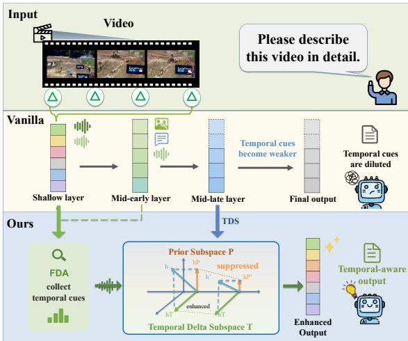
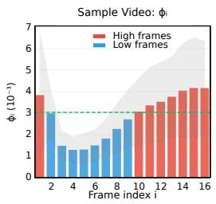
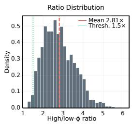
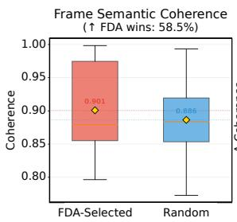
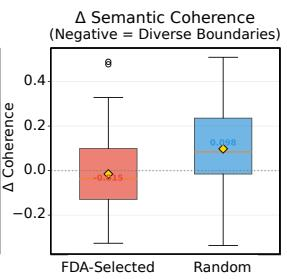
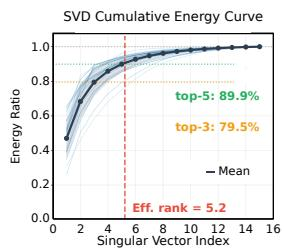
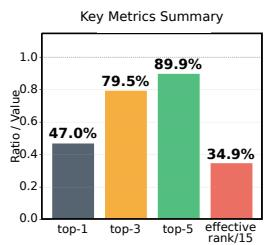
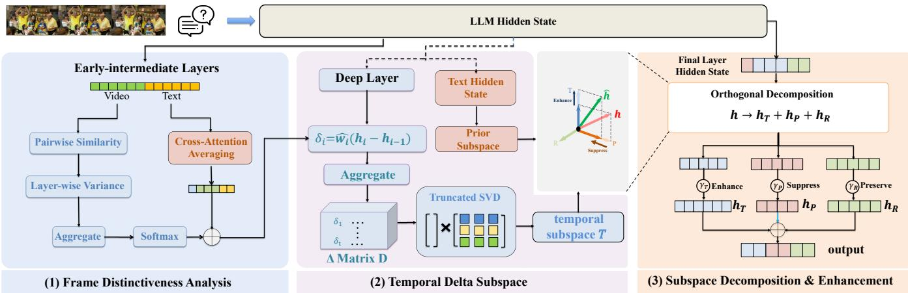
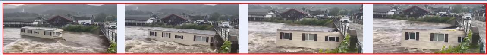
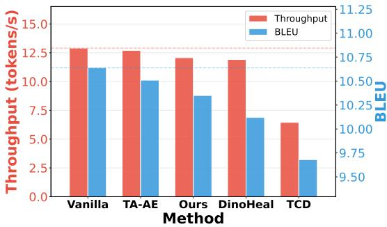

# SPOD: Recovering Suppressed Temporal Evidence in Video-LLMs via Single-Pass Orthogonal Decomposition

Yangguang Lin sunshinelin@bupt.edu.cn Beijing University of Posts and Telecommunications Beijing, China

Xiaoyan Liu xiaoyanliu@bupt.edu.cn Beijing University of Posts and Telecommunications Beijing, China

Quan Fang∗ qfang@bupt.edu.cn Beijing University of Posts and Telecommunications Beijing, China

Zefan Xu xuzefan@bupt.edu.cn Beijing University of Posts and Telecommunications Beijing, China

## Abstract

Video Large Language Models (Video-LLMs) have achieved strong performance on many video understanding tasks, yet remain vul nerable to temporal hallucination in time-sensitive reasoning scenarios such as scene transition understanding and event ordering. Existing solutions either require costly retraining or introduce inefficient multi-pass inference and external supervision at test time. In this work, we show that temporal evidence is already encoded in Video-LLM hidden representations but is not fully exploited during standard inference. Motivated by this observation, we propose Single-Pass Orthogonal Decomposition (SPOD), a training-free framework that recovers suppressed temporal evidence through analytical hidden-state manipulation in a single forward pass. SPOD consists of two components: Frame Distinctiveness Analysis (FDA), which identifies salient frames from middle-layer hidden-state geometry, and Temporal Delta Subspace (TDS), which constructs or thogonal temporal and prior subspaces from weighted inter-frame hidden-state diferences. By decomposing final hidden states into temporal, prior, and residual components and rescaling them independently, SPOD enhances dynamic information, suppresses static appearance bias, and preserves complementary information. Experiments on VidHalluc, EventHallusion, and VideoMMMU show that SPOD consistently outperforms strong inference-time baselines across temporal reasoning tasks and model architectures while retaining near-vanilla inference eficiency. These results suggest that improving temporal reasoning in Video-LLMs may depend not only on additional supervision, but also on recovering temporal evidence already present in their internal representations. Our code is available at https://github.com/VioAgnes/SPOD.

## CCS Concepts

• Computing methodologies → Activity recognition and understanding; Scene understanding; Machine learning approaches.

Video Large Language Models, Temporal Hallucination, Orthogonal Decomposition

ACM Reference Format: Yangguang Lin, Quan Fang, Xiaoyan Liu, and Zefan Xu. 2026. SPOD: Recovering Suppressed Temporal Evidence in Video-LLMs via Single-Pass Orthogonal Decomposition. In Proceedings of the 34th ACM International Conference on Multimedia (MM ’26), November 10–14, 2026, Rio de Janeiro, Brazil. ACM, New York, NY, USA, 10 pages. https://doi.org/10.1145/3767308.3835492

## 1 Introduction

Video Large Language Models (Video-LLMs) have advanced rapidly [4, 21, 25, 26], achieving performance in tasks such as video question answering [12] and complex action recognition [37]. Recent eforts like Video-R1 [11] further explore reinforcement learning to enhance video reasoning [7]. Despite these advances, Video-LLMs still face challenges in temporal reasoning, frequently exhibiting temporal hallucination, where generated content contradicts the temporal logic of videos [22, 38, 44]. This undermines their reliability in time-sensitive applications.

Existing approaches to temporal hallucination mainly follow two directions. Training-based methods [1, 9, 21, 26] improve temporal modeling through retraining, but typically require large-scale data and substantial computational resources. Training-free methods avoid retraining, yet most either rely on contrastive decoding with multiple forward passes [8, 20, 32] or depend on auxiliary calibration data and external vision models for activation manipulation [35, 40]. As a result, existing solutions often sacrifice inference eficiency or deployment simplicity. What remains missing is a practical training-free method that improves temporal reasoning without retraining, auxiliary supervision, or multi-pass decoding.

Rather than assuming that Video-LLMs fail because they lack temporal information [22], we ask whether temporal evidence is encoded in their hidden representations but underutilized during inference. To answer this question, we conduct an analysis of hidden states across temporal reasoning tasks. Our study reveals three findings (see Sec. 3). First, middle-layer hidden states exhibit frame discriminability that correlates with temporal saliency. Frames associated with scene changes or temporal moments produce distinctive geometric relationships with other frames in representation space. Second, frames selected by this discriminative structure capture meaningful and diverse temporal boundaries, rather than redundant visual variation. Third, inter-frame hidden-state diferences lie in a low-dimensional subspace, indicating that temporal dynamics are not scattered in representation space, but are organized in a form amenable to explicit manipulation. Taken together, these observations suggest that the bottleneck is not the absence of temporal information, but such information is systematically suppressed during standard inference.

  
Figure 1: Illustration of temporal hallucination in Video-LLMs and our proposed SPOD.

Motivated by this observation, we propose Single-Pass Orthogonal Decomposition (SPOD), a training-free framework that recovers temporal evidence through analytical hidden-state manipulation in a single forward pass. As illustrated in Figure 1, SPOD includes two components. Frame Distinctiveness Analysis (FDA) identifies temporally informative frames from middle-layer hidden-state geometry. Temporal Delta Subspace (TDS) con structs orthogonal temporal and prior subspaces from inter-frame hidden-state diferences. SPOD then projects final-layer hidden states onto these subspaces and rescales them independently to enhance temporal information while suppressing static bias. This closed-form intervention improves temporal reasoning without retraining, iterative decoding, or external supervision.

Our main contributions are summarized as follows:

• A structured analysis of temporal evidence in Video-LLMs. Through systematic probing, we discover that temporal evidence is often already present in hidden representations but is not fully exploited during standard inference.

• A training-free framework for temporal evidence recovery. We propose SPOD, a single-pass intervention that combines FDA and TDS to analytically recover temporal evidence, requiring no retraining, auxiliary supervision, external vision models, or iterative decoding.

• Extensive validation across benchmarks and architectures. Experiments on VidHalluc, EventHallusion, and VideoM-MMU show that SPOD consistently outperforms strong trainingfree baselines across Video-LLM architectures and model scales, while maintaining near-vanilla inference eficiency.

## 2 Related Work

## 2.1 Video Large Language Models

Video-LLMs provide a unified paradigm for video understanding. Their architecture typically integrates a visual encoder, a projection layer that maps visual features into the language model’s embedding space, and a large language model for text generation [36]. Video-LLaVA pioneered an alignment-before-projection approach, hP’ h’ jointly learning visual and video representations through unified instruction tuning [26]. Subsequent models such as LLaVA-OneVision hU hUand VideoChat-R1 advanced this paradigm through improved archi-2 � 531tectures and training strategies [21, 25]. Recent eforts, including Video-R1, TinyLLaVA-Video-R1, and LongVLM, have explored rein-N Video Framesforcement learning, test-time scaling, and long-video understanding [7, 11, 39, 45]. Eficient video token representations have also been studied to reduce computational overhead [13, 17]. Despite �2 �� �5�3�1these advances, Video-LLMs still struggle with temporal reasoning modeling Temporal Dyncmisdue to the complexity of sequential visual information.

## 2.2 Hallucinations in Video-LLMs

Temporal hallucination is a critical challenge in Video-LLMs [16, 28], where generated content contradicts video logic and undermines reliability. Several benchmarks have been developed for systematic evaluation. VidHalluc assesses QA and ranking tasks [22], EventHallusion evaluates event-level hallucinations [44], and VER-Hallu extends evaluation to causal relations [46]. Argus and Video-MMMU provide complementary evaluations of temporal and multimodal reasoning capabilities [14, 34].

Existing mitigation methods fall into two categories. Trainingbased methods improve temporal modeling through caption supervision, attention refinement, preference optimization, or multimodal orchestration [1, 5, 9, 42], but require additional data and computation. Training-free methods intervene during inference. Contrastive decoding methods construct negatives from perturbed visual inputs to suppress language priors or enhance temporal reasoning [20, 32, 40]. Activation-based methods directly steer hidden states [3]; related image-based work also applies orthogonal subspace editing to mitigate object hallucination [27]. Other video-oriented methods explore visual-token reweighting, temporal grounding, and temporal focusing [10, 31, 33, 47]. In contrast, our work derives temporal subspaces from inter-frame hidden-state diferences to mitigate video temporal hallucination without architectural modifications or contrastive decoding.

## 2.3 Interpretability of Video-LLMs

Recent interpretability studies examine how Video-LLMs process temporal information. Map the Flow shows that temporal reasoning emerges through cross-frame interactions in early-to-middle layers, followed by video-language alignment and response finalization in deeper layers [18]. Complementary studies indicate that temporal information is structured across model depths and that temporal reasoning limitations may arise from the LLM rather than the visual encoder [24, 30, 43]. LLMs may also possess latent temporal and causal reasoning capabilities recoverable from internal representations [19, 41].

These findings motivate architectural and representation-level enhancement strategies. Architectural approaches such as Time Gating and TemporalAware modify model structure to improve temporal modeling [15]. Layer-based methods exploit information across model depths. DoLa contrasts predictions from diferent layers to improve factuality [6], while Inference-Time Intervention steers hidden states to elicit more truthful responses [23]. Although Temporal-Aware Activation Engineering also manipulates internal activations [3], SPOD uses orthogonal subspace decomposition in a single forward pass without ofline calibration or auxiliary datasets.

## 3 Preliminary Analysis

To investigate whether Video-LLMs encode temporal information internally that is underutilized during inference, we conduct three systematic analyses of hidden representations. To ensure that our observations generalize beyond a single model-video combination, we conduct analyses across three Video-LLMs using samples from temporal reasoning benchmarks. Frames are labeled as high- or lowsaliency based on ground-truth scene-change annotations provided by these benchmarks, enabling a controlled comparison of hiddenstate geometry at temporal versus static moments.

  
Figure 2: Frame-level temporal distinctiveness across video samples. Layer-aggregated scores $\phi _ { i }$ separate high- and low saliency frames, with a mean high-to-low ratio of 2.81×.

Observation 1: Middle-layer hidden states encode inherent frame discriminability. Our first analysis examines whether middle-layer hidden states encode frame-level discriminability. We measure frame distinctiveness $\phi _ { i }$ as the layer-wise variance of pair wise cosine similarities between a frame and all others in the video (detailed in Sec. 4.2). As illustrated in Figure 2, the frame-wise similarity variance reveals a sharp distinction between static and dynamic content: the ratio exceeds a 1.5× threshold in 98.7% of cases, with a mean ratio of approximately 2.8×, and the signal peaks near layer 10. These findings suggest that middle-layer hid den states are sensitive to frame-level distinctiveness in ways that correlate with temporal saliency, providing empirical grounding for investigating temporal evidence recovery in subsequent layers.

Observation 2: Frames identified by discriminability analysis capture diverse temporal boundaries. Having established that discriminative signals exist, we next examine whether these signals capture semantically meaningful temporal boundaries. To assess the quality of these signals, we compare frames selected by FDA against uniformly random frames, as shown in Fig. 3. FDA-selected frames achieve superior semantic consistency while simultaneously exhibiting more diverse temporal boundaries: the mean frame semantic coherence is 0.901 versus 0.886 for random sampling, with

  
Figure 3: Comparison of frame semantic coherence and temporal-boundary diversity between FDA-selected and uniformly sampled random frames.

FDA winning in 58.5% of samples. The frequent occurrence of negative Δ consistency variations (mean −0.015 versus 0.098) indicates lower directional redundancy among the captured changes, suggesting that the selected frames represent distinct events rather than redundant information. Our findings confirm that the model has the ability to distinguish semantically rich temporal boundaries through its latent representations.

  
Figure 4: Cumulative singular-value energy and efectiverank statistics of FDA-weighted temporal-diference matrices used for temporal subspace construction.

Observation 3: The temporal diference subspace is compact and structurally organized. Finally, we investigate whether inter-frame diferences form a structured subspace suitable for manipulation. We perform singular value decomposition on interframe diference vectors to characterize the geometry of the temporal subspace. As shown in Fig. 4, the top three singular vectors account for 79.5% of the cumulative energy, while the first five account for approximately $9 0 \% ,$ with an efective rank of 5.2. These results suggest that temporal variations are concentrated in a lowdimensional subspace. Moreover, the low directional consistency between diferent diference vectors suggests that distinct temporal events are encoded along diverse, weakly aligned directions in hidden space. These results support modeling temporal evidence as a compact and manipulable subspace.

These empirical findings motivate our proposed approach. Building on the observation that temporal evidence already exists within hidden representations yet remains suppressed during standard inference, we develop a method that explicitly extracts and enhances these signals through orthogonal subspace decomposition, thereby enabling more efective temporal evidence recovery without requiring additional training or external signals.

  
Figure 5: SPOD pipeline. (1) FDA identifies salient frames from middle-layer hidden-state geometry. (2) TDS constructs temporal and prior subspaces from weighted inter-frame diferences and text hidden states. (3) Final hidden states are decomposed into temporal, prior, and residual components and rescaled to recover temporal evidence in a single forward pass.

## 4 Methodology

## 4.1 Overview of SPOD

As illustrated in Fig. 5, SPOD recovers suppressed temporal evidence in a single inference pass. FDA identifies temporally salient frames, while TDS constructs temporal and prior subspaces from weighted inter-frame diferences and text hidden states. Component-wise rescaling then enhances temporal evidence while adaptively adjusting prior and preserving residual components.

## 4.2 Frame Distinctiveness Analysis

FDA aims to identify temporally salient frames by exploiting an inherent property of Video-LLMs: in middle layers, frames carrying significant temporal information produce hidden states that are structurally distinct from those of neighboring frames. Unlike prior approaches that rely on external cues such as pixel diferences, saliency maps from frozen vision models, or dual-rate processing, FDA extracts the discriminative signal directly from the LLM’s internal representations, following the spirit of DoLa and ITI.

Let $\mathbf { H } _ { i } ^ { ( l ) } \in \mathbb { R } ^ { d }$ denote the mean hidden state of frame � at layer �, and let $\dot { \mathcal { L } } = \{ l _ { 1 } , \dots , l _ { m } \}$ denote the FDA layer range.

Pairwise Similarity Computation. For each frame � and layer $l \in { \mathcal { L } } ,$ , we normalize hidden states to unit norm and compute the full pairwise cosine similarity matrix:

$$
\tilde { \mathbf { H } } _ { i } ^ { ( l ) } = \frac { \mathbf { H } _ { i } ^ { ( l ) } } { \lVert \mathbf { H } _ { i } ^ { ( l ) } \rVert } , ~ \mathbf { S } ^ { ( l ) } = \tilde { \mathbf { H } } ^ { ( l ) } \tilde { \mathbf { H } } ^ { ( l ) \top }\tag{1}
$$

where $\mathbf { S } ^ { ( l ) } \in \mathbb { R } ^ { T \times T }$ with entries $s _ { i j } ^ { ( l ) } = \tilde { \mathbf { H } } _ { i } ^ { ( l ) \top } \tilde { \mathbf { H } } _ { j } ^ { ( l ) }$ and $s _ { i i } ^ { ( l ) } = 1$

Layer-wise Variance. The variance of similarities in row � of $\mathsf { S } ^ { ( l ) }$ quantifies how unevenly frame � relates to others:

$$
\phi _ { i } ^ { ( l ) } = \mathrm { V a r } _ { j } \big ( s _ { i j } ^ { ( l ) } \big ) = \frac { 1 } { T } \sum _ { j = 1 } ^ { T } \Big ( s _ { i j } ^ { ( l ) } - \bar { s } _ { i } ^ { ( l ) } \Big ) ^ { 2 }\tag{2}
$$

where $\begin{array} { r } { \bar { s } _ { i } ^ { ( l ) } = \frac { 1 } { T } \sum _ { j = 1 } ^ { T } s _ { i j } ^ { ( l ) } } \end{array}$ is the sample mean similarity and � is the total number of frames. Here we adopt the maximum likelihood estimator for variance, which is consistent with the mean estimation above. High variance indicates that frame � is strongly similar to some frames and strongly dissimilar to others, characteristic of frames marking scene transitions or salient temporal moments.

Layer Aggregation and Smoothing. We aggregate across $\mathcal { L }$ and apply a smoothing window of size 3:

$$
\varphi _ { i } = \mathrm { S m o o t h } _ { 3 } \Bigg ( \frac { 1 } { | \mathscr { L } | } \sum _ { l \in \mathscr { L } } \phi _ { i } ^ { ( l ) } \Bigg )\tag{3}
$$

where $\varphi _ { i }$ is the smoothed, layer-averaged distinctiveness score for frame �.

Softmax Normalization. Scores are normalized to obtain frame weights:

$$
w _ { i } = \frac { \exp ( \varphi _ { i } ) } { \sum _ { j = 1 } ^ { T } \exp ( \varphi _ { j } ) }\tag{4}
$$

where $w _ { i }$ reflects the model’s hidden-state-level assessment of temporal evidence.

Attention-Level Refinement. To further align FDA with the LLM’s cross-modal reasoning pathway, we refine the weights using cross-attention from text tokens to video tokens. We average crossattention weights across heads and question tokens at each layer, then aggregate across L to obtain a per-frame textual relevance score $a _ { i } .$ The final frame weight is a convex combination:

$$
\hat { w } _ { i } = \alpha \cdot w _ { i } + \left( 1 - \alpha \right) \cdot a _ { i }\tag{5}
$$

where � ∈ [0, 1] balances hidden-state distinctiveness and textual relevance. These refined weights $\hat { w } _ { i }$ guide the construction of the Temporal Delta Subspace.

## 4.3 Temporal Delta Subspace

TDS constructs an orthogonal subspace that explicitly captures temporal dynamics, complementing FDA’s frame identification. A key limitation of existing subspace-based approaches is that they apply PCA or SVD directly to video token sets, treating frames as unordered points in representation space and ignoring temporal order.

In contrast, TDS builds the subspace from inter-frame hidden state diferences, which naturally encode temporal change. We extract these representations from a deep layer $l ^ { * }$ near the Stage 2/3 transition boundary.

Temporal Delta Construction. We extract hidden states at layer �∗ and compute weighted inter-frame diferences:

$$
\delta _ { i } = \hat { w } _ { i } \cdot \left( \mathbf { H } _ { i } ^ { ( l ^ { * } ) } - \mathbf { H } _ { i - 1 } ^ { ( l ^ { * } ) } \right) , \quad \forall i \in \{ 2 , . . . , T \}\tag{6}
$$

where $\delta _ { i }$ encodes the direction and magnitude of representational change from frame $i - 1$ to frame $i ,$ weighted by its temporal signif icance from FDA.

Truncated SVD for Temporal Subspace. We stack these dif ferences into a matrix $\Delta \in \mathbb { R } ^ { ( \overbar { T } - 1 ) \times d }$ and apply truncated SVD:

$$
\Delta = \mathbf { U } \Sigma \mathbf { V } ^ { \top }\tag{7}
$$

where $\mathbf { U } \in \mathbb { R } ^ { ( T - 1 ) \times ( T - 1 ) }$ is a square orthogonal matrix, $\Sigma \in \mathbb { R } ^ { ( T - 1 ) \times d }$ is a rectangular matrix containing the singular values $\sigma _ { 1 } \geq \sigma _ { 2 }$ ≥ $\cdots \geq \sigma _ { T - 1 } \geq 0$ on its first $( T - 1 )$ diagonal entries (with remaining entries being zero), and $\mathbf { V } \in \mathbb { R } ^ { d \times d }$ is an orthogonal matrix of right singular vectors. We then take $\mathbf { V } _ { r } = \mathbf { V } ^ { ( 1 : r ) } \in \bar { \mathbb { R } } ^ { d \times r }$ , the top-� right singular vectors forming an orthonormal basis for the temporal subspace T. By building from inter-frame diferences rather than absolute token positions, this subspace directly encodes the directions of temporal change; frames near scene transitions produce large magnitudes in these diference vectors, and their directions dominate the top singular vectors.

Prior Subspace Construction. To construct the prior subspace $\mathcal { P } _ { : }$ we project text token hidden states onto the orthogonal complement of $\mathcal { T }$ . Let $\mathbf { T } \in \mathbb { R } ^ { n _ { t } \times d }$ denote the matrix of $n _ { t }$ text token hidden states at layer �∗. We compute:

$$
\mathbf { T } _ { \perp } = \mathbf { T } \left( \mathbf { I } _ { d } - \mathbf { V } _ { r } \mathbf { V } _ { r } ^ { \top } \right) \in \mathbb { R } ^ { n _ { t } \times d }\tag{8}
$$

which removes the temporally aligned component from each text token. We then perform SVD:

$$
\mathbf { T } _ { \perp } = \mathbf { U } ^ { \prime } \Sigma ^ { \prime } \mathbf { V } ^ { \prime \top } \quad \implies \quad \mathbf { P } _ { q } = \mathbf { V } ^ { \prime ( 1 : q ) } \in \mathbb { R } ^ { d \times q }\tag{9}
$$

where $\mathbf { P } _ { q } = \mathbf { V } ^ { \prime ( 1 : q ) }$ consists of the first $q$ columns of $\mathbf { V } ^ { \prime } { } _ { ; }$ , forming the orthonormal basis for the prior subspace $\mathcal { P } .$ . By construction, ${ \bf V } _ { r } ^ { \top } { \bf P } _ { q } = { \bf 0 } ,$ , confirming $\mathcal { P } \perp \mathcal { T }$

Semantic Interpretation. The temporal subspace $\mathcal { T } = \operatorname { s p a n } ( \mathbf { V } _ { r } )$ encodes temporal dynamics: directions of change between consecutive frames, including scene transitions, motion patterns, and event ordering. The prior subspace $\mathcal { P }$ mainly captures static, nontemporal visual-semantic content, such as object identity, spatial layout, and scene context. The residual subspace spans directions orthogonal to both T and $\mathcal { P }$

For temporal reasoning tasks, the answer is fundamentally deter mined by what changes rather than what remains static. Empirically, scaling down the static component while scaling up the dynamic component improves accuracy. We do not claim $\mathcal { P }$ exclusively captures task-irrelevant content; static appearance can be essential for non-temporal questions.

## 4.4 Subspace Decomposition and Enhancement

With the temporal subspace T and prior subspace P established, we describe the decomposition and enhancement mechanism for recovering suppressed temporal evidence in a single forward pass.

Decomposition. Given a hidden state $\mathbf { h } \in \mathbb { R } ^ { d }$ at the final layer, we decompose it via orthogonal projections onto the three mutually orthogonal subspaces:

$$
\mathbf { h } _ { \mathcal { T } } = \mathbf { V } _ { r } \mathbf { V } _ { r } ^ { \top } \mathbf { h }\tag{10}
$$

$$
\mathbf { h } _ { \mathcal { P } } = \mathbf { P } _ { q } \mathbf { P } _ { q } ^ { \top } \mathbf { h }\tag{11}
$$

$$
\mathbf { h } _ { \mathcal { R } } = \left( \mathbf { I } _ { d } - \mathbf { V } _ { r } \mathbf { V } _ { r } ^ { \top } - \mathbf { P } _ { q } \mathbf { P } _ { q } ^ { \top } \right) \mathbf { h }\tag{12}
$$

where $\mathbf { h } \tau ,$ , hP, and hR are the temporal, prior, and residual components, respectively.

Enhancement. For enhanced temporal reasoning, we scale each component independently:

$$
\hat { \mathbf { h } } = \gamma \mathcal { T } \cdot \mathbf { h } _ { \mathcal { T } } + \gamma \varphi \cdot \mathbf { h } _ { \mathcal { P } } + \gamma _ { \mathcal { R } } \cdot \mathbf { h } _ { \mathcal { R } }\tag{13}
$$

where $\gamma \mathcal { T } \geq 1$ enhances temporal evidence, $\gamma \mathcal { P } \in ( 0 , 1 )$ suppresses prior components, and $\gamma _ { \mathcal R } = 1$ preserves the residual unchanged. Since the bases are orthonormal and mutually orthogonal, the components can be manipulated independently without cross-interference. This enables temporal evidence recovery in a single forward pass, without iterative optimization or parameter updates.

## 4.5 Complexity Analysis

For a video with � frames and hidden dimension $d ,$ FDA computes pairwise cosine similarities across the selected layers $\mathcal { L } ,$ yielding a complexity of $O ( T ^ { 2 } d | { \mathcal { L } } | )$ ), where the normalization cost $O ( T d | \mathcal { L } | )$ is dominated. For TDS, the temporal-diference matrix $\Delta \in \mathbb { R } ^ { ( T - 1 ) \times d }$ satisfies $T - 1 < d ,$ as typically � ≫ � in Video-LLMs. Applying thin SVD to Δ costs $O ( ( T - 1 ) ^ { 2 } d ) = O ( T ^ { 2 } d )$ . In the final decomposition step, projecting each generated hidden state onto the temporal and prior subspaces using low-rank bases $\mathbf { V } _ { r } \in \mathbb { R } ^ { d \times r }$ and $\mathbf { P } _ { q } \in \mathbb { R } ^ { d \times q }$ costs $O ( d r + d q )$ per step, while rescaling is negligible. Therefore, the extra overhead is dominated by FDA similarity computation and SVD, and SPOD remains lightweight compared with a full model forward pass while requiring no iterative optimization.

## 5 Experiments

## 5.1 Experimental Settings

Dataset. We evaluate SPOD on three main benchmarks: VidHalluc [22], EventHallusion [44], and VideoMMMU [14]. VidHalluc quantifies temporal hallucinations across four task categories including binary question answering, multiple-choice questions, scenetime hallucination, and temporal scene ranking. EventHallusion assesses event-level hallucinations through Entire, Mix, and Misleading subtasks. VideoMMMU provides a comprehensive evaluation spanning Perception, Comprehension, and Adaptation tasks. Our experiments on VidHalluc follow the oficial validation set protocol while EventHallusion results are reported on the full benchmark as distributed.

Models. We evaluate three 7B Video-LLMs: Qwen2.5-VL-7B [2], VideoLLaMA2-7B [4] and Video-LLaVA-7B [26]. These cover diverse architectures, including dual-encoder and unified encoding strategies with varying backbones. All experiments uniformly sample 16 frames per video without any fine-tuning. To further validate the scalability of SPOD, we additionally conduct experiments on Qwen2.5-VL-72B, a state-of-the-art large-scale Video-LLM that represents a significant leap in model capacity.

Baselines. We compare against a vanilla model (no intervention) and five representative inference-time baselines. These baselines are categorized into three groups based on their mechanisms. The first group comprises contrastive decoding methods: TCD [44] contrasts predictions from clean inputs against frame-dropped counterparts to identify spurious visual priors. The second group includes external-model-assisted methods: CGD [20] and VTI [29] refine generation by leveraging external frozen vision models, where CGD employs contrastive logits and VTI performs temporal hidden-state steering through auxiliary vision guidance. The third group consists of auxiliary-training methods: DINO-HEAL [22] reweights video tokens through DINOv2 saliency maps [31] using a separately trained saliency module, while TA-AE [3] reconstructs video features through temporal autoencoding with a dedicated auxiliary autoencoder. During evaluation, all baselines are applied without updating the underlying Video-LLM parameters.

Implementation details. For Frame Distinctiveness Analysis, we compute distinctiveness scores using hidden states from layers 8 to 16, refined via cross-attention weights from text to video tokens with fusion weight � = 0.5. For Temporal Delta Subspace, we extract inter-frame diferences from layer 22 and perform truncated SVD to obtain an orthogonal basis. The temporal subspace rank � is set to 4, prior subspace rank � to 4, and scaling factors are configured as �T = 1.2, �P = 0.5, �R = 1.0. All experiments follow oficial evaluation protocols using deterministic generation with Temperature = 0 and Top-� = 1, and all baselines are reproduced according to their original papers. All experiments are conducted on NVIDIA A100 GPUs with 40GB memory. For VideoLLaMA2-7B and Video-LLaVA-7B, the FDA layer range and TDS extraction layer are adjusted proportionally to their total depth to preserve the same relative positions within their Stage 2 region.

## 5.2 Main Results on Hallucination Benchmarks

VidHalluc Results. We evaluate SPOD on VidHalluc, a benchmark specifically designed to assess temporal hallucination. As shown in Table 1, SPOD delivers consistent and substantial improvements across all three backbone models, with an average overall gain of 10.07 points over the vanilla models. On VideoLLaMA2, SPOD improves the overall score from 68.46 to 76.56, with the largest gains in scene time hallucination, from 56.55 to 69.80, and temporal scene hallucination, from 58.17 to 70.67. On Qwen2.5-VL, SPOD achieves an overall gain of 9.3 points and improves every metric, most notably temporal scene hallucination from 59.17 to 68.22. Similar improvements are observed on Video-LLaVA, where the overall score increases from 50.75 to 63.56 and the temporal scene hallucination score rises substantially from 46.83 to 66.50. These results demonstrate that SPOD efectively mitigates temporal hallucination by recovering suppressed temporal evidence through orthogonal subspace decomposition, with particularly clear benefits for challenging scene level temporal relations.

Large-Scale Generalization. To validate the scalability ofSPOD, we extend our experiments to Qwen2.5-VL-72B, a state-of-the-art large-scale Video-LLM. As shown in Table 2, our method maintains consistent improvements across all metrics. Notably, larger models already possess stronger temporal understanding capabil ities and reduced hallucination rates, so the absolute gains are naturally smaller than on 7B models. The consistent relative gains nonetheless confirm that SPOD generalizes to larger architectures and efectively recovers temporal evidence at greater model scales.

Table 1: Results on VidHalluc benchmark. Bold indicates the best result per metric within each model group.
<table><tr><td>Model</td><td>BQA</td><td>MCQ</td><td>STH</td><td>TSH</td><td>Overall</td></tr><tr><td colspan="6">VideoLLaMA2</td></tr><tr><td>Vanilla</td><td>75.77</td><td>83.35</td><td>56.55</td><td>58.17</td><td>68.46</td></tr><tr><td>TCD</td><td>76.77</td><td>83.65</td><td>55.19</td><td>56.67</td><td>68.07</td></tr><tr><td>DINO-HEAL</td><td>75.79</td><td>83.35</td><td>56.32</td><td>57.67</td><td>68.28</td></tr><tr><td>TA-AE</td><td>79.09</td><td>84.07</td><td>65.14</td><td>61.67</td><td>72.49</td></tr><tr><td>CGD</td><td>76.03</td><td>82.76</td><td>59.14</td><td>59.02</td><td>69.24</td></tr><tr><td>VTI</td><td>78.14</td><td>83.67</td><td>62.47</td><td>60.28</td><td>71.14</td></tr><tr><td>Ours</td><td>81.48</td><td>84.28</td><td>69.80</td><td>70.67</td><td>76.56</td></tr><tr><td colspan="6">Qwen2.5-VL</td></tr><tr><td>Vanilla</td><td>73.50</td><td>63.66</td><td>60.55</td><td>59.17</td><td>64.22</td></tr><tr><td>TCD</td><td>75.49</td><td>74.35</td><td>46.81</td><td>65.83</td><td>65.62</td></tr><tr><td>DINO-HEAL</td><td>69.77</td><td>65.69</td><td>60.97</td><td>59.83</td><td>64.07</td></tr><tr><td>TA-AE</td><td>76.18</td><td>74.95</td><td>61.81</td><td>61.33</td><td>68.57</td></tr><tr><td>CGD</td><td>74.23</td><td>65.18</td><td>60.97</td><td>59.86</td><td>65.06</td></tr><tr><td>VTI</td><td>75.49</td><td>69.82</td><td>61.74</td><td>60.97</td><td>67.01</td></tr><tr><td>Ours</td><td>82.16</td><td>76.28</td><td>67.40</td><td>68.22</td><td>73.52</td></tr><tr><td colspan="6">Video-LLaVA</td></tr><tr><td>Vanilla</td><td>67.75</td><td>66.60</td><td>21.80</td><td>46.83</td><td>50.75</td></tr><tr><td>TCD</td><td>70.40</td><td>65.97</td><td>21.77</td><td>42.33</td><td>50.12</td></tr><tr><td>DINO-HEAL</td><td>70.82</td><td>67.19</td><td>26.47</td><td>47.50</td><td>53.00</td></tr><tr><td>TA-AE</td><td>67.70</td><td>66.84</td><td>41.16</td><td>49.50</td><td>56.30</td></tr><tr><td>CGD</td><td>67.42</td><td>65.79</td><td>29.17</td><td>47.29</td><td>52.42</td></tr><tr><td>VTI</td><td>68.23</td><td>66.14</td><td>33.24</td><td>48.96</td><td>54.14</td></tr><tr><td>Ours</td><td>71.30</td><td>68.06</td><td>48.36</td><td>66.50</td><td>63.56</td></tr></table>

Table 2: Results on Qwen2.5-VL-72B.
<table><tr><td>Variant</td><td>BQA</td><td>MCQ</td><td>STH</td><td>TSH</td></tr><tr><td>Vanilla</td><td>81.47</td><td>81.24</td><td>67.60</td><td>84.00</td></tr><tr><td>Ours</td><td>84.73</td><td>88.45</td><td>68.64</td><td>85.67</td></tr></table>

EventHallusion Results. On EventHallusion, which evaluates event level reasoning through Entire, Mix, and Misleading subtasks, SPOD achieves the best overall score across all three backbone models. As shown in Table 3, our method demonstrates particularly strong performance on the Misleading subtask, with VideoLLaMA2 improving from 46.08 to 86.27. On Video-LLaVA, SPOD increases the Misleading score from 41.18 to 91.00, demonstrating robust reasoning under misleading temporal content. After including the inference time baselines CGD and VTI, SPOD remains the strongest overall method across all evaluated backbones. Although individual baselines may perform better on particular subtasks, the consistent overall gains indicate that SPOD improves event level temporal reasoning without sacrificing performance across diferent question types. These results confirm that recovered temporal evidence generalizes from frame-level hallucination to event-level reasoning.

Table 3: Results on EventHallusion benchmark.
<table><tr><td>Model</td><td>Entire</td><td>Mix</td><td>Misleading</td><td>Overall</td></tr><tr><td colspan="5">VideoLLaMA2</td></tr><tr><td>Vanilla</td><td>38.60</td><td>62.18</td><td>46.08</td><td>48.95</td></tr><tr><td>TCD</td><td>42.98</td><td>75.65</td><td>54.90</td><td>57.84</td></tr><tr><td>DINO-HEAL</td><td>38.60</td><td>62.69</td><td>46.08</td><td>48.96</td></tr><tr><td>TA-AE</td><td>43.86</td><td>70.47</td><td>57.70</td><td>57.34</td></tr><tr><td>CGD</td><td>42.11</td><td>63.21</td><td>47.06</td><td>50.79</td></tr><tr><td>VTI</td><td>38.60</td><td>67.36</td><td>46.08</td><td>50.68</td></tr><tr><td>Ours</td><td>46.49</td><td>71.00</td><td>86.27</td><td>67.92</td></tr><tr><td colspan="5">Qwen2.5-VL</td></tr><tr><td>Vanilla</td><td>71.93</td><td>39.38</td><td>98.04</td><td>69.78</td></tr><tr><td>TCD</td><td>69.30</td><td>43.01</td><td>97.06</td><td>69.79</td></tr><tr><td>DINO-HEAL</td><td>80.70</td><td>35.75</td><td>95.10</td><td>70.52</td></tr><tr><td>TA-AE</td><td>89.47</td><td>41.50</td><td>100.00</td><td>76.99</td></tr><tr><td>CGD</td><td>71.93</td><td>32.12</td><td>99.02</td><td>67.69</td></tr><tr><td>VTI</td><td>99.12</td><td>27.98</td><td>100.00</td><td>75.70</td></tr><tr><td>Ours</td><td>89.80</td><td>43.50</td><td>100.00</td><td>77.77</td></tr><tr><td colspan="5">Video-LLaVA</td></tr><tr><td>Vanilla</td><td>41.23</td><td>57.71</td><td>41.18</td><td>46.70</td></tr><tr><td>TCD</td><td>46.49</td><td>54.92</td><td>74.50</td><td>58.64</td></tr><tr><td>DINO-HEAL</td><td>39.47</td><td>48.71</td><td>79.41</td><td>55.86</td></tr><tr><td>TA-AE</td><td>79.83</td><td>55.96</td><td>90.20</td><td>75.33</td></tr><tr><td>CGD</td><td>40.40</td><td>47.70</td><td>66.70</td><td>51.60</td></tr><tr><td>VTI</td><td>56.14</td><td>65.80</td><td>58.82</td><td>60.25</td></tr><tr><td>Ours</td><td>81.60</td><td>63.20</td><td>91.00</td><td>78.60</td></tr><tr><td></td><td></td><td></td><td></td><td></td></tr></table>

## 5.3 VideoMMMU Results

We further evaluate SPOD on VideoMMMU, a comprehensive benchmark designed to assess general video understanding capabilities across perception, comprehension, and adaptation tasks. Unlike the hallucination-focused benchmarks, VideoMMMU tests whether enhanced temporal reasoning translates to broader video comprehension abilities. As shown in Table 4, after adding TCD and TA-AE as inference-time baselines, SPOD achieves the best overall score across all three backbone models. On Qwen2.5-VL, the overall score improves from 47.44 for vanilla and 49.00 for TA-AE to 54.33. Similar overall gains are observed on VideoLLaMA2 and Video-LLaVA. Although some baselines perform better on individual subcategories, SPOD provides the most consistent overall improvement, suggesting broad applicability to real-world video comprehension tasks where temporal reasoning is essential.

## 5.4 Ablation Study

To evaluate the efectiveness of each component, we conduct ablation studies on VidHalluc using Qwen2.5-VL-7B. Table 5 reports the main results on frame selection, subspace construction, and factor sensitivity. Additional analyses of fusion weights, subspace ranks, layer choices, and decomposition designs are provided in the supplementary material.

Frame Distinctiveness Analysis. The distinctiveness score $\phi _ { t }$ measures how diferently a frame relates to others in middle layers. High-scoring frames mark scene transitions or salient temporal moments. As shown in Table 5, FDA alone improves STH and TSH by 2.35 and 2.33 points over the vanilla model, confirming that internal discriminative signals encode underutilized temporal information. Cross-attention refinement yields gains of 0.60 and 0.40 points, validating the benefit of aligning FDA weights with the LLM’s cross-modal reasoning pathway. FDA also outperforms random frame selection by 2.00 points on STH and 1.60 points on TSH, confirming that hidden-state geometry captures temporally informative boundaries more efectively than uniform sampling.

Table 4: Results on VideoMMMU benchmark.
<table><tr><td>Model</td><td>Perc.</td><td>Comp.</td><td>Adapt.</td><td>Overall</td></tr><tr><td colspan="5">VideoLLaMA2</td></tr><tr><td>Vanilla</td><td>60.34</td><td>46.00</td><td>27.67</td><td>44.67</td></tr><tr><td>TCD</td><td>60.00</td><td>43.00</td><td>36.33 35.00</td><td>46.44</td></tr><tr><td>TA-AE</td><td>61.67</td><td>43.00</td><td></td><td>46.56</td></tr><tr><td>Ours</td><td>68.67</td><td>48.34</td><td>28.67</td><td>48.56</td></tr><tr><td colspan="5">Qwen2.5-VL</td></tr><tr><td>Vanilla TCD</td><td>58.33 62.00</td><td>44.33 45.00</td><td>39.67 29.00</td><td>47.44 45.33</td></tr><tr><td>TA-AE</td><td>64.00</td><td>51.00</td><td>32.00</td><td>49.00</td></tr><tr><td>Ours</td><td>68.33</td><td>50.33</td><td>44.33</td><td>54.33</td></tr><tr><td colspan="5">Video-LLaVA</td></tr><tr><td>Vanilla</td><td>41.67</td><td>33.33</td><td>33.33</td><td>36.11</td></tr><tr><td>TCD</td><td>44.00</td><td>32.67</td><td>35.00</td><td>37.22</td></tr><tr><td>TA-AE</td><td>37.67</td><td>30.00</td><td>33.00</td><td>33.56</td></tr><tr><td></td><td></td><td></td><td></td><td></td></tr><tr><td>Ours</td><td>46.33</td><td>34.67</td><td>34.78</td><td>38.59</td></tr></table>

Table 5: Ablation study and sensitivity analysis.
<table><tr><td>Category</td><td>Variant</td><td>STH</td><td>TSH</td></tr><tr><td colspan="2">Vanilla</td><td>60.55</td><td>59.17</td></tr><tr><td rowspan="3">FDA Ablation</td><td>FDA only</td><td>62.90</td><td>61.50</td></tr><tr><td>FDA + Attn</td><td>63.50</td><td>61.90</td></tr><tr><td>Random frames</td><td>61.50</td><td>60.30</td></tr><tr><td rowspan="2">TDS Ablation</td><td>w/o FDA weights</td><td>62.50</td><td>61.10</td></tr><tr><td>TDS + FDA weights</td><td>63.80</td><td>62.20</td></tr><tr><td rowspan="5">Sensitivity (γτ, γP)</td><td>(1.0, 1.0)</td><td>60.55</td><td>59.17</td></tr><tr><td>(1.2, 1.0)</td><td>63.30</td><td>61.70</td></tr><tr><td>(1.0, 0.5)</td><td>61.50</td><td>59.80</td></tr><tr><td>(1.2, 0.5)</td><td>67.40</td><td>68.22</td></tr><tr><td>(1.5, 0.5)</td><td>66.90</td><td>67.50</td></tr></table>

Temporal Delta Subspace. Constructing the subspace from inter-frame diferences is critical. As shown in Table 5, removing FDA weights reduces STH and TSH by 1.30 and 1.10 points relative to TDS with FDA weights. The consistent degradation across both metrics indicates that salient-frame weighting improves temporal subspace construction rather than favoring a single hallucination type. This suggests that temporally salient frames provide more informative and discriminative diference vectors, validating the benefit of frame-level saliency in TDS.

Q: Please describe this video in detail.  
  
Qwen2.5-VL(Vanilla): The video shows a house being carried away by a flood. The house is floating in the water, and it appears to be moving downstream. The surrounding area is flooded, and there are people standing on a bridge watching the house as it floats away. Qwen2.5-VL(Ours): The video shows a house being carried away by a strong current of water. The house is floating in the water, and it appears to be moving quickly downstream. The current is so strong that the house is being pushed against a bridge. There are people standing on the bridge, watching the house as it passes by.

Figure 6: Qualitative example on EventHallusion with Qwen2.5-VL-7B, where bold green text denotes correct descriptions with accurate temporal details, and bold red text denotes hallucinated descriptions.  
  
Figure 7: Joint comparison of inference throughput and BLEU scores across diferent methods.

Scaling Factor Sensitivity. The enhancement mechanism independently rescales the temporal (T) and prior (P) components. As shown in Table 5, enhancing temporal evidence or suppressing prior information alone improves performance, while combining both yields the strongest results. The setting (1.2, 0.5) achieves 67.40 STH and 68.22 TSH, indicating that the two operations address complementary temporal errors. Additional sensitivity results show that performance degrades smoothly around this setting.

## 5.5 Eficiency and Linguistic Quality

Inference eficiency. We evaluate inference throughput across all methods and diverse backbone models. As shown in Figure 7, TCD sufers a severe throughput reduction, reaching only 6.45 tokens/s compared to 12.90 for Vanilla, which is expected given its multiple forward passes. SPOD achieves 12.07 tokens/s, surpassing both DINO-HEAL at 11.91 tokens/s and TCD, while remaining close to Vanilla. These results confirm that our method incurs only marginal overhead relative to an additional full forward pass.

Linguistic quality. We further assess answer consistency using BLEU. Results in Figure 7 reveal that TCD incurs the largest degradation, dropping to 9.68 BLEU from Vanilla’s 10.64, a decrease of 0.96 points. DINO-HEAL also declines to 10.12 (a 0.52-point loss). Conversely, SPOD achieves a relatively high BLEU score of 10.35 among all methods, with only a 0.29-point gap from Vanilla. These findings suggest that the contrasting process in TCD introduces unwanted noise into surface-level language generation, whereas orthogonal subspace rescaling in SPOD preserves lexical consistency.

## 5.6 Case Study

To illustrate how SPOD improves temporal reasoning, we examine qualitative examples from EventHallusion. Fig. 6 shows a clip in which a mobile home drifts along a swollen river and is pinned against a bridge while onlookers watch, requiring fine-grained temporal grounding rather than reliance on a static flooding prior. Under the same prompt, the vanilla model produces a template-like flood description and misses the collision moment and preceding trajectory. With SPOD, FDA up-weights frames with pronounced hidden-state changes, while TDS amplifies temporal delta directions so that generation follows inter-frame evidence rather than coarse scene semantics. This behavior aligns with the event-grounding objective of EventHallusion. Similar patterns appear in VidHalluc transition clips, where vanilla models fixate on the opening scene, whereas FDA highlights boundary frames and TDS captures representational shifts. These examples demonstrate that SPOD shifts reliance from static visual-language priors toward temporal structure encoded in hidden-state dynamics, providing a pathway for grounding video understanding in temporal evidence.

## 6 Conclusion

In this paper, we present SPOD as a training-free approach for temporal hallucination mitigation in Video-LLMs. Our insight is that Video-LLMs encode temporal evidence in hidden representations but fail to exploit it during inference. Through systematic analysis, we find that important frames exhibit higher hidden-state variance and inter-frame diferences form a low-dimensional subspace. Motivated by these findings, SPOD introduces FDA and TDS to recover suppressed temporal evidence in a single forward pass. Extensive experiments on VidHalluc and other benchmarks show that SPOD consistently outperforms existing methods across model scales while maintaining inference eficiency. This work provides a mechanistic perspective for internal representation engineering.

## Acknowledgments

This work was supported by the Beijing Natural Science Foundation (JQ24019), the National Natural Science Foundation of China (No. 62576047), the CIPS-SMP-Zhipu Large Model Fund (No. CIPS-SMP20250313), and the Open Fund of the Key Laboratory for Civil Aviation Collaborative Air Trafic Management Technology and Applications (No. 2025-001).

## References

[1] Kyungho Bae, Jinhyung Kim, Sihaeng Lee, Soonyoung Lee, Gunhee Lee, and Jinwoo Choi. 2025. MASH-VLM: Mitigating Action-Scene Hallucination in Video LLMs through Disentangled Spatial-Temporal Representations. In IEEE/CVF Conference on Computer Vision and Pattern Recognition, CVPR 2025, Nashville, TN, USA, June 11-15, 2025. Computer Vision Foundation / IEEE, 13744–13753. doi:10.1109/CVPR52734.2025.01283

[2] Shuai Bai, Keqin Chen, Xuejing Liu, Jialin Wang, Wenbin Ge, Sibo Song, Kai Dang, Peng Wang, Shijie Wang, Jun Tang, Humen Zhong, Yuanzhi Zhu, Ming-Hsuan Yang, Zhaohai Li, Jianqiang Wan, Pengfei Wang, Wei Ding, Zheren Fu, Yiheng Xu, Jiabo Ye, Xi Zhang, Tianbao Xie, Zesen Cheng, Hang Zhang, Zhibo Yang, Haiyang Xu, and Junyang Lin. 2025. Qwen2.5-VL Technical Report. CoRR abs/2502.13923 (2025).

[3] Jianfeng Cai, Jiale Hong, Zongmeng Zhang, Wengang Zhou, Nianji Zhan, and Houqiang Li. 2025. Mitigating Hallucination in VideoLLMs via Temporal-Aware Activation Engineering. In Advances in Neural Information Processing Systems 38: Annual Conference on Neural Information Processing Systems, NeurIPS 2025. https://openreview.net/forum?id=7mTECPRtll

[4] Zesen Cheng, Sicong Leng, Hang Zhang, Yifei Xin, Xin Li, Guanzheng Chen, Yongxin Zhu, Wenqi Zhang, Ziyang Luo, Deli Zhao, and Lidong Bing. 2024. VideoLLaMA 2: Advancing Spatial-Temporal Modeling and Audio Understanding in Video-LLMs. CoRR abs/2406.07476 (2024).

[5] Bo-Cheng Chiu, Jen-Jee Chen, Yu-Chee Tseng, Feng-Chi Chen, and An-Zi Yen. 2026. DaMO: A Data-Eficient Multimodal Orchestrator for Temporal Reasoning with Video LLMs. In ICASSP 2026 IEEE International Conference on Acoustics, Speech and Signal Processing (ICASSP). IEEE, 11817–11821.

[6] Yung-Sung Chuang, Yujia Xie, Hongyin Luo, Yoon Kim, James R. Glass, and Pengcheng He. 2024. DoLa: Decoding by Contrasting Layers Improves Factuality in Large Language Models. In The Twelfth International Conference on Learning Representations, ICLR 2024, Vienna, Austria, May 7-11, 2024. OpenReview.net. https://openreview.net/forum?id=Th6NyL07na

[7] DeepSeek-AI. 2025. DeepSeek-R1: Incentivizing Reasoning Capability in LLMs via Reinforcement Learning. CoRR abs/2501.12948 (2025). arXiv:2501.12948 doi:10.48550/ARXIV.2501.12948

[8] Jingyuan Deng and Yujiu Yang. 2025. MaskCD: Mitigating LVLM Hallucinations by Image Head Masked Contrastive Decoding. In EMNLP (Findings). Association for Computational Linguistics, 18854–18866

[9] Xinpeng Ding, Kui Zhang, Jianhua Han, Lanqing Hong, Hang Xu, and Xiaomeng Li. 2025. PaMi-VDPO: Mitigating Video Hallucinations by Prompt-Aware Multi Instance Video Preference Learning. CoRR abs/2504.05810 (2025).

[10] Yang Ding, Yizhen Zhang, Xin Lai, Ruihang Chu, and Yujiu Yang. 2025. Video-Zoomer: Reinforcement-Learned Temporal Focusing for Long Video Reasoning. CoRR abs/2512.22315 (2025). arXiv:2512.22315 doi:10.48550/ARXIV.2512.22315

[11] Kaituo Feng, Kaixiong Gong, Bohao Li, Zonghao Guo, Yibing Wang, Tianshuo Peng, Benyou Wang, and Xiangyu Yue. 2025. Video-R1: Reinforcing Video Reasoning in MLLMs. CoRR abs/2503.21776 (2025). arXiv:2503.21776 doi:10. 48550/ARXIV.2503.21776

[12] Chaoyou Fu, Yuhan Dai, Yongdong Luo, Lei Li, Shuhuai Ren, Renrui Zhang, Zihan Wang, Chenyu Zhou, Yunhang Shen, Mengdan Zhang, Peixian Chen, Yanwei Li, Shaohui Lin, Sirui Zhao, Ke Li, Tong Xu, Xiawu Zheng, Enhong Chen, Caifeng Shan, Ran He, and Xing Sun. 2025. Video-MME: The First-Ever Comprehensive Evaluation Benchmark of Multi-modal LLMs in Video Analysis. In IEEE/CVF Conference on Computer Vision and Pattern Recognition, CVPR 2025, Nashville, TN, USA, June 11-15, 2025. Computer Vision Foundation / IEEE, 24108–24118. doi:10.1109/CVPR52734.2025.02245

[13] Xinyue Hao, Gen Li, Shreyank N. Gowda, Robert B. Fisher, Jonathan Huang, Anurag Arnab, and Laura Sevilla-Lara. 2024. Principles of Visual Tokens for Eficient Video Understanding. CoRR abs/2411.13626 (2024).

[14] Kairui Hu, Penghao Wu, Fanyi Pu, Wang Xiao, Yuanhan Zhang, Xiang Yue, Bo Li, and Ziwei Liu. 2025. Video-MMMU: Evaluating Knowledge Acquisition from Multi-Discipline Professional Videos. CoRR abs/2501.13826 (2025). arXiv:2501.13826 doi:10.48550/ARXIV.2501.13826

[15] Zi-Yuan Hu, Yiwu Zhong, Shijia Huang, Michael R. Lyu, and Liwei Wang. 2024. Enhancing Temporal Modeling of Video LLMs via Time Gating. In Findings of the Association for Computational Linguistics: EMNLP 2024, Miami, Florida, USA, November 12-16, 2024 (Findings of ACL), Yaser Al-Onaizan, Mohit Bansal, and Yun-Nung Chen (Eds.). Association for Computational Linguistics, 2845–2856. doi:10.18653/V1/2024.FINDINGS-EMNLP.162

[16] Tao Huang, Zhekun Liu, Rui Wang, Yang Zhang, and Liping Jing. 2025. Visual hallucination detection in large vision-language models via evidential conflict. International Journal ofApproximate Reasoning (2025). doi:10.1016/j.ijar.2025. 109507

[17] Jindong Jiang, Xiuyu Li, Zhijian Liu, Muyang Li, Guo Chen, Zhiqi Li, De-An Huang, Guilin Liu, Zhiding Yu, Kurt Keutzer, Sungjin Ahn, Jan Kautz, Hongxu Yin, Yao Lu, Song Han, and Wonmin Byeon. 2025. STORM: Token-Eficient Long Video Understanding for Multimodal LLMs. In ICCVW. IEEE, 5889–5900.

[18] Minji Kim, Taekyung Kim, and Bohyung Han. 2025. Map the Flow: Revealing Hidden Pathways of Information in VideoLLMs. CoRR abs/2510.13251 (2025).

arXiv:2510.13251 doi:10.48550/ARXIV.2510.13251

[19] Dohwan Ko, Ji Soo Lee, Woo-Young Kang, Byungseok Roh, and Hyunwoo Kim. 2023. Large Language Models are Temporal and Causal Reasoners for Video Question Answering. In Proceedings of the 2023 Conference on Empirical Methods in Natural Language Processing, EMNLP 2023, Singapore, December 6-10, 2023, Houda Bouamor, Juan Pino, and Kalika Bali (Eds.). Association for Computational Linguistics, 4300–4316. doi:10.18653/V1/2023.EMNLP-MAIN.261

[20] Sicong Leng, Hang Zhang, Guanzheng Chen, Xin Li, Shijian Lu, Chunyan Miao, and Lidong Bing. 2024. Mitigating Object Hallucinations in Large Vision-Language Models through Visual Contrastive Decoding. In IEEE/CVF Conference on Computer Vision and Pattern Recognition, CVPR 2024, Seattle, WA, USA, June 16-22, 2024. IEEE, 13872–13882. doi:10.1109/CVPR52733.2024.01316

[21] Bo Li, Yuanhan Zhang, Dong Guo, Renrui Zhang, Feng Li, Hao Zhang, Kaichen Zhang, Peiyuan Zhang, Yanwei Li, Ziwei Liu, and Chunyuan Li. 2025. LLaVA-OneVision: Easy Visual Task Transfer. Trans. Mach. Learn. Res. 2025 (2025). https://openreview.net/forum?id=zKv8qULV6n

[22] Chaoyu Li, Eun Woo Im, and Pooyan Fazli. 2025. VidHalluc: Evaluating Temporal Hallucinations in Multimodal Large Language Models for Video Understanding. In IEEE/CVF Conference on Computer Vision and Pattern Recognition, CVPR 2025, Nashville, TN, USA, June 11-15, 2025. Computer Vision Foundation / IEEE, 13723– 13733. doi:10.1109/CVPR52734.2025.0128

[23] Kenneth Li, Oam Patel, Fernanda B. Viégas, Hanspeter Pfister, and Martin Wattenberg. 2023. Inference-Time Intervention: Eliciting Truthful Answers from a Language Model. In Advances in Neural Information Processing Systems 36: Annual Conference on Neural Information Processing Systems 2023, NeurIPS 2023, New Orleans, LA, USA, December 10 - 16, 2023, Alice Oh, Tristan Naumann, Amir Globerson, Kate Saenko, Moritz Hardt, and Sergey Levine (Eds.). http://papers.nips.cc/paper\_files/paper/2023/hash/ 81b8390039b7302c909cb769f8b6cd93-Abstract-Conference.html

[24] Lei Li, Yuanxin Liu, Linli Yao, Peiyuan Zhang, Chenxin An, Lean Wang, Xu Sun, Lingpeng Kong, and Qi Liu. 2025. Temporal Reasoning Transfer from Text to Video. In ICLR. OpenReview.net.

[25] Xinhao Li, Ziang Yan, Desen Meng, Lu Dong, Xiangyu Zeng, Yinan He, Yali Wang, Yu Qiao, Yi Wang, and Limin Wang. 2025. VideoChat-R1: Enhancing Spatio Temporal Perception via Reinforcement Fine-Tuning. CoRR abs/2504.06958 (2025). arXiv:2504.06958 doi:10.48550/ARXIV.2504.06958

[26] Bin Lin, Yang Ye, Bin Zhu, Jiaxi Cui, Munan Ning, Peng Jin, and Li Yuan. 2024. Video-LLaVA: Learning United Visual Representation by Alignment Before Projection. In Proceedings ofthe 2024 Conference on Empirical Methods in Natural Language Processing, EMNLP 2024, Miami, FL, USA, November 12-16, 2024, Yaser Al-Onaizan, Mohit Bansal, and Yun-Nung Chen (Eds.). Association for Computa tional Linguistics, 5971–5984. doi:10.18653/V1/2024.EMNLP-MAIN.342

[27] Yangguang Lin, Quan Fang, Yufei Li, Jiachen Sun, Junyu Gao, and Jitao Sang. 2026. HulluEdit: Single-Pass Evidence-Consistent Subspace Editing for Mitigating Hallucinations in Large Vision-Language Models. In Proceedings ofthe IEEE/CVF Conference on Computer Vision and Pattern Recognition (CVPR). 11086–11095.

[28] Hanchao Liu, Wenyuan Xue, Yifei Chen, Dapeng Chen, Xiutian Zhao, Ke Wang, Liping Hou, Rongjun Li, and Wei Peng. 2024. A Survey on Hallucination in Large Vision-Language Models. CoRR abs/2402.00253 (2024). arXiv:2402.00253 doi:10.48550/ARXIV.2402.00253

[29] Sheng Liu, Haotian Ye, and James Zou. 2025. Reducing Hallucinations in Large Vision-Language Models via Latent Space Steering. In The Thirteenth International Conference on Learning Representations, ICLR 2025, Singapore, April 24-28, 2025. OpenReview.net. https://openreview.net/forum?id=LBl7Hez0fF

[30] Yuxi Liu, Wenyu Zhang, Sihong Chen, and Xinming Zhang. 2025. Improving Video Representation of Vision-Language Model with Decoupled Explicit Temporal Modeling. In Lecture Notes in Computer Science. doi:10.1007/978-981-97- 8511-7\_37

[31] Maxime Oquab, Timothée Darcet, Théo Moutakanni, Huy V. Vo, Marc Szafraniec, Vasil Khalidov, Pierre Fernandez, Daniel Haziza, Francisco Massa, Alaaeldin El-Nouby, Mido Assran, Nicolas Ballas, Wojciech Galuba, Russell Howes, Po Yao Huang, Shang-Wen Li, Ishan Misra, Michael Rabbat, Vasu Sharma, Gabriel Synnaeve, Hu Xu, Hervé Jégou, Julien Mairal, Patrick Labatut, Armand Joulin, and Piotr Bojanowski. 2024. DINOv2: Learning Robust Visual Features without Supervision. Trans. Mach. Learn. Res. 2024 (2024). https://openreview.net/forum? id=a68SUt6zFt

[32] Daiqing Qi, Dongliang Guo, Hanzhang Yuan, Handong Zhao, Mengxuan Hu, Lehan Yang, and Sheng Li. 2025. Improve Temporal Reasoning in Multimodal Large Language Models via Video Contrastive Decoding. In The Thirty-ninth Annual Conference on Neural Information Processing Systems. https://openreview. net/forum?id=2nIAtsUC27

[33] Long Qian, Juncheng Li, Yu Wu, Yaobo Ye, Hao Fei, Tat-Seng Chua, Yueting Zhuang, and Siliang Tang. 2024. Momentor: Advancing Video Large Lan guage Model with Fine-Grained Temporal Reasoning. In Forty-first International Conference on Machine Learning, ICML 2024, Vienna, Austria, July 21-27, 2024 (Proceedings of Machine Learning Research), Ruslan Salakhutdinov, Zico Kolter, Katherine A. Heller, Adrian Weller, Nuria Oliver, Jonathan Scarlett, and Felix Berkenkamp (Eds.). PMLR / OpenReview.net, 41340–41356. https:

//proceedings.mlr.press/v235/qian24a.html

[34] Ruchit Rawal, Reza Shirkavand, Heng Huang, Gowthami Somepalli, and Tom Goldstein. 2025. ARGUS: Hallucination and Omission Evaluation in Video-LLMs. CoRR abs/2506.07371 (2025).

[35] Li Sun, Liuan Wang, Jun Sun, and Takayuki Okatani. 2025. Temporal Insight Enhancement: Mitigating Temporal Hallucination in Video Understanding by Multimodal Large Language Models. In Pattern Recognition - 27th International Conference, ICPR 2024, Kolkata, India, December 1-5, 2024, Proceedings, Part VII (Lecture Notes in Computer Science, Vol. 15307). Springer, 455–473. doi:10.1007/978- 3-031-78183-4\_29

[36] Yunlong Tang, Jing Bi, Siting Xu, Luchuan Song, Susan Liang, Teng Wang, Daoan Zhang, Jie An, Jingyang Lin, Rongyi Zhu, Ali Vosoughi, Chao Huang, Zeliang Zhang, Pinxin Liu, Mingqian Feng, Feng Zheng, Jianguo Zhang, Ping Luo, Jiebo Luo, and Chenliang Xu. 2026. Video Understanding With Large Language Models: A Survey. IEEE Trans. Circuits Syst. Video Technol. 36, 2 (2026), 1355–1376.

[37] Yi Wang, Kunchang Li, Yizhuo Li, Yinan He, Bingkun Huang, Zhiyu Zhao, Hongjie Zhang, Jilan Xu, Yi Liu, Zun Wang, Sen Xing, Guo Chen, Junting Pan, Jiashuo Yu, Yali Wang, Limin Wang, and Yu Qiao. 2022. InternVideo: General Video Founda tion Models via Generative and Discriminative Learning. CoRR abs/2212.03191 (2022). arXiv:2212.03191 doi:10.48550/ARXIV.2212.03191

[38] Yuxuan Wang, Yueqian Wang, Dongyan Zhao, Cihang Xie, and Zilong Zheng. 2024. VideoHallucer: Evaluating Intrinsic and Extrinsic Hallucinations in Large Video-Language Models. CoRR abs/2406.16338 (2024).

[39] Yuetian Weng, Mingfei Han, Haoyu He, Xiaojun Chang, and Bohan Zhuang. 2024. LongVLM: Eficient Long Video Understanding via Large Language Models. In Computer Vision - ECCV 2024 - 18th European Conference, Milan, Italy, September 29-October 4, 2024, Proceedings, Part XXXIII (Lecture Notes in Computer Science), Ales Leonardis, Elisa Ricci, Stefan Roth, Olga Russakovsky, Torsten Sattler, and Gül Varol (Eds.). Springer, 453–470. doi:10.1007/978-3-031-73414-4\_26

[40] Chang-Hsun Wu, Kai-Po Chang, Yu-Yang Sheng, Hung-Kai Chung, Kuei-Chun Wang, and Yu-Chiang Frank Wang. 2026. SEASON: Mitigating Temporal Hallucination in Video Large Language Models via Self-Diagnostic Contrastive Decoding. In Proceedings of the IEEE/CVF Conference on Computer Vision and Pattern Recognition. https://openaccess.thecvf.com/content/CVPR2026/ html/Wu\_SEASON\_Mitigating\_Temporal\_Hallucination\_in\_Video\_Large\_

Language\_Models\_via\_CVPR\_2026\_paper.html

[41] Siheng Xiong, Ali Payani, Ramana Kompella, and Faramarz Fekri. 2024. Large Language Models Can Learn Temporal Reasoning. In Proceedings ofthe 62nd Annual Meeting of the Association for Computational Linguistics (Volume 1: Long Papers), ACL 2024, Bangkok, Thailand, August 11-16, 2024, Lun-Wei Ku, Andre Martins, and Vivek Srikumar (Eds.). Association for Computational Linguistics, 10452–10470. doi:10.18653/V1/2024.ACL-LONG.563

[42] Dongjie Yang, Suyuan Huang, Chengqiang Lu, Xiaodong Han, Haoxin Zhang, Yan Gao, Yao Hu, and Hai Zhao. 2024. Vript: A Video Is Worth Thousands ofWords. In Advances in Neural Information Processing Systems 38: Annual Conference on Neural Information Processing Systems 2024, NeurIPS 2024, Vancouver, BC, Canada, December 10 - 15, 2024, Amir Globersons, Lester Mackey, Danielle Belgrave, Angela Fan, Ulrich Paquet, Jakub M. Tomczak, and Cheng Zhang (Eds.). http://papers. nips.cc/paper\_files/paper/2024/hash/6903a5aaece71b76623245fc6e32f01b-Abstract-Datasets\_and\_Benchmarks\_Track.html

[43] Yuqian Yuan, Hang Zhang, Wentong Li, Zesen Cheng, Boqiang Zhang, Long Li, Xin Li, Deli Zhao, Wenqiao Zhang, Yueting Zhuang, Jianke Zhu, and Lidong Bing. 2025. VideoRefer Suite: Advancing Spatial-Temporal Object Understanding with Video LLM. In CVPR. Computer Vision Foundation / IEEE, 18970–18980.

[44] Jiacheng Zhang, Yang Jiao, Shaoxiang Chen, Jingjing Chen, and Yu-Gang Jiang. 2024. EventHallusion: Diagnosing Event Hallucinations in Video LLMs. CoRR abs/2409.16597 (2024). arXiv:2409.16597 doi:10.48550/ARXIV.2409.16597

[45] Xingjian Zhang, Siwei Wen, Wenjun Wu, and Lei Huang. 2025. TinyLLaVA-Video-R1: Towards Smaller LMMs for Video Reasoning. CoRR abs/2504.09641 (2025). arXiv:2504.09641 doi:10.48550/ARXIV.2504.09641

[46] Zefan Zhang, Kehua Zhu, Shijie Jiang, Hongyuan Lu, Shengkai Sun, and Tian Bai. 2026. VERHallu: Evaluating and Mitigating Event Relation Hallucination in Video Large Language Models. CoRR abs/2601.10010 (2026). arXiv:2601.10010 doi:10.48550/ARXIV.2601.10010

[47] Minghang Zheng, Xinhao Cai, Qingchao Chen, Yuxin Peng, and Yang Liu. 2024. Training-Free Video Temporal Grounding Using Large-Scale Pre-trained Models. In ComputerVision - ECCV2024 - 18th European Conference, Milan, Italy, September 29-October 4, 2024, Proceedings, Part LXXXII (Lecture Notes in Computer Science), Ales Leonardis, Elisa Ricci, Stefan Roth, Olga Russakovsky, Torsten Sattler, and Gül Varol (Eds.). Springer, 20–37. doi:10.1007/978-3-031-73007-8\_2