Base + TDM Flow-OPD + TDM DiffusionOPD + TDM StepX-OPD

# ST E PX-OPD: RETHINKING MULTI-TEACHER ON-POLICY DISTILLATION IN DIFFUSION MODELS

Chenru Wang1∗, Xuanyang Zhang1†, Yucheng Han1, Wenbo Nie1∗, Wei Cheng1,

Xianfang Zeng1, Gang YU1, Chi Zhang2‡

1StepFun 2Westlake University

§ GitHub | Hugging Face | € Project Page

## ABSTRACT

A deployable text-to-image diffusion model must hold several capabilities at once, such as instruction following, text rendering and human preference, and must sample in a few steps. Capabilities and few-step sampling are built in separate stages: a full-step model first consolidates capabilities through multi-teacher on-policy distillation, then serves as a fixed teacher for step distillation. Every full-step model we evaluate scores lower once compressed, and the second stage cannot begin until the first finishes. We introduce StepX-OPD, which merges the two stages: one student acquires every capability while learning to sample in a few steps, so frozen specialists supervise it on the states its own rollout visits rather than on a longer trajectory it never runs. Because a decomposition of the rollout’s KL weights velocity mismatch most heavily near the clean end, we also regress the student’s velocity on the low-noise part of the rollout. Separately, we find that capability integration makes models write prompt words into images on prompts that never asked for text, and we give a variant that lowers it. We evaluate on SD3.5-Medium and FLUX.1-dev across instruction following, text rendering, image quality and human preference. On both architectures, StepX-OPD attains the highest normalized average score among the four-step methods compared and exceeds the forty-step Flow-OPD model, and on SD3.5-Medium it trains with about 37% fewer GPU-hours than sequential DiffusionOPD followed by step distillation.

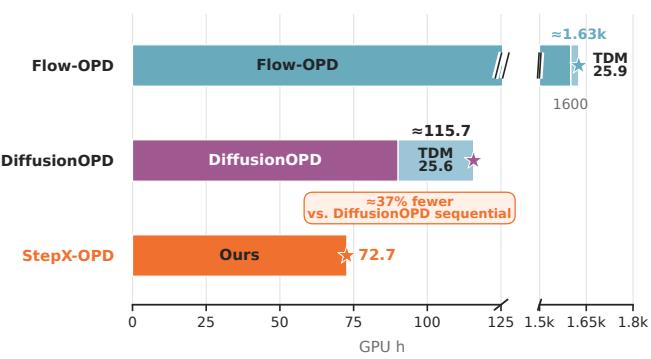

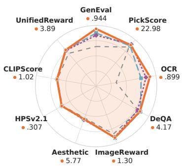  
Figure 1: Training cost for the displayed optimization stages (left) and four-step performance across nine benchmarks after fixed axis-wise normalization (right).

## 1 INTRODUCTION

Flow matching and diffusion models are widely used for text-to-image generation (Lipman et al., 2023; Esser et al., 2024). A model prepared for deployment must meet two needs at once: it must be capable across composition, text rendering, image quality, and human preference, and it must be fast, measured by how few sampling steps its inference requires. Models meet these needs through two separate lines of post-training, one that integrates capabilities into a single model and one that compresses its sampling trajectory into a few steps. These two lines are developed independently, each advancing its own need while leaving the other untouched. Yet both needs are placed on the same deployed model, so capability integration and step distillation constrain that model together.

Existing methods address these two deployment needs separately. Capability integration builds on on-policy distillation, which supervises the student on states the student itself generates (Agarwal et al., 2024). In continuous image generation, DiffusionOPD (Li et al., 2026), Flow-OPD (Fang et al., 2026), and DanceOPD (Zhou et al., 2026) use analytic transition KL or local regression to integrate capabilities, but retain full-step sampling. Step distillation, by contrast, starts from a teacher whose capabilities are already fixed. DMD (Yin et al., 2024b) and DMD2(Yin et al., 2024a) use a frozen teacher score and an auxiliary fake-score estimator, while Qwen-Image-Flash (Wu et al., 2026) combines a base teacher with a post-trained teacher. TDM (Luo et al., 2025), CDM (Liu et al., 2026b), and SenseFlow (Ge et al., 2025) move supervision toward student-generated trajectories or nearby states, which improves the few-step trajectory. These compression methods still treat teacher capabilities as inputs. A multi-capability few-step model therefore continues to rely on a serial pipeline: multi-teacher capability integration first produces a full-step multi-capability model, and step distillation then treats that model as a fixed teacher for few-step compression. The serial pipeline lengthens training, because compression starts only once the full-step capability model finishes. Fig. 1 reports the training cost each optimization stage carries. Beyond this training cost, it leaves open the question: do the capabilities integrated into the full-step model still hold once its sampling trajectory is compressed to afew steps?

We test this directly by comparing each full-step capability model with its few-step compressed counterpart: Tab. 1 reports lower aggregate scores for every one of them after compression, with larger declines on individual metrics. Fig. 4 shows that these full-step OPD models already render prompt words into images more often than the base model, on prompts that neither request nor forbid text, before their trajectories are shortened. Transition matching in continuous-image OPD and marginal matching in DMD (Yin et al., 2024b) and TDM (Luo et al., 2025) both admit reverse-KL interpretations over different distributions and states. Theorem A.3 analyzes this relationship through a reverse-KL decomposition.

Motivated by this decomposition, we propose StepX-OPD, which integrates capabilities and compresses sampling in one training run, without an intermediate full-step OPD model. Frozen specialists supervise the student directly on the states its current few-step rollout visits, with each mini-batch going to the specialist for its training source. Because this decomposition weights the low-noise part of the rollout most heavily, StepX-OPD also regresses the student’s velocity there, telling it not only which distribution to land in but also which direction to move.

We evaluate StepX-OPD on SD3.5-Medium (Esser et al., 2024) and FLUX.1-dev (Labs et al., 2025) across GenEval (Ghosh et al., 2023), OCR accuracy (Chen et al., 2023), DeQA (You et al., 2025), PickScore (Kirstain et al., 2023) and their normalized Average, against sequential Flow-OPD + TDM and DiffusionOPD + TDM baselines. On both architectures, StepX-OPD achieves the highest Average among the few-step systems, 0.8901 and 0.8902, and exceeds the forty-step Flow-OPD model, and on SD3.5-Medium it trains with about 37% fewer GPU-hours than DiffusionOPD + TDM. On prompts that do not request text, recurrence rises from 21 images for the SD3.5-Medium base to 218 for DiffusionOPD, and StepX-OPD, trained with the DiffusionOPD teachers, reduces it to 94, and to 84 with its precise-teacher variant.

Our contributions are summarized as follows:

• We introduce StepX-OPD, which trains capability integration and few-step compression together on the student’s current rollout, with the routed specialist supplying both the distributionmatching and the velocity-regression targets.

• We measure unintended prompt-word rendering on prompts that neither request nor forbid text, find it rises with capability integration, and give a variant that reduces it.

• We show under a common protocol that every full-step capability model we evaluate scores lower once compressed, and that StepX-OPD attains the highest Average among the few-step systems on both architectures and, on SD3.5-Medium, trains with about 37% fewer GPU-hours than sequential DiffusionOPD + TDM.

## 2 RELATED WORK

Step distillation. Within distribution-matching methods, DMD uses the difference between real and fake score fields as a reverse-KL gradient. It also adds regression on teacher-generated noise– image pairs, so part of the update still depends on a multi-step teacher sampler (Yin et al., 2024b). DMD2 removes this paired regression, uses two-time-scale updates to stabilize fake-score learning, adds adversarial training, and uses fixed-schedule backward simulation for multi-step students (Yin et al., 2024a). Decoupled DMD separates CFG augmentation from distribution matching and gives them different re-noising schedules, while retaining DMD2’s fixed simulation and fake-score training (Liu et al., 2026a). A data-dependent alternative, Moment Matching, matches conditional cleandata means. SiD derives data-free score identities (Salimans et al., 2024; Zhou et al., 2024). TDM instead matches intermediate trajectory marginals over step-dependent intervals, without instancelevel trajectory matching (Luo et al., 2025). SenseFlow adapts DMD to large flow backbones through implicit alignment, intra-segment guidance, real-data supervision, and a VFM discriminator, while keeping coarse fixed anchors (Ge et al., 2025). CDM replaces fixed anchors with dynamically sampled on- and off-trajectory states. This broadens supervision but adds training-time evaluations, while inference uses the same number of steps (Liu et al., 2026b). Qwen-Image-Flash blends base and reinforcement-trained teacher scores with a fixed step schedule. The selected blend is more stable than its specialist-only setting (Wu et al., 2026). These methods still provide fixed capabilities to the distillation objective; Qwen’s blend is also fixed in advance rather than chosen from the states the student visits, motivating the on-policy routing methods discussed next.

On-policy distillation in diffusion models. On-policy distillation lets a teacher supervise the states the student visits during generation, rather than states drawn from an offline trajectory or dataset. DiffusionOPD (Li et al., 2026) lifts this idea from the discrete token transitions used in language models to the continuous-state denoising process, modeling each step as a Gaussian transition and deriving a closed-form per-step KL objective in place of a PPO-style surrogate. Flow-OPD (Fang et al., 2026) first trains a domain-specialized teacher per reward with single-reward GRPO, then merges the teachers into a cold-started student via on-policy sampling and task-routing labeling, adding a Manifold Anchor Regularization term in which a task-agnostic teacher anchors generation to a high-quality manifold. DanceOPD (Zhou et al., 2026) treats each frozen capability as a velocity field over the denoising state space, routing each sample to one field, querying it once on a low-noise state from the student’s rollout, and training with a plain velocity mean-squared-error objective. A second arrangement applies on-policy supervision after step distillation rather than before it. D-OPSD (Jiang et al., 2026) tunes an already step-distilled few-step model by having the same network act as teacher and student under different conditioning, the student seeing only the text prompt while the teacher also sees the target image, so it learns new concepts or styles on its rollout without degrading its distilled few-step behavior. Both arrangements treat capability integration and step-count reduction as separate stages; StepX-OPD places multi-teacher on-policy supervision inside the few-step distillation objective, carrying out both in a single stage.

For a broader review of unintended text rendering, see App. D.

## 3 PRELIMINARIES

Flow matching. We use the rectified-flow convention $t \in [ 0 , 1 ]$ , where $t = 1$ is pure noise and $t = 0$ is clean (Lipman et al., 2023; Esser et al., 2024), and denote the condition by c. The linear path is

$$
z _ { t } = ( 1 - t ) x _ { 0 } + t \epsilon .\tag{1}
$$

Here, $x _ { 0 }$ is a clean sample and $\epsilon \sim \mathcal { N } ( 0 , I )$ , and differentiating Eq. 1 with respect to t gives the target velocity $\mathrm { d } z _ { t } / \mathrm { d } t = \epsilon - x _ { 0 }$ that the student velocity $v _ { \theta }$ regresses onto. We write $v _ { \phi }$ for the

teacher velocity, trained the same way, and use $1 = \sigma _ { 0 } > \cdot \cdot \cdot > \sigma _ { N } = 0$ for the student grid. Sampling advances along that grid by the deterministic Euler update

$$
z _ { \sigma _ { i + 1 } } = z _ { \sigma _ { i } } + ( \sigma _ { i + 1 } - \sigma _ { i } ) v _ { \theta } ( z _ { \sigma _ { i } } , \sigma _ { i } ) ,\tag{2}
$$

whose step $\sigma _ { i + 1 } - \sigma _ { i }$ is negative because the grid decreases from noise to clean.

Distribution matching. At the clean terminal distribution, DMD (Yin et al., 2024b;a) minimizes the reverse $\mathrm { K L } \ : \mathrm { D } _ { \mathrm { K L } } ( q _ { \theta } ^ { \mathrm { \scriptsize { c l e a n } } } \parallel p _ { \phi } ^ { \mathrm { \scriptsize { c l e a n } } } )$ . TDM (Luo et al., 2025) extends the same marginal matching to intermediate rollout distributions:

$$
\mathcal { L } _ { \mathrm { T D M } } = \sum _ { i = 1 } ^ { N } \mathbb { E } _ { \tau \sim \pi _ { i } } \left[ \lambda _ { \tau } \operatorname { D } _ { \mathrm { K L } } ( q _ { \theta , \tau } ^ { i } \parallel p _ { \phi , \tau } ) \right] .\tag{3}
$$

Here, $q _ { \theta } ^ { i } = \operatorname { L a w } ( z _ { \sigma _ { i } } ) , q _ { \theta , \tau } ^ { i } = k _ { \tau | \sigma _ { i } } q _ { \theta } ^ { i }$ , and $\operatorname { s u p p } ( \pi _ { i } ) \subset [ \sigma _ { i } , \sigma _ { i - 1 } ] ; p _ { \phi } ,$ is the teacher marginal and $\lambda _ { \tau }$ is the timestep weight. Its gradient is estimated by

$$
\nabla _ { \boldsymbol { \theta } } \mathcal { L } _ { \mathrm { T D M } } \approx \sum _ { i = 1 } ^ { N } \mathbb { E } _ { \tau \sim \pi _ { i } , \boldsymbol { z } _ { \tau } \sim \boldsymbol { q } _ { \boldsymbol { \theta } , \tau } ^ { i } } \left[ \lambda _ { \tau } \boldsymbol { J } _ { \tau } ^ { \top } ( \boldsymbol { s } _ { \boldsymbol { \psi } } - \boldsymbol { s } _ { \boldsymbol { \phi } , \tau } ) \right] .\tag{4}
$$

Here, $s _ { \psi } \approx s _ { \theta , \tau } ^ { i } = \nabla _ { z }$ τ log $q _ { \theta , \tau } ^ { i } , s _ { \phi , \tau } = \nabla _ { z _ { \tau } } \log p _ { \phi , \tau }$ , and $J _ { \tau } = \partial z _ { \tau } / \partial \theta$

On-policy distillation. OPD (Li et al., 2026; Fang et al., 2026) matches the conditional transition reverse KL at the same student-visited state:

$$
\mathrm { D } _ { \mathrm { K L } } \big ( q _ { \theta , i } ( \cdot | z _ { \sigma _ { i } } ) \| p _ { \phi , i } ( \cdot | z _ { \sigma _ { i } } ) \big ) = \omega _ { i } \| v _ { \theta } ( z _ { \sigma _ { i } } , \sigma _ { i } ) - v _ { \phi } ( z _ { \sigma _ { i } } , \sigma _ { i } ) \| ^ { 2 } .\tag{5}
$$

Here, $q _ { \theta , i } ( \cdot | z _ { \sigma _ { i } } )$ and $p _ { \phi , i } ( \cdot | z _ { \sigma _ { i } } )$ are the student and teacher kernels, $\Delta _ { i } = \sigma _ { i } - \sigma _ { i + 1 } > 0$ , and $g _ { i }$ is the diffusion coefficient at $\sigma _ { i } ;$ they share covariance $g _ { i } ^ { 2 } \Delta _ { i } I ,$ and $\begin{array} { r } { \omega _ { i } = \frac { \Delta _ { i } } { 2 } ( \frac { 1 } { g _ { i } } + \frac { g _ { i } ( 1 - \sigma _ { i } ) } { 2 \sigma _ { i } } ) ^ { 2 } } \end{array}$ for $0 < \sigma _ { i } < 1$ . The later batch-gated velocity MSE is an unweighted surrogate of this term, and the weight $w _ { b }$ that App. A derives is a separate marginal-KL weight.

## 4 METHOD

StepX-OPD trains one student to carry out multi-teacher on-policy distillation and step distillation at the same time, rather than consolidating capabilities at full step count and compressing the result afterward. We build on trajectory distribution matching (TDM) (Luo et al., 2025) and redraw the rollout grid at random on every training step. Sec. 4.1 then constructs supervision states between the nodes of that grid, Sec. 4.2 routes each mini-batch to the frozen specialist that supplies its target velocity, and Sec. 4.3 regresses the student’s velocity field directly on the low-noise ones. Alg. 1 in App. B gives the complete training procedure.

## 4.1 INTERPOLATED ROLLOUT STATES AND EXACT RE-NOISING

CDM Liu et al. (2026b) replaces TDM’s Luo et al. (2025) fixed, predefined discrete anchor schedule with a dynamic one that randomizes both the number of anchors and their placement on every training iteration. StepX-OPD adopts this dynamic grid for the rollout it distills, but instantiates it with the segment count fixed and both ends pinned, randomizing the placement of the interior nodes. During training the student advances along a rollout grid $1 = \sigma _ { 0 } > \sigma _ { 1 } > \cdot \cdot \cdot > \sigma _ { N } = 0$ that is redrawn independently before every training step, while all parallel processes share that step’s draw so their gradients remain consistent. Because the anchors of this grid are the nodes of the student’s own randomized few-step rollout, no state exists at the continuous times that fall between two consecutive nodes.

Given this randomized rollout grid, StepX-OPD first selects one segment $[ \sigma _ { \ell } , \sigma _ { u } ]$ uniformly at random, then draws a base time $\tau _ { \mathrm { b a s e } }$ uniformly within it, with $\sigma _ { \ell } \leq \tau _ { \mathrm { b a s e } } < \sigma _ { u }$ . Let $z _ { \mathrm { s t a r t } }$ be the state at $\sigma _ { u }$ and $z _ { \mathrm { e n d } }$ the state at $\sigma _ { \ell } .$ , and interpolate between them using

$$
x _ { \mathrm { b a s e } } = \gamma z _ { \mathrm { s t a r t } } + ( 1 - \gamma ) \ \mathrm { s g } [ z _ { \mathrm { e n d } } ] .\tag{6}
$$

where $\begin{array} { r } { \gamma = \frac { \tau _ { \mathrm { b a s e } } - \sigma _ { \ell } } { \sigma _ { u } - \sigma _ { \ell } } } \end{array}$ . Here sg denotes the stop-gradient. When $\tau _ { \mathrm { b a s e } } = \sigma _ { \ell } , \gamma = 0$ and Eq. 6 reduces to $x _ { \mathrm { b a s e } } = \mathrm { s g } [ z _ { \mathrm { e n d } } ]$ , so the construction includes direct re-noising from the lower endpoint as a special case. The two rollout states being interpolated are related by Eq. 2, since that is the update the rollout visiting them took, which lets $x _ { \mathrm { b a s e } }$ be characterized exactly.

The interpolated state $x _ { \mathrm { b a s e } }$ is exactly the state a first-order Euler step from ${ \cal Z } _ { \mathrm { s t a r t } }$ reaches at $\tau _ { \mathrm { b a s e } } .$ and App. A proves this as Lemma A.1. This is exactly how CDM constructs its off-trajectory point: it takes an on-trajectory anchor and its predicted velocity and performs a first-order Euler extrapolation toward an independently sampled time. StepX-OPD’s within-segment interpolation and CDM’s one-step Euler extrapolation therefore compute the same quantity through two different routes, one interpolating between two already-visited rollout states, which requires no velocity evaluation beyond the rollout, and the other extrapolating from a single velocity evaluation at ${ \mathit { z } } _ { \mathrm { s t a r t } } .$

Conditioned on the grid and $\tau _ { \mathrm { b a s e } } ,$ we sample the supervision time $\tau \sim U [ \tau _ { \mathrm { b a s e } } , \sigma _ { u } ]$ . We obtain $z _ { \tau }$ from $x _ { \mathrm { b a s e } }$ by the exact forward SDE transition from $\tau _ { \mathrm { b a s e } }$ to τ, whose coefficients App. A derives by matching moments with the Euler re-noising law of Lemma ${ \mathrm { A . 1 } }$ . With $\alpha _ { t } = 1 - t$ and $\sigma _ { t } = t .$ this re-noising step is

$$
z _ { \tau } = \kappa x _ { \mathrm { b a s e } } + \beta \epsilon ,\tag{7}
$$

where ϵ is a standard Gaussian draw, $\begin{array} { r } { \kappa = \frac { \alpha _ { \tau } } { \alpha _ { \tau _ { \mathrm { b a s e } } } } } \end{array}$ , and $\beta = \sqrt { \operatorname* { m a x } \mathopen { } \mathclose \bgroup \left( \sigma _ { \tau } ^ { 2 } - ( \kappa \sigma _ { \tau _ { \mathrm { b a s e } } } ) ^ { 2 } , 0 \aftergroup \egroup \right) }$ . Because τ remains inside the sampled segment $[ \tau _ { \mathrm { b a s e } } , \sigma _ { u } ] ,$ , Lemma A.1 applies directly and $z _ { \tau }$ carries $x _ { \mathrm { b a s e } } ^ { \ } \mathrm { { s } }$ own conditional law forward to τ exactly.

## 4.2 SOURCE ROUTING TO FROZEN SPECIALISTS

Each training step draws its mini-batch from a single training source d among $\{ { \mathcal { C } } _ { d } \}$ , rather than mixing sources within a batch, and this source choice determines which model serves as the active target $\bar { \boldsymbol { v } } ^ { \mathrm { t g t } }$ for every supervision state drawn from that batch. During an early warmup, $v ^ { \mathrm { t g t } }$ is the frozen initial student $v _ { \theta _ { 0 } } ^ { \mathrm { s t } }$ , letting the student’s own few-step rollout settle before any teacher enters. Afterward, a static lookup r maps the batch’s source d to one of $M$ frozen specialists $\{ v _ { m } ^ { \mathrm { t e a } } \} _ { m = 1 } ^ { M }$ and $v ^ { \mathrm { t g t } }$ becomes the routed specialist $v _ { r ( d ) } ^ { \mathrm { t e a } }$ . Because r depends only on the sampled source and is fixed before the forward pass begins, every data-parallel process resolves the same routed teacher for a given step without exchanging any information. Each training source corresponds to one capability a specialist was trained to supply, so routing by source sends every mini-batch to the one specialist whose target behavior matches the capability that source is meant to teach.

## 4.3 LOW-NOISE VELOCITY REGRESSION

Theorem A.3 shows that, under its assumptions,

$$
\mathrm { D } _ { \mathrm { K L } } ( q _ { b } \| p _ { b } ) = \mathbb { E } _ { T } \mathrm { D } _ { \mathrm { K L } } ( q _ { T } \| p _ { T } ) + \mathbb { E } \big [ w _ { b } ( T ) \| v _ { q } ( Z _ { T } , T ) - v _ { p } ( Z _ { T } , T ) \| ^ { 2 } \big ] ,\tag{8}
$$

where $q _ { t }$ and $p _ { t }$ are the rollout state’s own distribution and the teacher distribution at time t, $v _ { q }$ and $v _ { p }$ are the velocity fields each distribution induces, and $Z _ { T }$ is the state at a time $T$ drawn uniformly on the segment. The weight is

$$
w _ { b } ( t ) = ( t _ { i } - t ) \frac { 1 - t } { t } , \qquad b < t < t _ { i } ,\tag{9}
$$

where b is the base time and $t _ { i }$ the segment’s upper endpoint. The $1 / t$ factor makes $w _ { b }$ grow without bound as $t  0 .$ , so the velocity-difference term carries its largest weight toward the low-noise end of the segment, which is why we add velocity regression as an auxiliary term on the low-noise part of the rollout. App. A gives the full statement, the proof, and the bound relating the student network to the field its rollout induces.

For each sampled state $z _ { \tau }$ , the active target $v ^ { \mathrm { t g t } }$ selected by source routing (Sec. 4.2) supplies the instantaneous classifier-free guided velocity. It is evaluated once with condition c and once without it at the same state and time, and the two evaluations are combined with guidance scale w:

$$
v _ { \mathrm { c f g } } ^ { \mathrm { t g t } } ( z _ { \tau } , \tau , c ) = v ^ { \mathrm { t g t } } ( z _ { \tau } , \tau , \emptyset ) + w \left[ v ^ { \mathrm { t g t } } ( z _ { \tau } , \tau , c ) - v ^ { \mathrm { t g t } } ( z _ { \tau } , \tau , \emptyset ) \right] .\tag{10}
$$

The trainable student $v _ { \theta } ^ { \mathrm { s t u } }$ makes an additional forward pass at the same state and time and regresses toward this frozen target through

$$
\mathcal { L } _ { \mathrm { v } } ( { \tilde { v } } ^ { \mathrm { t g t } } ) = \frac { 1 } { N _ { \mathrm { e l t } } } \sum _ { j = 1 } ^ { B } \left\| v _ { \theta } ^ { \mathrm { s t u } } ( { z _ { \tau _ { j } } } , \tau _ { j } , c ) - \mathrm { s g } \left[ \tilde { v } _ { j } ^ { \mathrm { t g t } } \right] \right\| _ { 2 } ^ { 2 } ,\tag{11}
$$

where B is the number of sampled states in the batch, and $N _ { \mathrm { e l t } }$ is the number of packed tensor elements those states carry. Eq. 11 is the unweighted surrogate of the conditional-transition KL in Eq. 5: dropping the weight $\omega _ { i }$ and averaging the squared distance elementwise rather than summing

Table 1: Comparison of text-to-image scores across methods, at forty and at four sampling steps, for both base architectures evaluated. The lower per-architecture block reports the same models after step distillation.
<table><tr><td>Base Model</td><td>Model</td><td>NFEs</td><td>GenEval ↑</td><td>OCR↑</td><td>DeQA ↑</td><td>PickScore ↑</td><td>Average ↑</td></tr><tr><td rowspan="11">SD3.5-Medium</td><td>Base</td><td>80</td><td>0.666</td><td>0.529</td><td>4.045</td><td>21.79</td><td>0.7105</td></tr><tr><td>GenEval Teacher</td><td>80</td><td>0.946</td><td>0.597</td><td>3.965</td><td>21.66</td><td>0.7923</td></tr><tr><td>OCR Teacher</td><td>80</td><td>0.656</td><td>0.924</td><td>3.849</td><td>21.66</td><td>0.7957</td></tr><tr><td>PickScore Teacher</td><td>80</td><td>0.744</td><td>0.629</td><td>4.166</td><td>23.30</td><td>0.7756</td></tr><tr><td>Flow-OPD</td><td>80</td><td>0.905</td><td>0.885</td><td>4.268</td><td>22.66</td><td>0.8788</td></tr><tr><td>DiffusionOPD</td><td>80</td><td>0.945</td><td>0.930</td><td>4.113</td><td>23.68</td><td>0.9022</td></tr><tr><td>Base + TDM</td><td>4</td><td>0.653</td><td>0.335</td><td>4.002</td><td>21.87</td><td>0.6573</td></tr><tr><td>Flow-OPD + TDM</td><td>4</td><td>0.875</td><td>0.751</td><td>4.217</td><td>22.60</td><td>0.8345</td></tr><tr><td>DiffusionOPD + TDM</td><td>4</td><td>0.838</td><td>0.833</td><td>3.952</td><td>23.41</td><td>0.8403</td></tr><tr><td>StepX-OPD (Ours)</td><td>4</td><td>0.944</td><td>0.899</td><td>4.170</td><td>22.98</td><td>0.8901</td></tr><tr><td>Base</td><td>40</td><td>0.655</td><td>0.588</td><td>4.298</td><td>21.96</td><td>0.7368</td></tr><tr><td rowspan="8">FLUX.1-dev</td><td>GenEval Teacher</td><td>40</td><td>0.900</td><td>0.663</td><td>4.333</td><td>22.06</td><td>0.8195</td></tr><tr><td>OCR Teacher</td><td>40</td><td>0.670</td><td>0.942</td><td>4.254</td><td>21.99</td><td>0.8270</td></tr><tr><td>PickScore Teacher</td><td>40</td><td>0.690</td><td>0.678</td><td>4.153</td><td>23.57</td><td>0.7765</td></tr><tr><td>Flow-OPD</td><td>40</td><td>0.880</td><td>0.913</td><td>4.247</td><td>23.50</td><td>0.8864</td></tr><tr><td>DiffusionOPD</td><td>40</td><td>0.892</td><td>0.933</td><td>4.225</td><td>23.58</td><td>0.8943</td></tr><tr><td>Base + TDM</td><td>4</td><td>0.632</td><td>0.557</td><td>4.340</td><td>21.94</td><td>0.7252</td></tr><tr><td>Flow-OPD + TDM</td><td>4</td><td>0.864</td><td>0.901</td><td>4.087</td><td>23.30</td><td>0.8695</td></tr><tr><td>DiffusionOPD + TDM</td><td>4</td><td>0.882</td><td>0.925</td><td>4.005</td><td>23.32</td><td>0.8761</td></tr><tr><td></td><td>StepX-OPD (Ours)</td><td>4</td><td>0.890</td><td>0.929</td><td>4.233</td><td>23.28</td><td>0.8902</td></tr></table>

it yields the $1 / N _ { \mathrm { e l t } }$ factor, and the target becomes the guided, per-step $\tilde { v } ^ { \mathrm { t g t } } = v _ { \mathrm { c f g } } ^ { \mathrm { t g t } } ( z _ { \tau } , \tau , c )$ of Eq. 10 rather than a single fixed teacher velocity $v _ { \phi }$ . The auxiliary term is gated for the whole batch: with training step $s ,$ configured start step $s _ { \mathrm { v } } ,$ , sampled times $\{ \tau _ { j } \} _ { j = 1 } ^ { B }$ , and threshold $\tau _ { \mathrm { v } } .$

$$
g _ { \mathrm { v } } = { \bf 1 } \{ s \geq s _ { \mathrm { v } } \} ~ { \bf 1 } \{ \bar { \tau } \leq \tau _ { \mathrm { v } } \} , \qquad \bar { \tau } = \frac { 1 } { B } \sum _ { j = 1 } ^ { B } \tau _ { j } .\tag{12}
$$

This supplies direct local velocity supervision near the clean endpoint, where the capability signal must be transferred through the student’s on-policy states.

The same target $\tilde { v } ^ { \mathrm { t g t } }$ also supplies the teacher score for the distribution-matching term $\mathcal { L } _ { \mathrm { T D M } } ( \tilde { v } ^ { \mathrm { t g t } } )$ which follows the gradient estimator of Eq. 4 with the teacher score $s _ { \phi , \ l }$ evaluated at $\tilde { v } ^ { \mathrm { t g t } }$ . The total objective is

$$
\mathcal { L } _ { \mathrm { t o t a l } } = \mathcal { L } _ { \mathrm { T D M } } ( \tilde { v } ^ { \mathrm { t g t } } ) + w _ { \mathrm { v } } g _ { \mathrm { v } } \mathcal { L } _ { \mathrm { v } } ( \tilde { v } ^ { \mathrm { t g t } } ) .\tag{13}
$$

See App. G for an optional target that replaces this instantaneous velocity with an average taken along a short guided rollout from the supervision state.

## 5 EXPERIMENTS

## 5.1 EXPERIMENTAL SETUP

Model. We evaluate two base architectures, SD3.5-Medium (Esser et al., 2024) and FLUX.1- dev (Labs et al., 2025). For each, the joint OPD models and task-specialist teachers use forty-step generation and the step-distilled students, including StepX-OPD, use four steps. Every evaluated model is sampled at $5 1 2 \times 5 1 2$ resolution. On SD3.5-Medium, full-step models use a classifier-free guidance scale of 4.5 and four-step students a scale of 1.0. FLUX.1-dev instead carries a distilled guidance embedding, set to 3.5 at forty steps and 1.0 at four steps, with classifier-free guidance disabled throughout.

Benchmark. We evaluate each base model, its task specialists, and its joint OPD models at forty steps, together with step-distilled variants of the base and joint OPD models at four steps, on GenEval (Ghosh et al., 2023), OCR accuracy (Cui et al., 2025), DeQA (You et al., 2025), and

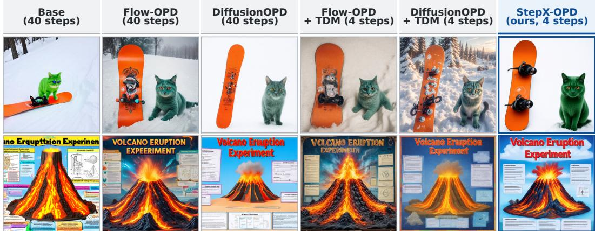  
Figure 2: Qualitative comparison result from benchmark.

PickScore (Kirstain et al., 2023), combined into a single Average score. Tab. 1 reports these four measures and Average for both SD3.5-Medium and FLUX.1-dev under the same protocol, and Tab. 8 additionally reports CLIPScore (Xu et al., 2024), HPSv2.1 (Wu et al., 2023), Aesthetic (Murray et al., 2012), ImageReward (Xu et al., 2023), and UnifiedReward (Wang et al., 2025) for the SD3.5- Medium rows, outside the Average score. See App. C for the Average formula, the generated image counts, and the scoring procedures.

Implementation details. For the four-step distillation runs, we adapt the transformer with rank-32 LoRA student and fake adapters, trained at learning rates $2 \times 1 0 ^ { - 6 ^ { 2 } }$ and $1 \times 1 0 ^ { - 5 }$ respectively, on four-step on-policy rollouts. Multi-teacher supervision covers the GenEval, OCR, and PickScore training sources, and StepX-OPD combines trajectory distribution matching with low-noise velocity regression, weighted by $w _ { \mathrm { v } } = 0 . 5$ , against the routed teacher under static source routing. We train with FSDP on 8 NVIDIA H800 GPUs at a per-rank batch size of 32, giving a global batch size of 256, with 200-step optimizer warmups. The frozen initial student supplies the self-distillation target during the first 200 steps; afterward, source routing sends the whole mini-batch to one of three frozen DiffusionOPD teachers, with a static lookup routing the GenEval, OCR, and PickScore training sources to the GenEval, OCR, and aesthetic teachers, respectively.

## 5.2 MAIN RESULTS

Quantitative. To test whether joint training can deliver integrated capability at four steps, Tab. 1 compares StepX-OPD with four-step TDM baselines and forty-step OPD models on both SD3.5- Medium and FLUX.1-dev. StepX-OPD reaches a four-step Average of 0.8901 on SD3.5-Medium and 0.8902 on FLUX.1-dev, against 0.8403 and 0.8761 for the next-best four-step baseline on each. A single four-step model therefore carries integrated capability across all four measures.

Qualitative comparison. Fig. 2 compares the forty-step and four-step models on one prompt from each of two benchmarks, and shows StepX-OPD matching what the forty-step models produce while the other four-step columns fall short of both. It is the only column of the six that spells the poster title correctly. Fig. 3 compares the four-step models on prompts written for this comparison. Further examples appear in App. F.

## 5.3 PROMPT-WORD RECURRENCE

To test whether capability integration is accompanied by unintended prompt-word rendering, Tab. 11 counts recurrence across eight models on prompts that do not request text, with seven models sampled at forty steps and StepX-OPD at four steps; Fig. 4 repeats the comparison on a stricter prompt subset. The largest shift is on SD3.5-Medium, where recurrence rises from 21 images for the base model to 218 for DiffusionOPD. This shows that the recurrence measure exposes a text-rendering side effect associated with capability integration. StepX-OPD, trained with the DiffusionOPD teachers, reduces this count to 94.

  
Figure 3: Qualitative comparison result from generated prompt.

## 5.4 ABLATION AND ANALYSIS

Supervision-point construction. To assess supervision-point construction, Tab. 2 compares fixedgrid endpoints, randomized-grid endpoints, and randomized-grid interpolated re-noising. Replacing the fixed grid with the randomized one raises Average from 0.7090 to 0.7548, and moving the renoising source from the segment endpoint to an interpolated point raises it further to 0.8240, with OCR rising from 0.4499 to 0.5776 to 0.7968 across the same three rows. Both changes therefore improve the aggregate score.

Velocity-regression target source. The additive initialization used in this section adds the SFT increment at full weight on top of the mean of the three specialist increments. Tab. 4 compares regressing toward the routed teacher’s own velocity field against regressing toward a separate, dedicated quality teacher under low-noise coverage. The routed target reaches an Average of 0.8901, versus 0.8446 for the dedicated target.

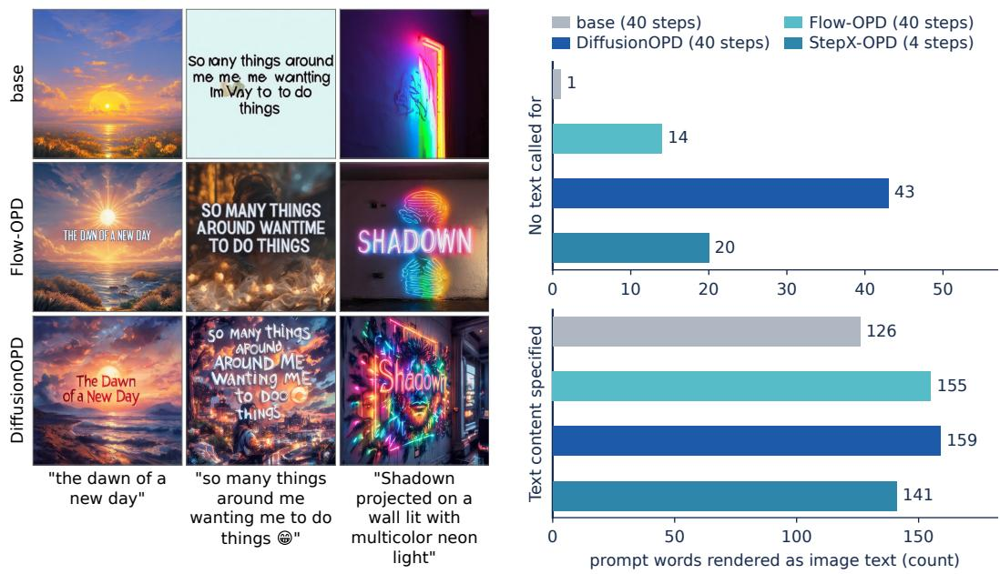

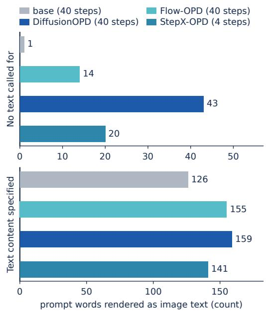  
Figure 4: Text that models render into the image. The left panel shows generations on the No text called for prompt group; the right panel counts the generations whose detected on-image text reproduces a word from the prompt, on that same group and on Text content specified, drawn on separate scales.

Table 2: Ablation of the three supervision-point constructions. Best results are in bold.
<table><tr><td>Rollout grid</td><td>Re-noising source</td><td>GenEval ↑</td><td>OCR↑</td><td>DeQA ↑</td><td>PickScore ↑</td><td>Average ↑</td></tr><tr><td>Fixed</td><td>Segment endpoint</td><td>0.7230</td><td>0.4499</td><td>4.003</td><td>22.42</td><td>0.7090</td></tr><tr><td>Randomized</td><td>Segment endpoint</td><td>0.7523</td><td>0.5776</td><td>4.129</td><td>22.46</td><td>0.7548</td></tr><tr><td>Randomized</td><td>Interpolated</td><td>0.8198</td><td>0.7968</td><td>4.076</td><td>22.47</td><td>0.8240</td></tr></table>

Teacher selection. To test how each mini-batch should pick which DiffusionOPD teacher supplies its distribution-matching target, Tab. 3 compares source routing, in which a mini-batch drawn from one training source is routed to that source’s dedicated teacher, against two alternatives that break this correspondence: assigning a teacher at random per mini-batch, and averaging the three teachers velocity fields into a single uniform target. Source routing reaches 0.8986 on OCR against 0.7388 for random assignment and 0.6738 for uniform averaging, the largest separation among the three rows, and source routing also reaches the highest GenEval, PickScore, and Average. Matching each mini-batch’s teacher to its training source therefore matters most for the text-rendering objective.

Initialization from released adapters. To test dependence on student initialization, Tab. 5 compares TDM and StepX-OPD from the released Flow-OPD and DiffusionOPD adapters. From the Flow-OPD adapter, StepX-OPD raises Average from 0.8345 to 0.8746, the larger gain of the two pairs, and StepX-OPD also reaches the higher score from the DiffusionOPD adapter. StepX-OPD therefore leads from both released initializations, independent of the additive merge.

Table 3: Ablation of how each mini-batch selects its teacher, reported as full-benchmark scores. Best results are in bold.
<table><tr><td>Teacher selection</td><td>GenEval ↑</td><td>OCR↑</td><td>DeQA↑</td><td>PickScore ↑</td><td>Average ↑</td></tr><tr><td>Source routing</td><td>0.9442</td><td>0.8986</td><td>4.170</td><td>22.98</td><td>0.8901</td></tr><tr><td>Random teacher</td><td>0.9241</td><td>0.7388</td><td>4.203</td><td>22.37</td><td>0.8410</td></tr><tr><td>Uniform teacher average</td><td>0.9292</td><td>0.6738</td><td>4.179</td><td>22.18</td><td>0.8230</td></tr></table>

Table 4: Comparison of four configurations, grouped by velocity-regression noise coverage and by the model that supplies the regression target. Best results are in bold.
<table><tr><td>Coverage</td><td>Target</td><td colspan="3">Gen ↑ OCR ↑ DeQA ↑ Pick ↑ Avg ↑</td></tr><tr><td rowspan="2">Low-noise</td><td>Routed</td><td>0.9442 0.8986</td><td></td><td>4.170 22.98 0.8901</td></tr><tr><td></td><td>Dedicated 0.8822 0.8127</td><td></td><td>4.057 22.67 0.8446</td></tr><tr><td rowspan="2">Full-range</td><td>Routed</td><td>0.8894 0.8341</td><td></td><td>4.121 22.73 0.8555</td></tr><tr><td></td><td>Dedicated 0.86640.7296</td><td></td><td>4.101 22.65 0.8219</td></tr></table>

Table 5: Comparison of distillation methods across two student initializations. Best results are in bold.
<table><tr><td>Init.</td><td>Method</td><td>Gen ↑ OCR ↑ DeQA ↑ Pick ↑ Avg ↑</td><td></td></tr><tr><td rowspan="2">Flow-OPD</td><td>TDM</td><td>0.875 0.751</td><td>4.21722.60 0.8345</td></tr><tr><td>StepX-OPD 0.909</td><td>0.897</td><td>4.103 22.68 0.8746</td></tr><tr><td rowspan="2">DiffusionOPD</td><td>TDM</td><td>0.838 0.833</td><td>3.952 23.41 0.8403</td></tr><tr><td>StepX-OPD 0.906</td><td>0.893</td><td>4.056 22.92 0.8727</td></tr></table>

Velocity-regression term. To examine how the velocity-regression term should be applied, Tab. 6 compares omitting it against applying it from step 0 and from step 500. Omitting the term, applying it from step 0, and applying it from step 500 reach Averages of 0.8894, 0.8895, and 0.8901, so the result is stable across this choice.

SFT-increment merge weight. To compare how the SFT increment enters the student initialization, Tab. 7 tests the SFT increment on its own, the base merge, a four-model mean that averages the SFT and the three specialist increments together, and the additive merge defined above. See App. H for the expressions. The additive variant reaches the highest Average, 0.8348 versus 0.8219 for the next-best row. This supports the additive merge as the strongest initialization variant tested.

Table 6: Ablation of the velocity-regression term, covering whether it is applied, and the step from which it is applied. Best results are in bold.
<table><tr><td colspan="4">Velocity regression Gen ↑ OCR ↑ DeQA ↑ Pick ↑ Avg ↑</td></tr><tr><td>w/o regression</td><td>0.9134 0.8956</td><td>4.178</td><td>22.05 0.8731</td></tr><tr><td>from step 0</td><td>0.9444 0.8950</td><td>4.177</td><td>22.96 0.8895</td></tr><tr><td>from step 500</td><td>0.9442 0.8986</td><td></td><td>4.170 22.98 0.8901</td></tr><tr><td>from step 1000</td><td>0.9069 0.8845</td><td></td><td>3.996 22.62 0.8652</td></tr></table>

Table 7: Ablation of SFT-merge variants of the student initialization, reported as fullbenchmark scores. Best results are in bold.
<table><tr><td>Initialization</td><td colspan="4">Gen ↑ OCR ↑ DeQA ↑ Pick ↑ Avg ↑</td></tr><tr><td>SFT</td><td>0.90070.6343</td><td>4.024</td><td>22.63 0.8025</td><td rowspan="3"></td></tr><tr><td>Merge</td><td>0.86640.7296</td><td>4.101</td><td>22.65 0.8219</td></tr><tr><td>SFT Merge (mean)</td><td>0.87580.7054</td><td>4.116</td><td>22.65 0.8189</td></tr><tr><td colspan="3">SFT Merge (additive) 0.9273 0.7294</td><td>4.050 22.68 0.8348</td><td></td></tr></table>

## 6 CONCLUSION

Multi-capability, few-step text-to-image models are typically built in two stages: a full-step model consolidates capabilities, then serves as a fixed teacher for compression. This lengthens training, and the capabilities gathered in the first stage do not fully survive into the second. StepX-OPD merges the two stages, learning capabilities directly on the few-step trajectory the deployed model runs and removing the intermediate full-step teacher. A reverse-KL decomposition characterizes this supervision and motivates velocity regression on the trajectory’s low-noise part. Capability integration also leads models to render prompt words into images on prompts that neither request nor forbid text, and we give a variant of StepX-OPD that reduces this behavior. Evaluated on SD3.5-Medium and FLUX.1-dev, StepX-OPD reaches the highest Average among the four-step methods on both and exceeds the forty-step Flow-OPD, and on SD3.5-Medium it trains with about 37% fewer GPU-hours than sequential DiffusionOPD followed by step distillation.

## REFERENCES

Rishabh Agarwal, Nino Vieillard, Yongchao Zhou, Piotr Stanczyk, Sabela Ramos Garea, Matthieu Geist, and Olivier Bachem. On-policy distillation of language models: Learning from selfgenerated mistakes. In B. Kim, Y. Yue, S. Chaudhuri, K. Fragkiadaki, M. Khan, and Y. Sun (eds.), International Conference on Learning Representations, volume 2024, pp. 21246–21263, 2024. URL https://proceedings.iclr.cc/paper\_files/paper/2024/file/ 5be69a584901a26c521c2b51e40a4c20-Paper-Conference.pdf.

Kevin Black, Michael Janner, Yilun Du, Ilya Kostrikov, and Sergey Levine. Training diffusion models with reinforcement learning. In International Conference on Learning Representations, volume 2024, pp. 4965–4987, 2024.

Jingye Chen, Yupan Huang, Tengchao Lv, Lei Cui, Qifeng Chen, and Furu Wei. Textdiffuser: Diffusion models as text painters. Advances in Neural Information Processing Systems, 36:9353– 9387, 2023.

Cheng Cui, Ting Sun, Manhui Lin, Tingquan Gao, Yubo Zhang, Jiaxuan Liu, Xueqing Wang, Zelun Zhang, Changda Zhou, Hongen Liu, Yue Zhang, Wenyu Lv, Kui Huang, Yichao Zhang, Jing Zhang, Jun Zhang, Yi Liu, Dianhai Yu, and Yanjun Ma. Paddleocr 3.0 technical report, 2025. URL https://arxiv.org/abs/2507.05595.

Patrick Esser, Sumith Kulal, Andreas Blattmann, Rahim Entezari, Jonas Muller, Harry Saini, Yam¨ Levi, Dominik Lorenz, Axel Sauer, Frederic Boesel, Dustin Podell, Tim Dockhorn, Zion English, and Robin Rombach. Scaling rectified flow transformers for high-resolution image synthesis. In Proceedings of the 41st International Conference on Machine Learning, ICML’24. JMLR.org, 2024.

Zhen Fang, Wenxuan Huang, Yu Zeng, Yiming Zhao, Shuang Chen, Kaituo Feng, Yunlong Lin, Lin Chen, Zehui Chen, Shaosheng Cao, et al. Flow-opd: On-policy distillation for flow matching models. arXiv preprint arXiv:2605.08063, 2026.

Xingtong Ge, Xin Zhang, Tongda Xu, Yi Zhang, Xinjie Zhang, Yan Wang, and Jun Zhang. Senseflow: Scaling distribution matching for flow-based text-to-image distillation. arXiv preprint arXiv:2506.00523, 2025.

Dhruba Ghosh, Hannaneh Hajishirzi, and Ludwig Schmidt. Geneval: an object-focused framework for evaluating text-to-image alignment. In Proceedings of the 37th International Conference on Neural Information Processing Systems, NIPS ’23, Red Hook, NY, USA, 2023. Curran Associates Inc.

Yunqi Hong, Kuei-Chun Kao, Hengguang Zhou, and Cho-Jui Hsieh. Understanding reward hacking in text-to-image reinforcement learning. In Proceedings of the IEEE/CVF Conference on Computer Vision and Pattern Recognition (CVPR) Findings, pp. 4245–4255, June 2026.

Haoqi Hu, Tongji Luo, Li Zhang, and Boning Zhou. Tangpoetrybench: A multi-dimensional benchmark and rubric-conditioned evaluator for poetry-to-image generation. arXiv preprint arXiv:2608.11452, 2026.

Dengyang Jiang, Xin Jin, Dongyang Liu, Zanyi Wang, Mingzhe Zheng, Ruoyi Du, Xiangpeng Yang, Qilong Wu, Zhen Li, Peng Gao, Harry Yang, and Steven Hoi. D-opsd: On-policy self-distillation for continuously tuning step-distilled diffusion models. arXiv preprint arXiv:2605.05204, 2026.

Yuval Kirstain, Adam Polyak, Uriel Singer, Shahbuland Matiana, Joe Penna, and Omer Levy. Picka-pic: an open dataset of user preferences for text-to-image generation. In Proceedings of the 37th International Conference on Neural Information Processing Systems, NIPS ’23, Red Hook, NY, USA, 2023. Curran Associates Inc.

Black Forest Labs, Stephen Batifol, Andreas Blattmann, Frederic Boesel, Saksham Consul, Cyril Diagne, Tim Dockhorn, Jack English, Zion English, Patrick Esser, Sumith Kulal, Kyle Lacey, Yam Levi, Cheng Li, Dominik Lorenz, Jonas Muller, Dustin Podell, Robin Rombach, Harry Saini,¨ Axel Sauer, and Luke Smith. Flux.1 kontext: Flow matching for in-context image generation and editing in latent space, 2025. URL https://arxiv.org/abs/2506.15742.

Quanhao Li, Junqiu Yu, Kaixun Jiang, Yujie Wei, Zhen Xing, Pandeng Li, Ruihang Chu, Shiwei Zhang, Yu Liu, and Zuxuan Wu. Diffusionopd: A unified perspective of on-policy distillation in diffusion models. SIGGRAPH Asia 2026 Conference Papers, 2026.

Yaron Lipman, Ricky T. Q. Chen, Heli Ben-Hamu, Maximilian Nickel, and Matthew Le. Flow matching for generative modeling. In The Eleventh International Conference on Learning Representations, 2023. URL https://openreview.net/forum?id=PqvMRDCJT9t.

Dongyang Liu, Peng Gao, David Liu, Ruoyi Du, Zhen Li, Qilong Wu, Xin Jin, Sihan Cao, Shifeng Zhang, Steven HOI, and Hongsheng Li. Decoupled DMD: CFG augmentation as the spear, distribution matching as the shield. In The Fourteenth International Conference on Learning Representations, 2026a. URL https://openreview.net/forum?id=jBztvOiCKE.

Jie Liu, Gongye Liu, Jiajun Liang, Yangguang Li, Jiaheng Liu, Xintao Wang, Pengfei Wan, Di ZHANG, and Wanli Ouyang. Flow-GRPO: Training flow matching models via online RL. In The Thirty-ninth Annual Conference on Neural Information Processing Systems, 2025. URL https://openreview.net/forum?id=oCBKGw5HNf.

Tao Liu, Hao Yan, Mengting Chen, Taihang Hu, Zhengrong Yue, Zihao Pan, Jinsong Lan, Xiaoyong Zhu, Ming-Ming Cheng, Bo Zheng, and Yaxing Wang. Continuous-time distribution matching for few-step diffusion distillation, 2026b. URL https://arxiv.org/abs/2605.06376.

Yihong Luo, Tianyang Hu, Jiacheng Sun, Yujun Cai, and Jing Tang. Learning few-step diffusion models by trajectory distribution matching. In Proceedings of the IEEE/CVF International Con ference on Computer Vision (ICCV), pp. 17719–17728, October 2025.

Siwei Lyu. Interpretation and generalization of score matching. In Proceedings of the Twenty-Fifth Conference on Uncertainty in Artificial Intelligence, UAI ’09, pp. 359–366, Arlington, Virginia, USA, 2009. AUAI Press. ISBN 9780974903958.

Joanna Materzynska, Antonio Torralba, and David Bau. Disentangling visual and written concepts´ in clip. In 2022 IEEE/CVF Conference on Computer Vision and Pattern Recognition (CVPR), pp. 16389–16398, 2022. doi: 10.1109/CVPR52688.2022.01592.

Naila Murray, Luca Marchesotti, and Florent Perronnin. Ava: A large-scale database for aesthetic visual analysis. In 2012 IEEE Conference on Computer Vision and Pattern Recognition, pp. 2408–2415, 2012. doi: 10.1109/CVPR.2012.6247954.

Juan Rodriguez, Haotian Zhang, Abhay Puri, Rishav Pramanik, Aarash Feizi, Pascal Wichmann, Arnab Mondal, Mohammad R Samsami, Rabiul Awal, Perouz Taslakian, et al. Rendering-aware reinforcement learning for vector graphics generation. In NeurIPS, 2025.

Tim Salimans, Thomas Mensink, Jonathan Heek, and Emiel Hoogeboom. Multistep distillation of diffusion models via moment matching. In Proceedings ofthe 38th International Conference on Neural Information Processing Systems, NIPS ’24, Red Hook, NY, USA, 2024. Curran Associates Inc. ISBN 9798331314385.

Yibin Wang, Yuhang Zang, Hao Li, Cheng Jin, and Jiaqi Wang. Unified reward model for multimodal understanding and generation. arXiv preprint arXiv:2503.05236, 2025.

Tianhe Wu, Kun Yan, Zikai Zhou, Lihan Jiang, Jiahao Li, Jie Zhang, Kaiyuan Gao, Ningyuan Tang, Shengming Yin, Xiaoyue Chen, et al. Qwen-image-flash: Beyond objective design. arXiv preprint arXiv:2606.03746, 2026.

Xiaoshi Wu, Yiming Hao, Keqiang Sun, Yixiong Chen, Feng Zhu, Rui Zhao, and Hongsheng Li. Human preference score v2: A solid benchmark for evaluating human preferences of text-toimage synthesis. arXiv preprint arXiv:2306.09341, 2023.

Jiazheng Xu, Xiao Liu, Yuchen Wu, Yuxuan Tong, Qinkai Li, Ming Ding, Jie Tang, and Yuxiao Dong. Imagereward: learning and evaluating human preferences for text-to-image generation. In Proceedings ofthe 37th International Conference on Neural Information Processing Systems, pp. 15903–15935, 2023.

Zipeng Xu, Songlong Xing, Enver Sangineto, and Nicu Sebe. Spectralclip: Preventing artifacts in text-guided style transfer from a spectral perspective. In 2024 IEEE/CVF Winter Conference on Applications ofComputer Vision (WACV), pp. 5109–5118, 2024. doi: 10.1109/WACV57701. 2024.00504.

Tianwei Yin, Michael Gharbi, Taesung Park, Richard Zhang, Eli Shechtman, Fr¨ edo Du-´ rand, and William T. Freeman. Improved distribution matching distillation for fast image synthesis. In A. Globerson, L. Mackey, D. Belgrave, A. Fan, U. Paquet, J. Tomczak, and C. Zhang (eds.), Advances in Neural Information Processing Systems, volume 37, pp. 47455–47487. Curran Associates, Inc., 2024a. doi: 10.52202/ 079017-1505. URL https://proceedings.neurips.cc/paper\_files/paper/ 2024/file/54dcf25318f9de5a7a01f0a4125c541e-Paper-Conference.pdf.

Tianwei Yin, Michael Gharbi, Richard Zhang, Eli Shechtman, Fr¨ edo Durand, William T. Freeman,´ and Taesung Park. One-step diffusion with distribution matching distillation. In 2024 IEEE/CVF Conference on Computer Vision and Pattern Recognition (CVPR), pp. 6613–6623, 2024b. doi: 10.1109/CVPR52733.2024.00632.

TaeHo Yoon, Kibeom Myoung, Keon Lee, Jaewoong Cho, Albert No, and Ernest K. Ryu. Censored sampling of diffusion models using 3 minutes of human feedback. In Proceedings of the 37th International Conference on Neural Information Processing Systems, NIPS ’23, Red Hook, NY, USA, 2023. Curran Associates Inc.

Zhiyuan You, Xin Cai, Jinjin Gu, Tianfan Xue, and Chao Dong. Teaching large language models to regress accurate image quality scores using score distribution. In IEEE/CVF Conference on Computer Vision and Pattern Recognition, pp. 14483–14494, 2025.

Mingyuan Zhou, Huangjie Zheng, Zhendong Wang, Mingzhang Yin, and Hai Huang. Score identity distillation: exponentially fast distillation of pretrained diffusion models for one-step generation. In Proceedings ofthe 41st International Conference on Machine Learning, ICML’24. JMLR.org, 2024.

Wei Zhou, Xiongwei Zhu, Zelin Xu, Bo Dong, Lixue Gong, Yongyuan Liang, Meng Chu, Leigang Qu, Lingdong Kong, Wei Liu, et al. Danceopd: On-policy generative field distillation. arXiv preprint arXiv:2606.27377, 2026.

## APPENDIX

## CONTENTS OF APPENDIX

A Theoretical Analysis 15   
A.1 Setting and Assumptions 15   
A.2 Preliminary Identities 16   
A.3 Main Results and Proofs 18   
A.4 Training Objectives and Low-Noise Truncation 20   
B Training algorithm 21   
C Evaluation protocol 21   
D Additional related work on unintended text rendering 22   
E Supplementary results 22   
F Additional qualitative comparisons 29   
G Precise teacher targets and prompt-word recurrence 33   
H Soup composition and velocity-regression variants 33

## A THEORETICAL ANALYSIS

## A.1 SETTING AND ASSUMPTIONS

DMD matches distributions after forward noising, and TDM applies this objective to states along the student’s trajectory (Yin et al., 2024b; Luo et al., 2025). OPD matches the teacher’s behavior at states generated by the student (Li et al., 2026). We fix a text condition and relate these objectives on the same noised states.

## A.1.1 SAMPLING AND FORWARD LAWS

Given a random rollout grid, first select one of its K segments uniformly at random and then draw the base time uniformly within that segment:

$$
\mathcal { T } = ( 1 = t _ { K } > \cdots > t _ { 0 } = 0 ) , \qquad i \sim \mathrm { U n i f } \{ 1 , \dots , K \} , \qquad b \mid i \sim \mathrm { U n i f } [ t _ { i - 1 } , t _ { i } ] .\tag{14}
$$

Interpolate the two endpoint rollout states to obtain the state at the sampled base:

$$
X _ { b } = \frac { ( t _ { i } - b ) X _ { t _ { i - 1 } } + ( b - t _ { i - 1 } ) X _ { t _ { i } } } { t _ { i } - t _ { i - 1 } } .\tag{15}
$$

The analysis below conditions on the sampled $( \mathcal { T } , b )$ , with $b \ < \ t _ { i } \ \leq \ 1$ . Segment lengths vary under a random grid, so this two-stage draw does not make b itself uniform on $( 0 , 1 )$ ; conditioning on $( \mathcal { T } , b )$ means this marginal law does not affect the conclusions that follow. When $t _ { i } = 1$ , the uniform draw satisfies $T < 1$ almost surely, so every velocity and identity is evaluated below 1. Values assigned at the sampling endpoints do not affect the Lebesgue expectations. Let $q _ { b }$ be the conditional distribution of $X _ { b }$ , and let $p _ { b }$ be the teacher distribution at the same time. All laws are on $\mathbb { R } ^ { d } .$ , and $D _ { \mathrm { K L } } ( q \| p )$ denotes relative entropy. For $b < t < 1$ , apply the same forward noising kernel to both laws:

$$
k _ { t | b } ( \cdot \mid x ) = \mathcal { N } ( a _ { t | b } x , s _ { t | b } ^ { 2 } I ) ,
$$

$$
a _ { t | b } = \frac { 1 - t } { 1 - b } , \qquad s _ { t | b } ^ { 2 } = t ^ { 2 } - a _ { t | b } ^ { 2 } b ^ { 2 } .\tag{16}
$$

$$
q _ { t } = k _ { t | b } q _ { b } , p _ { t } = k _ { t | b } p _ { b } .\tag{17}
$$

Here $\begin{array} { r } { k r = \int k ( \cdot \mid x ) r ( \mathrm { d } x ) } \end{array}$ , and $q _ { t }$ is the forward-noised law from $q _ { b }$ . Next sample the supervision time and apply the exact forward SDE transition from b to $T \colon$

$$
T \mid T , b \sim \operatorname { U n i f } [ b , t _ { i } ] , \qquad \epsilon \sim \mathcal { N } ( 0 , I ) ,
$$

$$
Z _ { T } = a _ { T | b } X _ { b } + s _ { T | b } \epsilon , \qquad Z _ { T } \mid T , T , b \sim q _ { T } .\tag{18}
$$

Unless stated otherwise, expectations are conditional on $( \mathcal { T } , b )$ . The weight used throughout is

$$
w _ { b } ( t ) = ( t _ { i } - t ) \frac { 1 - t } { t } , \qquad b < t < t _ { i } .\tag{19}
$$

## A.1.2 ASSUMPTIONS

The statements below use the following assumptions at the fixed grid and base.

A1. Conditional sampling and common kernel. Given $( \mathcal { T } , b )$ , T is independent of $X _ { b } .$ , and ϵ is independent of $( \bar { X } _ { b } , \bar { T } )$ . Both distributions evolve through the kernel in equation 16, and the samples follow equation 18.

A2. Regularity and the base limit. The laws $q _ { b } , p _ { b }$ have finite second moments and $D _ { \mathrm { K L } } ( q _ { b } | | p _ { b } ) <$ ∞. Their Gaussian-smoothed densities satisfy the smoothness and tail conditions of the relative de Bruijn identity below. In particular, differentiation under the integral and integration by parts are valid, with vanishing boundary terms. The function $K ( t ) = \bar { D } _ { \mathrm { K L } } ( q _ { t } | | p _ { t } )$ is continuously differentiable on $( b , t _ { i } )$ and satisfies $K ( t ) \mathop { \to } \cal D \mathrm { { } } _ { \mathrm { K L } } ( q _ { b } | | p _ { b } )$ as $t \downarrow b .$

A3. Teacher consistency. Let $v _ { \phi }$ denote the teacher network velocity. Assume $v _ { \phi } ( z , t ) = v _ { p } ( z , t )$ for $\textit { b } < \textit { t } < \textit { t } _ { i }$ , where $v _ { p }$ is the distribution-induced velocity in equation 29. The student network velocity is the measurable function $v _ { \theta }$ . The teacher network velocity $v _ { \phi }$ is the velocity field produced by the teacher together with its guidance configuration, and p is defined to be the distribution induced by this guided field, following the convention used throughout distillation methods built on classifier-free guidance.

A4. Weighted integrability. The weighted squared discrepancies defining $O _ { b }$ and $R _ { b }$ in equation 37 and equation 38 are integrable.

## A.2 PRELIMINARY IDENTITIES

## A.2.1 SEMIGROUP OF THE FORWARD KERNEL

For $b < s < t < 1$ , the Gaussian kernels satisfy

$$
k _ { t | s } k _ { s | b } = k _ { t | b } .\tag{20}
$$

Indeed, composition gives a Gaussian kernel, whose mean coefficient and variance are

$$
a _ { t | s } a _ { s | b } = \frac { 1 - t } { 1 - s } \frac { 1 - s } { 1 - b } = a _ { t | b } ,\tag{21}
$$

$$
a _ { t | s } ^ { 2 } s _ { s | b } ^ { 2 } + s _ { t | s } ^ { 2 } = a _ { t | s } ^ { 2 } \big ( s ^ { 2 } - a _ { s | b } ^ { 2 } b ^ { 2 } \big ) + t ^ { 2 } - a _ { t | s } ^ { 2 } s ^ { 2 }
$$

$$
= t ^ { 2 } - a _ { t | b } ^ { 2 } b ^ { 2 } = s _ { t | b } ^ { 2 } .\tag{22}
$$

Consequently, $q _ { t } = k _ { t | s } q _ { s }$ and $p _ { t } = k _ { t | s } p _ { s }$ . Both smoothed laws therefore follow the same forward evolution.

## A.2.2 EULER INTERPOLATION AND EXACT RE-NOISING

Lemma A.1 (Interpolation is an Euler sub-step). Suppose the rollout endpoints satisfy the Euler update of $E q .$ . 2 that produced them, $z _ { \mathrm { e n d } } = z _ { \mathrm { s t a r t } } + \left( \sigma _ { \ell } - \sigma _ { u } \right) v _ { \theta } ( z _ { \mathrm { s t a r t } } , \sigma _ { u } )$ . Then the interpolated state of Eq. 6 satisfies

$$
x _ { \mathrm { b a s e } } = z _ { \mathrm { s t a r t } } + \left( \tau _ { \mathrm { b a s e } } - \sigma _ { u } \right) v _ { \theta } ( z _ { \mathrm { s t a r t } } , \sigma _ { u } ) ,
$$

so $x _ { \mathrm { b a s e } }$ is exactly the state reached by inserting $\tau _ { \mathrm { b a s e } }$ into the grid and taking one Euler step from $\sigma _ { u } .$ Moreover, under the sampling independence assumed in Assumption A1, Gaussian re-noising from $x _ { \mathrm { b a s e } }$ to any later time carries $x _ { \mathrm { b a s e } } \overset { \cdot } { s }$ own conditional distribution forward exactly, whatever that distribution $i s ,$ with no approximation.

Proof of Lemma A.1. Fix the sampled grid and base. By hypothesis, the two rollout endpoints satisfy the Euler update

$$
X _ { t _ { i - 1 } } = X _ { t _ { i } } + ( t _ { i - 1 } - t _ { i } ) v _ { \theta } ( X _ { t _ { i } } , t _ { i } ) .\tag{23}
$$

Substitute equation 23 into equation 15 and collect the coefficients of $X _ { t _ { i } }$ :

$$
\begin{array} { l } { { \displaystyle X _ { b } = \frac { ( t _ { i } - b ) \big [ X _ { t _ { i } } + ( t _ { i - 1 } - t _ { i } ) v _ { \theta } ( X _ { t _ { i } } , t _ { i } ) \big ] + ( b - t _ { i - 1 } ) X _ { t _ { i } } } { t _ { i } - t _ { i - 1 } } } \ ~ } \\ { { \displaystyle ~ = X _ { t _ { i } } + \frac { ( t _ { i } - b ) ( t _ { i - 1 } - t _ { i } ) } { t _ { i } - t _ { i - 1 } } v _ { \theta } ( X _ { t _ { i } } , t _ { i } ) } \ ~ } \\ { { \displaystyle ~ = X _ { t _ { i } } + ( b - t _ { i } ) v _ { \theta } ( X _ { t _ { i } } , t _ { i } ) } . } \end{array}\tag{24}
$$

The sum of those coefficients is $[ ( t _ { i } - b ) + ( b - t _ { i - 1 } ) ] / ( t _ { i } - t _ { i - 1 } ) = 1$ , and $( t _ { i - 1 } - t _ { i } ) / ( t _ { i } - t _ { i - 1 } ) = - 1$ gives the last line, so equation 24 is exactly the state reached by inserting b into the grid and advancing from $t _ { i }$ to b by one Euler step. Inserting b below $t _ { i }$ leaves the already computed states at $t _ { K } , \ldots , t _ { i }$ unchanged. When $b = t _ { i - 1 }$ , equation 23 gives the lower endpoint directly, matching equation 24 at that boundary. Under the conditional independence assumed in Assumption $_ { \textrm { A l } }$ re-noising from this base has exactly the law $k _ { t \mid b } q _ { b }$ for $b < t < 1$ , where $q _ { b }$ is the actual conditional law of the interpolated state. For re-noising, condition on $X _ { b } = x$ . Independence of ϵ makes $Z _ { t } = a _ { t \vert b } x + s _ { t \vert b } \epsilon$ Gaussian with kernel $k _ { t | b } ( \cdot \mid x )$ . Thus, for every Borel set $A$

$$
\begin{array} { r } { \mathbb { P } ( Z _ { t } \in A \mid \mathcal { T } , b ) = \displaystyle \int \mathbb { P } ( Z _ { t } \in A \mid X _ { b } = x , \mathcal { T } , b ) q _ { b } ( \mathrm { d } x ) } \\ { = \displaystyle \int k _ { t \mid b } ( A \mid x ) q _ { b } ( \mathrm { d } x ) = ( k _ { t \mid b } q _ { b } ) ( A ) . } \end{array}\tag{25}
$$

For $b < s < t < 1$ , the Chapman–Kolmogorov identity equation 20 also gives

$$
k _ { t | s } ( k _ { s | b } q _ { b } ) = ( k _ { t | s } k _ { s | b } ) q _ { b } = k _ { t | b } q _ { b } .\tag{26}
$$

so adding noise in two stages and adding it directly give the same marginal law.

Relation to the continuous ODE. The interpolation identity is exact for the piecewise-linear Euler trajectory. For a continuous solution of ${ \dot { x } } ( t ) = v _ { \theta } ( x ( t ) , t )$ , the Euler sub-step is a numerical approximation. Even when both endpoints lie on the same exact ODE solution, linear interpolation reproduces every intermediate state exactly only when that solution segment is affine, equivalently when its velocity is constant along the segment. Indeed, agreement with the endpoint chord at every intermediate time makes the trajectory affine, and the converse follows by interpolation. The Gaussian transition above is exact for the actual base law $q _ { b }$ , including any approximation error in that law relative to a continuous ODE marginal.

Coefficients of the re-noising step used in the main text. Sec. 4 moves from $\tau _ { \mathrm { b a s e } }$ to τ along the forward path $z _ { t } = \alpha _ { t } x _ { 0 } + \sigma _ { t } \epsilon$ with $\alpha _ { t } = 1 - t$ and $\sigma _ { t } = t .$ , writing this transition as $z _ { \tau } = \kappa x _ { \mathrm { b a s e } } + \beta \epsilon$ ϵ in Eq. 7. This step is the kernel of Eq. 16 evaluated at $t = \tau$ and $b = \tau _ { \mathrm { b a s e } } .$ , so $\kappa = a _ { \tau | \tau _ { \mathrm { b a s e } } }$ and $\beta = s _ { \tau | \tau _ { \mathrm { b a s e } } }$ , and the derivation below writes the two coefficients out directly in the $\alpha _ { t } , \sigma _ { t }$ notation that Sec. 4 uses. Requiring $z _ { \tau } = \kappa x _ { \mathrm { b a s e } } + \beta \epsilon ^ { \prime }$ , with $\epsilon ^ { \prime }$ independent of the noise already carried by $x _ { \mathrm { b a s e } } .$ to share the same law as $\alpha _ { \tau } x _ { 0 } + \sigma _ { \tau } \epsilon$ fixes both coefficients by matching moments. Matching the coefficient of x gives κ $\alpha _ { \tau _ { \mathrm { b a s e } } } = \alpha _ { \tau } ,$ hence

$$
\kappa = \frac { \alpha _ { \tau } } { \alpha _ { \tau _ { \mathrm { b a s e } } } } ,\tag{27}
$$

and matching the variance contributed by the Gaussian noise gives $( \kappa \sigma _ { \tau _ { \mathrm { b a s e } } } ) ^ { 2 } + \beta ^ { 2 } = \sigma _ { \tau } ^ { 2 }$ , hence

$$
\beta ^ { 2 } = \sigma _ { \tau } ^ { 2 } - ( \kappa \sigma _ { \tau _ { \mathrm { b a s e } } } ) ^ { 2 } .\tag{28}
$$

Under the ordering $\tau \geq \tau _ { \mathrm { b a s e } }$ that $\operatorname { E q . 7 }$ assumes, this right-hand side is nonnegative, so the max(·, 0) that Eq. 7 applies before the square root only guards against floating-point round-off at that boundary, not against a genuine sign change.

## A.2.3 VELOCITY AND SCORE

For $r \in \{ q , p \}$ , define the velocity induced by the forward law:

$$
v _ { r } ( z , t ) = - \frac { z } { 1 - t } - \frac { t } { 1 - t } \nabla _ { z } \log r _ { t } ( z ) .\tag{29}
$$

Subtracting the two definitions cancels the common drift. Thus,

$$
v _ { q } ( z , t ) - v _ { p } ( z , t ) = - \frac { t } { 1 - t } \big ( \nabla _ { z } \log q _ { t } ( z ) - \nabla _ { z } \log p _ { t } ( z ) \big ) ,\tag{30}
$$

$$
\Vert \nabla _ { z } \log { q _ { t } ( z ) } - \nabla _ { z } \log { p _ { t } ( z ) } \Vert ^ { 2 } = \frac { ( 1 - t ) ^ { 2 } } { t ^ { 2 } } \Vert v _ { q } ( z , t ) - v _ { p } ( z , t ) \Vert ^ { 2 } .\tag{31}
$$

## A.2.4 RELATIVE DE BRUIJN IDENTITY

Let $u > 0$ be a Gaussian variance parameter and define

$$
\widehat { q } _ { u } = q _ { b } * { \mathcal { N } } ( 0 , u I ) , \qquad \widehat { p } _ { u } = p _ { b } * { \mathcal { N } } ( 0 , u I ) .\tag{32}
$$

Theorem 1 of Lyu (2009) gives the relative KL dissipation identity under Gaussian smoothing, also called a generalized de Bruijn identity:

$$
\frac { \mathrm { d } } { \mathrm { d } u } D _ { \mathrm { K L } } ( \widehat { q } _ { u } \| \widehat { p } _ { u } ) = - \frac { 1 } { 2 } \mathbb { E } _ { Y \sim \widehat { q } _ { u } } \| \nabla _ { y } \log \widehat { q } _ { u } ( Y ) - \nabla _ { y } \log \widehat { p } _ { u } ( Y ) \| ^ { 2 } .\tag{33}
$$

We use this established identity directly. The change of variables for our forward kernel is given in Proposition A.2.

## A.2.5 A UNIFORM RANDOM INTEGRATION ENDPOINT

For any measurable $h \geq 0$ and $T \sim \mathrm { U n i f } [ b , t _ { i } ]$ , Tonelli’s theorem gives

$$
\begin{array} { r l } & { \mathbb { E } _ { T } \Bigg [ \int _ { b } ^ { T } h ( t ) \mathrm { d } t \Bigg ] = \frac { 1 } { t _ { i } - b } \int _ { b } ^ { t _ { i } } \int _ { b } ^ { \tau } h ( t ) \mathrm { d } t \mathrm { d } \tau } \\ & { \qquad = \frac { 1 } { t _ { i } - b } \int _ { b } ^ { t _ { i } } \int _ { t } ^ { t _ { i } } h ( t ) \mathrm { d } \tau \mathrm { d } t } \\ & { \qquad = \frac { 1 } { t _ { i } - b } \int _ { b } ^ { t _ { i } } \left( t _ { i } - t \right) h ( t ) \mathrm { d } t } \\ & { \qquad = \mathbb { E } _ { T } \big [ ( t _ { i } - T ) h ( T ) \big ] . } \end{array}\tag{34}
$$

The factor $1 / ( t _ { i } - b )$ is already included in the uniform expectation in the last line.

## A.3 MAIN RESULTS AND PROOFS

For an Euler rollout, Lemma A.1 identifies $q _ { b }$ as the law of an interpolated Euler state and justifies its exact Gaussian smoothing. The KL results below apply to this actual base law under the stated assumptions. Define

$$
K ( t ) = D _ { \mathrm { K L } } ( q _ { t } \| p _ { t } ) , \qquad m ( t ) = \mathbb { E } _ { Z \sim q _ { t } } \| v _ { q } ( Z , t ) - v _ { p } ( Z , t ) \| ^ { 2 } .\tag{35}
$$

The three quantities used in the main theorem are

$$
D _ { b } = \mathbb { E } _ { T } D _ { \mathrm { K L } } ( q _ { T } \lVert p _ { T } ) ,\tag{36}
$$

$$
O _ { b } = \mathbb { E } \big [ w _ { b } ( T ) \lVert v _ { \theta } ( Z _ { T } , T ) - v _ { \phi } ( Z _ { T } , T ) \lVert ^ { 2 } \big ] ,\tag{37}
$$

$$
R _ { b } = \mathbb { E } \big [ w _ { b } ( T ) \lVert v _ { \theta } ( Z _ { T } , T ) - v _ { q } ( Z _ { T } , T ) \rVert ^ { 2 } \big ] .\tag{38}
$$

Proposition A.2 (Dissipation under the forward kernel). Under Assumptions A1 and A2, $f o r \ b <$ $t < t _ { i } ,$

$$
K ^ { \prime } ( t ) = - { \frac { 1 - t } { t } } m ( t ) .\tag{39}
$$

Proof. For this proof, write $a ( t ) = a _ { t \mid b }$ . The rescaled state and its Gaussian noise variance are

$$
Y _ { t } = \frac { Z _ { t } } { a ( t ) } = X _ { b } + \sqrt { \lambda _ { b } ( t ) } \epsilon ,
$$

$$
\lambda _ { b } ( t ) = \frac { s _ { t | b } ^ { 2 } } { a ( t ) ^ { 2 } } = \frac { ( 1 - b ) ^ { 2 } t ^ { 2 } } { ( 1 - t ) ^ { 2 } } - b ^ { 2 } .\tag{40}
$$

The kernel in equation 16 is equivalent to Gaussian smoothing with variance $\lambda _ { b } ( t )$ followed by multiplication by a(t). The resulting densities are

$$
q _ { t } ( z ) = a ( t ) ^ { - d } \widehat { q } _ { \lambda _ { b } ( t ) } ( z / a ( t ) ) , \qquad p _ { t } ( z ) = a ( t ) ^ { - d } \widehat { p } _ { \lambda _ { b } ( t ) } ( z / a ( t ) ) .\tag{41}
$$

Using the substitution $y = z / a ( t )$ and $\mathrm { d } z = a ( t ) ^ { d } \mathrm { d } y$ , the common scaling cancels in KL:

$$
\begin{array} { l } { \displaystyle { K ( t ) = \int a ( t ) ^ { - d } \widehat { q } _ { \lambda _ { b } ( t ) } ( z / a ( t ) ) \log \frac { \widehat { q } _ { \lambda _ { b } ( t ) } ( z / a ( t ) ) } { \widehat { p } _ { \lambda _ { b } ( t ) } ( z / a ( t ) ) } \mathrm { d } z } } \\ { \displaystyle { \quad = \int \widehat { q } _ { \lambda _ { b } ( t ) } ( y ) \log \frac { \widehat { q } _ { \lambda _ { b } ( t ) } ( y ) } { \widehat { p } _ { \lambda _ { b } ( t ) } ( y ) } \mathrm { d } y } } \\ { \displaystyle { \quad = D _ { \mathrm { K L } } \widehat { q } _ { \lambda _ { b } ( t ) } \lVert \widehat { p } _ { \lambda _ { b } ( t ) } ) . } } \end{array}\tag{42}
$$

The spatial chain rule applied to equation 41 gives, for $r \in \{ q , p \}$

$$
\nabla _ { z } \log { r _ { t } ( z ) } = a ( t ) ^ { - 1 } \nabla _ { y } \log { \widehat { r } _ { \lambda _ { b } ( t ) } ( z / a ( t ) ) } .\tag{43}
$$

Since $Z = a ( t ) Y$ has law $q _ { t }$ when $Y \sim \widehat { q } _ { \lambda _ { b } ( t ) }$ , this implies

$$
\begin{array} { r l } & { \mathbb { E } _ { Y \sim \widehat { q } _ { \lambda _ { b } ( t ) } } \| \nabla \log \widehat { q } _ { \lambda _ { b } ( t ) } ( Y ) - \nabla \log \widehat { p } _ { \lambda _ { b } ( t ) } ( Y ) \| ^ { 2 } } \\ & { \qquad = a ( t ) ^ { 2 } \mathbb { E } _ { Z \sim q _ { t } } \| \nabla \log q _ { t } ( Z ) - \nabla \log p _ { t } ( Z ) \| ^ { 2 } . } \end{array}\tag{44}
$$

Differentiating the variance parameter in equation 40 gives

$$
\begin{array} { l } { { \lambda _ { b } ^ { \prime } ( t ) = ( 1 - b ) ^ { 2 } \left( \displaystyle \frac { 2 t } { ( 1 - t ) ^ { 2 } } + \displaystyle \frac { 2 t ^ { 2 } } { ( 1 - t ) ^ { 3 } } \right) } } \\ { { = \displaystyle \frac { 2 ( 1 - b ) ^ { 2 } t } { ( 1 - t ) ^ { 3 } } . } } \end{array}\tag{45}
$$

Apply the time chain rule to equation 42, substitute Lyu’s identity equation 33, and then use equation 44:

$$
\begin{array} { l } { \displaystyle K ^ { \prime } ( t ) = \lambda _ { b } ^ { \prime } ( t ) \left. \frac { \mathrm { d } } { \mathrm { d } u } D _ { \mathrm { K L } } ( \widehat { q } _ { u } \| \widehat { p } _ { u } ) \right. _ { u = \lambda _ { b } ( t ) } } \\ { \displaystyle = - \frac { \lambda _ { b } ^ { \prime } ( t ) } { 2 } \mathbb { E } _ { Y \sim \widehat { q } _ { \lambda _ { b } ( t ) } } \| \nabla \log \widehat { q } _ { \lambda _ { b } ( t ) } ( Y ) - \nabla \log \widehat { p } _ { \lambda _ { b } ( t ) } ( Y ) \| ^ { 2 } } \\ { \displaystyle = - \frac { \lambda _ { b } ^ { \prime } ( t ) a ( t ) ^ { 2 } } { 2 } \mathbb { E } _ { Z \sim q _ { t } } \| \nabla \log q _ { t } ( Z ) - \nabla \log p _ { t } ( Z ) \| ^ { 2 } . } \end{array}\tag{46}
$$

The coefficient reduces to

$$
\frac { \lambda _ { b } ^ { \prime } ( t ) a ( t ) ^ { 2 } } { 2 } = \frac { ( 1 - b ) ^ { 2 } t } { ( 1 - t ) ^ { 3 } } \frac { ( 1 - t ) ^ { 2 } } { ( 1 - b ) ^ { 2 } } = \frac { t } { 1 - t } .\tag{47}
$$

Finally substitute the velocity–score relation equation 31:

$$
\begin{array} { l } { { K ^ { \prime } ( t ) = - \displaystyle \frac { t } { 1 - t } \mathbb { E } _ { Z \sim q _ { t } } \| \nabla \log q _ { t } ( Z ) - \nabla \log p _ { t } ( Z ) \| ^ { 2 } } } \\ { { \displaystyle \quad = - \frac { t } { 1 - t } \frac { ( 1 - t ) ^ { 2 } } { t ^ { 2 } } m ( t ) } } \\ { { \displaystyle \quad = - \frac { 1 - t } { t } m ( t ) . } } \end{array}\tag{48}
$$

Theorem A.3 (Decomposition, bound, and self-consistency). Under Assumptions A1 through A4, at thefixed sampled $( \mathcal { T } , b )$ with $t _ { i } \leq 1$ , the exact decomposition is

$$
\Bigl | D _ { \mathrm { K L } } ( q _ { b } \| p _ { b } ) = D _ { b } + \mathbb { E } \bigl [ w _ { b } ( T ) \| v _ { q } ( Z _ { T } , T ) - v _ { p } ( Z _ { T } , T ) \| ^ { 2 } \bigr ] \Bigr | .\tag{49}
$$

For every $\eta > 0$ , it yields

$$
\Big | D _ { \mathrm { K L } } ( q _ { b } \| p _ { b } ) \leq D _ { b } + ( 1 + \eta ) O _ { b } + ( 1 + \eta ^ { - 1 } ) R _ { b } \Big | .\tag{50}
$$

In particular, setting $\eta = 1 \ g i \nu e s$

$$
\Big | D _ { \mathrm { K L } } \big ( q _ { b } \| p _ { b } \big ) \le D _ { b } + 2 O _ { b } + 2 R _ { b } \Big | .\tag{51}
$$

If $R _ { b } = 0 ,$ , the decomposition becomes

$$
\boxed { D _ { \mathrm { K L } } ( q _ { b } \| p _ { b } ) = D _ { b } + O _ { b } } .\tag{52}
$$

Proof. Fix $b < s < \tau < t _ { i }$ . Integrating Proposition A.2 on [s, τ ] gives

$$
K ( s ) - K ( \tau ) = \int _ { s } ^ { \tau } { \frac { 1 - t } { t } } m ( t ) \mathrm { d } t .\tag{53}
$$

The integrand is nonnegative. Let $s \downarrow b .$ Assumption A2 gives the limit of $K ( s )$ , and monotone convergence gives the limit of the integral:

$$
D _ { \mathrm { K L } } ( q _ { b } \| p _ { b } ) = K ( \tau ) + \int _ { b } ^ { \tau } \frac { 1 - t } { t } m ( t ) \mathrm { d } t .\tag{54}
$$

Both terms on the right are nonnegative, and their sum is finite. Now average over $\tau = T \sim$ $\mathrm { U n i f } [ b , t _ { i } ]$ and apply equation 34 with $h ( t ) = ( 1 - t ) m ( t ) / t \colon$

$$
\begin{array} { l } { { \displaystyle D _ { \mathrm { K L } } ( q _ { b } \| p _ { b } ) = \mathbb { E } _ { T } K ( T ) + \mathbb { E } _ { T } \Biggl [ \int _ { b } ^ { T } \frac { 1 - t } { t } m ( t ) \mathrm { d } t \Biggr ] } } \\ { ~ = D _ { b } + \mathbb { E } _ { T } \biggl [ ( t _ { i } - T ) \frac { 1 - T } { T } m ( T ) \biggr ] } \\ { ~ = D _ { b } + \mathbb { E } _ { T } \bigl [ w _ { b } ( T ) \mathbb { E } _ { Z _ { T } \mid T } \| v _ { q } ( Z _ { T } , T ) - v _ { p } ( Z _ { T } , T ) \| ^ { 2 } \bigr ] } \\ { ~ = D _ { b } + \mathbb { E } \bigl [ w _ { b } ( T ) \| v _ { q } ( Z _ { T } , T ) - v _ { p } ( Z _ { T } , T ) \| ^ { 2 } \bigr ] . } \end{array}\tag{55}
$$

The first equality averages equation 54. The second uses the uniform-endpoint identity and the definition of $D _ { b }$ . The third substitutes the definitions of $w _ { b }$ and $m ,$ , with the conditional law from equation 18. The last equality is the law of total expectation. This proves equation 49.

For the bound, omit the shared arguments $( Z _ { T } , T )$ . By Assumption ${ \bf A } 3 , v _ { p } = v _ { \phi }$ . Write $A = v _ { \theta } - v _ { \phi }$ and $B = v _ { q } - v _ { \theta }$ . For $\eta > 0 .$ , use $2 \langle A , B \rangle \leq \eta \| A \| ^ { 2 } + \eta ^ { - 1 } \| B \| ^ { 2 }$ to obtain

$$
\begin{array} { r l } & { \| v _ { q } - v _ { p } \| ^ { 2 } = \| v _ { q } - v _ { \phi } \| ^ { 2 } = \| A + B \| ^ { 2 } } \\ & { \qquad = \| A \| ^ { 2 } + 2 \langle A , B \rangle + \| B \| ^ { 2 } } \\ & { \qquad \leq ( 1 + \eta ) \| A \| ^ { 2 } + ( 1 + \eta ^ { - 1 } ) \| B \| ^ { 2 } } \\ & { \qquad = ( 1 + \eta ) \| v _ { \theta } - v _ { \phi } \| ^ { 2 } + ( 1 + \eta ^ { - 1 } ) \| v _ { \theta } - v _ { q } \| ^ { 2 } . } \end{array}\tag{56}
$$

Multiply by $w _ { b } ( T ) \geq 0$ , take expectations, and substitute equation 49:

$$
\begin{array} { r l } & { D _ { \mathrm { K L } } ( q _ { b } \| p _ { b } ) - D _ { b } = \mathbb { E } \big [ w _ { b } ( T ) \| v _ { q } - v _ { p } \| ^ { 2 } \big ] } \\ & { \qquad \leq ( 1 + \eta ) \mathbb { E } \big [ w _ { b } ( T ) \| v _ { \theta } - v _ { \phi } \| ^ { 2 } \big ] } \\ & { \qquad + ( 1 + \eta ^ { - 1 } ) \mathbb { E } \big [ w _ { b } ( T ) \| v _ { \theta } - v _ { q } \| ^ { 2 } \big ] } \\ & { \qquad = ( 1 + \eta ) O _ { b } + ( 1 + \eta ^ { - 1 } ) R _ { b } . } \end{array}\tag{57}
$$

This proves equation 50; setting $\eta = 1$ gives equation 51. If $R _ { b } = 0$ , its nonnegative integrand is zero almost surely:

$$
w _ { b } ( T ) \lVert v _ { \theta } - v _ { q } \rVert ^ { 2 } = 0 \qquad \mathrm { a . s . }\tag{58}
$$

Where $w _ { b } ( T ) > 0$ , this implies $v _ { \theta } = v _ { q }$ . Where the weight is zero, the weighted discrepancies below vanish. Using teacher consistency again gives

$$
\begin{array} { r l } & { \mathbb { E } \big [ w _ { b } ( T ) \| v _ { q } - v _ { p } \| ^ { 2 } \big ] = \mathbb { E } \big [ w _ { b } ( T ) \| v _ { \theta } - v _ { p } \| ^ { 2 } \big ] } \\ & { \qquad = \mathbb { E } \big [ w _ { b } ( T ) \| v _ { \theta } - v _ { \phi } \| ^ { 2 } \big ] = O _ { b } . } \end{array}\tag{59}
$$

Substituting this equality into equation 49 proves equation 52.

## A.4 TRAINING OBJECTIVES AND LOW-NOISE TRUNCATION

Conditional on the sampled grid and base, the TDM distribution-matching objective corresponds directly to $D _ { b }$ . OPD velocity regression on the same $Z _ { T }$ , with the weight in equation 19 and the teacher in Assumption A3, corresponds directly to $O _ { b } .$ . The self-consistency residual $R _ { b }$ measures the discrepancy between the student network velocity and the velocity induced by its own forwardnoised distribution. Both objectives share the student parameters, so $D _ { b } , O _ { b }$ , and $R _ { b }$ can change together during training. Theorem A.3 relates these quantities to the base KL, and identifies their exact sum when $R _ { b } = 0$

Why low-noise velocity MSE. For a fixed interval endpoint $t _ { i \cdot }$ , the weight satisfies

$$
w _ { b } ( t ) = \frac { t _ { i } } { t } - t _ { i } - 1 + t ,\tag{60}
$$

$$
w _ { b } ^ { \prime } ( t ) = 1 - \frac { t _ { i } } { t ^ { 2 } } < 0 , \qquad b < t < t _ { i } \leq 1 ,\tag{61}
$$

$$
w _ { b } ( t _ { i } ) = 0 , \qquad w _ { b } ( t ) \sim \frac { t _ { i } } { t } \quad ( b = 0 , t \downarrow 0 ) .\tag{62}
$$

The strict inequality follows from $t ^ { 2 } < t _ { i } ^ { 2 } \leq t _ { i }$ . Thus the weight decreases toward the noisier end of each interval, while the factor $( 1 - t ) / t$ also emphasizes small absolute noise levels. In equation 49, $D _ { b }$ is the KL at a random smoothing level, and the remaining dissipation is the weighted discrepancy between $v _ { q }$ and $v _ { p } .$ . Under teacher consistency, equation 50 bounds this remainder by $( 1 + \eta ) O _ { b } +$ $( 1 + \eta ^ { - 1 } ) \bar { R } _ { b } ;$ when $R _ { b } = 0$ , it equals $O _ { b }$ . Weighted velocity MSE therefore supplies an explicit objective for this remainder under self-consistency, with larger weights at lower noise levels. This motivates low-noise velocity supervision. We set the threshold to 0.5. Keeping only times below that threshold approximates the full $O _ { b }$ by its first term in

$$
\begin{array} { r l } & { { \cal { O } } _ { b } = \mathbb { E } \big [ w _ { b } ( T ) \| v _ { \theta } - v _ { \phi } \| ^ { 2 } { \mathbf { 1 } } _ { \{ T \leq 0 . 5 \} } \big ] } \\ & { ~ + \mathbb { E } \big [ w _ { b } ( T ) \| v _ { \theta } - v _ { \phi } \| ^ { 2 } { \mathbf { 1 } } _ { \{ T > 0 . 5 \} } \big ] . } \end{array}\tag{63}
$$

where all velocities are evaluated at $( Z _ { T } , T )$ . The second term is the omitted contribution and remains part of the complete bound.

Numerical truncation. If numerical truncation removes the interval $( b , \delta )$ for some $b < \delta < t _ { i }$ then equation 54 gives

$$
D _ { \mathrm { K L } } ( q _ { b } \| p _ { b } ) = D _ { \mathrm { K L } } ( q _ { \delta } \| p _ { \delta } ) + \int _ { b } ^ { \delta } \frac { 1 - t } { t } m ( t ) \mathrm { d } t .\tag{64}
$$

The integral is the low-noise dissipation residual omitted by truncation. A decomposition based on the retained noise interval must include this residual and use the sampling normalization for that interval. In particular, truncating levels near zero does not remove this term from the exact identity.

## B TRAINING ALGORITHM

Algorithm 1: Main-configuration training procedure for StepX-OPD.   
Input: learning rate λ, training sources $\{ { \mathcal { C } } _ { d } \}$ with routing r, grid size $N ,$ guidance scale w, velocity-loss weight wv,   
teacher-warmup steps $s _ { \mathrm { w } } ,$ , velocity-loss start step $s _ { \mathrm { v } }$ and batch-mean threshold $\tau _ { \mathrm { v } } ,$ , student $v _ { \theta } ^ { \mathrm { s t u } }$ , fake velocity   
$v _ { \psi } ^ { \mathrm { f a k e } }$ , frozen initial student $v _ { \theta _ { 0 } } ^ { \mathrm { s t u } }$ , frozen specialists $\{ v _ { m } ^ { \mathrm { t e a } } \} _ { m = 1 } ^ { M }$   
Output: optimized student $v _ { \theta } ^ { \mathrm { s t u } }$   
1 for $s \gets 0$ to S − 1 do   
2 Sample source d and mini-batch $\begin{array} { r } { B _ { d } = \{ c _ { j } \} _ { j = \mathrm { ~ . ~ } } ^ { B } } \end{array}$ from $\mathcal { C } _ { d } , \mathbf { c } \gets ( c _ { j } ) _ { j = 1 } ^ { B } ;$   
3 $\mathbf { i f } \ s < s _ { \mathrm { w } }$ then   
4 $\begin{array} { r l } { \llangle } & { { } v ^ { \mathrm { { t g t } } } \ll v _ { \theta _ { 0 } } ^ { \mathrm { { s t u } } } ; } \end{array}$   
5 else   
6 $v ^ { \mathrm { t g t } }  v _ { r ( d ) } ^ { \mathrm { t e a } }$ ; $/ /$ routed specialist, Sec. 4.2   
7 Redraw the rollout grid σ with $1 = \sigma _ { 0 } > \cdot \cdot \cdot > \sigma _ { N } = 0$ // random grid, Sec. 4.1   
8 Sample noise $\bar { z } _ { \sigma _ { 0 } }$ from standard normal distribution;   
9 $\{ \bar { z } _ { \sigma _ { n } } \} _ { n = 0 } ^ { N } \ $ ← Rollou $\mathfrak { s g } ( v _ { \theta } ^ { \mathrm { s t u } } , \mathbf { c } ; \pmb { \sigma } , \bar { z } _ { \sigma _ { 0 } } ) ;$   
10 Sample $z _ { \mathrm { s t a r t } }$ from $\{ \bar { z } _ { \sigma _ { n } } \} _ { n = 0 } ^ { N - 1 }$ , with corresponding interval $( \sigma _ { u } , \sigma _ { \ell } ) ;$   
11 zend ← zstart $+ ( \sigma _ { \ell } - \sigma _ { u } ) v _ { \ell } ^ { \mathrm { s t u } } ( z _ { \mathrm { s t a r t } } , \sigma _ { u } , \mathbf { c } ) ;$ // Eq. 2   
12 Sample base timestep $\tau _ { \mathrm { b a s e } }$ from $\sigma _ { \ell } \mathrm { t o } \ \sigma _ { u } ;$   
13 $x _ { \mathrm { b a s e } } $ Interpolate(zstart, sg[z ], τ ) ; // Eq. 6   
14 Sample timestep τ from $\tau _ { \mathrm { b a s e } } \mathrm { t o } \sigma _ { u } ;$   
15 zτ ← ReNoise(xbase, τbase, $\ulcorner ;$ // Eq. 7   
16 $\psi  \mathrm { U p d a t e F a k e } ( \psi ; z _ { \tau } , \tau , \mathbf { c } ) ;$ // default TDM fake update   
17 $\tilde { v } ^ { \mathrm { t g t } }  v _ { \mathrm { c f g } } ^ { \mathrm { t g t } } ( z _ { \tau } , \tau , \mathbf { c } ) ;$ // guidance scale w, Eq. 10   
18 $\Delta _ { \tau }  \tilde { v } ^ { \mathrm { t g t } } - v _ { \psi } ^ { \mathrm { f a k e } } ( z _ { \tau } , \tau , \mathbf { c } ) ;$   
19 $\hat { z } \gets$ sg[zend − τ∆τ], LTDM ← ρ(zend − zˆ) ; // pseudo-Huber ρ   
20 $\mathcal { L } _ { \mathrm { v } }  \mathrm { 0 } ;$   
21 $\begin{array} { r } { \bar { \tau }  B ^ { - 1 } \sum _ { j = 1 } ^ { B } \tau _ { j } ; } \end{array}$   
22 if s ≥ sv and $\bar { \tau } \leq \tau _ { \mathrm { v } }$ then // Eq. 12   
23 $\mathcal { L } _ { \mathrm { v } } \gets \mathrm { m e a n } \Big [ \big ( v _ { \theta } ^ { \mathrm { s t u } } ( z _ { \tau } , \tau , \mathbf { c } ) - \mathrm { s g } [ \tilde { v } ^ { \mathrm { t g t } } ] \big ) ^ { \odot 2 } \Big ]$ // Eq. 11   
24 θ ← θ − λ∇θ (LTDM + wvLv);

## C EVALUATION PROTOCOL

For every evaluated model, we generate four images for each GenEval record, OCR prompt, and PickScore prompt. See Sec. 5.1 for the sampling steps, guidance scale, and resolution used to generate them. GenEval’s 2,212 records cover 553 unique strings. The resulting image counts are 8,848 for GenEval, 4,072 for OCR, and 8,192 for PickScore. DeQA and the five additional measures that Tab. 8 reports are evaluated on the same fixed 250-image subset from each of GenEval, OCR, and PickScore, for 750 images total. GenEval uses the official detector-based scorer; OCR uses normalized target-string matching with PaddleOCR; and PickScore is reported both in its raw scale and, when forming Average, after division by 26. CLIPScore is reported after division by 30. Average is $( { \mathrm { G e n E v a l } } + { \mathrm { { O C R } } } + { \mathrm { { D e Q A } } } / 5 + { \mathrm { P i c k S c o r e } } / 2 6 ) / 4$

The three training sources follow the prompt sets and the train/evaluation split that the rewardoptimization and on-policy distillation works this paper builds on use for the same three objectives (Liu et al., 2025; Li et al., 2026), and the frozen specialists are the adapters those works release. Evaluation therefore reads the same held-out prompts those works report on.

Sample sizes. The prompt-word recurrence measurement on real benchmark prompts draws on the 2,048 prompts of the PickScore benchmark, with three generations per prompt from three random seeds. We partition these prompts by whether a scene that faithfully renders the prompt would be expected to contain text, giving 1,633 prompts with no text expected (4,899 images per model), 128 that name an object which itself bears text (384 images), 193 that depict a scene where text is typical (579 images), and 94 that specify particular text content (282 images). Tab. 11 reports the first of these groups and Tab. 12 reports all four, both with PickScore after division by 26. Within the first of these, the group used in Fig. 4 and in Figs. 5, 7 and 8 is the further cut that also excludes prompts that name an existing entity or that describe an object able to carry text, which leaves 789 prompts and

2,367 images per model. Both panels of Fig. 4 draw on that cut, and its right panel sets the cut against the fourth group above, the 94 prompts that specify particular text content. Two further prompt sets, written for this measurement, appear in Tab. 13: a slogan register of 100 prompts phrased like a slogan or title, and a descriptive set of 100 prompts with nothing to write on. Tab. 13 draws four seeds per prompt from each set across the six four-step models it evaluates, giving N = 400 in both columns.

## D ADDITIONAL RELATED WORK ON UNINTENDED TEXT RENDERING

Text rendered without being asked for. Work that touches this behavior reaches it from several directions. On the representation side, Materzynska et al. (2022) show that CLIP’s image encoder´ holds spelling and scene content in one space, and that text-to-image methods guided by CLIP spell out the single word they are conditioned on, in a setting where generation is an iterative optimization through CLIP rather than a trained sampler. SpectralCLIP (Xu et al., 2024) names these written words textual artifacts and suppresses them by masking the frequency band of the CLIP embedding they occupy, a remedy that acts on the CLIP guidance path a flow matching sampler does not pass through. Censored sampling (Yoon et al., 2023) treats the behavior as something to remove at sampling time: Stable Diffusion, asked for a photo of a human, sometimes produces prominent embedded text or shows text in place of any human figure, and about 23.7% of the samples drawn from that one hand-written prompt are judged malign, which ties the measurement to the prompt rather than to a benchmark a model is scored on. TangPoetryBench (Hu et al., 2026) instead scores it under prompts that instruct the model to include no text, giving text integrity a dimension of its own that separates leakage of the prompt’s own text from garbled characters and counting 119 of 1,280 images as carrying a text issue, so what it measures there is disobedience of an explicit instruction. On the reinforcement learning side, DDPO (Black et al., 2024) reports a policy trained against a vision-language reward printing the string sixx ttutttas over an image of eight turtles, presented as one qualitative case from a single-reward run, and RLRF (Rodriguez et al., 2025) lists a text-in-image hack in which the policy emits the prompt string as an SVG text primitive rather than drawing the described scene. Hong et al. (2026) organize the failure modes of text-to-image reinforcement learning around artifact-prone generation and train an artifact reward model as a regularizer for the reward models in use, and rendered text is not among the modes that catalogue lists. Flow-OPD (Fang et al., 2026) attributes degraded aesthetics under aggressive optimization of text rendering to reward hacking, citing Flow-GRPO (Liu et al., 2025), and the evidence it reports for the effect is a drop in GenEval, which reads object composition rather than what the image writes. We report this behavior as a count taken under one protocol on benchmark prompts that neither ask for rendered text nor forbid it, on the same backbone before and after several rewards are integrated into it.

## E SUPPLEMENTARY RESULTS

Additional quality measures. Tab. 8 reports, for the models of both base architectures, aligned quality and preference measures that lie outside the Average score.

Initialization recipe and teacher family. Tab. 9 reports four completed four-step full-benchmark evaluations crossing two initialization recipes with two multi-teacher on-policy distillation teacher families. The averaged-specialist merge pools several published single-reward LoRA adapters with uniform weight over the attention projections, while the SFT-augmented merge instead adds a supervised fine-tuning increment to a similarly pooled combination that also covers the feed-forward and embedding modules. Paired with Flow-GRPO teachers, the averaged-specialist merge reaches GenEval 0.885, OCR 0.874, DeQA 4.073, PickScore 22.61, and Average 0.8610, and paired with DiffusionOPD teachers it reaches 0.903, 0.896, 4.164, 22.89, and 0.8779 on the same columns. The SFT-augmented merge paired with Flow-GRPO teachers reaches 0.932, 0.886, 4.077, 22.75, and 0.8772, and paired with DiffusionOPD teachers it reaches 0.944, 0.899, 4.170, 22.98, and 0.8901.

Training-source sampling ratio. Tab. 10 ablates the sampling ratio over the three training sources, GenEval, OCR, and PickScore, within each of two student configurations. Within the merged-initialization configuration, the equal ratio reaches 0.8901 against 0.8427 at 1:2:1, so StepX-OPD keeps it.

Table 8: Comparison of additional aligned quality and preference measures across methods, for both base architectures evaluated.
<table><tr><td>Base Model</td><td>Model</td><td>NFEs</td><td>CLIPScore ↑</td><td>HPSv2.1 ↑</td><td>Aesthetic ↑</td><td>ImageReward ↑</td><td>UnifiedReward ↑</td></tr><tr><td rowspan="12">SD3.5-Medium</td><td>Base</td><td>80</td><td>1.000</td><td>0.289</td><td>5.552</td><td>1.081</td><td>3.701</td></tr><tr><td>GenEval Teacher</td><td>80</td><td>1.020</td><td>0.277</td><td>5.541</td><td>1.222</td><td>3.783</td></tr><tr><td>OCR Teacher</td><td>80</td><td>0.994</td><td>0.274</td><td>5.390</td><td>1.015</td><td>3.579</td></tr><tr><td>PickScore Teacher</td><td>80</td><td>1.004</td><td>0.325</td><td>5.954</td><td>1.396</td><td>3.964</td></tr><tr><td>DeQA Teacher</td><td>80</td><td>1.011</td><td>0.301</td><td>5.622</td><td>1.293</td><td>3.903</td></tr><tr><td>DiffusionOPD</td><td>80</td><td>1.033</td><td>0.304</td><td>5.676</td><td>1.288</td><td>3.874</td></tr><tr><td>Flow-OPD</td><td>80</td><td>1.021</td><td>0.313</td><td>5.788</td><td>1.389</td><td>3.992</td></tr><tr><td>Base + TDM</td><td>4</td><td>0.983</td><td>0.285</td><td>5.567</td><td>0.987</td><td>3.524</td></tr><tr><td>Flow-OPD + TDM</td><td>4</td><td>1.012</td><td>0.304</td><td>5.811</td><td>1.344</td><td>3.880</td></tr><tr><td>DiffusionOPD + TDM</td><td>4</td><td>1.026</td><td>0.307</td><td>5.893</td><td>1.263</td><td>3.849</td></tr><tr><td>StepX-OPD</td><td>4</td><td>1.024</td><td>0.307</td><td>5.772</td><td>1.301</td><td>3.894</td></tr><tr><td>Base</td><td>40</td><td>0.969</td><td>0.299</td><td>5.784</td><td>1.086</td><td>3.769</td></tr><tr><td rowspan="10">FLUX.1-dev</td><td>GenEval Specialist</td><td>40</td><td>0.997</td><td>0.303</td><td>5.795</td><td>1.292</td><td>3.902</td></tr><tr><td>OCR Specialist</td><td>40</td><td>0.982</td><td>0.298</td><td>5.713</td><td>1.138</td><td>3.798</td></tr><tr><td>PickScore Specialist</td><td>40</td><td>1.000</td><td>0.325</td><td>6.101</td><td>1.412</td><td>3.942</td></tr><tr><td>Joint Flow-OPD</td><td>40</td><td>1.017</td><td>0.310</td><td>5.790</td><td>1.355</td><td>3.987</td></tr><tr><td>Joint DiffusionOPD</td><td>40</td><td>1.013</td><td>0.310</td><td>5.804</td><td>1.332</td><td>3.981</td></tr><tr><td>Base + TDM</td><td>4</td><td>0.986</td><td>0.297</td><td></td><td></td><td></td></tr><tr><td>Flow-OPD + TDM</td><td>4</td><td>1.017</td><td>0.308</td><td>5.679 5.642</td><td>1.107 1.327</td><td>3.515</td></tr><tr><td>DiffusionOPD + TDM</td><td>4</td><td>1.020</td><td>0.307</td><td>5.662</td><td>1.329</td><td>3.800 3.771</td></tr><tr><td>StepX-OPD</td><td>4</td><td>1.021</td><td>0.309</td><td>5.794</td><td>1.344</td><td></td></tr><tr><td></td><td></td><td></td><td></td><td></td><td></td><td>3.923</td></tr></table>

Table 9: Ablation of two initialization recipes crossed with two multi-teacher on-policy distillation teacher families, reported as full-benchmark scores.
<table><tr><td>Initialization</td><td>Teachers</td><td>GenEval ↑</td><td>OCR↑</td><td>DeQA↑</td><td>PickScore ↑</td><td>Average ↑</td></tr><tr><td rowspan="3">Averaged-specialist merge</td><td>Flow-OPD</td><td>0.885</td><td>0.874</td><td>4.073</td><td>22.61</td><td>0.8610</td></tr><tr><td>DiffusionOPD</td><td>0.903</td><td>0.896</td><td>4.164</td><td>22.89</td><td>0.8779</td></tr><tr><td>Flow-OPD</td><td>0.932</td><td>0.886</td><td>4.077</td><td>22.75</td><td>0.8772</td></tr><tr><td>SFT-augmented merge</td><td>DiffusionOPD</td><td>0.944</td><td>0.899</td><td>4.170</td><td>22.98</td><td>0.8901</td></tr></table>

Prompt-word recurrence on prompts with no text called for. Tab. 11 reports what eight models write into the image on prompts that ask for no rendered text, seven of them sampled at forty steps and StepX-OPD at its four-step working point. The prompts are the 2,048 that ship with the PickScore benchmark, stratified by a rule that reads the prompt text alone and was fixed before any model output was generated, and the stratum reported here is the one where no text is expected, whose described scenes hold no surface able to carry text. We read every generation with the same OCR service that supplies the training reward, and count a generation as prompt-word recurrence when its detected text contains an adjacent pair of content words from the prompt, or any sixcharacter contiguous substring of the prompt. The untrained SD3.5-Medium base renders text in 166 generations and reproduces a prompt word in 21 of them, while SD3.5-Medium DiffusionOPD renders text in 699 and reproduces a prompt word in 218. Fig. 4 draws from a further cut of this stratum that also excludes prompts that name an existing entity or that describe an object able to carry text, Tab. 12 gives the same two counts on all four strata, and Fig. 6 resolves the measurement to individual prompts.

Prompt-word recurrence measurements. Tab. 12 extends Tab. 11 to all four prompt groups, so the counts on the group that calls for no rendered text can be read against the group whose prompts state what text should appear. Fig. 5 reports, for seven models evaluated under one protocol at forty sampling steps, the count of generated images whose detected text reproduces a word drawn from the prompt, on the benchmark prompt group Fig. 4 draws from. Tab. 13 reports that same measurement as a fraction for six four-step models, on a slogan register and a descriptive set with nothing to write on, both written for this measurement, together with their OCR and GenEval scores. Fig. 6 resolves the measurement to individual prompts for the three forty-step models of Fig. 4: each point places one prompt’s recurrence rate over three seeds against that prompt’s PickScore over the same three seeds, PickScore being the quality measure these same prompts carry.

Table 10: Ablation of the training-source sampling ratio (GenEval:OCR:PickScore) within each of two student configurations.
<table><tr><td>Student configuration Source ratio GenEval ↑</td><td></td><td></td><td>OCR↑</td><td></td><td>DeQA ↑ PickScore ↑ Average ↑</td><td></td></tr><tr><td rowspan="2">Fresh-LoRA student</td><td>1:1:1</td><td>0.752</td><td>0.5776</td><td>4.129</td><td>22.46</td><td>0.7548</td></tr><tr><td>1:2:1</td><td>0.762</td><td>0.683</td><td>4.145</td><td>22.42</td><td>0.7839</td></tr><tr><td rowspan="2">Merged-init. student</td><td>1:1:1</td><td>0.944</td><td>0.899</td><td>4.170</td><td>22.98</td><td>0.8901</td></tr><tr><td>1:2:1</td><td>0.869</td><td>0.815</td><td>4.095</td><td>22.53</td><td>0.8427</td></tr></table>

Table 11: Comparison of text rendered, the count of generations with any detected on-image text, and prompt-word recurrence, the count among those whose detected text reproduces a word from the prompt, across models, on PickScore benchmark prompts that do not call for rendered text, together with each model’s PickScore.
<table><tr><td colspan="2">Model Text rendered</td><td>Prompt-word recurrence</td><td>PickScore ↑</td></tr><tr><td>SD3.5-Medium base</td><td>166</td><td>21</td><td>0.838</td></tr><tr><td>SD3.5-Medium SFT (GenEval)</td><td>283</td><td>40</td><td>0.838</td></tr><tr><td>SD3.5-Medium DiffusionOPD</td><td>699</td><td>218</td><td>0.912</td></tr><tr><td>SD3.5-Medium Flow-OPD</td><td>238</td><td>66</td><td>0.872</td></tr><tr><td>FLUX.1-dev base</td><td>177</td><td>8</td><td>0.844</td></tr><tr><td>FLUX.1-dev DiffusionOPD</td><td>266</td><td>44</td><td>0.907</td></tr><tr><td>FLUX.1-dev Flow-OPD</td><td>276</td><td>54</td><td>0.904</td></tr><tr><td>StepX-OPD (four-step)</td><td>304</td><td>94</td><td>0.885</td></tr></table>

Qualitative examples on the no-text-called-for subset. Figs. 7 and 8 extend the left panel of Fig. 4 in two directions. The rows grow from three models to seven, adding the four single-reward experts between the untrained base and the two published multi-capability models, so a reader can see which reward the rendered text follows. The columns are fourteen prompts of that subset on which DiffusionOPD renders a word from the prompt, and each prompt is printed in full below its block.

Table 12: Comparison of text rendered, the count of generations with any detected on-image text, and prompt-word recurrence, the count among those whose detected text reproduces a word from the prompt, together with PickScore, across models, for four prompt groups defined by whether the described scene calls for rendered text.
<table><tr><td></td><td colspan="3">No text expected</td><td colspan="3">Text-bearing object named</td><td colspan="3">Scene-typical text</td><td colspan="3">Specified text content</td></tr><tr><td>Model</td><td>Text rendered</td><td>Prompt-word recurrence</td><td>Pick- Score ↑ rendered</td><td>Text</td><td>Prompt-word recurrence</td><td>Pick- Score ↑ rendered</td><td>Text</td><td>Prompt-word recurrence</td><td>Pick-</td><td>Text Score ↑ rendered</td><td>Prompt-word recurrence</td><td>Pick- Score ↑</td></tr><tr><td>SD3.5-Medium base</td><td>166</td><td>21</td><td>0.838</td><td>149</td><td>54</td><td>0.821</td><td>74</td><td>2</td><td>0.842</td><td>234</td><td></td><td>0.860</td></tr><tr><td>SD3.5-Medium SFT (GenEval)</td><td>283</td><td>40</td><td>0.838</td><td>162</td><td>78</td><td>0.820</td><td>103</td><td>12</td><td>0.840</td><td>247</td><td>126 137</td><td>0.872</td></tr><tr><td>SD3.5-Medium DiffusionOPD</td><td>699</td><td>218</td><td>0.912</td><td>273</td><td>178</td><td>0.889</td><td>198</td><td>44</td><td>0.909</td><td>247</td><td>159</td><td>0.928</td></tr><tr><td>SD3.5-Medium Flow-OPD</td><td>238</td><td>66</td><td>0.872</td><td>159</td><td>77</td><td>0.850</td><td>80</td><td>11</td><td>0.870</td><td>255</td><td>155</td><td>0.895</td></tr><tr><td>FLUX.1-dev base</td><td>177</td><td>8</td><td>0.844</td><td>66</td><td>12</td><td>0.823</td><td>84</td><td>3</td><td>0.848</td><td>225</td><td>115</td><td>0.871</td></tr><tr><td>FLUX.1-dev DiffusionOPD</td><td>266</td><td>44</td><td>0.907</td><td>144</td><td>63</td><td>0.891</td><td>141</td><td>25</td><td>0.906</td><td>242</td><td>133</td><td>0.927</td></tr><tr><td>FLUX.1-dev Flow-OPD</td><td>276</td><td>54</td><td>0.904</td><td>151</td><td>60</td><td>0.887</td><td>156</td><td>17</td><td>0.902</td><td>242</td><td>132</td><td>0.928</td></tr><tr><td>StepX-OPD (four-step)</td><td>304</td><td>94</td><td>0.885</td><td>200</td><td>73</td><td>0.858</td><td>74</td><td>17</td><td>0.880</td><td>253</td><td>141</td><td>0.895</td></tr></table>

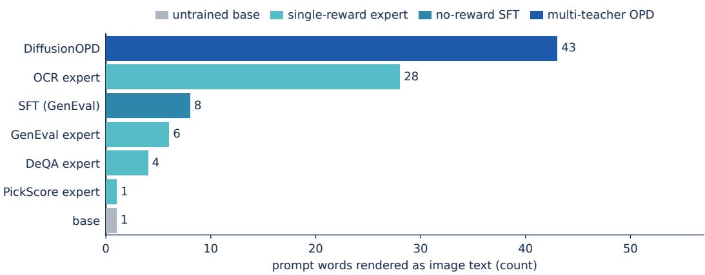  
Figure 5: Count of generated images whose detected text reproduces a word drawn from the prompt, for seven models on the prompt group that calls for no rendered text. Colour marks the kind of posttraining each model received.

Table 13: Comparison of prompt-word recurrence, the fraction of generations whose detected onimage text reproduces words from the prompt, across four-step models under two prompt registers, alongside each model’s OCR and GenEval scores from the full evaluation.
<table><tr><td rowspan="2"></td><td colspan="2">Prompt-word recurrence</td><td rowspan="2"></td><td rowspan="2"></td></tr><tr><td></td><td>Descriptive,</td></tr><tr><td>Model</td><td>Slogan register</td><td>nothing to write on</td><td>OCR↑</td><td>GenEval ↑</td></tr><tr><td>Base + TDM</td><td>0.168</td><td>0.000</td><td>0.335</td><td>0.653</td></tr><tr><td>DiffusionOPD + TDM</td><td>0.782</td><td>0.000</td><td>0.833</td><td>0.838</td></tr><tr><td>Flow-OPD + TDM</td><td>0.675</td><td>0.000</td><td>0.751</td><td>0.875</td></tr><tr><td>SFT + TDM</td><td>0.610</td><td>0.000</td><td>0.725</td><td>0.932</td></tr><tr><td>StepX-OPD, w/o precise teacher</td><td>0.820</td><td>0.000</td><td>0.899</td><td>0.944</td></tr><tr><td>StepX-OPD, w/ precise teacher</td><td>0.610</td><td>0.000</td><td>0.895</td><td>0.945</td></tr></table>

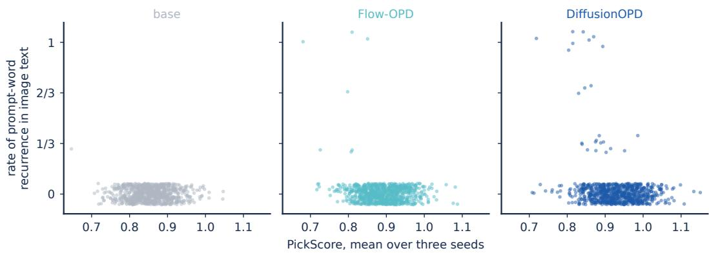  
Figure 6: Prompt-word recurrence against PickScore, resolved to individual prompts. Each point is one prompt on one model: the vertical coordinate is the fraction of that prompt’s three seeds whose detected on-image text reproduces a word from the prompt, and the horizontal coordinate is that prompt’s PickScore averaged over the same three seeds. Panels and colours are the three SD3.5- Medium models of Fig. 4, on the prompt group that figure draws from. Points carry a small vertical jitter so that points sharing a vertical value are visible as separate marks.

(4)  
(1)  
  
(1) "so many things around me wanting me to do things " (2) "You can save up to 24 hours a week by eliminating these 10 unnecessary things from your life." (3) "An image of someone who is just too damn pretty to die" (4) "the dawn of a new day" (5) "Hit me with something creative, in synthwave retro style" (6) "A man on a mission to summon the best wife in the universe, grahams number beauty" (7) "Photo of A man out of luck, bad karma, funny, humorous"

Figure 7: Text seven SD3.5-Medium models render into the image, on seven of the prompts of the Fig. 4 subset for which DiffusionOPD produces an image whose text reproduces a word from the prompt. Columns are prompts (1)–(7), printed in full below the block; rows are the untrained base, four single-reward experts, and two published multi-capability models. Fig. 8 continues with prompts (8)–(14).

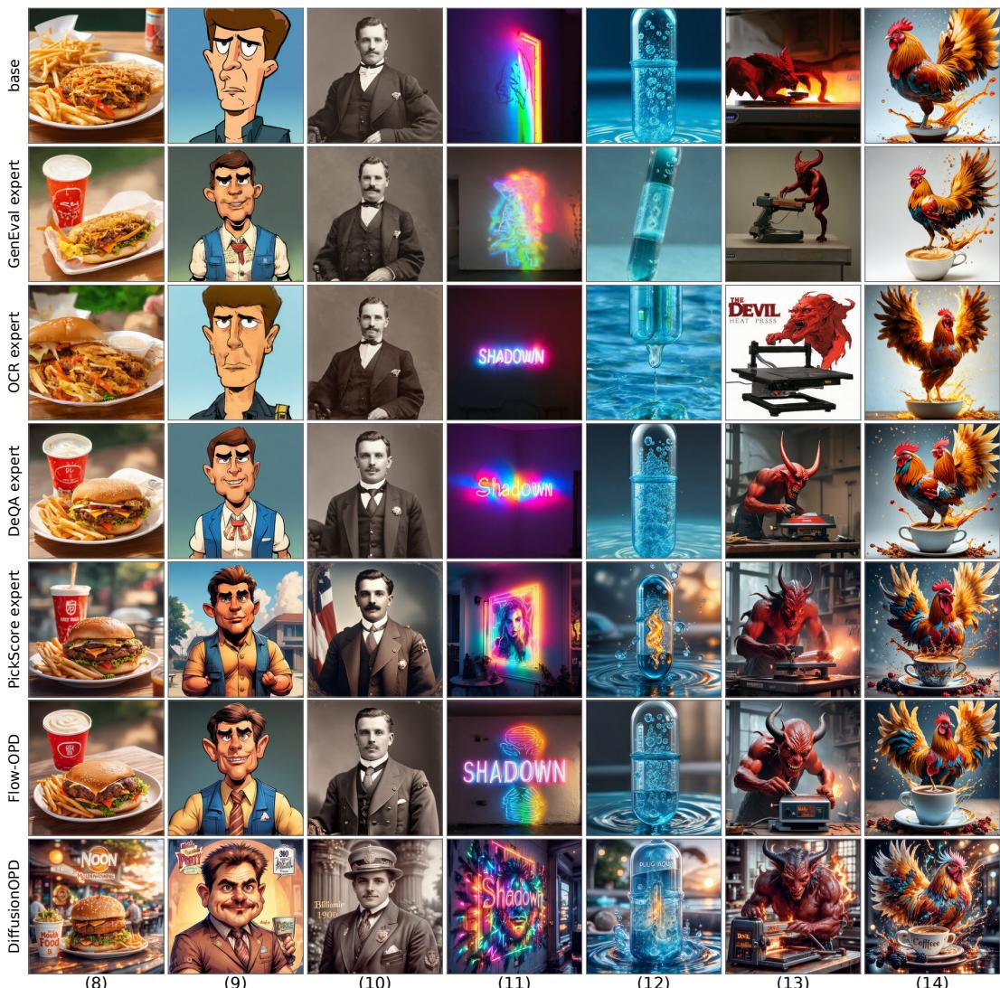  
(8) "noon sunshine, Mouth-watering fast food, real photo, 8k." (9) "porty male caricature from a 90's cartoon in a comic role" (10) "portrait of a billionair in the 1900s" (11) "Shadown projected on a wall lit with multicolor neon light" (12) "Pulsing aqua energy in a capsule" (13) "The devil using a heat press" (14) "a cup of coffee splashing morph into a rising phoenix rooster with bramble and sparkle sparks spark particles, beautiful studio lighting, appetizing lighting"

Figure 8: Text seven SD3.5-Medium models render into the image, continuing Fig. 7 with prompts (8)–(14) of the same fourteen. Columns are those prompts, printed in full below the block; rows are the untrained base, four single-reward experts, and two published multi-capability models.

## F ADDITIONAL QUALITATIVE COMPARISONS

Fig. 9 through Fig. 12 extend the comparison in Fig. 3 with sixteen further self-written prompts, four per figure, on the same four-step models, rather than the six-model comparison on benchmark prompts that Fig. 2 gives. Fig. 9 and Fig. 10 show eight scenes that call for no rendered text. Fig. 11 keeps that register for two of its four prompts and turns to a short phrase rendered on an object for the other two, and Fig. 12 specifies a phrase to render in every one of its four prompts.

Base+ TDM  
Flow-OPD + TDM  
DiffusionOPD + TDM  
StepX-OPD (ours)  
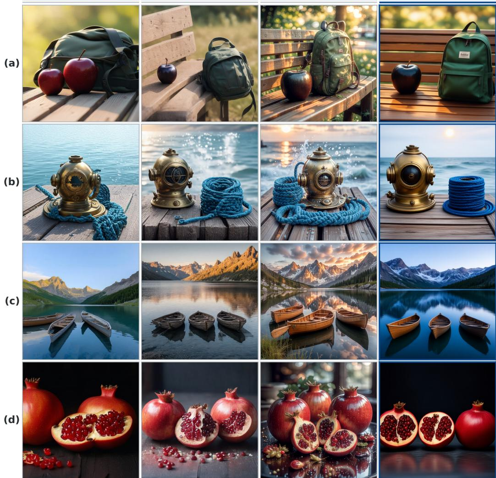  
Figure 9: (a) A black apple and a green backpack on a sunlit wooden bench, shallow depth of field, warm afternoon light; (b) A brass diving helmet and a coil of blue rope on a weathered dock, sea spray, low sun behind; (c) Three wooden rowing boats moored on a still alpine lake at dawn, mountains mirrored in the water; (d) Three ripe pomegranates split open on a dark table, seeds glistening, dramatic side light, baroque still life.

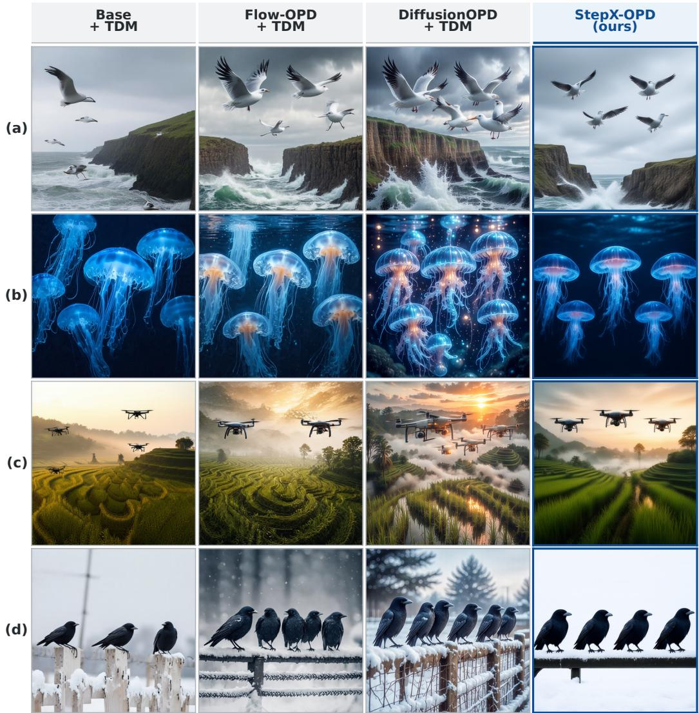  
Figure 10: (a) Four seagulls in flight against a stormy grey sky above cliffs, wind-torn spray below; (b) Five jellyfish drifting in dark water, translucent bells glowing blue, fine tentacles trailing; (c) Three drones hovering above a terraced rice field at sunrise, mist between the terraces; (d) Four crows lined up on a snowy fence rail, black against white, flat overcast light.

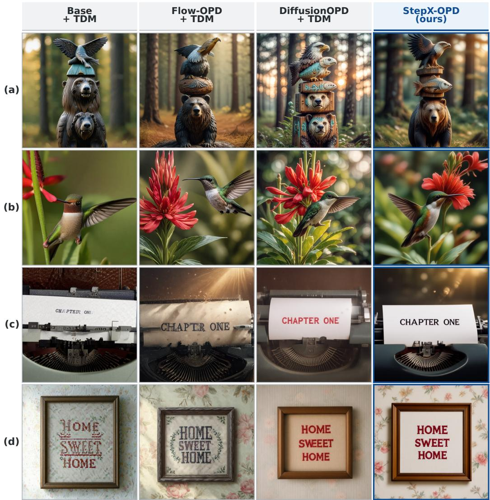  
Figure 11: (a) Stacked wooden animal totem with bear at the bottom, eagle in the middle and fish on top, with weathered paint, forest bokeh and warm light; (b) A hummingbird hovering in front of a red trumpet flower with blurred green foliage behind, high-speed macro; (c) An old typewriter with a sheet of paper rolled in, the typed line reading “CHAPTER ONE”, dust motes in a slanting sunbeam; (d) A hand-stitched sampler framed on a wall reading “HOME SWEET HOME”, late afternoon light, faded floral wallpaper behind.

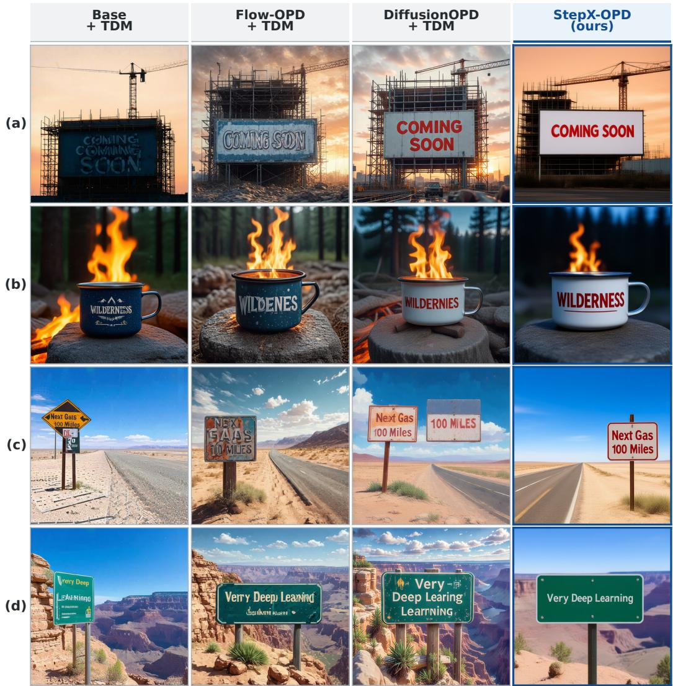  
Figure 12: (a) A construction site hoarding painted with “COMING SOON”, scaffolding above, crane silhouette against an orange evening sky; (b) An enamel mug on a campfire stone printed with “WILDERNESS”, flames glowing, pine forest dark behind, blue hour; (c) A vast, sun-baked desert landscape with a lone highway stretching into the distance. A weathered road sign stands by the side, warning “Next Gas 100 Miles”, under a blazing sky; (d) A green sign that says “Very Deep Learning” and is at the edge of the Grand Canyon.

## G PRECISE TEACHER TARGETS AND PROMPT-WORD RECURRENCE

At the four-step working point, each sampling step spans a state interval far larger than a full-step sampler’s, so a single instantaneous teacher velocity captures only one point of the local transition it should describe. The precise teacher target replaces that single evaluation with an average of guided velocities recomputed along a short rollout launched from the supervision state, so that one target covers the whole transition. It is an optional component, and Tab. 1 reports StepX-OPD without it. This appendix first gives its construction and then reports what it changes in the text these models write into images.

The construction starts from each supervision point $z _ { \tau }$ and rolls out the active target velocity field $v ^ { \mathrm { t g t } }$ . Set $x ^ { ( 0 ) } = z _ { \tau }$ and define

$$
t _ { k } = \frac { K - k } { K } \tau , \qquad k = 0 , \dots , K ,\tag{65}
$$

so that $t _ { K } = 0$ . At each $k = 0 , \ldots , K - 1$ , evaluate the conditional and unconditional velocities at the same current state:

$$
v _ { c } ^ { \mathrm { t g t } , ( k ) } = v ^ { \mathrm { t g t } } \bigl ( x ^ { ( k ) } , t _ { k } , c \bigr ) , \qquad v _ { u } ^ { \mathrm { t g t } , ( k ) } = v ^ { \mathrm { t g t } } \bigl ( x ^ { ( k ) } , t _ { k } , \emptyset \bigr ) ,\tag{66}
$$

Combine the two velocities with classifier-free guidance,

$$
v _ { \mathrm { c f g } } ^ { \mathrm { t g t , } ( k ) } = v _ { u } ^ { \mathrm { t g t , } ( k ) } + w \big ( v _ { c } ^ { \mathrm { t g t , } ( k ) } - v _ { u } ^ { \mathrm { t g t , } ( k ) } \big ) ,\tag{67}
$$

and use the explicit equal-interval Euler update

$$
x ^ { ( k + 1 ) } = x ^ { ( k ) } + ( t _ { k + 1 } - t _ { k } ) v _ { \mathrm { c f g } } ^ { \mathrm { t g t } , ( k ) } ,\tag{68}
$$

recomputing both velocities at each new state. After K steps, define ${ \hat { x } } _ { 0 } = x ^ { ( K ) }$ and average the guided velocities:

$$
\bar { v } ^ { \mathrm { t g t } } = \frac { 1 } { K } \sum _ { k = 0 } ^ { K - 1 } v _ { \mathrm { c f g } } ^ { \mathrm { t g t , } ( k ) } ,\tag{69}
$$

which requires 2K target-model forward evaluations in total.

Because the guided velocity is recomputed before every advance, the rollout follows the current guided direction at each step. With $\hat { x } _ { 0 } = x ^ { ( K ) }$ , its average satisfies

$$
z _ { \tau } - \tau \bar { v } ^ { \mathrm { t g t } } = \hat { x } _ { 0 } ,\tag{70}
$$

where $\scriptstyle { \hat { x } } _ { 0 }$ is the state reached at $t = 0$ . Thus $\bar { v } ^ { \mathrm { t g t } }$ is a secant velocity, the average slope from $z _ { \tau }$ to the guided trajectory’s endpoint, rather than an instantaneous velocity at one point. Turning the precise teacher on makes both terms of Eq. 13 take $\bar { v } ^ { \mathrm { t g t } }$ in place of the instantaneous target $\bar { \boldsymbol { v } } ^ { \mathrm { t g t } }$ which costs $2 K - 2$ target-model forwards beyond the two that the instantaneous target uses.

Measured overhead. The precise teacher adds 4.33 seconds per step inside its 500-step window, 4.8% of ordinary training time.

Effect on prompt-word recurrence. Tab. 14 reports the same two counts as Tab. 11 and Tab. 12, on the same two prompt groups, for three four-step distillation configurations each evaluated with precise teacher supervision off and on. Recurrence falls in all six comparisons, from 94 to 84 and from 20 to 19 on the configuration $\mathtt { S t e p X - O P D }$ uses.

## H SOUP COMPOSITION AND VELOCITY-REGRESSION VARIANTS

The evaluations in this section follow the protocol in App. C.

Initialization definitions. Let $W _ { 0 }$ denote the base weights, $D _ { \mathrm { G E } } , D _ { \mathrm { O C R } }$ , and $D _ { \mathrm { P i c k } }$ the three specialist increments. The merge initialization is

$$
\begin{array} { r } { W _ { \mathrm { m e r g e } } = W _ { 0 } + \frac { 1 } { 3 } \big ( D _ { \mathrm { G E } } + D _ { \mathrm { O C R } } + D _ { \mathrm { P i c k } } \big ) . } \end{array}
$$

The no-OCR variant retains coefficient $1 / 2$ on each of the other two increments, $W _ { 0 } + { \textstyle \frac { 1 } { 2 } } ( D _ { \mathrm { G E } } +$ $D _ { \mathrm { P i c k } } )$ , without renormalization. The $+ \mathrm { D e Q A }$ variant is the four-source mean, $\begin{array} { r } { W _ { 0 } + \frac { 1 } { 4 } ( D _ { \mathrm { G E } } + } \end{array}$ $D _ { \mathrm { O C R } } + D _ { \mathrm { P i c k } } + D _ { \mathrm { D e Q A } } )$ . For the SFT variants, $D _ { \mathrm { S F T } }$ is the step-2350 SFT increment: additive initialization is $W _ { 0 } + D _ { \mathrm { S F T } } + \textstyle { \frac { 1 } { 3 } } ( D _ { \mathrm { G E } } + D _ { \mathrm { O C R } } + D _ { \mathrm { P i c k } } )$ , whereas the four-model mean is $W _ { 0 } +$ $\begin{array} { r } { \frac { 1 } { 4 } ( D _ { \mathrm { S F T } } + D _ { \mathrm { G E } } + D _ { \mathrm { O C R } } + D _ { \mathrm { P i c k } } ) } \end{array}$ . Tab. 15 uses low-noise velocity MSE from step 500 without a precise target, and its rows are aligned comparisons under the four-step full-benchmark protocol.

Table 14: Comparison of text rendered and prompt-word recurrence with precise-teacher supervision off and on, across three distillation configurations, on the prompt group with no text expected and on its subset with no text called for. Bold marks the lower prompt-word recurrence count within each configuration line.
<table><tr><td colspan="3"></td><td colspan="2">No text expected</td><td colspan="2">No text called for</td></tr><tr><td>Initialization</td><td>Teachers</td><td>Precise teacher</td><td>Text rendered</td><td>Prompt-word recurrence</td><td>Text rendered</td><td>Prompt-word recurrence</td></tr><tr><td rowspan="2">SFT-augmented merge</td><td rowspan="2">DiffusionOPD</td><td>Off</td><td>304</td><td>94</td><td>96</td><td>20</td></tr><tr><td>On</td><td>298</td><td>84</td><td>92</td><td>19</td></tr><tr><td rowspan="2">Averaged-specialist merge</td><td rowspan="2">DiffusionOPD</td><td>Off</td><td>284</td><td>101</td><td>93</td><td>24</td></tr><tr><td>On</td><td>292</td><td>87</td><td>86</td><td>21</td></tr><tr><td rowspan="2">Averaged-specialist merge</td><td rowspan="2">Flow-GRPO</td><td>Off</td><td>190</td><td>71</td><td>60</td><td></td></tr><tr><td>On</td><td>236</td><td>70</td><td>71</td><td>17 15</td></tr></table>

Table 15: Ablation of soup-composition variants of the initialization, reported as full-benchmark scores.
<table><tr><td>Initialization</td><td>GenEval ↑</td><td>OCR↑</td><td>DeQA↑</td><td>PickScore ↑</td><td>Average ↑</td></tr><tr><td>Merge (3 teacher)</td><td>0.8709</td><td>0.8603</td><td>4.064</td><td>22.53</td><td>0.8527</td></tr><tr><td>Merge w/o OCR</td><td>0.8822</td><td>0.8253</td><td>4.078</td><td>22.62</td><td>0.8483</td></tr><tr><td>Merge w DEQA</td><td>0.8691</td><td>0.8346</td><td>4.086</td><td>22.58</td><td>0.8474</td></tr></table>

Soup composition. Tab. 15 compares which specialist increments are pooled into the initialization soup.

Velocity-regression evaluations. All rows below start velocity-MSE at step 500. A per-sample inference-grid query samples one of the four inference-grid points for each sample rather than evaluating all four points on every training step. Tab. 16 compares this per-sample inference-grid query against the continuous sampled τ query under full-range support. Switching to the per-sample inference-grid query lowers Average from 0.8219 to 0.8113 and OCR from 0.7296 to 0.7123.

Weight on the velocity-regression term. Fig. 13 varies the weight on the low-noise velocityregression term across five values. The Average score spans 0.8892 to 0.8908 over the whole range, so the Average score is insensitive to this weight across the swept range.

Table 16: Comparison of two velocity-regression query designs, reported as full-benchmark scores.
<table><tr><td>vMSE query</td><td>GenEval ↑</td><td>OCR↑</td><td>DeQA↑</td><td>PickScore ↑</td><td>Average ↑</td></tr><tr><td>Continuous sampled τ</td><td>0.8664</td><td>0.7296</td><td>4.101</td><td>22.65</td><td>0.8219</td></tr><tr><td>Per-sample inference-grid point</td><td>0.8449</td><td>0.7123</td><td>4.098</td><td>22.57</td><td>0.8113</td></tr></table>

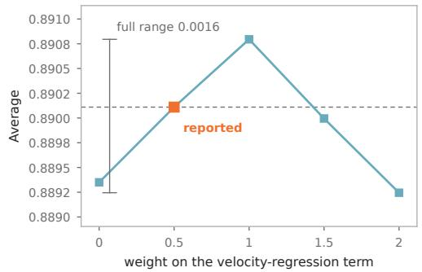

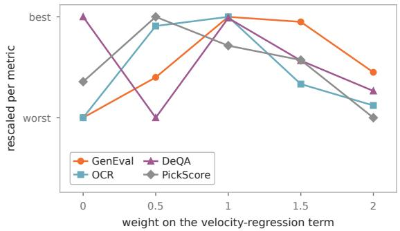  
Figure 13: Ablation of the weight on the low-noise velocity-regression term. The left panel gives the Average score and the right panel rescales each of its four components to its own range across the five settings.