# STATISTICAL MACHINE LEARNING FOR MEDICINAL PLANT LEAVES CLASSIFICATION

A PREPRINT

Jayani P. Gamage∗ Centre for Crop and Disease Management (CCDM) Faculty of Science and Engineering Curtin University Bentley, WA, Australia j.piyadigamage@curtin.edu.au

Thiyanga S. Talagala Department of Statistics University of Sri Jayewardenepura Nugegoda, Sri Lanka

November 4, 2026

## ABSTRACT

Medicinal plants are usually identified using practitioners’ experience, but reproducible, image based methods can complement this knowledge. We present MEDIPI (MEDIcinal Plant Identification), a statistical machine learning approach that classifies medicinal plant leaves from photographs. From each leaf image we extract 52 interpretable features covering shape, texture, color, and a new scagnostics category. We then classify leaves using a three level hierarchy: shape, then edge type, then species. We also release MedLEA, an open R package with 1,099 leaf images of 31 Sri Lankan medicinal plant species. On this dataset, a hierarchical Random Forest achieved the best overall accuracy (100%) in our comparison of hierarchical and non-hierarchical approaches and eight algorithms: Random Forest, XGBoost, Gradient Boosting, linear discriminant analysis, k-nearest neighbor, support vector machine, probabilistic neural network, and artificial neural network. Adding texture, color, and scagnostic features to shape features raised shape level accuracy from 90% to 97%. Linear discriminant analysis plots show how the trained model separates leaf shapes. Accuracy dropped sharply (23–50%) when training and test data came from different datasets. Therefore, generalization across datasets remains a challenge.

Keywords image processing · feature extraction · statistical machine learning · hierarchical classification · medicinal plants · leaf image classification · interpretable machine learning

## 1 Introduction

Located in the tropics, Sri Lanka is home to many plant species with medicinal properties. Generations of Sri Lankans have used them as herbal treatments, and the traditional medicine system, which has been practiced for more than 3000 years, is still in use today [Waisundara and Watawana, 2014]. It includes Ayurveda, Unani, and Deshiya Chikitsa [Gunawardana and Jayasuriya, 2019]. Traditional treatments are used to manage many conditions, including diseases with complicated causes such as diabetes, arthritis, and cancer [Waisundara and Watawana, 2014, Devalaraja et al., 2011], and a wide range of plants is used for this purpose [Gunawardana and Jayasuriya, 2019, Goyal et al., 2018].

Medicinal plants are important worldwide. An estimated 50, 000 to 70, 000 plant species are used for medicinal purposes [Schippmann et al., 2006], and the World Health Organization’s Global Traditional Medicine Strategy 2025–2034 stresses that traditional medicines should be used safely and based on scientific evidence [World Health Organization, 2025]. Sri Lanka has about 550 medicinal plant species out of a total of 3, 314 plant species (16.6%) [Schippmann et al., 2006]. Among the 15 countries with available data [Schippmann et al., 2006], Sri Lanka ranks 13th in the number of medicinal plant species and $7 ^ { \mathrm { t h } }$ in the percentage of medicinal plants compared with its total flora (Figure 1). Estimates of the number of medicinal plants in Sri Lanka differ between sources; recent surveys report as many as 1432 species [Nilaweera, 2010].

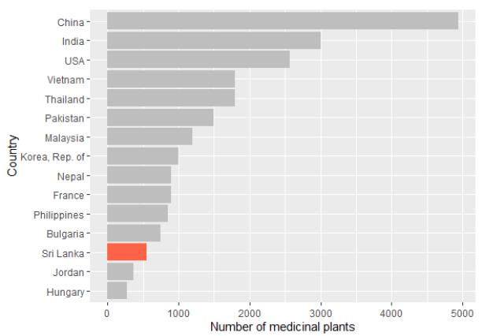

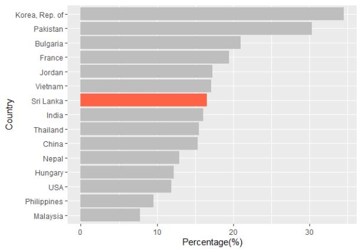  
Figure 1: Sri Lanka is in the top 15 for medicinal plant diversity among countries with published estimates. (a) Number of medicinal plant species and (b) percentage of medicinal plants relative to total flora in 15 countries; Sri Lanka is highlighted. Data: Schippmann et al. [2006], Table 1.

Sri Lanka also exports medicinal plants and plant materials. According to ITC Trade Map data for HS code 1211, which covers plants and plant parts used mainly in perfumes, medicines, and insecticides [International Trade Centre, 2026], Sri Lanka’s export value rose from USD 3.9 million in 2016 to USD 17.1 million in 2025, more than four times the 2016 value. Over the same period, global exports rose from USD 3.2 billion to USD 4.6 billion (Figure 2a). Even so, Sri Lanka’s share of the global market remains small, at about 0.4%. In 2024, the five largest exporters were China, India, Canada, Germany, and Egypt, while Sri Lanka ranked 41st (Figure 2b).

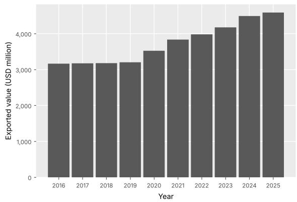

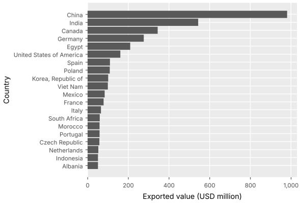  
Figure 2: Global trade in medicinal plants is growing, but Sri Lanka’s share is small. (a) Global export value of HS 1211 plants, 2016–2025 (2025 is provisional); (b) top 20 exporting economies of HS 1211 plants in 2024. Source: ITC Trade Map, https://www.trademap.org.

Despite this demand, there is no standard way to identify medicinal plants. Many medicinal plants grow in backyards with little care, and some are even treated as weeds [Waisundara and Watawana, 2014]. Most Sri Lankans know the traditional system and use the plants growing near their homes without the advice of a practitioner, relying on knowledge passed down by their ancestors [Saslis-Lagoudakis et al., 2014]. Identifying plants by hand, however, needs a lot of botanical expertise, and it is costly, slow, and difficult for the general public. Misidentification also matters for conservation. Nearly 15,000 medicinal plant species are threatened worldwide, and 280 plant species are threatened in Sri Lanka. Of the medicinal plants in Sri Lanka, 100–200 species are threatened [Nilaweera, 2010], including Abarema begimena, the Ashoka tree (Saraca asoca), the Beautiful Leaf (Calophyllum trapezifolium), and Aglaia apiocarpa. The IUCN classes threatened plants as Critically Endangered, Endangered, or Vulnerable.

Automatic identification from images is a promising solution, but existing work has several gaps. Most algorithms learn from images, so image quality strongly affects performance. Researchers therefore use the built-in cameras of mobile devices [Waldchen and Mader, 2018] or special cameras and scanners, and there are rules for taking the photographs, such as a single leaf, good lighting, no shadows, and a fixed line of sight angle [Goyal et al., 2018]. Most studies use secondary datasets such as Flavia and Swedish [Goyal et al., 2018, Waldchen and Mader, 2018]. These datasets contain few plant species [Goyal et al., 2018, Waldchen and Mader, 2018], so researchers often collect their own images, and no database of Sri Lankan medicinal plant leaves was available.

Images of leaves, flowers, bark, and fruit [Waldchen and Mader, 2018] have all been used to train classification models. Leaves carry many useful features and are easy to collect, so most researchers use them, and most work focuses on shape features [Goyal et al., 2018]. Shape features alone, however, are not enough to train a reliable model, which raises the question of which features matter most for classifying plant species. Existing algorithms are mostly built on CNN, ANN, PNN, and KNN architectures. These models need a lot of memory and computing power, and although they can predict well, they are hard to interpret. We address these gaps with an image feature-based statistical machine learning algorithm.

Our main objective is to develop an automatic algorithm that classifies medicinal plants from leaf images using statistical machine learning. To reach it, we pursue four supporting objectives. First, we build and share a repository of medicinal plant leaf images from Sri Lanka. Gathering leaf samples is slow, so sharing the database gives other researchers data to train and test their own algorithms. Second, we identify features that are useful for classifying medicinal plants from leaf images, which contain a large and diverse set of features such as shape, veins, edges, and apices, and we develop an algorithm to extract and quantify them. Third, we use high-dimensional visualization to show what happens inside the trained algorithm. Fourth, we release the algorithm as open-source software for identifying Sri Lankan medicinal plants from leaf images.

This research can help avoid misidentification of medicinal plants in Sri Lanka, which supports conservation and ecological efforts. Leaves are easy to collect without damaging the plant, so developing and using the algorithm does no harm to the plants. The algorithm is also hierarchical: users can follow its first two levels even if they do not know the exact species name, which may reduce misidentification and computation time.

The remainder of this paper is organized as follows. Section 2 describes the materials and methods, including the datasets, the image processing and feature extraction pipeline, the hierarchical classification framework, and an exploratory analysis of leaf morphology in the Ruhuna dataset. Section 3 presents the results: the two classification experiments, a comparison with benchmark algorithms, visualization of the trained model using linear discriminant analysis, and feature importance at each level of the hierarchy. Section 4 discusses the findings and their limitations, and Section 5 concludes and outlines future work.

## 2 Materials and Methods

## 2.1 Overview of the Algorithm

In this section, we provide a general overview of the methodology used to develop our classification algorithm. The classification algorithm we introduce contains two main phases: (i) the offline phase, and (ii) the online phase.

  
Figure 3: Workflow of the offline phase of the algorithm.

As shown in Figure 3, the workflow of the offline phase of the algorithm contains four main steps:

1. Image acquisition

2. Image processing

3. Feature extraction

4. Algorithm development and visualization of algorithm performance

Figure 4 shows the overview of the methodology followed. The online phase of the study is colored orange and the offline phase is colored blue. Firstly, we acquire leaf images from existing datasets and from the leaf image dataset collected by ourselves. Each leaf image dataset is then divided into training and test images: the training set contains 80% of images and the test set contains 20% of images from each dataset. We use four datasets to build and evaluate the algorithm; a summary is given in Table 1.

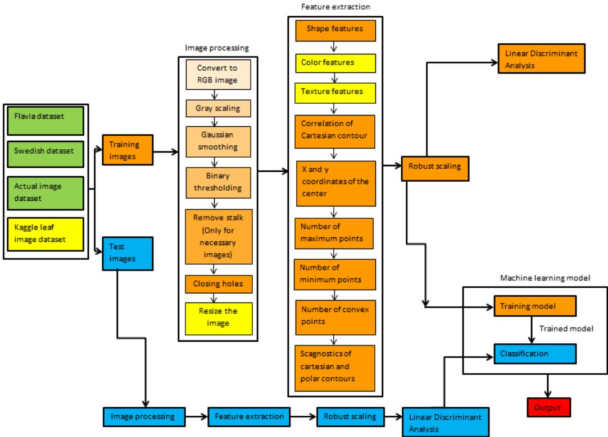  
Figure 4: Methodology diagram.

Table 1: Summary of datasets used in the algorithm.
<table><tr><td>Dataset</td><td>Image format</td><td>Total number of leaf images</td></tr><tr><td>Actual Leaf Image Dataset (MedLEA)</td><td>Color</td><td>1099</td></tr><tr><td>Flavia dataset</td><td>Color</td><td>1907</td></tr><tr><td>Swedish Leaf Image Dataset</td><td>Color</td><td>1125</td></tr><tr><td>Kaggle Leaf Image Dataset</td><td>Binary</td><td>1584</td></tr></table>

The next step is image processing. As shown in Figure 4, the main image processing steps are: convert to RGB image, gray scaling, Gaussian smoothing, binary thresholding, remove stalk, close holes, and resize image. Since the Kaggle leaf image dataset contains only binary images, resizing is the only applicable step. Removing the stalk and closing holes apply only to datasets containing leaf images with a stalk or with holes (e.g., diseased leaves). After image processing, images are ready for feature extraction. There are four classes of features: (i) shape features, (ii) color features, (iii) texture features, and (iv) scagnostics features of Cartesian and polar coordinates. In this research we also introduce several new features: correlation of Cartesian contour, x and y coordinates of the contour, number of minimum and maximum points, and number of convex points. The resulting dataset contains all features along with the leaf image id; note that the Kaggle leaf image dataset does not have color and texture features. Robust scaling [Brownlee, 2020] is applied to scale the data. To visualize the labeled feature dataset, linear discriminant analysis (LDA) [Tharwat et al., 2017] is used. Our algorithm operates as a hierarchical classification system: leaves are first classified according to shape (diamond, simple round, round, needle, or heart shape), then according to edge type, and finally the bottom level classifies plant species. Before training the model, all leaves are labeled according to shape type, edge type, leaf arrangement, apex type, base type, etc. These labels were identified by exploring the “Ayurvedic Medicinal Plants of Sri Lanka” medicinal leaf repository maintained by Barberyn Ayurveda Resort and the University of Ruhuna. The information gathered from this repository is made available through our R package MedLEA. The next step is to train the model on the training dataset using machine learning techniques: a multi-class supervised classification problem and use the trained model to predict labels in the test dataset.

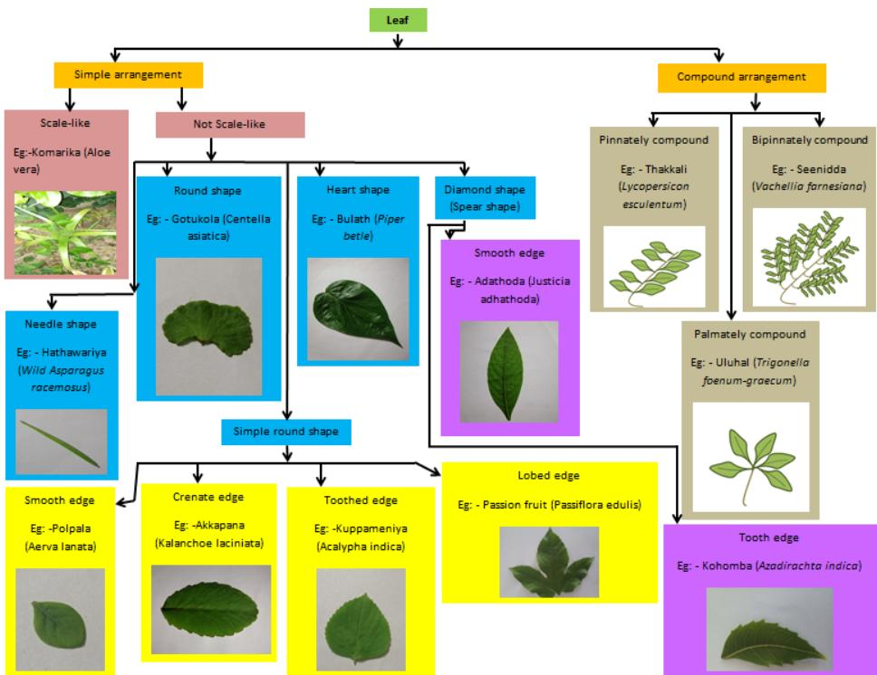  
Figure 5: Classification hierarchy.

Our medicinal plant classification algorithm is defined as MEDIPI: MEDIcinal Plant Identification. MEDIPI is divided into an offline phase and an online phase. The classification algorithm is trained in the offline phase; in the online phase, the pre-trained classification model is used for real-time leaf image classification for general users.

## 2.2 Data

We use four datasets: one primary dataset and three secondary datasets. The primary dataset is named MedLEA; the secondary datasets are Flavia, Swedish, and Kaggle (Table 2).

Table 2: Summary of secondary datasets.
<table><tr><td>Dataset</td><td>Image format</td><td>No. species</td><td>Images per species</td><td>No. leaf images</td><td>Remarks</td></tr><tr><td>Flavia</td><td>Color</td><td>32</td><td>50-77</td><td>1907</td><td>Scanners and digital cameras used to acquire leaf images on a plain background; isolated leaf images contain blades</td></tr><tr><td>Swedish</td><td>Color</td><td>15</td><td>75</td><td>1125</td><td>lected in China. Isolated leaf scans on a plain background. Collected in Sweden.</td></tr><tr><td>Kaggle</td><td>Binary</td><td>99</td><td>16</td><td>1584</td><td>Collected in the United King- dom.</td></tr></table>

## 2.2.1 MedLEA

The image collection process contains five main steps, shown in Figure 7. This approach is simple and can be followed without any expert knowledge.

First, a plant is selected and a leaf is picked using scissors, without petiole, in the morning when the leaf looks fresh. The leaf is then cleaned with a small brush or paper serviette to remove water bubbles, soil, or mud. In some cases, where the leaf rounds from the apex, base, or margin and cannot lie flat, the leaf is pressed for approximately 1–2 days before photographing, to avoid distorting the extracted contour. The pressed leaf is then kept centered on a white sheet of paper, since accurate binary conversion depends on the leaf being centered. Finally, the closest photo is taken without flash (Figure 8): the closest photo reduces computational load and unnecessary foreground region [Goyal et al., 2018], and avoiding flash removes shadow, which is important for capturing the leaf shape correctly in the binary image. Photos are taken in daylight to minimize the effect of light illumination.

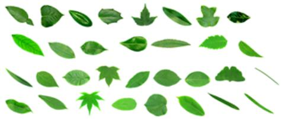  
Sample of Flavia dataset

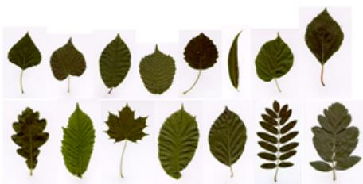  
Sample of Swedish dataset

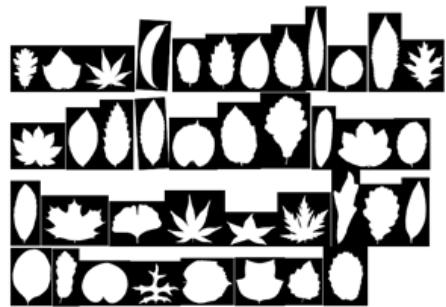  
Sample of Kaggle dataset

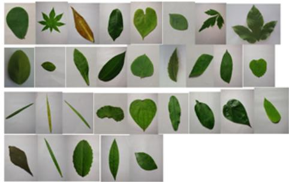  
Sample of MedLEA dataset

Figure 6: Sample leaf images from the Flavia, Swedish, Kaggle, and MedLEA datasets.  
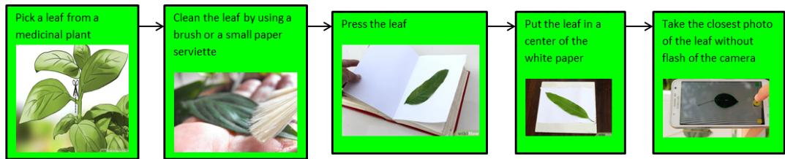  
Figure 7: Image collection process of medicinal plants in Sri Lanka.

Through this research, we establish a repository of medicinal plant images in Sri Lanka. This repository is made available to the public through the open-source R package MedLEA, available at https://CRAN.R-project.org/ package=MedLEA, for research reproducibility.

There are 1099 leaf images of 31 species, with 29–45 images per species of medicinal plants in Sri Lanka. These leaves have simple arrangement: a single leaf that is never divided into smaller leaflet units, always attached to a twig by its stem or petiole. Leaf margins can be smooth, lobed, or toothed. Photos were taken with a Huawei Nova 3i, with the closest photos captured on a white background.

## 2.3 Image Processing

Image processing plays a vital role in leaf image identification, reducing noise, subtracting the background, and enhancing content for the identification process [Goyal et al., 2018]. The workflow used to process images in this

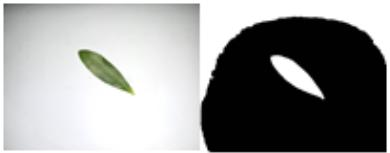  
With flash

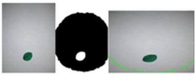  
Not closest photo without

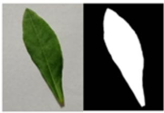  
Closest photo without flash

Figure 8: Effect of flash and distance on binary conversion quality.

paper is shown in Figure 9 and includes seven main steps: (i) converting BGR to RGB, (ii) gray scaling, (iii) Gaussian filtering, (iv) binary thresholding, (v) removing stalk, (vi) closing holes, and (vii) image resizing. Some steps apply only to specific images. For example, removing the stalk applies only to leaf images that have one.

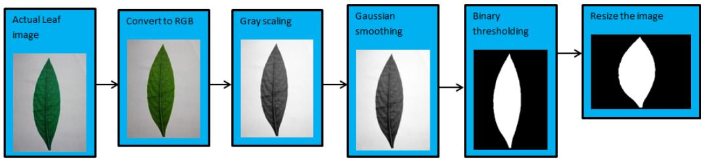  
Figure 9: Image processing workflow.

Feeding RGB images through gray scaling optimizes the contrast and intensity of images by reducing dimensionality and complexity. Smoothing techniques are applied to remove noise, and binary thresholding separates foreground from background. Removal of the stalk and closing of holes in the foreground are important for accurately capturing leaf shape (Figure 10). More details on the image processing pipeline are discussed in Lakshika and Talagala [2021].

## 2.4 Feature Extraction

The most crucial part of the algorithm is extracting distinctive leaf features from the images. Much prior work focuses on neural network models such as CNNs [Wu et al., 2007, Azlah et al., 2019, Herdiyeni and Wahyuni, 2012], which are complex and difficult to interpret. We instead introduce pre-calculated features that are easy to interpret, generalize well, and are computationally efficient. We focus on four types of leaf image features: shape, texture, color, and scagnostics features, identifying 52 features in total. More details on these features are discussed in Lakshika and Talagala [2021].

## 2.5 Classification Framework

Our algorithm operates as a hierarchical classification system with three levels. The first level classifies images according to shape; the second level classifies according to edge type; the bottom level classifies plant species. If species names were used directly rather than a hierarchical classification, the resulting large number of class labels would be difficult to manage and would create a severe class imbalance problem. To develop the hierarchical system we explored the actual plant image repository “Ayurvedic Medicinal Plants of Sri Lanka” (http://www.instituteofayurveda. org/plants/), which describes the most commonly used medicinal plants in Ayurvedic practice in Sri Lanka. This website was created as the result of a project implemented by Barberyn Ayurveda resort and the University of Ruhuna, and was last updated on 11 May 2017. Our pilot study was based on this database.

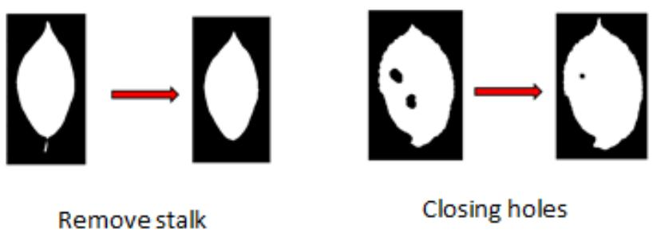  
Figure 10: Binary image before and after removing the stalk and closing holes.

We investigated 471 medicinal leaves in this repository, recording the physical appearances (morphological characteristics) of each leaf together with its Sinhala (local) name, family name, and scientific name. There were 22 variables in total, with a unique primary key “Id”, of which 18 variables described physical appearances such as leaf arrangement, shape, edge type, apex, and base.

## 2.6 Exploratory Data Analysis of the Ruhuna Dataset

In this section, we present exploratory data analysis to characterize the common morphological features of leaves in the Ruhuna repository.

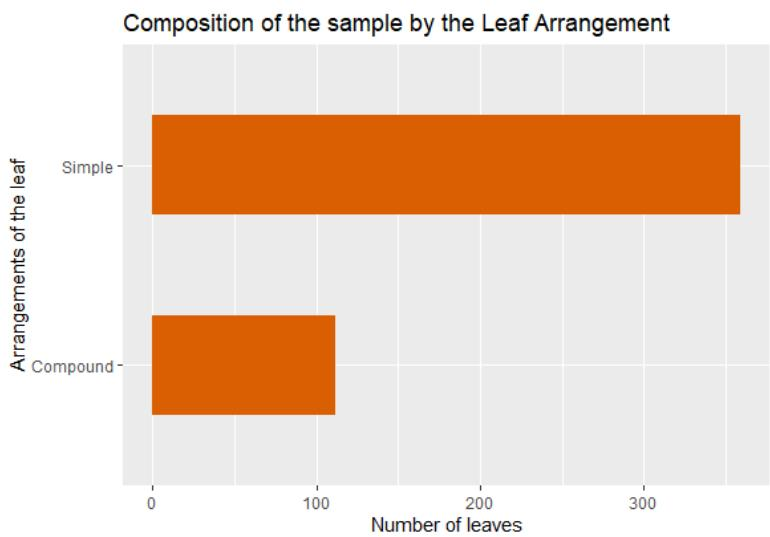  
Figure 11: Composition of the Ruhuna dataset sample by leaf arrangement.

According to Figure 11, most leaves have simple arrangement; we therefore restrict further analysis to leaves with simple arrangement. According to Table 3, the most common leaf shapes are (i) diamond, (ii) simple round, (iii) heart, (iv) needle, and (v) round, which we use as the first level of the hierarchy. Most leaves have smooth edges; we identify four common edge types: (i) smooth, (ii) toothed, (iii) lobed, and (iv) crenate, used as the second level of the hierarchy. As shown in Table 3, most diamond, heart, round, needle, and simple round-shaped leaves have smooth edges; all needle-shaped leaves have smooth edges; there are no crenate-edged heart-shaped leaves; and diamond, round, and simple round-shaped leaves span all four edge types.

Table 3: Cross tabulation of shape and edge type in the Ruhuna dataset.
<table><tr><td>Shape label</td><td></td><td>Smooth</td><td>Tooth</td><td>Lobed</td><td>Crenate</td><td>Row total (%)</td></tr><tr><td rowspan="4">Diamond</td><td>Count</td><td>167</td><td>27</td><td>22</td><td>1</td><td rowspan="4">217 (60.4)</td></tr><tr><td>Row %</td><td>77.0</td><td>12.4</td><td>10.1</td><td>0.5</td></tr><tr><td>Column %</td><td>66.0</td><td>44.3</td><td>55.0</td><td>20.0</td></tr><tr><td>Total %</td><td>46.5</td><td>7.5</td><td>6.1</td><td>0.3</td></tr><tr><td rowspan="4">Heart</td><td>Count</td><td>26</td><td>14</td><td>6</td><td>0</td><td rowspan="4">46 (12.8)</td></tr><tr><td>Row %</td><td>56.5</td><td>30.4</td><td>13.0</td><td>0.0</td></tr><tr><td>Column %</td><td>10.3</td><td>23.0</td><td>15.0</td><td>0.0</td></tr><tr><td>Total %</td><td>7.2</td><td>3.9</td><td>1.0</td><td>0.0</td></tr><tr><td rowspan="3">Needle</td><td>Count</td><td>21</td><td>0</td><td>0</td><td>0</td><td rowspan="3">21 (5.8)</td></tr><tr><td>Row %</td><td>100</td><td>0.0</td><td>0.0</td><td>0.0</td></tr><tr><td>Column %</td><td>8.3</td><td>0.0</td><td>0.0</td><td>0.0</td></tr><tr><td rowspan="3">Round</td><td>Count</td><td>5</td><td>3</td><td>1</td><td>1</td><td rowspan="3">10 (2.8)</td></tr><tr><td>Row %</td><td>50</td><td>30</td><td>10</td><td>10</td></tr><tr><td>Column %</td><td>2.0</td><td>4.9</td><td>2.5</td><td>20</td></tr><tr><td rowspan="3">Simple round</td><td>Count</td><td>31</td><td>14</td><td>11</td><td>3</td><td rowspan="3">59 (16.4)</td></tr><tr><td>Row %</td><td>52.5</td><td>23.7</td><td>18.6</td><td>5.1</td></tr><tr><td>Column %</td><td>12.3</td><td>23.0</td><td>27.5</td><td>60</td></tr><tr><td rowspan="3">Scale-like</td><td>Count</td><td>3</td><td>3</td><td>0</td><td>0</td><td rowspan="3">6 (1.7)</td></tr><tr><td>Row %</td><td>50</td><td>50</td><td>0.0</td><td>0.0</td></tr><tr><td>Column %</td><td>1.2</td><td>4.9</td><td>0.0</td><td>0.0</td></tr><tr><td>Column total (%)</td><td></td><td>253 (70.5)</td><td>61 (17.0)</td><td>40 (11.1)</td><td>5 (1.4)</td><td>359 (100)</td></tr></table>

By conducting this study we identified the common shapes and edge types of medicinal leaves in Sri Lanka: five main shapes (diamond, heart, round, needle, simple round) and four main edge types (smooth, toothed, lobed, crenate). This informs the general hierarchical structure shown in Figure 12 and Figure 13.

## 3 Results

## 3.1 Experiments

We conducted two experiments, illustrated in Figure 14. Since most studies in the literature consider shape features only, we designed the experiments to test whether adding new feature categories improves accuracy, arranging the experiments in two ways: (i) using all feature categories (shape, color, texture, and scagnostic features), and (ii) using shape features only.

## 3.2 Experiment 1

Experiment 1 asks how well the classifiers perform when the training and test sets come from the same dataset. We split each dataset into 80% training and 20% test data, and we ran the experiment twice: first with all feature categories, and then with shape features only. The Flavia, Swedish, and Kaggle datasets were used for the first level of the hierarchy only (H1, shape). The Actual dataset (MedLEA) was analyzed from top to bottom, so that we could record accuracy at every level: shape (H1), edge type (H2), and species (H3).

We begin with the first level. Table 4 shows shape-wise (H1) and overall accuracy when all feature categories are used.   
The Kaggle dataset has no needle shaped leaves, so that column is empty.

Random Forest classifies simple round, needle, round, and heart shaped leaves in the Actual dataset with 100% accuracy, and it ties with Gradient Boosting for the highest overall accuracy (97%). The same pattern holds in the other datasets:

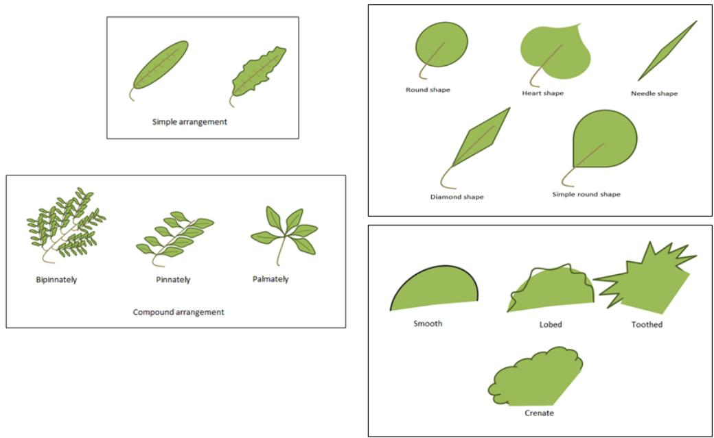  
Figure 12: Common arrangements, shapes, and edge types.

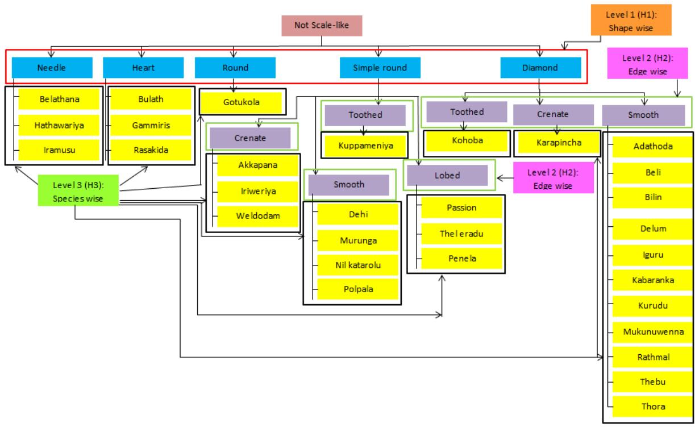  
Figure 13: General hierarchical structure types.

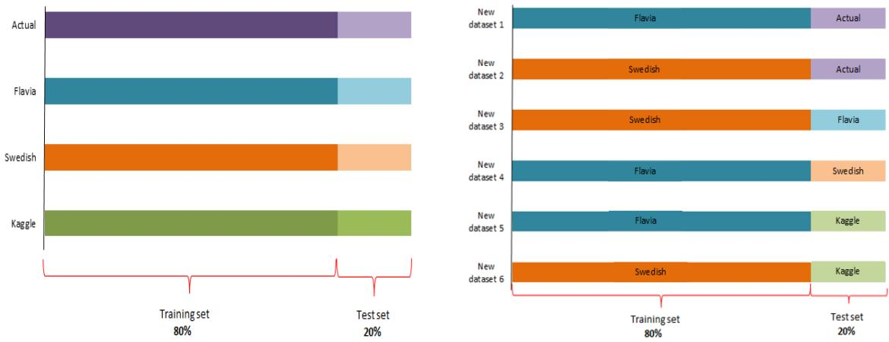  
Figure 14: Proportion of training and test sets in Experiment 1 (a) and Experiment 2 (b).

Table 4: Shape-wise (H1) and overall classification accuracy, Experiment 1 – all feature categories (training and test sets from the same dataset).
<table><tr><td>Dataset</td><td>Algorithm</td><td>Diamond</td><td>Simple Round</td><td>Needle</td><td>Heart</td><td>Round</td><td>Overall</td></tr><tr><td rowspan="3">Actual</td><td>Random Forest</td><td>0.94</td><td>1.00</td><td>1.00</td><td>1.00</td><td>1.00</td><td>0.97</td></tr><tr><td>XGBoost</td><td>0.94</td><td>0.95</td><td>1.00</td><td>0.96</td><td>1.00</td><td>0.95</td></tr><tr><td>Gradient Boosting</td><td>0.96</td><td>0.96</td><td>1.00</td><td>1.00</td><td>1.00</td><td>0.97</td></tr><tr><td rowspan="3">Flavia</td><td>Random Forest</td><td>0.98</td><td>0.97</td><td>0.96</td><td>0.97</td><td>1.00</td><td>0.98</td></tr><tr><td>XGBoost</td><td>0.99</td><td>0.95</td><td>0.93</td><td>0.98</td><td>1.00</td><td>0.97</td></tr><tr><td>Gradient Boosting</td><td>0.98</td><td>0.96</td><td>1.00</td><td>1.00</td><td>1.00</td><td>0.98</td></tr><tr><td rowspan="3">Swedish</td><td>Random Forest</td><td>0.99</td><td>1.00</td><td>1.00</td><td>0.95</td><td>1.00</td><td>0.98</td></tr><tr><td>XGBoost</td><td>1.00</td><td>1.00</td><td>1.00</td><td>0.88</td><td>0.92</td><td>0.97</td></tr><tr><td>Gradient Boosting</td><td>0.99</td><td>0.98</td><td>0.96</td><td>0.86</td><td>1.00</td><td>0.96</td></tr><tr><td rowspan="3">Kaggle</td><td>Random Forest</td><td>0.76</td><td>0.69</td><td></td><td>0.82</td><td>0.77</td><td>0.74</td></tr><tr><td>XGBoost</td><td>0.75</td><td>0.68</td><td></td><td>0.70</td><td>0.70</td><td>0.71</td></tr><tr><td>Gradient Boosting</td><td>0.74</td><td>0.68</td><td>一</td><td>0.92</td><td>0.66</td><td>0.71</td></tr></table>

Random Forest and Gradient Boosting tie on Flavia (98%), and Random Forest is best on Swedish (98%) and Kaggle (74%). Across all four datasets, the overall H1 accuracy of Random Forest is equal to or higher than that of XGBoost and Gradient Boosting.

Because of this strong and consistent performance, we used Random Forest for the lower levels of the hierarchy on the Actual dataset. Figure 15 shows the second level (H2) for diamond and simple round leaves, and Table 5 gives the edge-wise accuracy.

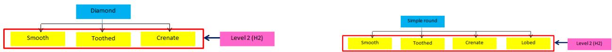  
Figure 15: Level 2 hierarchy (H2) of diamond-shaped leaves (left) and simple round-shaped leaves (right).

At the edge level, Random Forest reaches 97% overall accuracy for both diamond and simple round leaves. Accuracy is 100% for smooth and toothed diamond leaves, and for toothed, lobed, and crenate simple round leaves. The weakest result is for crenate diamond leaves (40%), the only edge type that falls well below the rest.

Table 5: Edge-wise (H2) and overall classification accuracy, Experiment 1 (training and test sets from the Actual dataset).
<table><tr><td colspan="5">Diamond</td><td colspan="5">Simple Round</td></tr><tr><td>Dataset / Algorithm</td><td>Smooth</td><td>Toothed</td><td>Crenate</td><td>Overall</td><td>Smooth</td><td>Toothed</td><td>Lobed</td><td>Crenate</td><td>Overall</td></tr><tr><td>Actual – Random Forest</td><td>1.00</td><td>1.00</td><td>0.40</td><td>0.97</td><td>0.94</td><td>1.00</td><td>1.00</td><td>1.00</td><td>0.97</td></tr></table>

Next, we look at the species level (H3). Heart- and needle-shaped leaves have no edge split, so their species are classified directly from shape (Figure 16 and Table 6).

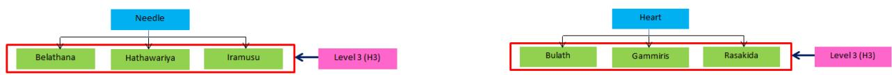  
Figure 16: Level 3 hierarchy (H3) of needle-shaped leaves (left) and heart-shaped leaves (right).

Table 6: Species-wise (H3) and overall classification accuracy given shape (training and test sets from the Actual dataset).
<table><tr><td></td><td colspan="4">Needle</td><td colspan="4">Heart Shape</td></tr><tr><td>Dataset / Algorithm</td><td>Belathana</td><td>Hathawariya</td><td>Iramusu</td><td>Overall</td><td>Bulath</td><td>Gammiris</td><td>Rasakida</td><td>Overall</td></tr><tr><td>Actual – Random Forest</td><td>1.00</td><td>1.00</td><td>1.00</td><td>1.00</td><td>1.00</td><td>1.00</td><td>1.00</td><td>1.00</td></tr></table>

Random Forest classifies every species of needle- and heart-shaped leaves with 100% accuracy.

For diamond and simple round leaves, species are classified within each edge type. Figure 17 shows the hierarchy for these cases, and Table 7 gives the species-wise accuracy.

Table 7: Species-wise (H3) and overall classification accuracy given the edge (training and test sets are from the Actual dataset)
<table><tr><td rowspan="3">Dataset</td><td colspan="8">Diamond</td><td colspan="9">Simple Round</td><td colspan="7" rowspan="2">Crenate</td></tr><tr><td colspan="10">Smooth</td></tr><tr><td colspan="3">Kaqqga Dllunm uuu Beli Bilin</td><td colspan="3">Muuna uudu Ratmal Thqbu Thoira</td><td colspan="3">Oyverl rcy</td><td colspan="3">Smooth Oyve rcy Nittrolnu</td><td colspan="10"></td></tr></table>

Random Forest achieves 100% overall species-wise accuracy for simple round leaves of every edge type. For smooth diamond leaves the overall accuracy is 87%. Most species are classified correctly, but three have noticeably lower accuracy: Kabaranga (43%), Delum (50%), and Rathmal (50%). These species may deserve a closer look.

Finally, we repeated the H1 experiment using shape features only. Table 8 shows the results.

With shape features only, XGBoost has the highest overall H1 accuracy on the Actual (92%) and Swedish (97%) datasets, and all three algorithms tie on Flavia (96%). Comparing Table 8 with Table 4, overall accuracy is lower when only shape features are used. For Random Forest, accuracy drops from 97% to 90% on the Actual dataset, from 98% to 96% on Flavia, and from 98% to 95% on Swedish. Color, texture, and scagnostic features therefore add useful information beyond shape.

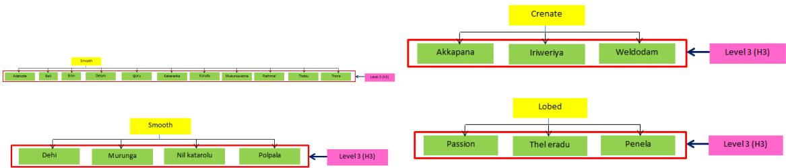  
Figure 17: Level 3 hierarchy (H3) of diamond shaped smooth edged leaves, simple round shaped smooth edged leaves, simple round shaped crenate edged, and simple round shaped lobed edged leaves.

Table 8: Shape-wise (H1) and overall classification accuracy, Experiment 1 – shape features only (training and test sets from the same datasets).
<table><tr><td>Training/Test set</td><td>Algorithm</td><td>Diamond</td><td>Simple Round</td><td>Needle</td><td>Heart</td><td>Round</td><td>Overall</td></tr><tr><td rowspan="3">Actual</td><td>Random Forest</td><td>0.89</td><td>0.86</td><td>1.00</td><td>1.00</td><td>0.86</td><td>0.90</td></tr><tr><td>XGBoost</td><td>0.92</td><td>0.89</td><td>0.97</td><td>0.97</td><td>1.00</td><td>0.92</td></tr><tr><td>Gradient Boosting</td><td>0.93</td><td>0.83</td><td>1.00</td><td>0.92</td><td>0.71</td><td>0.90</td></tr><tr><td rowspan="3">Flavia</td><td>Random Forest</td><td>0.93</td><td>1.00</td><td>0.91</td><td>0.97</td><td>1.00</td><td>0.96</td></tr><tr><td>XGBoost</td><td>0.96</td><td>0.96</td><td>1.00</td><td>0.96</td><td>0.98</td><td>0.96</td></tr><tr><td>Gradient Boosting</td><td>0.94</td><td>0.98</td><td>0.95</td><td>1.00</td><td>1.00</td><td>0.96</td></tr><tr><td rowspan="3">Swedish</td><td>Random Forest</td><td>0.96</td><td>1.00</td><td>1.00</td><td>0.85</td><td>0.94</td><td>0.95</td></tr><tr><td>XGBoost</td><td>0.99</td><td>1.00</td><td>1.00</td><td>0.82</td><td>1.00</td><td>0.97</td></tr><tr><td>Gradient Boosting</td><td>0.95</td><td>0.98</td><td>1.00</td><td>1.00</td><td>0.92</td><td>0.96</td></tr></table>

## 3.3 Experiment 2

Experiment 2 tests how well the classifiers generalize to data they have not seen before. Here, the training and test sets come from different datasets: each model is trained on 80% of one dataset and tested on 20% of another (written as Train → Test in the tables). As in Experiment 1, we ran the experiment with all feature categories and then with shape features only. Only the first level of the hierarchy (H1, shape) was evaluated.

Table 9 shows shape-wise (H1) and overall accuracy when all feature categories are used.

Accuracy drops sharply compared with Experiment 1. Overall accuracy ranges from 23% to 44%, and no algorithm is consistently best. Random Forest is highest only for Flavia → Kaggle (44%), XGBoost for Flavia → Actual (43%), and Gradient Boosting for Swedish → Actual, Swedish → Flavia, and Swedish → Kaggle (27% to 37%). XGBoost and Gradient Boosting tie for Flavia → Swedish (41%). Performance also varies by shape: heart-shaped leaves are rarely classified correctly (at most 12%).

Table 10 shows the same experiment using shape features only. This table covers four of the six dataset combinations;   
the two Kaggle combinations are not included.

The pattern is again mixed. Overall accuracy ranges from 23% to 50%. XGBoost is highest for Flavia → Actual (50%), Gradient Boosting for Swedish → Actual (31%) and Swedish → Flavia (38%), and Random Forest for Flavia → Swedish (39%). Some individual shapes are classified well: needle-shaped leaves reach 81% to 95% for Flavia → Actual, and simple round leaves reach up to 88% for Flavia → Swedish. Heart-shaped leaves remain very hard to classify (at most 13%).

Taken together, the two tables show that the best algorithm depends on the dataset pair. Gradient Boosting has the highest overall accuracy most often (in 5 of the 10 combinations across Tables 9 and 10), but the differences between algorithms are small compared with the drop from Experiment 1. Overall accuracy was 71% to 98% when training and test data came from the same dataset (Tables 4 and 8), and only 23% to 50% when they came from different datasets. Generalizing across independently collected datasets is therefore much harder than generalizing within one.

Table 9: Shape-wise (H1) and overall classification accuracy, Experiment 2 – all feature categories (training and test sets from different datasets).
<table><tr><td>Train → Test</td><td>Algorithm</td><td>Diamond</td><td>Simple Round</td><td>Needle</td><td>Heart</td><td>Round</td><td>Overall</td></tr><tr><td rowspan="3">Flavia → Actual</td><td>Random Forest</td><td>0.70</td><td>0.28</td><td>0.23</td><td>0.04</td><td>0.10</td><td>0.41</td></tr><tr><td>XGBoost</td><td>0.65</td><td>0.28</td><td>0.56</td><td>0.03</td><td>0.29</td><td>0.43</td></tr><tr><td>Gradient Boosting</td><td>0.63</td><td>0.31</td><td>0.45</td><td>0.03</td><td>0.26</td><td>0.42</td></tr><tr><td rowspan="4">Swedish → Actual</td><td>Random Forest</td><td>0.38</td><td>0.22</td><td>0.06</td><td>0.12</td><td>0.39</td><td>0.26</td></tr><tr><td>XGBoost</td><td>0.40</td><td>0.23</td><td>0.18</td><td>0.04</td><td>0.23</td><td>0.25</td></tr><tr><td>Gradient Boosting</td><td>0.50</td><td>0.33</td><td>0.11</td><td>0.12</td><td>0.55</td><td>0.36</td></tr><tr><td>Random Forest</td><td>0.29</td><td>0.43</td><td>0.46</td><td>0.0</td><td>0.0</td><td>0.27</td></tr><tr><td rowspan="4">Swedish → Flavia Flavia → Swedish</td><td>XGBoost</td><td>0.42</td><td>0.34</td><td>0.40</td><td>0.01</td><td>0.01</td><td>0.31</td></tr><tr><td>Gradient Boosting</td><td>0.40</td><td>0.37</td><td>0.53</td><td>0.12</td><td>0.27</td><td>0.37</td></tr><tr><td>Random Forest</td><td>0.57</td><td>0.72</td><td>0.03</td><td>0.0</td><td>0.01</td><td>0.39</td></tr><tr><td>XGBoost</td><td>0.58</td><td>0.67</td><td>0.13</td><td>0.0</td><td>0.15</td><td>0.41</td></tr><tr><td rowspan="3">Flavia → Kaggle</td><td>Gradient Boosting</td><td>0.51</td><td>0.79</td><td>0.12</td><td>0.0</td><td>0.18</td><td>0.41</td></tr><tr><td>Random Forest</td><td>0.66</td><td>0.39</td><td>0.0</td><td>0.0</td><td>0.17</td><td>0.44</td></tr><tr><td>XGBoost</td><td>0.56</td><td>0.48</td><td>0.0</td><td>0.0</td><td>0.21</td><td>0.43</td></tr><tr><td rowspan="3">Swedish → Kaggle</td><td>Gradient Boosting</td><td>0.51</td><td>0.47</td><td>0.0</td><td>0.0</td><td>0.25</td><td>0.42</td></tr><tr><td>Random Forest</td><td>0.42</td><td>0.12</td><td>0.0</td><td>0.07</td><td>0.05</td><td>0.24</td></tr><tr><td>XGBoost</td><td>0.35</td><td>0.12</td><td>0.0</td><td>0.10</td><td>0.14</td><td>0.23</td></tr><tr><td></td><td>Gradient Boosting</td><td>0.44</td><td>0.14</td><td>一</td><td>0.10</td><td>0.13</td><td>0.27</td></tr></table>

Table 10: Shape-wise (H1) and overall classification accuracy, Experiment 2 – shape features only (training and test sets from different datasets).
<table><tr><td>Train → Test</td><td>Algorithm</td><td>Diamond</td><td>Simple Round</td><td>Needle</td><td>Heart</td><td>Round</td><td>Overall</td></tr><tr><td rowspan="3">Flavia → Actual</td><td>Random Forest</td><td>0.57</td><td>0.29</td><td>0.81</td><td>0.04</td><td>0.13</td><td>0.42</td></tr><tr><td>XGBoost</td><td>0.65</td><td>0.37</td><td>0.85</td><td>0.03</td><td>0.48</td><td>0.50</td></tr><tr><td>Gradient Boosting</td><td>0.55</td><td>0.36</td><td>0.95</td><td>0.05</td><td>0.58</td><td>0.49</td></tr><tr><td rowspan="3">Swedish → Actual</td><td>Random Forest</td><td>0.37</td><td>0.31</td><td>0.09</td><td>0.10</td><td>0.14</td><td>0.24</td></tr><tr><td>XGBoost</td><td>0.38</td><td>0.35</td><td>0.0</td><td>0.05</td><td>0.08</td><td>0.23</td></tr><tr><td>Gradient Boosting</td><td>0.53</td><td>0.27</td><td>0.03</td><td>0.08</td><td>0.39</td><td>0.31</td></tr><tr><td rowspan="3">Swedish → Flavia</td><td>Random Forest</td><td>0.29</td><td>0.45</td><td>0.38</td><td>0.0</td><td>0.0</td><td>0.27</td></tr><tr><td>XGBoost</td><td>0.46</td><td>0.32</td><td>0.41</td><td>0.0</td><td>0.06</td><td>0.33</td></tr><tr><td>Gradient Boosting</td><td>0.52</td><td>0.36</td><td>0.27</td><td>0.13</td><td>0.20</td><td>0.38</td></tr><tr><td rowspan="3">Flavia → Swedish</td><td>Random Forest</td><td>0.46</td><td>0.88</td><td>0.15</td><td>0.0</td><td>0.01</td><td>0.39</td></tr><tr><td>XGBoost</td><td>0.47</td><td>0.72</td><td>0.16</td><td>0.0</td><td>0.01</td><td>0.36</td></tr><tr><td>Gradient Boosting</td><td>0.39</td><td>0.84</td><td>0.16</td><td>0.0</td><td>0.01</td><td>0.36</td></tr></table>

## 3.4 Algorithm Performance & Comparison with Benchmarks

This section asks two questions: does the hierarchical approach classify better than a single, non-hierarchical classifier, and how does our best model compare with other well-known algorithms? We used the Actual (MedLEA) image dataset for both.

Random Forest, XGBoost, and Gradient Boosting were tested with both the hierarchical and the non-hierarchical approach. Five further algorithms were tested with the non-hierarchical approach only: Linear Discriminant Analysis (LDA), k-Nearest Neighbor (KNN), Support Vector Machine (SVM), Probabilistic Neural Network (PNN), and Artificial Neural Network (ANN). We compared the algorithms using three measures: overall accuracy, macro average accuracy, and weighted average accuracy. We ranked the algorithms on each measure and picked the best one using the average of the three ranks. Table 11 shows the results.

The hierarchical Random Forest is the best model. It has the highest overall and weighted average accuracy (1.00), and it ranks first on all three measures, so its average rank is 1. On macro-average accuracy (0.99), it shares first place with the hierarchical XGBoost and Gradient Boosting models and with the non-hierarchical Random Forest.

Table 11: Comparison of overall classification accuracy, macro average accuracy, and weighted average accuracy, with ranks, hierarchical vs. non-hierarchical approaches.
<table><tr><td rowspan="2">Case</td><td rowspan="2">Algorithm</td><td colspan="2">Overall</td><td colspan="2">Macro avg.</td><td colspan="2">Weighted avg.</td></tr><tr><td>Acc.</td><td>Rank</td><td>Acc.</td><td>Rank</td><td>Acc.</td><td>Rank</td></tr><tr><td rowspan="3">Hierarchical</td><td>Random Forest</td><td>1.00</td><td>1</td><td>0.99</td><td>1</td><td>1.00</td><td>1</td></tr><tr><td>XGBoost</td><td>0.99</td><td>2</td><td>0.99</td><td>1</td><td>0.99</td><td>2</td></tr><tr><td>Gradient Boosting</td><td>0.99</td><td>2</td><td>0.99</td><td>1</td><td>0.99</td><td>2</td></tr><tr><td rowspan="8">Non-hierarchical</td><td>Random Forest</td><td>0.99</td><td>2</td><td>0.99</td><td>1</td><td>0.99</td><td>2</td></tr><tr><td>XGBoost</td><td>0.98</td><td>5</td><td>0.98</td><td>5</td><td>0.98</td><td>5</td></tr><tr><td>Gradient Boosting</td><td>0.98</td><td>5</td><td>0.98</td><td>5</td><td>0.98</td><td>5</td></tr><tr><td>LDA</td><td>0.98</td><td>5</td><td>0.98</td><td>5</td><td>0.98</td><td>5</td></tr><tr><td>KNN</td><td>0.84</td><td>9</td><td>0.81</td><td>9</td><td>0.84</td><td>9</td></tr><tr><td>SVM</td><td>0.47</td><td>10</td><td>0.40</td><td>11</td><td>0.42</td><td>11</td></tr><tr><td>PNN</td><td>0.47</td><td>10</td><td>0.44</td><td>10</td><td>0.45</td><td>10</td></tr><tr><td>ANN</td><td>0.98</td><td>5</td><td>0.98</td><td>5</td><td>0.98</td><td>5</td></tr></table>

The hierarchical approach gives a small but consistent gain. For each of the three algorithms tested both ways, the hierarchical version scores one percentage point higher than the non-hierarchical version on overall accuracy (Random Forest 1.00 vs. 0.99, XGBoost and Gradient Boosting 0.99 vs. 0.98). The benchmark algorithms fall into three groups. LDA and ANN match the non-hierarchical boosting models at 0.98. KNN is lower (0.84). SVM and PNN perform worst, with overall accuracy of only 0.47.

## 3.5 Visualization of Algorithm Performance

Random Forest is often treated as a black box, so we used Linear Discriminant Analysis (LDA) to look inside the trained model. LDA combines the many leaf features into a few new axes (LDA1, LDA2, and LDA3) that best separate the shape classes. Plotting leaves on these axes shows how well the shapes are separated and where the model gets confused. We first look at the shape labels (Figures 18 to 23), and then at the features that drive the separation (Figure 24 and Table 12).

## 3.5.1 Training and Test Sets from the Actual Dataset

All plots in this section use the Actual dataset. In the first three figures, the left panels show the training set only, and the right panels add the test set. The top panels use the actual shape labels, and the bottom panels use the labels predicted by Random Forest.

On the first two axes (LDA1 and LDA2), needle- and heart-shaped leaves separate cleanly, while diamond, round, and simple round leaves overlap (Figure 18a). Test leaves fall in the same space as the training leaves (Figure 18b), with one exception: a single simple round leaf lies outside the training space. Random Forest predicts it correctly (Figure 18c,d).

On LDA1 and LDA3, needle-shaped leaves are again separated, and the other four shapes overlap (Figure 19). Three test leaves lie outside the training space. Two are simple-round and are predicted correctly. The third is actually a diamond leaf but is predicted as a needle.

On LDA2 and LDA3, all shape labels overlap, and three test leaves fall outside the training space in both the actual and predicted label views (Figure 20).

Putting the three views side by side (Figure 21) gives a clear summary. Needle-shaped leaves are classified correctly in every view. Heart-shaped leaves are classified correctly in the LDA1–LDA2 view. Diamond, round, and simple round leaves overlap in all views, which is where most classification errors arise.

Figure 22 marks the misclassified leaves in each view. Seven leaves are misclassified as diamond in all three views. Of these, three are actually needle- shaped, one is heart-shaped, and three are simple round.

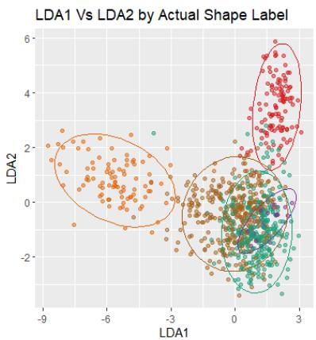

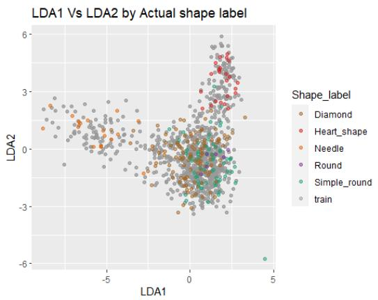

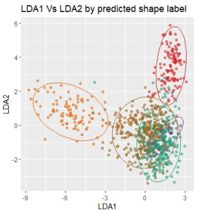

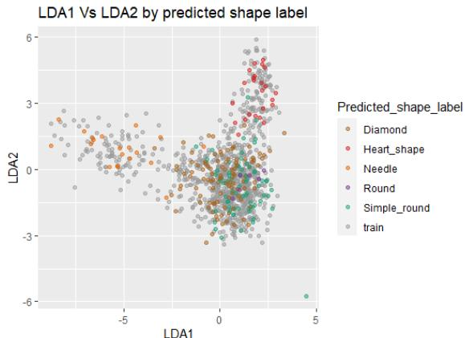  
Figure 18: Needle- and heart-shaped leaves separate cleanly on the first two LDA axes. Leaves of the Actual dataset plotted on LDA1 and LDA2: (a) actual shape labels, training set; (b) actual labels, training + test sets; (c) labels predicted by Random Forest, training set; (d) predicted labels, training + test sets.

Random Forest also gives a probability for each prediction, based on the trees that did not use that leaf in training (the out of bag, or OOB, probability). Within the training space, these probabilities reach 1 for every shape label, which confirms a good separation (Figure 23).

## 3.5.2 Features That Separate the Shapes

The same LDA plots can be drawn for each feature category separately (Figure 24). These plots show which features help to tell the shapes apart. Table 12 summarizes what we found.

Shape features separate needle, heart, and round leaves best (Figure 24a). Texture features mainly help to pick out heart leaves, and also split heart, round, and simple round leaves from needle and diamond leaves (Figure 24b). Color features identify heart leaves, which are darker than the other shapes, and needle leaves, which vary least in red (Figure 24c). Scagnostic features help mainly with round leaves (Figure 24d). No feature category singles out diamond leaves, which fits with their overlap with other shapes in the earlier plots. Striated and stringy scagnostics are high for all shapes, and clumpy, convex, outlying (polar), and sparse scagnostics are low for all shapes, so they do not help to tell the shapes apart.

## 3.5.3 Visualization of Actual, Flavia, Swedish, and Kaggle Leaf Datasets

We also used LDA to compare the four leaf datasets with one another. The Actual, Flavia, and Swedish datasets contain color images, so we could extract all four feature categories (shape, texture, color, and scagnostic), giving 52 features in total. With all of these features, the three datasets project into overlapping regions of LDA space (Figure 25a).

The Kaggle dataset contains only binary images, so only shape and scagnostic features could be extracted for it. When we compare all four datasets using these two feature categories (Figure 25b,c), the Kaggle leaves form a separate region that does not overlap the other three, while Actual, Flavia, and Swedish still overlap one another. This difference

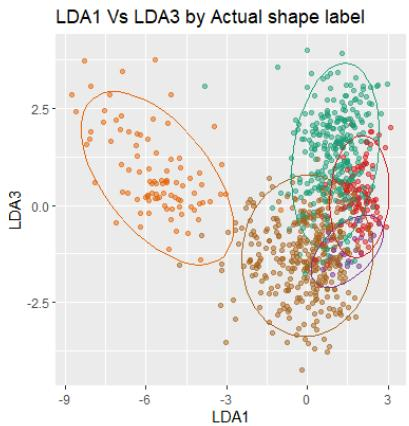

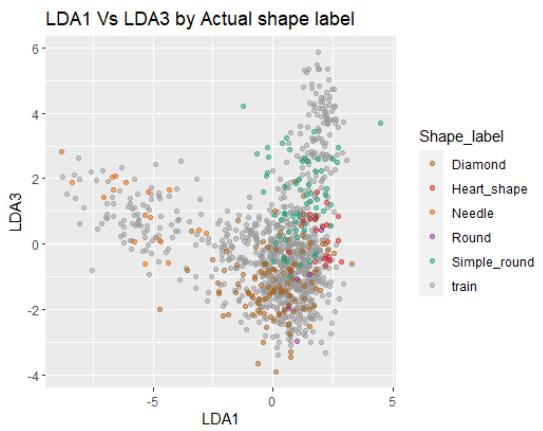

LDA1 Vs LDA3 by predicted shape label  
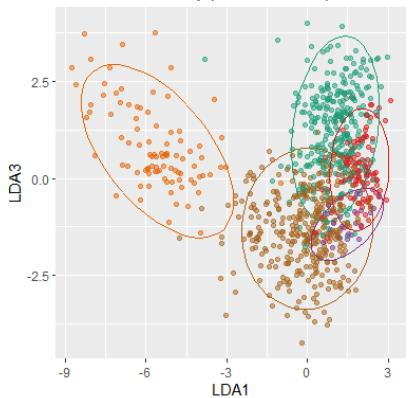

LDA1 Vs LDA3 by predicted shape label  
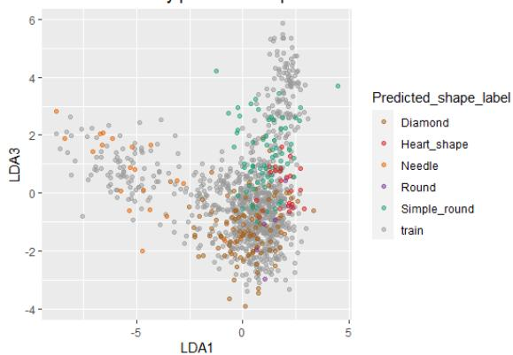  
Figure 19: On LDA1 and LDA3, only needle-shaped leaves are clearly separated. Leaves of the Actual dataset plotted on LDA1 and LDA3: (a) actual labels, training set; (b) actual labels, training + test sets; (c) predicted labels, training set; (d) predicted labels, training + test sets.

Table 12: Features that help to identify each leaf shape (from Figure 24).
<table><tr><td>Shape</td><td>Shape features</td><td>Texture</td><td>Color</td><td>Scagnostic</td></tr><tr><td>Needle</td><td>Higher: eccentricity, compactness, narrow factor, perimeter ratio length. Lower: circularity, area, equivalent diameter,</td><td></td><td>Lower standard deviation of red</td><td></td></tr><tr><td>Heart</td><td>physiological length Higher number of convex points</td><td>Higher contrast, entropy, and correlation</td><td>Lower mean of blue, green, and red; higher standard deviation of red, green, and blue</td><td></td></tr><tr><td>Round</td><td>Higher: area convexity, compactness, correlation, perimeter, perimeter ratio diameter, perimeter ratio length and width. Lower: area ratio convexity, number of convex points, perimeter convexity,</td><td>Higher correlation</td><td>Higher standard deviation of blue and green</td><td>Higher monotonic contour and monotonic polar</td></tr><tr><td>Simple round</td><td>rectangularity</td><td>Higher inverse difference moment and correlation</td><td>Higher standard deviation of blue and</td><td></td></tr><tr><td>Diamond</td><td></td><td></td><td>green</td><td></td></tr></table>

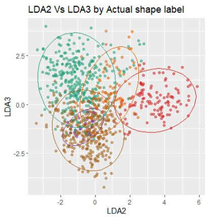

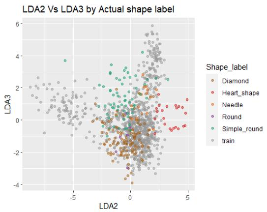

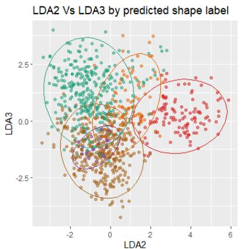

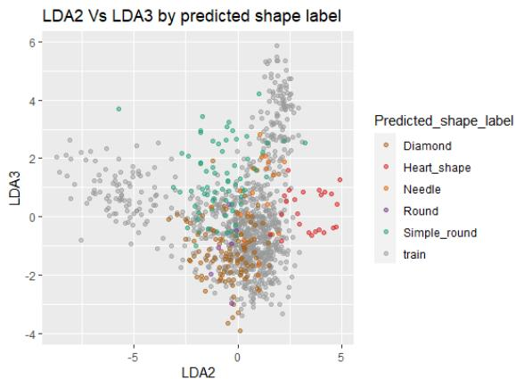  
Figure 20: On LDA2 and LDA3, all shape labels overlap. Leaves of the Actual dataset plotted on LDA2 and LDA3: (a) actual labels, training set; (b) actual labels, training + test sets; (c) predicted labels, training set; (d) predicted labels, training + test sets.

between Kaggle and the other datasets may help to explain why accuracy was low when Kaggle was used in the cross dataset experiment (Table 9).

## 3.6 Feature Importance

Variable importance shows how much each feature contributes to a model’s predictions, so it tells us which features matter most for classifying leaves. We looked at feature importance at each level of the hierarchy, in the same order as the classification: shape (H1), edge type (H2), and species (H3). All results are for the Actual dataset.

At the first level, we compared the variable importance of Random Forest, XGBoost, and Gradient Boosting (Figure 26). The most important features are mainly shape features: the x and y values of the leaf center, the perimeter ratio of length and width, diameter, area convexity, perimeter convexity, narrow factor, area ratio convexity, physiological length, physiological width, rectangularity, and eccentricity. Entropy is also among the most important features.

For the lower levels, we used Random Forest. Figure 27 shows the most important features for classifying edge types in diamond-shaped and simple round-shaped leaves. For diamond-shaped leaves, the number of convex points, perimeter ratio length and width, and x value of the center were the most important features. For simple round-shaped leaves, the x value of the center, entropy, and perimeter ratio length and width were the most important features. These results show that different features are important for identifying edge types in different leaf shapes.

At the species level, Figure 28 shows the important features for heart and needle shaped leaves (top), and for smooth edged diamond leaves and simple round leaves (bottom). For the diamond and simple round leaves, scagnostic features become more important: monotonic contour, convex polar, convex contour, striated polar, striated contour, and skinny contour.

LDA with Actual shape label  
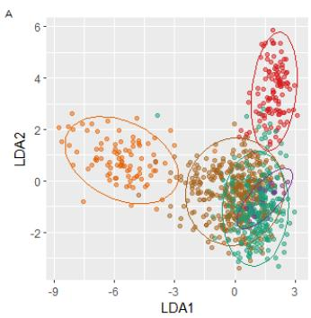

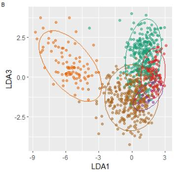

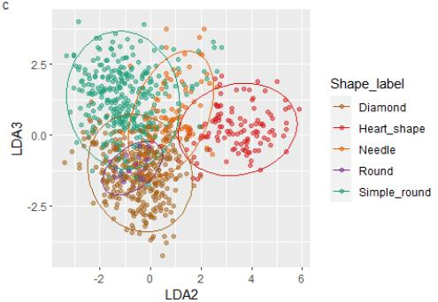

LDA with Predicted shape label  
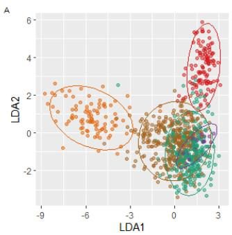

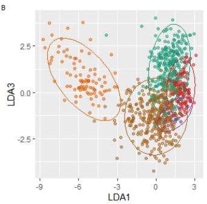

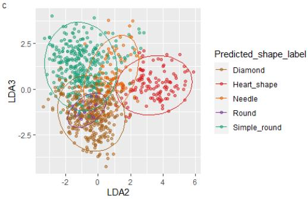  
Figure 21: Needle-shaped leaves separate in every view; the other shapes overlap. The three pairwise LDA views of the Actual dataset: (a) actual shape labels; (b) predicted shape labels.

## 4 Discussion

Identifying medicinal plant species automatically from leaf images has many practical uses. In this study we built MEDIPI (MEDIcinal Plant Identification), a classifier that works from ordinary leaf photographs. Leaf images carry rich information about shape, edges, texture, and color, and we turned this information into 52 interpretable features. Many earlier studies use shape, texture, and color features only. We added a new scagnostics category, together with three new shape features: correlation of the Cartesian contour, number of convex points, and number of minimum and maximum points. Both the supervised and the unsupervised projections (linear discriminant analysis and principal component analysis) show clear separation between classes, so these features do carry useful information.

A second contribution is the data. Most existing work relies on datasets such as Flavia and Swedish, which have few plant species and are too small to train a reliable model on their own. No image database of Sri Lankan medicinal plants existed, so we built one and released it in the open-source R package MedLEA (https://CRAN.R-project. org/package=MedLEA). We first studied the leaves in the medicinal plant repository of the Barberyn Ayurveda resort and the University of Ruhuna (http://www.instituteofayurveda.org/plants/) and identified five main shapes and four main edge types. The images were then collected in a simple way that needs no expert knowledge: a normal smartphone, no flash to avoid shadows, and the leaf placed at the center of a white sheet of paper.

The results support three main findings. First, a hierarchical Random Forest classifier worked best. Random Forest gave the highest accuracy of the three tree-ensemble algorithms we tried, and it also performed better than the benchmark algorithms (Table 11). Classifying first by shape, then by edge type, and then by species let the model use different features at each step. Shape features such as the leaf center coordinates, perimeter ratio of length and width, diameter, convexity measures, narrow factor, physiological length and width, rectangularity, and eccentricity were the most important for the first level, while scagnostic features such as monotonic contour, convex polar, and striated contour mattered more for identifying species at the bottom level (Section 3.6).

Second, shape features alone are not enough. When we compared models trained on shape features only with models trained on all feature categories, the all feature models were more accurate. For example, Random Forest on the

LDA1 Vs LDA3 by predicted shape label  
LDA1 Vs LDA3 by Actual shape label  
LDA2 Vs LDA3 by Actual shape label  
LDA2 Vs LDA3 by Actual shape labe  
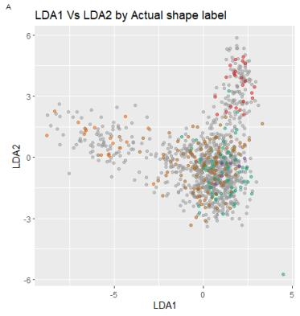

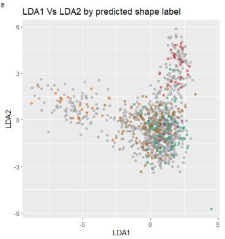

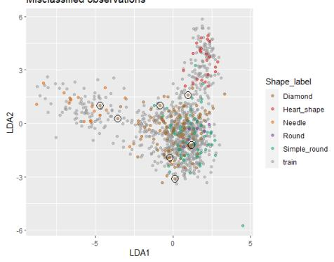

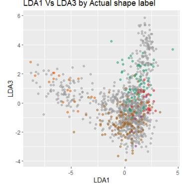

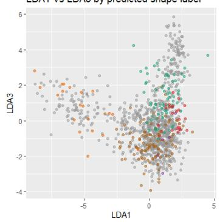

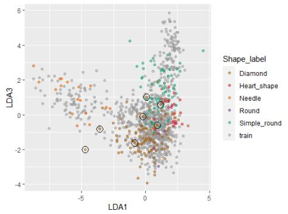

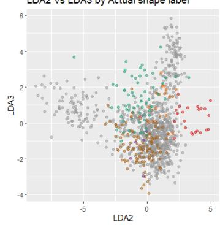

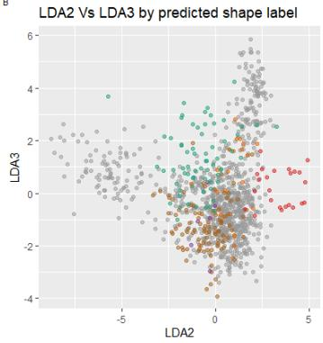

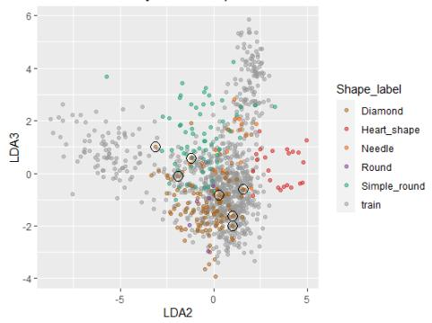  
Figure 22: Seven leaves are misclassified as diamond in every view. Actual labels, predicted labels, and misclassified observations of the Actual dataset on (a) LDA1 vs. LDA2, (b) LDA1 vs. LDA3, and (c) LDA2 vs. LDA3.

OOB probability distribution by shape label  

  
Figure 23: Random Forest is confident about every shape inside the training space. LDA1 vs. LDA2 colored by out of bag (OOB) probability for each shape label.

  
Figure 24: Each feature category separates the shape classes in a different way. LDA1 vs. LDA2 of the Actual dataset using only (a) shape, (b) texture, (c) color, or (d) scagnostic features.

  
Figure 25: The Kaggle dataset lies apart from the other three datasets in LDA space. LDA1 vs. LDA2 of (a) the Actual, Flavia, and Swedish datasets using all feature categories, and (b, c) the Actual, Flavia, Swedish, and Kaggle datasets using shape features only.

  
Figure 26: Shape-related features are the most important for classifying leaf shape. Feature importance in shape-wise (H1) classification of the Actual dataset: (A) Random Forest, (B) XGBoost, (C) Gradient Boosting.

  
Figure 27: Feature importance in edge-wise (H2) classification of the Actual dataset: (A) diamond shaped leaves, (B) simple round shaped leaves.

Actual dataset reached 97% shape level accuracy with all features but 90% with shape features only (Tables 4 and 8).   
Combining feature categories within a hierarchical structure therefore gave the strongest results.

Third, the model is not a complete black box. The LDA plots show how the trained Random Forest separates the shape classes: needle shaped leaves are separated in every view, while diamond, round, and simple round leaves overlap, which is where most of the errors occur (Section 3.5).

Our results also show some limitations. Accuracy was high only when the training and test sets came from the same dataset (Experiment 1). When we trained on one dataset and tested on another, accuracy dropped sharply (Experiment 2, Tables 9 and 10). One reason may be that the datasets differ in how the images were collected: for example, the Kaggle images are binary only and lie apart from the other datasets in LDA space. Cross dataset testing was done only at the shape level, so we do not yet know how well the edge and species levels would transfer. In addition, the Actual dataset covers only a limited set of species from Sri Lanka, and some species were classified less well (for example, a few smooth edged diamond leaves in Experiment 1).

## 5 Conclusions

We presented MEDIPI, a hierarchical, feature-based statistical machine learning method for classifying medicinal plant leaves, together with MedLEA, an open R package of leaf images and morphological data from Sri Lanka. Using 52 interpretable shape, texture, color, and scagnostic features, a hierarchical Random Forest gave the best performance among the algorithms we compared, and linear discriminant analysis helped us see how the model separates the leaf shapes. Shape features alone were not enough; combining feature categories within a hierarchical structure worked best. In future work, MEDIPI could be extended to more, and more diverse, medicinal species, tested on images from other sources to improve cross dataset accuracy, and compared directly with deep-learning methods to measure the trade-off between accuracy and interpretability.

  
Figure 28: Scagnostic features matter most for classifying species within diamond and simple round shaped leaves. Feature importance in species-wise (H3) classification of the Actual dataset: heart shaped leaves (top left), needle shaped leaves (top right), smooth edged diamond-shaped leaves (bottom left), and simple round shaped leaves (bottom right).

## Author Contributions

Conceptualization, J.P.G. and T.S.T.; methodology, J.P.G. and T.S.T.; software, J.P.G.; validation, J.P.G. and T.S.T.; formal analysis, J.P.G.; investigation, J.P.G.; resources, J.P.G. and T.S.T.; data curation, J.P.G.; writing – original draft preparation, J.P.G. and T.S.T.; writing – review and editing, J.P.G. and T.S.T.; visualization, J.P.G. and T.S.T.; supervision, T.S.T.; project administration, T.S.T.

## Funding

This research received no external funding.

## Data Availability Statement

The data presented in this study are openly available in the R package MedLEA at https://CRAN.R-project.org/ package=MedLEA. This repository contains the leaf images and morphological data collected for this study, along with the labeling scheme used to build the hierarchical classifier. The Flavia, Swedish, and Kaggle leaf image datasets analyzed in this study are third party datasets used under their original terms of release; restrictions may apply to their redistribution, and they should be obtained directly from their original sources.

## Acknowledgments

Not applicable.

## Conflicts of Interest

The authors declare no conflicts of interest.

## Abbreviations

The following abbreviations are used in this manuscript: The following abbreviations are used in this manuscript:

IUCN International Union for Conservation of Nature   
MEDIPI MEDIcinal Plant Identification   
LDA Linear Discriminant Analysis   
RF Random Forest   
XGBoost Extreme Gradient Boosting   
KNN k-Nearest Neighbor   
SVM Support Vector Machine   
PNN Probabilistic Neural Network   
ANN Artificial Neural Network   
CNN Convolutional Neural Network

## References

Viduranga Y Waisundara and Mindani I Watawana. The classification of sri lankan medicinal herbs: an extensive comparison of the antioxidant activities. Journal ofTraditional and Complementary Medicine, 4(3):196–202, July 2014. ISSN 2225-4110. doi:10.4103/2225-4110.126175. URL https://europepmc.org/articles/PMC4142458.

Shehara Gunawardana and W.J.A. Banukie Jayasuriya. Medicinally important herbal flowers in sri lanka. Evidence-Based Complementary and Alternative Medicine, 2019:1–18, 05 2019. doi:10.1155/2019/2321961.

Samir Devalaraja, Shalini Jain, and Hariom Yadav. Exotic fruits as therapeutic complements for diabetes, obesity and metabolic syndrome. Food Research International (OTTAWA, ONT.), 44:1856–1865, 08 2011. doi:10.1016/j.foodres.2011.04.008.

N. Goyal, Kapil, and N. Kumar. Plant species identification using leaf image retrieval: A study. In 2018 International Conference on Computing, Power and Communication Technologies (GUCON), pages 405–411, 2018.

Uwe Schippmann, Danna J. Leaman, and A. B. Cunningham. A comparison of cultivation and wild collection of medicinal and aromatic plants under sustainability aspects. In R. J. Bogers, L. E. Craker, and D. Lange, editors, Medicinal and Aromatic Plants, volume 17 of Wageningen UR Frontis Series, pages 75–95. Springer, 2006.

World Health Organization. Global Traditional Medicine Strategy 2025–2034. World Health Organization, Geneva, 2025.

D. D. Nilaweera. Threatened and endangered herbs in sri lanka. https://sites.google.com/site herbalsinsrilanka/threatened-endangered, 2010. Accessed: 2026-03-23.

International Trade Centre. Trade map: Trade statistics for international business development. https://www. trademap.org, 2026. Accessed October 2026.

C. Haris Saslis-Lagoudakis, Julie Hawkins, Simon Greenhill, Colin Pendry, Mark Watson, Will Tuladhar-Douglas, Sushim Baral, and Vincent Savolainen. The evolution of traditional knowledge: Environment shapes medicinal plant use in nepal. Proceedings. Biological sciences / The Royal Society, 281:20132768, 02 2014. doi:10.1098/rspb.2013.2768.

Jana Waldchen and Patrick Mader. Plant species identification using computer vision techniques: A systematic literature review. Archives ofComputational Methods in Engineering, 25:507–543, 04 2018. doi:10.1007/s11831-016-9206-z.

Jason Brownlee. How to scale data with outliers for machine learning, 2020.

Alaa Tharwat, Tarek Gaber, Abdelhameed Ibrahim, and Aboul Ella Hassanien. Linear discriminant analysis: A detailed tutorial. AI Communications, 30:169–190, 2017. doi:10.3233/AIC-170729.

N. Goyal, Kapil, and N. Kumar. Plant species identification using leaf image retrieval: A study. In 2018 International Conference on Computing, Power and Communication Technologies (GUCON), pages 405–411, 2018.

Jayani P. G. Lakshika and Thiyanga S. Talagala. Computer-aided interpretable features for leaf image classification. arXiv preprint arXiv:2106.08077, 2021.

S. G. Wu, F. S. Bao, E. Y. Xu, Y. Wang, Y. Chang, and Q. Xiang. A leaf recognition algorithm for plant classification using probabilistic neural network. In 2007 IEEE International Symposium on Signal Processing and Information Technology, pages 11–16, 2007.

Muhammad Azlah, Lee Suan Chua, Fakhrul Rahmad, Farah Abdullah, and Sharifah Alwi. Review on techniques for plant leaf classification and recognition. Computers, 8:77, 10 2019. doi:10.3390/computers8040077.

Yeni Herdiyeni and Ni Kadek Sri Wahyuni. Mobile application for Indonesian medicinal plants identification using fuzzy local binary pattern and fuzzy color histogram. In 2012 International Conference on Advanced Computer Science and Information Systems (ICACSIS), pages 301–306, 12 2012.