# SWAP-INR: Implicit Neural Representation with Switchable Attention Paths for Time-varying Multivariate Scientific Data Compression

Hyunsoo Son1∗ Jeonghyun Noh1∗ Chaoli Wang2 Won-Ki Jeong1†

1Korea University 2University of Notre Dame

1{ehsson,wjdgus0967,wkjeong}@korea.ac.kr 2chaoli.wang@nd.edu

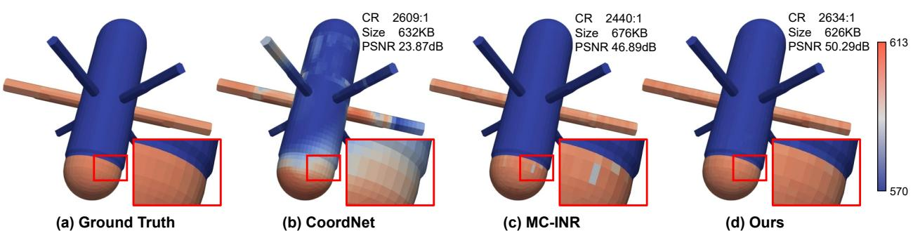  
Figure 1. Visual comparison of compression quality on the CUPID [3] at matched compression ratios. (a) Ground truth. (b) CoordNet [6] struggles to capture multivariate characteristics, resulting in a significant loss of structural details. (c) MC-INR [28] isolates variables, missing explicit cross-variable interactions, and produces severe visual artifacts (red box). (d) Our proposed SWAP-INR preserves high fidelity physical details with superior PSNR by switching between the attention and non-attention paths to capture essential dynamics.

## Abstract

Visualizing multivariate scientific simulation data is essential for understanding complex physical phenomena, yet the massive scale of such data imposes a severe storage bottleneck in high-performance computing environments. Implicit neural representations (INRs) have emerged as a promising continuous alternative to traditional lossy compressors, but existing methods struggle to explicitly capture cross-variable interactions and to adapt to the diverse spectral characteristics ofphysical variables. To address these limitations, we propose SWAP-INR, an architecture for high-fidelity compression ofmultivariate, time-varying simulation data. SWAP-INR introduces two key components: (1) The switchable attention path (SWAP) module explicitly models cross-variable interactions through a cross-variable attention layer, then routes each variable to an attention or non-attention path by a deterministic, loss-driven criterion, and prunes the inactive layers for structural compression. (2) The adaptability amplification SIREN (A2-SIREN) replaces rigidfrequency scaling with channel-wise learnable modulation, adapting to heterogeneous physical features with negligible overhead. Combined with post-training 16-

bit quantization, SWAP-INR achieves state-of-the-art performance on small modular reactor (SMR) datasets and remains competitive on public physics simulation datasets, while maintaining a constrained memory footprint. Our code is https://github.com/hvcl/SWAP-INR.

## 1. Introduction

Scientific simulation is central to studying complex realworld phenomena that are too costly, dangerous, or inaccessible to observe directly, and visualizing the resulting data is essential for analysis and decision-making [19, 25, 33, 42]. In safety-critical engineering domains such as small modular reactor (SMR) design, high-fidelity simulations couple multiple physical processes, including fluid dynamics, heat transfer, and thermodynamics. The resulting data are multivariate and time-varying, defined at high spatial and temporal resolution on unstructured grids that conform to complex geometries. Such fields encode rich physical behavior and thus accumulate substantial fine-grained detail, so storing or transmitting them at full resolution exceeds the memory and bandwidth budgets of high-performance computing (HPC) environments. Overcoming this bottleneck requires representations that substantially reduce memory consumption while preserving the fidelity needed for accurate analysis.

To alleviate this storage bottleneck, hand-crafted lossy compressors (TTHRESH [1], SZ3 [12], and ZFP [14]) have been widely adopted for scientific simulation data. However, their reliance on fixed transforms, predictors, and quantization schemes limits their adaptability to complex, dataset-specific structures. Recently, implicit neural representations (INRs) have emerged as a promising alternative, encoding scientific data as continuous functions and supporting queries at arbitrary spatial locations. Following the SIREN framework [27], coordinate-based methods such as CoordNet [6] and its variants [8, 28, 31] have demonstrated strong compression performance while supporting continuous queries at arbitrary spatial locations. In parallel, gridbased methods, such as fv-SRN [35], APMGSRN [39], and Wu et al. [37], employ multi-scale feature grids to encode spatially located data more effectively.

Despite their effectiveness, existing INR-based methods exhibit several limitations when applied to multivariate scientific simulation data. First, most INRs are designed for single-variable fields and handle multiple variables by simply expanding the output channels of a shared network. Since the representation is fully shared, distinct variables compete for the same parameters and impose conflicting gradients, making it difficult for the model to learn inter-variable relationships. This may cause feature interference that degrades decoding quality, a gradient-conflict effect studied in shared-parameter optimization [29, 43]. The recent MC-INR [28] partially mitigates this limitation with a branched architecture, but it merely decouples variables into separate branches without explicitly modeling cross-variable dependencies. Moreover, because the relevant interactions among variables are unknown a priori and dataset-dependent, a fixed architecture is inherently limited in its ability to capture these dependencies. Second, existing INRs often struggle to adapt efficiently to the diverse physical characteristics present within a single dataset. Baselines such as SIREN [27] are efficient, but their fixed frequency scaling limits the representation of variables with heterogeneous spectral properties. Remedies that increase network capacity [13, 44] or partition the spatial domain [23] improve adaptability at substantial computational overhead.

To address these limitations, we propose SWAP-INR, an INR network tailored for high-fidelity compression of multivariate, time-varying scientific data. Extending coordinate-based INRs, our method introduces two core components. First, the switchable attention path (SWAP) module models multivariate interactions through a crossvariable attention layer, automatically discovers which variables should interact, and then dynamically routes each variable through an attention or non-attention path rather than relying on a hand-specified correlation structure. This routing prevents forced correlations among non-interacting variables, and the unselected layers are then pruned to yield structural compression. Second, adaptability amplification SIREN (A2-SIREN) replaces rigid frequency scaling with neuron-level learnable modulation, resolving heterogeneous physical features at negligible computational cost. Combined with post-training 16-bit quantization, SWAP-INR delivers high-fidelity representations within a constrained memory budget. As a result, SWAP-INR outperforms existing methods on small modular reactor (SMR) datasets and achieves comparable results on public simulation datasets, at matched compression ratios and PSNR settings, preserving the underlying structures (Fig. 1). Our main contributions are summarized as follows:

• We propose the SWAP module, which explicitly models cross-variable interactions via a cross-variable attention layer. By dynamically switching paths and pruning inactive layers, it eliminates feature interference and achieves structural compression.

• We introduce A2-SIREN, which relaxes the rigid global frequency modulation of traditional INRs. Its neuronlevel learnable modulation adaptively captures datadependent high-fidelity physical details with negligible computational overhead.

• We demonstrate that the proposed SWAP-INR achieves state-of-the-art (SOTA) performance on in-house SMR datasets and competitive results on public datasets.

## 2. Related Work

## 2.1. Implicit Neural Representations

INRs based on standard ReLU-multi-layer perceptrons (ReLU-MLPs) suffer from severe spectral bias, failing to capture high-frequency details [30]. Two paradigms address this. The first advances activation functions. SIREN [27] introduced periodic sine activations, on which BACON [13] imposed progressively expanding frequency bandwidths, and AFNet [44] assigned localized frequency scaling via an auxiliary network. Other works replace the activation itself with wavelet [24], variable-periodic [15], or polynomial [22] formulations, or re-parameterize training in the Fourier domain [26]. The second paradigm encodes spatial and spatiotemporal coordinates. Positional encoding [18], hierarchical input partitioning [23], and multi-resolution hash grids [20] capture fine detail, while grid-factorization methods such as K-Planes [5] and HexPlane [2] extend this to 4D spatiotemporal volumes. Recent encoding schemes such as content-aware Fourier features [11] have begun to relax the dependence on fixed frequency bases. Yet across these paradigms, frequency adaptation typically requires dedicated encoding modules, rigid grid structures, or heavy architectural changes. In contrast, we introduce a simple yet efficient learnable channel-wise modulation that dynamically adapts to the data with negligible overhead.

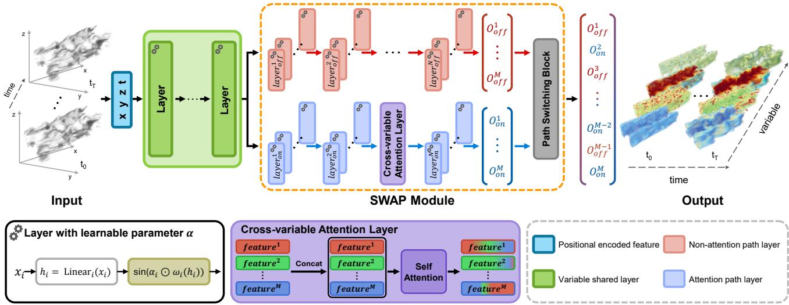  
Figure 2. Overview of the proposed SWAP-INR. Given a spatiotemporal coordinate $( x , y , z , t )$ , the network first applies positional encoding. The feature is then processed through MLP layers shared across variables, equipped with A2-SIREN, which uses a learnable parameter α for adaptive frequency modulation (bottom left). The representations are split into two branches: a non-attention path (red) and an attention path (blue), where the latter models cross-variable interactions via a cross-variable attention layer (purple). The variable driven path switching block selects the optimal representation per variable to reconstruct high-fidelity multivariate outputs.

## 2.2. Scientific Data Compression

Single-variable. Traditional compressors operate directly on discrete data through transform-, prediction-, or decomposition-based schemes (ZFP [14], SZ3 [12], TTHRESH [1]), and thus face inherent memory limitations, with grid-based variants further constrained to structured topologies. As a parameter-efficient alternative, Neur-Comp [16] and CoordNet [6] introduced INRs that map continuous spatiotemporal coordinates directly, removing the dependence on discrete grids. Building on this, later methods improved representational capacity through hierarchical Laplacian pyramids [31], knowledge distillation [8], spatially adaptive feature encoding [39], and mixture-ofexperts partitioning [9]. Others focused on practical deployment: ray-tracing integration [35], interactive hash encoding [37], distributed in-situ processing [38], and metalearned adaptation [41]. Despite this progress, all of these methods are designed for single-variable fields.

Multivariate. Naively applying single-variable INRs to multivariate data forces strict weight sharing across distinct variables, causing severe feature interference [29, 43]. STSR-INR [32] mitigates this by conditioning a shared network on variable-specific latent vectors, but still entangles distinct dynamics. MC-INR [28] instead encodes each variable through a separate network, isolating the variables but discarding the cross-variable correlations essential to physical systems. To resolve this trade-off, we propose the SWAP module, which routes physical fields through switchable attention and non-attention paths, explicitly modeling crossvariable interactions while isolating independent features.

## 3. Method

We begin with $\mathbf { A } ^ { 2 }$ -SIREN, followed by the SWAP module, and finally the training scheme, loss function, and quantization procedure. An overview of our approach is presented in Fig. 2. As our method builds on coordinate-based INRs, it maps continuous coordinates directly to physical values, making it applicable to both structured and unstructured grids without modification.

## 3.1. A2-SIREN

SIREN [27] effectively represents the physical values using a pre-defined amplification factor (ω = 30) and sine activation (sin), formulated as:

$$
\mathbf { x } _ { i + 1 } = \mathbf { s } \mathrm { i n } ( \omega \mathbf { h } _ { i } ( \mathbf { x } _ { i } ) ) , \quad i = 0 , \ldots , N - 1 ,\tag{1}
$$

where $\mathbf { h } _ { i }$ is the i-th linear layer and $\mathbf { x } _ { i }$ its input, with $\mathbf { x } _ { \mathrm { 0 } }$ the network input; each output $\mathbf x _ { i + 1 }$ is passed to the next layer across N layers. However, this fixed, single-scale amplification applies a uniform frequency band to all variables, lacking the flexibility to encode heterogeneous spectral characteristics, where some fields vary smoothly while others contain sharp, high-frequency structures. Recent frequency-adaptive methods [13, 44] address this by predicting frequency shifts through auxiliary networks. While effective, this reliance introduces parameter overhead that conflicts with the goal of compression, particularly under the multivariate setting.

To address this limitation, we introduce $\mathbf { A } ^ { 2 } .$ -SIREN, a simple yet efficient mechanism that integrates a channelwise learnable parameter (α). Unlike these methods that depend on a separate prediction network, $\mathbf { A } ^ { 2 } .$ -SIREN achieves frequency adaptation through a purely intrinsic mechanism. Each layer is assigned a fixed base frequency $\omega _ { i } \in [ 3 0 , 1 5 0 ]$ ], and the learnable vector $\alpha _ { i }$ rescales it independently per channel. $\mathbf { A } ^ { 2 }$ -SIREN is formulated as:

$$
\begin{array} { r } { \mathbf { x } _ { i + 1 } = \mathbf { s } \mathbf { i } \mathbf { n } \big ( \big ( \pmb { \alpha } _ { i } \odot \omega _ { i } \big ) \mathbf { h } _ { i } ( \mathbf { x } _ { i } ) \big ) , \quad \pmb { \alpha } _ { i } \in \mathbb { R } ^ { d } , } \end{array}\tag{2}
$$

where ⊙ scales the scalar base frequency $\omega _ { i }$ channel-wise by $\pmb { \alpha } _ { i } \in \mathbb { R } ^ { d }$ , yielding a per-channel frequency, and d is the channel dimension. Since only $\alpha _ { i }$ is learned while $\omega _ { i }$ remains fixed, distinct variables can allocate independent frequency bandwidths within a single coordinate-based network. Consequently, this intrinsic adaptability effectively captures physical features at negligible computational cost.

## 3.2. SWAP Module

The proposed SWAP module is a lightweight mechanism for efficiently encoding multivariate data, comprising three core components: a cross-variable attention layer, a path switching block, and layer pruning.

## 3.2.1. Cross-variable attention layer

As discussed, although multivariate scientific data exhibit inherent correlations, traditional shared networks [7, 9, 39] force variables to compete for the same parameters, causing severe feature interference. Conversely, recent branched architectures [28] mitigate this by isolating variables, but their structural separation prevents the network from modeling explicit cross-variable interactions. To overcome this limitation, we introduce a cross-variable attention layer that facilitates explicit interactions among all variables. At a designated intermediate layer, this attention layer concatenates the independent branch features along the variable dimension into $\mathbf { X } = [ \mathbf { x } ^ { ( 1 ) } , \mathbf { x } ^ { ( 2 ) } , \ldots , \mathbf { x } ^ { ( M ) } ] ^ { \top } \in \mathbb { R } ^ { M \times d }$ , where m and M denote the variable index and the number of physical variables, respectively. The query (Q), key (K), and value (V) matrices are derived from X after layer normalization (LN) for stable optimization, and the cross-variable attention is formulated as:

$$
{ \mathbf X } = \mathsf { c o n c a t } ( { \mathbf x } ^ { ( 1 ) } , { \mathbf x } ^ { ( 2 ) } , \ldots , { \mathbf x } ^ { ( M ) } ) ,\tag{3}
$$

$$
\mathbf { Q } , \mathbf { K } , \mathbf { V } = \operatorname { L i n e a r } _ { Q , K , V } ( \operatorname { L N } ( \mathbf { X } ) ) ,\tag{4}
$$

$$
\hat { \mathbf { X } } = \mathbf { s } \mathbf { o f t m a x } \bigg ( \frac { \mathbf { Q K } ^ { \top } } { \sqrt { d _ { k } } } \bigg ) \mathbf { V } .\tag{5}
$$

The attended output $( { \hat { \mathbf { X } } } )$ is residually added to X and injected into the next hidden layer (hi). For instance, in SMR simulations, strongly coupled quantities such as temperature and velocity fields can exchange information through this layer, capturing their shared dynamics. Thus, our approach harmonizes explicit multivariate interactions with the decoupled physical features essential for accurate scientific data modeling.

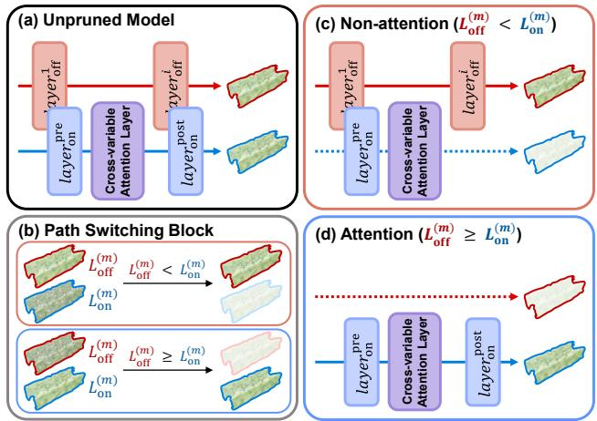  
Figure 3. Illustration of the variable-driven switchable mechanism and targeted layer pruning. (a) The unpruned model features both non-attention (red) and attention (blue) paths. (b) Path switching block evaluates $L _ { \mathrm { o f f } } ^ { ( m ) }$ and $L _ { \mathrm { o n } } ^ { ( m ) }$ to deterministically route the m-th variable. (c) When the non-attention path is selected $( L _ { \mathrm { o f f } } ^ { ( m ) } < L _ { \mathrm { o n } } ^ { ( m ) } )$ ), post-attention layers are pruned while base layers are retained to serve as K, V. (d) Conversely, when the attention path is selected $( L _ { \mathrm { o f f } } ^ { ( m ) } \ge L _ { \mathrm { o n } } ^ { ( m ) } )$ , the structurally redundant nonattention baseline path is eliminated.

## 3.2.2. Path switching block

While a cross-variable attention layer facilitates explicit interactions, it implicitly assumes uniform correlation across all variables. In reality, scientific data are heterogeneous: physical quantities may be strongly coupled or strictly independent. Compounding this, attention aggregates features as a weighted average and thus acts as a low-pass filter [21, 34]. Such smoothing benefits coupled variables by reinforcing their shared dynamics, but blurs the sharp, highfrequency structures that characterize independent ones. A cross-variable attention layer cannot serve both regimes simultaneously. This motivates a mechanism that routes each variable based on whether it benefits from coupling or must preserve high-frequency detail.

To this end, we propose a path switching block with an attention path and a non-attention path, as described in Fig. 3. To ensure stable optimization, we employ a sequential training strategy. The non-attention path is first trained to establish a robust baseline of independent representations. The attention path is then introduced and optimized while the non-attention path and shared layers remain frozen. Upon completion, we apply a loss-driven pathselection mechanism. For each variable m, we compute its converged per-variable attention-path loss $L _ { \mathrm { o n } } ^ { ( m ) }$ and nonattention-path loss $L _ { \mathrm { o f f } } ^ { ( m ) }$ . We then define a binary switching mask $s ^ { ( m ) } \in \{ 0 , 1 \}$ as:

$$
s ^ { ( m ) } = \mathbb { I } \left( L _ { \mathrm { o n } } ^ { ( m ) } \leq L _ { \mathrm { o f f } } ^ { ( m ) } \right) ,\tag{6}
$$

where I denotes the indicator function, yielding 1 if the condition is true and 0 otherwise. During inference, the final optimal representation $\tilde { \mathbf { x } } ^ { ( m ) }$ for the m-th variable is deterministically computed as:

$$
\begin{array} { r } { \tilde { \mathbf { x } } ^ { ( m ) } = s ^ { ( m ) } \hat { \mathbf { x } } _ { \mathrm { a t t n } } ^ { ( m ) } + ( 1 - s ^ { ( m ) } ) \hat { \mathbf { x } } _ { \mathrm { n o n - a t t n } } ^ { ( m ) } , } \end{array}\tag{7}
$$

where $\hat { \mathbf { x } } _ { \mathrm { a t t n } } ^ { ( m ) }$ and $\hat { \mathbf { x } } _ { \mathrm { n o n - a t t n } } ^ { ( m ) }$ are the feature outputs of the respective paths, as detailed in Fig. 3 (b). This post-training selection ensures that the attention path is engaged only when coupling empirically benefits a variable, while variables that must retain high-frequency detail are preserved through the non-attention path. The resulting routing is thus determined entirely by each variable’s measured reconstruction loss, engaging cross-variable attention only where it is empirically beneficial and otherwise preserving the independent representation. Our switching results are detailed in Appendix E.

Although physical coupling can be spatially or temporally localized, we deliberately design the routing as a global, variable-level decision. While localized routing could capture finer interactions, storing a dense coordinatespecific map incurs memory overhead. Our block thus decouples variables at the macroscopic level while preserving the lightweight architecture for compression.

## 3.2.3. Layer pruning

After path switching, each variable activates only one path, leaving the unselected branches without any activation flow during the forward pass. Since these inactive branches no longer contribute to the output, they become computationally redundant and can be safely removed. Guided by the switching mask $s ^ { ( m ) }$ , we therefore prune the network to retain only the active parameters. Let $\Phi _ { \mathrm { n o n - a t t n } } ^ { ( m ) }$ and $\Phi _ { \mathrm { a t t n } } ^ { ( m ) }$ denote the parameters of the non-attention and attention paths for the m-th variable, where the attention path is further divided into pre-attention parameters $\Phi _ { \mathrm { p r e } } ^ { ( m ) }$ (layers $l \leq l _ { \mathrm { a t t n } } )$ and post-attention parameters $\Phi _ { \mathrm { p o s t } } ^ { ( m ) }$ (layers $l > l _ { \mathrm { a t t n } } )$ . The retained parameter set $\tilde { \Phi } ^ { ( m ) }$ is formulated as:

$$
\tilde { \Phi } ^ { ( m ) } = \left\{ \begin{array} { l l } { \Phi _ { \mathrm { n o n - a t t n } } ^ { ( m ) } \cup \Phi _ { \mathrm { p r e } } ^ { ( m ) } , } & { \mathrm { i f } s ^ { ( m ) } = 0 , } \\ { \Phi _ { \mathrm { a t t n } } ^ { ( m ) } , } & { \mathrm { i f } s ^ { ( m ) } = 1 . } \end{array} \right.\tag{8}
$$

This conditional pruning retains different parameters depending on the selected path. When $s ^ { ( m ) } = 0 ,$ , we prune the post-attention layers $( \Phi _ { \mathrm { p o s t } } ^ { ( m ) } )$ but preserve $\Phi _ { \mathrm { p r e } } ^ { ( m ) }$ . As shown in $\mathrm { F i g . ~ } 3 \ \mathrm { ~ ( c ) }$ , this asymmetric retention is essential: it allows the m-th variable to still provide informative K and V for other actively attending variables. When $s ^ { ( m ) } = 1$ , the variable relies entirely on cross-variable interactions, so the independent non-attention path $\Phi _ { \mathrm { n o n - a t t n } } ^ { ( m ) }$ is discarded without any loss of essential features (Fig. 3 (d)). Overall, this targeted pruning removes redundant operations, yielding a highly lightweight model while strictly preserving accuracy.

## 3.3. Training Strategy and Loss Function

To ensure stable optimization, we adopt a two-stage strategy. For any output ˆx and ground truth (GT) $\mathbf { x } _ { \mathrm { g t } }$ , the mean squared error (MSE) loss is:

$$
L ( \hat { \mathbf { x } } ) = \frac { 1 } { M } \sum _ { m = 1 } ^ { M } \left. \hat { \mathbf { x } } ^ { ( m ) } - \mathbf { x } _ { \mathrm { g t } } ^ { ( m ) } \right. _ { 2 } ^ { 2 } .\tag{9}
$$

Stage 1 (non-attention path). We first establish a robust baseline of independent physical representations by optimizing the feature extractor and the non-attention path:

$$
\operatorname* { m i n } _ { \Phi _ { \mathrm { s h } } , \Phi _ { \mathrm { n o n - a t t n } } } L \big ( \hat { \mathbf { x } } _ { \mathrm { n o n - a t t n } } \big ) ,\tag{10}
$$

where $\Phi _ { \mathrm { s h } }$ denotes the parameters of shared MLP layers. Stage 2 (attention path). Once the non-attention path converges, we initialize the attention path with its weights $( \Phi _ { \mathrm { a t t n } }  \Phi _ { \mathrm { n o n - a t t n } } )$ and randomly initialize the new linear projections. We then freeze the baseline parameters $( \Phi _ { \mathrm { s h } }$ and $\Phi _ { \mathrm { n o n - a t t n } } )$ and optimize only the attention path:

$$
\operatorname* { m i n } _ { \Phi _ { \mathrm { a t t n } } } L ( \hat { \mathbf { x } } _ { \mathrm { a t t n } } ) .\tag{11}
$$

Freezing the baseline lets the network explore crossvariable interactions without corrupting the learned independent representations.

## 3.4. Quantization

Layer pruning reduces structural redundancy, but the model size is ultimately governed by parameter precision. To achieve a lightweight model, we apply post-training quantization as the final compression step, inspired by COIN [4]. The network is trained in 32-bit floating-point precision for stable gradient updates. For storage, only the parameters are quantized to 16-bit, while activations are cast at inference time for efficiency. Since neural representations are largely resilient to reduced precision [17], this halves the storage budget, $M ( \tilde { \Phi } _ { q } ) \approx \textstyle { \frac { 1 } { 2 } } M ( \tilde { \Phi } )$ , where $M ( \cdot )$ denotes the overall model size, while incurring minor loss in reconstruction quality. As a result, SWAP-INR effectively doubles its compression ratio at nearly imperceptible cost.

Table 1. Experimental datasets. P and t are the # of spatial coordinates per timestep and the # of timesteps, respectively.
<table><tr><td>Grid type</td><td>Dataset</td><td># of points  $\overline { { ( \mathbf { P } \times t ) } }$ </td><td># of variables</td></tr><tr><td rowspan="3">Unstructured</td><td>ROCOM [3]</td><td>12,440,366 × 5</td><td>8</td></tr><tr><td>CUPID</td><td> $1 , 2 7 9 , 3 7 5 \times 3 0$ </td><td>11</td></tr><tr><td>Synthetic</td><td> $5 , 2 5 3 , 7 5 0 \times 3 0$ </td><td>4</td></tr><tr><td rowspan="3">Structured</td><td>SMR Simulation</td><td> $\overline { { 1 , 0 4 8 , 5 7 6 \times 1 0 } }$ </td><td>8</td></tr><tr><td>Combustion [10]</td><td> $6 4 8 , 0 0 0 \times 2 5$ </td><td>4</td></tr><tr><td>Ionization [36]</td><td> $5 7 6 { , } 6 0 0 \times 5 0$ </td><td>4</td></tr></table>

Table 2. Quantitative comparison of compression results with previous methods at matched CR. The ∗ denotes that the reported performance is averaged across independent time steps. Baselines are stored at 32-bit precision, while SWAP-INR uses 16-bit.
<table><tr><td>Dataset</td><td>Method</td><td>PSNR↑</td><td>NRMSE↓</td><td>R2 ↑</td><td>CR↑</td><td>Size(KB)↓</td><td>Dataset</td><td>Method</td><td>PSNR↑</td><td>NRMSE↓</td><td>R2 ↑</td><td>CR↑</td><td>Size(KB)↓</td></tr><tr><td rowspan="12">ROCOM</td><td>SIREN NeurComp</td><td>42.34</td><td>0.0114</td><td>0.9323</td><td>3,311</td><td>587</td><td rowspan="8">CUPID</td><td>SIREN NeurComp</td></tr><tr><td>42.66</td><td>0.0105</td><td>0.9398</td><td>3,346</td><td>581</td><td rowspan="8"></td><td>24.63</td><td>21.46 0.1657 0.0850</td><td>0.5585 0.7002</td><td>2,634 2,626</td><td>626 628</td></tr><tr><td>CoordNet</td><td>43.49</td><td>0.0105</td><td>0.9392</td><td>3,351 580</td><td>CoordNet</td><td>23.87</td><td>0.0914</td><td>0.6540</td><td>2,609</td><td>632</td></tr><tr><td>Instant-NGP</td><td>30.28</td><td>0.0356</td><td>0.4391</td><td>3,346 581</td><td>Instant-NGP</td><td>19.61</td><td>0.1791</td><td>0.3948</td><td>2,561</td><td>644</td></tr><tr><td>fV-SRN*</td><td>40.24</td><td>0.0125</td><td>0.8764</td><td>3,351 580</td><td>fV-SRN*</td><td>13.99</td><td>0.2362</td><td>-13.4032</td><td>2,618</td><td>630</td></tr><tr><td>WIRE</td><td>25.09</td><td>0.0966</td><td>-0.0004</td><td>3,351 580</td><td>WIRE</td><td>16.92</td><td>0.2595</td><td>0.0000</td><td>2,630</td><td>627</td></tr><tr><td>AFNet</td><td>44.19</td><td>0.0094</td><td>0.9480</td><td>3,351 580</td><td>AFNet</td><td>48.38</td><td>0.0044</td><td>0.9695</td><td>2,622</td><td>629</td></tr><tr><td>APMGSRN*</td><td>38.21</td><td>0.0171</td><td>0.8383</td><td>3,351 580</td><td>APMGSRN*</td><td>19.25</td><td>0.1789</td><td>-0.1587</td><td>2,618</td><td>630</td></tr><tr><td>SL2A-INR</td><td>43.39</td><td>0.0113</td><td>0.9258</td><td>3,334</td><td></td><td>SL²A-INR 46.77</td><td>0.0051</td><td>0.9679</td><td>2,626</td><td>628</td></tr><tr><td>MC-INR</td><td>33.61</td><td>0.0255</td><td>0.5857</td><td>3,328</td><td>583 584</td><td>MC-INR</td><td>46.89</td><td>0.0086</td><td>0.9579</td><td>2,440</td><td>676</td></tr><tr><td>Ours</td><td>47.41</td><td>0.0073</td><td>0.9782</td><td>3,351</td><td>580</td><td>Ours</td><td>50.29</td><td>0.0035</td><td>0.9904</td><td>2,634</td><td></td><td>626</td></tr><tr><td rowspan="11"></td><td>SIREN</td><td>70.31</td><td>0.0003</td><td>0.9245</td><td>7,793</td><td>316</td><td rowspan="11">SMR Simulation</td><td>SIREN</td><td>33.71</td><td>0.0277</td><td>0.2851</td><td>665</td><td>493</td></tr><tr><td>NeurComp</td><td>68.72</td><td>0.0004</td><td>0.8830</td><td>7,868</td><td>313</td><td>NeurComp CoordNet</td><td>33.15</td><td>0.0297</td><td>0.1884</td><td>665</td><td>493</td></tr><tr><td>CoordNet Instant-NGP</td><td>72.14 35.22</td><td>0.0003</td><td>0.9755</td><td>7,843</td><td>314</td><td>Instant-NGP</td><td>34.03</td><td>0.0267 0.0850</td><td>0.3411</td><td>666</td><td>492</td></tr><tr><td></td><td></td><td>0.0776</td><td>0.0280</td><td>7,601</td><td>324</td><td></td><td>30.16</td><td></td><td>0.0356</td><td>635</td><td>516</td></tr><tr><td>fV-SRN*</td><td>64.10</td><td>0.0007</td><td>0.8038</td><td>7,463</td><td>330</td><td>fV-SRN*</td><td>29.60</td><td>0.0472</td><td>-3.1898</td><td>655</td><td>500</td></tr><tr><td>WIRE</td><td>34.90</td><td>0.0802</td><td>-0.0470</td><td>7,868</td><td>313</td><td>WIRE</td><td>29.98</td><td>0.0911</td><td>-0.0024</td><td>663 666</td><td>494</td></tr><tr><td>AFNet APMGSRN*</td><td>74.60</td><td>0.0002 0.0011</td><td>0.9657</td><td>7,793 7,463</td><td>316</td><td>AFNet</td><td>35.80</td><td>0.0190</td><td>0.3564 -0.6753</td><td>655</td><td>492 500</td></tr><tr><td>SL2A-INR</td><td>60.93 73.00</td><td>0.0002</td><td>0.7438 0.9338</td><td>7,793</td><td>330</td><td>APMGSRN*</td><td>30.51</td><td>0.0534 0.0210</td><td>0.3108</td><td>667</td><td></td></tr><tr><td>MC-INR</td><td>66.69</td><td>0.0006</td><td>0.9616</td><td>7,696</td><td>316</td><td>SL2A-INR</td><td>35.10</td><td>0.0259</td><td>0.2826</td><td>655</td><td>491</td></tr><tr><td>Ours</td><td>75.00</td><td>0.0002</td><td>0.9736</td><td>7,868</td><td>320 313</td><td>MC-INR Ours</td><td>33.92</td><td>0.0153</td><td>0.4494</td><td>667</td><td>500</td></tr><tr><td>SIREN</td><td>30.62</td><td>0.0296</td><td>0.8967</td><td>989</td><td>256</td><td>SIREN</td><td>38.17 43.12</td><td>0.0078</td><td>0.9664</td><td>2,011</td><td>491 224</td></tr><tr><td rowspan="8">Combustion</td><td>NeurComp</td><td>32.22</td><td>0.0245</td><td>0.9140</td><td>997</td><td>254</td><td></td><td>NeurComp CoordNet</td><td>45.67 39.28</td><td>0.0056</td><td>0.9777</td><td>2,002</td><td>225</td></tr><tr><td>CoordNet</td><td>31.09</td><td>0.0280</td><td>0.9014</td><td>981</td><td>258</td><td></td><td>Instant-NGP fV-SRN*</td><td>21.93</td><td>0.0135</td><td>0.9451</td><td>1,993</td><td>226</td></tr><tr><td>Instant-NGP</td><td>20.86</td><td>0.1033</td><td>0.4767</td><td>977</td><td>259</td><td></td><td></td><td></td><td>0.1988</td><td>0.1837</td><td>1,984</td><td>227</td></tr><tr><td>fV-SRN*</td><td>23.53</td><td>0.0726</td><td>0.6768</td><td>920</td><td>275</td><td>Ionization</td><td></td><td>22.76 0.1039</td><td></td><td>-0.6598</td><td>1,802</td><td>250</td></tr><tr><td>WIRE</td><td>17.75</td><td>0.1615</td><td>0.0000</td><td>985</td><td>257</td><td></td><td>WIRE</td><td>20.94 0.2469</td><td>-0.0002</td><td></td><td>2,011</td><td>224</td></tr><tr><td>AFNet</td><td>28.33</td><td>0.0392</td><td>0.8643</td><td>997</td><td>254</td><td></td><td>AFNet</td><td>50.62 0.0030</td><td></td><td>0.9899</td><td>2,011</td><td>224</td></tr><tr><td>APMGSRN*</td><td>21.52</td><td>0.0951</td><td>0.5493</td><td>920</td><td>275</td><td></td><td>APMGSRN*</td><td>18.02 0.1439</td><td></td><td>-9.2996</td><td>1,802</td><td>250</td></tr><tr><td>SL2A-INR</td><td>26.02</td><td>0.0525</td><td>0.8025</td><td>981</td><td>258</td><td></td><td>SL2A-INR</td><td>42.64</td><td>0.0078</td><td>0.9496</td><td>2,002</td><td>225</td></tr><tr><td></td><td></td><td></td><td></td><td></td><td></td><td>256 254</td><td>Ours</td><td></td><td></td><td></td><td></td><td></td><td></td></tr><tr><td></td><td>MC-INR Ours</td><td>18.05 31.17</td><td>0.1502 0.0278</td><td>-0.0065 0.9116</td><td>989 997</td><td></td><td></td><td>MC-INR</td><td>20.93</td><td>0.1686</td><td>-0.3931 0.9905</td><td>1,909 2,011</td><td>236 224</td></tr></table>

## 4. Experiments

## 4.1. Experiment Setup

Datasets. Our experiments were conducted using a comprehensive suite of multivariate scientific datasets. The datasets are categorized by their spatial topology: RO-COM [3], CUPID, and Synthetic datasets are SMR data defined on unstructured tetrahedral meshes. In contrast, the SMR simulation dataset (provided by our collaborator) and the publicly available Combustion [10] and Ionization [36] datasets are defined on structured 3D rectilinear grids. For computational feasibility, the Combustion and Ionization datasets were spatiotemporally downsampled by a factor of 4. The details of each dataset are summarized in Table 1.

Implementation details. SWAP-INR comprises a shared base network (2 layers, 128 channels) and variable-specific branches (6 layers), each splitting into a non-attention and an attention path with the cross-variable attention layer applied after the third branched layer. The per-channel scalar α is uniformly initialized to 1.0, and the number of feature channels per branch is set by dataset complexity: 64 for RO-COM and Synthetic, 56 for CUPID, and 48 for SMR Simulation, Combustion, and Ionization. Each physical variable is independently normalized to [−1, 1]. We train all models in PyTorch 2.1.0 on a single NVIDIA RTX 3090 GPU using Adam (learning rate $2 \times 1 0 ^ { - 5 }$ , batch size 100,000), with early stopping after 20 epochs without loss improvement. For evaluation, we report peak signal-to-noise ratio (PSNR), normalized root-mean-squared error (NRMSE), the coefficient of determination (R2), compression ratio (CR), and model size in KB. Note that CR is defined as raw data size over total stored network parameters; mesh topology is excluded as INRs represent fields grid-agnostically without encoding the evaluation grid itself.

## 4.2. Results and Evaluation

We compare against a broad range of methods: INR-based approaches SIREN [27], NeurComp [16], CoordNet [6], Instant-NGP [20], fV-SRN [35], WIRE [24], AFNet [44], APMGSRN [39], SL2A-INR [22], and MC-INR [28], as well as the conventional lossy compressors SZ3 [12], ZFP [14], and TTHRESH [1]. Further details on these methods and the matched PSNR comparison are provided in Appendix A and Appendix B.

## 4.2.1. Quantitative results at matched CR

Table 2 presents a quantitative comparison against previous INR-based methods at matched CR. Note that fV-SRN and APMGSRN do not support time-varying data; we evaluated them per time step and averaged the results. SWAP-

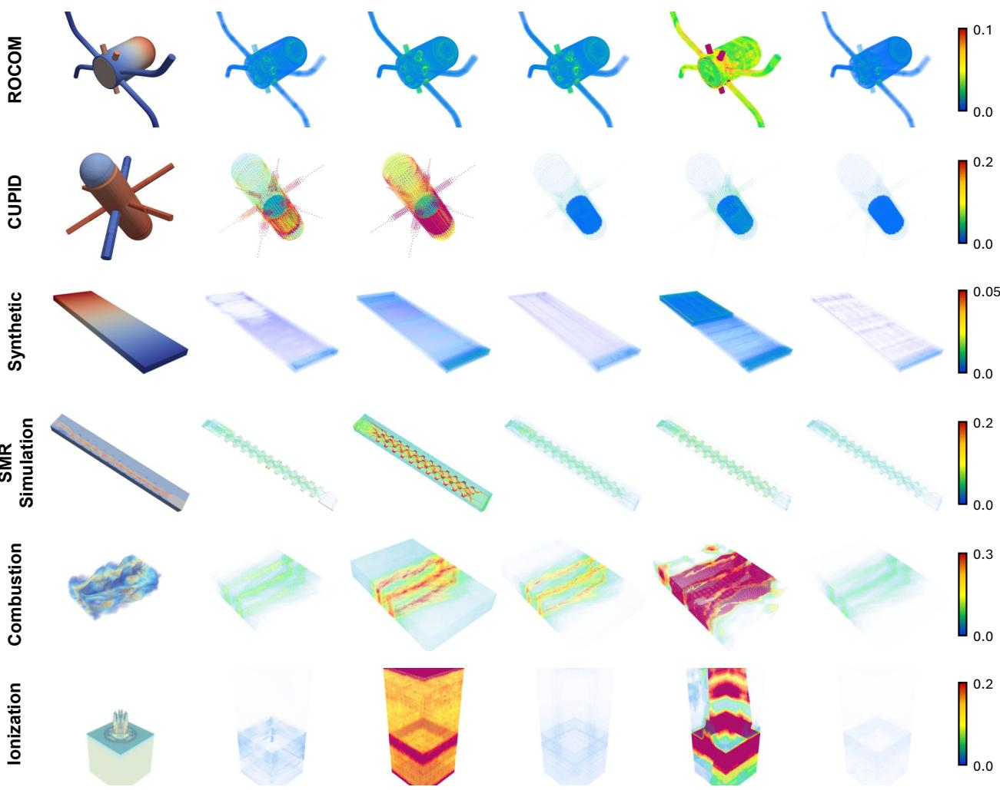  
(a) Ground Truth  
(b) CoordNet  
(c) fV-SRN  
(d) SL2A-INR  
(e) MC-INR  
(f) Ours  
Figure 4. Visualization of error maps at matched compression ratios. The error map represents the mean absolute error averaged across al time steps and variables (blue: low, red: high). GT is visualized for a specific snapshot (time and variable). ROCOM, CUPID, Synthetic, and SMR Simulation are rendered via tetrahedral meshes, whereas Combustion and Ionization are shown as regular volumes.

INR achieves SOTA performance on the SMR datasets and competitive results on the public Combustion and Ionization datasets. This confirms that explicitly modeling crossvariable interactions, rather than naively sharing or fully isolating them, enhances reconstruction fidelity across diverse data. The lower performance here stems from the low-pass nature of the attention path [21, 34], analyzed in Appendix C. SWAP-INR maintains a competitive fidelityefficiency trade-off among methods of comparable speed (Appendix D), and remains SOTA on the in-house SMR datasets under 16-bit quantization (Appendix F).

## 4.2.2. Qualitative results at matched CR

Figure 4 compares SWAP-INR with CoordNet, fV-SRN, SL2A-INR, and MC-INR via error maps. SWAP-INR consistently achieves the lowest error across the datasets, and the error maps expose a distinct failure mode behind each baseline. The CoordNet shared layer causes cross-variable interference that spreads error broadly. fV-SRN reconstructs each time step independently, accumulating temporally inconsistent errors on CUPID and Ionization. SL2A-INR, lacking explicit cross-variable modeling, retains visibly higher residual error across coupled regions. MC-INR clusters, when constrained to the target CR, leave high-error blocks at their boundaries (ROCOM, Combustion, Ionization). In contrast, SWAP-INR couples variables that benefit from interaction while preserving high-frequency details in the others. This yields consistently low reconstruction error and faithful recovery of fine physical structures critical for scientific visualization. These results demonstrate the quantitative and qualitative advantages of SWAP-INR.

## 4.3. Ablation Study

We conduct ablations on the ROCOM, SMR Simulation, and Ionization datasets to validate three components: (1) the adaptability amplification factor α; (2) the elements of the SWAP module, and (3) the quantization process.

Table 3. Ablation on adaptability amplification factor, α.
<table><tr><td>Dataset</td><td>Method</td><td>PSNR↑</td><td>NRMSE↓</td><td>R2 ↑</td></tr><tr><td rowspan="2">ROCOM</td><td>w/o α</td><td>46.29</td><td>0.0082</td><td>0.9665</td></tr><tr><td>w/α</td><td>47.41</td><td>0.0073</td><td>0.9782</td></tr><tr><td rowspan="2">SMR Simulation</td><td>w/o α</td><td>37.79</td><td>0.0158</td><td>0.4195</td></tr><tr><td>w/α</td><td>38.17</td><td>0.0153</td><td>0.4494</td></tr><tr><td rowspan="2">Ionization</td><td>w/o α</td><td>50.09</td><td>0.0033</td><td>0.9899</td></tr><tr><td>w/α</td><td>50.25</td><td>0.0032</td><td>0.9905</td></tr></table>

Adaptability amplification factor. Table 3 reports the effect of α. Applying it improves PSNR by 1.12 dB on RO-COM, 0.38 dB on SMR Simulation, and 0.16 dB on Ionization, confirming that channel-wise frequency modulation better captures physical details. Notably, this improvement requires only an additional 22 KB, demonstrating that α provides a simple yet effective mechanism for balancing accuracy and memory efficiency.

Table 4. Ablation on the SWAP module. We evaluate the individual contributions of its core components: (a) cross-variable attention layer, (b) path switching block, and (c) layer pruning.
<table><tr><td>Dataset</td><td>(a)</td><td>(b)</td><td>(c)</td><td>PSNR↑</td><td>NRMSE↓</td><td>R2 ↑</td><td>CR↑</td><td>Size(KB)↓</td></tr><tr><td rowspan="4">ROCOM</td><td></td><td></td><td></td><td>46.20</td><td>0.0080</td><td>0.9742</td><td>1,967</td><td>988</td></tr><tr><td>√</td><td></td><td></td><td>47.23</td><td>0.0073</td><td>0.9782</td><td>1,967</td><td>988</td></tr><tr><td>√</td><td>√</td><td></td><td>47.41</td><td>0.0073</td><td>0.9782</td><td>1,967</td><td>988</td></tr><tr><td>√</td><td>√</td><td>√</td><td>47.41</td><td>0.0073</td><td>0.9782</td><td>3,351</td><td>580</td></tr><tr><td rowspan="4">SMR Simulation</td><td></td><td></td><td></td><td>37.25</td><td>0.0161</td><td>0.4448</td><td>486</td><td>674</td></tr><tr><td>√</td><td></td><td></td><td>38.14</td><td>0.0154</td><td>0.4395</td><td>486</td><td>674</td></tr><tr><td>√</td><td>√</td><td></td><td>38.17</td><td>0.0153</td><td>0.4494</td><td>486</td><td>674</td></tr><tr><td>√</td><td>√</td><td>√</td><td>38.17</td><td>0.0153</td><td>0.4494</td><td>667</td><td>491</td></tr><tr><td rowspan="4">Ionization</td><td></td><td></td><td></td><td>47.78</td><td>0.0044</td><td>0.9854</td><td>1,195</td><td>377</td></tr><tr><td>√</td><td></td><td></td><td>50.25</td><td>0.0032</td><td>0.9905</td><td>1,195</td><td>377</td></tr><tr><td>√</td><td>√</td><td></td><td>50.25</td><td>0.0032</td><td>0.9905</td><td>1,195</td><td>377</td></tr><tr><td>√</td><td>√</td><td>√</td><td>50.25</td><td>0.0032</td><td>0.9905</td><td>2,011</td><td>224</td></tr></table>

SWAP module components. Table 4 validates each component within the SWAP module. The cross-variable attention layer increases PSNR by 1.03 dB (ROCOM), 0.89 dB (SMR Simulation), and 2.47 dB (Ionization) by explicitly capturing multivariate interactions. The path switching block yields further gains by routing each variable to its lower-loss path, isolating variables that do not benefit from coupling to prevent feature interference, with full routing results in Appendix E. Layer pruning reduces the model size by 41% (988 to 580 KB) on ROCOM, 27% (674 to 491 KB) on SMR Simulation, and 41% (377 to 224 KB) on Ionization, with no drop in reconstruction quality. These results demonstrate that every component is integral to maximizing both the fidelity and compactness of SWAP-INR.

Table 5. Ablation on model bit-widths.
<table><tr><td>Dataset</td><td>Bit-widths</td><td>PSNR↑</td><td>NRMSE↓</td><td>R2 ↑</td><td>Size(KB)↓</td></tr><tr><td rowspan="3">ROCOM</td><td>32-bit</td><td>47.89</td><td>0.0072</td><td>0.9788</td><td>1,101</td></tr><tr><td>16-bit</td><td>47.41</td><td>0.0073</td><td>0.9782</td><td>580</td></tr><tr><td>8-bit</td><td>24.41</td><td>0.0642</td><td>-6.5984</td><td>319</td></tr><tr><td rowspan="3">CUPID</td><td>32-bit</td><td>50.91</td><td>0.0033</td><td>0.9912</td><td>1,167</td></tr><tr><td>16-bit</td><td>50.29</td><td>0.0035</td><td>0.9904</td><td>626</td></tr><tr><td>8-bit</td><td>16.19</td><td>0.1707</td><td>-22.2139</td><td>351</td></tr><tr><td rowspan="3">Synthetic</td><td>32-bit</td><td>78.10</td><td>0.0001</td><td>0.9769</td><td>596</td></tr><tr><td>16-bit</td><td>75.00</td><td>0.0002</td><td>0.9736</td><td>313</td></tr><tr><td>8-bit</td><td>40.48</td><td>0.0117</td><td>-500.3126</td><td>172</td></tr><tr><td rowspan="3">SMR Simulation</td><td>32-bit</td><td>38.51</td><td>0.0152</td><td>0.4502</td><td>919</td></tr><tr><td>16-bit</td><td>38.17</td><td>0.0153</td><td>0.4494</td><td>491</td></tr><tr><td>8-bit</td><td>22.20</td><td>0.0852</td><td>-92.1838</td><td>285</td></tr><tr><td rowspan="3">Combustion</td><td>32-bit</td><td>31.20</td><td>0.0277</td><td>0.9119</td><td>478</td></tr><tr><td>16-bit</td><td>31.17</td><td>0.0278</td><td>0.9116</td><td>254</td></tr><tr><td>8-bit</td><td>22.84</td><td>0.0771</td><td>0.6117</td><td>146</td></tr><tr><td rowspan="3">Ionization</td><td>32-bit</td><td>52.52</td><td>0.0024</td><td>0.9933</td><td>421</td></tr><tr><td>16-bit</td><td>50.25</td><td>0.0032</td><td>0.9905</td><td>224</td></tr><tr><td>8-bit</td><td>20.25</td><td>0.1044</td><td>-33.0035</td><td>129</td></tr></table>

Quantization. Table 5 reports the effect of quantization across 32-, 16-, and 8-bit precisions. Reducing the precision from 32-bit to 16-bit approximately halves the model size while preserving reconstruction quality. Crucially, Appendix F demonstrates that this reduction yields nearly imperceptible visual differences. Under this uniform 16- bit setup, SWAP-INR outperforms all baselines except on Combustion, confirming that our overall advantage stems from architectural representation rather than reduced precision. Conversely, 8-bit quantization severely degrades performance across all datasets. Thus, 16-bit precision serves as the optimal operating point, effectively doubling the CR while preserving high reconstruction fidelity.

## 5. Conclusion

We presented SWAP-INR, an INR for high-fidelity compression of time-varying multivariate scientific data on both structured and unstructured grids. At its core, the SWAP module routes each variable to an attention or non-attention path by a deterministic, loss-driven criterion and prunes the inactive branches. Together with the channel-wise frequency modulation of $\mathbf { A } ^ { 2 } { \ - } { \mathbf { S I R E N } } .$ , this models crossvariable interactions within a minimal parameter footprint. Combined with 16-bit quantization, SWAP-INR achieves SOTA performance on the SMR datasets and competitive results on two public datasets at matched compression ratios, while maintaining inference cost on par with lightweight INR baselines. In practice, this lets engineers store, transmit, and visualize massive simulations on complex geometries within tight HPC budgets, addressing a bottleneck in safety-critical workflows like SMR analysis.

For future work, frequency-adaptive attention could mitigate over-smoothing in high-frequency fields, and extending evaluation to downstream tasks such as derived-quantity analysis could further demonstrate scientific utility.

## Acknowledgments

This work was supported in part by the National Research Foundation of Korea under Grant RS-2024-00349697 and Grant RS-2021- NR060143; in part by the Institute for Information and Communications Technology Planning and Evaluation under Grant IITP-2027-RS-2020-II201819; in part by the National Research Council of Science & Technology(NST) grant by the Korea government (MSIT) (No. GTL24033-000); and in part by Korea University Grant. C. Wang is supported by the U.S. National Science Foundation through grants IIS-2101696, OAC-2104158, IIS-2401144, and CCF-2550610.

## References

[1] Rafael Ballester-Ripoll, Peter Lindstrom, and Renato Pajarola. TTHRESH: Tensor compression for multidimensional visual data. IEEE Trans. on Visualization and Computer Graphics (TVCG), 26(9):2891–2903, 2019. 2, 3, 6, 11

[2] Ang Cao and Justin Johnson. HexPlane: A fast representation for dynamic scenes. In Proc. Comput. Vis. Pattern Recognit. (CVPR), pages 130–141, 2023. 2

[3] Yun Je Cho and Han Young Yoon. Numerical analysis of the rocom boron dilution benchmark experiment using the cupid code. Nuclear Engineering and Design, 341:167–175, 2019. 1, 5, 6, 11, 14, 15, 16

[4] Emilien Dupont, Adam Golinski, Milad Alizadeh, Yee Whye´ Teh, and Arnaud Doucet. COIN: Compression with implicit neural representations. arXiv preprint arXiv:2103.03123, 2021. 5

[5] Sara Fridovich-Keil, Giacomo Meanti, Frederik Rahbæk Warburg, Benjamin Recht, and Angjoo Kanazawa. K-Planes: Explicit radiance fields in space, time, and appearance. In Proc. Comput. Vis. Pattern Recognit. (CVPR), pages 12479–12488, 2023. 2

[6] Jun Han and Chaoli Wang. CoordNet: Data generation and visualization generation for time-varying volumes via a coordinate-based neural network. IEEE Trans. on Visualization and Computer Graphics (TVCG), 29(12):4951–4963, 2022. 1, 2, 3, 6, 11

[7] Jun Han and Fan Yang. DCINR: A divide-and-conquer implicit neural representation for compressing time-varying volumetric data in hours. IEEE Trans. on Visualization and Computer Graphics (TVCG), 31(10):8116–8128, 2025. 4, 11

[8] Jun Han, Hao Zheng, and Chongke Bi. KD-INR: Time-varying volumetric data compression via knowledge distillation-based implicit neural representation. IEEE Trans. on Visualization and Computer Graphics (TVCG), 30(10): 6826–6838, 2023. 2, 3, 11

[9] Jun Han, Kaiyuan Tang, and Chaoli Wang. MoE-INR: Implicit neural representation with mixture-of-experts for timevarying volumetric data compression. IEEE Trans. on Visualization and Computer Graphics (TVCG), 32(1):254–264, 2026. 3, 4, 11

[10] Evatt R Hawkes, Ramanan Sankaran, James C Sutherland, and Jacqueline H Chen. Scalar mixing in direct numeri cal simulations of temporally evolving plane jet flames with skeletal CO/H2 kinetics. Proceedings ofthe Combustion In stitute, 31(1):1633–1640, 2007. 5, 6, 14, 15

[11] Junbo Ke, Yangyang Xu, Chao Wang, and You-Wei Wen. Content-aware frequency encoding for implicit neural repre sentations with fourier-chebyshev features. In Proc. Comput. Vis. Pattern Recognit. (CVPR), pages 3646–3655, 2026. 2

[12] Xin Liang, Kai Zhao, Sheng Di, Sihuan Li, Robert Underwood, Ali M Gok, Jiannan Tian, Junjing Deng, Jon C Calhoun, Dingwen Tao, et al. SZ3: A modular framework for composing prediction-based error-bounded lossy compressors. IEEE Transactions on Big Data, 9(2):485–498, 2022. 2, 3, 6, 11

[13] David B Lindell, Dave Van Veen, Jeong Joon Park, and Gor don Wetzstein. BACON: Band-limited coordinate networks for multiscale scene representation. In Proc. Comput. Vis. Pattern Recognit. (CVPR), pages 16252–16262, 2022. 2, 3

[14] Peter Lindstrom. Fixed-rate compressed floating-point arrays. IEEE Trans. on Visualization and Computer Graphics (TVCG), 20(12):2674–2683, 2014. 2, 3, 6, 11

[15] Zhen Liu, Hao Zhu, Qi Zhang, Jingde Fu, Weibing Deng, Zhan Ma, Yanwen Guo, and Xun Cao. FINER: Flexible spectral-bias tuning in implicit neural representation by variable-periodic activation functions. In Proc. Comput. Vis. Pattern Recognit. (CVPR), pages 2713–2722, 2024. 2

[16] Yuzhe Lu, Kairong Jiang, Joshua A Levine, and Matthew Berger. Compressive neural representations of volumetric scalar fields. Computer Graphics Forum, 40(3):135–146, 2021. 3, 6, 11

[17] Paulius Micikevicius, Sharan Narang, Jonah Alben, Gregory Diamos, Erich Elsen, David Garcia, Boris Ginsburg, Michael Houston, Oleksii Kuchaiev, Ganesh Venkatesh, et al. Mixed precision training. In Proc. of Int’l Conf. on Learning Rep resentations, 2017. 5

[18] Ben Mildenhall, Pratul P Srinivasan, Matthew Tancik, Jonathan T Barron, Ravi Ramamoorthi, and Ren Ng. NeRF: Representing scenes as neural radiance fields for view synthesis. Communications of the ACM, 65(1):99–106, 2021. 2

[19] Philipp Muigg, Markus Hadwiger, Helmut Doleisch, and Helwig Hauser. Scalable hybrid unstructured and structured grid raycasting. IEEE Trans. on Visualization and Computer Graphics (TVCG), 13(6):1592–1599, 2007. 1

[20] Thomas Muller, Alex Evans, Christoph Schied, and Alexan-¨ der Keller. Instant neural graphics primitives with a multiresolution hash encoding. ACM Transactions on Graphics, 41 (4):102:1–102:15, 2022. 2, 6, 11

[21] Namuk Park and Songkuk Kim. How do vision transformers work? In Proc. of Int’l Conf. on Learning Representations, 2022. 4, 7, 12

[22] Reza Rezaeian, Moein Heidari, Reza Azad, Dorit Merhof, Hamid Soltanian-Zadeh, and Ilker Hacihaliloglu. SL2A-INR: Single-layer learnable activation for implicit neural representation. In Proc. of Int’l Conf. on Comput. Vis. (ICCV), pages 26065–26074, 2025. 2, 6, 11

[23] Vishwanath Saragadam, Jasper Tan, Guha Balakrishnan, Richard G Baraniuk, and Ashok Veeraraghavan. MINER: Multiscale implicit neural representation. In Proc. of European Conf. on Computer Vision (ECCV), pages 318–333, 2022. 2

[24] Vishwanath Saragadam, Daniel LeJeune, Jasper Tan, Guha Balakrishnan, Ashok Veeraraghavan, and Richard G Baraniuk. WIRE: Wavelet implicit neural representations. In Proc. Comput. Vis. Pattern Recognit. (CVPR), pages 18507– 18516, 2023. 2, 6, 11

[25] Han-Wei Shen. Visualization of large scale time-varying scientific data. Journal of Physics: Conference Series, 46(1): 535, 2006. 1

[26] Kexuan Shi, Xingyu Zhou, and Shuhang Gu. Improved implicit neural representation with fourier reparameterized training. In Proc. Comput. Vis. Pattern Recognit. (CVPR), pages 25985–25994, 2024. 2

[27] Vincent Sitzmann, Julien Martel, Alexander Bergman, David Lindell, and Gordon Wetzstein. Implicit neural representations with periodic activation functions. In Adv. Neural Inf. Process. Syst. (NeurIPS), pages 7462–7473, 2020. 2, 3, 6, 11

[28] Hyunsoo Son, Jeonghyun Noh, Suemin Jeon, Chaoli Wang, and Won-Ki Jeong. MC-INR: Efficient encoding of multivariate scientific simulation data using meta-learning and clustered implicit neural representations. In Proc. IEEE Conf. Vis. Visual Anal. (VIS) (Short), pages 206–210, 2025. 1, 2, 3, 4, 6, 11

[29] Trevor Standley, Amir Zamir, Dawn Chen, Leonidas Guibas, Jitendra Malik, and Silvio Savarese. Which tasks should be learned together in multi-task learning? In Proc. of Int’l Conf. on Machine Learning (ICML), 2020. 2, 3

[30] Matthew Tancik, Pratul Srinivasan, Ben Mildenhall, Sara Fridovich-Keil, Nithin Raghavan, Utkarsh Singhal, Ravi Ramamoorthi, Jonathan Barron, and Ren Ng. Fourier features let networks learn high frequency functions in low dimensional domains. In Adv. Neural Inf. Process. Syst. (NeurIPS), pages 7537–7547, 2020. 2

[31] Kaiyuan Tang and Chaoli Wang. ECNR: Efficient compressive neural representation of time-varying volumetric datasets. In Proceedings of IEEE Pacific Visualization Conference, pages 72–81, 2024. 2, 3, 11

[32] Kaiyuan Tang and Chaoli Wang. STSR-INR: Spatiotemporal super-resolution for multivariate time-varying volumetric data via implicit neural representation. Computers & Graphics, 119:103874, 2024. 3

[33] Junpeng Wang, Subhashis Hazarika, Cheng Li, and Han-Wei Shen. Visualization and visual analysis of ensemble data: A survey. IEEE Trans. on Visualization and Computer Graphics (TVCG), 25(9):2853–2872, 2018. 1

[34] Peihao Wang, Wenqing Zheng, Tianlong Chen, and Zhangyang Wang. Anti-oversmoothing in deep vision transformers via the fourier domain analysis: From theory to practice. In Proc. ofInt’l Conf. on Learning Representations, 2022. 4, 7, 12

[35] Sebastian Weiss, Philipp Hermuller, and R ¨ udiger Wester-¨ mann. Fast neural representations for direct volume render-

ing. Computer Graphics Forum, 41(6):196–211, 2022. 2, 3, 6, 11

[36] Daniel Whalen and Michael L Norman. Ionization front instabilities in primordial H II regions. The Astrophysical Jour nal, 673(2):664–675, 2008. 5, 6, 14, 15, 16

[37] Qi Wu, David Bauer, Michael J. Doyle, and Kwan-Liu Ma. Interactive volume visualization via multi-resolution hash encoding based neural representation. IEEE Trans. on Visualization and Computer Graphics (TVCG), 30(8):5404– 5418, 2024. 2, 3

[38] Qi Wu, Joseph A Insley, Victor A Mateevitsi, Silvio Rizzi, Michael E Papka, and Kwan-Liu Ma. Distributed neural representation for reactive in situ visualization. IEEE Trans. on Visualization and Computer Graphics (TVCG), 31(9):5199– 5214, 2024. 3

[39] Skylar W Wurster, Tianyu Xiong, Han-Wei Shen, Hanq Guo, and Tom Peterka. Adaptively placed multi-grid scene representation networks for large-scale data visualization. IEEE Trans. on Visualization and Computer Graphics (TVCG), 30(1):965–974, 2023. 2, 3, 4, 6, 11

[40] Tianyu Xiong, Skylar W Wurster, Hanqi Guo, Tom Peterka, and Han-Wei Shen. Regularized multi-decoder ensemble for an error-aware scene representation network. IEEE Trans. on Visualization and Computer Graphics (TVCG), 31(1):645– 655, 2024. 11

[41] Maizhe Yang, Kaiyuan Tang, and Chaoli Wang. Meta-INR: Efficient encoding of volumetric data via meta-learning implicit neural representation. In Proceedings of IEEE Pacific Visualization Conference, pages 246–251, 2025. 3

[42] Hongfeng Yu, Chaoli Wang, Ray W Grout, Jacqueline H Chen, and Kwan-Liu Ma. In situ visualization for large-scale combustion simulations. IEEE Computer Graphics and Ap plications, 30(3):45–57, 2010. 1

[43] Tianhe Yu, Saurabh Kumar, Abhishek Gupta, Sergey Levine, Karol Hausman, and Chelsea Finn. Gradient surgery for multi-task learning. In Adv. Neural Inf. Process. Syst. (NeurIPS), 2020. 2, 3

[44] Yi Zhang, Xiaoyang Huang, Bingbing Ni, Teng Li, and Wenjun Zhang. Frequency-modulated point cloud rendering with easy editing. In Proc. Comput. Vis. Pattern Recognit. (CVPR), pages 119–129, 2023. 2, 3, 6, 11

## Appendix

In this appendix, we present additional implementation details, results at matched PSNR, an extended discussion of the low-pass filter of attention and hot corner cases, pathswitching results, training-time comparisons, additional results for 16-bit quantization, and CR-PSNR curves.

## A. Additional Implementation Details

Table 6. Structural comparison of mainstream INR-based and traditional compressors. Multi.: native multivariate, Grid-agn.: gridagnostic, No-Interf: interference-free, Corr.: explicit correlation, Impl.: implementation.
<table><tr><td>Methods</td><td>Multi.</td><td>Grid-agn.</td><td>No-Interf.</td><td>Corr.</td><td>Impl.</td></tr><tr><td>ZFP [14]</td><td>Yes</td><td>No</td><td>Yes</td><td>No</td><td>Official</td></tr><tr><td>TTHRESH [1]</td><td>Yes</td><td>No</td><td>Yes</td><td>No</td><td>Official</td></tr><tr><td>SZ3 [12]</td><td>Yes</td><td>Yes</td><td>No</td><td>No</td><td>Official</td></tr><tr><td>SIREN [27]</td><td>No</td><td>Yes</td><td>No</td><td>No</td><td>Official</td></tr><tr><td>NeurComp [16]</td><td>No</td><td>No</td><td>No</td><td>No</td><td>Official</td></tr><tr><td>CoordNet [6]</td><td>No</td><td>Yes</td><td>No</td><td>No</td><td>Official</td></tr><tr><td>Instant-NGP [20] fV-SRN [35]</td><td>No</td><td>Yes</td><td>No</td><td>No</td><td>Official</td></tr><tr><td>WIRE [24]</td><td>No</td><td>Yes</td><td>No</td><td>No</td><td>Official</td></tr><tr><td>AFNet [44]</td><td>No</td><td>Yes</td><td>No</td><td>No</td><td>Official</td></tr><tr><td></td><td>No</td><td>Yes</td><td>No</td><td>No</td><td>Official</td></tr><tr><td>ECNR [31]</td><td>No</td><td>No</td><td>No</td><td>No</td><td>None</td></tr><tr><td>KD-INR [8]</td><td>No</td><td>Yes</td><td>No</td><td>No</td><td>None</td></tr><tr><td>APMGSRN [39]</td><td>No</td><td>Yes</td><td>No</td><td>No</td><td>Official</td></tr><tr><td>RMDSRN [40]</td><td>No</td><td>No</td><td>No</td><td>No</td><td>None</td></tr><tr><td>SL2A-INR [22]</td><td>No</td><td>Yes</td><td>No</td><td>No</td><td>Official</td></tr><tr><td>DC-INR [7]</td><td>No</td><td>No</td><td>No</td><td>No</td><td>None</td></tr><tr><td>MC-INR [28]</td><td>Yes</td><td>Yes</td><td>Yes</td><td>No</td><td>Official</td></tr><tr><td>MoE-INR [9] Ours (SWAP-INR)</td><td>No Yes</td><td>Yes Yes</td><td>No Yes</td><td>No Yes</td><td>None</td></tr></table>

Table 6 summarizes the structural properties of mainstream INR-based and traditional compressors along four axes central to multivariate scientific data: native multivariate support (Multi.), grid-agnostic operation (Gridagn.), interference-free representation (No-Interf.), and explicit cross-variable correlation (Corr.). Conventional lossy compressors (ZFP, TTHRESH, SZ3) handle multiple variables but are tied to discrete grids and cannot model crossvariable correlations. Most INR-based methods, in contrast, target single-variable fields; even those supporting multiple variables either share parameters across them, incurring feature interference, or isolate them entirely, discarding correlations. As the table shows, no existing method satisfies all four properties at once, whereas SWAP-INR is the only one to do so, directly reflecting our design goals.

For evaluation, we use the official source code for every method that provides it and exclude those without a public implementation, adapting several baselines to our setting. Specifically, the gradient-based regularization of NeurComp is modified to operate on unstructured data, and since the ZFP and TTHRESH require structured grids, we convert the unstructured datasets accordingly.

## B. Results at matched PSNR

Table 7. Quantitative comparison of compression results with conventional lossy compressors at matched PSNR levels. The ‡ is grid-dependent methods evaluated by converting the unstructured to structured grids.
<table><tr><td>Dataset</td><td>Method</td><td>PSNR</td><td>CR↑</td><td>Size(KB)↓</td></tr><tr><td rowspan="4">ROCOM</td><td>SZ3</td><td rowspan="4">47.41</td><td>14</td><td>141,163</td></tr><tr><td>ZFP</td><td>11</td><td>171,308</td></tr><tr><td>TTHRESH‡</td><td>169</td><td>11,510</td></tr><tr><td>Ours</td><td>3,351</td><td>580</td></tr><tr><td rowspan="4">CUPID</td><td>SZ3</td><td rowspan="4">50.29</td><td>26</td><td>63,001</td></tr><tr><td>ZFP</td><td>15</td><td>108,906</td></tr><tr><td>TTHRESH‡</td><td>212</td><td>7,783</td></tr><tr><td>Ours</td><td>2,634</td><td>626</td></tr><tr><td rowspan="4">Synthetic</td><td>SZ3</td><td rowspan="4">75.00</td><td>39</td><td>63,298</td></tr><tr><td>ZFP‡</td><td>20</td><td>124,080</td></tr><tr><td>TTHRESH‡</td><td>18,799</td><td>131</td></tr><tr><td>Ours</td><td>7,868</td><td>313</td></tr><tr><td rowspan="4">SMR Simulation</td><td>SZ3</td><td rowspan="4">38.17</td><td>36</td><td>9,114</td></tr><tr><td>ZFP</td><td>13</td><td>24,584</td></tr><tr><td>TTHRESH</td><td>18</td><td>18,701</td></tr><tr><td>Ours</td><td>667</td><td>491</td></tr><tr><td rowspan="4">Combustion</td><td>SZ3</td><td rowspan="4">31.17</td><td>44</td><td>5,799</td></tr><tr><td>ZFP</td><td>34</td><td>7,420</td></tr><tr><td>TTHRESH</td><td>72</td><td>3,492</td></tr><tr><td>Ours</td><td>997</td><td>254</td></tr><tr><td rowspan="4">Ionization</td><td>SZ3</td><td rowspan="4">50.25</td><td>102</td><td>4,410</td></tr><tr><td>ZFP</td><td>9</td><td>51,996</td></tr><tr><td>TTHRESH</td><td>258</td><td>1,748</td></tr><tr><td>Ours</td><td>2,011</td><td>224</td></tr></table>

Comparison at matched PSNR. Table 7 evaluates our method against conventional lossy compressors at matched PSNR. Since ZFP and TTHRESH operate exclusively on structured grids, we convert the ROCOM [3], CUPID, and Synthetic datasets into structured formats for fair evaluation. SWAP-INR achieves substantially higher CR and smaller model size on most datasets, indicating that our continuous representation with targeted pruning and quantization is more compact than conventional methods. One exception is the Synthetic dataset, where TTHRESH yields a higher CR due to a localized high-intensity region (the hot corner phenomenon), detailed in Appendix C. SWAP-INR maintains its practical superiority across all other datasets.

Visualization at matched PSNR Fig. 5 compares SWAP-INR with conventional lossy compressors. We evaluate only the structured datasets, as converting unstructured data into regular volumes introduces resampling artifacts that confound visual comparison. Although all methods are constrained to the same PSNR, the lossy compressors exhibit pronounced noise and visual artifacts. SWAP-INR instead suppresses noise and favors smooth reconstructions via learning-based continuous INRs and a cross-variable attention layer, yielding the highest visual fidelity, particularly valuable in scientific visualization. Together with the smaller memory budget in Tab. 7, these results demonstrate the quantitative and qualitative superiority of SWAP-INR.

MR Simulation

Combustion

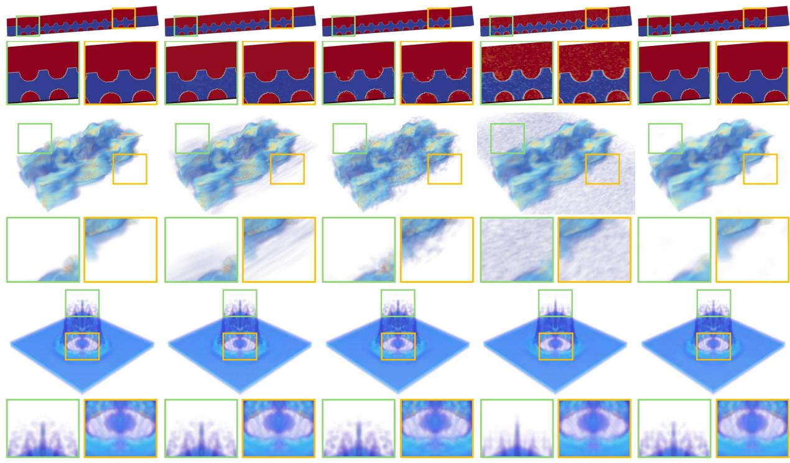  
(a) Ground Truth  
(b) SZ3  
(c) ZFP  
(d) TTHRESH  
(e) Ours  
Figure 5. Visualization of volume at matched PSNR. The volume is reconstructed for a specific snapshot (time and variable). The green and orange boxes, along with their zoomed-in highlight regions, where SWAP-INR excels at compression quality.

Ionization

## C. Discussion

Combustion: low-pass filter of attention. On Combustion, SWAP-INR yields an overall PSNR 1.05 dB below NeurComp. This gap originates from the attention operation, which aggregates features as a weighted average and thus acts as a low-pass filter, smoothing sharp structures while suppressing noise [21, 34]. As shown in Fig. 6 (top), variables on the attention path exhibit slight blurring but fewer structural artifacts than NeurComp. Conversely, variables on the non-attention path (bottom) avoid the low-pass effect of attention and, aided by A2-SIREN, preserve highfrequency detail, surpassing NeurComp by 0.14 dB. Crucially, this lower PSNR is not a failure but a design choice: SWAP-INR routes each variable to balance fidelity against sharpness, trading a marginal PSNR drop for robust reconstructions suited to scientific visualization.

Ionization: the dual benefit of attention. On Ionization, SWAP-INR is 0.37 dB below AFNet in PSNR, yet the two differ in visual quality. As shown in Fig. 7, the attention path offers two complementary benefits depending on each variable’s role. The top row shows that AFNet introduces noticeable structural artifacts throughout the volume, whereas the low-pass nature of attention suppresses them, yielding clean, artifact-free reconstructions. The bottom row shows that attention introduces slight blurring as a weighted average, yet recovers the underlying structure more faithfully than AFNet by exploiting crossvariable correlation. Across both regimes, the attention path thus suppresses artifacts while preserving physical structure, precisely the reliability demanded by scientific visualization, where such artifacts can mislead downstream analysis. SWAP-INR therefore turns a marginal PSNR gap into a tangible gain in visual fidelity, underscoring that numerical scores alone do not capture reconstruction quality.

Synthetic: the hot corner phenomenon. On Synthetic, TTHRESH attains a higher compression ratio than SWAP-INR, the only dataset where a conventional compressor surpasses our method (Table 7). As visualized in Fig. 8, this stems from the hot corner phenomenon: under HOSVD, the structural energy of the core tensor concentrates almost entirely in a single corner, leaving the remainder near zero. Such extreme, localized sparsity is the ideal regime for transform-based compressors, as TTHRESH directly discards the resulting zero coefficients. Coordinate-based INRs, by contrast, distribute capacity smoothly over the domain and cannot concentrate it so asymmetrically, a manifestation of their well-known spatial-spectral bias. We regard this as a boundary condition specific to such degenerate distributions rather than a general limitation, where SWAP-INR otherwise consistently outperforms.

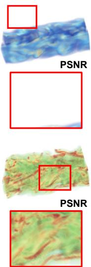  
(a) Ground Truth

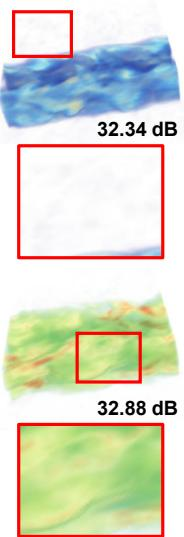  
(b) NeurComp

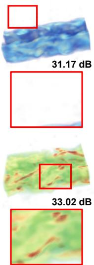  
(c) Ours  
Figure 6. Comparison with NeurComp on the Combustion dataset. (Top) The $j e t _ { h r }$ variable: Reconstructions via the attention path While our method exhibits slight blurring and a lower PSNR due to the weighted averaging effect, it significantly suppresses structural artifacts. (Bottom) The $j e t _ { v o r t }$ variable: Reconstructions via the non-attention path. Here, our method outperforms NeurComp by 0.14 dB, better capturing high-frequency details. Red boxes indicate zoomed-in regions highlighting these improvements.

## D. Training time

Table 8 compares the per-epoch time t (sec), the total training time t (hr), and the full-volume inference time across all datasets, where every model is trained until convergence (no loss improvement over 20 consecutive epochs). Despite its cross-variable attention layer and adaptive frequency modulation, SWAP-INR maintains efficient per-epoch computation, comparable to lightweight baselines such as SIREN, NeurComp, and CoordNet. Total training time instead depends on how long each model keeps improving before convergence. Note that fV-SRN and APMGSRN cannot handle time-varying data; they train a separate model per time step, inflating their totals. SWAP-INR, by comparison, converges quickly and stays among the most efficient on all datasets except Combustion. There, the loss drops sharply to about $3 . 6 \times 1 0 ^ { - 3 }$ by the 20-hour mark and then declines marginally to $3 . 2 \times 1 0 ^ { - 3 }$ near 50 hours, reflecting continued refinement of fine details rather than wasted computation.

SWAP-INR’s inference time is on par with lightweight baselines such as SIREN, NeurComp, and CoordNet, and faster than per-timestep methods (fV-SRN, APMGSRN) that decode each step separately. It matches these baselines because pruning removes the inactive path for each variable, so only a single path is evaluated at inference, keeping the per-query cost close to a standard coordinatebased network. Crucially, SWAP-INR achieves the best compression-fidelity trade-off, attaining the highest PSNR at matched CR among methods of similar speed.

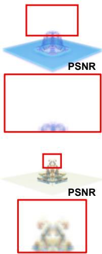  
(a) Ground Truth

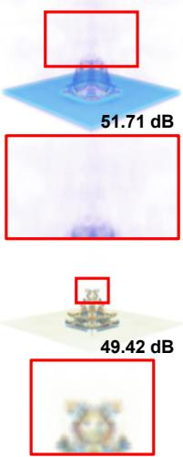  
(b) AFNet

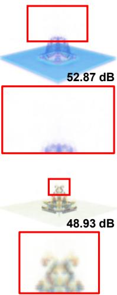  
(c) Ours

Figure 7. Comparison with AFNet on the Ionization dataset. (Top) The PD variable: AFNet introduces noticeable noise across the volume, whereas the low-pass nature of attention suppresses this noise, yielding clean, artifact-free reconstructions. (Bottom) The He variable, which benefits from cross-variable correlation, although attention induces slight blurring, ours reconstructs the underlying structure more faithfully than AFNet. Red boxes indicate zoomed-in regions highlighting these improvements.  
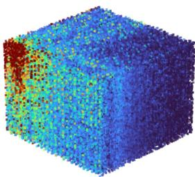  
(a) Variable 1

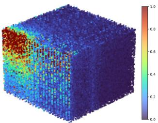  
(b) Variable 2

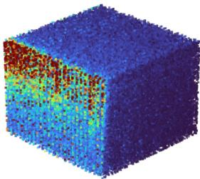  
(c) Variable 3

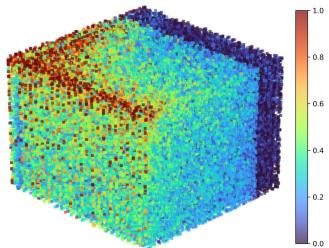  
(d) Variable 4  
Figure 8. Visualization of the HOSVD core tensor for the Synthetic dataset, demonstrating the hot corner phenomenon. Across all variables, the colormap represents the normalized structural weight of the tensor entries. blue: discardable background noise, red: core structural components.

Table 8. Comparison of training and inference times across datasets. t (sec) and t (hr) denote the time per epoch and total training time, respectively, and Inf. (sec) denotes the full-volume inference time.
<table><tr><td>Dataset</td><td>Method</td><td>t (sec)</td><td>t (hr)</td><td>Inf. (sec)</td><td>Dataset</td><td>Method</td><td>t (sec)</td><td>t (hr)</td><td>Inf. (sec)</td><td>Dataset</td><td>Method</td><td>t (sec)</td><td>t (hr)</td><td>Inf. (sec)</td></tr><tr><td rowspan="11">ROCOM</td><td>SIREN</td><td>216</td><td>36.2</td><td>177 176</td><td rowspan="11"></td><td>SIREN</td><td>140</td><td>4.7</td><td>136 109</td><td rowspan="11"></td><td>SIREN</td><td>600</td><td>20.3</td><td>483</td></tr><tr><td>NeurComp</td><td>223</td><td>13.8</td><td></td><td>NeurComp</td><td>138</td><td>7.0</td><td></td><td>NeurComp</td><td>533</td><td>26.5</td><td>466</td></tr><tr><td>CoordNet</td><td>227</td><td>45.4</td><td>182 205</td><td>CoordNet</td><td>134</td><td>15.3</td><td>150 124</td><td>CoordNet</td><td>686</td><td>31.5</td><td>494</td></tr><tr><td>Instant-NGP</td><td>199</td><td>137.6</td><td></td><td>Instant-NGP</td><td>133</td><td>85.1</td><td></td><td>Instant-NGP</td><td>524</td><td>185.5</td><td>494</td></tr><tr><td>fV-SRN</td><td>230</td><td>132.7 200</td><td></td><td>fV-SRN</td><td>240</td><td>109.7 210</td><td></td><td>fV-SRN</td><td>600</td><td>338.3</td><td>656</td></tr><tr><td>WIRE</td><td>246</td><td>8.2 198</td><td>CUPID</td><td>WIRE</td><td>132</td><td>6.7 142</td><td>Synthetic</td><td>WIRE</td><td>598</td><td>19.9</td><td>542</td></tr><tr><td>APMGSRN</td><td>210</td><td>128.7</td><td>197</td><td>APMGSRN</td><td>180</td><td>113.3 209</td><td></td><td>APMGSRN</td><td>630</td><td>346.1</td><td>654</td></tr><tr><td>AFNet</td><td>226</td><td>125.6</td><td>178</td><td>AFNet</td><td>126</td><td>58.0</td><td>137</td><td>AFNet</td><td>593</td><td>137.8</td><td>481</td></tr><tr><td>SL2A-INR MC-INR</td><td>225 618</td><td>125.0</td><td>179</td><td>SL2A-INR</td><td>134</td><td>74.4</td><td>145</td><td>SL2A-INR</td><td>547</td><td>158.3</td><td>464</td></tr><tr><td>Ours</td><td>210</td><td>53.2 33.4</td><td>202 193</td><td>MC-INR Ours</td><td>301</td><td>38.5 9.5</td><td>282 132</td><td>MC-INR Ours</td><td>726</td><td>170.6</td><td>641</td></tr><tr><td>SIREN</td><td>39</td><td>2.3</td><td>37</td><td>SIREN</td><td>136 59</td><td>11.8</td><td>51</td><td>SIREN</td><td>517 92</td><td>34.0 5.6</td><td>483 82</td></tr><tr><td rowspan="11">SMR</td><td>NeurComp</td><td>96</td><td>19.8</td><td>40</td><td>NeurComp</td><td>61</td><td>11.8</td><td>49</td><td>NeurComp CoordNet</td><td></td><td>110</td><td>6.0 87 81</td></tr><tr><td>CoordNet</td><td>41</td><td>3.4</td><td>32</td><td>CoordNet</td><td>63</td><td>12.9</td><td>48 53</td><td></td><td></td><td>101</td><td>5.2</td></tr><tr><td>Instant-NGP</td><td>35</td><td>19.4</td><td>36</td><td>Instant-NGP</td><td>61</td><td>33.2</td><td></td><td>Instant-NGP</td><td>95</td><td>58.3</td></tr><tr><td>fV-SRN</td><td>60</td><td>28.9</td><td>61</td><td>fV-SRN</td><td>75</td><td>44.7 144</td><td>fV-SRN</td><td>150</td><td>85.1</td><td>93 263</td></tr><tr><td>WIRE</td><td>39</td><td>5.0</td><td>33</td><td>WIRE</td><td>62</td><td>6.1 47</td><td>Ionization WIRE</td><td>103</td><td>5.9</td><td>90</td></tr><tr><td>APMGSRN</td><td>50</td><td>28.0</td><td>Combustion</td><td>APMGSRN</td><td>75</td><td>44.6 130</td><td>APMGSRN</td><td>150</td><td>93.1</td><td>265 94</td></tr><tr><td>AFNet</td><td>36</td><td>28.8</td><td>64 32</td><td>AFNet</td><td>57</td><td>31.6</td><td></td><td>AFNet</td><td>106</td><td>54.7</td></tr><tr><td>SL2A-INR</td><td>39</td><td>12.2</td><td>32</td><td>SL2A-INR</td><td>63</td><td>35.0</td><td>52 46</td><td>SL2A-INR</td><td>107</td><td>48.2</td><td>83</td></tr><tr><td>MC-INR</td><td>58</td><td></td><td>4.6 59</td><td>MC-INR</td><td>154</td><td>19.4</td><td>44</td><td>MC-INR</td><td>142</td><td>11.2</td><td>79</td></tr><tr><td>Ours</td><td>42</td><td>4.4</td><td>39</td><td>Ours</td><td>56</td><td>49.3</td><td>56</td><td>Ours</td><td>98</td><td>6.8</td><td>88</td></tr><tr><td></td><td></td><td></td><td></td><td></td><td></td><td></td><td></td><td></td><td></td><td></td><td></td></tr></table>

## E. Path Switching Results

Tables 9 through 14 report the path-switching results for all six datasets: ROCOM [3], CUPID, Synthetic, SMR Simulation, Combustion [10], and Ionization [36]. For each dataset, we list the path selected for every variable along with its reconstruction PSNR. The routing is determined entirely by the deterministic, loss-driven criterion, without any hand-specified correlation structure or manual tuning. The resulting assignments are non-trivial and datasetdependent: rather than collapsing to a single path, variables split between the attention and non-attention paths in proportions that vary across datasets. Critically, this routing is not merely descriptive but functionally validated. The SWAP module ablation shows that enabling switching consistently improves reconstruction fidelity. This confirms that the selected assignments measurably reduce error rather than emerging incidentally during training.

## E.1. ROCOM

Table 9 presents ROCOM results. The cboron, rhol, $\begin{array} { r } { v l _ { 0 , 1 , 2 } , } \end{array}$ mutl, and yplus are routed to the attention path, while p is routed to the non-attention path.

Table 9. Path switching results for the ROCOM dataset [3].
<table><tr><td>Variables</td><td> $\mathbf { P a t h } _ { a t t n }$ </td><td> $\mathbf { P a t h } _ { n o n - a t t n }$ </td><td>PSNR↑</td></tr><tr><td>cboron (Concentration of Boron)</td><td>√</td><td></td><td>67.12</td></tr><tr><td>mutl (Turbulent viscosity)</td><td>√</td><td></td><td>32.64</td></tr><tr><td>p (Pressure)</td><td></td><td>√</td><td>53.35</td></tr><tr><td>rhol (Density of liquid)</td><td>√</td><td></td><td>53.40</td></tr><tr><td>vl0 (Liquid velocity vector)</td><td>√</td><td></td><td>43.14</td></tr><tr><td>vl1 (Liquid velocity vector)</td><td>√</td><td></td><td>46.65</td></tr><tr><td>vl2 (Liquid velocity vector)</td><td>√</td><td></td><td>45.34</td></tr><tr><td>yplus (Non-dimensional wall distance)</td><td>√</td><td></td><td>37.67</td></tr></table>

## E.2. CUPID

Table 10 presents CUPID results. The qvol mas, $t l , v l _ { 0 , 1 , 2 } ,$ and twall rv1 ∼ 5 are routed to the attention path, while p is routed to the non-attention path.

Table 10. Path switching results for the CUPID dataset.
<table><tr><td>Variables</td><td> $\mathbf { P a t h } _ { a t t n }$ </td><td> $\mathbf { P a t h } _ { n o n - a t t n }$ </td><td>PSNR↑</td></tr><tr><td>p (Pressure)</td><td></td><td>√</td><td>50.37</td></tr><tr><td>qvol_mas (Axial core power)</td><td>√</td><td></td><td>45.39</td></tr><tr><td>tl (Temperature of liquid)</td><td>√</td><td></td><td>45.28</td></tr><tr><td>twall_rv1 (User-defined)</td><td>√</td><td></td><td>52.76</td></tr><tr><td>twall_rv2 (User-defined)</td><td>√</td><td></td><td>45.74</td></tr><tr><td>twall_rv3 (User-defined)</td><td>√</td><td></td><td>60.48</td></tr><tr><td>twall_rv4 (User-defined)</td><td>√</td><td></td><td>52.03</td></tr><tr><td>twall_rv5 (User-defined)</td><td>√</td><td></td><td>50.19</td></tr><tr><td>vl0 (Liquid velocity vector)</td><td>√</td><td></td><td>52.95</td></tr><tr><td>vl1 (Liquid velocity vector)</td><td>√</td><td></td><td>54.00</td></tr><tr><td>vl2 (Liquid velocity vector)</td><td>√</td><td></td><td>43.96</td></tr></table>

## E.3. Synthetic

Table 11 presents Synthetic results. All four variables (ϵ, $k , \mu _ { t } , p )$ are routed to the attention path, with no variable assigned to the non-attention path.

Table 11. Path switching results for the Synthetic dataset.
<table><tr><td>Variables</td><td> $\mathbf { P a t h } _ { a t t n }$ </td><td> $\mathbf { P a t h } _ { n o n - a t t n }$ </td><td>PSNR↑</td></tr><tr><td>€ (Dissipation rate of turbulence)</td><td>√</td><td></td><td>79.58</td></tr><tr><td>k (Turbulent kinetic energy)</td><td>√</td><td></td><td>75.10</td></tr><tr><td>µt (Turbulent viscosity)</td><td>√</td><td></td><td>68.70</td></tr><tr><td>p (Pressure)</td><td>√</td><td></td><td>76.60</td></tr></table>

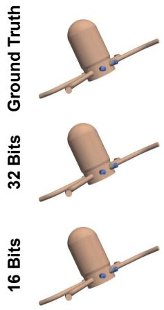  
(a) ROCOM  
(b) CUPID  
(c) Synthetic

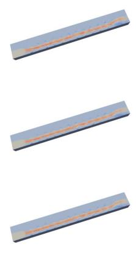  
(d) SMR Simulation

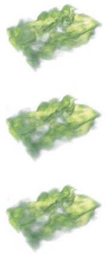  
(e) Combustion  
(f) Ionization

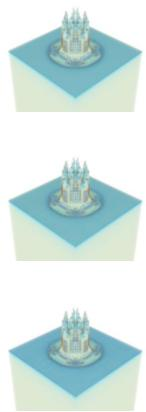  
Figure 9. Visual comparison of ground truth data (top row) with model reconstructions using 32-bit (middle row) and quantized 16-bit weights (bottom row). The volume is rendered for a specific snapshot (time and variable).

## E.4. SMR Simulation

Table 12 presents SMR Simulation results. The $p , U , V ,$ and $\omega _ { z }$ are routed to the attention path, while $W , \omega _ { x } , \omega _ { y } ,$ and L2 are routed to the non-attention path.

Table 12. Path switching results for the SMR Simulation dataset.
<table><tr><td>Variables</td><td> $\mathbf { P a t h } _ { a t t n }$ </td><td> $\mathbf { P a t h } _ { n o n - a t t n }$ </td><td>PSNR↑</td></tr><tr><td>L2 (Vortex identifier)</td><td></td><td>√</td><td>48.36</td></tr><tr><td>p (Pressure)</td><td>√</td><td></td><td>47.90</td></tr><tr><td>U (Velocity x components)</td><td>√</td><td></td><td>32.62</td></tr><tr><td>V (Velocity y components)</td><td>√</td><td></td><td>31.11</td></tr><tr><td>W (Velocity z component)</td><td></td><td>√</td><td>32.22</td></tr><tr><td>ωx (Vorticity x components)</td><td></td><td>√</td><td>37.01</td></tr><tr><td>ωy (Vorticity y components)</td><td></td><td>√</td><td>37.45</td></tr><tr><td>ωz (Vorticity z component)</td><td>√</td><td></td><td>38.68</td></tr></table>

## E.5. Combustion

Table 13 presents Combustion results. The reactive scalars $( j e t _ { m i x f r a c } , j e t _ { Y _ { O H } } , j e t _ { h r } )$ are routed to the attention path, while $j e t _ { v o r t }$ is routed to the non-attention path.

Table 13. Path switching results for the Combustion dataset [10].
<table><tr><td>Variables</td><td> $\mathbf { P a t h } _ { a t t n }$ </td><td> $\mathbf { P a t h } _ { n o n - a t t n }$ </td><td>PSNR↑</td></tr><tr><td> $j e t _ { h r }$  (Heat release rate)</td><td>√</td><td></td><td>30.80</td></tr><tr><td> $j e t _ { m i x f r a c }$  (Mixture fraction)</td><td>√</td><td></td><td>30.35</td></tr><tr><td> $j e t _ { v o r t }$  (Vorticity)</td><td></td><td>√</td><td>32.80</td></tr><tr><td> $j e t _ { Y _ { O H } }$  (OH mass fraction)</td><td>√</td><td></td><td>30.74</td></tr></table>

## E.6. Ionization

Table 14 presents Ionization results. All four variables $( H _ { 2 }$ $H ^ { + } , H e , P D )$ are routed to the attention path, with no variable assigned to the non-attention path.

Table 14. Path switching results for the Ionization dataset [36].
<table><tr><td>Variables</td><td> $\mathbf { P a t h } _ { a t t n }$ </td><td> $\mathbf { P a t h } _ { n o n - a t t n }$ </td><td>PSNR↑</td></tr><tr><td> $H _ { 2 }$  (Molecular hydrogen)</td><td>√</td><td></td><td>52.97</td></tr><tr><td>H+ (Ionized hydrogen)</td><td>V</td><td></td><td>48.21</td></tr><tr><td>He (Neutral helium)</td><td>√</td><td></td><td>46.80</td></tr><tr><td>PD (Photon/Particle density)</td><td>√</td><td></td><td>53.02</td></tr></table>

## F. Quantization

We further analyze the effect of 16-bit quantization. Figure 9 compares the 32-bit and 16-bit reconstructions of SWAP-INR across all six datasets. The two are visually indistinguishable, confirming that half-precision conversion preserves fine physical details while roughly halving the model size, directly enabling the compression gains reported throughout the paper. This resilience reflects a known property of coordinate-based neural representations, which are largely robust to reduced precision.

To verify that SWAP-INR’s advantage stems from its representation rather than from quantization alone, Tab. 15 applies the same 16-bit conversion to all competing methods, placing every baseline on equal footing at matched CR. Note that WIRE is excluded, as its complex-valued Gaborwavelet activations are incompatible with real-valued 16-bit conversion. Even under this uniform 16-bit setting, SWAP-INR achieves SOTA performance on the SMR datasets (RO-COM [3], CUPID, Synthetic, and SMR Simulation) and remains competitive on the public datasets (Combustion [10] and Ionization [36]) at matched CR. This confirms that the advantage of SWAP-INR is intrinsic to its architectural design rather than to numerical precision, persisting even when every competing baseline benefits equally from the same quantization.

Table 15. Quantitative comparison with all methods under 16-bit quantization.
<table><tr><td>Dataset</td><td>Method</td><td>PSNR↑</td><td>NRMSE↓</td><td>R2 ↑</td><td>CR↑</td><td>Size(KB)↓</td><td>Dataset</td><td>Method</td><td>PSNR↑</td><td>NRMSE↓</td><td>R2 ↑</td><td>CR↑</td><td>Size(KB)↓</td></tr><tr><td rowspan="10">ROCOM</td><td>SIREN NeurComp</td><td>42.84 42.59</td><td>0.0105 0.0105</td><td>0.9417 0.9399</td><td>3,345 3,328</td><td>581 584</td><td rowspan="9"></td><td>SIREN NeurComp</td><td>23.62 23.15</td><td>0.0098 0.1163</td><td>0.6511 0.6457</td><td>2,622 2,630</td><td>629 627</td></tr><tr><td></td><td>42.88</td><td></td><td></td><td></td><td></td><td>CoordNet</td><td>22.19</td><td>0.0164</td><td>0.6110</td><td>2,626</td><td>628</td></tr><tr><td>CoordNet</td><td></td><td>0.0108</td><td>0.9382</td><td>3,323 3,351</td><td>585 580</td><td>Instant-NGP</td><td></td><td></td><td></td><td></td><td></td></tr><tr><td>Instant-NGP</td><td>32.49</td><td>0.0266</td><td>0.5243</td><td></td><td></td><td></td><td>19.98</td><td>0.1759</td><td>0.4335</td><td>2,561</td><td>644</td></tr><tr><td>fV-SRN*</td><td>41.45</td><td>0.0112</td><td>0.9145</td><td>3,351</td><td>580</td><td>fV-SRN* WIRE</td><td>21.52</td><td>0.1616</td><td>0.4151</td><td>2,618</td><td>630</td></tr><tr><td>WIRE</td><td></td><td></td><td></td><td></td><td>CUPID</td><td></td><td></td><td></td><td></td><td></td><td></td></tr><tr><td>AFNet</td><td>44.98</td><td>0.0087</td><td>0.9545</td><td>3,351</td><td>580</td><td>AFNet</td><td>49.95</td><td>0.0036</td><td>0.9779</td><td>2,622</td><td>629</td></tr><tr><td>APMGSRN*</td><td>39.27</td><td>0.0161</td><td>0.8844</td><td>3,351</td><td>580</td><td>APMGSRN*</td><td>20.20</td><td>0.1723</td><td>0.2197</td><td>2,618</td><td>630</td></tr><tr><td>SL2A-INR MC-INR*</td><td>41.33 39.78</td><td>0.0123 0.0168</td><td>0.9254 0.8360</td><td>3,328 3,328</td><td>584 584</td><td rowspan="2">SL2A-INR MC-INR*</td><td>22.45 46.14</td><td>0.1186 0.0078</td><td>0.5282 0.9647</td><td>2,622 2,626</td><td>629 628</td></tr><tr><td>Ours</td><td>47.41</td><td>0.0073</td><td>0.9782</td><td>3,351</td><td></td><td>Ours 50.29</td><td></td><td>0.0035</td><td>0.9904</td><td></td></tr><tr><td rowspan="10"></td><td>SIREN</td><td>65.11</td><td>0.0007</td><td>0.8558</td><td>7,818</td><td>580 315 317</td><td rowspan="10"></td><td></td><td>34.21</td><td>0.0248</td><td>0.3192</td><td>2,634 667</td><td>626 491</td></tr><tr><td>NeurComp</td><td>68.06</td><td>0.0004</td><td>0.7237</td><td>7,769</td><td></td><td>SIREN NeurComp</td><td>33.36</td><td>0.0287</td><td>0.2119</td><td>666</td><td>492</td></tr><tr><td>CoordNet</td><td>63.73</td><td>0.0011</td><td>0.9731</td><td>7,868</td><td></td><td>CoordNet</td><td>34.14</td><td>0.0259</td><td>0.3427</td><td>658</td><td>498</td></tr><tr><td>Instant-NGP</td><td>35.22</td><td>0.0772</td><td>0.0514</td><td>7,601</td><td></td><td>Instant-NGP</td><td>30.27</td><td>0.0811</td><td>0.0565</td><td>635</td><td>516</td></tr><tr><td>fV-SRN*</td><td>66.68</td><td>0.0005</td><td>0.8526</td><td>7,463</td><td></td><td>fV-SRN*</td><td>30.61</td><td>0.0359</td><td>-2.7409</td><td>655</td><td>500</td></tr><tr><td>WIRE</td><td></td><td></td><td></td><td></td><td>Simulation</td><td>WIRE</td><td></td><td></td><td></td><td></td><td>一</td></tr><tr><td>AFNet</td><td>71.69</td><td>0.0003</td><td>0.9379</td><td>7,793</td><td>316</td><td>AFNet</td><td>36.24</td><td>0.0178</td><td>0.3907</td><td>667</td><td>491</td></tr><tr><td>APMGSRN*</td><td>64.46</td><td>0.0007</td><td>0.8124</td><td>7,463</td><td>330</td><td>APMGSRN*</td><td>30.90</td><td>0.0512</td><td>-0.3559</td><td>655</td><td>500</td></tr><tr><td>SL²A-INR</td><td>41.41</td><td>0.0086</td><td>-121.0300</td><td>7,843</td><td>314</td><td>SL2A-INR</td><td>31.58</td><td>0.0354</td><td>-1.2366</td><td>665</td><td>493</td></tr><tr><td>MC-INR</td><td>65.03</td><td>0.0007</td><td>0.9507</td><td>7,696</td><td>320</td><td>MC-INR</td><td>34.03</td><td>0.0250</td><td>0.2843</td><td>650</td><td>504</td></tr><tr><td>Ours</td><td>75.00</td><td>0.0002</td><td>0.9736</td><td>7,868</td><td>313</td><td>Ours</td><td></td><td>38.17</td><td>0.0153</td><td>0.4494</td><td>667</td><td>491</td></tr><tr><td rowspan="10">Combustion</td><td>SIREN</td><td>31.06</td><td>0.0281</td><td>0.9057</td><td>989</td><td>256 254</td><td rowspan="7"></td><td>SIREN</td><td>38.34</td><td>0.0162</td><td>0.9402</td><td>2,011</td><td>224 224</td></tr><tr><td>NeurComp</td><td>32.86</td><td>0.0227</td><td>0.9197</td><td>997</td><td></td><td>NeurComp</td><td>39.87</td><td>0.0129</td><td>0.9526</td><td>2,011</td><td></td></tr><tr><td>CoordNet</td><td>30.74</td><td>0.0292</td><td>0.9030</td><td>985</td><td>257</td><td>CoordNet</td><td>32.75</td><td>0.0321</td><td>0.8128</td><td>1,993</td><td>226</td></tr><tr><td>Instant-NGP</td><td>21.03</td><td>0.1009</td><td>0.4953</td><td>977</td><td>259</td><td>Instant-NGP</td><td>22.47</td><td>0.1767</td><td>0.2545</td><td>1,984</td><td>227</td></tr><tr><td>fV-SRN*</td><td>24.91</td><td>0.0607</td><td>0.7590</td><td>920</td><td>275</td><td>fV-SRN*</td><td>26.48</td><td>0.0657</td><td>0.2457</td><td>1,802</td><td>250</td></tr><tr><td>WIRE</td><td></td><td></td><td></td><td></td><td></td><td>WIRE</td><td></td><td></td><td></td><td></td><td></td></tr><tr><td>AFNet</td><td>31.03</td><td>0.0282</td><td>0.9022</td><td>993</td><td>255</td><td>AFNet</td><td>48.64</td><td>0.0044</td><td>0.9916</td><td>1,984</td><td>227 250</td></tr><tr><td>APMGSRN*</td><td>22.67</td><td>0.0808</td><td>0.6272</td><td>920</td><td>275</td><td>APMGSRN*</td><td>19.77</td><td>0.1306</td><td>-3.8897 0.8109</td><td>1,802</td><td>227</td></tr><tr><td>SL²A-INR</td><td>24.21</td><td>0.0669</td><td>0.7251</td><td>997</td><td>254</td><td>SL2A-INR</td><td>33.50</td><td>0.0277 0.1443</td><td></td><td>1,984</td><td>232</td></tr><tr><td>MC-INR</td><td>17.46</td><td>0.1592</td><td>-0.1311</td><td>989</td><td>256</td><td>MC-INR</td><td>21.44</td><td></td><td></td><td>-0.4746</td><td></td></tr><tr><td></td><td></td><td></td><td></td><td>997</td><td>254</td><td></td><td></td><td>50.25</td><td>0.0032</td><td>0.9905</td><td>1,942 2,011</td></tr><tr><td></td><td>Ours</td><td>31.17</td><td>0.0278</td><td>0.9116</td><td></td></table>

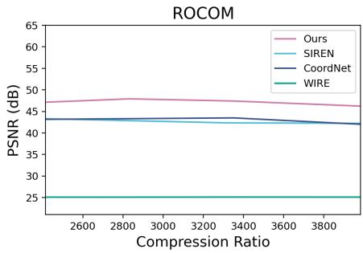

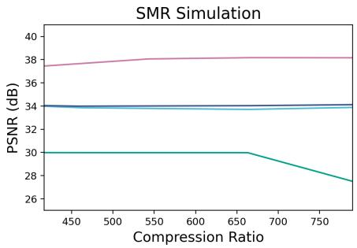

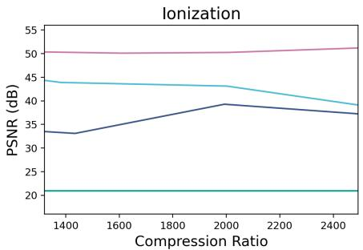  
Figure 10. PSNR graph across various CRs for SIREN, CoordNet, WIRE, and Ours on ROCOM, SMR Simulation, and Ionization.

## G. PSNR Results under Various CR

Figure 10 illustrates how PSNR changes as the CR increases for SIREN, CoordNet, WIRE, and our proposed SWAP-INR across three datasets. Across all evaluations, SWAP-INR consistently and significantly outperforms the baselines at every compression level, while WIRE remains the weakest throughout, reflecting the difficulty its wavelet activations face in these scientific fields. Beyond this overall margin, the trends reveal distinct behaviors per dataset. On ROCOM [3], SWAP-INR is remarkably stable, holding a peak PSNR near 48 dB; although it degrades slightly beyond CR > 3200, it still retains a wide fidelity margin over the baselines. On SMR Simulation, SWAP-INR is notably robust to increasing compression: rather than the steady decline expected at higher CR, its PSNR stays essentially flat, indicating that our targeted pruning removes redundant parameters with little impact on the retained representation. On Ionization [36], PSNR even rises slightly beyond CR ≈ 2000, showing that SWAP-INR sustains, and can modestly improve, fidelity under aggressive compression. This stability is the key practical advantage of SWAP-INR: it sustains high-fidelity reconstruction even under aggressive compression, where baseline methods either degrade or plateau at substantially lower quality. Together, these results establish that SWAP-INR achieves extreme compression while preserving the fidelity of complex physical fields.