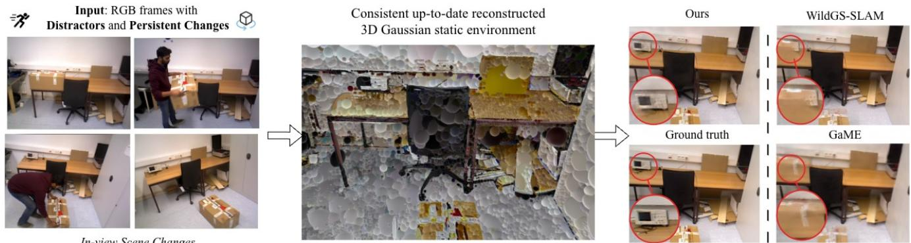
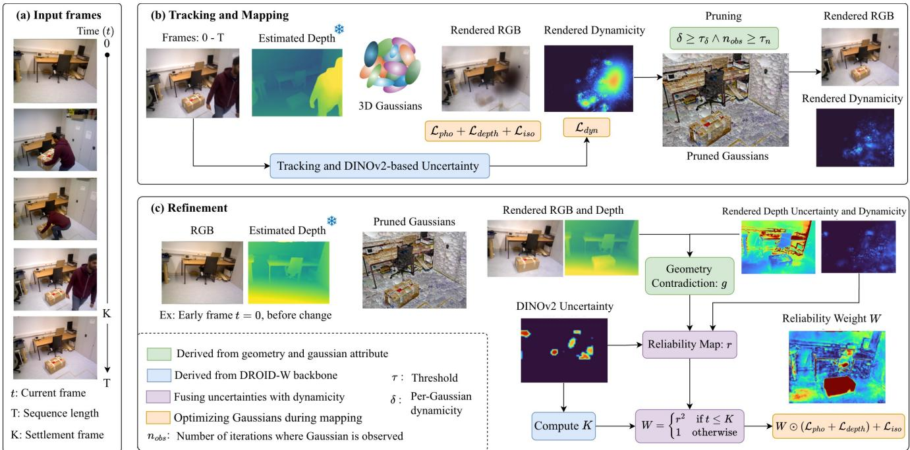
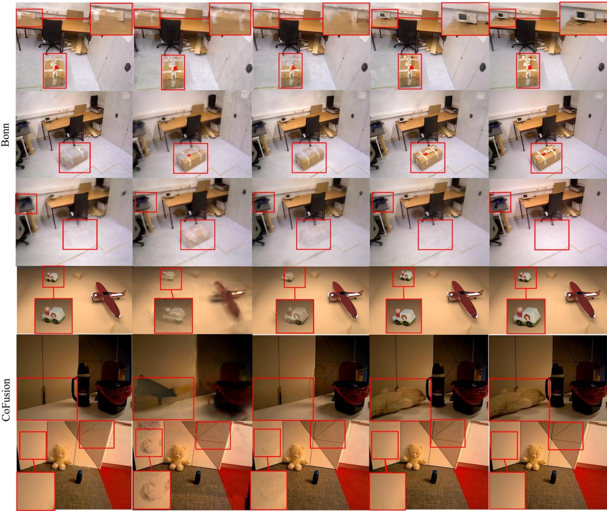
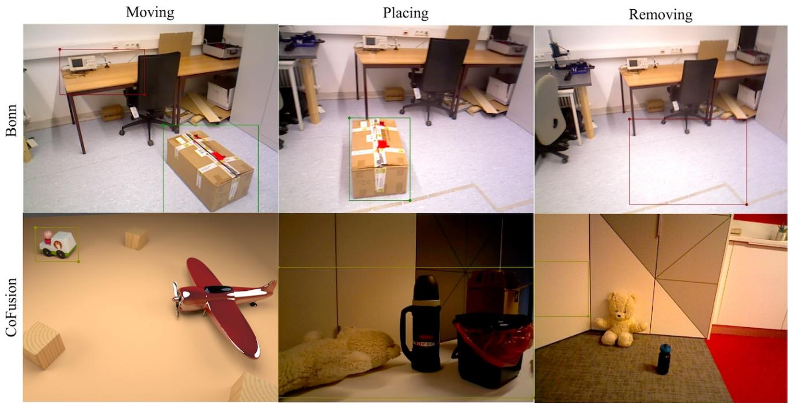

  
Figure 1. SettleSplat. Given monocular RGB sequence (left) with in-view scene changes, containing dynamic distractors (moving person) and persistent changes (box), SettleSplat reconstructs a consistent, up-to-date 3D Gaussian map (middle). At previously changed locations (red circles), our method achieves clean and consistent rendering, while previous studies [39, 41] leave ghosting artifacts (right).

# SettleSplat: Monocular Gaussian Mapping under In-View Scene Changes

Anh Thuan Tran1,2,\* Xiyun Song2,† Yubin Zhou2 Heather Yu2 Jana Kosecka1 Liang Peng2

1George Mason University 2Futurewei Technologies

{atran92, kosecka}@gmu.edu {xsong, yzhou2, hyu, lpeng}@futurewei.com

In-view Scene Changes

## Abstract

Online 3D Gaussian mapping enablesfast and high-fidelity novel view synthesis, with broad applications in augmented reality, robotics, and autonomous systems. However, many current methods assume static scenes orfilter out dynamics as outliers. In this paper, we study in-view scene changes where objects are manipulated infront ofthe camera within a single online sequence, unlike prior works that detect changes outside the camera view or between separate captures. This setting entangles transient and persistent dynamics, as objects can be distractors while moving and persistent once they settle. While recent studies start to address distractors by removing them for clean static background, in-view scene changes remain underexplored. To resolve this, we present SettleSplat, a monocular mapping system that maintains up-to-date 3D Gaussian maps under such changes. Specifically, we lift coarse per-pixel uncertainty into Gaussian dynamicity field, then prune transient ones. For persistent changes, we derive geometric contradictions weighted by parameter-free rendered depth uncertainty to separate true changes from under-optimized regions. On

Bonn and Co-Fusion, SettleSplat achieves consistent 3D Gaussian maps, outperforming current baselines on both full images and change regions while maintaining comparable speed.

## 1. Introduction

Visual mapping aims to reconstruct an up-to-date and consistent 3D representation from RGB images. It is a fundamental task in computer vision, with broad applications in robotics, autonomous systems, and AR/VR [3], where spatial understanding supports navigation, planning, and interaction. Recent developments in 3D representations, such as NeRF [23] or 3D Gaussian Splatting [9], further provide novel view synthesis capabilities with photorealistic rendering. Although achieving remarkable performance in both image quality and training speed, these approaches [8, 31, 34] assume that the scene remains static during optimization across all frames.

However, real-world scenes are more complicated with different kinds of motions. For example, a person walking through the scene is treated as dynamic distractor, while an object newly placed into the scene is a persistent change that must be reflected in the final representation. These two dynamics, however, are intertwined within a single sequence in the camera’s view, a setting we refer to as in-view scene changes. When a hand places an item into the scene, the body movement is considered a distractor, while the item, once settled, becomes persistent change. Prior works address either distractor removal [2, 15, 16, 41], change detection between separate captures [1, 19], or changes that happen out of view in a single sequence [39]. The mixed case, where objects transition from dynamic to static or vice versa within camera view, remains unresolved. The monocular setting makes this problem harder due to errors in depth estimation [5, 27, 36]. Previous studies [16, 41] show that DINOv2-based uncertainty, derived from semantic features can correct these errors in bundle adjustment for tracking. For mapping, however, the uncertainty map is too coarse, and estimated depth alone is not enough to capture persistent changes from Gaussians that are still under-optimized and keep changing during online reconstruction.

To address these challenges, we propose SettleSplat, a monocular method for change detection where dynamic distractors and persistent changes are entangled. For distractors, we lift the coarse 2D uncertainty into per-Gaussian dynamicity field and prune dynamic ones from the 3D map. For persistent changes, we capture geometric contradictions between the map and observed frames, weighted by a rendered depth uncertainty that separates persistent changes from under-optimized Gaussians. To the best of our knowledge, SettleSplat is the first monocular 3DGS mapping system that handles persistent changes entangled with transient distractors without depth sensor or segmentation masks. In summary, our contributions are as follows.

• We propose SettleSplat, a monocular method for online mapping of dynamic scenes where transient distractors and persistent changes are entangled.

• We introduce a per-Gaussian dynamicity field that lifts coarse 2D uncertainty into 3D for pruning, and a correction mechanism for recovery of wrongly suppressed regions.

• We derive a rendered depth uncertainty to gate geometric contradictions between the map and previous frames, separating persistent changes from under-optimized regions.

• Our method outperforms current approaches on in-view scene changes, containing dynamic distractors and persistent changes at competitive tracking and mapping speed.

## 2. Related Work

Dynamic Gaussian Splatting. Neural radiance fields [23] enable novel view synthesis with photorealistic rendering. 3D Gaussian Splatting [9] further improves rendering speed and optimization time, achieving real-time performance. Extending this to dynamic scenes has received broad attention. Existing methods model temporal changes through deformation fields [35, 37] or per-Gaussian motion representations [12, 14, 17, 20], enabling dynamic novel view synthesis. However, these approaches typically rely on offline reconstruction and multi-view or RGB-D observations, whereas SettleSplat performs online mapping from monocular RGB sequences.

Online Gaussian Mapping. Early online mapping systems use neural implicit representations, encoding the scene into MLP or feature grid that is optimized on-the-go for novel view synthesis [30, 32, 43]. Explicit 3DGS then accelerated this line, replacing volumetric sampling with rasterized Gaussians for high-fidelity rendering at faster speed. Recent studies use 3D Gaussians as the main scene representation for tracking and mapping [8, 22, 26, 38]. Subsequent works extend the setting along several axes, such as reconstructing from monocular RGB [6, 22, 31], modeling uncertainty to down-weight unreliable observations [4, 34], and using loop closure to remain consistent over long trajectories [18, 42], then typically completing the online map with a short final refinement. However, these works compute uncertainties against observed color [34] or sensor depth [4], whereas we render depth uncertainty purely from Gaussian geometry to mark reliable regions.

Distractor Removal. While these methods perform well in static scenes, they still struggle in dynamic environments. Another line of works therefore removes dynamic distractors through semantic or motion masks [2, 7, 15] or transient-aware modeling in the wild [16, 21]. WildGS-SLAM [41] learns an uncertainty map from DINOv2 features with a shallow MLP [13], while DROID-W [16] obtains uncertainty from DINOv2 feature consistency inside bundle adjustment. However, these approaches treat dynamics in image space and only remove the distractors, not considering regions that transition from dynamic to persistent. We use DROID-W only as an uncertainty source and lift its per-pixel uncertainty into 3D Gaussian dynamicity field, deferring the masking decision to 3D instead of removing pixels in image space.

3DGS Change Detection. To address persistent changes and maintain up-to-date 3DGS map, several studies have been proposed [10, 19] to detect change regions and update the scene from sparse post-change images without reoptimizing the whole map. Another line of work [1, 11, 40] applies continual learning to 3DGS, maintaining the map across separate captures and lighting conditions using DI-NOv2 features and clustering algorithms. Unlike these approaches, which update Gaussian maps from sparse observations across different scene states, SettleSplat handles transient and persistent changes intertwined within a continuous monocular sequence. GaME [39] addresses this issue by bringing map updating into a single online sequence, focusing on objects that are changed outside the camera view. However, it requires posed RGB-D input and instance segmentation from pretrained models [28]. In contrast, our method addresses changes that unfold in front of the camera, where distractors and persistent changes are entangled in the same sequence. SettleSplat separates these motions, removing distractors while updating the map, and operates from monocular RGB without segmentation mask.

  
Figure 2. System overview. Given monocular RGB frames (a), SettleSplat estimates depth, then tracks and maps with the DROID-W backbone (b) while learning per-Gaussian dynamicity field δ that prunes transient distractors. During refinement (c), geometry contradiction score $^ { g , }$ derived from the rendered map and estimated depth and weighted by the rendered depth uncertainty, is integrated with the tracking uncertainty into reliability map r. Frames before the settlement frame K are weighted by $W = r ^ { 2 }$ , while later frames supervise the settled scene without masking.

## 3. Method

SettleSplat adapts uncertainty-aware SLAM backbone DROID-W [16] to in-view scene changes with mapping stage that reconstructs up-to-date 3D Gaussian maps. Given monocular RGB sequences where transient distractors and persistent changes are entangled, our system removes the former while updating the map to reflect the latter. The overview of SettleSplat is shown in Figure 2.

## 3.1. Preliminaries

3D Gaussian Splatting. Following [8, 9, 16, 41], we represent the scene as a set of 3D Gaussians, each parameterized by mean position $\mu _ { i } .$ , covariance $\Sigma _ { i }$ (factored into scale $s _ { i }$ and rotation $q _ { i } )$ , opacity $\alpha _ { i } .$ , and color $\mathbf { c } _ { i }$ represented by spherical harmonics. In addition, each Gaussian has a learnable dynamicity logit $\ell _ { i }$ , mapped through a sigmoid to obtain a bounded dynamicity value $\delta _ { i }$

$$
\mathcal { G } _ { i } = \{ \mu _ { i } , \mathbf { c } _ { i } , s _ { i } , q _ { i } , \alpha _ { i } , \ell _ { i } \} , \quad \delta _ { i } = \sigma ( \ell _ { i } ) \in ( 0 , 1 ) .\tag{1}
$$

Rendering follows standard alpha compositing: with transmittance $T _ { i } ,$ the blending weight of each Gaussian is $w _ { i } =$ $T _ { i } \alpha _ { i }$ , and color and depth are accumulated as

$$
\hat { C } = \sum _ { i } w _ { i } \mathbf { c } _ { i } , \qquad \hat { D } = \sum _ { i } w _ { i } d _ { i } .\tag{2}
$$

Dynamicity rendering. Unlike color or depth, dynamicity $\delta _ { i }$ is a surface attribute rather than an emitted quantity. At pixels with low accumulated opacity, plain accumulation would conflate coverage with dynamicity. We therefore normalize by the accumulated blending weights to obtain $\hat { M } ,$

$$
\hat { M } = \frac { \sum _ { i } w _ { i } \delta _ { i } } { \sum _ { i } w _ { i } + \varepsilon } ,\tag{3}
$$

giving an opacity-independent estimate $\hat { M } \in ( 0 , 1 )$ . Color, depth, and dynamicity are thus rendered for every pixel in a single rasterization pass.

Uncertainty-aware backbone. We build on DROID-W [16], which extends DROID-SLAM [33] with uncertaintyaware bundle adjustment. While tracking, DROID-W provides a per-pixel uncertainty map, derived from multi-view consistency of DINOv2 features [24] across views. Higher values indicate observations that violate the rigid-scene assumption, such as moving objects. We adapt DROID-W tracking stage and use its uncertainty $p _ { \mathrm { b a } } \in ( 0 , 1 )$ as supervision for the dynamicity loss (Sec. 3.3). Our contributions lie in the mapping stage. While DROID-W handles tracking in the presence of moving objects, we keep the 3DGS map consistent when the scene changes.

## 3.2. Geometry contradiction

Depth changes. Transient distractors can be pruned from the map, but persistent changes cannot. When an object moves to a new place, pruning alone leaves a ghost of its old position in the map. To capture such changes, we compare the map against early frames. We render depth from the up-to-date map and compute its residual against the estimated depth of previous frames. Unlike GaME [39], which requires depth sensor, we only use monocular depth D estimated by a pretrained model [5], similar to [16, 41]. Large residual here does not always mean a persistent change. It can also come from under-optimized Gaussians, especially in growing regions of the map.

Depth uncertainty. To separate the sources of large residual apart, we derive a rendered depth uncertainty directly from Gaussian geometry, without additional learnable parameters. Each Gaussian encodes depth variation through its spatial covariance. We first project its 3D covariance onto the camera axis:

$$
\boldsymbol { \sigma } _ { d , i } ^ { 2 } = \mathbf { e } _ { z } ^ { \top } \mathbf { W } _ { t } \mathbf { \Sigma } \boldsymbol { \Sigma } _ { i } \mathbf { W } _ { t } ^ { \top } \mathbf { e } _ { z } ,\tag{4}
$$

where $\mathbf { W } _ { t }$ is the world-to-camera rotation at frame t and $\mathbf { e } _ { z } = [ 0 , 0 , 1 ]$ is the unit vector along the camera axis. This projection is consistent with the z-depth used in rendering and depth comparison, but differs from ray-conditioned depth variance. Aggregating these per-splat depth variances follows the second-moment alpha compositing in VarSplat [34]. Using the same blending weights $w _ { i } = T _ { i } \alpha _ { i } .$ , we obtain per-pixel variance.

$$
V _ { d } = \sum _ { i } w _ { i } \left( \sigma _ { d , i } ^ { 2 } + d _ { i } ^ { 2 } \right) - \hat { D } ^ { 2 } .\tag{5}
$$

Unlike VarSplat [34], which learns per-splat appearance variance, our depth variance $\sigma _ { d , i } ^ { 2 }$ is determined analytically from the projected 3D covariance, where $d _ { i }$ denotes the Gaussian’s camera-space depth. Therefore, per-pixel depth variance $V _ { d }$ can be rendered in forward-pass rasterization.

We then use $V _ { d }$ to weight the depth residual from estimated depth D and rendered depth $\hat { D } .$ Pixels with high uncertainty are discounted, so attributing the large residuals to persistent changes rather than to under-optimized Gaussians. This enables us to compute the geometry contradiction map g.

$$
g = \mathrm { c l a m p } \left( \frac { | D - \hat { D } | } { V _ { d } + \epsilon } , 0 , 1 \right) .\tag{6}
$$

We clamp the ratio rather than normalize it, since per-frame normalization would rescale $g$ by each frame’s residual range. A fixed clamp keeps g comparable frame to frame.

## 3.3. Online mapping

Lifting 2D uncertainty to 3D Gaussians. To build a clean static map, prior works [16, 41] mask or downweight dynamic pixels directly in the 2D input images. This strategy has two problems. First, 2D masks cover not only moving objects but also the static background behind them, so background Gaussians are wrongly suppressed. Second, it mishandles objects that transition from dynamic to static. When such an object settles, the mask still marks it dynamic and suppresses Gaussians that now belong to the static scene. This gets worse with coarse uncertainty maps [16], which spill beyond moving object into nearby static regions. We take the opposite approach by mapping every frame without masking and deferring decision to 3D. Each Gaussian carries a dynamicity logit supervised by coarse per-pixel uncertainty from tracking, and once mapping is done, dynamic Gaussians are removed by thresholds on dynamicity and observation count.

Mapping losses. Concretely, we create and optimize Gaussians on all pixels, following common practice [16, 41],

$$
\mathcal { L } _ { \mathrm { p h o } } = \left( 1 - \lambda _ { \mathrm { S S I M } } \right) | \hat { C } - C | + \lambda _ { \mathrm { S S I M } } ( 1 - \mathrm { S S I M } ) ,\tag{7}
$$

$$
\begin{array} { r } { \mathcal { L } _ { \mathrm { d e p t h } } = | \hat { D } - D | , \qquad \mathcal { L } _ { \mathrm { d y n } } = \mathrm { B C E } \big ( \hat { M } , p _ { \mathrm { b a } } \big ) . } \end{array}\tag{8}
$$

The dynamicity loss is a binary cross-entropy (BCE) between the rendered dynamicity Mˆ and the DROID-W uncertainty $p _ { b a }$ as the target. This uncertainty is RGB-based, derived from DINOv2 feature consistency across views, and is distinct from the geometric depth uncertainty $V _ { d }$ in Section 3.2. The rendering pipeline itself lifts this 2D map into 3D. Occluded Gaussians have low transmittance, so their normalized weights $w / \sum _ { i } w _ { i }$ are smaller and get less gradient. Therefore, the supervision mainly updates the dynamicity of Gaussians on the moving object in front. The full online loss combines the reconstruction part with the dynamicity and isotropic regularizer that controls the scale of Gaussians [16, 22],

$$
\mathcal { L } _ { \mathrm { { o n l i n e } } } = \lambda _ { \mathrm { { p h o } } } \mathcal { L } _ { \mathrm { { p h o } } } + ( 1 - \lambda _ { \mathrm { { p h o } } } ) \mathcal { L } _ { \mathrm { { d e p t h } } } + \lambda _ { \mathrm { { d y n } } } \mathcal { L } _ { \mathrm { { d y n } } } + \lambda _ { \mathrm { { i s o } } } \Vert \hat { s } - s \Vert _ { 1 } .\tag{9}
$$

Following [38, 42], the isotropic regularizer penalizes differences between Gaussian scales and their mean to discourage elongated Gaussians.

Dynamic pruning. After mapping optimization, we prune Gaussians with consistently high dynamicity,

$$
\mathrm { p r u n e } \ : \mathcal { G } _ { i } \iff \left( \delta _ { i } > \tau _ { \delta } \right) \wedge \left( n _ { i } ^ { \mathrm { o b s } } > \tau _ { n } \right) ,\tag{10}
$$

where $n _ { i } ^ { \mathrm { o b s } }$ counts the mapping iterations in which $\mathcal { G } _ { i }$ is observed. The observation threshold prevents pruning Gaussians due to false alarms, preserving scene coverage.

## 3.4. Refinement

Following standard baselines [16, 22, 38, 39, 41], Settle-Splat ends with refinement over the whole sequence. However, instead of treating every frame equally, our refinement is mainly driven by a per-pixel reliability map r that captures changed regions.

Reliability map. During refinement, moving distractors and objects in pre-change regions can confuse the Gaussian optimization. To address this, we build a per-pixel reliability map r that captures both distractors and persistent changes. The static part $\left( 1 - p _ { \mathrm { b a } } \right)$ is trusted by default. Pixels flagged as dynamic by $p _ { \mathrm { b a } }$ are partially recovered through the rendered dynamicity $\hat { M } _ { \mathrm { p r u n e d } }$ after pruning. If a pixel still renders high dynamicity, the pruning removed nothing there, so the flag is likely a false alarm due to the coarse uncertainty map. Finally, we multiply by $( 1 - g )$ so that pixels with geometric contradictions remain downweighted,

$$
r = \left[ ( 1 - p _ { \mathrm { b a } } ) + \hat { M } _ { \mathrm { p r u n e d } } \odot p _ { \mathrm { b a } } \right] ( 1 - g ) .\tag{11}
$$

Therefore, once an object is fully mapped at its new location, g vanishes and r recovers that region automatically. This mechanism allows the approach to accommodate multiple scene changes, such as sequential placements, while the settlement frame K provides a single global transition for final refinement.

Settlement frame K. In the transition tail near the end of a sequence, the tracking uncertainty $p _ { b a }$ does not drop immediately. It keeps marking a just-settled object as dynamic for several frames because $p _ { \mathrm { b a } }$ is driven by multi-view feature inconsistency [16], which persists for a while after the object stops moving. Left to r alone, these frames are still suppressed and the object is under-optimized. To handle this, we use settlement frame K to remove this lag, letting the map catch up to the change. Specifically, we compute how much the tracking uncertainty $p _ { b a }$ changes between consecutive frames. A settlement is a frame-level attribute rather than a local one, so we average this change over all pixels Ω of that frame into a single activity value, and smooth it with a moving average of window ω so that one noisy frame cannot trigger the threshold on its own,

$$
a _ { t } = \frac { 1 } { | \Omega | } \sum _ { p \in \Omega } { \mid p _ { b a } ( t ) - p _ { b a } ( t - 1 ) \mid } , \tilde { a } _ { t } = \mathrm { M A } _ { \omega } ( a _ { t } )\tag{12}
$$

We use tracking uncertainty as a proxy for scene activity, which is expected to decrease as the scene settles. We take the last time $\tilde { a } _ { t }$ exceeds a threshold $\theta = \tau _ { \mathrm { s e t t l e } }$ · maxt $\tilde { a } _ { t } ,$ , relative to the peak activity, and set K to the following frame. For distractor-only sequences where the objects never settle, K falls near the end of the sequence.

$$
K = t _ { [ \mathrm { m a x } \{ i : \tilde { a } _ { i } > \theta \} + 1 ] } .\tag{13}
$$

From equations 11 and 13, frames up to K are weighted by $r ^ { 2 }$ , while later frames supervise the map with all pixels,

$$
W = { \left\{ \begin{array} { l l } { r ^ { 2 } } & { t \leq K } \\ { 1 } & { t > K } \end{array} \right. }\tag{14}
$$

The refinement loss then weights each pixel by W and keeps the isotropic regularizer,

$$
\begin{array} { r } { \mathcal { L } _ { \mathrm { r e f i n e } } = W \odot \left( \lambda _ { \mathrm { p h o } } \mathcal { L } _ { \mathrm { p h o } } + ( 1 - \lambda _ { \mathrm { p h o } } ) \mathcal { L } _ { \mathrm { d e p t h } } \right) + \lambda _ { \mathrm { i s o } } \| \hat { s } - s \| _ { 1 } . } \end{array}\tag{15}
$$

## 4. Experiment

Datasets. We evaluate on the Bonn RGB-D Dynamic dataset [25] and Co-Fusion [29]. From each dataset, we use all sequences involving in-view object changes, whether objects are added, moved, or removed. This gives 7 sequences on Bonn and 4 on Co-Fusion, covering all three change types. In-view changes remain scarce in existing benchmarks, which mostly capture distractor-only motion. For each sequence, we annotate a reference frame only to build the held-out test split. The exact frames are listed in the supplementary. Starting from this frame, we hold out every 5th frame on Bonn and every 3rd frame on Co-Fusion, whose sequences are shorter, as novel test views. The remaining frames are the input sequence for all methods. Note that the method itself does not assume a single change. It computes K from the input sequence, without access to the held-out views or the annotation. All methods are evaluated on the same held-out views for fair comparison.

Metrics. Following standard evaluation [9, 22, 41], we report PSNR, SSIM, and LPIPS between rendered and ground-truth images at full resolution. In addition, we manually annotate change regions in each sequence with bounding boxes from ground truth images. The regions cover where the scene changes, including old and new locations of moved objects, newly placed objects, and locations where objects are removed. We crop the rendered and groundtruth images with the same boxes for all methods and compute rendering metrics on the cropped regions. More details are provided in supplementary.

Baselines. We compare SettleSplat with SplaTAM [8], MonoGS [22], WildGS-SLAM [41], DROID-W [16], and GaME [39] on the same sequences and held-out views. These baselines differ in how much scene dynamics they support. SplaTAM and MonoGS assume a static scene, while WildGS-SLAM and DROID-W remove dynamic distractors. GaME further handles persistent changes, but requires posed RGB-D input and instance masks. As RGB-D methods, GaME and SplaTAM are provided sensor depth, and GaME additionally uses generated instance masks [28]. SettleSplat, WildGS-SLAM, and DROID-W are evaluated from monocular RGB with estimated depth [5]. All hyperparameters of our method are listed in supplementary and are identical across all 11 sequences on both datasets, with no per-scene tuning.

Table 1. Novel view synthesis results on the Bonn dynamic dataset. We report PSNR, SSIM, and LPIPS on the full image (top) and within the change region (bottom). Best and second-best results are highlighted.
<table><tr><td>Method</td><td>Metric</td><td>moving</td><td>moving2</td><td>placing</td><td>placing2</td><td>placing3</td><td>removing</td><td>removing2</td><td>Avg.</td></tr><tr><td colspan="10">Full Image</td></tr><tr><td rowspan="2">SplaTAM [8]</td><td>PSNR↑ SSIM↑</td><td>21.38 0.817</td><td>22.84 0.847</td><td>20.51 0.771</td><td>18.74 0.778</td><td>22.75 0.847</td><td>21.95 0.851</td><td>19.39 0.824</td><td>21.08 0.819</td></tr><tr><td>LPIPS↓</td><td>0.267</td><td>0.254</td><td>0.306</td><td>0.351</td><td>0.244</td><td>0.235</td><td>0.291</td><td>0.278</td></tr><tr><td>MonoGS [22]</td><td>PSNR↑ SSIM↑ LPIPS↓</td><td>18.89 0.696 0.416</td><td>19.88 0.745 0.398</td><td>17.09 0.640 0.501</td><td>21.64 0.794</td><td>20.91 0.777</td><td>24.01 0.852</td><td>19.37 0.790</td><td>20.26 0.756</td></tr><tr><td>WildGS-SLAM [41]</td><td>PSNR↑ SSIM↑ LPIPS↓</td><td>25.37 0.880 0.175</td><td>23.11 0.842 0.296</td><td>20.63 0.829</td><td>0.339 20.38 0.814</td><td>0.303 22.78 0.832</td><td>0.259 23.83 0.856</td><td>0.340 22.14 0.805</td><td>0.365 22.61 0.837</td></tr><tr><td>GaME [39]</td><td>PSNR↑ SSIM↑ LPIPS↓</td><td>24.58 0.807 0.199</td><td>25.42 0.834 0.204</td><td>0.286 22.32 0.795 0.251</td><td>0.336 23.27 0.799 0.265</td><td>0.274 24.15 0.805 0.238</td><td>0.235 23.72 0.810 0.228</td><td>0.368 20.52 0.776 0.308</td><td>0.281 23.42 0.804</td></tr><tr><td>DROID-W [16]</td><td>PSNR↑ SSIM↑ LPIPS↓</td><td>24.74 0.875 0.189</td><td>24.88 0.889 0.189</td><td>21.87 0.846 0.242</td><td>23.54 0.882 0.193</td><td>23.66 0.876 0.202</td><td>22.86 0.841 0.259</td><td>21.02 0.833 0.288</td><td>0.242 23.22 0.863</td></tr><tr><td>SettleSplat (Ours)</td><td>PSNR↑ SSIM↑ LPIPS↓</td><td>25.51 0.884 0.167</td><td>25.39 0.899 0.165</td><td>22.23 0.849 0.235</td><td>23.43 0.886 0.190</td><td>24.76 0.887 0.173</td><td>22.77 0.840 0.254</td><td>21.69 0.846 0.247</td><td>0.223 23.68 0.870 0.205</td></tr><tr><td colspan="10">Change Region 18.84 14.35 19.11 20.73</td></tr><tr><td>SplaTAM [8]</td><td>PSNR↑ SSIM↑ LPIPS↓ PSNR↑</td><td>19.18 0.783 0.265 16.33</td><td>19.63 0.765 0.257 17.44</td><td>0.611 0.413 15.28</td><td>0.546 0.638 17.95</td><td>0.656 0.431 18.95</td><td>0.800 0.362</td><td>17.47 0.794 0.392</td><td>18.47 0.708 0.394</td></tr><tr><td>MonoGS [22]</td><td>SSIM↑ LPIPS↓ PSNR↑</td><td>0.640 0.442 23.87</td><td>0.643 0.434</td><td>0.471 0.596</td><td>0.611 0.415</td><td>0.638 0.313</td><td>24.29 0.811 0.395</td><td>16.76 0.757 0.494</td><td>18.14 0.653 0.441</td></tr><tr><td>WildGS-SLAM [41]</td><td>SSIM↑ LPIPS↓ PSNR↑</td><td>0.878 0.146</td><td>22.48 0.812 0.238</td><td>15.26 0.656 0.514</td><td>12.57 0.612 0.615</td><td>16.52 0.665 0.540</td><td>22.86 0.811 0.319</td><td>24.09 0.840 0.338</td><td>19.66 0.753 0.387</td></tr><tr><td>GaME [39]</td><td>SSIM↑ LPIPS↓ PSNR↑</td><td>20.96 0.763 0.203</td><td>21.40 0.762 0.192</td><td>19.24 0.668 0.349</td><td>19.52 0.672 0.250</td><td>20.77 0.683 0.213</td><td>23.93 0.821 0.297</td><td>17.12 0.765 0.444</td><td>20.42 0.733 0.278</td></tr><tr><td>DROID-W [16]</td><td>SSIM↑ LPIPS↓</td><td>23.14 0.863 0.178</td><td>22.70 0.864 0.142</td><td>19.69 0.784 0.253</td><td>22.13 0.844 0.148</td><td>19.72 0.806 0.295</td><td>22.62 0.851 0.249</td><td>20.06 0.853 0.300</td><td>21.44 0.838 0.224</td></tr><tr><td>SettleSplat (Ours)</td><td>PSNR↑ SSIM↑ LPIPS↓</td><td>25.59 0.880 0.141</td><td>24.80 0.886 0.100</td><td>21.24 0.828 0.170</td><td>23.84 0.886 0.094</td><td>25.75 0.883 0.101</td><td>22.83 0.857 0.229</td><td>22.40 0.874 0.210</td><td>23.78 0.871 0.149</td></tr></table>

## 4.1. Experimental Results

Quantitative Results. Table 1 and Table 2 report novel view synthesis on two datasets across 11 sequences. On Bonn [25], SettleSplat achieves the best average PSNR, SSIM, and LPIPS on both the full image and the change region. The improvement is clearer in the change region on moving and placing sequences, where the scene structure changes and the map must be updated. Distractor-removal baselines [16, 41] match or slightly exceed us on the removing sequences, but drop once an object is moved or added, since they remove observations rather than update the map. Our change-region performance remains close to full-image scores across all scenes, showing consistent map without ghost artifacts at the old object locations. A similar trend is observed on Co-Fusion [29] (Table 2), where we obtain the best average on both regions. On adding (place) and moving (car) sequences, we outperform all baselines, with change-region performance comparable to full-image scores. Notably, place sequence contains multiple sequential placements, where our method achieves the highest change-region PSNR, demonstrating its ability to accommodate multiple changes before final settlement. As on Bonn, distractor-removal baselines remain competitive on sliding and handover, where an object leaves the view and the map must delete rather than update Gaussians. GaME [39] performs worse despite using sensor depth and instance masks, as its out-of-view change handling can fuse slow in-view manipulation into the static map, leaving artifacts (Figure 3).

Table 2. Novel view synthesis results on the CoFusion dataset, evaluated on the full image and within the change region. Best and second-best results are highlighted.
<table><tr><td></td><td></td><td colspan="4">Full Image</td><td></td><td colspan="4">Change Region</td><td></td></tr><tr><td>Method</td><td>Metric</td><td>place</td><td>sliding</td><td>handover</td><td>car</td><td>Avg.</td><td>place</td><td>sliding</td><td>handover</td><td>car</td><td>Avg.</td></tr><tr><td rowspan="3">SplaTAM [8]</td><td>PSNR↑</td><td>22.42</td><td>29.08</td><td>13.91</td><td>28.98</td><td>23.60</td><td>20.89</td><td>31.59</td><td>13.85</td><td>16.99</td><td>20.83</td></tr><tr><td>SSIM↑</td><td>0.844</td><td>0.848</td><td>0.292</td><td>0.955</td><td>0.735</td><td>0.791</td><td>0.876</td><td>0.225</td><td>0.614</td><td>0.626</td></tr><tr><td>LPIPS↓</td><td>0.249</td><td>0.223</td><td>0.770</td><td>0.099</td><td>0.335</td><td>0.286</td><td>0.322</td><td>0.806</td><td>0.307</td><td>0.430</td></tr><tr><td rowspan="3">MonoGS [22]</td><td>PSNR↑</td><td>15.71</td><td>28.57</td><td>20.53</td><td>32.14</td><td>24.24</td><td>14.16</td><td>29.53</td><td>20.59</td><td>20.90</td><td>21.29</td></tr><tr><td>SSIM↑</td><td>0.713</td><td>0.807</td><td>0.750</td><td>0.967</td><td>0.809</td><td>0.614</td><td>0.868</td><td>0.703</td><td>0.715</td><td>0.725</td></tr><tr><td>LPIPS↓</td><td>0.350</td><td>0.275</td><td>0.277</td><td>0.058</td><td>0.240</td><td>0.470</td><td>0.428</td><td>0.290</td><td>0.354</td><td>0.386</td></tr><tr><td rowspan="3">WildGS-SLAM [41]</td><td>PSNR↑</td><td>24.77</td><td>28.75</td><td>19.68</td><td>35.71</td><td>27.23</td><td>23.36</td><td>36.16</td><td>20.60</td><td>28.11</td><td>27.06</td></tr><tr><td>SSIM↑</td><td>0.909</td><td>0.797</td><td>0.748</td><td>0.979</td><td>0.858</td><td>0.883</td><td>0.893</td><td>0.694</td><td>0.924</td><td>0.848</td></tr><tr><td>LPIPS↓</td><td>0.183</td><td>0.238</td><td>0.468</td><td>0.033</td><td>0.231</td><td>0.207</td><td>0.326</td><td>0.530</td><td>0.050</td><td>0.278</td></tr><tr><td rowspan="3">GaME [39]</td><td>PSNR↑</td><td>23.02</td><td>19.10</td><td>19.94</td><td>22.46</td><td>21.13</td><td>17.37</td><td>17.63</td><td>26.48</td><td>25.14</td><td>21.65</td></tr><tr><td>SSIM↑</td><td>0.905</td><td>0.750</td><td>0.711</td><td>0.799</td><td>0.791</td><td>0.623</td><td>0.677</td><td>0.753</td><td>0.790</td><td>0.711</td></tr><tr><td>LPIPS↓</td><td>0.254</td><td>0.496</td><td>0.226</td><td>0.155</td><td>0.283</td><td>0.525</td><td>0.537</td><td>0.468</td><td>0.157</td><td>0.422</td></tr><tr><td rowspan="3">DROID-W [16]</td><td>PSNR↑</td><td>20.71</td><td>30.75</td><td>29.66</td><td>33.68</td><td>28.70</td><td>19.18</td><td>34.06</td><td>29.60</td><td>19.85</td><td>25.67</td></tr><tr><td>SSIM↑</td><td>0.850</td><td>0.855</td><td>0.916</td><td>0.983</td><td>0.901</td><td>0.800</td><td>0.880</td><td>0.905</td><td>0.851</td><td>0.859</td></tr><tr><td>LPIPS↓</td><td>0.271</td><td>0.198</td><td>0.104</td><td>0.037</td><td>0.153</td><td>0.331</td><td>0.348</td><td>0.106</td><td>0.293</td><td>0.269</td></tr><tr><td rowspan="3">SettleSplat (Ours)</td><td>PSNR↑</td><td>36.56</td><td>31.03</td><td>28.72</td><td>39.05</td><td>33.84</td><td>35.75</td><td>35.11</td><td>28.29</td><td>33.36</td><td>33.12</td></tr><tr><td>SSIM↑</td><td>0.956</td><td>0.855</td><td>0.900</td><td>0.984</td><td>0.924</td><td>0.950</td><td>0.893</td><td>0.885</td><td>0.965</td><td>0.923</td></tr><tr><td>LPIPS↓</td><td>0.097</td><td>0.182</td><td>0.114</td><td>0.022</td><td>0.104</td><td>0.093</td><td>0.291</td><td>0.123</td><td>0.034</td><td>0.135</td></tr></table>

Qualitative Results. Figure 3 demonstrates novel view synthesis on Bonn and Co-Fusion. At old object locations, our method shows the updated scene clearly, while the baselines leave ghosting artifacts. This happens because the old location is genuinely static in pre-change frames, so baselines map it as valid geometry and have no mechanism to detect that later frames contradict it. For added objects, we preserve their appearance and detail, whereas slow body motion causes other methods to blur or miss them. For removal, SettleSplat is comparable to distractorremoval baselines [16, 41] and avoids the residual ghosting left by long-term change methods [39].

## 4.2. Ablation Study

Table 3 reports the ablation on the main components. In w/o $V _ { d } ,$ we disable the rendered depth uncertainty and use the raw depth residual as the geometry contradiction, which degrades performance. In w/o K, we disable settlement detection and apply $W = r ^ { 2 }$ to all frames. Just-settled objects then remain suppressed by the lagging tracking uncertainty, so the map never catches up to the change. In w/o M, we mask dynamics in 2D pixel space instead of lifting them into 3D, and remove the correction of wrongly suppressed regions. The full model outperforms all variants on both regions, showing the effectiveness of each component. Table 4 reports runtime. We exclude GaME here, as it performs mapping only and relies on segmentation precomputed offline. Compared with DROID-W, our method adds a small overhead from rendering depth uncertainty and computing the reliability weight. For tracking accuracy, SettleSplat matches DROID-W and WildGS-SLAM, showing that our mapping stage does not degrade performance. Full results are in the supplementary.

Table 3. Ablation study on CoFusion (averaged over all sequences). Best results are highlighted.
<table><tr><td></td><td colspan="3">Full Image</td><td colspan="3">Change Region</td></tr><tr><td>Variant</td><td>PSNR↑</td><td>SSIM↑</td><td>LPIPS↓</td><td>PSNR↑</td><td>SSIM↑</td><td>LPIPS↓</td></tr><tr><td>w/o Vd</td><td>29.57</td><td>0.907</td><td>0.140</td><td>27.00</td><td>0.877</td><td>0.221</td></tr><tr><td>w/o K</td><td>27.56</td><td>0.888</td><td>0.161</td><td>24.50</td><td>0.839</td><td>0.259</td></tr><tr><td>w/o M</td><td>32.79</td><td>0.921</td><td>0.106</td><td>32.84</td><td>0.920</td><td>0.139</td></tr><tr><td>Full (Ours)</td><td>33.84</td><td>0.924</td><td>0.104</td><td>33.12</td><td>0.923</td><td>0.135</td></tr></table>

Table 4. Runtime comparison with dynamic-scene methods. We report the tracking speed in frames per second and the average mapping time per optimization iteration. Best results are in bold.
<table><tr><td rowspan="2">Method</td><td colspan="2">Bonn</td><td colspan="2">CoFusion</td></tr><tr><td>Track. FPS↑</td><td>Map. /iter(s)↓</td><td>Track. FPS↑</td><td>Map. /iter(s)↓</td></tr><tr><td>WildGS-SLAM [41]</td><td>1.7</td><td>14.7</td><td>4.0</td><td>14.0</td></tr><tr><td>DROID-W [16]</td><td>10.7</td><td>1.3</td><td>20.4</td><td>1.2</td></tr><tr><td>SettleSplat (Ours)</td><td>10.6</td><td>1.8</td><td>21.7</td><td>1.4</td></tr></table>

  
Figure 3. Qualitative comparison on Bonn (rows 1–3) and Co-Fusion (rows 4–6), covering moving, adding, and removing objects. Red boxes show the change regions. At old object locations, baselines leave ghosting artifacts, while SettleSplat reconstructs the updated scene cleanly. For added and moved objects, SettleSplat preserves appearance and detail, whereas the baselines blur or miss them. For removed objects, SettleSplat is competitive with other baselines while reducing ghosting.

## 5. Conclusion

In this paper, we introduce in-view scene changes, a challenging setting where transient and persistent dynamics are entangled within the camera’s view. To address it, we propose a monocular mapping stage that turns tracking uncertainty into 3D dynamicity field and detects geometric contradictions. Experiments on Bonn and Co-Fusion show better rendering quality on full images and in change regions, while keeping tracking and mapping speed comparable to the backbone. By separating transient distractors from persistent changes, SettleSplat can maintain clean, up-to-date Gaussian maps from monocular RGB input.

Limitations. Our distractor handling relies on DINOv2 inconsistency, which can misfire and remove a static object instead of mapping it. Adding verification steps, such as segmentation priors, could improve these cases.

## References

[1] Jan Ackermann, Jonas Kulhanek, Shengqu Cai, Haofei Xu, Marc Pollefeys, Gordon Wetzstein, Leonidas J Guibas, and Songyou Peng. CL-Splats: Continual Learning of Gaussian Splatting with Local Optimization. In Proceedings of the IEEE/CVF International Conference on Computer Vision, pages 7808–7817, 2025. 2

[2] Berta Bescos, Jose M F´ acil, Javier Civera, and Jos´ e Neira.´ DynaSLAM: Tracking, Mapping, and Inpainting in Dynamic Scenes. IEEE robotics and automation letters, 3(4):4076– 4083, 2018. 2

[3] Ben Fei, Jingyi Xu, Rui Zhang, Qingyuan Zhou, Weidong Yang, and Ying He. 3D Gaussian Splatting as a New Era: A Survey. IEEE Transactions on Visualization and Computer Graphics, 2024. 1

[4] Jiarui Hu, Xianhao Chen, Boyin Feng, Guanglin Li, Liangjing Yang, Hujun Bao, Guofeng Zhang, and Zhaopeng Cui. CG-SLAM: Efficient Dense RGB-D SLAM in a Consistent Uncertainty-Aware 3D Gaussian Field. In European Conference on Computer Vision, pages 93–112. Springer, 2024. 2

[5] Mu Hu, Wei Yin, Chi Zhang, Zhipeng Cai, Xiaoxiao Long, Hao Chen, Kaixuan Wang, Gang Yu, Chunhua Shen, and Shaojie Shen. Metric3D v2: A Versatile Monocular Geometric Foundation Model for Zero-Shot Metric Depth and Surface Normal Estimation. IEEE Transactions on Pattern Analysis and Machine Intelligence, 46(12):10579–10596, 2024. 2, 4, 5

[6] Huajian Huang, Longwei Li, Hui Cheng, and Sai-Kit Yeung. Photo-SLAM: Real-time Simultaneous Localization and Photorealistic Mapping for Monocular Stereo and RGB-D Cameras. In Proceedings of the IEEE/CVF Conference on Computer Vision and Pattern Recognition, pages 21584– 21593, 2024. 2

[7] Haochen Jiang, Yueming Xu, Kejie Li, Jianfeng Feng, and Li Zhang. RoDyn-SLAM: Robust Dynamic Dense RGB-D SLAM With Neural Radiance Fields. IEEE Robotics and Automation Letters, 9(9):7509–7516, 2024. 2

[8] Nikhil Keetha, Jay Karhade, Krishna Murthy Jatavallabhula, Gengshan Yang, Sebastian Scherer, Deva Ramanan, and Jonathon Luiten. SplaTAM: Splat Track & Map 3D Gaussians for Dense RGB-D SLAM. In Proceedings of the IEEE/CVF conference on computer vision and pattern recognition, pages 21357–21366, 2024. 1, 2, 3, 5, 6, 7

[9] Bernhard Kerbl, Georgios Kopanas, Thomas Leimkuhler,¨ and George Drettakis. 3D Gaussian Splatting for Real-Time Radiance Field Rendering. ACM Transactions on Graphics, 42(4), 2023. 1, 2, 3, 5

[10] Jae-Woo Kim and Ue-Hwan Kim. Towards Generalizable Scene Change Detection. In Proceedings of the IEEE/CVF Conference on Computer Vision and Pattern Recognition, pages 24463–24473, 2025. 2

[11] Minkwan Kim, Seungmin Lee, Junho Kim, and Young Min Kim. LTGS: Long-Term Gaussian Scene Chronology From Sparse View Updates. In Proceedings ofthe IEEE/CVF Conference on Computer Vision and Pattern Recognition, pages 488–497, 2026. 2

[12] Agelos Kratimenos, Jiahui Lei, and Kostas Daniilidis. DynMF: Neural Motion Factorization for Real-Time Dy namic View Synthesis with 3D Gaussian Splatting. In Eu ropean Conference on Computer Vision, pages 252–269. Springer, 2024. 2

[13] Jonas Kulhanek, Songyou Peng, Zuzana Kukelova, Marc Pollefeys, and Torsten Sattler. WildGaussians: 3D Gaussian Splatting in the Wild. arXiv preprint arXiv:2407.08447, 2024. 2

[14] Jiahui Lei, Yijia Weng, Adam W Harley, Leonidas Guibas, and Kostas Daniilidis. MoSca: Dynamic Gaussian Fusion from Casual Videos via 4D Motion Scaffolds. In Proceedings of the Computer Vision and Pattern Recognition Con ference, pages 6165–6177, 2025. 2

[15] Mingrui Li, Weijian Chen, Na Cheng, Jingyuan Xu, Dong Li, and Hongyu Wang. GARAD-SLAM: 3D Gaussian Splatting for Real-Time Anti Dynamic SLAM. In 2025 IEEE International Conference on Robotics and Automation (ICRA), pages 11047–11053. IEEE, 2025. 2

[16] Moyang Li, Zihan Zhu, Marc Pollefeys, and Daniel Barath. DROID-SLAM in the Wild. In Proceedings ofthe IEEE/CVF Conference on Computer Vision and Pattern Recognition, pages 36498–36508, 2026. 2, 3, 4, 5, 6, 7, 1

[17] Youtian Lin, Zuozhuo Dai, Siyu Zhu, and Yao Yao. Gaussian-Flow: 4D Reconstruction with Dynamic 3D Gaussian Particle. In Proceedings of the IEEE/CVF Conference on Computer Vision and Pattern Recognition, pages 21136– 21145, 2024. 2

[18] Lorenzo Liso, Erik Sandstrom, Vladimir Yugay, Luc¨ Van Gool, and Martin R Oswald. Loopy-SLAM: Dense Neural SLAM with Loop Closures. In Proceedings of the IEEE/CVF conference on computer vision and pattern recognition, pages 20363–20373, 2024. 2

[19] Ziqi Lu, Jianbo Ye, and John Leonard. 3DGS-CD: 3D Gaussian Splatting-Based Change Detection for Physical Object Rearrangement. IEEE Robotics and Automation Letters, 10 (3):2662–2669, 2025. 2

[20] Jonathon Luiten, Georgios Kopanas, Bastian Leibe, and Deva Ramanan. Dynamic 3D Gaussians: Tracking by Persistent Dynamic View Synthesis. In 2024 International Con ference on 3D Vision (3DV), pages 800–809. IEEE, 2024. 2

[21] Ricardo Martin-Brualla, Noha Radwan, Mehdi SM Saj jadi, Jonathan T Barron, Alexey Dosovitskiy, and Daniel Duckworth. NeRF in the Wild: Neural Radiance Fields for Unconstrained Photo Collections. In Proceedings of the IEEE/CVF conference on computer vision and pattern recognition, pages 7210–7219, 2021. 2

[22] Hidenobu Matsuki, Riku Murai, Paul H. J. Kelly, and An drew J. Davison. Gaussian Splatting SLAM. In Proceedings of the IEEE/CVF Conference on Computer Vision and Pat tern Recognition, 2024. 2, 4, 5, 6, 7, 1

[23] Ben Mildenhall, Pratul P Srinivasan, Matthew Tancik, Jonathan T Barron, Ravi Ramamoorthi, and Ren Ng. NeRF: representing scenes as neural radiance fields for view synthesis. Communications ofthe ACM, 65(1):99–106, 2021. 1, 2

[24] Maxime Oquab, Timothee Darcet, Th ´ eo Moutakanni, Huy´ Vo, Marc Szafraniec, Vasil Khalidov, Pierre Fernandez,

Daniel Haziza, Francisco Massa, Alaaeldin El-Nouby, et al. DINOv2: Learning Robust Visual Features without Supervision. arXiv preprint arXiv:2304.07193, 2023. 3

[25] E. Palazzolo, J. Behley, P. Lottes, P. Giguere, and C. Stach-\` niss. ReFusion: 3D Reconstruction in Dynamic Environments for RGB-D Cameras Exploiting Residuals. 2019. 5, 6, 1

[26] Zhexi Peng, Tianjia Shao, Yong Liu, Jingke Zhou, Yin Yang, Jingdong Wang, and Kun Zhou. RTG-SLAM: Real-time 3D Reconstruction at Scale using Gaussian Splatting. In ACM SIGGRAPH 2024 conference papers, pages 1–11, 2024. 2

[27] Luigi Piccinelli, Yung-Hsu Yang, Christos Sakaridis, Mattia Segu, Siyuan Li, Luc Van Gool, and Fisher Yu. UniDepth: Universal Monocular Metric Depth Estimation. In Proceedings of the IEEE/CVF Conference on Computer Vision and Pattern Recognition, pages 10106–10116, 2024. 2

[28] Nikhila Ravi, Valentin Gabeur, Yuan-Ting Hu, Ronghang Hu, Chaitanya Ryali, Tengyu Ma, Haitham Khedr, Roman Radle, Chloe Rolland, Laura Gustafson, et al. SAM 2: Seg-¨ ment Anything in Images and Videos. In International Conference on Learning Representations, pages 28085–28128, 2025. 2, 5

[29] Martin Runz and Lourdes Agapito. Co-fusion: Real-time¨ segmentation, tracking and fusion of multiple objects. In 2017 IEEE International Conference on Robotics and Automation (ICRA), pages 4471–4478. IEEE, 2017. 5, 6, 1

[30] Erik Sandstrom, Yue Li, Luc Van Gool, and Martin R¨ Oswald. Point-SLAM: Dense Neural Point Cloud-based SLAM. In Proceedings ofthe IEEE/CVF international conference on computer vision, pages 18433–18444, 2023. 2

[31] Erik Sandstrom, Ganlin Zhang, Keisuke Tateno, Michael¨ Oechsle, Michael Niemeyer, Youmin Zhang, Manthan Patel, Luc Van Gool, Martin Oswald, and Federico Tombari. Splat-SLAM: Globally Optimized RGB-only SLAM with 3D Gaussians. In Proceedings of the Computer Vision and Pattern Recognition Conference, pages 1680–1691, 2025. 1, 2

[32] Edgar Sucar, Shikun Liu, Joseph Ortiz, and Andrew J Davison. iMAP: Implicit Mapping and Positioning in Real-Time. In Proceedings of the IEEE/CVF international conference on computer vision, pages 6229–6238, 2021. 2

[33] Zachary Teed and Jia Deng. DROID-SLAM: Deep Visual SLAM for Monocular, Stereo, and RGB-D Cameras. Advances in neural information processing systems, 34:16558– 16569, 2021. 3

[34] Anh Thuan Tran and Jana Kosecka. VarSplat: Uncertaintyaware 3D Gaussian Splatting for Robust RGB-D SLAM. In Proceedings of the IEEE/CVF Conference on Computer Vision and Pattern Recognition, pages 26072–26082, 2026. 1, 2, 4

[35] Guanjun Wu, Taoran Yi, Jiemin Fang, Lingxi Xie, Xiaopeng Zhang, Wei Wei, Wenyu Liu, Qi Tian, and Xinggang Wang. 4D Gaussian Splatting for Real-Time Dynamic Scene Rendering. In Proceedings of the IEEE/CVF conference on computer vision and pattern recognition, pages 20310–20320, 2024. 2

[36] Lihe Yang, Bingyi Kang, Zilong Huang, Zhen Zhao, Xiaogang Xu, Jiashi Feng, and Hengshuang Zhao. Depth Any-

thing V2. Advances in Neural Information Processing Sys tems, 37:21875–21911, 2024. 2

[37] Ziyi Yang, Xinyu Gao, Wen Zhou, Shaohui Jiao, Yuqing Zhang, and Xiaogang Jin. Deformable 3D Gaussians for High-Fidelity Monocular Dynamic Scene Reconstruction. In Proceedings of the IEEE/CVF conference on computer vision and pattern recognition, pages 20331–20341, 2024. 2

[38] Vladimir Yugay, Yue Li, Theo Gevers, and Martin R Oswald. Gaussian-SLAM: Photo-realistic Dense SLAM with Gaussian Splatting. arXiv preprint arXiv:2312.10070, 2023. 2, 4

[39] Vladimir Yugay, Thies Kersten, Luca Carlone, Theo Gevers, Martin R Oswald, and Lukas Schmid. Gaussian Mapping for Evolving Scenes. In Proceedings of the IEEE/CVF Con ference on Computer Vision and Pattern Recognition, pages 18903–18912, 2026. 1, 2, 4, 5, 6, 7

[40] Lin Zeng, Boming Zhao, Jiarui Hu, Xujie Shen, Ziqiang Dang, Hujun Bao, and Zhaopeng Cui. GaussianUpdate: Continual 3D Gaussian Splatting Update for Changing Environments. In Proceedings of the IEEE/CVF International Conference on Computer Vision, pages 25800–25809, 2025. 2

[41] Jianhao Zheng, Zihan Zhu, Valentin Bieri, Marc Pollefeys, Songyou Peng, and Iro Armeni. WildGS-SLAM: Monocular Gaussian Splatting SLAM in Dynamic Environments. In Proceedings of the IEEE/CVF Conference on Computer Vision and Pattern Recognition, pages 11461–11471, 2025. 1, 2, 3, 4, 5, 6, 7

[42] Liyuan Zhu, Yue Li, Erik Sandstrom, Shengyu Huang, Kon-¨ rad Schindler, and Iro Armeni. LoopSplat: Loop Closure by Registering 3D Gaussian Splats. In 2025 International Conference on 3D Vision (3DV), pages 156–167. IEEE, 2025. 2, 4

[43] Zihan Zhu, Songyou Peng, Viktor Larsson, Zhaopeng Cui, Martin R Oswald, Andreas Geiger, and Marc Pollefeys. NICER-SLAM: Neural Implicit Scene Encoding for RGB SLAM. In 2024 International Conference on 3D Vision (3DV), pages 42–52. IEEE, 2024. 2

# SettleSplat: Monocular Gaussian Mapping under In-View Scene Changes Supplementary Material

Table S1. SettleSplat hyperparameters used in the Bonn and Co-Fusion experiments.
<table><tr><td></td><td></td><td>Symbol Value Description</td></tr><tr><td colspan="3">Dynamicity pruning</td></tr><tr><td> $\tau _ { \delta }$ </td><td>0.5</td><td>Prune Gaussians with dynamicity</td></tr><tr><td> $\tau _ { n }$ </td><td>20</td><td>Min. observations before a Gaussian is prunable</td></tr><tr><td>€</td><td> $1 e - 6$ </td><td>Geometry contradiction computation</td></tr><tr><td colspan="3">Mapping loss weights</td></tr><tr><td> $\lambda _ { \mathrm { p h o } }$ </td><td>0.5</td><td>Photometric (RGB) vs. depth loss weight</td></tr><tr><td>λSSIM</td><td>0.2</td><td>SSIM weight within the photometric loss</td></tr><tr><td> $\lambda _ { \mathrm { i s o } }$ </td><td>10</td><td>Scale regularizer</td></tr><tr><td> $\lambda _ { \mathrm { d y n } }$ </td><td>0.3</td><td>Loss weight for per-Gaussian dynamicity</td></tr><tr><td colspan="3">Settlement frame (K) estimation</td></tr><tr><td> $\omega$ </td><td>5</td><td>Moving-average window over keyframes</td></tr><tr><td> $\tau _ { \mathrm { s e t t l e } }$ </td><td>0.15</td><td>Relative settle threshold for K</td></tr></table>

Table S2. Held-out novel-view frames per scene.
<table><tr><td>Dataset</td><td>Scene</td><td> $t _ { \mathrm { h o l d } }$ </td><td>End</td><td>#</td></tr><tr><td rowspan="5">Bonn</td><td>moving_nonobstructing_box</td><td>476</td><td>776</td><td>61</td></tr><tr><td>moving_nonobstructing_box2</td><td>703</td><td>933</td><td>47</td></tr><tr><td>placing_nonobstructing_box</td><td>346</td><td>716</td><td>75</td></tr><tr><td>placing_nonobstructing_box2</td><td>394</td><td>674</td><td>57</td></tr><tr><td>placing_nonobstructing_box3 removing_nonobstructing_box</td><td>491</td><td>661</td><td>35</td></tr><tr><td rowspan="5">Co-Fusion</td><td>removing_nonobstructing_box2</td><td>291 647</td><td>491 902</td><td>41 52</td></tr><tr><td>place-items</td><td>910</td><td>970</td><td>21</td></tr><tr><td>sliding-clock</td><td>600</td><td>753</td><td>52</td></tr><tr><td>teddy-handover</td><td>480</td><td>525</td><td>16</td></tr><tr><td>car4-noise</td><td>367</td><td>400</td><td>12</td></tr></table>

In Supplementary Material, we provide more details to support the conclusions in the main paper.

• Implementation. Hardware and software details and corresponding hyperparameters used in the main results.

• Evaluation protocol. More details about dataset preparation and evaluation protocol.

• Additional results. Per-scene tracking results on Bonn RGB-D Dynamic dataset.

System details. We implement SettleSplat using Python 3.8, Pytorch 2.1.0 with CUDA 11.8 on NVIDIA H100 80 GB GPU. Starting from 3DGS rasterizer with pose [9, 22], we render per-pixel depth uncertainty map by updating renderer with Equation 4 and 5 in the main paper.

Table S3. Per-scene tracking accuracy (ATE RMSE [cm]) on Bonn dynamic scenes.
<table><tr><td>Scene</td><td>WildGS-SLAM [41]</td><td>DROID-W [16]</td><td>SettleSplat (Ours)</td></tr><tr><td>moving</td><td>1.59</td><td>1.61</td><td>1.61</td></tr><tr><td>moving2</td><td>2.61</td><td>2.38</td><td>2.38</td></tr><tr><td>placing</td><td>1.52</td><td>1.61</td><td>1.58</td></tr><tr><td>placing2</td><td>1.86</td><td>1.84</td><td>1.84</td></tr><tr><td>placing3</td><td>1.99</td><td>2.04</td><td>2.08</td></tr><tr><td>removing</td><td>1.40</td><td>1.49</td><td>1.49</td></tr><tr><td>removing2</td><td>1.99</td><td>2.02</td><td>2.01</td></tr><tr><td>Avg</td><td>1.85</td><td>1.86</td><td>1.86</td></tr></table>

Hyperparameters. We follow our backbone [16] for fair comparison. We report the settings used in our experiments with detailed descriptions in Table S1. The hyperparameters are same for all scenes on both Bonn RGB-D and CoFusion datasets.

Benchmark. To obtain novel-view test frames, we annotate the first held-out frame $t _ { \mathrm { h o l d } }$ . From $t _ { \mathrm { h o l d } }$ to the end of sequence, every 5th frame in Bonn and 3rd frame in CoFusion are withheld from keyframing/mapping and used only for novel-view synthesis and evaluation. A fixed interva avoids selecting favorable test views and keeps the split reproducible. The interval is denser on CoFusion because its sequences are shorter, ensuring enough novel views for stable evaluation, as shown in Table S2. Notably, settlement frame K is computed from the mapping frames without using held-out views. The specific $t _ { \mathrm { h o l d } }$ frame for each scene is described in Table S2. In Figure S4, we manually choose change regions with bounding boxes based on held-out test images. Then, these bounding boxes are applied across all methods to ensure fair comparisons.

Additional Results. Table S3 shows tracking performance with current baselines on Bonn RGB-D dynamic scenes [25], while CoFusion [29] ground truth pose is not available. SettleSplat maintains comparable tracking accuracy (Table S3) and speed (main Table 4), showing our mapping pipeline can be plugged in the uncertainty-aware tracking backbone without hurting its performance.

  
Figure S1. Data preparation with change region (bounding boxes) on Bonn and CoFusion, covering moving, adding and removing objects. The rendering metrics are computed on full rendered images and cropped change regions.