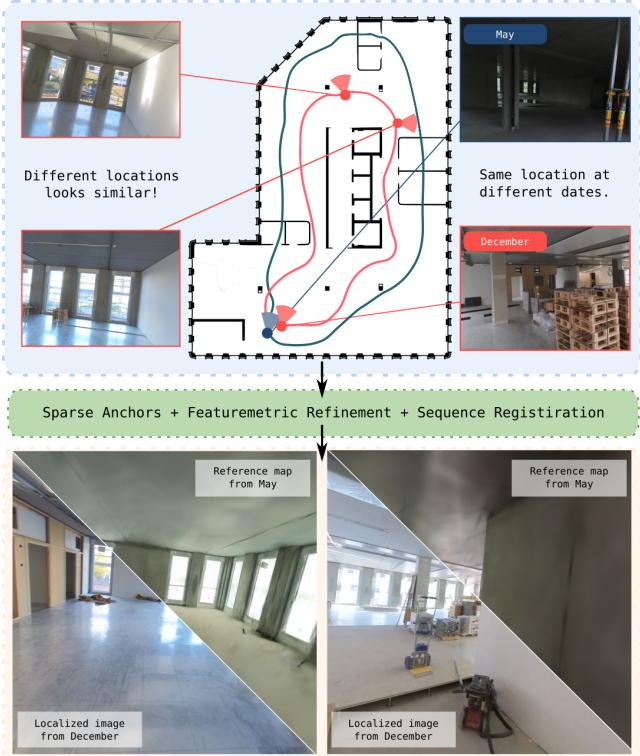
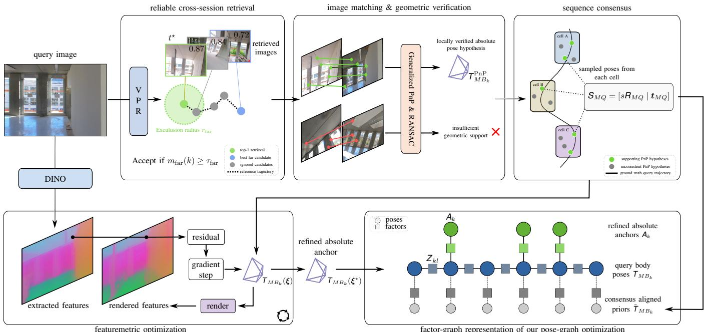
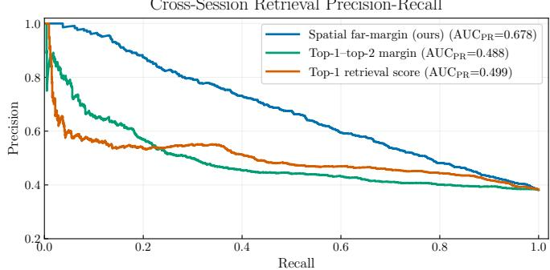
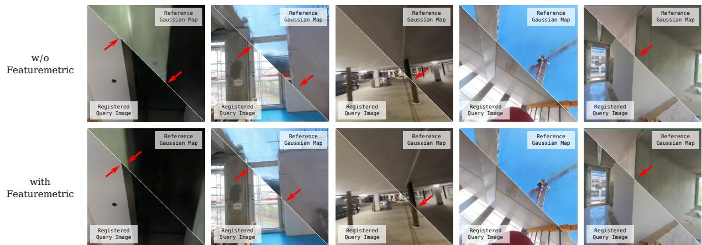

# Sparse Anchors for Visual Multi-Session Registration in Changing Environments

Yunus Talha Erzurumlu Jens Behley

Niklas Trekel

Saurabh Gupta

Louis Wiesmann

Nico Koltermann

Olga Vysotska

Cyrill Stachniss

Abstract— Repeated robotic monitoring requires localization across visits to the same environment, even if the environment changes. Such changes can substantially reduce persistent visual content, and repetitive structures can lead to incorrect crosssession correspondences. In this paper, we address visual multisession registration of a new data recording (the query session) to a previously reconstructed reference map. Under substantial visual and structural changes, cross-session localization may be possible only for parts of the trajectory. In our approach, we therefore rely on a sparse set of reliable absolute pose constraints and combine them with within-session relativepose information to register the complete trajectory to the reference map. We first estimate absolute alignment hypotheses through visual place recognition, local feature matching, and geometric verification. We then use sequence consensus to reject hypotheses that are inconsistent with a common query-toreference alignment and retain the remaining poses as absolute anchors. These anchors are refined through featuremetric alignment against a Gaussian feature field and combined with within-session relative-pose constraints in a robust pose-graph optimization. We evaluate our approach on 15 cross-session experiments from the challenging HILTI26 construction-site dataset, covering substantial scene changes and difficult-tomatch environments. Our method achieves 94.4% recall within 1 m and 100.0% within 5 m, outperforming independent image localization, which peaks at 65.3% and 70.7%, respectively, as well as direct registration of independently reconstructed Structure-from-Motion geometry. Our results show that sparse, reliable absolute anchors can provide accurate and complete trajectory registration even when reliable cross-session correspondences are available only for part of the query session.

## I. INTRODUCTION

Most robotic systems operating repeatedly in the same environment must reliably localize in a previously built map despite scene changes. Reliable cross-session localization and registration are therefore important for long-term autonomy, repeated inspection and monitoring, as well as persistent mapping [13], [17], [37]. This becomes particularly challenging when changes are structural rather than purely appearance-level, since parts of the previously mapped geometry may no longer exist, while new structures may alter or occlude previously visible content.

Construction sites are a particularly demanding instance of this problem. Their geometry and appearance evolve as

  
Correctly localized images under severe changes!

Fig. 1: Repetitive structures create perceptual aliasing between distant locations, while construction progress causes substantial appearance and geometric changes over time (top). Using sparse absolute anchors, featuremetric refinement, and sequence-level registration, our approach recovers poses with accurate image-to-map alignment even under severe scene changes (bottom).

walls, installations, temporary structures, and surface finishes are added, removed, or modified, while repetitive and lowtexture structures create additional perceptual ambiguity [32], further compounded by the frequent lack of GNSS availability in indoor construction environments. Construction progress monitoring requires repeated observations to compare the current as-built state against earlier observations or the planned state [34]. Autonomous mobile robots can acquire such observations, but comparing visits requires reliable localization in a common coordinate frame.

In this work, we address visual multi-session registration in challenging, GNSS-denied, and changing environments. Given a previously reconstructed reference map, together with its posed reference observations, for example computed with any SLAM system, we seek to register the query session, a visual sequence acquired at a different time. The sequence of body poses associated with the noisy query observations forms the query trajectory, which we seek to recover in the reference map coordinate frame. This is difficult because substantial geometric and appearance changes reduce the persistent visual content available for cross-session correspondences, while repetitive structures can produce plausible correspondences between physically distinct locations, as shown in Fig. 1.

Existing strategies often use image-based localization against an earlier map [27] or direct registration of independently reconstructed 3D maps. Image-based localization becomes unreliable when persistent visual content is limited or perceptually ambiguous, while 3D point-cloud registration degrades as spatial and temporal changes accumulate [32].

The main contribution of this paper is a visual multisession registration approach for changing environments, where scene changes and perceptual aliasing can make reliable cross-session correspondences available only for parts of the trajectory. Our approach combines conservative cross-session anchor selection, retaining only absolute pose hypotheses that are geometrically verified and consistent with the query trajectory, with featuremetric pose refinement for precise image-to-map alignment. These sparse absolute anchors are then combined with within-session relativepose constraints to recover the complete query trajectory even when reliable cross-session correspondences are only sparsely available.

We make three key claims: our approach (i) provides more accurate and complete multi-session registration than the baselines; (ii) improves the reliability of cross-session constraints under scene change and perceptual aliasing through conservative filtering and sequence consensus; and (iii) improves fine image-to-map alignment through featuremetric refinement of the verified absolute anchors. We will publicly release our implementation upon publication.

## II. RELATED WORK

A common approach to visual multi-session registration is to localize observations from a later session against a previously reconstructed reference map. Visual place recognition (VPR) identifies corresponding places across sessions [5], [11], [15], [20]. Modern VPR methods range from learned aggregation approaches such as NetVLAD [2] to scalable and viewpoint-robust descriptors [1], [4] and representations based on large pretrained visual features [3], [14], [15]. Hierarchical Localization (HLoc) by Sarlin et al. [27] combines retrieval, local feature matching, and perspective-n-point (PnP)-based localization and forms our image-based localization baseline. However, such approaches rely on distinctive, persistent cross-session correspondences and often degrade under appearance changes and repetitive structures [29], [33]. In contrast, we use image-based localization to obtain sparse, reliable absolute anchors rather than localizing every query observation.

Leveraging multiple observations can improve robustness when individual cross-session correspondences are unreliable. Multi-sequence maps retain observations acquired under different appearance conditions [35], while sequencebased VPR exploits temporal context to resolve ambiguities difficult from individual images [5], [20], [36]. Stenborg et al. [31] combine map-based localization with relative motion to bridge observations that cannot be localized independently, but assume that the query approximately follows the reference route. More generally, multi-map and multi-session SLAM systems exploit cross-session constraints across different traversals [7], and HILTI23 benchmarks multi-session SLAM in construction environments [22]. Our approach similarly exploits within-session motion, but uses sparse crosssession anchors to register trajectories without requiring the query path to follow the reference trajectory.

A different strategy is to reconstruct each session independently and register the resulting 3D maps. Global point-cloud registration methods address limited overlap and high outlier rates [21], [38], but most target dense LiDAR or RGB-D geometry rather than sparse and non-uniform Structure-from-Motion (SfM) reconstructions. ColabSfM [10] specifically addresses this domain gap, while construction-site studies show that temporal scene change further reduces persistent geometric overlap [32]. Rather than aligning independently reconstructed geometry, our method uses sparse image-tomap pose constraints together with the query trajectory.

Featuremetric localization refines camera poses by directly aligning learned features [28], and recent approaches extend this idea to differentiable Gaussian Splatting based scene representations [9], [25]. We apply featuremetric optimization only to cross-session poses that have passed geometric verification and sequence-level consistency checks. The refined poses then serve as sparse constraints for complete trajectory registration rather than as independent localization outputs.

## III. OUR APPROACH TO

## VISUAL MULTI-SESSION REGISTRATION

We address registration of a visual query session to a fixed reference map of the same environment built at a different time. In challenging environments such as construction sites, substantial geometric and appearance changes can limit reliable cross-session correspondences to only a subset of query observations. Our goal is to recover the complete query trajectory in the reference map frame without directly localizing every query observation.

Our approach consists of five stages, illustrated in Fig. 2. First, we identify reliable cross-session retrieval hypotheses using visual place recognition and distinctiveness filtering (Sec. III-B). Second, we establish local feature correspondences and estimate absolute pose hypotheses using reference-map geometry and generalized PnP (Sec. III-C). Third, we use the query trajectory to retain hypotheses supporting a common query-to-reference alignment, forming sparse absolute anchors (Sec. III-D). Fourth, we refine these anchors through featuremetric alignment against the reference feature field (Sec. III-E). Finally, we combine the refined anchors with within-session relative-pose constraints in a robust pose-graph optimization (PGO) to recover the complete query trajectory (Sec. III-F).

## A. Preliminaries and Problem Formulation

We consider a fixed reference map and a query session acquired in the same environment at different times. Both comprise synchronized multi-camera observations from a calibrated system with $N _ { v }$ cameras. We index reference observations by time index t and query observations by $k ,$ with $N _ { q }$ query observations in total. Each observation has one body pose and one image from each camera v. We denote reference and query images by $I _ { t , v } ^ { M }$ and $I _ { k . v } ^ { Q } ,$ respectively.

  
Fig. 2: Overview of our visual multi-session registration pipeline. We first select distinctive cross-session retrievals and establish local feature correspondences between query and reference observations. Generalized PnP with RANSAC uses the reference-map geometry to reject correspondences that do not support a geometrically consistent multi-camera pose, producing locally verified absolute pose hypotheses. Since a locally plausible pose may still correspond to an incorrect location, sequence consensus evaluates the hypotheses jointly with the within-session query trajectory and retains only spatially distributed hypotheses that support a common query-to-reference similarity alignment. The resulting sparse absolute anchors are refined by featuremetric alignment against the reference Gaussian feature field and finally combined with within-session relative-pose constraints and consensus-aligned priors in a pose-graph optimization to recover the complete query trajectory.

Coordinate frames are written as ${ \mathcal { F } } _ { A } ,$ and $\tau _ { A B } \in S E ( 3 )$ maps coordinates from $\mathcal { F } _ { B }$ to ${ \mathcal { F } } _ { A }$ . Let $\mathcal { F } _ { M }$ be the reference map coordinate frame and $\mathcal { F } _ { Q }$ the arbitrary query coordinate frame. The body frame at observation i is $\mathcal { F } _ { B _ { i } }$ , and the frame of camera v at that observation is $\mathcal { F } _ { C _ { i , v } } .$ The fixed camerato-body extrinsic calibration satisfies $T _ { B _ { i } C _ { i , v } } ~ = ~ T _ { B C _ { v } } ~ \in ~$ $S E ( 3 )$ for all observations i. The reference body poses $T _ { M B _ { t } }$ are known, and the corresponding camera poses are

$$
\begin{array} { r } { T _ { M C _ { t , v } } = T _ { M B _ { t } } T _ { B _ { t } C _ { t , v } } . } \end{array}\tag{1}
$$

We represent the reference map using Gaussian splatting [12], [16] as a set of Gaussian primitives encoding geometry, opacity, and appearance. We additionally associate each Gaussian with a learned feature vector $f \in \mathbb { R } ^ { n }$ and denote the resulting map by ${ \mathcal { G } } .$ Given a camera pose $T _ { M C }$ we render depth and feature maps as

$$
\boldsymbol { D } = \mathcal { R } _ { D } ( \mathcal { G } , T _ { M C } ) , \quad \hat { \boldsymbol { F } } = \mathcal { R } _ { F } ( \mathcal { G } , T _ { M C } ) ,\tag{2}
$$

where $\mathcal { R } _ { D }$ and $\mathcal { R } _ { F }$ are the depth and feature renderers [12], used for absolute pose estimation and featuremetric pose refinement, respectively.

The query session provides body poses $T _ { Q B _ { k } }$ in the arbitrary query coordinate frame $\mathcal { F } _ { Q }$ . We assume that their within-session relative geometry is consistent, while their

alignment with the reference map and, potentially, their metric scale are unknown. Our objective is to estimate

$$
\mathcal { T } _ { Q } ^ { \star } = \{ \tau _ { M B _ { k } } ^ { \star } \} _ { k = 1 } ^ { N _ { q } } ,\tag{3}
$$

such that the complete query trajectory is expressed in the reference map coordinate frame $\mathcal { F } _ { M }$

## B. Reliable Cross-Session Retrieval

The first stage seeks to identify query observations for which a reliable cross-session retrieval hypothesis can be established. This is challenging in changing environments such as construction sites, where repetitive structures and lowtexture regions can produce perceptually similar observations at physically distinct locations [32], [33]. Since an incorrect retrieval may lead to an erroneous absolute pose constraint, we deliberately favor precision over retrieval density.

For every camera image $I _ { k , v } ^ { Q }$ of query observation $k ,$ a shared visual place recognition encoder produces a global descriptor $\pmb { d } _ { k , v } ^ { Q } \in \mathbb { R } ^ { m }$ . We aggregate these descriptors into one descriptor for the complete observation,

$$
d _ { k } ^ { Q } = \frac { \sum _ { v = 1 } ^ { N _ { v } } d _ { k , v } ^ { Q } } { N _ { v } } .\tag{4}
$$

We obtain reference descriptors $d _ { t } ^ { M }$ analogously. Given query observation k and reference observation $t ,$ we measure their visual similarity by

$$
\begin{array} { r } { s ( k , t ) = d _ { k } ^ { Q ^ { \mathsf { T } } } d _ { t } ^ { M } . } \end{array}\tag{5}
$$

The highest-scoring reference observation

$$
t ^ { \star } = \operatorname * { a r g m a x } _ { t } s ( k , t ) ,\tag{6}
$$

defines the initial retrieval hypothesis.

The retrieval score $s ( k , t )$ alone does not indicate whether the selected location is visually distinctive from other parts of the environment. One approach is to use the margin between the best and second-ranked reference observations. For sequentially acquired data, however, neighboring reference observations often depict essentially the same place and consequently receive similarly high similarity scores. A small top-two margin therefore does not necessarily indicate genuine spatial ambiguity. We instead compare the best retrieval against the strongest spatially distinct alternative.

Let $\mathbf { \nabla } _ { \pmb { p } _ { t } }$ denote the known position of reference observation t in the reference map coordinate frame. For an exclusion radius $r _ { \mathrm { f a r } }$ , we define the spatial margin as

$$
\begin{array} { r } { m _ { \mathrm { f a r } } ( \boldsymbol { k } ) = s ( \boldsymbol { k } , t ^ { \star } ) - \underset { t \in \mathcal { D } } { \operatorname* { m a x } } s ( \boldsymbol { k } , t ) , } \\ { \mathcal { D } = \left\{ t \mid \left. p _ { t } - p _ { t ^ { \star } } \right. > r _ { \mathrm { f a r } } \right\} . } \end{array}\tag{7}
$$

We accept retrievals with $m _ { \mathrm { f a r } } ( k ) \geq \tau _ { \mathrm { f a r } }$ . The exclusion radius prevents nearby observations of the same place from competing, so a large margin indicates preference over visually similar alternatives from spatially distinct map regions.

For each accepted query-reference pair, we use the percamera descriptors to identify views likely to depict the same scene content. We compute pairwise descriptor similarities between query and reference views and select the one-to-one assignment maximizing total similarity using the Hungarian algorithm [19]. We then perform local feature matching only between the selected view pairs. We lift the resulting 2D-2D correspondences to 3D using reference map geometry and verify them with generalized PnP.

## C. Geometric Verification with Generalized PnP

The preceding stage provides tentative 2D–2D correspondences that need not be geometrically consistent. We therefore lift the reference matches to 3D using the reference map geometry and estimate one shared multi-camera body pose through generalized PnP with RANSAC.

Using the known reference camera pose $T _ { M C _ { t , v _ { T } } }$ , we render its depth and back-project the reference pixel to obtain the 3D point $X _ { n }$ in the reference map coordinate frame:

$$
\begin{array} { r } { d _ { n } = \mathcal { R } _ { D } ( \mathcal { G } , T _ { M C _ { t , v _ { r } } } ) [ \pmb { u } _ { n } ^ { M } ] , } \\ { \pmb { X } _ { n } = T _ { M C _ { t , v _ { r } } } \pi _ { v _ { r } } ^ { - 1 } \left( \pmb { u } _ { n } ^ { M } , d _ { n } \right) . } \end{array}\tag{8}
$$

Here, [u] denotes indexing the rendered depth map at pixel u. Since rays from different cameras do not share a common optical center, let $\scriptstyle o _ { v _ { q } }$ and $b _ { n }$ denote the camera center and corresponding unit bearing vector expressed in $\mathcal { F } _ { B _ { k } }$

We seek the body pose $T _ { M B _ { k } } = [ R _ { M B _ { k } } \ | \ t _ { M B _ { k } } ]$ obeying:

$$
X _ { n } = R _ { M B _ { k } } \left( \pmb { \sigma } _ { v _ { q } } + \lambda _ { n } \pmb { b } _ { n } \right) + \pmb { t } _ { M B _ { k } } ,\tag{9}
$$

where $\lambda _ { n }$ is the unknown ray depth.

We solve the generalized PnP problem jointly over all views using RANSAC [18]. RANSAC rejects inconsistent matches and returns an absolute pose hypothesis $\tau _ { M B _ { k } } ^ { \mathrm { P n P } }$

from the inliers. These locally verified hypotheses are then evaluated for consistency with the query trajectory.

## D. Sequence Consensus

Generalized PnP locally verifies each absolute pose hypothesis $\tau _ { M B _ { k } } ^ { \mathrm { P n P } }$ , but a geometrically plausible pose may still correspond to an incorrect place. We therefore use the consistency of the query trajectory to identify hypotheses that jointly support a common query-to-reference alignment. For each candidate observation $k ,$ we have its pose $T _ { Q B _ { k } }$ in the query coordinate frame and its verified pose hypothesis $T _ { M B _ { k } } ^ { \mathrm { P n } \hat { \mathrm { P } } }$ in the reference map coordinate frame.

We seek a similarity transformation with scale

$$
S _ { M Q } = [ s R _ { M Q } \ | \ t _ { M Q } ] , \qquad s > 0 ,\tag{10}
$$

which aligns the query trajectory with the reference map while remaining consistent with the absolute pose hypotheses.

This transformation predicts the reference-frame pose of query observation k as

$$
\tilde { T } _ { M B _ { k } } = { \cal S } _ { M Q } T _ { Q B _ { k } } .\tag{11}
$$

A pose hypothesis $\tau _ { M B _ { k } } ^ { \mathrm { P n P } }$ supports the transformation when its position and orientation agree with $\tilde { T } _ { M B _ { k } }$

To prevent dense neighboring observations from dominating the alignment, we partition the query trajectory into spatial regions and favor support across distinct regions. We generate candidate transformations from spatially separated pose pairs. Each proposal estimates rotation from the corresponding query-to-reference orientations, and translation and, when required, scale from the associated body centers. We evaluate each proposal against all pose hypotheses using translation and rotation residuals.

We select the proposal with the strongest spatially distributed support and refit $S _ { M Q }$ using its inliers. During refitting, each spatial region receives equal total weight, preventing densely sampled portions from dominating the estimate. We recompute support and require the alignment to remain stable as supported regions are removed. If no sufficiently distributed and stable consensus exists, we reject the session rather than forcing a global registration.

The resulting $S _ { M Q }$ defines the consensus alignment between the query trajectory and reference map. Its inliers form the absolute anchor set A passed to featuremetric refinement. For each $k \in \mathcal { A } , T _ { M B _ { k } } ^ { \mathrm { P n P } }$ provides the initial anchor pose.

## E. Featuremetric Pose Refinement

Sequence consensus provides sparse absolute anchors supported by local geometric verification and consistency with the query trajectory. Small residual pose errors can still cause noticeable image-to-map misalignment. We therefore refine each absolute anchor by aligning the query feature maps with the reference feature field. Since we refine only anchors retained by sequence consensus, we assume their views contain sufficient persistent scene content for reliable alignment. The learned features additionally provide robustness to appearance and texture changes between sessions.

TABLE I: Aggregate multi-session registration performance over 15 cross-session experiments. Translation and rotation RMSE are computed only for poses with translation error below 5 m, whereas recall is evaluated over all query observations. All metrics are micro-averaged over query observations.
<table><tr><td colspan="5">Method  $\mathrm { t { - R M S E } } _ { < 5 \mathrm { m } }$  [m] ↓  $\mathrm { r { - R M S E { < } 5 m \ [ \mathrm { ^ { \circ } ] } \downarrow } }$  R@0.5m ↑ R@1m ↑</td></tr><tr><td>FPFH  $[ 2 6 ] + \mathrm { I C P } \ [ 6 ]$ </td><td>1.793</td><td>36.51</td><td>11.22%</td><td>R@5m ↑ 34.59%</td></tr><tr><td>Register Any Point [24]</td><td>2.314</td><td>69.50</td><td>1.34%</td><td>60.95% 6.69% 19.38%</td></tr><tr><td>ColabSfM [10]</td><td>2.254</td><td>42.51</td><td>5.46% 18.03%</td><td>46.47%</td></tr><tr><td>HLoc [27]</td><td>0.944</td><td>15.21</td><td>45.5% 65.3%</td><td>70.7%</td></tr><tr><td>Ours</td><td>0.600</td><td>1.204</td><td>62.5%</td><td>94.4% 100.0%</td></tr></table>

Let $\pmb { \xi } ^ { \mathrm { ~ \tiny ~ \in ~ } \mathbb { R } ^ { 6 } }$ denote a local pose update, with $( \cdot ) ^ { \wedge }$ $\mathbb { R } ^ { 6 } \to \mathfrak { s e } ( 3 )$ mapping it to the Lie algebra of SE(3). We parameterize the refined body pose as

$$
T _ { M B _ { k } } ( \pmb { \xi } ) = \mathrm { E x p } ( \pmb { \xi } ^ { \wedge } ) T _ { M B _ { k } } ^ { \mathrm { P n P } } .\tag{12}
$$

For camera v, the pose and rendered feature map are

$$
\begin{array} { r } { T _ { M C _ { k , v } } ( \pmb { \xi } ) = T _ { M B _ { k } } ( \pmb { \xi } ) T _ { B _ { k } C _ { k , v } } , } \\ { \hat { F } _ { k , v } ( \pmb { \xi } ) = \mathcal { R } _ { F } ( \pmb { \mathcal { G } } , T _ { M C _ { k , v } } ( \pmb { \xi } ) ) . } \end{array}\tag{13}
$$

Let Φ denote the feature encoder used to construct the reference feature field and extract query features $F _ { k , v } ^ { Q } ~ =$ $\Phi ( I _ { k , v } ^ { Q } )$ . We optimize a shared body pose across cameras by minimizing the query-rendered feature discrepancy:

$$
\pmb { \xi } ^ { \star } = \underset { \pmb { \xi } } { \mathrm { a r g m i n } } \sum _ { \pmb { v } = 1 } ^ { N _ { v } } \frac { 1 } { | \Omega _ { v } | } \sum _ { \pmb { u } \in \Omega _ { v } } \Vert \pmb { F } _ { k , v } ^ { Q } [ \pmb { u } ] - \hat { \pmb { F } } _ { k , v } ( \pmb { \xi } ) [ \pmb { u } ] \Vert _ { 1 } .\tag{14}
$$

Here, $\Omega _ { v }$ denotes the valid rendered pixels for camera v. Since the Gaussian renderer is differentiable with respect to pose, we minimize Eq. (14) with G fixed, optimizing only the six-degree-of-freedom body pose. The resulting $T _ { M B _ { k } } ( \pmb { \xi } ^ { \star } )$ defines the refined anchor for $k \in { \mathcal { A } }$ and is used in the subsequent pose-graph optimization.

## F. Pose-Graph Optimization

The preceding stages provide refined absolute anchors $T _ { M B _ { k } } ( \pmb { \xi } ^ { \star } )$ and the consensus alignment $S _ { M Q }$ . We initialize the query poses with the consensus-aligned poses $\tilde { T } _ { M B _ { k } }$ from Eq. (11) and refine them using PGO.

Let E denote the available within-session relative-pose constraints, with measurements

$$
Z _ { k l } = T _ { Q B _ { k } } ^ { - 1 } T _ { Q B _ { l } } , \qquad ( k , l ) \in \mathcal { E } .\tag{15}
$$

For trajectories with unknown metric scale, we apply the scale estimated during sequence consensus to the relativepose translations and keep it fixed during optimization.

For each anchor $k \in { \mathcal { A } } .$ , let $A _ { k } = T _ { M B _ { k } } ( \pmb { \xi } ^ { \star } )$ denote its refined absolute pose. We optimize the reference-frame body poses $\{ \tau _ { M B _ { k } } \}$ using relative-pose measurements $Z _ { k l } .$ , refined anchors $A _ { k }$ , and consensus-aligned pose priors $\dot { T } _ { M B _ { k } }$

$$
\begin{array} { r l } & { \left\{ \hat { T } _ { M B _ { k } } ^ { \star } \right\} = \underset { \{ \hat { T } _ { M B _ { k } } \} } { \mathrm { a r g m i n } } \displaystyle \sum _ { k \in \mathcal { A } } \rho \left( \left\| \mathrm { L o g } \left( \hat { A } _ { k } ^ { - 1 } \hat { T } _ { M B _ { k } } \right) \right\| _ { \mathbf { A } _ { A } } ^ { 2 } \right) } \\ & { \qquad + \displaystyle \sum _ { ( k , l ) \in \mathcal { E } } \rho \left( \left\| \mathrm { L o g } \left( \hat { Z } _ { k l } ^ { - 1 } \hat { T } _ { M B _ { k } } ^ { - 1 } \hat { T } _ { M B _ { l } } \right) \right\| _ { \mathbf { A } _ { R } } ^ { 2 } \right) } \\ & { \qquad + \displaystyle \sum _ { k } \rho \left( \left\| \mathrm { L o g } \left( \tilde { T } _ { M B _ { k } } ^ { - 1 } \hat { T } _ { M B _ { k } } \right) \right\| _ { \mathbf { A } _ { P } } ^ { 2 } \right) . ~ ( 1 6 ) } \end{array}
$$

Here, $\rho$ is a robust loss, while the information matrices $\mathbf { \Lambda } _ { \Lambda , \Lambda _ { R } , }$ and $\mathbf { \Delta } \Lambda _ { P }$ weight the anchor, relative-pose, and prior residuals. The anchor and relative-pose factors constrain the trajectory to the refined poses while preserving local motion, and the priors prevent poorly constrained regions from drifting from the consensus alignment. The optimized poses define $\mathcal { T } _ { Q } ^ { \star }$ from Eq. (3).

## G. Implementation Details

We use MegaLoc [3] for visual place recognition, LoMa-B [23] for local feature matching, and DINOv3 ViT-S/16 [30] for featuremetric refinement. MegaLoc descriptors are extracted from $3 2 2 \times 3 2 2$ images. For the spatial far-margin, we use $r _ { \mathrm { f a r } } = 1 0 \mathrm { n }$ m and accept retrievals with $m _ { \mathrm { f a r } } \ge 0 . 0 1$ For each accepted retrieval, up to eight one-to-one queryreference view pairs are matched with LoMa-B using at most 4096 keypoints per image. Generalized PnP with RANSAC uses a 12 px reprojection threshold, confidence 0.999, at most 1000 iterations, and requires at least 20 inliers.

For sequence consensus, spatial cells have width 5% of the query trajectory bounding-box diagonal. Translation and rotation inlier thresholds are 15% in normalized trajectory coordinates and $1 5 ^ { \circ }$ , respectively, and a valid consensus requires at least six anchors across three spatial cells. Featuremetric refinement optimizes one shared $S E ( 3 )$ bodypose update over all valid camera views using Adam for 32 steps with learning rate $1 0 ^ { - 3 }$ . Pose corrections are limited to 0.03 in normalized translation and $3 ^ { \circ }$ in rotation.

The final pose graph uses a soft- $. L _ { 1 }$ loss. Translation standard deviations for relative-pose, absolute-anchor, and trajectory-prior factors are 0.005, 0.03, and 0.05, with corresponding rotation standard deviations of $0 . 5 ^ { \circ } , 2 ^ { \circ }$ , and $3 ^ { \circ } .$ Scale recovered by sequence consensus is fixed before PGO.

## IV. EXPERIMENTAL EVALUATION

We evaluate our approach for registering visual sessions acquired at different times to an earlier reference map under substantial scene change and perceptual ambiguity. Specifically, we evaluate three claims: (i) our approach provides more accurate and complete multi-session registration than the baselines; (ii) conservative cross-session filtering and anchor selection improve the reliability of absolute pose constraints under scene change and perceptual aliasing; and (iii) featuremetric refinement improves the fine image-to-map alignment of verified absolute anchors.

## A. Experimental Setup

We use the HILTI26 [8] construction-site dataset, where data were collected by human operators and ground truth was generated using LiDAR-Inertial SLAM. We construct 15 cross-session registration experiments using seven reference sessions. Unlike HILTI23 [22], whose multi-session recordings span only several days, HILTI26 follows an active construction project over eight months and therefore captures substantially larger structural changes between sessions. We exclude floor 5 because it has only one recording, and UG2, floor 7, and the second runs of floor 2 and UG1 due to SfM failures to generate even a single consistent map. For each remaining environment, we use the earliest recording as the reference session and register all later recordings against it, evaluating registration against an earlier map as the construction site evolves.

Cross-Session Retrieval Precision-Recall  
  
Fig. 3: Precision–recall trade-off of VPR confidence criteria. Retrievals are considered correct if the retrieved reference observation lies within 2 m of the ground-truth position. Our spatial far-margin achieves substantially higher precision across a broad range of recall than the top-1 retrieval score and the top-1–top-2 margin.

For each reference session, we reconstruct the scene using SfM and train a 3D Gaussian Splatting map [16] from the resulting images and poses. Within-session relative-pose constraints for each query session are obtained from an independent SfM reconstruction. Only its relative geometry is provided; its alignment and metric scale with respect to the reference map must be recovered during registration. All experiments run on an NVIDIA RTX A5000 GPU, Intel Xeon W-1290P CPU, and 64 GiB of RAM.

## B. Multi-Session Registration

The first experiment evaluates the accuracy and completeness of our multi-session registration and compares its performance against several baselines. Its results directly support our first claim that our approach provides more accurate and complete registration than existing alternatives.

We compare against HLoc [27], using the same MegaLoc retrieval, LoMa-B matching, and generalized multi-camera PnP configuration as our localization front end to ensure a fair comparison. HLoc localizes each query observation independently against the reference map and does not exploit within-session relative-pose constraints.

As a complementary geometry-based baseline, we independently reconstruct the reference and query sessions and register their sparse SfM point clouds using FPFH-based [26] RANSAC followed by ICP [6]. Since their relative scale is unknown, we provide this baseline with the ground-truth scale, removing scale estimation as a source of failure. We additionally evaluate recent learned registration methods,

TABLE II: Ablation of sequence consensus, pose-graph optimization, and featuremetric refinement. Unlike Tab. I, RMSE is computed without an error gate.
<table><tr><td>Configuration</td><td>t-RMSE r-RMSE [m]</td><td>[°]</td><td>R@0.5</td></tr><tr><td>Raw PnP hypotheses</td><td>12.398</td><td>68.144</td><td>25.7%</td></tr><tr><td>PnP + PGO</td><td>0.862</td><td>2.297</td><td>45.2%</td></tr><tr><td>PnP + Consensus alignment</td><td>0.681</td><td>1.334</td><td>49.9%</td></tr><tr><td> $\mathrm { P n P + C o n s . + P G O }$ </td><td>0.608</td><td>1.218</td><td>60.7%</td></tr><tr><td> $\mathrm { P n P + C o n s . + F e a t u r e m e t r i c + P G O }$ </td><td>0.600</td><td>1.204</td><td>62.5%</td></tr></table>

ColabSfM [10] and Register Any Point [24], on the same cross-session SfM reconstructions.

Tab. I reports the aggregate registration performance. Our approach achieves the highest recall at all thresholds, with $R @ 0 . 5 \mathrm { ~ m ~ } = ~ 6 2 . 5 \% , ~ R @ 1 \mathrm { ~ m ~ } = ~ 9 4 . 4 \% ,$ and $R @ 5 { \mathrm { m } } \ =$ 100.0%. Among poses with translation error below 5 m, it also achieves the lowest translation and rotation RMSE, with 0.600 m and 1.204◦, respectively.

HLoc performs well for observations that can be localized independently, but suffers from catastrophic failures when reliable cross-session correspondences are unavailable or ambiguous. Direct registration of independently reconstructed SfM point clouds is considerably less reliable. Register Any Point is designed as a general-purpose point-cloud registration method rather than specifically for sparse SfM geometry or temporally changing scenes [24], while Colab-SfM is trained on trajectories observing the same underlying scene [10]. Both therefore face a substantial domain shift under the structural changes present in our setting. FPFHbased RANSAC followed by ICP is more robust than the learned registration methods, but still remains well below our image-based registration approach.

These results support our first claim: sparse, reliable crosssession constraints combined with within-session trajectory information provide more complete and accurate registration than the evaluated alternatives.

## C. Reliability of Cross-Session Constraints

The second experiment evaluates the reliability of the cross-session pose constraints produced by our retrieval and geometric verification pipeline. We first isolate the VPR distinctiveness criterion, then test whether sequence consensus rejects locally plausible but globally inconsistent hypotheses.

a) Visual Distinctiveness: We compare the proposed spatial far-margin against the top-1 retrieval score and conventional top-1–top-2 margin. Fig. 3 shows the resulting precision-recall trade-off, where a retrieval is correct if the retrieved reference observation lies within $\tau _ { \mathrm { V P R } } = 2 1$ m of the ground-truth query position.

The spatial far-margin achieves higher precision over a broad range of recall. Unlike the conventional top-two margin, it does not penalize neighboring reference observations depicting the same physical location. Instead, it measures whether the selected location remains distinctive from spatially separated alternatives. This matters in repetitive construction environments, where perceptually similar observations may originate from distant site regions.

  
Fig. 4: Qualitative effect of featuremetric pose refinement. Top row shows alignment after sequence consensus and PGO. Bottom row additionally uses featuremetric refinement, which corrects residual misalignment when present while preserving already well-aligned poses.

b) Sequence Consensus: We then evaluate whether sequence consensus rejects absolute pose hypotheses that are locally plausible but inconsistent with the query trajectory. Tab. II compares raw generalized PnP hypotheses, PGO without sequence consensus, consensus alignment, and the subsequent refinement stages. Raw PnP hypotheses are available only for directly localized observations, whereas the remaining configurations estimate the complete query trajectory. Recall is evaluated over all query observations, and RMSE is computed without the 5 m gate used in Tab. I.

Raw generalized-PnP hypotheses contain severe outliers, with a translation RMSE of 12.4 m, rotation RMSE of 68.1◦, and R@0.5 m = 25.7%. Directly combining these hypotheses with within-session relative-pose constraints using PGO substantially reduces the error, but remains less reliable, with 0.862 m translation RMSE, 2.3◦ rotation RMSE, and R@0.5 m = 45.2%. Thus, PGO alone cannot fully compensate for incorrect absolute constraints.

Sequence consensus further improves registration reliability. Consensus alignment alone reduces translation and rotation RMSE to 0.681 m and 1.3◦, while increasing R@0.5 m to 49.9%. Adding PGO further improves R@0.5 m to 60.7% and translation RMSE to 0.608 m.

These results support our second claim that filtering absolute pose hypotheses before trajectory optimization produces more reliable cross-session constraints than jointly optimizing all locally verified hypotheses.

## D. Featuremetric Pose Refinement

Finally, the last experiment evaluates whether featuremetric refinement improves the fine image-to-map alignment of the verified absolute anchors. Unlike the preceding filtering stages, featuremetric optimization is not intended to recover from incorrect place hypotheses or large pose errors. Instead, it operates only on the absolute anchors retained by sequence consensus and targets the remaining small image-to-map misalignments.

As shown in Tab. II, adding featuremetric refinement before PGO reduces the translation RMSE from 0.608 m to 0.600 m and also slightly reduces the rotation RMSE. Registration recall at the stricter threshold, R@0.5 m, increases from 60.7% to 62.5%. This modest trajectory-level improvement is expected because refinement is applied only to already verified sparse anchors, whose pose corrections are subsequently propagated through the trajectory by PGO.

The effect of featuremetric refinement is more apparent at the image level. Fig. 4 shows representative absolute anchors before and after optimization. The generalized-PnP poses already provide geometrically valid initializations, while featuremetric refinement improves the alignment of persistent structures between the real query observations and the reference Gaussian rendering despite scene changes. This is a clear support of our third claim

## V. CONCLUSION

In this paper, we presented a novel, complete visual multisession registration pipeline designed for challenging and changing environments such as construction sites, without requiring reliable cross-session correspondences along the entire query trajectory. Our method identifies a sparse set of strongly supported absolute anchors using visual distinctiveness, geometric verification, and sequence-level consistency, refines these anchors against a reference Gaussian feature field, and propagates their information through the query trajectory using within-session relative-pose constraints.

Our experimental evaluation on evolving construction environments shows that this strategy provides more complete and accurate trajectory registration than independent image localization and direct registration of independently reconstructed geometry. If no sufficiently distributed consensus is found, our method rejects the session rather than forcing an incorrect global alignment. The results further demonstrate the importance of conservative anchor selection and show that featuremetric refinement improves the fine image-to-map alignment of verified absolute anchors.

These properties make the proposed approach suitable for persistent mapping and repeated robotic operation under substantial structural change.

[1] A. Ali-bey, B. Chaib-draa, and P. Giguere. MixVPR: Feature Mixing\` for Visual Place Recognition. In Proc. of the IEEE Winter Conf. on Applications of Computer Vision (WACV), 2023.

[2] R. Arandjelovic, P. Gronat, A. Torii, T. Pajdla, and J. Sivic. Netvlad: Cnn architecture for weakly supervised place recognition. In Proc. of the IEEE Conf. on Computer Vision and Pattern Recognition (CVPR), 2016.

[3] G. Berton and C. Masone. MegaLoc: One Retrieval to Place Them All. In Proc. of the IEEE/CVF Conf. on Computer Vision and Pattern Recognition Workshops, 2025.

[4] G. Berton, C. Masone, and B. Caputo. Rethinking Visual Geo-Localization for Large-Scale Applications. In Proc. of the IEEE/CVF Conf. on Computer Vision and Pattern Recognition (CVPR), 2022.

[5] G. Berton, G. Trivigno, B. Caputo, and C. Masone. JIST: Joint Image and Sequence Training for Sequential Visual Place Recognition. IEEE Robotics and Automation Letters (RA-L), 9(2):1310–1317, 2024.

[6] P.J. Besl and N.D. McKay. A Method for Registration of 3-D Shapes. IEEE Trans. on Pattern Analysis and Machine Intelligence (TPAMI), 14(2):239–256, 1992.

[7] C. Campos, R. Elvira, J.J.G. Rodr´ıguez, J.M. Montiel, and J.D. Tardos.´ Orb-slam3: An accurate open-source library for visual, visual–inertial, and multimap slam. IEEE Trans. on Robotics (TRO), 37(6):1874– 1890, 2021.

[8] S. Centanni, Y. Zhang, Y. Tao, J. Kindle, F. Neuhaus, T. Koß, A. Patel, M. Helmberger, E. Szymanska, T. Gr´ aber, and M. Fallon.¨ Hilti-Trimble-Oxford Dataset: 360 Visual-Inertial Benchmark with Floor Plan Priors for SLAM and Localization. arXiv preprint, arXiv:2607.06464, 2026.

[9] Y. Cheng, J. Jiao, Y. Wang, and D. Kanoulas. LoGS: Visual Localization via Gaussian Splatting with Fewer Training Images. In Proc. ofthe IEEE Intl. Conf. on Robotics & Automation (ICRA), 2025.

[10] J. Edstedt, A. Mateus, and A. Jaenal. Colabsfm: Collaborative structure-from-motion by point cloud registration. In Proc. of the IEEE/CVF Conf. on Computer Vision and Pattern Recognition (CVPR), 2025.

[11] S. Hausler and P. Moghadam. Pair-VPR: Place-Aware Pre-Training and Contrastive Pair Classification for Visual Place Recognition With Vision Transformers. IEEE Robotics and Automation Letters (RA-L), 10(4):4013–4020, 2025.

[12] B. Huang, Z. Yu, A. Chen, A. Geiger, and S. Gao. 2D Gaussian Splatting for Geometrically Accurate Radiance Fields. In Proc. of the Intl. Conf. on Computer Graphics and Interactive Techniques (SIGGRAPH), 2024.

[13] M. Hutter, R. Diethelm, S. Bachmann, P. Fankhauser, C. Gehring, V. Tsounis, A. Lauber, F. Guenther, M. Bjelonic, L. Isler, H. Kolvenbach, K. Meyer, and M.A. Hoepflinger. Towards a Generic Solution for Inspection of Industrial Sites. In Field and Service Robotics, 2018.

[14] S. Izquierdo and J. Civera. Optimal Transport Aggregation for Visual Place Recognition. In Proc. of the IEEE/CVF Conf. on Computer Vision and Pattern Recognition (CVPR), 2024.

[15] N.V. Keetha, A. Mishra, J. Karhade, K.M. Jatavallabhula, S. Scherer, M. Krishna, and S. Garg. AnyLoc: Towards Universal Visual Place Recognition. IEEE Robotics and Automation Letters (RA-L), 9(2):1286–1293, 2024.

[16] B. Kerbl, G. Kopanas, T. Leimkuhler, and G. Drettakis. 3D Gaussian¨ Splatting for Real-Time Radiance Field Rendering. ACM Trans. on Graphics (TOG), 42(4):1–14, 2023.

[17] A. Kim and R.M. Eustice. Real-Time Visual SLAM for Autonomous Underwater Hull Inspection Using Visual Saliency. IEEE Trans. on Robotics (TRO), 29(3):719–733, 2013.

[18] L. Kneip, P. Furgale, and R. Siegwart. Using multi-camera systems in robotics: Efficient solutions to the NPnP problem. In Proc. of the IEEE Intl. Conf. on Robotics & Automation (ICRA), 2013.

[19] H.W. Kuhn. The Hungarian Method for the Assignment Problem. Naval Research Logistics Quarterly, 2(1–2), 1955.

[20] H. Li, G. Peng, J. Zhang, M. Wen, Y. Ma, and D. Wang. CaseVPR: Correlation-Aware Sequential Embedding for Sequence-to-Frame Visual Place Recognition. IEEE Robotics and Automation Letters (RA-L), 10(4):3430–3437, 2025.

[21] H. Lim, D. Kim, G. Shin, J. Shi, I. Vizzo, H. Myung, J. Park, and L. Carlone. KISS-Matcher: Fast and Robust Point Cloud Registration Revisited. In Proc. of the IEEE Intl. Conf. on Robotics & Automation (ICRA), 2025.

[22] A.D. Nair, J. Kindle, P. Levchev, and D. Scaramuzza. Hilti SLAM Challenge 2023: Benchmarking Single + Multi-Session SLAM Across Sensor Constellations in Construction. IEEE Robotics and Automation Letters (RA-L), 9(8):7286–7293, 2024.

[23] D. Nordstrom, J. Edstedt, G. B¨ okman, J. Astermark, A. Heyden,¨ V. Larsson, M. Wadenback, M. Felsberg, and F. Kahl. Loma: Local¨ feature matching revisited. In Proc. of the Europ. Conf. on Computer Vision (ECCV), 2026.

[24] Y. Pan, T. Sun, L. Zhu, L. Nunes, I. Armeni, J. Behley, and C. Stachniss. Register Any Point: Scaling 3D Point Cloud Registration by Flow Matching. In Proc. of the Europ. Conf. on Computer Vision (ECCV), 2026.

[25] M. Pietrantoni, G. Csurka, and T. Sattler. Gaussian Splatting Feature Fields for (Privacy-Preserving) Visual Localization. In Proc. of the IEEE/CVF Conf. on Computer Vision and Pattern Recognition (CVPR), 2025.

[26] R. Rusu, N. Blodow, and M. Beetz. Fast point feature histograms (fpfh) for 3d registration. In Proc. of the IEEE Intl. Conf. on Robotics & Automation (ICRA), 2009.

[27] P.E. Sarlin, C. Cadena, R. Siegwart, and M. Dymczyk. From Coarse to Fine: Robust Hierarchical Localization at Large Scale. In Proc. of the IEEE/CVF Conf. on Computer Vision and Pattern Recognition (CVPR), 2019.

[28] P.E. Sarlin, A. Unagar, M. Larsson, H. Germain, C. Toft, V. Larsson, M. Pollefeys, V. Lepetit, L. Hammarstrand, F. Kahl, and T. Sattler. Back to the Feature: Learning Robust Camera Localization from Pixels to Pose. In Proc. of the IEEE/CVF Conf. on Computer Vision and Pattern Recognition (CVPR), 2021.

[29] T. Sattler, W. Maddern, C. Toft, A. Torii, L. Hammarstrand, E. Stenborg, D. Safari, M. Okutomi, M. Pollefeys, J. Sivic, F. Kahl, and T. Pajdla. Benchmarking 6DOF Outdoor Visual Localization in Changing Conditions. In Proc. of the IEEE/CVF Conf. on Computer Vision and Pattern Recognition (CVPR), 2018.

[30] O. Simeoni, H.V. Vo, M. Seitzer, F. Baldassarre, M. Oquab, C. Jose,´ V. Khalidov, M. Szafraniec, S. Yi, M. Ramamonjisoa, F. Massa, D. Haziza, L. Wehrstedt, J. Wang, T. Darcet, T. Moutakanni, L. Sentana, C. Roberts, A. Vedaldi, J. Tolan, J. Brandt, C. Couprie, J. Mairal, H. Jegou, P. Labatut, and P. Bojanowski. Dinov3. ´ Trans. on Machine Learning Research (TMLR), 2026.

[31] E. Stenborg, T. Sattler, and L. Hammarstrand. Using Image Sequences for Long-Term Visual Localization. In Proc. of the Intl. Conf. on 3D Vision (3DV), 2020.

[32] T. Sun, Y. Hao, S. Huang, S. Savarese, K. Schindler, M. Pollefeys, and I. Armeni. Nothing Stands Still: A Spatiotemporal Benchmark on 3D Point Cloud Registration Under Large Geometric and Temporal Change. ISPRS Journal of Photogrammetry and Remote Sensing, 220:799–823, 2025.

[33] A. Torii, J. Sivic, M. Okutomi, and T. Pajdla. Visual place recognition with repetitive structures. IEEE Trans. on Pattern Analysis and Machine Intelligence (TPAMI), 37(11):2346–2359, 2015.

[34] S. Tuttas, A. Braun, A. Borrmann, and U. Stilla. Acquisition and Consecutive Registration of Photogrammetric Point Clouds for Construction Progress Monitoring Using a 4D BIM. In ISPRS Archives of the Photogrammetry, Remote Sensing and Spatial Information Sciences, 2014.

[35] O. Vysotska and C. Stachniss. Effective Visual Place Recognition Using Multi-Sequence Maps. IEEE Robotics and Automation Letters (RA-L), 4(2):1730–1736, 2019.

[36] O. Vysotska, I. Bogoslavskyi, M. Hutter, and C. Stachniss. Adaptive Thresholding for Sequence-Based Place Recognition. In Proc. of the IEEE Intl. Conf. on Robotics & Automation (ICRA), 2025.

[37] Y. Wang, M. Ramezani, and M. Fallon. Actively Mapping Industrial Structures with Information Gain-Based Planning on a Quadruped Robot. In Proc. of the IEEE Intl. Conf. on Robotics & Automation (ICRA), 2020.

[38] H. Yang, J. Shi, and L. Carlone. TEASER: Fast and Certifiable Point Cloud Registration. IEEE Trans. on Robotics (TRO), 37(2):314–333, 2021.