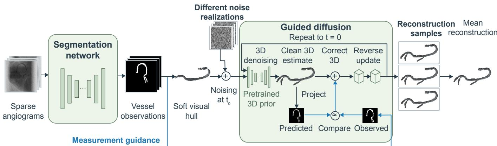
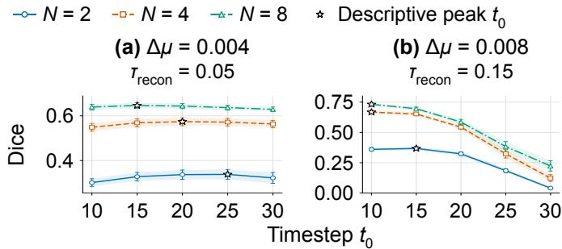
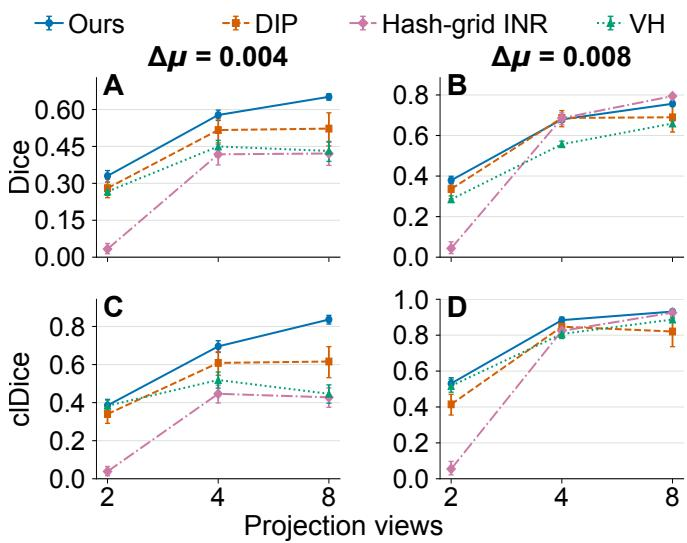
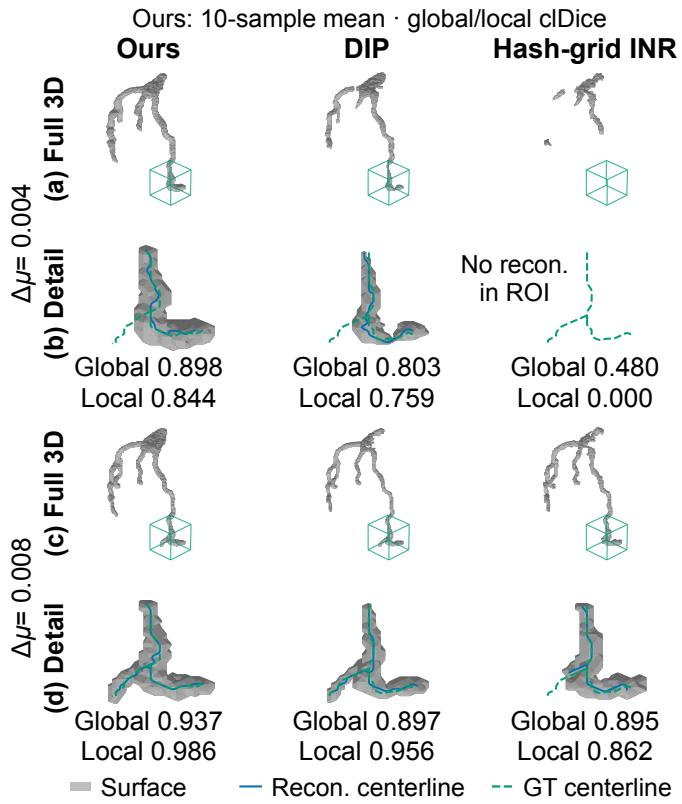
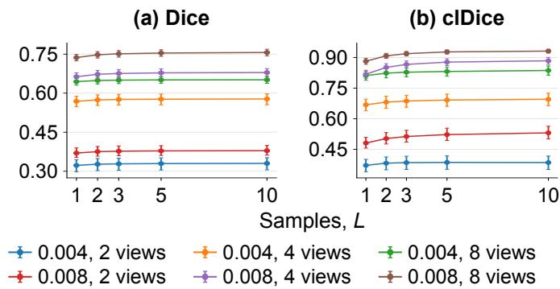

# Sparse-View 3D Coronary Reconstruction from Vessel Segmentations Using a Diffusion Prior

Tianyuan Wang, Kenan Niu, and Stefano Stramigioli, Fellow, IEEE

Abstract— Reconstructing three-dimensional (3D) coronary anatomy from sparse angiographic views could support percutaneous coronary intervention, but limited angular coverage and imperfect vessel segmentations introduce substantial geometric ambiguity. We propose a vesselspecific reconstruction framework combining a learned 3D diffusion prior, visual-hull initialization, and projectionbased data consistency. The unconditional diffusion model is trained on coronary vessel masks without paired 2D–3D data and reused across different view counts without retraining. During inference, a scaled visual hull initializes reconstruction, while projection-based updates constrain diffusion refinement using patient-specific vessel observations. We evaluated the framework on simulated angiograms derived from ImageCAS computed tomography angiography volumes using two, four, and eight views at two contrast levels. Across 50 evaluation coronary-tree cases, the proposed method achieved higher mean Dice and clDice than visual hull, deep image prior (DIP), and hash-grid implicit neural representation (INR) at all view counts under reduced contrast. With eight views, improvements over DIP, the best-performing baseline at lower contrast, were approximately 0.13 in Dice and 0.22 in clDice. At higher contrast, performance remained competitive with hash-grid INR, the best-performing eight-view baseline. The preferred diffusion starting timestep depended on observation quality and view count, with excessive refinement reducing accuracy at higher contrast. Projection guidance improved both metrics across all conditions. Averaging stochastic reconstructions further improved accuracy, while sample disagreement localized errors with averageprecision gains of 0.14–0.21 over error prevalence. These findings support diffusion-prior reconstruction from sparse vessel observations, although clinical validation remains necessary.

Index Terms— Coronary artery reconstruction, diffusion priors, percutaneous coronary intervention, stochastic reconstructions, vessel segmentation, X-ray angiography.

## I. INTRODUCTION

P ERCUTANEOUS coronary intervention (PCI) is primar- ily performed under two-dimensional (2D) X-ray angiography and fluoroscopy, where the interventionalist navigates guidewires and catheters through a complex three-dimensional (3D) coronary anatomy based on projected images [1]. Although the C-arm can be rotated to acquire the coronary tree from different viewing angles, each projection inevitably loses depth information and may suffer from vessel overlap and foreshortening. In clinical practice, these ambiguities are largely resolved through the operator’s experience and by acquiring additional projections when necessary. Similar ambiguities pose an even greater challenge for image-guided robotic PCI, where a robotic system must infer the spatial relationship between the device and vascular anatomy from limited 2D observations. Since different viewing angles are already accessible with a rotational C-arm, an attractive alternative is to exploit a small number of angiographic views to recover a 3D representation of the coronary vasculature, thereby providing more explicit spatial information for either human or robotic navigation.

Unlike conventional computed tomography (CT), PCI guidance does not necessarily require reconstruction of the full attenuation distribution within the imaged volume. For navigation, the primary structures of interest are the coronary vessels themselves. This motivates a task-specific reconstruction formulation in which vessel-related information is first extracted from a small number of X-ray projections through segmentation and subsequently used to infer the corresponding 3D coronary geometry [2]. Such a formulation focuses reconstruction on vascular structures, but recovering a complex vascular tree from only a few segmented projections remains severely ill-posed. In particular, multiple 3D vessel configurations may produce similar 2D segmented observations, and distal branches or overlapping vessels may not be uniquely resolved from the available views. Anatomical prior knowledge can therefore help constrain the reconstruction and reduce these ambiguities.

Generative models provide a promising mechanism for incorporating such prior knowledge [3]. In particular, diffusion models can learn the distribution of anatomically plausible 3D coronary structures from a population of vessel geometries and can therefore constrain sparse-view reconstruction toward realistic vascular anatomies. From an inverse-problem perspective, the reconstruction can be regarded as balancing two sources of information [4]: patient-specific observations derived from the acquired X-ray images and a learned anatomical prior provided by the diffusion model. A strong prior can compensate for information that is absent from sparse projections, but it must remain sufficiently constrained by the observations to preserve the patient-specific vessel geometry. The appropriate balance between these two components therefore becomes a central issue in diffusion-prior reconstruction.

This balance becomes particularly important when the observations themselves are uncertain. In a vessel-specific reconstruction pipeline, the X-ray projections are first converted into vessel observations by a segmentation model. However, segmentation quality depends strongly on the visibility of the vessels in the original angiographic images. Reduced vessel contrast, noise, overlap, or weak visualization of small branches may lead to missing vessels, inaccurate boundaries, or false-positive structures. If these imperfect segmentations are imposed as strong deterministic constraints, their errors can directly propagate into the reconstructed 3D vessel tree and prevent the learned prior from correcting them. Conversely, if the observations are weighted too weakly, the reconstruction may follow the learned population prior while losing important patient-specific information.

In this work, we investigate sparse-view coronary reconstruction by combining a pretrained 3D anatomical diffusion prior with soft visual-hull initialization and projection-based data consistency. Rather than treating segmented vessels as exact geometric constraints throughout reconstruction, the visual hull provides an initial spatial estimate, while projection-based updates encourage agreement with the observed vessel structures during diffusion refinement. We systematically vary vessel contrast and the number of projection views to investigate how observation quality and angular sparsity affect reconstruction performance and the preferred diffusion starting timestep. This allows us to examine the tradeoff between preserving measurement-derived geometry and allowing refinement by the learned anatomical prior. The proposed framework aims to recover patient-specific 3D coronary geometry from a small number of angiographic views, with potential applications in human or robotic PCI guidance.

The main contributions of this work are as follows:

1. We formulate sparse-view coronary reconstruction as a vessel-specific inverse problem and introduce a framework that combines a learned anatomical diffusion prior with soft visualhull initialization and projection-based data consistency.

2. We systematically investigate how vessel contrast and the number of projection views affect the reconstruction performance of the proposed method and baseline approaches when using imperfect vessel segmentations.

3. We demonstrate that averaging reconstruction samples generated using different noise realizations improves accuracy relative to single-sample reconstruction, while disagreement among samples provides a spatial indicator of potentially unreliable regions.

## II. RELATED WORK

## A. Sparse-View Coronary Artery Reconstruction

Tomographic coronary reconstruction generally requires more projection views and broader angular coverage than geometry-based approaches [5]. Banerjee et al. combined rigid and non-rigid motion correction with iterative point-cloud reconstruction to recover coronary vessel geometry from as few as two non-simultaneous angiographic views [6]. They evaluated centerline accuracy using two-dimensional reprojection errors and compared lumen cross-sectional areas with optical coherence tomography measurements. However, the geometric accuracy of the complete reconstructed coronary tree was not directly quantified against an independent threedimensional reference.

Supervised learning methods can replace part of this explicit geometric reasoning with anatomical information learned from training data. Iyer et al. trained a multi-stage neural network on synthetic coronary trees and their corresponding projections to estimate vessel centerlines and radii without requiring acquisition parameters as network inputs [7]. 3DAngioNet constructs a coarse vessel mesh from learned segmentations of two angiographic views, calibrated acquisition geometry, and segment endpoints identified by a clinician. The mesh is subsequently refined by a graph convolutional network using image features sampled at the projected mesh vertices [8]. DeepCA is trained on projections simulated from 3D vessel masks, with motion introduced between views, to reconstruct coronary trees from two non-simultaneous angiograms with implicit compensation for cardiac and respiratory motion [9]. However, these supervised approaches learn reconstruction mappings from paired 2D–3D data under the acquisition conditions represented during training. Their generalization can therefore depend on the quality and diversity of the training data, the range of input-view configurations considered, and the similarity between training and clinical data distributions.

Patient-specific reconstruction methods instead optimize a three-dimensional representation directly against the available projections, often without requiring paired 3D supervision. Early investigations of NeRF for X-ray angiography demonstrated the feasibility of this strategy but also identified limitations arising from sparse angular sampling, foreground– background ambiguity, vessel overlap, and the sparse occupancy of vascular structures [10]. NeRF-CA subsequently introduced a static–dynamic scene decomposition that models the moving coronary vasculature separately from the background, enabling four-dimensional reconstruction from angiographic sequences acquired at very few viewing angles [11]. NeCA represents coronary occupancy using a multiresolution hash-encoded neural implicit field and optimizes it through a differentiable cone-beam projector using two projections [12]. 3DGR-CAR represents the coronary tree using sparse 3D Gaussian primitives; a learned Gaussian-center predictor supplies an initial point distribution, after which the Gaussian parameters are refined through projection-based optimization [13].

Patient-specific optimization promotes agreement with the acquired measurements and reduces reliance on direct predic tion of the complete anatomy. Nevertheless, it requires iterative optimization at inference, which can be computationally demanding. Moreover, projection consistency alone does not guarantee a unique reconstruction from ultra-sparse views, and the solution remains dependent on the imposed priors and regularization. 3DGR-CAR mitigates this ambiguity through learned initialization, but its Gaussian-center predictor requires supervised training on paired projections and CT-derived 3D targets.

## B. Diffusion Priors for Medical Inverse Problems and Vascular Anatomy

Score-based and diffusion generative models provide a principled mechanism for incorporating learned anatomical information into inverse problems. A generative model can first be trained to represent a measurement-independent prior distribution $p ( { \pmb x } )$ and subsequently combined with a known forward model during inference [14]. CCDF accelerates conditional diffusion by perturbing an initial reconstruction to an intermediate diffusion timestep and applying a shortened reverse process, demonstrating how an informative initialization can reduce the required sampling steps [15]. Diffusion posterior sampling introduces likelihood-derived guidance into the reverse process to promote agreement with noisy or nonlinear measurements [3], while DiffusionMBIR extends this strategy to 3D medical reconstruction using pretrained diffusion priors and model-based constraints [4]. Separating prior learning from measurement inversion allows the same anatomical model to be reused without training a new end-toend reconstruction network for every acquisition configuration.

Diffusion models have also been developed specifically to represent vascular anatomy. VesselDiffusion generates threedimensional vascular networks using a two-stage formulation that combines two-dimensional vascular mask generation with conditional 3D diffusion [16]. VesselFusion applies conditional diffusion to vessel centerline extraction from an available 3D CT volume and uses coarse-to-fine prediction with voting-based aggregation to improve structural stability [17]. These studies demonstrate that diffusion models can capture vascular continuity, branching, and anatomical variability. Nevertheless, they address vascular generation or extraction from existing three-dimensional data and do not enforce patient-specific consistency with sparse angiographic projections. They therefore establish the suitability of diffusion models for vascular representation, but not how such a prior should be incorporated into a severely underdetermined coronary reconstruction problem.

Within coronary reconstruction, XRA-Diff performs learned refinement of a backprojected volume using a diffusion model conditioned on two segmented angiographic projections and the corresponding backprojected representation [18]. The anatomical prior and projection-conditioning pathway are learned jointly from paired projection–volume examples, with synthetic projections generated directly from 3D coronary masks rather than CT intensity volumes. The basic configuration employs separate diffusion models for the left and right coronary trees, although a model trained on both sides is also evaluated. The model is trained with a two-view conditioning representation, and reduced reconstruction accuracy is reported when additional projections are used to construct the backprojected volume. Patient-specific measurement information is incorporated through backprojection and learned conditioning, without an explicit projection-based data-consistency update during inference. Consequently, the reported sampling procedure does not directly use reprojection error to correct the reconstruction.

## III. METHOD

## A. Problem Formulation and Framework Overview

We reconstruct the three-dimensional coronary vasculature relevant to image-guided intervention, rather than the complete attenuation volume. Given N X-ray angiographic images $\mathcal { T } = \{ I _ { i } \} _ { i = 1 } ^ { N }$ acquired at known projection geometries $\mathcal { G } =$ $\{ P _ { i } \} _ { i = 1 } ^ { N }$ , the objective is to estimate a vessel occupancy volume $\mathbf { \bar { x } } \in [ 0 , 1 ] ^ { \mathbf { \bar { H } } \times W \times D }$

The proposed framework proceeds in three stages, as shown in Figure 1. First, vessel structures are extracted from the X-ray images to obtain a set of 2D vessel observations. Second, these observations are geometrically backprojected to construct a visual-hull estimate that provides rapid coarse localization of the vessel in 3D. Since sparse projections alone do not uniquely determine the underlying vascular structure, the resulting inverse problem is subsequently addressed within a Bayesian framework, where projection-based data consistency provides the measurement constraint and a learned 3D diffusion model provides an anatomical prior.

## B. Vessel Extraction from X-ray Angiography

For each X-ray angiographic image $I _ { i } , i = 1 , \ldots , N ,$ , a segmentation model $S _ { \phi }$ with parameters ϕ predicts a vessel probability map $\pmb { \mathscr { s } } _ { i } = \pmb { \mathscr { S } } _ { \phi } ( \pmb { I } _ { i } ) \ \mathrm { ~ \bar { \ t } ~ } [ 0 , 1 ] ^ { H _ { d } \times W _ { d } }$ , where $H _ { d }$ and $W _ { d }$ denote the height and width of the projection images, respectively. These maps form the collection of vessel observations ${ \cal { S } } = \{ s _ { i } \} _ { i = 1 } ^ { N }$ . The corresponding binary vessel mask is obtained by thresholding:

$$
m _ { i } = \mathbb { I } \left( \pmb { s } _ { i } \ge \tau _ { \mathrm { s e g } } \right) \in \{ 0 , 1 \} ^ { H _ { d } \times W _ { d } } ,\tag{1}
$$

where $\tau _ { \mathrm { s e g } }$ is the segmentation threshold and $\mathbb { I } ( \cdot )$ denotes the elementwise indicator function.

## C. Fast Geometric Initialization with Visual Hull

To obtain an initial three-dimensional estimate directly from the segmented projections, we employ visual-hull reconstruction. For each acquisition view, the binary vessel support $\mathbf { \nabla } m _ { i }$ is backprojected through the corresponding imaging geometry. Denoting the backprojection operation associated with geometry $P _ { i }$ by $B _ { i }$ , the three-dimensional support induced by the i-th observation is

$$
\begin{array} { r } { \mathbb { V } _ { i } = \mathbb { B } _ { i } ( \pmb { m } _ { i } ) . } \end{array}\tag{2}
$$

Each $\nu _ { i }$ contains the voxels that are geometrically compatible with the vessel silhouette observed in the corresponding projection. The visual hull is then obtained by intersecting these supports across all available views,

$$
\pmb { x } _ { \mathrm { V H } } = \bigcap _ { i = 1 } ^ { N } \mathcal { V } _ { i } .\tag{3}
$$

The visual hull provides a computationally efficient estimate of the spatial region in which the vessel may be located. It is constructed directly from the segmented projections and the calibrated acquisition geometry.

  
Fig. 1. Overview of the proposed sparse-view coronary reconstruction framework. Angiograms are segmented to obtain vessel observation for soft visual-hull initialization and projection guidance. Starting from a noised hull, reconstruction uses a pretrained 3D diffusion prior learned independently of projection data. At each step, the estimated clean 3D volume is forward-projected and compared with the observations to compute a correction before the reverse-diffusion update. Different noise realizations produce L reconstruction samples, which are averaged voxelwise.

## D. Bayesian Formulation of the Sparse-view Inverse Problem

Given the vessel observations S and known acquisition geometry G, Bayes’ rule expresses the posterior distribution as

$$
p ( \pmb { x } \mid \mathcal { S } , \mathcal { G } ) \propto p ( \mathcal { S } \mid \pmb { x } , \mathcal { G } ) p ( \pmb { x } ) ,\tag{4}
$$

where the likelihood $p ( \boldsymbol { S } \mid \boldsymbol { x } , \boldsymbol { \mathcal { G } } )$ quantifies the consistency of a candidate vessel volume with the observed projections, and the prior $p ( { \pmb x } )$ encodes knowledge of plausible three-dimensional coronary anatomy.

This decomposition provides the theoretical motivation for incorporating a prior into sparse-view vessel reconstruction. As the number of observations decreases, the likelihood alone admits an increasingly large set of measurement-compatible solutions. The prior provides complementary structural information that is not recoverable from the available projections alone.

## E. Projection Observation Model and Data Consistency

We next define the relationship between a candidate vessel occupancy volume x and its two-dimensional vessel projections. For acquisition geometry $P _ { i }$ , let $A _ { i }$ denote the corresponding discrete cone-beam projection operator. The predicted soft vessel silhouette is

$$
\widehat { \pmb { s } } _ { i } = \mathcal { A } _ { i } ( \pmb { x } ) = \mathbf { 1 } - \exp \left( - \frac { \pmb { A } _ { i } [ - \log ( \mathbf { 1 } - \pmb { x } _ { \epsilon } ) ] } { c } \right) ,\tag{5}
$$

where $\mathbf { \delta x } _ { \epsilon } = \mathrm { c l i p } ( \mathbf { \delta x } , \epsilon , 1 - \epsilon )$ ensures numerical stability, and $c$ is the smallest effective voxel spacing. The logarithm and exponential are applied elementwise. This mapping converts the three-dimensional occupancy field into a soft vessel silhouette with values in [0, 1].

The predicted silhouettes are compared with the binary vessel masks $\mathbf { m } _ { i }$ defined in Section III-B. The segmentation probability maps $\mathbf { \boldsymbol { s } } _ { i }$ additionally provide pixelwise confidence weights, allowing uncertain segmentation predictions to contribute less to the objective. We define the data-consistency term using confidence-weighted binary cross-entropy:

$$
\mathcal { L } _ { \mathrm { D C } } (  { \boldsymbol { \mathbf { x } } } ) = \frac { 1 } { Z } \sum _ { i = 1 } ^ { N } \sum _ { u } \omega _ { i , u } \mathrm { B C E } \left( \widehat { s } _ { i , u } , m _ { i , u } \right) ,\tag{6}
$$

where u indexes detector pixels, $\omega _ { i , u }$ is the confidence weight derived from $s _ { i , u } ,$ and $\begin{array} { r } { Z = \operatorname* { m a x } ( \sum _ { i , u } \omega _ { i , u } , 1 ) } \end{array}$ normalizes the total weight across pixels and views. The predicted silhouette values are clipped away from zero and one when evaluating the loss. This objective measures agreement between the candidate vessel geometry and the segmented observations.

## F. 3D Coronary Diffusion Prior

To constrain the sparse-view inverse problem toward anatomically plausible solutions, we learn a prior distribution over three-dimensional coronary vessel structures using a diffusion model.

Let

$$
\pmb { x } _ { 0 } \sim p _ { \mathrm { d a t a } } ( \pmb { x } )\tag{7}
$$

denote a clean 3D vessel occupancy volume sampled from the training distribution. Before diffusion, the volume is normalized as $z _ { 0 } ~ = ~ 2 x _ { 0 } - 1$ . The forward diffusion process progressively perturbs $z _ { \mathrm { 0 } }$ according to

$$
\begin{array} { r } { q ( z _ { t } \mid z _ { 0 } ) = \mathcal { N } \left( \sqrt { \bar { \alpha } _ { t } } z _ { 0 } , ( 1 - \bar { \alpha } _ { t } ) I \right) , } \end{array}\tag{8}
$$

where $\begin{array} { r } { \bar { \alpha } _ { t } = \prod _ { k = 1 } ^ { t } ( 1 - \beta _ { k } ) } \end{array}$ and $\{ \beta _ { k } \}$ specifies the diffusion noise schedule. Equivalently,

$$
z _ { t } = \sqrt { \bar { \alpha } _ { t } } z _ { 0 } + \sqrt { 1 - \bar { \alpha } _ { t } } \epsilon , \qquad \epsilon \sim \mathcal { N } ( \mathbf { 0 } , I ) .\tag{9}
$$

A neural network $\boldsymbol { \epsilon } _ { \boldsymbol { \theta } } ( z _ { t } , t )$ is trained to predict the added noise by minimizing

$$
\begin{array} { r } { \mathcal { L } _ { \mathrm { d i f f } } = \mathbb { E } _ { \mathbf { x } _ { 0 } , t , \epsilon } \left[ \| \epsilon - \epsilon _ { \theta } ( z _ { t } , t ) \| _ { 2 } ^ { 2 } \right] . } \end{array}\tag{10}
$$

Through this training process, the diffusion model learns an approximation to the distribution of three-dimensional vessel structures represented in the training population. The role of the diffusion model can be related to the Bayesian formulation.

At diffusion time t, the predicted noise provides an estimate of the score of the perturbed prior distribution:

$$
\nabla _ { z _ { t } } \log { p _ { t } ( z _ { t } ) } \approx - \frac { \epsilon _ { \theta } ( z _ { t } , t ) } { \sqrt { 1 - \bar { \alpha } _ { t } } } ,\tag{11}
$$

where $p _ { t }$ denotes the distribution of the normalized vessel volumes after perturbation at timestep t.

This motivates a guided reconstruction process in which the diffusion model promotes anatomically plausible vessel structures, while the data-consistency term encourages agreement with the observed vessel projections. These components play complementary roles, consistent with the Bayesian motivation in Equation (4).

## G. Visual-Hull-Initialized Diffusion Reconstruction

The preceding components are combined during reconstruction by using the visual hull as a measurement-derived initialization for diffusion-based refinement. The soft visualhull initialization is defined as

$$
\begin{array} { r } { \pmb { c } _ { \mathrm { V H } } = \lambda _ { \mathrm { V H } } \pmb { x } _ { \mathrm { V H } } , } \end{array}\tag{12}
$$

where $\pmb { x } _ { \mathrm { V H } }$ denotes the binary visual-hull volume and $0 ~ <$ $\lambda _ { \mathrm { V H } } \leq 1$ scales the occupancy assigned to its support.

A larger $\lambda _ { \mathrm { V H } }$ assigns higher initial occupancy values within the visual hull. The visual hull therefore provides measurement-derived spatial localization without being treated as an anatomical prior.

For a selected starting diffusion step $t _ { 0 } ,$ , the initialization is converted to diffusion coordinates and perturbed according to

$$
z _ { t _ { 0 } } = \sqrt { \bar { \alpha } _ { t _ { 0 } } } \left( 2 c _ { \mathrm { V H } } - 1 \right) + \sqrt { 1 - \bar { \alpha } _ { t _ { 0 } } } \epsilon , \qquad \epsilon \sim \mathcal { N } ( \mathbf { 0 } , I ) .\tag{13}
$$

The parameter $t _ { 0 }$ determines the initial noise level and the number of reverse diffusion steps. A smaller $t _ { 0 }$ preserves more of the measurement-derived geometric structure in the initial state, whereas a larger $t _ { 0 }$ introduces stronger perturbations and a longer reverse diffusion trajectory.

Starting from ${ \boldsymbol { z } } _ { t _ { 0 } } ,$ reconstruction proceeds toward $t = 0$ . At each step, the diffusion model first predicts a clean vessel volume. Its corresponding occupancy volume is evaluated using the projection-based data-consistency objective. Measurement guidance is then applied to the predicted clean volume, which is subsequently used to compute the next diffusion state.

Consequently, the proposed reconstruction combines three complementary components: the visual hull provides coarse measurement-derived 3D localization, the diffusion model provides a learned anatomical prior, and the data-consistency term encourages agreement with the available observations. This separation allows the visual hull to guide the initial spatial localization while allowing the final vessel geometry to deviate from the initial hull.

At diffusion step t, let ${ \widehat { z } } _ { 0 \mid t }$ denote the predicted clean volume in normalized diffusion coordinates. Measurement guidance is applied through

$$
\begin{array} { r } { \widehat { z } _ { 0 \mid t } ^ { + } = \mathrm { c l i p } \left( \widehat { z } _ { 0 \mid t } - \eta \widetilde { \pmb g } _ { t } , - 1 , 1 \right) , } \end{array}\tag{14}
$$

where $\widetilde { \pmb { g } } _ { t }$ is the normalized, backprojection-based correction computed from the data-consistency objective Equation 6 and

Algorithm 1 Visual-Hull-Initialized Diffusion Reconstruction   
Require: Vessel observations ${ \cal S } = \{ s _ { i } \} _ { i = 1 } ^ { N }$ and corresponding binary masks $\{ m _ { i } \} _ { i = 1 } ^ { N } ;$ projection geometries $\mathcal { G } =$ $\{ P _ { i } \} _ { i = 1 } ^ { N } ;$ soft visual-hull initialization cVH; pretrained diffusion model $\epsilon _ { \theta } ;$ diffusion schedule $\{ \bar { \alpha } _ { t } \} ;$ ; starting diffusion step t0; measurement-guidance strength η.   
Ensure: Reconstructed 3D vessel volume xb.

1: Sample $\epsilon \sim \mathcal { N } ( 0 , I )$

2: Initialize the diffusion state from the soft visual hull:

$$
z _ { t _ { 0 } } \gets \sqrt { \bar { \alpha } _ { t _ { 0 } } } ( 2 c _ { \mathrm { V H } } - 1 ) + \sqrt { 1 - \bar { \alpha } _ { t _ { 0 } } } \epsilon .
$$

3: for $t = t _ { 0 } , t _ { 0 } - 1 , \ldots , 1$ do

4: Predict the added noise:

$$
{ \widehat { \epsilon } } _ { t } \gets \epsilon _ { \theta } ( z _ { t } , t ) .
$$

5: Estimate the clean volume:

$$
\widehat { z } _ { 0 | t } \gets \mathrm { c l i p } \left( \frac { z _ { t } - \sqrt { 1 - \bar { \alpha } _ { t } } \widehat { \epsilon } _ { t } } { \sqrt { \bar { \alpha } _ { t } } } , - 1 , 1 \right) .
$$

6: Convert to vessel occupancy:

$$
\widehat { \pmb { x } } _ { 0 \mid t }  \frac { \widehat { \pmb { z } } _ { 0 \mid t } + \mathbf { 1 } } { 2 } .
$$

7: Compute the normalized measurement correction $\widetilde { \pmb { g } } _ { t }$ from $\mathcal { L } _ { \mathrm { D C } } ( \widehat { \pmb { x } } _ { 0 \mid t } )$

8: Apply measurement guidance to the predicted clean volume:

$$
\begin{array} { r } { \widehat { \pmb { z } } _ { 0 | t } ^ { + }  \mathrm { c l i p } ( \widehat { \pmb { z } } _ { 0 | t } - \eta \widetilde { \pmb { g } } _ { t } , - 1 , 1 ) . } \end{array}
$$

9: Perform one reverse-diffusion update:

$$
z _ { t - 1 } \gets \mathcal { R } \left( z _ { t } , \widehat { z } _ { 0 | t } ^ { + } , t \right) .
$$

10: end for

11: Convert the final state to vessel occupancy:

$$
\widehat { \pmb { x } }  \mathrm { c l i p } ( \frac { z _ { 0 } + \mathbf { 1 } } { 2 } , 0 , 1 ) .
$$

12: return ${ \widehat { \mathbf { x } } } .$

expressed in diffusion coordinates. The parameter $\eta ~ > ~ 0$ controls the correction strength. The clipping operation limits each voxel value to [−1, 1], consistent with the normalization $z = 2 x - 1$ . The adjusted estimate $\widehat { z } _ { 0 \mid t } ^ { + }$ is subsequently used in the Denoising Diffusion Probabilistic Models (DDPM) [19] reverse update R to obtain $z _ { t - 1 }$ . The complete procedure is summarized in Algorithm 1.

## IV. EXPERIMENTS

## A. Datasets and Preprocessing

Experiments were conducted using the ImageCAS dataset [20], which provides 1,000 coronary CT angiography volumes from 1,000 patients. For this study, the left and right coronary trees were treated as separate reconstruction samples.

The CT volumes and binary vessel masks were resampled to a common grid of $1 2 8 \times 1 2 8 \times 1 2 8$ voxels while preserving the selected physical field of view. The diffusion-prior dataset comprised 1,981 side-specific coronary-tree samples, partitioned into 1,387 training, 297 validation, and 297 test samples. From the test partition, 110 samples were selected for the reconstruction study.

## B. Implementation Details

1) Diffusion Prior Training: An unconditional threedimensional DDPM was trained as a spatial prior over binary coronary occupancy volumes. Training masks were resized to $1 2 8 \times 1 2 8 \times 1 2 8$ voxels, mapped linearly from [0, 1] to [−1, 1], and augmented using independent reflections along the three spatial axes.

The noise-prediction network was a single-channel 3D U-Net with a base feature width of 32 and two spatial downsampling stages. Residual blocks used group normalization and SiLU activations, and diffusion time was represented using a 128-dimensional sinusoidal embedding. The forward diffusion process comprised $T = 2 0 0$ timesteps with a linear variance schedule from $\beta _ { 1 } = 1 0 ^ { - 4 } \ \mathrm { t o } \ \beta _ { T } = 2 \times 1 0 ^ { - 2 }$ . The model was optimized using the standard noise-prediction mean-squarederror objective in Equation 10.

Training used AdamW with a learning rate of $1 0 ^ { - 4 }$ , weight decay $1 0 ^ { - 5 }$ , and batch size one for at most 1,000 epochs.

2) Projection Simulation: Synthetic contrast-enhanced radiographs were generated using a differentiable cone-beam projector implemented in Tomosipo [21]. CT intensities were clipped to [−1000, 3000] HU and converted into a background attenuation volume. A vessel-specific attenuation increment $\Delta \mu$ was then added within the regions defined by the corresponding binary vessel masks to simulate iodine contrast enhancement. Quantum noise was simulated by applying Poisson sampling in the transmission domain, after which each projection was independently normalized to [0, 1]. The simulation modeled monochromatic Beer–Lambert attenuation and Poisson noise [22].

3) Vessel Segmentation: Projection data for segmentation training were generated using eight uniformly distributed views over $3 6 0 ^ { \circ }$ . The source-to-isocenter and isocenter-todetector distances were 350 and 400 mm, respectively. A $5 1 2 \times 5 1 2$ detector covered a physical area of $\mathrm { 3 0 0 \times 3 0 0 ~ m m ^ { 2 } }$ The photon count was $1 0 ^ { 5 }$ , and the vessel contrast was fixed at $\Delta \mu = 0 . 0 0 8$ . The resulting projection images were resized to 256 × 256 pixels before segmentation training.

Vessel segmentation was performed using a three-level 2D U-Net with a base feature width of 32. The network was trained for 100 epochs using the unweighted sum of binary cross-entropy and soft Dice losses. AdamW was used with a learning rate of $1 0 ^ { - 3 }$ , weight decay $1 0 ^ { - 5 }$ , and batch size eight. Data augmentation comprised independent horizontal and vertical reflections and additive Gaussian noise. The checkpoint achieving the highest validation soft Dice was selected.

The trained network was applied to the reconstruction projections without retraining. Its sigmoid output yielded a vessel probability map $\mathbf { \boldsymbol { s } } _ { i }$ for each view i. The corresponding binary masks $\mathbf { m } _ { i }$ , used for visual-hull construction and dataconsistency guidance, were obtained using $\tau _ { \mathrm { s e g } } = 0 . 5$

4) Reconstruction Settings: A binary visual hull was constructed by intersecting the vessel supports backprojected from all available views. A soft initialization was then obtained by assigning an occupancy value of 0.30 inside the hull and zero outside. This volume was mapped to normalized diffusion coordinates and perturbed according to the forward diffusion process at the selected starting timestep $t _ { 0 }$ . The reconstruction procedure, which combines the learned diffusion prior with projection-based measurement guidance, is summarized in Algorithm 1.

For each case and acquisition condition, the simulated projections, segmentation outputs, and soft visual-hull initialization were held fixed across all tested reconstruction parameter settings.

The implementation and evaluation code are publicly available in https://github.com/tianyuan1wang/spa rse\_view\_3d\_vessel\_reconstruction.git.

## C. Evaluation Protocol

Each reconstruction case corresponded to one side-specific coronary tree. From the held-out diffusion test partition, 110 cases were selected for the reconstruction study. Experiment 1 used 50 development cases to investigate and select the reconstruction parameters of the proposed method. Experiments 2 and 3 shared a separate evaluation cohort of 50 cases, each from a different source CT volume. The remaining 10 cases were reserved and not used in the reported experiments.

The holdout was defined at the coronary-tree level rather than the source-CT level. Although the evaluated vessel masks were excluded from diffusion-model training, other coronary trees from the same source CT volumes could appear in diffusion or segmentation training.

Thresholded reconstructions were evaluated using Dice and clDice. Dice quantified volumetric overlap, whereas clDice assessed centerline and topological agreement. Average precision (AP) [23] was used to evaluate the ability of sample disagreement to identify reconstruction errors. Disagreement values were used as prediction scores, with incorrectly classified voxels in the thresholded reconstruction treated as the positive class. AP summarized precision across recall levels without requiring a fixed threshold on the disagreement scores.

To assess reconstruction robustness to variations in segmentation quality, we applied the same segmentation model, trained at $\Delta \mu = 0 . 0 0 8$ , across all contrast conditions without retraining. This setup represents a simplified deployment scenario in which vessel contrast may differ from that encountered during training. Applying the fixed model to lower-contrast images may reduce segmentation accuracy, resulting in less reliable vessel observations for reconstruction.

## D. Effect of Measurement Quality on Diffusion Refinement

We first examined whether the diffusion refinement depth required for reconstruction depends on the quality of the measurement-derived initialization. Vessel contrast was used as a controlled proxy for image quality, with $\Delta \mu \in$ {0.004, 0.008}. For each contrast level, we evaluated reconstructions from $N _ { \mathrm { v i e w } } \in \{ 2 , 4 , 8 \}$ uniformly spaced projection views over $[ 0 ^ { \circ } , 1 8 0 ^ { \circ } )$ , while varying the diffusion start timestep over $t _ { 0 } \in \{ 1 0 , 1 5 , 2 0 , 2 5 , 3 0 \}$ . Based on a comparison of two heuristic threshold candidates on parameter-selection cohort, $\tau = 0 . 0 5$ and 0.15 were selected for $\Delta \mu = 0 . 0 0 4$ and 0.008, respectively. These thresholds were held fixed across diffusion depths and view counts.

  
Fig. 2. Effect of the diffusion start timestep $\scriptstyle t _ { 0 }$ on fixed-threshold 3-D Dice (a,b) for $\Delta \mu = 0$ .004 and $\Delta \mu = 0 . 0 0 8 .$ . Curves correspond to $N _ { \mathbf { v i e w } } \in \{ 2 , 4 , 8 \}$ , using reconstruction thresholds of $\pmb { \tau _ { \mathbf { r e c o n } } } =$ 0.05 and 0.15 for the two contrast levels, respectively. Stars indicate the value of $\scriptstyle t _ { 0 }$ attaining the highest observed mean for the corresponding metric and view count within the evaluated grid.

As described in Section III-G, increasing $t _ { 0 }$ introduces a stronger perturbation of the soft visual-hull initialization before reverse diffusion. A larger $t _ { 0 }$ consequently allows the learned prior greater freedom to modify the measurementderived geometry, whereas a smaller $t _ { 0 }$ retains more information from the initial visual hull. We therefore interpret $t _ { 0 }$ as the degree of diffusion-based refinement away from the measurement-derived initialization, rather than as an explicit scalar weight on the prior.

Figure 2 shows that the influence of $t _ { 0 }$ depended on both measurement quality and the evaluation criterion. At the lower contrast $\Delta \mu = 0 . 0 0 4$ , fixed-threshold Dice exhibited broad, shallow maxima [Figure 2(a)]. The highest observed mean shifted from $t _ { 0 } = 2 5$ for two views to $t _ { 0 } = 2 0$ for four views and $t _ { 0 } ~ = ~ 1 5$ for eight views. This trend is consistent with stronger prior-mediated correction being useful when angular information is limited: fewer views produce a less constrained visual hull and therefore permit greater benefit from departing from the initial geometry. Nevertheless, the differences between adjacent values of $t _ { 0 }$ were modest, particularly for four and eight views. The separation between the view-count curves was substantially larger than the variation within each curve, indicating that angular coverage was the dominant factor under low-contrast conditions.

A different behavior was observed at the higher contrast $\Delta \mu = 0 . 0 0 8$ . It deteriorated markedly as $t _ { 0 }$ increased beyond the shallowest settings [Figure 2(b)]. The highest observed Dice occurred at $t _ { 0 } = 1 5$ for two views and at $t _ { 0 } = 1 0$ for four and eight views. The decrease was particularly pronounced for $t _ { 0 } ~ \geq ~ 2 0$ , showing that excessive perturbation of an already informative measurement-derived initialization can remove vessel structures supported by the observations and degrade both volumetric overlap and centerline consistency.

Overall, these results show that there is no universally optimal diffusion start timestep. When the observations provide reliable geometric information, the reconstruction should remain close to the visual-hull initialization and only limited diffusion refinement is beneficial. Under lower-quality and more angularly sparse measurements, greater refinement can improve volumetric overlap. The preferred setting is therefore determined jointly by image quality, angular coverage, and the reconstruction objective. For subsequent experiments, $t _ { 0 }$ was fixed at 20 for $\Delta \mu = 0 . 0 0 4$ and 10 for $\Delta \mu = 0 . 0 0 8$ independent of the number of projection views. The larger $t _ { 0 }$ at lower contrast allows greater diffusion refinement to compensate for less reliable vessel observations, whereas the smaller $t _ { 0 }$ at higher contrast better preserves the more informative visual-hull initialization.

## E. Comparison with Measurement-Driven Reconstruction Methods

We next evaluated whether incorporating a pretrained threedimensional coronary diffusion prior improves reconstruction relative to measurement-only geometry and patient-specific neural regularization. For the proposed method, we used the voxelwise mean of ten reconstructions generated with different noise realizations. The proposed method was compared with the visual hull (VH), deep image prior (DIP) [24], and hashgrid implicit neural representation (INR) [12], [25] on the matched method-comparison cohort.

The four methods use different types of prior information. VH directly intersects the backprojected vessel silhouettes and therefore relies only on measurement-derived geometry. DIP optimizes a randomly initialized convolutional generator for each case, introducing an architectural prior without population-level anatomical training. Hash-grid INR encodes normalized 3D coordinates using a multiresolution hash grid and predicts vessel occupancy through a neural network optimized for each case. The proposed method combines patientspecific projection consistency with a diffusion prior learned from a population of three-dimensional coronary trees.

Reconstruction thresholds were held fixed across view counts. For each method and contrast level, the reconstruction threshold was selected using the parameter-selection cohort and subsequently held fixed across all view counts. For the proposed method, DIP, and hash-grid INR, respectively, the selected thresholds were (0.05, 0.145, 0.76) at $\Delta \mu = 0 . 0 0 4$ and (0.15, 0.82, 0.83) at $\Delta \mu = 0 . 0 0 8$ . The binary visual hull was evaluated directly after the common connected-component filtering. Dice and clDice were used to assess volumetric overlap and centerline agreement, respectively.

As shown in Figure 3, reconstruction accuracy generally improved with additional projection views, although neither metric increased monotonically for every method. At the lower contrast, $\Delta \mu = 0 . 0 0 4$ , the proposed method achieved the highest mean Dice and clDice at all three view counts [Figure 3 (A,C)], indicating better volumetric overlap and centerline agreement. DIP achieved higher Dice than VH at all view counts, but higher clDice only with four and eight views. Hash-grid INR had particularly low scores with two views and improved substantially with additional views.

  
Fig. 3. Comparison of the proposed method, DIP, hash-grid INR, and VH using fixed-threshold Dice (A,B) and clDice (C,D) at vessel contrasts $\Delta \mu = 0 . 0 0 4$ and $\Delta \mu = 0 . 0 0 8 .$ The proposed reconstruction is the voxelwise mean of ten samples. All methods used the same cases, projection views, and segmentation-derived observations. Method-specific thresholds were selected on development data and held fixed across $N _ { \mathbf { v i e w } } \ \in \ \{ 2 , 4 , 8 \}$ . Markers show mean scores across 50 held-out coronary-tree cases; error bars indicate 95% confidence intervals.

At the higher contrast, $\Delta \mu = 0 . 0 0 8$ , the proposed method achieved the highest mean Dice with two views. The three neural reconstruction methods achieved similar mean Dice with four views, whereas hash-grid INR attained the highest mean Dice with eight views [Figure 3(B)]. For clDice, the proposed method achieved the highest mean with two and four views and a similar mean to hash-grid INR with eight views [Figure 3(D)]. Hash-grid INR remained limited under two-view acquisition.

In a matched comparison on the same NVIDIA A40 GPU at $\Delta \mu = 0 . 0 0 4$ , the proposed method (L = 10) required a mean wall-clock time of 4.49 min per phantom across two, four, and eight views. This corresponds to speedups of 3.87× over DIP (17.37 min) and 15.86× over hash-grid INR (71.26 min).

Figure 4 shows reconstruction examples with eight views at both contrast levels, together with enlarged regions comparing the reconstructed and ground-truth centerlines. At low contrast, the proposed method retained more of the branches in the highlighted region than DIP and hash-grid INR, consistent with its higher global and local clDice. At higher contrast, all three methods recovered these branches more completely. The proposed method achieved the highest global and local clDice scores, although the differences among methods were smaller than at lower contrast. These examples suggest that the advantage of the proposed method is more pronounced under reduced contrast, particularly in preserving vessel branches.

To assess the contribution of projection guidance, we disabled the consistency updates $( \eta = 0 )$ while retaining visualhull initialization and matching all other settings. As shown in Table I, guidance improved mean Dice and clDice across all conditions, with larger gains at lower contrast and with more projection views. At low contrast, unguided reconstruction deteriorated with increasing view count. This may reflect the sensitivity of visual-hull intersection to false-negative segmentations: additional imperfect views can remove valid vessel structures from the initialization, and unguided diffusion lacks subsequent measurement-based correction.

  
Fig. 4. Reconstruction examples at $\Delta \mu = 0 . 0 0 4 ( \mathrm { a } , \mathrm { b } )$ and $\Delta \pmb { \mu } =$ 0.008 (c,d). Rows (a,c) show the full 3D vessel structures, and rows (b,d) show enlarged regions marked by green boxes. Gray surfaces represent vessel geometry, solid blue lines show reconstruction-derived centerlines, and dashed green lines show ground-truth centerlines. Global clDice is reported for the complete reconstruction and local clDice for the highlighted region.

## F. Reconstruction Sampling for Accuracy and Error Localization

The proposed method generates multiple reconstructions using different diffusion noise realizations. Whereas the preceding comparison used the voxelwise mean of $L ~ = ~ 1 0$ samples, this experiment examines the effect of sample averaging on reconstruction accuracy and the ability of sample disagreement to identify reconstruction errors. As shown in Figure 5, mean Dice and clDice generally increased with the number of samples, with diminishing improvements beyond $L = 5$

To assess error localization, we computed voxelwise disagreement among $L ~ = ~ 1 0$ reconstruction samples without using ground-truth information. The evaluation region was defined by dilating the union of the ground-truth mask and the thresholded $L = 1 0$ sample-mean reconstruction by two voxels using six-connectivity, without component filtering.

Within this region, incorrectly classified voxels were treated as the positive class, and disagreement values were used as prediction scores. Error-localization performance was quantified using AP. Error prevalence was defined as the fraction of incorrectly classified voxels within the evaluation region, and AP gain was calculated as AP minus error prevalence, corresponding to the improvement over the constant-score baseline. Metrics were first averaged across coronary-tree cases derived from the same source CT volume. Cohort means were then calculated across the 50 source CT volumes, and 95% confidence intervals were estimated by percentile bootstrapping over these volumes.

TABLE I  
PROJECTION-GUIDANCE ABLATION ON THE 50 HELD-OUT CORONARY-TREE CASES FROM SECTION IV-E. VALUES ARE MEAN $\pm \mathtt { S D }$ ACROSS CASES, USING TEN-SAMPLE MEAN RECONSTRUCTIONS. ALL OTHER SETTINGS ARE MATCHED.
<table><tr><td rowspan="2"> $\Delta \mu$ </td><td rowspan="2">Views</td><td colspan="2">Dice ↑</td><td colspan="2">clDice ↑</td></tr><tr><td>No guidance</td><td>Full method</td><td>No guidance</td><td>Full method</td></tr><tr><td>0.004</td><td>2</td><td> $0 . 2 8 9 \pm 0 . 0 8 9$ </td><td> $0 . 3 3 0 \pm 0 . 0 8 5$ </td><td> $0 . 3 3 8 \pm 0 . 1 1 9$ </td><td> $0 . 3 8 2 \pm 0 . 1 1 9$ </td></tr><tr><td>0.004</td><td>4</td><td> $0 . 2 7 8 \pm 0 . 1 2 7$ </td><td> $0 . 5 7 8 \pm 0 . 0 7 5$ </td><td> $0 . 3 3 1 \pm 0 . 1 5 3$ </td><td> $0 . 6 9 6 \pm 0 . 1 1 2$ </td></tr><tr><td>0.004</td><td>8</td><td> $0 . 1 8 6 \pm 0 . 1 2 6$ </td><td> $0 . 6 5 2 \pm 0 . 0 4 8$ </td><td> $0 . 2 1 9 \pm 0 . 1 4 5$ </td><td> $0 . 8 3 7 \pm 0 . 0 8 3$ </td></tr><tr><td>0.008</td><td>2</td><td> $0 . 3 6 7 \pm 0 . 0 6 9$ </td><td> $0 . 3 7 9 \pm 0 . 0 6 9$ </td><td> $0 . 5 1 7 \pm 0 . 1 1 6$ </td><td> $0 . 5 3 4 \pm 0 . 1 1 8$ </td></tr><tr><td>0.008</td><td>4</td><td> $0 . 6 1 2 \pm 0 . 0 5 5$ </td><td> $0 . 6 8 0 \pm 0 . 0 5 5$ </td><td> $0 . 7 8 6 \pm 0 . 0 7 9$ </td><td> $0 . 8 8 4 \pm 0 . 0 6 1$ </td></tr><tr><td>0.008</td><td>8</td><td> $0 . 6 2 4 \pm 0 . 0 5 3$ </td><td> $0 . 7 5 7 \pm 0 . 0 4 7$ </td><td> $0 . 7 6 9 \pm 0 . 0 8 3$ </td><td> $0 . 9 3 3 \pm 0 . 0 3 4$ </td></tr></table>

TABLE II

ERROR LOCALIZATION USING DISAGREEMENT AMONG L = 10 RECONSTRUCTION SAMPLES. VALUES ARE MEANS ACROSS SOURCE CT VOLUMES [95% CONFIDENCE INTERVALS].
<table><tr><td rowspan=1 colspan=6>Contrast $\Delta \mu$   Views      Error prevalence       Error-localization AP            AP gain</td></tr><tr><td rowspan=1 colspan=1>0.004       2    0.2353 [</td><td rowspan=1 colspan=1>0.2271, 0.2437]</td><td rowspan=1 colspan=1>0.4470 [</td><td rowspan=1 colspan=1>0.4281, 0.4639]</td><td rowspan=1 colspan=1>+0.2117 [0</td><td rowspan=1 colspan=1>.1973, 0.2247]</td></tr><tr><td rowspan=1 colspan=1>0.004       4    0.1673 [</td><td rowspan=1 colspan=1>0.1618, 0.1728]</td><td rowspan=1 colspan=1>0.3226</td><td rowspan=1 colspan=1>[0.3089, 0.3362]</td><td rowspan=1 colspan=1>+0.1553 [0</td><td rowspan=1 colspan=1>.1448, 0.1657]</td></tr><tr><td rowspan=1 colspan=1>0.004       8    0.1510 [</td><td rowspan=1 colspan=1>0.1471, 0.1548]</td><td rowspan=1 colspan=1>0.2929</td><td rowspan=1 colspan=1>[0.2829, 0.3034]</td><td rowspan=2 colspan=1>+0.1419+0.1456</td><td rowspan=2 colspan=1>[0.1335, 0.1507][0.1399, 0.1517]</td></tr><tr><td rowspan=1 colspan=1>0.008       2    0.2604 [</td><td rowspan=1 colspan=1>0.2500, 0.2705]</td><td rowspan=1 colspan=1>0.4060</td><td rowspan=1 colspan=1>[0.4005, 0.4115]</td></tr><tr><td rowspan=1 colspan=1>0.008       4    0.1494 [</td><td rowspan=1 colspan=1>0.1410, 0.1580]</td><td rowspan=1 colspan=1>0.3505</td><td rowspan=1 colspan=1>[0.3459, 0.3551]</td><td rowspan=1 colspan=1>+0.2011</td><td rowspan=2 colspan=1>[0.1933, 0.2091].2067, 0.2205]</td></tr><tr><td rowspan=1 colspan=1>0.008       8    0.1126 [</td><td rowspan=1 colspan=1>0.1057, 0.1196]</td><td rowspan=1 colspan=1>0.3261 [</td><td rowspan=1 colspan=1>0.3200, 0.3318]</td><td rowspan=1 colspan=1>+0.2135 [0</td></tr></table>

  
Fig. 5. Effect of the number of reconstruction samples L on the Dice (a) and clDice (b) of the voxelwise mean reconstruction for two, four, and eight projection views at vessel contrasts $\Delta \mu \in \{ 0 . 0 0 4 , 0 . 0 0 8 \}$

As reported in Table II, mean AP gains ranged from 0.1419 to 0.2135 across the six contrast–view conditions. All corresponding 95% confidence intervals were above zero, indicating that sample disagreement provided information about reconstruction-error locations within the evaluated regions. These results support its potential as a spatial indicator of unreliable reconstruction regions.

## V. DISCUSSION

This work combines a measurement-independent 3D coronary prior with segmentation-derived observations through visual-hull initialization and projection guidance. Unlike projection-conditioned models learned from paired examples [9], anatomical-prior training requires only 3D vessel masks. Patient-specific observations enter during reconstruction, following the separation of prior learning and inversion [3], [14]. The same prior was used across the evaluated view counts without retraining.

The low-contrast advantage over DIP and hash-grid INR is consistent with anatomical regularization helping constrain geometry when observations are ambiguous. At higher contrast, the advantage was less consistent, and hash-grid INR achieved higher Dice with eight views. More informative observations may reduce the relative benefit of population-level regularization. The limited two-view performance nevertheless shows that accurate recovery remains challenging under severe angular sparsity.

The truncated reverse trajectory applies anatomical information encoded in the trained denoiser. Increasing $t _ { 0 }$ introduces both greater perturbation and additional refinement steps; it does not independently control a scalar prior weight. The deterioration at higher contrast suggests that excessive perturbation can compromise the benefit of an informative initialization.

At low contrast, unguided deterioration with additional views may reflect the sensitivity of hull intersection to segmentation false negatives. Additional views provide more constraints but also more opportunities to exclude valid vessel support. Projection updates permit the reconstruction to depart from this initialization. The matched ablation isolates their benefit, although the specific contribution of hull errors to the unguided decline was not directly measured.

Sample averaging improved accuracy with diminishing returns, consistent with reduced sampling variability. Disagreement also identified error-prone regions retrospectively and could help prioritize additional verification. However, averaging cannot remove shared errors, and samples may agree on an incorrect structure. Disagreement is therefore an errorlocalization cue within the evaluated region, not a calibrated error probability; low disagreement does not guarantee correctness.

The matched runtime advantage is relevant to preparing a 3D reference before guidewire navigation [2]. Rapid updates would require further acceleration. The practical value of both the geometry and disagreement maps remains to be established in navigation tasks.

Evaluation was limited to static, simulated ImageCAS anatomy [20], uniformly spaced views, and a $1 2 8 ^ { 3 }$ reconstruction grid. Clinical angiograms, motion, and fine-vessel accuracy in physical units require further assessment. Mismatch between the surrogate observation model and segmented projections may also affect guidance. Although the prior remained fixed, $t _ { 0 }$ was selected by acquisition condition and thresholds were selected per contrast, then held fixed across view counts. Reliable parameter selection under variable clinical observation quality therefore remains an unresolved deployment requirement.

## VI. CONCLUSION

We presented a sparse-view 3D coronary reconstruction framework that combines a diffusion prior learned from 3D vessel masks with soft visual-hull initialization and projectionbased data consistency. The framework reconstructs coronary geometry from segmentation-derived vessel observations. Experiments on simulated angiographic data demonstrated improved reconstruction accuracy at low contrast relative to the evaluated baselines. Averaging reconstruction samples improved accuracy, while disagreement among samples provided a spatial indicator of potentially unreliable regions. Further validation on clinical angiograms and in navigation tasks is needed to assess the framework’s potential to provide anatomical guidance for PCI.

## REFERENCES

[1] A. Pore, Z. Li, D. Dall’Alba, A. Hernansanz, E. De Momi, A. Menciassi, A. C. Gelpi, J. Dankelman, P. Fiorini, and E. Vander Poorten, “Autonomous navigation for robot-assisted intraluminal and endovascular procedures: A systematic review,” IEEE Transactions on Robotics, vol. 39, no. 4, pp. 2529–2548, 2023.

[2] S. R. Ravigopal, T. A. Brumfiel, A. Sarma, and J. P. Desai, “Fluoroscopic image-based 3-d environment reconstruction and automated path planning for a robotically steerable guidewire,” IEEE Robotics and Automation Letters, vol. 7, no. 4, pp. 11 918–11 925, 2022.

[3] H. Chung, J. Kim, M. T. Mccann, M. L. Klasky, and J. C. Ye, “Diffusion posterior sampling for general noisy inverse problems,” arXiv preprint arXiv:2209.14687, 2022.

[4] H. Chung, D. Ryu, M. T. McCann, M. L. Klasky, and J. C. Ye, “Solving 3d inverse problems using pre-trained 2d diffusion models,” in 2023 IEEE/CVF conference on computer vision and pattern recognition (CVPR). IEEE, 2023, pp. 22 542–22 551.

[5] S. C¸ imen, A. Gooya, M. Grass, and A. F. Frangi, “Reconstruction of coronary arteries from x-ray angiography: A review,” Medical image analysis, vol. 32, pp. 46–68, 2016.

[6] A. Banerjee, F. Galassi, E. Zacur, G. L. De Maria, R. P. Choudhury, and V. Grau, “Point-cloud method for automated 3d coronary tree reconstruction from multiple non-simultaneous angiographic projections,” IEEE transactions on medical imaging, vol. 39, no. 4, pp. 1278–1290, 2019.

[7] K. Iyer, B. K. Nallamothu, C. A. Figueroa, and R. R. Nadakuditi, “A multi-stage neural network approach for coronary 3d reconstruction from uncalibrated x-ray angiography images,” Scientific Reports, vol. 13, no. 1, p. 17603, 2023.

[8] K. M. Bransby, V. Tufaro, M. Cap, G. Slabaugh, C. Bourantas, and Q. Zhang, “3d coronary vessel reconstruction from bi-plane angiography using graph convolutional networks,” in 2023 IEEE 20th International Symposium on Biomedical Imaging (ISBI). IEEE, 2023, pp. 1–5.

[9] Y. Wang, A. Banerjee, R. P. Choudhury, and V. Grau, “Deepca: Deep learning-based 3d coronary artery tree reconstruction from two 2d nonsimultaneous x-ray angiography projections,” in 2025 IEEE/CVF Winter Conference on Applications of Computer Vision (WACV). IEEE, 2025, pp. 337–346.

[10] K. W. Maas, N. Pezzotti, A. J. Vermeer, D. Ruijters, and A. Vilanova, “Nerf for 3d reconstruction from x-ray angiography: Possibilities and limitations,” in 2023 Eurographics Workshop on Visual Computing for Biology and Medicine, VCBM 2023. Eurographics Association, 2023, pp. 29–40.

[11] K. W. Maas, D. Ruijters, A. Vilanova, and N. Pezzotti, “Nerfca: dynamic reconstruction of x-ray coronary angiography with extremely sparse-views,” IEEE Transactions on Visualization and Computer Graphics, vol. 31, no. 10, pp. 8782–8795, 2025.

[12] Y. Wang, A. Banerjee, and V. Grau, “Neca: 3d coronary artery tree reconstruction from two 2d projections via neural implicit representation,” Bioengineering, vol. 11, no. 12, p. 1227, 2024.

[13] X. Fu, Y. Li, F. Tang, J. Li, M. Zhao, G.-J. Teng, and S. K. Zhou, “3dgrcar: Coronary artery reconstruction from ultra-sparse 2d x-ray views with a 3d gaussians representation,” in International Conference on Medical Image Computing and Computer-Assisted Intervention. Springer, 2024, pp. 14–24.

[14] Y. Song, L. Shen, L. Xing, and S. Ermon, “Solving inverse problems in medical imaging with score-based generative models,” arXiv preprint arXiv:2111.08005, 2021.

[15] H. Chung, B. Sim, and J. C. Ye, “Come-closer-diffuse-faster: Accelerating conditional diffusion models for inverse problems through stochastic contraction,” in 2022 IEEE/CVF Conference on Computer Vision and Pattern Recognition (CVPR). IEEE, 2022, pp. 12 403–12 412.

[16] Z. Guo, Z. Tan, J. Feng, and J. Zhou, “Vesseldiffusion: 3d vascular structure generation based on diffusion model,” IEEE Transactions on Medical Imaging, vol. 44, no. 9, pp. 3845–3857, 2025.

[17] S. Mita, S. Takezaki, and R. Bise, “Vesselfusion: Diffusion models for vessel centerline extraction from 3d ct images,” in 2026 IEEE 23rd International Symposium on Biomedical Imaging (ISBI). IEEE, 2026, pp. 1–5.

[18] D. B. Lau, H. Malinowski, J. Szyjut, and T. Dziubich, “XRA-diff: Guided diffusion as a refinement for backprojected coronary angiography X-ray images,” Applied Soft Computing, p. 116236, 2026.

[19] J. Ho, A. Jain, and P. Abbeel, “Denoising diffusion probabilistic models,” Advances in neural information processing systems, vol. 33, pp. 6840– 6851, 2020.

[20] A. Zeng, C. Wu, G. Lin, W. Xie, J. Hong, M. Huang, J. Zhuang, S. Bi, D. Pan, N. Ullah et al., “Imagecas: A large-scale dataset and benchmark for coronary artery segmentation based on computed tomography angiography images,” Computerized Medical Imaging and Graphics, vol. 109, p. 102287, 2023.

[21] A. A. Hendriksen, D. Schut, W. J. Palenstijn, N. Vigano, J. Kim, D. M.´ Pelt, T. Van Leeuwen, and K. Joost Batenburg, “Tomosipo: fast, flexible, and convenient 3d tomography for complex scanning geometries in python,” Optics Express, vol. 29, no. 24, pp. 40 494–40 513, 2021.

[22] P. C. Hansen, J. Jørgensen, and W. R. Lionheart, Computed tomography: algorithms, insight, and just enough theory. SIAM, 2021.

[23] F. Pedregosa, G. Varoquaux, A. Gramfort, V. Michel, B. Thirion, O. Grisel, M. Blondel, P. Prettenhofer, R. Weiss, V. Dubourg et al., “Scikit-learn: Machine learning in python,” the Journal of machine Learning research, vol. 12, pp. 2825–2830, 2011.

[24] D. Ulyanov, A. Vedaldi, and V. Lempitsky, “Deep image prior,” in Proceedings of the IEEE conference on computer vision and pattern recognition, 2018, pp. 9446–9454.

[25] L. Mescheder, M. Oechsle, M. Niemeyer, S. Nowozin, and A. Geiger, “Occupancy networks: Learning 3d reconstruction in function space,” in 2019 IEEE/CVF Conference on Computer Vision and Pattern Recognition (CVPR). IEEE, 2019, pp. 4455–4465.