# SparseGraph-I2P: Consistency-Guided Hypothesis Selection for Efficient Image-to-Point-Cloud Registration

Ziyang Yu1, Xiang Li2, Qiong Chang1, Jun Miyazaki1 1School of Computing, Institute of Science Tokyo 2School of Electronic Science & Engineering, Nanjing University

yu.ziyang.2001@gmail.com;652022230010@smail.nju.edu.cn;q.chang@c.titech.ac.jp;miyazaki@comp.isct.ac.jp

Runtime 33.4 ms (avg., RTX 5090)  
(a) Input  
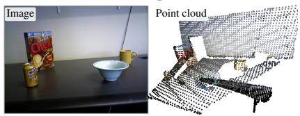  
(d) Sparse Fine Matching

(b) Feature extraction  
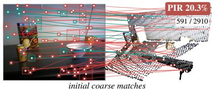

(c) Coarse Hypothesis Graph  
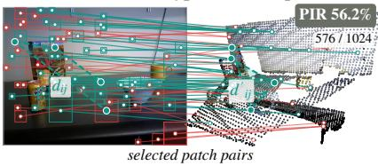

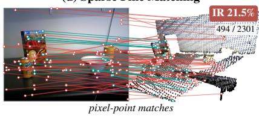

(e) SC2 filtering  
(f) Registration  
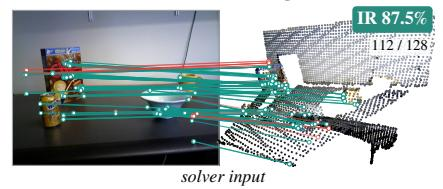  
PIR: correct coarse patch pairs · IR: pixel-point matches within 5 cm

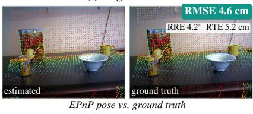  
Figure 1. SparseGraph-I2P on an RGB-D Scenes V2 test pair. The Coarse Hypothesis Graph raises the share of correct coarse patch pairs (PIR) from 20.3% to 56.2%, and SC2 filtering passes 112 inliers among 128 correspondences to a single EPnP solve (4.6 cm RMSE).

## Abstract

Coarse-to-fine image-to-point-cloud (I2P) registration risks discarding correct but ambiguous patch pairs, while retaining more candidates repeatsfine matching over overlapping patches. SparseGraph-I2P aims to improve registration recall by increasing the inlier ratio at the pose solver, using sensor or monocular depth. A Coarse Hypothesis Graph combines appearance with depth-derivedfirst- and second order compatibility to select a fixed budget of patch pairs. Sparse Fine Matching decodes each queried pixel once and skips pixel–point comparisons covered by an ancestorpatch paired with the same point-cloud region. With sensor depth, depth-aware filtering ranks correspondences by SC2 spectral supportfor a single EPnP solve. With monocular depth, depth or inverse depth is calibrated from correspondence geometry before filtering. SparseGraph-I2P achieves the highest registration recall and lowest latency among the compared methods on RGB-D Scenes V2 and 7-Scenes with sensor depth. With predicted depth, it retains the highest re-

call on RGB-D Scenes V2 at an additional calibration cost.   
Code will be released.

## 1. Introduction

Image-to-point-cloud (I2P) registration estimates the camera pose of an image relative to a 3D point cloud, enabling camera relocalization and image–map alignment. In these applications, depth-equipped robots and AR devices can acquire depth alongside the query image, providing geometric observations that can help establish correspondences with the 3D map. Coarse-to-fine methods first match image and point-cloud patches, then expand selected patch pairs into pixel–point correspondences for pose estimation [19]. However, cross-modal differences, viewpoint changes, and partial overlap can make correct and incorrect patch pairs difficult to distinguish by descriptor scores alone. Coarse selection must therefore balance retaining potentially correct matches against the cost of expanding unreliable candidates.

Selecting too few candidates can discard correct patch pairs before their fine correspondences are examined; retaining more candidates preserves alternatives but can also increase outlier contamination and matching cost. A lower inlier ratio makes sampling an all-inlier subset less likely under a fixed RANSAC budget. Geometric filtering [5, 7] can reject outliers after matching, but cannot recover inliers lost during coarse selection or avoid the computation already spent on rejected matches. Keeping more coarse candidates therefore does not by itself resolve the tradeoff between inlier retention, outlier contamination, and computation. In 2D3D-MATR, dense decoding computes descriptors even for unqueried pixels, while nested patches paired with the same point-cloud region repeat pixel–point comparisons. These costs limit the efficiency of exploring alternative matches. These limitations motivate using the available depth to assess geometric consistency before coarse candidates are discarded, together with efficient expansion of the selected pairs and fine-level outlier rejection before pose estimation.

We propose SparseGraph-I2P, which builds on a 2D3D-MATR backbone to improve registration recall (RR) by delivering a higher inlier ratio (IR) to the pose solver (Figure 1). Geometric consistency guides coarse selection to retain promising patch pairs, then filters their fine correspondences using $\mathrm { S C ^ { 2 } }$ spectral support [7]. Sparse execution makes this process efficient by sharing pixel descriptors and comparison blocks across nested patches. Higher IR reduces outlier contamination, but reliable registration also requires sufficient inlier coverage. Sensor depth permits a single EPnP solve [17]; predicted depth requires correspondence-driven calibration and robust pose estimation. On RGB-D Scenes V2 and 7-Scenes, high solver-input IR accompanies the highest RR as well as the lowest latency among six compared methods, all given sensor depth (four use it only as a validity mask). With DAv2/DA3 predictions, our method also achieves the highest RR on RGB-D Scenes V2.

The main contributions are as follows:

• SparseGraph-I2P uses a Coarse Hypothesis Graph to combine appearance and depth-derived compatibility for coarse selection within a fixed budget.

• Sparse Fine Matching decodes each queried pixel once and skips ancestor-covered comparisons, preserving the pixel–point comparison domain.

• Depth-aware filtering combines $\mathrm { S C ^ { 2 } }$ ranking with EPnP for sensor depth, or correspondence-driven calibration and USAC-MSAC for predicted depth.

• Among compared methods, we achieve the highest RR and lowest latency on both indoor benchmarks with sensor depth, and the highest RGB-D Scenes V2 RR with predicted depth.

## 2. Related Work

## 2.1. Image-to-Point-Cloud Matching

Early methods learn cross-modal descriptors [11, 33] or model visibility and overlap [18, 28]. 2D3D-MATR [19] and CoFiI2P [14] use coarse-to-fine matching, while VP2P-Match [41] and MinCD-PnP [2] improve geometric supervision. FreeReg [34] and Diff2I2P [24] exploit pretrained diffusion priors; GLASS [8] incorporates surface-normal cues and graph-distribution consistency. These methods primarily improve cross-modal representations and correspondence quality. Relocalization and image–map alignment on robots and AR devices, however, must also keep pace with the camera, so latency matters alongside accuracy. Contextual image matchers [29, 31] have been accelerated through adaptive computation and efficient attention [21, 35], and computation reuse and sparse execution reduce other vision workloads [12, 26, 32]. This work instead lets coarse hypotheses allocate fine matching and removes two I2P-specific redundancies: decoding unqueried pixels and repeating nested pixel–point comparisons.

## 2.2. Geometric Consistency for Correspondence Selection

Point-cloud registration uses sampling [10, 13], certifiable optimization [37], learned confidence [5, 9], and local pose hypotheses [25] to reject outliers. Compatibility methods rank correspondences spectrally [16], seek consistent subsets [22, 23], or exploit second-order support [7] and clique structure [36, 39, 40]. Applied after fine matching, these methods cannot recover candidates discarded earlier.

For I2P, GraphI2P [6] selects virtual-to-LiDAR correspondences, Top-I2P [1] reasons about topology, and Hg-I2P [3] uses heterogeneous region graphs for feature adaptation and pruning. Ex-Sim(3)-Reg [4] handles monocular depth noise through compatibility graphs over scale hypotheses. SparseGraph-I2P uses compatibility-biased attention, as in PointDSC, to score coarse patch-pair hypotheses before fine matching, then reuses consistency for fine filtering. Since rigid-distance compatibility requires metric geometry, predicted depth is scale-corrected before coarse selection and calibrated in depth or inverse depth before fine filtering.

## 3. Method

## 3.1. Problem Formulation and Overview

Given an image I, point cloud P, camera intrinsics K, and aligned image-side depth D, the task is to estimate a rigid pose (R, t) mapping point-cloud coordinates into the camera frame. Given a selected set of pixel–point correspondences $\mathcal { C } ^ { \star } = \{ ( u _ { i } , p _ { i } ) \}$ }, the registration objective is to min-

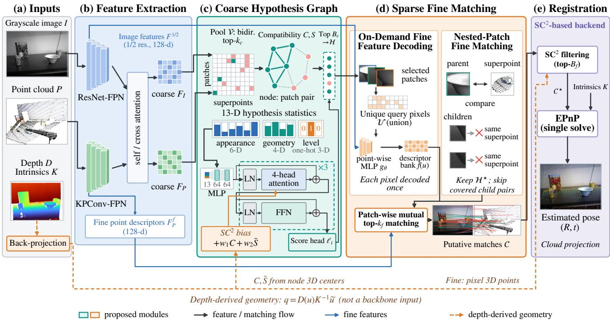  
Figure 2. Overview of SparseGraph-I2P with sensor depth. (a) Image $I ,$ point cloud P, depth $D ,$ and camera intrinsics K. (b) A frozen 2D3D-MATR backbone provides coarse descriptors $F _ { I } , F _ { P }$ and fine features $F ^ { 1 / 2 } , F _ { P } ^ { f } .$ . (c) The Coarse Hypothesis Graph scores the bidirectional $\mathsf { t o p } \mathrm { - } k _ { c }$ pool V from appearance statistics and depth-derived compatibility $C , S$ and keeps the top $B _ { c }$ pairs H. (d) Sparse Fine Matching decodes the queried pixels U once, skips covered child pairs $( \mathcal { H } ^ { \star } )$ , and outputs putative matches C. (e) $\mathrm { S C ^ { 2 } }$ filtering keeps the top $B _ { f }$ correspondences ${ \mathcal { C } } ^ { \star }$ for a single EPnP solve with K. Depth (dashed) enters through validity masks and back-projection (Eq. (2)); predicted depth uses the calibration and robust solver of Sec. 3.4.2.

imize reprojection error:

$$
( R , t ) = \underset { R , t } { \arg \operatorname* { m i n } } \ \sum _ { ( u _ { i } , p _ { i } ) \in { \mathcal { C } ^ { \star } } } \| u _ { i } - \pi ( K ( R p _ { i } + t ) ) \| _ { 2 } ^ { 2 } ,\tag{1}
$$

where $R \in \mathrm { S O } ( 3 )$ and $t \in \mathbb { R } ^ { 3 }$ are the rotation and translation, and $\pi ( [ x , y , z ] ^ { \top } ) = [ x / z , y / z ] ^ { \top }$ converts homogeneous coordinates to pixel coordinates. Depth in meters lifts a pixel to

$$
q _ { i } = D ( u _ { i } ) K ^ { - 1 } \widetilde { u } _ { i } ,\tag{2}
$$

where $\widetilde { u } _ { i }$ is its homogeneous coordinate. The pair $( q _ { i } , p _ { i } )$ denotes the image-side and cloud-side 3D representatives of a correspondence hypothesis, with $i , j$ indexing hypotheses at either resolution: coarse hypotheses use patch representatives and fine hypotheses individual points.

SparseGraph-I2P uses coarse selection and fine filtering to improve the correspondences reaching the pose solver (Figure 2). A frozen 2D3D-MATR backbone [19] extracts cross-modal descriptors (a–b): ResNet-FPN and KPConv-FPN encode the image and point cloud, and self/cross attention produces coarse descriptors $F _ { I }$ and $F _ { P }$ . The image branch also provides a half-resolution feature map $F ^ { 1 / 2 }$ and the point branch fine point descriptors $F _ { P } ^ { f } .$ . The Coarse Hypothesis Graph (Sec. 3.2) selects up to $B _ { c }$ coarse patch pairs (c), Sparse Fine Matching (Sec. 3.3) expands them into pixel–point correspondences (d), and $\mathrm { S C ^ { 2 } }$ -based filtering keeps consistent correspondences for a single EPnP solve with sensor depth (e, Sec. 3.4). Depth supplies validity masks and geometric compatibility. The sensor-depth pipeline is described first; Sec. 3.4.2 adds calibration and USAC-MSAC for monocular predictions.

## 3.2. Coarse Hypothesis Graph

Selecting coarse pairs by descriptor similarity discards correct but ambiguous matches, while keeping more candidates raises fine-matching cost. The Coarse Hypothesis Graph (Figure 2c) instead scores a broad candidate pool jointly with depth-derived rigid compatibility and keeps a budget of at most $B _ { c }$ patch pairs (Figure 3).

## 3.2.1. Graph Construction

Let r index image patches across three pyramid levels and s index superpoints, whose point sets $\mathcal { P } _ { s }$ partition the cloud by nearest superpoint. The candidate set V is the deduplicated union of image-to-point and point-to-image top-kc lists under the cosine similarity of $F _ { I }$ and $F _ { P }$ , which preserves alternatives when a correct pair ranks highly in only one direction. Each candidate $i \in \mathcal V$ is a graph node (Figure 3a), with $q _ { i }$ the mean of valid back-projected samples of its image patch and $p _ { i }$ its superpoint.

Rigid motion preserves distances between corresponding 3D points. Patch representatives, however, need not denote the same physical locations under partial visibility. Coarse distance agreement is therefore approximate evidence, rather than an exact constraint on correct patch pairs. Following spatial compatibility [7], we measure this evidence with a tolerance:

$$
C _ { i j } = \Bigg [ 1 - \frac { ( \| q _ { i } - q _ { j } \| _ { 2 } - \| p _ { i } - p _ { j } \| _ { 2 } ) ^ { 2 } } { \sigma _ { i j } ^ { 2 } } \Bigg ] _ { + } ,\tag{3}
$$

where $[ x ] _ { + } = \operatorname* { m a x } ( x , 0 )$ and $C _ { i i } = 0$ . The same definition is used at both resolutions, with tolerance $\sigma _ { i j } = \sigma _ { c }$ for coarse hypotheses. Thresholding gives $A _ { i j } = \mathcal { H } [ C _ { i j } > \tau ]$ and second-order support is

$$
S = ( A A ) \odot A ,\tag{4}
$$

where the matrix product counts common compatible neighbors and ⊙ retains only compatible edges. Thus $C$ measures direct distance agreement, while $S$ measures collective support: false hypotheses may agree by chance without sharing the compatible neighbors of a correct cluster (Figure 3b, edge widths proportional to $S _ { i j } )$ . For attention, S¯ denotes S normalized by its largest entry, or zero when $S = 0$

## 3.2.2. Graph-Attention Scoring

To accommodate approximate patch geometry, the graph learns to combine appearance and geometric support (Figure 3c). Each node contains six appearance statistics (similarity, two directional gaps, two ranks, and mutual-top-1 membership), four geometric measures (first- and secondorder degree, spectral support, and local support), and three pyramid-level indicators. An MLP embeds these features into 64 dimensions; three pre-norm layers then aggregate evidence across hypotheses with attention biased by compatibility. Each head computes

$$
\mathrm { s o f t m a x } \left( \frac { \mathbf { Q } \mathbf { K } ^ { \top } } { \sqrt { d } } + w _ { 1 } C + w _ { 2 } \bar { S } \right) \mathbf { V } ,\tag{5}
$$

where d is the head dimension, $\mathbf { Q } , \mathbf { K } , \mathbf { V }$ are learned projections (bold K is not the intrinsics K), and $w _ { 1 } , w _ { 2 }$ are learned for each head and layer. The feature term relates node attributes, while C and S¯ add direct and collective support. Geometry biases attention without masking it, so imperfect patch geometry need not exclude useful hypotheses. After residual feed-forward blocks and layer normalization, an MLP gives a logit $\ell _ { i }$ per node, and up to $B _ { c }$ highestscoring nodes form $\mathcal { H } \subseteq \mathcal { V }$ . The candidate-pool size is thus decoupled from the fine-matching budget.

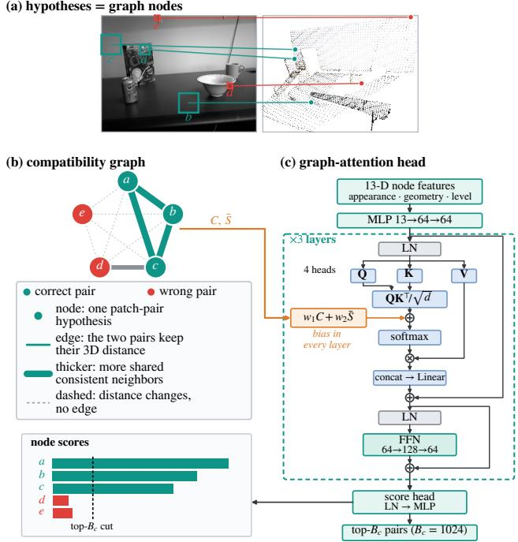  
Figure 3. Coarse Hypothesis Graph on the pair of Figure 1. (a) Each candidate patch pair is a node (green: correct; red: wrong). (b) Edges join pairs whose image-side and cloud-side distances agree (Eq. (3)); thicker edges share more compatible neighbors. Correct pairs form a mutually supporting cluster, while wrong pairs stay weakly connected. (c) Attention biased by C and $\bar { S }$ in every layer scores the nodes, and the top $B _ { c }$ pairs are kept.

## 3.3. Sparse Fine Matching

Overlapping patches make fine matching redundant: descriptors are decoded for the whole image, and nested patches paired with the same superpoint compare the same pixel–point block again. Sparse Fine Matching (Figure 2d) organizes all image patches in one quadtree, then decodes each queried pixel once and skips blocks already covered by a selected ancestor (Figure 4).

Each selected pair $( r , s ) \in \mathcal { H }$ requests the comparison block $U _ { r } \times \mathcal { P } _ { s } ,$ where $U _ { r }$ is the sampled pixel set of patch $r .$ The image patches form a quadtree on a common pixel lattice (Figure 4a): level 0 is the $2 4 \times 3 2$ patch grid and each coarser level halves both sides, so patch $r = ( l , i , j )$ has parent pa $\mathbf { \boldsymbol { \cdot } } ( \boldsymbol { r } ) = ( l { + } 1 , \lfloor i / 2 \rfloor , \lfloor j / 2 \rfloor )$ and $U _ { \mathrm { p a r } ( r ) }$ is the union of the pixel sets of its four children. We write $\boldsymbol { \mathcal { A } } ( \boldsymbol { r } )$ for the ancestors of $r ,$ obtained by repeating par. The tree indexes queried pixels and covered blocks once per image.

## 3.3.1. On-Demand Fine Feature Decoding

The convolutional decoder of 2D3D-MATR produces a full descriptor map. To enable independent pixel queries, we replace it with a point-wise MLP trained by distillation and fine-matching supervision (Sec. 3.5). This is a learned approximation to the original decoder. We form the query union $\begin{array} { r } { \mathcal { U } = \bigcup _ { ( r , s ) \in \mathcal { H } } U _ { r } } \end{array}$ on the lattice and batch-decode its pixels once (Figure 4b):

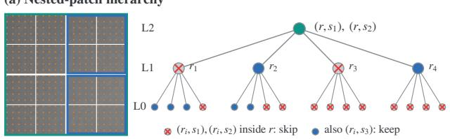

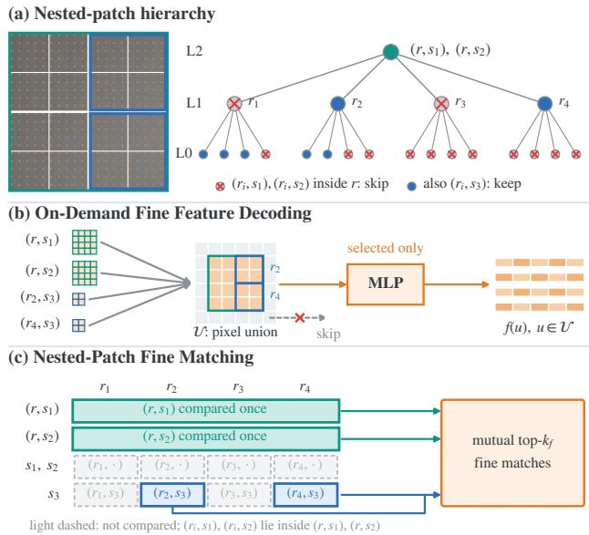  
Figure 4. Sparse Fine Matching (Figure 2d) on the pair of Figure 1. (a) Image patches form a quadtree; a child pair is skipped when a selected ancestor covers it with the same superpoint and kept for a different one $\left( s _ { 3 } \right)$ . (b) On-Demand Fine Feature Decoding decodes the union of queried pixels once. (c) Nested-Patch Fine Matching compares each pixel–point block once.

$$
\begin{array} { r } { f ( u ) = \mathrm { n o r m } \Big ( g _ { \theta } \big ( \mathrm { b i l i n e a r } ( F ^ { 1 / 2 } , u ) \big ) \Big ) , \quad u \in \mathcal { U } , } \end{array}\tag{6}
$$

where $g _ { \theta }$ is the point-wise decoder and norm denotes $\ell _ { 2 }$ normalization. All patches share a descriptor bank indexed by global pixel IDs, so a pixel requested by a parent and several children is decoded once. Decoding cost therefore scales with $| \boldsymbol { \mathcal { U } } |$ rather than with the image size or the number of pairs.

## 3.3.2. Nested-Patch Fine Matching

Matching every selected pair independently repeats comparisons whenever nested patches share a superpoint. Since $U _ { r } \subset U _ { a }$ for every $a \in { \mathcal { A } } ( r )$ , a pair (r, s) is discarded if a selected ancestor pair (a, s) already covers its block (Figure 4c):

$$
\mathcal { H } ^ { \star } = \{ ( r , s ) \in \mathcal { H } : ( a , s ) \notin \mathcal { H } \ \forall a \in A ( r ) \} .\tag{7}
$$

The retained set preserves the comparison domain,

$$
\bigcup _ { ( r , s ) \in \mathcal { H } ^ { \star } } U _ { r } \times \mathcal { P } _ { s } = \bigcup _ { ( r , s ) \in \mathcal { H } } U _ { r } \times \mathcal { P } _ { s } ,\tag{8}
$$

so every requested pixel–point pair is evaluated once. This preserves the comparison domain, but not necessarily the output correspondences: mutual top-kf rankings are computed within each retained block and can change when child blocks are removed. Comparison cost scales with $\sum _ { ( r , s ) \in { \mathcal { H } } ^ { \star } } | U _ { r } | | { \mathcal { P } } _ { s } |$ . Within each retained block, a pixel u and point p are matched if they are mutual top- $\cdot k _ { f }$ under $\begin{array} { r } { z ( u , p ) = \frac { 1 } { 2 } ( 1 + f ( u ) ^ { \top } F _ { P } ^ { f } ( p ) ) } \end{array}$ and $z ( u , p ) > \gamma ;$ repeats of the same global IDs are merged into $\mathcal { C } = \{ ( u _ { i } , p _ { i } ) \}$ , with lifted points $q _ { i }$ from Eq. (2). Retained blocks are grouped by pyramid level for batched GPU products; the Coarse Hypothesis Graph itself remains dense.

## 3.4. Depth-Aware Filtering and Pose Estimation

Fine correspondences still contain outliers, even inside correct coarse pairs. The compatibility of Sec. 3.2 is reused at pixel level to filter them before pose estimation. Sensor depth uses a single EPnP solve; predicted depth uses correspondence-driven calibration and USAC-MSAC.

## 3.4.1. Sensor Depth

Each fine correspondence in C is lifted by Eq. (2), and Eqs. (3)–(4) give C, A, and S over C with $\sigma _ { i j } = \sigma _ { f } ~ ( \mathrm { F i g \mathrm { - } }$ ure 2e). We use a simplified $\mathrm { S C ^ { 2 } }$ [7]: instead of selecting seeds on $C$ and expanding a consensus set per seed, spectral matching [16] ranks all correspondences once on S. For $| { \mathcal { C } } | \geq 4 .$ , starting from $v ^ { ( 0 ) } = \mathbf { 1 } / \sqrt { | \mathcal { C } | } , T = 1 0$ power iterations

$$
v ^ { ( n + 1 ) } = { \frac { S v ^ { ( n ) } } { \| S v ^ { ( n ) } \| _ { 2 } } }\tag{9}
$$

estimate the leading eigenvector of S. If the normalization denominator is below $\bar { 1 } 0 ^ { - 1 2 }$ , we use uniform scores. The top min $\left( B _ { f } , | \boldsymbol { C } | \right)$ correspondences form

$$
\mathcal { C } ^ { \star } = \{ ( u _ { i } , p _ { i } ) \in \mathcal { C } : i \in \mathrm { T o p K } _ { \operatorname* { m i n } ( B _ { f } , | \mathcal { C } | ) } ( v ^ { ( T ) } ) \} .\tag{10}
$$

Depth is used to select correspondences; the final pose is estimated from their original 2D pixels and 3D cloud points. We apply EPnP [17] once to ${ \mathcal { C } } ^ { \star }$ , without RANSAC, using its algebraic fit to approximate Eq. (1). This choice relies on the quality and geometric coverage of the selected correspondences. Fewer than four correspondences or an unsuccessful EPnP solve returns no pose.

## 3.4.2. Predicted Depth

Monocular predictions distort the geometry through scale and offset errors. Predicted depth supplies the valid-pixel and valid-patch masks and the coarse patch representatives. Before graph selection, we estimate scale from the dominant mode of cloud-to-image distance ratios in the appearance-based candidate pool. These pose-invariant ratios rescale the coarse representatives. After fine matching, affine models in depth and inverse depth are initialized by pairwise distance-agreement voting. We refine and select the model using the leading eigenvalue of its soft secondorder compatibility matrix, favoring collectively consistent correspondences. The calibrated depth $\widehat { D }$ replaces D in Eq. (2) for fine filtering. Distance-adaptive tolerances and spatially spread one-to-one matches accommodate residual errors, and USAC-MSAC [27] estimates the pose from the selected original pixel–point pairs. Neither sensor depth nor ground-truth poses enter this inference path.

## 3.5. Loss Function

We freeze the 2D3D-MATR backbone and train the graph and decoder separately. The graph uses class-weighted binary cross-entropy over the candidates:

$$
\mathcal { L } _ { \mathrm { g r a p h } } = - \frac { 1 } { | \mathcal { V } | } \sum _ { i \in \mathcal { V } } \left[ \alpha y _ { i } \log \hat { y } _ { i } + \left( 1 - y _ { i } \right) \log \left( 1 - \hat { y } _ { i } \right) \right] ,\tag{11}
$$

where $\hat { y } _ { i } = \mathrm { s i g m o i d } ( \ell _ { i } ) , y _ { i }$ indicates nonzero ground-truth patch overlap in both directions, and α is the training-set ratio of negative to positive candidates. The decoder loss is

$$
\begin{array} { r } { \mathcal { L } _ { \mathrm { d e c } } = \mathcal { L } _ { \mathrm { f n e } } + \lambda _ { d } \mathcal { L } _ { \mathrm { d i s t i l l } } , \qquad \lambda _ { d } = 1 , } \end{array}\tag{12}
$$

where 2D3D-MATR’s fine circle loss ${ \mathcal L } _ { \mathrm { f i n e } }$ [19] supervises pixel–point discrimination using ground-truth 2D/3D distances, and ${ \mathcal { L } } _ { \mathrm { d i s t i l l } }$ transfers the frozen dense decoder’s descriptors $f _ { T }$ by averaging $1 - \cos ( f ( u ) , f _ { T } ( u ) )$ ) over sampled training pixels.

## 4. Experiments

All evaluations run on an otherwise idle machine with a 32 GB NVIDIA RTX 5090 GPU and an AMD Ryzen 7 9850X3D CPU. We follow the 2D3D-MATR benchmark [19]. RGB-D Scenes V2 uses scenes 1–9 for training, scene 10 for validation, and scenes 11–14 (497 pairs) for testing; 7-Scenes uses the standard split with 2304 test pairs. Inliers have 3D residual below 5 cm. IR is measured on the solver input, FMR counts pairs whose candidate IR before fine filtering is at least 10%, and RR counts pairs with registration RMSE below 10 cm. Percentages are averaged equally across scenes, and bold marks the best values, including ties. We use $k _ { c } = 3 , B _ { c } = 1 0 2 4 , \sigma _ { c } = 0 . 1 \mathrm { m } , \tau =$ 0.1, and $\gamma = 0 . 7 5$ , with $( k _ { f } , \sigma _ { f } , B _ { f } ) = ( 2 , 6 . 2 5 \mathrm { { m m } , 1 2 8 ) }$ on RGB-D Scenes V2 and (1, 12.5 mm, 64) on 7-Scenes. Our results average three graph-head seeds (RR std 0.7/0.2 points); latency and ablations use one seed.

All methods in Tables 1 and 2 use sensor depth with their own registration backends: 2D3D-MATR, Diff2I2P, GLASS, and Hg-I2P as a validity mask, and FreeReg and Ex-Sim(3)-Reg [4] in place of ZoeDepth and DAv2, which improves both (Figure 7a). Latency (Figure 5) covers forward, filtering, and pose estimation.

## 4.1. Comparison with State-of-the-Art Methods

On RGB-D Scenes V2 (Table 1), SparseGraph-I2P attains the highest mean RR (85.6%), 3.7 points above FreeReg (81.9%), and the highest RR in three of the four scenes. Its solver-input IR (89.0%, 128 kept by $\mathrm { S C ^ { 2 } } )$ exceeds baseline IR on full candidate sets (at most 63.4%, Ex-Sim(3)-Reg), and it runs at 33.4 ms per pair versus 50.4 ms for the fastest baseline (Figure 5). Its FMR (83.8%), measured before $\mathrm { S C ^ { 2 } }$ filtering, is below most baselines’; on Scene 14 the filter registers pairs with candidate IR below 10%, so RR (71.5%) exceeds FMR (54.7%).

On 7-Scenes (Table 2), it reaches 88.3% RR, 4.5 points above Diff2I2P (83.8%), with solver-input IR 85.3% (64 kept) versus at most 65.0% and latency 36.9 ms versus 64.8 ms for the fastest baseline. Stairs is the exception: FreeReg reaches 58.1% RR versus 37.8%; all others stay below 40%. Higher solver-input IR accompanies higher mean RR on both datasets, consistent with our design goal. These IR values reflect each method’s filtering and set size, rather than raw matching quality alone.

In Figure 6, baseline solver-input IR ranges from 28% to 94% and PnP-RANSAC registers 11 of the 12 baseline cells, whereas SparseGraph-I2P passes 92% and 89% inliers to a single EPnP solve.

## 4.2. Ablation Studies

In Table 3, (a)–(b) use the original convolutional decoder and (c)–(g) the distilled point-wise MLP. Replacing PnP-RANSAC with SC2/EPnP, (a)→(b), raises RGB-D/7- Scenes RR from 55.4/74.1% to 73.7/86.5% and cuts latency from 138.0/92.8 ms to 30.0/37.0 ms. Variants (c) and (g) differ only in coarse selection: the Coarse Hypothesis Graph raises RR from 69.4/84.4% (hand-crafted $\mathrm { S C ^ { 2 } } )$ to 84.8/88.2%, while solver-input IR rises from 78.4/81.8% to 88.8/85.3%. Over (b), the full system adds 11.1/1.7 RR points.

On-Demand Fine Feature Decoding saves 3.2/1.2 ms, (d)→(f), and 1.6/1.6 ms, (e)→(g), without changing accuracy. Nested-Patch Fine Matching saves 11.4/3.9 and 9.8/4.3 ms, (d)→(e) and (f)→(g), at a 0.2-point RR cost. Together they cut latency by 28%/13%, to 33.4/36.9 ms. Thus coarse selection and filtering improve IR and RR, while sparse fine matching lowers computation cost.

Coarse matching budget. Table 4 varies $B _ { c }$ from 256 to 2048 while keeping graph selection, on-demand decoding, nested-patch matching, and the fine backend fixed. Increasing $B _ { c }$ from 1024 to 2048 raises RGB-D RR from 84.8% to 86.1%, but increases latency from 33.4 to 46.1 ms; 7-Scenes RR falls from 88.2% to 87.6%. We retain the validationselected budget of 1024. This budget limits coarse patch pairs, not fine correspondences or solver inputs.

## 4.3. Registration with Predicted Depth

Sensor depth is replaced by the same DAv2 [38] or DA3 [20] predictions for all methods, without retraining (Figure 7). Our runs use predictions in both coarse selection and fine filtering, with no sensor depth at inference; our dashed diagnostic references retain predictionbased coarse hypotheses and fine candidates, but use sensor depth and sensor-depth settings for fine filtering, keeping USAC-MSAC. They differ from the full system of Tables 1–2. On RGB-D Scenes V2, SparseGraph-I2P achieves

Table 1. Registration on RGB-D Scenes V2 (%).
<table><tr><td>Method</td><td>Scene 11</td><td>Scene 12</td><td>Scene 13</td><td>Scene 14</td><td>Mean</td></tr><tr><td colspan="6">Inlier Ratio ↑</td></tr><tr><td>2D3D-MATR</td><td>32.8</td><td>34.4</td><td>39.3</td><td>23.3</td><td>32.4</td></tr><tr><td>FreeReg</td><td>43.1</td><td>46.5</td><td>53.4</td><td>33.6</td><td>44.2</td></tr><tr><td>Diff2I2P</td><td>52.7</td><td>58.4</td><td>17.8</td><td>8.5</td><td>34.3</td></tr><tr><td>GLASS</td><td>51.5</td><td>52.2</td><td>35.2</td><td>30.2</td><td>42.3</td></tr><tr><td>Hg-I2P</td><td>33.9</td><td>38.9</td><td>43.1</td><td>28.9</td><td>36.2</td></tr><tr><td>Ex-Sim(3)</td><td>64.9</td><td>63.4</td><td>73.4</td><td>51.7</td><td>63.4</td></tr><tr><td>Ours</td><td>95.4</td><td>94.6</td><td>90.5</td><td>75.4</td><td>89.0</td></tr><tr><td colspan="6">Feature Matching Recall ↑</td></tr><tr><td>2D3D-MATR</td><td>98.6</td><td>98.0</td><td>88.7</td><td>79.2</td><td>91.1</td></tr><tr><td>FreeReg</td><td>98.6</td><td>100.0</td><td>100.0</td><td>88.9</td><td>96.9</td></tr><tr><td>Diff2I2P</td><td>100.0</td><td>100.0</td><td>75.3</td><td>32.7</td><td>77.0</td></tr><tr><td>GLASS</td><td>100.0</td><td>100.0</td><td>89.7</td><td>82.7</td><td>93.1</td></tr><tr><td>Hg-I2P</td><td>100.0</td><td>100.0</td><td>92.8</td><td>85.0</td><td>94.4</td></tr><tr><td>Ex-Sim(3)</td><td>98.6</td><td>95.1</td><td>90.7</td><td>78.8</td><td>90.8</td></tr><tr><td>Ours</td><td>97.2</td><td>96.7</td><td>86.6</td><td>54.7</td><td>83.8</td></tr><tr><td colspan="6">Registration Recall ↑</td></tr><tr><td>2D3D-MATR</td><td>61.1</td><td>56.9</td><td>53.6</td><td>50.0</td><td>55.4</td></tr><tr><td>FreeReg</td><td>83.3</td><td>89.2</td><td>86.6</td><td>68.6</td><td>81.9</td></tr><tr><td>DiffI2P</td><td>86.1</td><td>78.4</td><td>9.3</td><td>14.2</td><td>47.0</td></tr><tr><td>GLASS</td><td>86.1</td><td>84.3</td><td>70.1</td><td>70.4</td><td>77.7</td></tr><tr><td>Hg-I2P</td><td>63.9</td><td>67.6</td><td>51.5</td><td>55.8</td><td>59.7</td></tr><tr><td>Ex-Sim(3)</td><td>77.8</td><td>63.7</td><td>63.9</td><td>46.0</td><td>62.9</td></tr><tr><td>Ours</td><td>90.7</td><td>88.6</td><td>91.8</td><td>71.5</td><td>85.6</td></tr></table>

Table 2. Registration on 7-Scenes (%).
<table><tr><td>Method</td><td>Chess</td><td>Fire Heads</td><td></td><td>Office</td><td>Pump. Kitch. Stairs Mean</td><td></td><td></td><td></td></tr><tr><td colspan="9">Inlier Ratio ↑</td></tr><tr><td>2D3D-MATR</td><td>72.1</td><td>66.1</td><td>31.3</td><td>60.7</td><td>50.2</td><td>52.5</td><td>18.1</td><td>50.1</td></tr><tr><td>FreeReg</td><td>52.9</td><td>50.9</td><td>50.8</td><td>46.6</td><td>28.2</td><td>41.4</td><td>34.5</td><td>43.6</td></tr><tr><td>Diff²I2P</td><td>74.1</td><td>68.0</td><td>52.8</td><td>67.8</td><td>50.1</td><td>56.9</td><td>20.9</td><td>55.8</td></tr><tr><td>GLASS</td><td>77.6</td><td>69.1</td><td>44.1</td><td>67.1</td><td>53.5</td><td>56.3</td><td>19.5</td><td>55.3</td></tr><tr><td>Hg-I2P</td><td>73.4</td><td>68.0</td><td>43.6</td><td>65.4</td><td>52.3</td><td>54.5</td><td>18.6</td><td>53.7</td></tr><tr><td>Ex-Sim(3)</td><td>84.9</td><td>81.6</td><td>67.0</td><td>73.9</td><td>59.6</td><td>61.0</td><td>27.1</td><td>65.0</td></tr><tr><td>Ours</td><td>100.0</td><td>99.3</td><td>89.7</td><td>99.3</td><td>82.9</td><td>88.7</td><td>37.0</td><td>85.3</td></tr></table>

<table><tr><td colspan="9">Feature Matching Recall ↑</td></tr><tr><td>2D3D-MATR</td><td>100.0</td><td>99.6</td><td>98.6</td><td>100.0</td><td>92.4</td><td>95.7</td><td>58.1</td><td>92.1</td></tr><tr><td>FreeReg</td><td>91.6</td><td>95.8</td><td>95.9</td><td>96.0</td><td>83.3</td><td>96.0</td><td>93.2</td><td>93.1</td></tr><tr><td>Diff2I2P</td><td>100.0</td><td>99.3</td><td>98.6</td><td>99.8</td><td>92.4</td><td>99.0</td><td>63.5</td><td>93.2</td></tr><tr><td>GLASS</td><td>100.0</td><td>100.0</td><td>98.6</td><td>100.0</td><td>90.3</td><td>95.7</td><td>75.7</td><td>94.3</td></tr><tr><td>Hg-I2P</td><td>100.0 100.0</td><td></td><td>100.0</td><td>100.0</td><td>94.8</td><td>96.3</td><td>66.2</td><td>93.9</td></tr><tr><td>Ex-Sim(3)</td><td>100.0</td><td>99.6</td><td>97.3</td><td>100.0</td><td>92.4</td><td>95.9</td><td>40.5</td><td>89.4</td></tr></table>

<table><tr><td colspan="10">Registration Recall ↑</td></tr><tr><td>2D3D-MATR</td><td>96.5</td><td>92.3</td><td>45.2</td><td>94.0</td><td>79.9</td><td>85.2</td><td>25.7</td><td>74.1</td></tr><tr><td>FreeReg</td><td>85.0</td><td>83.4</td><td>84.9</td><td>88.2</td><td>61.1</td><td>88.6</td><td>58.1</td><td>78.5</td></tr><tr><td>Diff²I2P</td><td>99.7</td><td>93.4</td><td>86.3</td><td>98.0</td><td>81.6</td><td>94.1</td><td>33.8</td><td>83.8</td></tr><tr><td>GLASS</td><td>99.0</td><td>91.2</td><td>80.8</td><td>94.2</td><td>78.8</td><td>87.2</td><td>27.0</td><td>79.7</td></tr><tr><td>Hg-I2P</td><td>98.6</td><td>97.1</td><td>75.3</td><td>98.0</td><td>81.9</td><td>90.2</td><td>36.5</td><td>82.5</td></tr><tr><td>Ex-Sim(3)</td><td>97.2</td><td>94.0</td><td>82.2</td><td>95.5</td><td>80.6</td><td>85.0</td><td>23.0</td><td>79.6</td></tr><tr><td>Ours</td><td>100.0</td><td>98.2</td><td>98.6</td><td>98.6</td><td>89.5</td><td>95.5</td><td>37.8</td><td>88.3</td></tr></table>

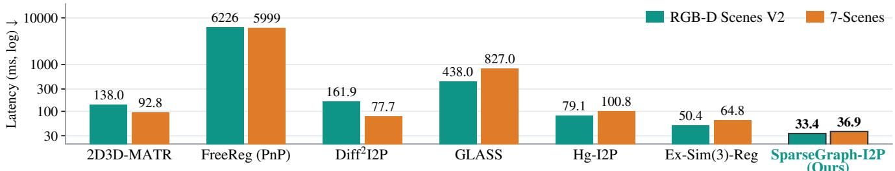  
Figure 5. Registration latency on RGB-D Scenes V2 and 7-Scenes (lower is better).

Table 3. Sensor-depth ablation of the three components (%, ms; graph-head seed 7351). Without the learned graph, (a)–(b) use 2D3D MATR coarse matching; (a) uses PnP-RANSAC.
<table><tr><td rowspan="2">Variant</td><td rowspan="2">Coarse Hypothesis Graph</td><td colspan="2">Sparse Fine Matching</td><td rowspan="2">Depth-aware Filtering</td><td colspan="4">RGB-D V2</td><td colspan="4">7-Scenes</td></tr><tr><td>On-demand</td><td>Nested</td><td>IR↑</td><td>FMR↑</td><td>RR↑</td><td>Lat.↓</td><td>IR↑</td><td>FMR↑</td><td>RR↑</td><td>Lat.↓</td></tr><tr><td>(a)</td><td>一</td><td></td><td>一</td><td>一</td><td>32.4</td><td>91.1</td><td>55.4</td><td>138.0</td><td>50.1</td><td>92.1</td><td>74.1</td><td>92.8</td></tr><tr><td>(b)</td><td>一</td><td>一</td><td>一</td><td>√</td><td>81.2</td><td>91.1</td><td>73.7</td><td>30.0</td><td>83.3</td><td>92.1</td><td>86.5</td><td>37.0</td></tr><tr><td>(c)</td><td>1</td><td>√</td><td>√</td><td>√</td><td>78.4</td><td>90.5</td><td>69.4</td><td>24.8</td><td>81.8</td><td>91.1</td><td>84.4</td><td>31.9</td></tr><tr><td>(d)</td><td>√</td><td>一</td><td>一</td><td>√</td><td>90.3</td><td>85.1</td><td>85.0</td><td>46.4</td><td>86.1</td><td>91.5</td><td>88.4</td><td>42.4</td></tr><tr><td>(e)</td><td>√</td><td>一</td><td>√</td><td>√</td><td>88.8</td><td>83.6</td><td>84.8</td><td>35.0</td><td>85.3</td><td>92.0</td><td>88.2</td><td>38.5</td></tr><tr><td>(f)</td><td>√</td><td>√</td><td>一</td><td>√</td><td>90.3</td><td>85.1</td><td>85.0</td><td>43.2</td><td>86.1</td><td>91.5</td><td>88.4</td><td>41.2</td></tr><tr><td>(g) Ours</td><td>V</td><td>√</td><td>√</td><td>√</td><td>88.8</td><td>83.6</td><td>84.8</td><td>33.4</td><td>85.3</td><td>92.0</td><td>88.2</td><td>36.9</td></tr></table>

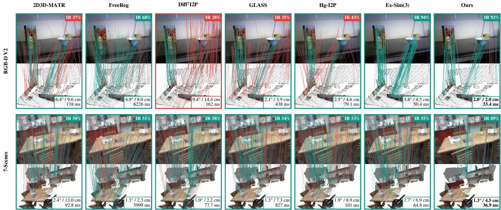  
Figure 6. Solver-input correspondences of every method on one test pair per dataset (green: inlier within 5 cm; red: outlier; up to 250 drawn per baseline, all 128/64 for SparseGraph-I2P). Badges give solver-input IR; the box at the lower right gives RRE / RTE of the estimated pose (green frame: RMSE < 10 cm) and the method’s mean latency on the dataset (Figure 5). All methods use sensor depth.

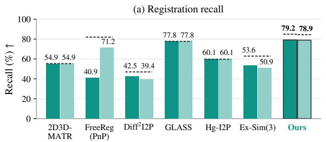

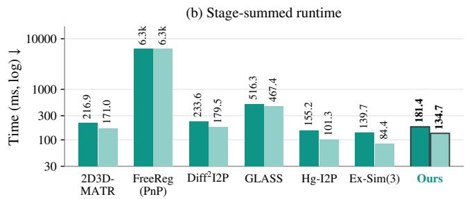  
Figure 7. Predicted-depth registration on RGB-D Scenes V2: (a) scene-mean recall; (b) sum of measured depth-prediction, forward, filtering and solving times (log scale; disk IO and offline MobileSAM excluded). Solid/light bars use DAv2/DA3 throughout inference. Dashed marks in (a) show sensor-depth references. For ours, these marks retain prediction-based coarse hypotheses and fine candidates, use sensor depth and its fine-filter settings, and keep USAC-MSAC. Stage sums are not directly timed end-to-end latency.

Table 4. Coarse matching budget ablation (%, ms).
<table><tr><td></td><td colspan="4">RGB-D V2</td><td colspan="4">7-Scenes</td></tr><tr><td>Setting</td><td>IR↑</td><td>FMR↑</td><td>RR↑</td><td>Lat.↓</td><td>IR↑</td><td>FMR↑</td><td>RR↑</td><td>Lat.↓</td></tr><tr><td>256</td><td>87.9</td><td>92.4</td><td>84.3</td><td>28.4</td><td>84.4</td><td>91.6</td><td>86.9</td><td>35.9</td></tr><tr><td>512</td><td>88.7</td><td>90.0</td><td>85.1</td><td>29.4</td><td>84.6</td><td>91.9</td><td>87.8</td><td>36.7</td></tr><tr><td>768</td><td>88.8</td><td>87.1</td><td>85.3</td><td>31.8</td><td>85.1</td><td>91.9</td><td>88.1</td><td>36.6</td></tr><tr><td>1536</td><td>88.9</td><td>75.1</td><td>86.0</td><td>38.7</td><td>85.0</td><td>91.7</td><td>88.1</td><td>37.1</td></tr><tr><td>2048</td><td>89.0</td><td>68.1</td><td>86.1</td><td>46.1</td><td>85.3</td><td>90.8</td><td>87.6</td><td>38.7</td></tr><tr><td>1024 (Ours)</td><td>88.8</td><td>83.6</td><td>84.8</td><td>33.4</td><td>85.3</td><td>92.0</td><td>88.2</td><td>36.9</td></tr></table>

79.2% RR with DAv2 and 78.9% with DA3, the highest under either predictor, 5.8/5.6 points below these diagnostic references (84.9/84.5%). On 7-Scenes it reaches 81.7%, 1.1 points below Hg-I2P (82.8%). Including depth prediction, its summed stage times are 181.4/134.7 ms (DAv2/DA3), within the 84.4–233.6 ms of the other four baselines and below GLASS and FreeReg.

## 5. Conclusion

SparseGraph-I2P targets higher registration recall through higher solver-input IR. The Coarse Hypothesis Graph retains geometrically supported patch pairs, and depth-aware filtering suppresses fine-match outliers. Sparse Fine Matching removes redundant decoding and comparisons. Together, these components improve sensor-depth registration recall at low latency; correspondence-driven calibration extends the approach to predicted depth. Future work will investigate cheaper calibration and better inlier coverage in ambiguous scenes.

## LLM Usage Statement

Claude, OpenAI Codex, and Qwen Image 2.1 were used as assistive tools for polishing the manuscript’s language and assisting with code development. OpenAI Codex additionally assisted with drafting and revising the Introduction, Method, experimental analysis, Discussion, and Conclusion, migrating the manuscript to the LATEX template, and drafting this statement.

## References

[1] Pei An, Jiaqi Yang, Muyao Peng, You Yang, Qiong Liu, Jie Ma, and Liangliang Nan. Top-I2P: Explore open-domain image-to-point cloud registration using topology relationship. In Proceedings ofthe Thirty-Fourth International Joint Conference on Artificial Intelligence, pages 674–683, 2025. 2

[2] Pei An, Jiaqi Yang, Muyao Peng, You Yang, Qiong Liu, Xiaolin Wu, and Liangliang Nan. MinCD-PnP: Learning 2D-3D correspondences with approximate blind PnP. In Proceedings of the IEEE/CVF International Conference on Computer Vision, pages 26519–26528, 2025. 2

[3] Pei An, Junfeng Ding, Jiaqi Yang, Yulong Wang, Jie Ma, and Liangliang Nan. Hg-I2P: Bridging modalities for generalizable image-to-point-cloud registration via heterogeneous graphs. arXiv preprint arXiv:2603.27969, 2026. 2

[4] Pei An, Muyao Peng, Junfeng Ding, Jiaqi Yang, and Liangliang Nan. Ex-Sim(3)-Reg: 2D-3D correspondence pruning via extended Sim(3) registration. arXiv preprint arXiv:2608.28096, 2026. 2, 6

[5] Xuyang Bai, Zixin Luo, Lei Zhou, Hongkai Chen, Lei Li, Zeyu Hu, Hongbo Fu, and Chiew-Lan Tai. PointDSC: Robust point cloud registration using deep spatial consistency. In Proceedings of the IEEE/CVF Conference on Computer Vision and Pattern Recognition, pages 15859–15869, 2021. 2

[6] Lin Bie, Shouan Pan, Siqi Li, Yining Zhao, and Yue Gao. GraphI2P: Image-to-point cloud registration with exploring pattern of correspondence via graph learning. In Proceedings of the IEEE/CVF Conference on Computer Vision and Pattern Recognition, pages 22161–22171, 2025. 2

[7] Zhi Chen, Kun Sun, Fan Yang, and Wenbing Tao. SC2-PCR: A second order spatial compatibility for efficient and robust point cloud registration. In Proceedings of the IEEE/CVF Conference on Computer Vision and Pattern Recognition, pages 13221–13231, 2022. 2, 4, 5

[8] Zhixin Cheng, Jiacheng Deng, Xinjun Li, Bohao Liao, Li Liu, Xiaotian Yin, Baoqun Yin, and Tianzhu Zhang. GLASS: Geometry-aware local alignment and structure synchronization network for 2D-3D registration. arXiv preprint arXiv:2603.26262, 2026. 2

[9] Christopher Choy, Wei Dong, and Vladlen Koltun. Deep global registration. In Proceedings of the IEEE/CVF Conference on Computer Vision and Pattern Recognition, pages 2514–2523, 2020. 2

[10] Ondˇrej Chum and Jiˇr´ı Matas. Matching with PROSAC— progressive sample consensus. In Proceedings of the IEEE Computer Society Conference on Computer Vision and Pat tern Recognition, pages 220–226, 2005. 2

[11] Mengdan Feng, Sixing Hu, Marcelo Ang, and Gim Hee Lee. 2D3D-MatchNet: Learning to match keypoints across 2D image and 3D point cloud. In IEEE International Confer ence on Robotics and Automation, 2019. 2

[12] Yu Feng, Boyuan Tian, Tiancheng Xu, Paul Whatmough, and Yuhao Zhu. Mesorasi: Architecture support for point cloud analytics via delayed-aggregation. In Proceedings of the IEEE/ACM International Symposium on Microarchitecture, 2020. 2

[13] Martin A. Fischler and Robert C. Bolles. Random sample consensus: A paradigm for model fitting with applications to image analysis and automated cartography. Communications ofthe ACM, 24(6):381–395, 1981. 2

[14] Shuhao Kang, Youqi Liao, Jianping Li, Fuxun Liang, Yuhao Li, Xianghong Zou, Fangning Li, Xieyuanli Chen, Zhen Dong, and Bisheng Yang. CoFiI2P: Coarse-to-fine correspondences-based image to point cloud registration. IEEE Robotics and Automation Letters, 2024. 2

[15] Kevin Lai, Liefeng Bo, and Dieter Fox. Unsupervised feature learning for 3D scene labeling. In Proceedings of the IEEE International Conference on Robotics and Automation, pages 3050–3057, 2014. 11

[16] Marius Leordeanu and Martial Hebert. A spectral technique for correspondence problems using pairwise constraints. In Proceedings of the IEEE International Conference on Com puter Vision, pages 1482–1489, 2005. 2, 5

[17] Vincent Lepetit, Francesc Moreno-Noguer, and Pascal Fua. EPnP: An accurate O(n) solution to the PnP problem. International Journal of Computer Vision, 81(2):155–166, 2009. 2, 5

[18] Jiaxin Li and Gim Hee Lee. DeepI2P: Image-to-point cloud registration via deep classification. In Proceedings of the IEEE/CVF Conference on Computer Vision and Pattern Recognition, pages 15960–15969, 2021. 2

[19] Minhao Li, Zheng Qin, Zhirui Gao, Renjiao Yi, Chenyang Zhu, Yulan Guo, and Kai Xu. 2D3D-MATR: 2D-3D match ing transformer for detection-free registration between im ages and point clouds. In Proceedings of the IEEE/CVF In ternational Conference on Computer Vision, pages 14128– 14138, 2023. 1, 2, 3, 6, 11

[20] Haotong Lin, Sili Chen, Jun Hao Liew, Donny Y. Chen, Zhenyu Li, Guang Shi, Jiashi Feng, and Bingyi Kang. Depth anything 3: Recovering the visual space from any views. arXiv preprint arXiv:2511.10647, 2025. 6

[21] Philipp Lindenberger, Paul-Edouard Sarlin, and Marc Pollefeys. LightGlue: Local feature matching at light speed. In Proceedings of the IEEE/CVF International Conference on Computer Vision, pages 17627–17638, 2023. 2

[22] Parker C. Lusk, Kaveh Fathian, and Jonathan P. How. CLIP-PER: A graph-theoretic framework for robust data association. In Proceedings of the IEEE International Conference on Robotics and Automation, pages 13828–13834, 2021. 2

[23] Joshua G. Mangelson, Derrick Dominic, Ryan M. Eustice, and Ram Vasudevan. Pairwise consistent measurement set maximization for robust multi-robot map merging. In Proceedings of the IEEE International Conference on Robotics and Automation, pages 2916–2923, 2018. 2

[24] Juncheng Mu, Chengwei Ren, Weixiang Zhang, Liang Pan, Xiao-Ping Zhang, and Yue Gao. Diff2I2P: Differentiable image-to-point cloud registration with diffusion prior. In Proceedings of the IEEE/CVF International Conference on Computer Vision, pages 25777–25787, 2025. 2, 11, 13

[25] Zheng Qin, Hao Yu, Changjian Wang, Yulan Guo, Yuxing Peng, and Kai Xu. Geometric transformer for fast and robust point cloud registration. In Proceedings of the IEEE/CVF Conference on Computer Vision and Pattern Recognition, pages 11143–11152, 2022. 2

[26] Jonathan Ragan-Kelley, Connelly Barnes, Andrew Adams, Sylvain Paris, Fredo Durand, and Saman Amarasinghe.´ Halide: A language and compiler for optimizing parallelism, locality, and recomputation in image processing pipelines. In Proceedings of the ACM SIGPLAN Conference on Programming Language Design and Implementation, pages 519–530, 2013. 2

[27] Rahul Raguram, Ondˇrej Chum, Marc Pollefeys, Jiˇr´ı Matas, and Jan-Michael Frahm. USAC: A universal framework for random sample consensus. IEEE Transactions on Pattern Analysis and Machine Intelligence, 35(8):2022–2038, 2013. 6

[28] Siyu Ren, Yiming Zeng, Junhui Hou, and Xiaodong Chen. CorrI2P: Deep image-to-point cloud registration via dense correspondence. IEEE Transactions on Circuits and Systems for Video Technology, 33(3):1198–1208, 2023. 2

[29] Paul-Edouard Sarlin, Daniel DeTone, Tomasz Malisiewicz, and Andrew Rabinovich. SuperGlue: Learning feature matching with graph neural networks. In Proceedings of the IEEE/CVF Conference on Computer Vision and Pattern Recognition, pages 4938–4947, 2020. 2

[30] Jamie Shotton, Ben Glocker, Christopher Zach, Shahram Izadi, Antonio Criminisi, and Andrew Fitzgibbon. Scene coordinate regression forests for camera relocalization in RGB-D images. In Proceedings of the IEEE Conference on Computer Vision and Pattern Recognition, pages 2930– 2937, 2013. 11

[31] Jiaming Sun, Zehong Shen, Yuang Wang, Hujun Bao, and Xiaowei Zhou. LoFTR: Detector-free local feature matching with transformers. In Proceedings of the IEEE/CVF Conference on Computer Vision and Pattern Recognition, pages 8922–8931, 2021. 2

[32] Haotian Tang, Zhijian Liu, Xiuyu Li, Yujun Lin, and Song Han. TorchSparse: Efficient point cloud inference engine. In Proceedings ofMachine Learning and Systems, 2022. 2

[33] Bing Wang, Changhao Chen, Zhaopeng Cui, Jie Qin, Chris Xiaoxuan Lu, Zhengdi Yu, Peijun Zhao, Zhen Dong, Fan Zhu, Niki Trigoni, and Andrew Markham. P2-Net: Joint

description and detection of local features for pixel and point matching. In Proceedings of the IEEE/CVF International Conference on Computer Vision, pages 16004–16013, 2021. 2

[34] Haiping Wang, Yuan Liu, Bing Wang, Yujing Sun, Zhen Dong, Wenping Wang, and Bisheng Yang. FreeReg: Imageto-point cloud registration leveraging pretrained diffusion models and monocular depth estimators. In International Conference on Learning Representations, 2024. 2, 13

[35] Yifan Wang, Xingyi He, Sida Peng, Dongli Tan, and Xiaowei Zhou. Efficient LoFTR: Semi-dense local feature matching with sparse-like speed. In Proceedings of the IEEE/CVF Conference on Computer Vision and Pattern Recognition, pages 21666–21675, 2024. 2

[36] Shaocheng Yan, Pengcheng Shi, Zhenjun Zhao, Kaixin Wang, Kuang Cao, Ji Wu, and Jiayuan Li. TurboReg: TurboClique for robust and efficient point cloud registration. In Proceedings of the IEEE/CVF International Conference on Computer Vision, pages 26371–26381, 2025. 2

[37] Heng Yang, Jingnan Shi, and Luca Carlone. TEASER: Fast and certifiable point cloud registration. IEEE Transactions on Robotics, 37(2):314–333, 2021. 2

[38] Lihe Yang, Bingyi Kang, Zilong Huang, Zhen Zhao, Xiaogang Xu, Jiashi Feng, and Hengshuang Zhao. Depth any thing V2. In Advances in Neural Information Processing Systems, 2024. 6

[39] Xiyu Zhang, Jiaqi Yang, Shikun Zhang, and Yanning Zhang. 3D registration with maximal cliques. In Proceedings of the IEEE/CVF Conference on Computer Vision and Pattern Recognition, pages 17745–17754, 2023. 2

[40] Yifei Zhang, Hao Zhao, Hongyang Li, and Siheng Chen. FastMAC: Stochastic spectral sampling of correspondence graph. In Proceedings ofthe IEEE/CVF Conference on Computer Vision and Pattern Recognition, pages 17857–17867, 2024. 2

[41] Junsheng Zhou, Baorui Ma, Wenyuan Zhang, Yi Fang, Yu-Shen Liu, and Zhizhong Han. Differentiable registration of images and LiDAR point clouds with VoxelPoint-to-pixel matching. In Advances in Neural Information Processing Systems, 2023. 2

# SparseGraph-I2P: Consistency-Guided Hypothesis Selection for Efficient Image-to-Point-Cloud Registration

Supplementary Material

This supplement first defines the evaluation metrics (Section A), the datasets and splits (Section B), and the baseline configurations (Section C). Section D gives the implementation details of SparseGraph-I2P, and Section E reports rotation and translation errors, and outdoor registration on KITTI-DC. Section F derives and evaluates the predicteddepth path of Section 3.4, and Section G shows additional qualitative results.

## A. Evaluation Metrics

The indoor metrics follow the 2D3D-MATR benchmark [19] and are computed by one evaluation script on the correspondences each method outputs. For a test pair with point cloud P, ground-truth pose (R,¯ t¯) from the cloud to the camera, and pixel–point correspondences ${ \mathcal { C } } =$ $\{ ( u _ { i } , p _ { i } ) \}$ , each pixel is lifted with the sensor depth as $q _ { i } = D ( u _ { i } ) K ^ { - 1 } \widetilde { u } _ { i }$ . The outdoor thresholds and error statistics for KITTI-DC are specified separately in Section E.2.

Inlier Ratio (IR). A correspondence is an inlier if its 3D residual under the ground truth is below $\tau _ { c } = 5$ cm:

$$
\mathrm { I R } ( { \mathcal { C } } ) = \frac { 1 } { | { \mathcal { C } } | } \sum _ { ( u _ { i } , p _ { i } ) \in { \mathcal { C } } } { \mathcal { H } } \big [ \| \bar { R } p _ { i } + \bar { t } - q _ { i } \| _ { 2 } < \tau _ { c } \big ] .\tag{S1}
$$

The reported IR is measured on the solver input: the $B _ { f }$ pairs selected by $\mathrm { S C ^ { 2 } }$ for SparseGraph-I2P, and each baseline’s own putative set, which its PnP-RANSAC receives.

Feature Matching Recall (FMR). FMR is the fraction of pairs whose candidate set $\mathcal { C } _ { \mathrm { c a n d } }$ reaches $\mathrm { I R } ( \mathcal { C } _ { \mathrm { c a n d } } ) \ \geq$ 10%. For SparseGraph-I2P, $\mathcal { C } _ { \mathrm { c a n d } }$ is the output of Sparse Fine Matching before fine filtering; for the baselines it is the same putative set as for IR. FMR therefore measures whether the candidates admit a robust estimate, not the quality of the final selection.

Registration Recall (RR). For an estimated pose $( R , t )$ the registration error is

$$
\mathrm { R M S E } = \Big ( \frac { 1 } { | P | } \sum _ { p \in P } \big | \big | ( \bar { R } p + \bar { t } ) - ( R p + t ) \big | \big | _ { 2 } ^ { 2 } \Big ) ^ { 1 / 2 } ,\tag{S2}
$$

and RR is the fraction of pairs with RMSE < 10 cm. Pairs with fewer than four correspondences count as failures.

Rotation and translation errors. For registered pairs, the relative rotation and translation errors are

$$
{ \mathrm { R R E } } = \operatorname { a r c c o s } { \frac { \operatorname { t r } ( R ^ { \top } { \bar { R } } ) - 1 } { 2 } } , \qquad { \mathrm { R T E } } = \| t - { \bar { t } } \| _ { 2 } .\tag{S3}
$$

Aggregation. Every metric is first averaged over the pairs of a scene and then over scenes, so each scene has equal weight. RRE and RTE are averaged over the registered pairs of each scene only (Figure S1).

## B. Datasets and Splits

Both indoor benchmarks use the image–point-cloud pairs released with 2D3D-MATR [19]. Each pair links an RGB-D frame to a point-cloud fragment of the same sequence, and pairs are kept by their image–cloud overlap ratio. Images enter the frozen backbone in grayscale; sensor depth is used for the depth-aware stages and for evaluation, with valid depths up to 6 m; coarse patches without valid depth are excluded from the candidate pool.

RGB-D Scenes V2. The dataset [15] contains 14 indoor scenes of furniture and tabletop objects. We use scenes 1–9 for training (1857 pairs), scene 10 for validation (127 pairs), and scenes 11–14 for testing (497 pairs), all with overlap at least 0.3. The test pairs are identical to those of 2D3D-MATR. The random split distributed with Diff2I2P [24] (1978/117/386 pairs drawn from all 14 scenes) is not used: its training split contains 79.5% of the standard test pairs.

7-Scenes. The dataset [30] contains seven indoor scenes recorded as multiple sequences. We use the sequence-level split of 2D3D-MATR with overlap at least 0.5, giving 4048 training, 1011 validation, and 2304 test pairs; the test pairs come from 18 sequences.

## C. Baseline Configurations

For the indoor benchmarks, all baselines keep their own registration backends and are scored by the same evaluation script as SparseGraph-I2P. SC2 filtering is used only in our method.

Checkpoints. 2D3D-MATR uses its released weights. Diff2I2P uses its released weights on 7-Scenes and is retrained on RGB-D Scenes V2 scenes 1–9 with its ful configuration, because its released RGB-D weights were trained on a split containing 79.5% of the standard test pairs. GLASS is trained for 30 epochs. Ex-Sim(3)-Reg follows Eq. (5) and Table 11 of its paper, with 0.2 m distance tolerance, eight scale intervals over ±15%, and 16 px reprojection filtering applied to 2D3D-MATR correspondences; its IR and FMR are measured after this pruning. The Hg-I2P checkpoint is selected by validation IR and reported without HC-pruning, the stronger variant at this checkpoint: HCpruning lowers validation RR from 61.7% to 61.2% and test RR from 59.7% to 53.1% on RGB-D Scenes V2 and from 82.5% to 81.3% on 7-Scenes.

Depth inputs. In the main benchmark, every method receives the image-side sensor depth. 2D3D-MATR, Diff2I2P, GLASS, and Hg-I2P use it as a validity mask. FreeReg receives it in place of ZoeDepth in its geometric branch, and Ex-Sim(3)-Reg in place of DAv2 in its pruning; both improve over their predicted-depth variants (Figure 7a). Their registration backends are unchanged.

Latency. Latency includes the forward pass, filtering, and pose estimation on an otherwise idle RTX 5090 and excludes depth prediction. Evaluation-only computation inside a forward pass, such as generating ground-truth patch correspondences, is removed before timing.

## D. Implementation Details

These details supplement the selection and execution mechanisms described in Section 3. The main benchmark uses sensor depth; calibration and evaluation settings for the predicted-depth extension are given in Section F.

Graph node features. Each patch-pair hypothesis has 13 input features. Six describe appearance: coarse cosine similarity, the gaps to the best image-to-point and point-toimage similarities, the two directional ranks divided by the pool parameter $k _ { c } ,$ and a mutual-top-1 indicator. Four describe geometry: first-order degree, second-order degree, spectral support, and local geometric support. First-order degree sums the soft compatibility row and divides by the pool size. Second-order degree sums the second-order support row; spectral support is estimated by ten power iterations on that matrix. Local support sums soft compatibil ity to hypotheses whose image-side 3D centers lie within 0.3 m. Second-order degree, spectral support, and local support are each divided by their maximum across nodes. Three one-hot features encode the image pyramid level. The second-order attention bias is also normalized by its maximum entry, retaining zero when the matrix is zero.

Graph architecture and optimization. An MLP maps node features through 13 → 64 → 64 dimensions, followed by three pre-norm graph-attention layers with four heads each (16 dimensions per head). Each layer contains residual attention and a 64 → 128 → 64 feed-forward block. The final score head applies layer normalization and a 64→64→1 MLP. The geometric bias weights w , w are learned separately for every head and layer. Training uses class-weighted binary cross-entropy, AdamW with learning rate $1 0 ^ { - 3 }$ and weight decay $1 0 ^ { - 4 }$ , for 15 epochs. The checkpoint with highest validation AUC is selected. Maintable accuracy averages graph-head seeds 7351, 1, and 2; latency and the module examples use seed 7351. Selection takes the globally highest-scoring hypotheses without a perimage-patch quota.

Fine decoder. The point-wise decoder is a 128 → 256 → 128 MLP with layer normalization and LeakyReLU between the linear layers. It is trained for 30 epochs with the original fine-matching loss and a unit-weight cosine distillation loss against the frozen 2D3D-MATR dense decoder. The hidden width is chosen from {64, 256} on each dataset’s validation split. 7-Scenes selects 256; on RGB-D Scenes V2 both widths reach 95.3% validation RR, and 256 is kept for its higher validation IR (97.6% versus 96.7%) and for consistency across datasets. Dense-query and unique-query executions evaluate this same point-wise network; the learned decoder is not an exact replacement for 2D3D-MATR’s convolutional decoder. In Table 3, (b)→(c) changes this architecture together with coarse selection and fine execution, so it does not identify the decoder’s effect. The (d)→(f) and (e)→(g) comparisons instead fix the decoder weights, coarse selection, and backend, isolating dense versus on-demand evaluation of the same MLP. A convolutional-versus-MLP comparison with identical hypotheses and backend would be needed to isolate the decoder replacement itself.

Training objectives. The decoder and graph head are optimized separately with the 2D3D-MATR backbone frozen. For graph supervision, a candidate is positive if both directional ground-truth patch-overlap ratios are nonzero. The positive-class weight is the total number of negative candidates divided by the total number of positive candidates in the training split, fixed throughout graph training. For decoder supervision, the fine circle loss follows 2D3D-MATR. Positive pairs have both 3D distance below 3.75 cm and reprojection distance below 8 pixels; negative pairs have either 3D distance above 10 cm or reprojection distance above 12 pixels. Remaining pairs are ignored. The circle-loss margins are 0.1 and 1.4, with log scale 24. The unit-weight

Algorithm S1 Sparse Fine Matching on GPU   
Require: H, tree indices, $\{ U _ { r } , \mathcal { P } _ { s } \} , F ^ { 1 / 2 } ,$ , point descriptors $F _ { P } ^ { f }$   
Ensure: Fine pixel–point correspondences C   
1: U ← Unique(Concat(r,s)∈H Ur)   
2: $F _ { \mathcal { U } } \gets \mathrm { D e c o d e } ( F ^ { 1 / 2 } , \mathcal { U } ) ;$ build Λ   
3: $\mathcal { K }  \{ r N _ { s } + s : ( r , s ) \in \mathcal { H } \} ; \mu $ true   
4: for $a = 1 , 2$ do ▷ two vectorized ancestor passes   
5: µ ← µ ∧ ¬ CoveredByAncesto $\cdot ( \mathcal { H } , a , \mathcal { K } )$   
6: end for   
7: {H⋆} ← GroupByLevel $( { \mathcal { H } } [ \mu ] ) ; c \gets \emptyset$   
8: for each nonempty level ℓ do   
9: $( X _ { \ell } , Y _ { \ell } , V _ { \ell } ) \longleftarrow \mathrm { G a t h e r } ( F _ { \ell } , \Lambda , F _ { P } ^ { f } , \mathcal { H } _ { \ell } ^ { \star } )$   
10: $\begin{array} { r } { Z _ { \ell } \gets \frac { 1 } { 2 } ( { \bf 1 } + \mathrm { B a t c h e d M a t M u l } ( { \dot { X } } _ { \ell } , { \dot { Y _ { \ell } } } ^ { \top } ) ) } \end{array}$   
11: $E _ { \ell } \gets \tilde { \mathrm { M u t u a l T o p K } } ( Z _ { \ell } , V _ { \ell } , k _ { f } , \gamma )$   
12: $c \gets c \cup$ GlobalPixelPointIDs(E )   
13: end for   
14: return Unique(C)

distillation term is

$$
\mathcal { L } _ { \mathrm { d i s t i l l } } = \frac { 1 } { | \mathcal { T } | } \sum _ { u \in \mathcal { T } } \left[ 1 - \frac { f ( u ) ^ { \top } f _ { T } ( u ) } { \| f ( u ) \| _ { 2 } \| f _ { T } ( u ) \| _ { 2 } } \right] ,\tag{S4}
$$

where $\tau$ contains image pixels from up to 256 sampled ground-truth pixel–point correspondences per training pair, and $f _ { T }$ is the frozen dense decoder’s output. Sampling uses the ground-truth correspondences; the query union in Section 3.3 describes inference.

Tree indices and GPU scheduling. Image blocks form a three-level quadtree stored as level and grid-index arrays. The parent of $( \ell , a , b ) \mathrm { i s } ( \ell + 1 , \lfloor a / 2 \rfloor , \lfloor b / 2 \rfloor )$ . All levels use the same stride-2 pixel lattice, so a parent contains its children’s sampled pixels. With Ns point superpoints, pair keys $r N _ { s } + s$ support two vectorized ancestor passes. A child pair is removed only if an ancestor is paired with the same superpoint. The unique-pixel descriptor bank is constructed from the selected set before pruning. Remaining blocks are grouped into at most three level batches and matched by padded, masked batched matrix products. Pixel–point IDs are deduplicated after patch-wise mutual $\mathrm { t o p } \mathrm { - } k _ { f }$ selection. Pruning preserves the union of compared edges, but can change local mutual-match rankings; it is not a guarantee of identical final correspondences or registration recall.

GPU pseudocode. Algorithm S1 uses the notation of Section 3: H is the selected patch-pair set, $U _ { r }$ is a patch’s sampled pixel set, and $\mathcal { P } _ { s }$ is a point block. Decode applies bilinear sampling and the point-wise MLP. The lookup table Λ indexes the shared descriptor bank $F \mathcal { U } = [ f ( u ) ] _ { u \in \mathcal { U } } . \ X _ { \ell } , Y _ { \ell }$ contain gathered pixel and point descriptors from $F _ { P } ^ { f } ;$ Vℓ masks padding. Grouping blocks by level keeps their pixel dimensions uniform for batched products.

Sensor-depth spectral selection and pose objective. For the fine-correspondence set $\mathcal { C } ~ = ~ \{ ( u _ { i } , p _ { i } ) \}$ , lift pixels to $q _ { i } = D ( u _ { i } ) K ^ { - 1 } \widetilde { u } _ { i }$ . Let C be their soft distance compatibility matrix, $A _ { i j } = \mathcal { H } [ C _ { i j } > \tau ]$ , and $S = ( A A ) \odot A$ . From $v ^ { ( 0 ) } = \mathbf { 1 } / \sqrt { | \mathcal { C } | }$ , power iteration estimates spectral support:

$$
v ^ { ( n + 1 ) } = \frac { S v ^ { ( n ) } } { \| S v ^ { ( n ) } \| _ { 2 } } , \qquad n = 0 , \ldots , 9 .\tag{S5}
$$

Using uniform scores if normalization degenerates, we select

$$
\mathcal { C } ^ { \star } = \{ ( u _ { i } , p _ { i } ) : i \in \mathrm { T o p K } _ { B _ { f } } ( | v ^ { ( 1 0 ) } | ) \} .\tag{S6}
$$

Here $B _ { f }$ is the solver-input budget; TopK returns at most the available number of pairs. The selected 2D–3D pairs define the PnP reprojection objective

$$
E ( R , t ) = \sum _ { ( u _ { i } , p _ { i } ) \in \mathcal { C } ^ { \star } } \| \pi ( K ( R p _ { i } + t ) ) - u _ { i } \| _ { 2 } ^ { 2 } ,\tag{S7}
$$

where $\pi ( [ x , y , z ] ^ { \top } ) = ( x / z , y / z ) ^ { \top }$

EPnP estimates the pose from the selected original pixel– point pairs and intrinsics, without using the lifted coordinates as solver inputs.

## E. Additional Experiments

## E.1. Rotation and Translation Errors

Figure S1 complements the RR of Tables 1 and 2 with RRE and RTE (Eq. (S3)). SparseGraph-I2P has the lowest mean and median errors on both datasets. Its median RTE is 2.4 cm on RGB-D Scenes V2, against 4.4 cm for GLASS, and 3.7 cm on 7-Scenes, against 6.2 cm for ${ \mathrm { D i f f } } ^ { 2 } { \mathrm { I } } 2 { \mathrm { P } } ,$ the next lowest values. Because our averages cover the largest share of pairs, the lower errors do not come from averaging over fewer registered pairs.

## E.2. Outdoor Registration on KITTI-DC

Data and depth inputs. We evaluate outdoor imageto-point-cloud registration on the KITTI-DC cross-frame benchmark used by FreeReg [34] and $\operatorname { D i f f } ^ { 2 } \mathrm { I } 2 \mathrm { P }$ [24]. The test set contains 342 pairs from four drives (2011 09 26: 0005, 0020, 0079, and 0113). Each query image is paired with a LiDAR scan from one of the next three frames, within 10 m. The training set contains 3,855 pairs from 138 disjoint drives; validation uses 272 pairs from three further drives. Learned methods use a $2 2 4 \times 1 2 1 6$ image crop and a 0.25 m point-cloud voxel size, with depths in [0.5, 80] m. Image-side input depth comes from the query frame’s own LiDAR scan, completed with IP-Basic. The target point cloud comes from a different scan. All compared methods receive the same image-side depth, including FreeReg in place of its ZoeDepth predictions. FreeReg runs at its native $1 2 4 2 \times 2 2 5$ resolution, with output pixels mapped to the common crop for evaluation. Ground-truth poses are computed from OXTS poses and KITTI calibration extrinsics, rather than FreeReg’s approximate axis conversion; the numbers therefore should not be compared directly with published results that use the latter ground truth.

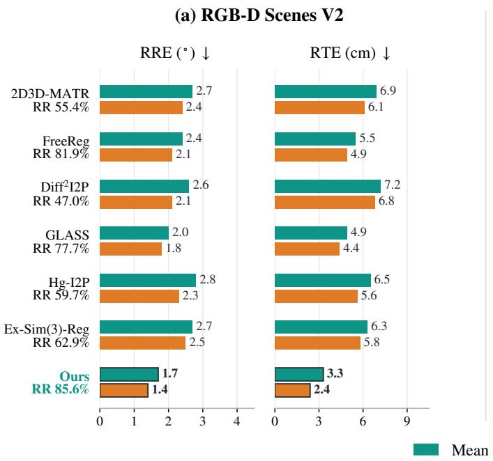

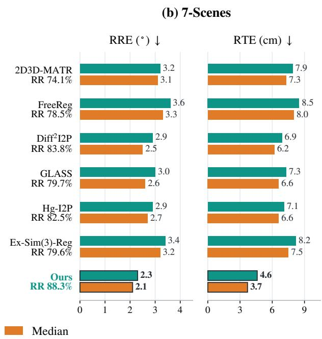  
Figure S1. Rotation and translation errors on (a) RGB-D Scenes V2 and (b) 7-Scenes. Teal/orange bars show mean/median RRE (◦) and RTE (cm) over registered pairs (RMSE < 10 cm). Each statistic is computed within a scene and averaged equally over scenes; ours further averages three graph-head seeds. Row labels give RR (%), the fraction of pairs covered by each method’s error statistics. These statistics are conditional on each method’s registered subset

Outdoor evaluation protocol. The indoor thresholds of Section A are replaced by the KITTI-DC thresholds. A correspondence is an inlier when its 3D residual is below 3 m, using the benchmark’s dense evaluation depth to lift image pixels; correspondences without evaluation depth are excluded from IR. FMR uses a 5% inlier-ratio threshold on the unfiltered candidate set, whereas IR is measured on the solver input. A pair is registered when both $\mathrm { R R E } < 1 0 ^ { \circ }$ and $\mathrm { R T E } < 3 \mathrm { m }$ Metrics are averaged within each test drive and then across the four drives. Table S1 reports mean RRE and RTE both over all test pairs and over registered pairs. The latter averages cover different subsets for different methods and should be read together with RR.

Outdoor configuration. The learned methods are trained on the KITTI-DC training split. SparseGraph-I2P freezes the KITTI-trained 2D3D-MATR backbone and learns its sparse fine decoder and Coarse Hypothesis Graph. The image patch grid is $1 6 \times 6 4$ at the finest level; the coarse budget remains 1,024 patch pairs. The graph compatibility scale and local-support radius are 1.0 m and 3.0 m, respectively. Fine $\mathrm { S C ^ { 2 } }$ parameters are selected on validation from $ \sigma _ { f } ~ \in ~ \{ 0 . 0 6 2 5 , 0 . 1 2 5 , 0 . 2 5 , 0 . 5 \}$ m and $B _ { f } \in \mathsf { \Gamma }$ {64, 128, 256}. Baselines use PnP-RANSAC with 50,000 iterations; our method uses fine $\mathrm { S C ^ { 2 } }$ selection followed by a single EPnP call.

Results. SparseGraph-I2P reaches 85.1% RR, improving on Diff2I2P by 7.6 percentage points, 2D3D-MATR by 13.5 points, and FreeReg by 19.3 points. Its solver-input IR is 81.0%, below 2D3D-MATR’s 89.7%, despite the higher registration recall. Thus correspondence purity alone does not determine pose success. All methods have FMR of at least 98.8%, so the recall gap arises despite most pairs passing the candidate-level inlier test. Diff2I2P has the lowest mean RRE over all pairs and the lowest RRE and RTE over its registered subset; it ties our all-pair RTE at 1.84 m. These results support higher outdoor registration recall for our method under this depth-assisted protocol, without a uniform advantage in correspondence purity or conditional pose accuracy.

## F. Registration with Predicted Depth

## F.1. Calibration and Filtering

This section derives the predicted-depth path summarized in Section 3.4. Inputs are the fine candidates $\{ ( u _ { i } , p _ { i } ) \} _ { i = 1 } ^ { N }$ produced by Sparse Fine Matching, the predicted depth $d _ { i } ~ = ~ D ( u _ { i } )$ , and the intrinsics $K .$ . Neither sensor depth nor the pose is used.

Table S1. Outdoor registration on KITTI-DC (342 test pairs, four drives). FMR, IR, and RR are in percent; RRE is in degrees and RTE in meters. All includes every test pair; Registered includes only pairs with $\mathrm { R R E } < 1 0 ^ { \circ }$ and $\mathrm { R T E } < 3 \mathrm { r }$ m. Best values are bold, including ties.
<table><tr><td></td><td></td><td></td><td></td><td colspan="2">All</td><td colspan="2">Registered</td></tr><tr><td>Method</td><td>FMR↑</td><td>IR↑</td><td>RR↑</td><td>RRE↓</td><td>RTE↓</td><td>RRE↓</td><td>RTE↓</td></tr><tr><td>FreeReg</td><td>100.0</td><td>60.4</td><td>65.8</td><td>8.21</td><td>2.91</td><td>4.64</td><td>1.62</td></tr><tr><td>Diff²I2P</td><td>99.7</td><td>66.7</td><td>77.5</td><td>2.79</td><td>1.84</td><td>1.88</td><td>1.10</td></tr><tr><td>2D3D-MATR</td><td>98.8</td><td>89.7</td><td>71.6</td><td>9.65</td><td>3.13</td><td>3.06</td><td>1.27</td></tr><tr><td>Ours</td><td>99.4</td><td>81.0</td><td>85.1</td><td>3.71</td><td>1.84</td><td>2.53</td><td>1.36</td></tr></table>

Why sensor-depth $\mathbf { S } \mathbf { C } ^ { 2 }$ fails. Let $r _ { i } ~ = ~ K ^ { - 1 } \widetilde { u } _ { i }$ be the unit-depth ray of $u _ { i } ,$ so that $q _ { i } ~ = ~ z _ { i } r _ { i }$ for true depth $z _ { i } .$ Suppose the prediction has a global scale error, $d _ { i } = z _ { i } / s$ For a correct pair $( i , j )$ , the lifted length is $\| d _ { i } r _ { i } - d _ { j } r _ { j } \| _ { 2 } =$ $\| p _ { i } - p _ { j } \| _ { 2 } / s _ { \mathrm { ~ } }$ , and the distance residual in Eq. (2) becomes

$$
\left| \Vert d _ { i } r _ { i } - d _ { j } r _ { j } \Vert _ { 2 } - \Vert p _ { i } - p _ { j } \Vert _ { 2 } \right| = \left| 1 - s ^ { - 1 } \right| \Vert p _ { i } - p _ { j } \Vert _ { 2 } .\tag{S8}
$$

The residual grows linearly with the pair length. With the sensor-depth tolerance $\sigma _ { f } ~ = ~ 6 . 2 5$ mm on RGB-D Scenes V2, a 1% scale error already exceeds $\sigma _ { f }$ for correct pairs longer than 0.63 m, so true correspondences lose their compatible neighbors and the spectral ranking no longer favors them. An offset in depth or inverse depth adds a depthdependent term to the same residual. The path below therefore removes the scale before coarse selection, calibrates an affine model before fine filtering, and widens the tolerance in proportion to length.

Figure S2 illustrates this effect. On the RGB-D Scenes V2 test set with DAv2 depth and solver seed 7351, $\mathrm { S C ^ { 2 } }$ with the sensor-depth settings registers 2.9% of pairs (scene mean), whereas the calibrated path below registers 78.7%.

Coarse-stage scale. For coarse hypotheses with representatives $( q _ { i } , p _ { i } )$ lifted by $D ,$ , a single scale is estimated from length ratios $\rho _ { i j } ~ = ~ \| p _ { i } - p _ { j } \| _ { 2 } / \| q _ { i } - q _ { j } \| _ { 2 }$ over 32,768 random pairs with both lengths above 0.15 m and $\rho _ { i j } \in [ 0 . 2 5 , 4 ]$ . Under Eq. (S8), every correct pair yields $\rho _ { i j } = s _ { \mathrm { \scriptsize ~ \mathscr { N } ~ } }$ , whereas incorrect pairs spread over the range. The estimate

$$
\hat { s } = \exp \biggl ( \operatorname* { m e d i a n } _ { ( i , j ) : | \log \rho _ { i j } - c | < 0 . 0 6 } \log \rho _ { i j } \biggr )\tag{S9}
$$

refines the center c of the highest bin of a 160-bin histogram of log $\rho _ { i j }$ , smoothed with the kernel [1, 2, 3, 2, 1]. The Coarse Hypothesis Graph then uses $\hat { s } q _ { i }$ with $\sigma _ { c } = 0 . 1 5 $ m; its weights are unchanged from sensor-depth training.

Affine depth models. Let m be the median of $\{ d _ { i } \}$ . Two families map $d _ { i }$ to calibrated depth, affine in inverse depth (inv) and in depth (aff):

$$
\begin{array} { r l } & { \hat { z } _ { i } ^ { \mathrm { i n v } } ( \alpha , \beta ) = \cfrac { \alpha m } { ( 1 - \beta ) m / d _ { i } + \beta } , } \\ & { \hat { z } _ { i } ^ { \mathrm { a f f } } ( \alpha , \beta ) = \alpha \big [ ( 1 - \beta ) d _ { i } + \beta m \big ] . } \end{array}\tag{S10}
$$

Here α scales the median depth and $\beta$ sets the offset; $\beta = 0$ reduces both families to $\hat { z } _ { i } = \alpha d _ { i }$ . Candidates with nonpositive denominators or $\hat { z } _ { i } ~ < ~ 0 . 0 5$ m are invalid. Both families are evaluated for every pair; neither is assigned to a predictor.

Length factorization and voting. With $\hat { q } _ { i } ~ = ~ \hat { z } _ { i } r _ { i }$ and $\ell _ { i j } ( \alpha , \beta ) = \| \hat { q } _ { i } - \hat { q } _ { j } \| _ { 2 }$ , Eq. (S10) is linear in $\alpha ,$ hence

$$
\ell _ { i j } ( \alpha , \beta ) = \alpha \ell _ { i j } ( 1 , \beta ) .\tag{S11}
$$

For a fixed $\beta ,$ every α is therefore scored from one set of unit lengths. Each family is initialized by maximizing a soft length vote over a set Ω of 40,000 random candidate pairs with $\delta _ { i j } = \| p _ { i } - p _ { j } \| _ { 2 } > 0 . 1 5$ m:

$$
( \alpha ^ { 0 } , \beta ^ { 0 } ) = \arg \operatorname* { m a x } _ { \alpha , \beta } \sum _ { ( i , j ) \in \Omega } \Big [ 1 - \Big ( \frac { \alpha \ell _ { i j } ( 1 , \beta ) - \delta _ { i j } } { \tau _ { i j } } \Big ) ^ { 2 } \Big ] _ { + } ,\tag{S12}
$$

with $\tau _ { i j } = 0 . 0 2 \mathrm { m } + 0 . 0 2 \delta _ { i j } ,$ , α on 97 log-spaced values in $[ 0 . 4 , 2 . 5 ]$ , and $\beta$ on 37 values in $[ - 0 . 9 , 0 . 9 ]$ . The vote needs neither a pose nor sensor depth.

Model selection by the leading eigenvalue. The vote counts pairs independently, so outlier pairs can still bias it. Each hypothesis $h = ( f , \alpha , \beta )$ is therefore rescored by the collective consistency it induces. With

$$
C _ { i j } ( h ) = \Big [ 1 - \Big ( \frac { \ell _ { i j } ( h ) - \delta _ { i j } } { \sigma _ { i j } } \Big ) ^ { 2 } \Big ] _ { + } , \quad \sigma _ { i j } = 0 . 0 1 5 \mathrm { m } + 0 . 0 1 \delta _ { i j } ,\tag{S13}
$$

$C _ { i i } = 0 $ , and $C _ { i j } = 0$ for $\delta _ { i j } \leq 0 . 0 1$ m, the objective is

$$
\lambda ( h ) = \lambda _ { \operatorname* { m a x } } \big ( ( C ( h ) C ( h ) ) \odot C ( h ) \big ) .\tag{S14}
$$

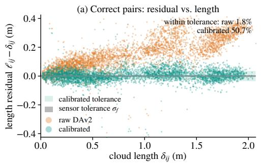

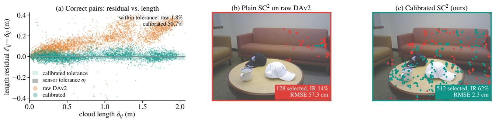  
Figure S2. $\mathrm { S C ^ { 2 } }$ filtering with DAv2 depth on an RGB-D Scenes ${ \mathrm { V } } 2$ test pair. (a) Length residuals of ground-truth-correct candidate pairs grow with length under raw depth, as in Eq. (S8), and center on zero after calibration. (b) With the sensor-depth settings, $\mathrm { S C ^ { 2 } }$ keeps a compact cluster and registration fails. (c) The calibrated path selects spatially spread correspondences and registers the pair. Green: inlier within 5 cm; red: outlier. Ground truth is used for coloring only.

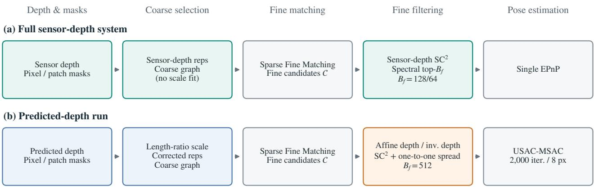  
Pose solvers use original pixel–point pairs and intrinsics; depth guides selection.  
Figure S3. Depth sources and execution order in SparseGraph-I2P. (a) Full sensor-depth system. (b) Predicted-depth inference, with no image-side sensor depth: scale correction precedes coarse graph selection, and affine depth/inverse-depth calibration precedes fine filtering. No affine fine-depth calibration is applied in (a). Budgets 128/64 refer to RGB-D Scenes V2/7-Scenes. All configurations use RGB, the point cloud, and intrinsics; ground-truth poses are used only for scoring.

For a cluster of $n$ candidates that are mutually compatible with $C _ { i j } = 1$ and isolated from the rest, every off-diagonal entry of CC within the cluster equals $n - 2 .$ The cluster block of the second-order matrix is then $( n - 2 ) ( \mathbf { 1 1 } ^ { \top } - I )$ with leading eigenvalue $( n - 1 ) ( n - 2 )$ . Thus $\lambda ( h )$ grows quadratically with the size of the largest consistent cluster, and the soft $C$ makes it peak at exact length agreement. Incorrect candidates outside the cluster barely affect $\lambda ( h )$ , unlike a least-squares fit over all candidates. The search evaluates λ on $H _ { 1 } = \{ ( f , \alpha _ { f } ^ { 0 } e ^ { t } , \beta _ { f } ^ { 0 } + b ) \}$ with $f \in$ {inv, af}, 13 values of $t \in [ - 0 . 1 \dot { 2 } , 0 . 1 2 \dot { ] }$ , and 5 values of $b \in [ - 0 . 3 , 0 . 3 ]$ , then on a finer grid around the best hypothesis of the same family (5 values each of $t \in [ - 0 . 0 2$ , 0.02] and $b \in [ - 0 . 0 6 , 0 . 0 6 ] )$ . The overall maximizer is $h ^ { \star }$ . Each λ uses 15 power iterations on at most 1,500 randomly subsampled candidates, and $\beta$ is clipped to [−1.5, 0.95].

Fine filtering. The calibrated points $\hat { q } _ { i } ~ = ~ \hat { z } _ { i } ( h ^ { \star } ) r _ { i }$ replace $q _ { i }$ . By Eq. (S8), a residual scale error ϵ leaves a residual proportional to length, so the tolerance gains a relative term:

$$
\sigma _ { i j } = \sigma _ { \mathrm { a b s } } + \sigma _ { \mathrm { r e l } } \operatorname* { m a x } \bigl ( \lVert \hat { q } _ { i } - \hat { q } _ { j } \rVert _ { 2 } , \delta _ { i j } \bigr ) ,\tag{S15}
$$

with $\sigma _ { \mathrm { a b s } } = 0 . 0 1 5 \mathrm { m }$ and $\sigma _ { \mathrm { r e l } } = 0 . 0 1$ , which admits |ϵ| up to 1% on long pairs. Compatibility then follows Eq. (2), and $A _ { i j } = \mathbb { k } [ C _ { i j } > \tau ] \mathbb { k } [ \| \hat { q } _ { i } - \hat { q } _ { j } \| _ { 2 } > 0 . 0 1 ] \mathbb { k } [ \delta _ { i j } > 0 . 0 1 ]$ where the length conditions exclude pairs that share a pixel or a point. The leading eigenvector v of $S = ( A A ) \odot A ( 1 0$ power iterations) ranks the candidates.

Spatially spread selection. The ray coordinates $( r _ { i , x } , r _ { i , y } )$ are normalized to $[ 0 , 1 ] ^ { 2 }$ over the candidates and binned on a $G \times G$ grid with $G = 8$ . Let O be the number of occupied cells. Candidates are visited in decreasing $v _ { i }$ and accepted if neither their pixel nor their point has been used and their cell holds fewer than

$$
Q = \lceil B _ { f } / O \rceil\tag{S16}
$$

accepted candidates, with $B _ { f } = 5 1 2$ . A second pass without the quota fills the remaining budget. The quota keeps the leading spectral cluster from filling the whole budget with nearby candidates, which constrain PnP poorly.

Pose estimation. USAC-MSAC estimates the pose from the original 2D pixels and 3D points of the selected set, with 2,000 iterations and an 8 px reprojection threshold. Calibrated depth is used only for selection.

## F.2. Evaluation Details

The predictions used in Figure 7 come from DAv2 (Hypersim, ViT-L) and DA3 (Metric-Large). For the predicteddepth runs, inference receives only RGB, intrinsics, and the point cloud; sensor depth and ground-truth poses are used only for scoring. Figure S3 shows the depth sources and execution order of our method. No model is retrained. Our method uses the sensor-trained backbone and Coarse Hypothesis Graph (seed 7351), with the calibrated filter and robust solver described in Section 3.4. Baselines retain their main-table checkpoints and solvers and receive the same depth predictions wherever they read image depth; FreeReg replaces its ZoeDepth branch. Baselines are also rerun with sensor depth in the same session, reproducing main-table recall within 1.0 point.

Sensor-fine diagnostic reference. Our dashed reference deliberately adds sensor depth for fine filtering. It retains the predicted-depth coarse hypotheses and pre-filter fine candidates, bypasses affine calibration, and applies the sensor-depth $\bar { \mathsf { S C } } ^ { 2 }$ settings: $\sigma _ { f } ~ = ~ 6 . 2 5 / 1 2 . 5$ mm and $B _ { f } = 1 2 8 / 6 4$ on RGB-D Scenes V2/7-Scenes, without the spatial quota. It retains the USAC-MSAC solver (2,000 iterations, 8 px) used in the predicted-depth study. Thus it diagnoses fine-stage depth sensitivity; it is neither a fully predicted-depth run nor the full sensor-depth system of the main tables. Its RGB-D RR is 84.93/84.49% for the DAv2/DA3-based candidates, whereas the full sensor-depth system reaches 85.6%.

Calibration settings. All settings in Section F.1 are fixed on RGB-D validation (scene 10), without 7-Scenes tuning.

Additional accuracy observations. On the full 7-Scenes split, our method reaches 81.7% RR with both predictors, ahead of GLASS and Ex-Sim(3)-Reg (80.3%) and 1.1 points below Hg-I2P (82.8%). Its drops from the sensorfine diagnostic references are 5.8 points on RGB-D and 6.1 points on 7-Scenes with DAv2. Without calibrated filtering, DAv2 recall drops to 69.8% and 79.9%, respectively. 2D3D-MATR, GLASS, and Hg-I2P use depth only as a validity mask; dense predictions give identical DAv2/DA3 matches and recall stays within 0.6 points of sensor depth. FreeReg, Diff2I2P, and Ex-Sim(3)-Reg use depth values and lose up to 41, 12, and 12 points. These predicted-depth runs use one graph-head seed and a robust solver, unlike the main tables’ three-seed EPnP results.

Runtime protocol. The predicted-depth figure sums separately measured depth prediction, forward, filtering, and pose-estimation stages, counting the shared predictor once per pair. These are not directly timed end-to-end measurements. Deployable forwards are measured on an idle RTX 5090 using 15 test pairs per scene after ten warm-up pairs, with evaluation-only node-label generation removed and correspondence outputs checked. Predictor and backend costs use existing stage records; loading, data transfers, disk IO, and offline MobileSAM are excluded. Calibration alone costs about 43–69 ms per pair in these scene-mean records. Our stage sums on 7-Scenes are 163.2/105.5 ms with DAv2/DA3. Calibration increases cost relative to the sensor-depth system; we do not claim the lowest runtime under predicted depth.

## G. Additional Qualitative Results

Figures S4–S6 extend Figure 6 with the same cell layout and the same sensor-depth settings. For each test scene, one pair is drawn uniformly at random (seed 7351) from the pairs that every method evaluates, excluding the pairs in Figures 1 and 7, that our method registers, and whose solver input contains at least one outlier. The last condition skips trivial cases: the top-128/64 $\mathrm { S C ^ { 2 } }$ selection consists entirely of inliers for 17–48% of the pairs per RGB-D Scenes V2 scene and 19–99% per 7-Scenes scene (graph-head seed 7351). Baseline results are not consulted; per-scene recall of all methods is reported in Tables 1 and 2.

On these pairs, our solver input contains 88–99% inliers. The baselines’ solver inputs contain 3–97% inliers, and their PnP-RANSAC solvers register 51 of the 66 baseline cells.

GLASS  
Hg-I2P  
Ours  
2D3D-MATR  
Diff2I2P  
FreeReg  
Ex-Sim(3)  
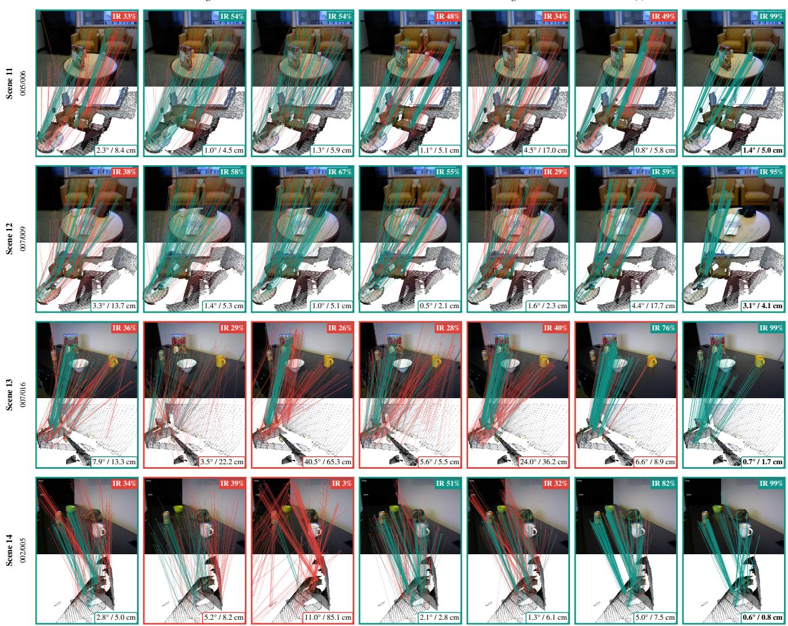  
Figure S4. RGB-D Scenes V2: one random test pair per scene. Green: inlier within 5 cm under the ground truth; red: outlier; up to 250 lines per baseline, all 128/64 for ours. Badges give solver-input IR; the box gives RRE / RTE (green frame: RMSE < 10 cm). Row labels give the scene and the image/cloud frame indices.

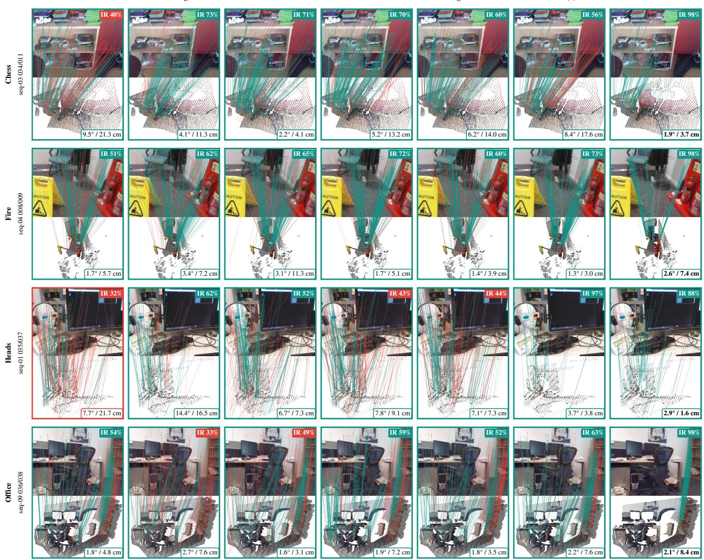  
Figure S5. 7-Scenes: one random test pair per scene (Chess, Fire, Heads, Office). Green: inlier within 5 cm under the ground truth; red: outlier; up to 250 lines per baseline, all 128/64 for ours. Badges give solver-input IR; the box gives RRE / RTE (green frame: RMSE < 10 cm). Row labels give the scene and the image/cloud frame indices.

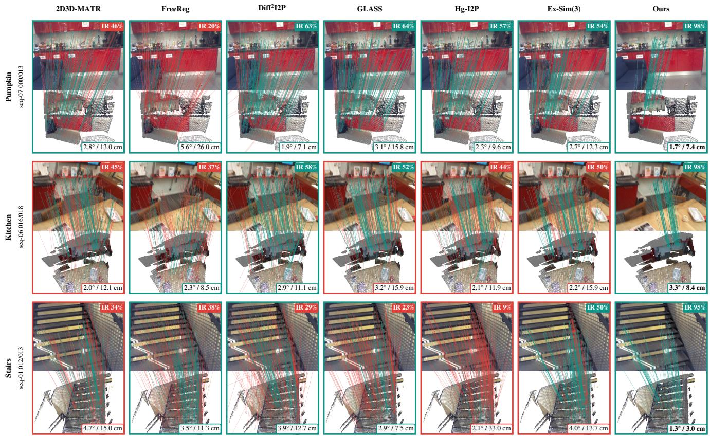  
Figure S6. 7-Scenes: one random test pair per scene (Pumpkin, Kitchen, Stairs). Green: inlier within 5 cm under the ground truth; red: outlier; up to 250 lines per baseline, all 128/64 for ours. Badges give solver-input IR; the box gives RRE / RTE (green frame: RMSE < 10 cm). Row labels give the scene and the image/cloud frame indices.