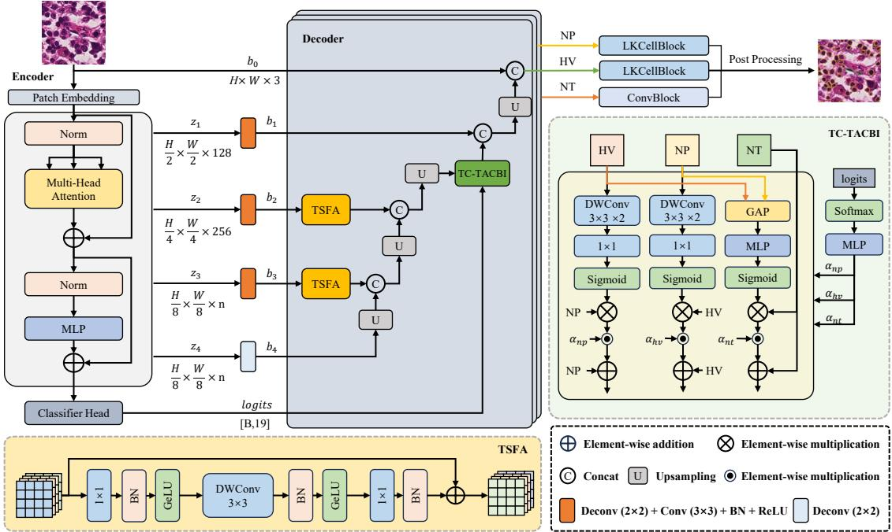
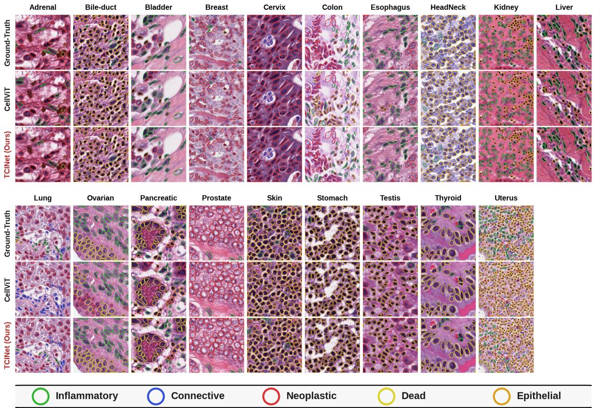
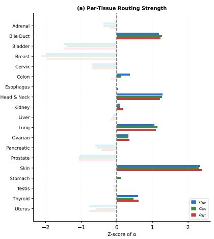
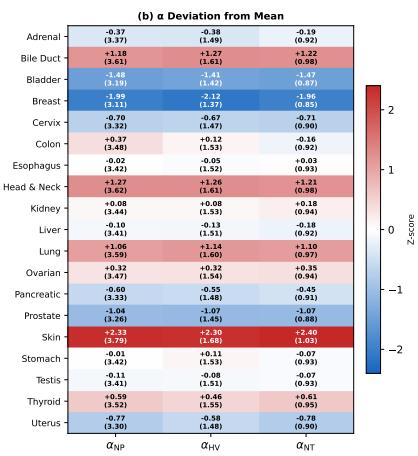
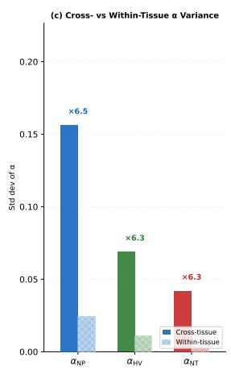

# TCINet: Tissue-Conditioned Adaptive Cross-Branch Interaction Network for Nuclei Instance Segmentation

Zhenghang Qian1,†, Yang Liu1,†, Yanzhi Yu2, Peiwu Qin3,\*, Yibing Shen1 JOONGWON CHAE¹, Lihui Luo1, Zhongde Zhang³, Jianwen Guo3, Lianshun Jin³

1Shenzhen International Graduate School, Tsinghua University, Shenzhen, China

2Macau University of Science and Technology, Macau, China

3Chinese Medicine Guangdong Laboratory/Hengqin Laboratory, Hengqin, China Emails: {qianzx21, lyang22, shenyb25, luolh23} @mails.tsinghua.edu.cn qinpeiwu@hengqinlab.cn; 306247680@qq.com; 924903534@qq.com

Abstract—Separating touching nuclei requires local boundary detail, while cell type classification requires broader morphological context. These requirements also vary with the surrounding tissue environment. We propose the Tissue-Conditioned Adaptive Cross-Branch Interaction Network (TCINet), a singlestage model with Task-Specific Feature Adapters (TSFA) and Tissue-Conditioned Task-Aware Cross-Branch Interaction (TC-TACBI). TSFA produces branch-specific features at skip connections, and TC-TACBI controls three asymmetric paths among nucleus-presence (NP), horizontal-vertical (HV), and nucleustype (NT) branches using predicted tissue probabilities. On PanNuke under standard three-fold cross-validation, TCINet achieves multiclass and binary panoptic quality scores of 0.519 and 0.692, respectively. Zero-shot tests on MoNuSeg yield a detection F1 score of 0.876. On PanNuke fold 0, adding TC-TACBI increases mPQ from 0.505 to 0.525. Code is available at https://github.com/celestial1321/TCINet.

Index Terms—nuclei instance segmentation, tissue-conditioned routing, PanNuke

## I. INTRODUCTION

Cell morphology is shaped by the surrounding tissue environment in hematoxylin and eosin (H&E)-stained sections. Different tasks require different cues: separating touching nuclei demands localized boundary detail, while cell type classification requires broader neighborhood context. HoVer-Net [1] introduced joint distance-map and classification prediction, CellViT [2] demonstrated the benefit of pretrained transformer encoders, and LKCell [4] widened the receptive field through large convolutions.

Shared skip features must support all three prediction tasks. TCINet adapts these features separately for each branch through TSFA, then routes information along three asymmetric paths controlled by predicted tissue probabilities through TC-TACBI. We evaluate TCINet on PanNuke [10] and test zeroshot transfer to MoNuSeg [11].

## II. RELATED WORK

TCINet follows CellViT's encoder and NP/HV/NT architecture [2], with prediction heads inspired by LKCell [4]. Adapter modules [17] and low-rank adaptation (LoRA) [18] introduced lightweight feature adaptation; ViT-Adapter [19] and Medical SAM Adapter [20] extended adaptation to vision and medical imaging. Our TSFA operates at decoder skip connections to produce branch-specific representations.

Cross-stitch networks and NDDR-CNN [6], [7] learn crosstask feature sharing. Squeeze-and-Excitation (SE) [8] and the Convolutional Block Attention Module (CBAM) [9] reweight features within a branch, while Feature-wise Linear Modulation (FiLM) [16] applies conditional affine transformations. TC-TACBI uses three asymmetric cross-branch paths, with each path scaled by a tissue-type MLP.

SFE-Net [15] fuses spatial and frequency representations, whereas our interaction operates on task features without frequency transforms. PromptNucSeg-H [5] separates prompt generation from Segment Anything Model (SAM) segmentation. IVAAN-H [12] uses attribute texts for vision-language alignment, and UN-SAM [13] employs domain-aware selfprompting. TCINet produces NP/HV/NT maps in one network, using neither text encoding nor externally supplied tissue labels at inference.

## III. METHOD

## A. Encoder and Task-Specific Adaptation

TCINet uses a SAM-H vision transformer (ViT) encoder [3] (Fig. 1). Intermediate features $z _ { 1 } - z _ { 4 }$ are extracted at layers $^ { 8 , }$ 16, 24, and 32. Global average pooling over the encoder-neck output feeds a linear head that predicts 19 tissue-type logits t. The shared decoder produces skip features $b _ { 3 }$ (512 channels) and $b _ { 2 }$ (256 channels). These features pass through per-branch TSFA modules before concatenation with upsampled branch features. TC-TACBI operates on the resulting 128-channel branch features before final upsampling.

  
Fig. 1. Architecture of TCINet. The SAM-H encoder extracts features and produces tissue logits. TSFA modules at the $b _ { 3 } ,$ b2 skip connections produce branchspecific features. TC-TACBI applies HV→NP, NP→HV, and (NP,HV)→NT interactions to 128-channel branch features. Final predictions use LKCellBlock heads for NP and HV, and a convolutional head for NT. Sizes beside $z _ { i }$ indicate decoder-rescaled features (n = 512).

In branch k, a residual adapter reduces the channel count by half with a $1 \times 1$ convolution, applies a $3 \times 3$ depthwise convolution, and restores the channels with a second $1 \times 1$ convolution:

$$
\begin{array} { r } { \begin{array} { r l } & { H _ { k } ( F ) = \mathrm { G E L U } ( f _ { \mathrm { d o w n } } ( F ) ) , } \\ & { G _ { k } ( F ) = \mathrm { G E L U } ( \mathrm { D W } _ { 3 \times 3 } ( H _ { k } ( F ) ) ) , } \\ & { \mathrm { T S F A } _ { k } ( F ) = F + f _ { \mathrm { u p } } ( G _ { k } ( F ) ) . } \end{array} } \end{array}\tag{1}
$$

Each convolution is followed by batch normalization (BN), with a Gaussian Error Linear Unit (GELU) after the first two. The final BN scale is zero-initialized, so TSFA starts as a pass-through and gradually learns branch-specific adjustments. Channel reduction limits pointwise convolution cost, while depthwise filtering processes local morphology. The NP, HV, and NT adapters use the same shared decoder maps but learn separate parameters.

## B. Tissue-Conditioned Cross-Branch Interaction (TC-TACBI)

TC-TACBI routes information across three asymmetric paths using 128-channel features $f ^ { \mathrm { N P } } , f ^ { \mathrm { H V } }$ , and $f ^ { \mathrm { N \bar { T } } }$ . A twolayer multilayer perceptron (MLP) maps tissue probabilities to three scaling scalars (19–64–3):

$$
[ \alpha _ { \mathrm { N P } } , \alpha _ { \mathrm { H V } } , \alpha _ { \mathrm { N T } } ] = \mathrm { M L P } ( \mathrm { s o f t m a x ( t ) } ) .\tag{2}
$$

Softmax is applied to the tissue logits before the MLP (Eq. 2). The three output scalars have no softmax or sigmoid constraint, so they may be positive or negative and need not sum to one. The final-layer weights and biases are zero-initialized, making the module an identity at initialization.

Paths 1 and 2 (spatial). The HV→NP path uses distance features to guide foreground separation. In the reverse direction, NP→HV uses foreground features to guide distance regression. Each source branch generates a one-channel mask with two depthwise $3 \times 3$ convolutions, BN/GELU after the first, a $1 \times 1$ projection, and sigmoid. Target branch k is updated as $f ^ { k } + \alpha _ { k } ( f ^ { k } \odot M _ { k } )$ , where  denotes elementwise multiplication. The target retains its own representation; the source controls where it is reweighted.

Path 3 (channel). For NT, global average pooling (GAP) summarizes NP and HV into two 128-dimensional vectors. Their concatenation passes through a 256–256–128 MLP and sigmoid to form a channel mask, followed by the same residual update. The NP and HV branches share pixel-level geometry and guide each other spatially, while both supply morphological context to the NT branch through global descriptors. All masks are computed from the original features, allowing parallel updates.

The 1,475-parameter controller accepts the full tissue probability vector, without hard assignments or tissue-specific parameter branches. Image features determine the masks; tissue coefficients adjust their strength, leaving the interaction directions unchanged. Tissue labels supervise training, but the image alone supplies features and tissue probabilities at inference.

## C. Heads and Supervision

For NP and HV, we use an LKCell-inspired block [4] with a 13 × 13 depthwise-pointwise block followed by a $3 \times 3$ depthwise-pointwise block at dilation 3. A residual shortcut preserves the input as the convolutions add spatial context. The NT head uses a convolution. NP supervision combines focal Tversky [21], [22], Dice, and boundary-weighted binary cross-entropy (BCE). HV uses mean-squared error (MSE) and mean-squared gradient error; NT uses multiclass focal Tversky, Dice, and cross-entropy. We also apply cross-entropy to tissue classification.

TABLE I  
TISSUE-WISE MPQ/BPQ AVERAGED OVER THREE PANNUKE FOLDS. BASELINE SCORES AND STANDARD DEVIATIONS ARE FROM THE CITED PAPERS, ROUNDED TO THREE DECIMALS; MISSING DEVIATIONS ARE SHOWN AS DASHES. \*COMPETITIVE RECENT EFFORTS (VIT-H): IVAAN-H ADDS PRETRAINED CLIP TEXT FEATURES AND ATTRIBUTE-GUIDED ALIGNMENT; UN-SAM USES SUPPLIED DOMAIN INFORMATION FOR DOMAIN-ADAPTIVE ENCODING AND SELF-PROMPT DECODING. TCINET PERFORMS TASK-SPECIFIC ADAPTATION AND IMAGE-PREDICTED TISSUE CONDITIONING IN A SINGLE-STAGE NETWORK.
<table><tr><td></td><td colspan="2">CellViT-SAM-H [2]</td><td colspan="2">LKCell-L [4]</td><td colspan="2">PromptNucSeg-H [5]</td><td colspan="2">IVAAN-H [12]</td><td colspan="2">UN-SAM [13]</td><td colspan="2">TCINet</td></tr><tr><td>Tissue</td><td>mPQ</td><td>bPQ</td><td>mPQ</td><td>bPQ</td><td>mPQ</td><td>bPQ</td><td>mPQ</td><td>bPQ</td><td>mPQ</td><td>bPQ</td><td>mPQ</td><td>bPQ</td></tr><tr><td>Adrenal Gland</td><td>0.513</td><td>0.709</td><td>0.508</td><td>0.715</td><td>0.513</td><td>0.723</td><td>0.587</td><td>0.736</td><td>0.518</td><td>0.726</td><td>0.527</td><td>0.720</td></tr><tr><td>Bile Duct</td><td>0.489</td><td>0.678</td><td>0.516</td><td>0.696</td><td>0.501</td><td>0.698</td><td>0.532</td><td>0.715</td><td>0.523</td><td>0.731</td><td>0.529</td><td>0.699</td></tr><tr><td>Bladder</td><td>0.584</td><td>0.707</td><td>0.601</td><td>0.714</td><td>0.604</td><td>0.721</td><td>0.615</td><td>0.735</td><td>0.606</td><td>0.723</td><td>0.611</td><td>0.731</td></tr><tr><td>Breast</td><td>0.518</td><td>0.675</td><td>0.514</td><td>0.723</td><td>0.532</td><td>0.684</td><td>0.550</td><td>0.684</td><td>0.535</td><td>0.686</td><td>0.537</td><td>0.689</td></tr><tr><td>Cervix</td><td>0.498</td><td>0.687</td><td>0.502</td><td>0.695</td><td>0.512</td><td>0.698</td><td>0.591</td><td>0.714</td><td>0.521</td><td>0.699</td><td>0.533</td><td>0.699</td></tr><tr><td>Colon</td><td>0.449</td><td>0.592</td><td>0.464</td><td>0.601</td><td>0.469</td><td>0.610</td><td>0.481</td><td>0.611</td><td>0.494</td><td>0.643</td><td>0.477</td><td>0.617</td></tr><tr><td>Esophagus</td><td>0.545</td><td>0.668</td><td>0.559</td><td>0.674</td><td>0.571</td><td>0.692</td><td>0.585</td><td>0.695</td><td>0.583</td><td>0.724</td><td>0.560</td><td>0.682</td></tr><tr><td>Head &amp; Neck</td><td>0.491</td><td>0.654</td><td>0.528</td><td>0.672</td><td>0.510</td><td>0.669</td><td>0.511</td><td>0.681</td><td>0.511</td><td>0.670</td><td>0.513</td><td>0.672</td></tr><tr><td>Kidney</td><td>0.537</td><td>0.709</td><td>0.574</td><td>0.728</td><td>0.579</td><td>0.712</td><td>0.554</td><td>0.680</td><td>0.587</td><td>0.738</td><td>0.558</td><td>0.721</td></tr><tr><td>Liver</td><td>0.522</td><td>0.732</td><td>0.535</td><td>0.743</td><td>0.533</td><td>0.737</td><td>0.566</td><td>0.737</td><td>0.534</td><td>0.738</td><td>0.547</td><td>0.746</td></tr><tr><td>Lung</td><td>0.431</td><td>0.643</td><td>0.442</td><td>0.646</td><td>0.440</td><td>0.658</td><td>0.483</td><td>0.647</td><td>0.452</td><td>0.673</td><td>0.427</td><td>0.655</td></tr><tr><td>Ovarian</td><td>0.539</td><td>0.672</td><td>0.531</td><td>0.668</td><td>0.544</td><td>0.686</td><td>0.574</td><td>0.693</td><td>0.558</td><td>0.706</td><td>0.543</td><td>0.671</td></tr><tr><td>Pancreatic</td><td>0.472</td><td>0.666</td><td>0.480</td><td>0.673</td><td>0.497</td><td>0.686</td><td>0.540</td><td>0.678</td><td>0.513</td><td>0.739</td><td>0.521</td><td>0.689</td></tr><tr><td>Prostate</td><td>0.532</td><td>0.682</td><td>0.532</td><td>0.678</td><td>0.546</td><td>0.698</td><td>0.568</td><td>0.707</td><td>0.548</td><td>0.721</td><td>0.563</td><td>0.695</td></tr><tr><td>Skin</td><td>0.434</td><td>0.657</td><td>0.422</td><td>0.666</td><td>0.411</td><td>0.661</td><td>0.450</td><td>0.695</td><td>0.434</td><td>0.660</td><td>0.436</td><td>0.668</td></tr><tr><td>Stomach</td><td>0.471</td><td>0.702</td><td>0.451</td><td>0.706</td><td>0.456</td><td>0.712</td><td>0.548</td><td>0.705</td><td>0.475</td><td>0.727</td><td>0.471</td><td>0.721</td></tr><tr><td>Testis</td><td>0.513</td><td>0.696</td><td>0.509</td><td>0.698</td><td>0.547</td><td>0.715</td><td>0.579</td><td>0.720</td><td>0.578</td><td>0.734</td><td>0.528</td><td>0.710</td></tr><tr><td>Thyroid</td><td>0.452 0.474</td><td>0.715 0.663</td><td>0.470 0.517</td><td>0.704</td><td>0.472</td><td>0.722</td><td>0.536</td><td>0.740</td><td>0.483</td><td>0.719</td><td>0.489</td><td>0.722</td></tr><tr><td>Uterus</td><td></td><td></td><td></td><td>0.662</td><td>0.495</td><td>0.674</td><td>0.526</td><td>0.682</td><td>0.506</td><td>0.683</td><td>0.474</td><td>0.650</td></tr><tr><td>Average Std. dev.</td><td>0.498 0.041</td><td>0.679 0.032</td><td>0.508</td><td>0.685</td><td>0.512 0.009</td><td>0.692 0.015</td><td>0.546</td><td>0.698</td><td>0.524</td><td>0.707</td><td>0.519</td><td>0.692</td></tr></table>

## IV. EXPERIMENTS

## A. Datasets, Metrics, and Implementation

We evaluate TCINet on PanNuke [10], containing 7,904 image patches from 19 tissue types annotated for five nucleus classes. Evaluation uses panoptic quality [23], reporting mPQ and bPQ averaged across tissue types under the official threefold protocol, together with detection $F _ { 1 , d } .$ Zero-shot tests on MoNuSeg [11] evaluate transfer without target-domain finetuning. TCINet is trained for 130 epochs using AdamW [24], a learning rate of $3 \times 1 0 ^ { - 4 }$ , and weight decay of $1 0 ^ { - 4 }$ . The encoder is frozen for the first 25 epochs. Training uses color jittering and elastic deformations. For instance extraction, we threshold NP at 0.500, remove components below 10 pixels, and use HV gradients for seeded watershed. A majority vote over the NT map assigns each instance its type.

## B. Comparison with State-of-the-Art

Table I compares paper-reported PanNuke results. TCINet achieves mPQ = 0.519 and bPQ = 0.692, surpassing CellViT-SAM-H and LKCell-L on both metrics. Compared to the two-stage PromptNucSeg-H (mPQ 0.512, bPQ 0.692), TCINet improves mPQ while matching bPQ at the reported precision in a single-stage network. IVAAN-H and UN-SAM report higher average scores on both metrics; their additional text and domain conditioning are noted in the table.

Per-category PQ. TCINet scores higher than PromptNucSeg-H in four of the five classes (Table II). Dead PQ rises from 0.161 to 0.197; Neoplastic PQ is slightly lower, at 0.594 versus 0.598. For Epithelial nuclei, TCINet reaches 0.600, the highest value among the listed methods, compared with IVAAN-H's 0.591.

TABLE II  
PANNUKE PQ BY NUCLEUS TYPE. NEO.: NEOPLASTIC; INFL.: INFLAMMATORY; CONN.: CONNECTIVE; EPIT.: EPITHELIAL. BASELINE VALUES ARE PAPER-REPORTED THREE-FOLD SCORES. †TSFD-NET USES A NON-OFFICIAL SPLIT. \*COMPETITIVE RECENT EFFORTS: IVAAN-H USES PRETRAINED CLIP TEXT FEATURES AND ATTRIBUTE-GUIDED ALIGNMENT.
<table><tr><td>Method</td><td>Neo.</td><td>Infl.</td><td>Conn.</td><td>Dead</td><td>Epit.</td></tr><tr><td>HoVer-Net [1]</td><td>0.551</td><td>0.417</td><td>0.388</td><td>0.139</td><td>0.491</td></tr><tr><td>TSFD-Net† [14]</td><td>0.557</td><td>0.383</td><td>0.404</td><td>0.142</td><td>0.536</td></tr><tr><td>CellViT-256 [2]</td><td>0.567</td><td>0.405</td><td>0.405</td><td>0.144</td><td>0.559</td></tr><tr><td>CellViT-SAM-H [2]</td><td>0.581</td><td>0.417</td><td>0.423</td><td>0.149</td><td>0.583</td></tr><tr><td>LKCell-B [4]</td><td>0.585</td><td>0.440</td><td>0.414</td><td>0.144</td><td>0.579</td></tr><tr><td>LKCell-L [4]</td><td>0.586</td><td>0.438</td><td>0.417</td><td>0.172</td><td>0.584</td></tr><tr><td>PromptNucSeg-H [5]</td><td>0.598</td><td>0.441</td><td>0.433</td><td>0.161</td><td>0.582</td></tr><tr><td>IVAAN-H* [12]</td><td>0.605</td><td>0.481</td><td>0.452</td><td>0.204</td><td>0.591</td></tr><tr><td>TCINet (Ours)</td><td>0.594</td><td>0.454</td><td>0.444</td><td>0.197</td><td>0.600</td></tr></table>

Model cost. Our TCINet and CellViT-SAM-H implementations contain 700.710 M and 699.740 M parameters, respectively, a 0.140% increase. For a 256 × 256 input at batch size 1, PyTorch operator counting estimates 768.500 G floating-point operations (FLOPs) for TCINet and 860.400 G for the baseline, a 10.700% reduction. We count two FLOPs per multiply– add and exclude preprocessing and post-processing. Shared decoder computation allows TCINet to add task adaptation and interaction with little net parameter growth.

TABLE III  
  
Fig. 2. Qualitative comparison on PanNuke across 19 tissue types. For each tissue, from top to bottom: ground truth, CellViT-SAM-H prediction, and TCINet prediction. Nuclei contours: Neoplastic, Epithelial, Inflammatory, Connective, Dead.

TC-TACBI: Tissue-Conditioned Dynamic α Routing  

  
Fig. 3. Tissue-conditioned attention modulation. (a,b) Per-tissue mean $\alpha ,$ z-scored across tissues for each route; parentheses in (b) show raw means. Distinct tissue profiles indicate different modulation strengths for the three attention paths. (c) Across-tissue standard deviation of tissue means versus mean withintissue standard deviation, with ratios of 6.300–6.500. Bars indicate standard deviations, not variances.

MoNuSeg generalization. Without fine-tuning, TCINet obtains $F _ { 1 , d } = 0 . 8 7 6$ using 256-pixel tiles with 64-pixel overlap, compared with CellViT-SAM-H's reported 0.868 (Table III). Recall increases from 0.893 to 0.908.

MONUSEG ZERO-SHOT TRANSFER USING 256-PIXEL TILES WITH 64-PIXEL OVERLAP. $P _ { d } , R _ { d } \colon$ DETECTION PRECISION AND RECALL. BASELINE VALUES ARE FROM [2].
<table><tr><td>Method</td><td>bPQ</td><td> $P _ { d }$ </td><td> $R _ { d }$ </td><td> $F _ { 1 , d }$ </td></tr><tr><td>CellViT-256</td><td>0.660</td><td>0.841</td><td>0.886</td><td>0.863</td></tr><tr><td>CellViT-SAM-H</td><td>0.671</td><td>0.846</td><td>0.893</td><td>0.868</td></tr><tr><td>TCINet</td><td>0.672</td><td>0.848</td><td>0.908</td><td>0.876</td></tr></table>

## C. Ablation Study

Table IV evaluates sequential component additions on fold 0, starting from a reimplemented CellViT-SAM-H. Adding LKCellBlock and boundary loss increases mPQ by 0.003. TC-TACBI contributes the largest gain, raising mPQ from 0.505 to 0.525. TSFA adds a further 0.003, showing measurable value in adapting skip-connection features per branch when interaction is already enabled.

TABLE IV  
SEQUENTIAL COMPONENT ABLATION ON PANNUKE FOLD 0. BASELINE: REIMPLEMENTED CELLVIT-SAM-H. LK: LKCELLBLOCK; BL: BOUNDARY-WEIGHTED LOSS. EACH ROW ADDS COMPONENTS TO THE PRECEDING CONFIGURATION.
<table><tr><td colspan="5"></td></tr><tr><td>Model</td><td>LK BL</td><td>TC- TACBI</td><td>TSFA</td><td>mPQ↑ bPQ↑</td><td> $F _ { 1 , d } \uparrow$ </td></tr><tr><td>Baseline</td><td></td><td></td><td></td><td>0.502</td><td>0.683 0.840</td></tr><tr><td>+LK+BL</td><td> $\checkmark \quad \checkmark$ </td><td></td><td>0.505</td><td>0.686</td><td>0.840</td></tr><tr><td>+TC-TACBI</td><td> $\checkmark \quad \checkmark$ </td><td>√</td><td></td><td>0.525 0.693</td><td>0.844</td></tr><tr><td>TCINet (Ours)</td><td>√</td><td>√</td><td>√</td><td>0.528</td><td>0.696 0.847</td></tr></table>

## D. Qualitative Results

Fig. 2 shows CellViT-SAM-H and TCINet predictions alongside ground truth across 19 tissue types. Fig. 3 shows distinct coefficient profiles across tissues. In the sampled patches, variation between tissue means exceeds variation within each tissue.

## V. DISCUSSION AND LIMITATIONS

TCINet adapts shared skip features per task and uses imagepredicted tissue probabilities to control three asymmetric interaction paths in a single-stage NP/HV/NT network. Tissue conditioning is handled by a 1,475-parameter controller at one decoder level. IVAAN-H [12] augments a SAM visual encoder with pretrained CLIP text features, attribute-guided contrastive supervision, and query-based instance decoding. UN-SAM [13] uses supplied domain information with domaincommon and domain-specific encoder mappings, self-prompt generation, and domain-query decoding. These approaches emphasize vision-language alignment and domain-adaptive prompting, respectively, while TCINet focuses on feature specialization and interaction among prediction tasks.

The fold-0 ablation shows gains from TC-TACBI and TSFA in the evaluated sequence. Further ablations are needed to assess cross-fold stability and isolate tissue conditioning and individual paths.

## VI. CONCLUSION

We presented TCINet, a nuclei instance segmentation model built on tissue-conditioned adaptive cross-branch interaction. TSFA adapts shared skip-connection features per branch before TC-TACBI controls cross-branch attention. On PanNuke, TCINet achieves m $\mathrm { P Q } = 0 . 5 1 9$ and $\mathsf { b P Q } = 0 . 6 9 2$ , with zeroshot $F _ { 1 , d } = 0 . 8 7 6$ on MoNuSeg. Sequential ablation shows gains from both interaction and adaptation.

[1] S. Graham et al., "HoVer-Net: Simultaneous segmentation and classification of nuclei in multi-tissue histology images," Medical Image Analysis, vol. 58, p. 101563, 2019.

[2] F. Hörst et al., “CellViT: Vision transformers for precise cell segmentation and classification," Medical Image Analysis, vol. 94, p. 103143, 2024.

[3] A. Kirillov et al., "Segment anything," in Proc. ICCV, 2023, pp. 4015– 4026.

[4] Z. Cui et al., “LKCell: Efficient cell nuclei instance segmentation with large convolution kernels," arXiv preprint arXiv:2407.18054, 2024.

[5] Z. Shui et al., “Unleashing the power of prompt-driven nucleus instance segmentation," in Proc. ECCV, 2024, pp. 288–304.

[6] I. Misra, A. Shrivastava, A. Gupta, and M. Hebert, "Cross-stitch networks for multi-task learning," in Proc. IEEE/CVF CVPR, 2016, pp. 3994–4003.

[7] Y. Gao, Q. She, J. Ma, M. Zhao, W. Liu, and A. L. Yuille, "NDDR-CNN: Layerwise feature fusing in multi-task CNNs by neural discriminative dimensionality reduction," in Proc. IEEE/CVF CVPR, 2019, pp. 3205– 3214.

[8] J. Hu, L. Shen, and G. Sun, “Squeeze-and-excitation networks," in Proc. IEEE/CVF CVPR, 2018, pp. 7132–7141.

[9] S. Woo, J. Park, J.-Y. Lee, and I. S. Kweon, "CBAM: Convolutional block attention module," in Proc. ECCV, 2018, pp. 3–19.

[10] J. Gamper et al., "PanNuke dataset extension, insights and baselines," arXiv preprint arXiv:2003.10778, 2020.

[11] N. Kumar et al., “A multi-organ nucleus segmentation challenge," IEEE Trans. Med. Imaging, vol. 39, no. 5, pp. 1380–1391, 2020.

[12] J. Jeong et al., IVAAN: Instance-level vision-language alignment via attribute-guided text prompts generation for nuclei analysis, in Proc. IEEE/CVF CVPR, 2026, pp. 29305–29314.

[13] Z. Chen, Q. Xu, X. Liu, and Y. Yuan, UN-SAM: Domain-adaptive self-prompt segmentation for universal nuclei images, Medical Image Analysis, vol. 103, p. 103607, 2025.

[14] T. Ilyas et al., “TSFD-Net: Tissue specific feature distillation network for nuclei segmentation and classification," Neural Networks, vol. 151, pp. 1–15, 2022.

[15] J. Chen, G. Yang, A. Liu, X. Chen, and J. Liu, "SFE-Net: Spatialfrequency enhancement network for robust nuclei segmentation in histopathology images," Computers in Biology and Medicine, vol. 171, p. 108131, 2024.

[16] E. Perez, F. Strub, H. de Vries, V. Dumoulin, and A. Courville, “FiLM: Visual reasoning with a general conditioning layer," in Proc. AAAI, 2018, pp. 3942–3951.

[17] N. Houlsby et al., "Parameter-efficient transfer learning for NLP," in Proc. ICML, 2019, pp. 2790–2799.

[18] E. J. Hu et al., "LoRA: Low-rank adaptation of large language models," in Proc. ICLR, 2022.

[19] Z. Chen et al., “Vision transformer adapter for dense predictions," in Proc. ICLR, 2023.

[20] J. Wu et al., "Medical SAM adapter: Adapting segment anything model for medical image segmentation," arXiv preprint arXiv:2304.12620, 2023.

[21] S. S. M. Salehi, D. Erdogmus, and A. Gholipour, "Tversky loss function for image segmentation using 3D fully convolutional deep networks," in Proc. MICCAI Workshop on Machine Learning in Medical Imaging, 2017, pp. 379–387.

[22] T.-Y. Lin, P. Goyal, R. Girshick, K. He, and P. Dollár, "Focal loss for dense object detection," in Proc. IEEE/CVF ICCV, 2017, pp. 2980–2988.

[23] A. Kirillov, K. He, R. Girshick, C. Rother, and P. Dollár, "Panoptic segmentation," in Proc. IEEE/CVF CVPR, 2019, pp. 9404–9413.

[24] I. Loshchilov and F. Hutter, "Decoupled weight decay regularization," in Proc. ICLR, 2019.