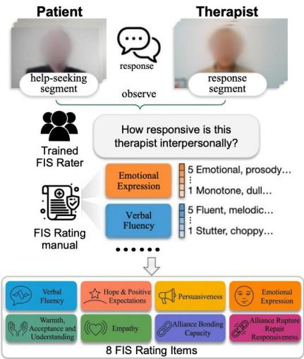
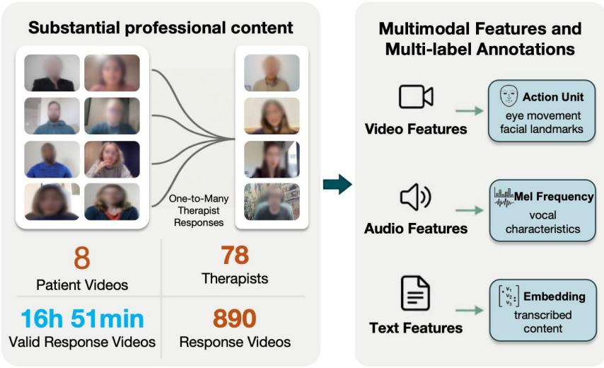
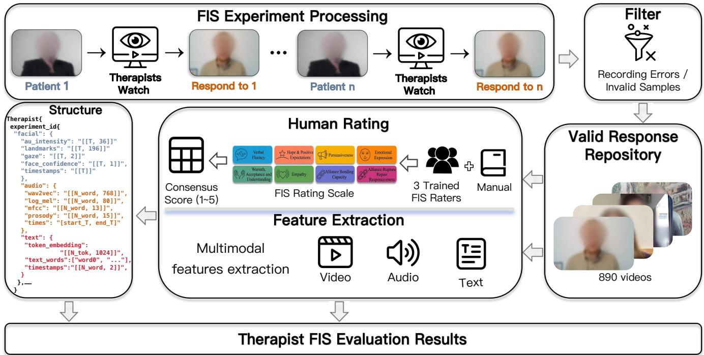
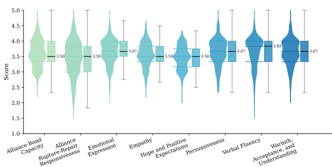
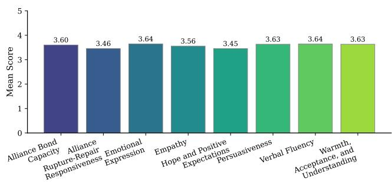
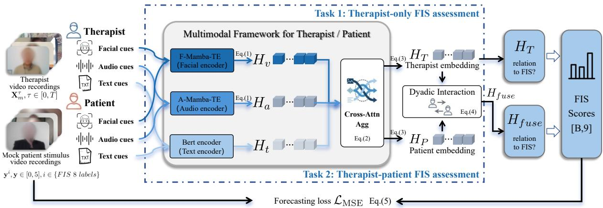

# Therapy-FIS: A Dataset for Assessing Facilitative Interpersonal Skills in Psychotherapeutic Setting

Qijian Zheng1, Wanqing Lin2, Yuanfang Wang3, Yijun Ge4 Jordan Bate5, Katie Aafjes-van Doorn2∗, Feng Liu4∗

1College of Computer Science and Artificial Intelligence, Fudan University, Shanghai, P. R. China 2Faculty of Arts and Sciences, New York University Shanghai, Shanghai, P. R. China 3Global College, Shanghai Jiao Tong University, Shanghai, P. R. China 4School of Psychology, Shanghai Jiao Tong University, Shanghai, P. R. China 5Adelphi University, New York, USA qjzheng25@m.fudan.edu.cn, wl3215@nyu.edu zhaomc911@sjtu.edu.cn, yijun.ge@sjtu.edu.cn, jbate@adelphi.edu kav9239@nyu.edu, liu.feng@sjtu.edu.cn

## Abstract

Facilitative Interpersonal Skills (FIS) is a performance-based assessment method that provides a structured framework for evaluating the interpersonal competencies of mental health professionals. However, existing FIS assessment relies heavily on human observer ratings, making the evaluation process labor-intensive, costly, and dificult to scale. Progress toward automated FIS assessment has also been constrained by the lack of publicly available professional data in psychotherapy settings. To address this limitation, we introduce Therapy-FIS, a dataset for automated FIS assessment in standardized psychotherapy tasks. To our knowledge, Therapy-FIS is the first publicly available dataset in this domain. It contains facial, acoustic, and textual signals derived from standardized therapist responses to standardized mock patient stimulus clips, based on 890 therapist video recordings and 8 patient videos, and is rated with eight FIS subscale ratings and an overall FIS score. Built on Therapy-FIS, we further establish a benchmark with two downstream tasks: Therapist Performance Rating and Joint Therapist–mock-Patient Performance Rating. We also introduce a competitive baseline, DyadicFIS, with gated fusion and routed readout under therapist-only and dyadic settings. DyadicFIS obtains the best macro CCC(Concordance Correlation Coeficient) scores on both tasks (0.2807 and 0.3299). Therapy-FIS ofers a reproducible resource for data-driven automated assessment of therapeutic interpersonal skills in mental health.

## Introduction

Facilitative Interpersonal Skills (FIS) have been established as robust predictors of the therapeutic alliance and patient outcomes (Allen, Parker, and Ogles 2024; Anderson et al. 2009, 2016). Research demonstrates that a substantial portion of the variance in psychotherapy success stems from therapist efects, which operate independently of the specific treatment modality and are largely explained by FIS (Schiefele et al. 2017; Johns et al. 2019). Instead of measuring general self-perceived competence, the assessment ofFIS targets the observable interpersonal qualities exhibited by therapists responding to mock patient stimulus clips(Anderson, Finkelstein, and Horvath 2020). Therapists exhibiting higher

FIS—defined as the ability to respond to patients in ways that are empathic, emotionally attuned, and therapeutically constructive—facilitate greater symptom reduction (Aafjes-van Doorn and Lin 2024; de Jong et al. 2024). In this sense, FIS provides a structured concept for characterizing therapy skill at the therapist level and ofers a behavior-grounded target for computational assessment.

Existing FIS assessment remains dependent on trained human observer raters, which makes it labor-intensive and hard to scale in large-scale clinical training (Imel, Steyvers, and Atkins 2015). Early computational eforts initially explored unimodal text (Goldberg et al. 2021) and audio signals (Glasgow et al. 2023). Broader research on automatic analysis of therapy-like interactions has also explored combining complementary behavioral cues (Zhu et al. 2023; Kashihara et al. 2024; Cong et al. 2024), yet progress toward automated FIS assessment remains constrained by the absence of publicly available professional data under the standardized FIS protocol. This gap is partly due to the demanding requirements of FIS data collection: standardized stimulus design, recruitment of trained or in-training mental health professionals and reliable annotation by trained human observer raters, and navigating stringent privacy and ethical constraints inherent in clinical interactions (Cummins et al. 2015).

To address this gap, we introduce Therapy-FIS, a therapycentered dataset for FIS assessment. Therapy-FIS organizes therapist response recordings together with mock patientside stimulus information under the standardized FIS framework, and releases de-identified derived behavioral signals such as facial action units, acoustic cues, and textual content to facilitate reproducible research while respecting privacy constraints. Based on this resource, we further formulate automatic FIS evaluation tasks in therapist-only and therapist– mock-patient settings and provide benchmark experiments with representative baselines. Our contributions are threefold:

1. A therapy-centered FIS dataset. We introduce Therapy-FIS, built from standardized FIS experiments that organizes video-recorded therapist responses, mock patientside stimuli, and de-identified derived signals including facial action units, acoustic cues, and textual content.

  
（a）Facilitative Interpersonal Skills

  
（b）Therapy-FIS dataset  
Figure 1: Overview of the Therapy-FIS dataset and the FIS evaluation protocol. (a) Facilitative interpersonal skills are evaluated by observing standardized mock patient stimulus clips and the therapist’s response segment, and then rating the therapist on eight FIS items. (b) Therapy-FIS releases derived behavioral features from therapist responses and mock-patient stimuli under the FIS protocol.

2. A benchmark on FIS evaluation. We establish a benchmark on Therapy-FIS for automatic FIS evaluation by formulating prediction tasks from both therapist-only and therapist–mock-patient joint perspectives. These tasks operationalize therapy skill assessment within a computational framework, and our reported results provide a reproducible starting point for scalable automatic evaluation of FIS.

3. A competitive baseline for the proposed protocol. We introduce DyadicFIS as a baseline under the Therapy-FIS tasks. Experiments show that DyadicFIS achieves strong agreement with human FIS ratings under the proposed evaluation protocol.

## Related Work

## Facilitative Interpersonal Skills Dataset

The FIS performance-based task and rating method systematically evaluates therapist competencies through standardized, interpersonally challenging clinical vignettes (Anderson et al. 2009). Extensive research confirms its robust reliability and construct validity, with scores consistently predicting therapeutic alliance and patient symptom reduction more efectively than self-reported metrics (Anderson et al. 2019; Aafjes-van Doorn and Lin 2024; Schöttke et al. 2017). Consequently, the FIS framework has been adapted for diverse contexts, including child therapy (Bate and Tsakas 2022), text-based interventions (Zech et al. 2022), and remote environments (Lin et al. 2025b; Antebi-Lerman et al. 2026).

While computational psychology has introduced datasets for analyzing therapeutic interactions, most focus on general conversational dynamics or specific constructs like empathy or alliance (Tahir et al. 2025; Zhang et al. 2023; Lin et al. 2025a). However, naturalistic session data often introduces excessive variability in patient pathology, making it illsuited for the standardized evaluation of performance-based competencies (Fairburn and Cooper 2011; Imel, Steyvers, and Atkins 2015). Therapy-FIS addresses this critical gap by providing a large-scale, publicly available dataset specifically designed for the standardized assessment of therapeutic skills.

## Interpersonal Skills Evaluation

The FIS performance-based task and rating method comprises eight subscales that operationalize general therapeutic skills, unrelated to treatment approach or patient population (Anderson et al. 2019). Extensive empirical evidence, including randomized trials, demonstrates that proficiency in subscales such as Empathy, Warmth, and Alliance Rupture-Repair Responsiveness predicts treatment success and symptom reduction more efectively than therapist demographics or self-reported traits (Wampold and Imel 2015; Flückiger et al. 2018; Eubanks, Muran, and Safran 2018; Elliott et al. 2011; Abargil and Tishby 2022; Heinonen and Nissen-Lie 2020). While human observer rating remains the traditional standard, the labor-intensive nature of manual rating necessitates scalable, automated assessment methods (Anderson, Finkelstein, and Horvath 2020).

Early computational approaches focused on unimodal analysis, utilizing machine learning and NLP to model clinical constructs from session transcripts, acoustic features, or non-verbal synchrony (Goldberg et al. 2020; Ryu et al. 2023; Eberhardt et al. 2025; Lalk et al. 2025; Tanana et al. 2021; Cohen et al. 2021; Reinecke, Joraschky, and Lausberg 2022).

However, reliance on a single data stream can miss complementary behavioral evidence and limit predictive power (Hinduja et al. 2024). Recent work therefore combines linguistic, acoustic, and visual cues for automatic estimation of therapy-related constructs, including FIS ratings (Tavabi et al. 2020; Aafjes-van Doorn et al. 2025). Our focus is the standardized FIS evaluation scenario and a reproducible public benchmark for scalable skill assessment in psychotherapeutic settings.

## FIS Dataset

## Experimental Setup

Equipment. The video was recorded via Zoom and stored at a resolution of 1920×1080 pixels with a frame rate of 30 fps. Audio was captured using the recording device’s built-in microphone and stored together with the video stream.

Standardized psychotherapy scenarios. The data collection followed a standardized FIS setting. Eight actors served as mock patients representing diferent challenging clinical scenarios typically encountered in psychotherapy, and they enacted pre-defined psychotherapy sessions. Based on patient scripts and transcripts, these scenarios were designed to elicit responses to clinically challenging situations, such as self-blame, confrontation, professional dilemmas and doubts about treatment efectiveness. This design enabled participating mental health professionals to respond to comparable yet ecologically meaningful psychotherapy situations. The response clips analyzed in the present study were drawn from a large-scale FIS dataset originally collected as part of a randomized controlled trial of an online skills training program. Participants were 78 mental health professionals, including clinical psychology graduate trainees and licensed clinicians, recruited through psychotherapy email listservs and direct communication with psychology graduate programs.

Procedure. Mental health professionals watched each mock patient video and provided a response as if they were the treating therapist, their response typically ranged from 30s to 2 minutes. The parent training study administered the FIS task at baseline, post-training, and 2-week followup, and we used all available response clips collected at these three time points, resulting in 12–18 clips per participant. To improve measurement stability, the same patient scenario could be administered again after an interval of 1–2 months, for up to three administrations. Each participant responded to 4-8 mock patient scenarios. According to the raw feature inventory, the original collection contains 890 therapist-side recordings from 78 therapist identities across eight patient scenarios. All participants provided consent for their recordings to be used in the development of an AI-based FIS feedback system for clinicians. The recorded response clips were rated independently by three trained research assistants. Raters were trained to reliability with expert ratings (ICC > 0.80 on six consecutive clips) and attended weekly calibration meetings to prevent rater drift. The Interrater reliability ranged from 0.70 to 0.86 (ICC3k ), with 0.86 for the total score of the FIS. We used the average of the three ratings for each subscale in subsequent analyses.

Annotation. Each therapist-response video was independently rated by three trained FIS observer raters following the oficial Facilitative Interpersonal Skills Task and Rating Manual (Anderson et al. 2019). The eight 1–5 subscales are Emotional Expression; Empathy; Hope and Positive Expectations; Persuasiveness; Verbal Fluency; Alliance Rupture-Repair Responsiveness; Alliance Bond Capacity; and Warmth, Acceptance, and Understanding. We first average the three raters for each subscale and then compute the overall FIS score as the arithmetic mean of the eight averaged subscales, yielding nine prediction targets.

## Data Preprocessing

In accordance with ethical requirements and participant privacy protection, we converted the original recordings into de-identified feature representations in three streams: face, audio, and text. This strategy preserves behaviorally meaningful signals for automatic FIS scoring while removing directly identifiable facial and vocal information.

Facial cues. The visual stream is represented by structured facial behavior descriptors rather than raw face images. We use OpenFace 3.0(Hu et al. 2025) to extract complementary signals, including AU occurrence and intensity, 98-point facial landmarks, gaze directions, and detection confidence. We also retained timestamps and applied temporal smoothing to support temporal alignment and modeling.

Audio cues. The audio stream is converted into abstract acoustic representations. We extracted acoustic features with librosa(McFee et al. 2015), including 80-dimensional log-Mel spectrograms and 13-dimensional MFCCs(Davis and Mermelstein 1980), and contextualized speech representations with a pre-trained Wav2Vec 2.0 model(Baevski et al. 2020), which yields 768-dimensional sequence features. In addition, we computed segment-level prosodic descriptors, including pitch statistics, energy variation, pause patterns, spectral characteristics, and voice-quality-related measures. Together, these features capture afective delivery and speaking styles while avoiding direct exposure of speaker identity.

Text cues. For the language stream, speech is converted into transcripts and contextualized text representations. A Whisper-based(Bain et al. 2023) forcedalignment process provides word-level timestamps and transcripts, which enables synchronization with facial and acoustic features. The transcripts are then encoded with microsoft/deberta-v3-large(He, Gao, and Chen 2023) to obtain contextual token-level embeddings for downstream learning. In this way, the released text stream preserves the semantic content and temporal organization of therapist responses without exposing raw audiovisual identity cues.

Overall, the released dataset is fully de-identified with respect to personal vocal and facial identity. It consists of facial behavior descriptors, acoustic features and textual representations derived from therapist speech.

## Statistic and Analysis

Therapy-FIS contains 890 therapist clips from 78 mental health professionals together with 8 mock patient recordings, totaling 16 hours and 51 minutes of interaction data. The data statistics are summarized in Table 1, therapist clips have an average duration of 67.29 s and reach up to 278.19 s, whereas mock patient recordings are longer on average (96.82 s). Figure 3 further shows that the score distribution is centered in the mid-to-high range rather than collapsing to a narrow extreme. The overall FIS score averages 3.58 on a scale of 1–5, with most samples concentrated in the 3.5–4.0 interval. Among the subscales, emotional expression, verbal fluency, and persuasiveness have the highest mean scores, while alliance rupture-repair responsiveness and hope/positive expectation are relatively lower, suggesting that relational repair and future-oriented support remain comparatively challenging dimensions. Together with the temporally aligned visual, acoustic, and textual representations summarized in Table 1, this score distribution indicates that Therapy-FIS provides both rich behavioral evidence and suficient label variation for continuous FIS prediction.

  
Figure 2: Dataset construction pipeline overview. FIS experiment: therapists watch a patient’s help-seeking segment and provide a recorded response. Human ratings: each response clip is rated by three trained FIS raters, and the final score is the average of the three ratings, and the overall FIS score is the mean of the eight averaged subscales. Structure: each therapist’s derived behavioral features are stored in tensor files.

## Ethics Review and License

Before data collection, all participants were informed of the study procedures, including the recording process and the intended research use of the collected data. Written informed consent was obtained from all participants for conversation recording and for the use of the resulting data in scientific publications, including conference and journal papers. To protect participant privacy, the released dataset does not include raw audiovisual recordings and instead provides deidentified representations only.

<table><tr><td>Source</td><td>Counts</td><td>Mean (s)</td><td>Max (s)</td></tr><tr><td>Therapist</td><td>890</td><td>67.29</td><td>278.19</td></tr><tr><td>Patient</td><td>8</td><td>96.82</td><td>123.66</td></tr><tr><td>Modality</td><td>Feature</td><td></td><td>Shape</td></tr><tr><td rowspan="4">Face</td><td>Action units</td><td></td><td>T×36</td></tr><tr><td>Facial landmarks (98 points, xy)</td><td></td><td>T×196</td></tr><tr><td>Gaze direction (2-D)</td><td></td><td>T×2</td></tr><tr><td>Detection confidence</td><td></td><td>T×2</td></tr><tr><td rowspan="5">Audio</td><td>Wav2Vec 2.0 frame embeddings</td><td></td><td>T×768</td></tr><tr><td>Prosody (pitch, energy, pauses,</td><td></td><td>T×15</td></tr><tr><td>spectral stats)</td><td></td><td></td></tr><tr><td>Log-Mel spectrogram</td><td></td><td>T×80</td></tr><tr><td>MFCCs</td><td></td><td>T×13</td></tr><tr><td rowspan="3">Text</td><td>DeBERTa-v3-large contextual to-</td><td></td><td>N×1024</td></tr><tr><td>ken embeddings</td><td></td><td></td></tr><tr><td>Transformed context</td><td></td><td>N</td></tr></table>

Table 1: Therapy-FIS scale and feature layout. T denotes time steps aligned to OpenFace frames; N is the number of transcript tokens.

  
(a) Label distribution of Therapy-FIS dataset.

  
(b) Mean score of Therapy-FIS dataset.  
Figure 3: Statistic and analysis of Therapy-FIS dataset. Panel(a) shows the score distribution for each label in Therapy-FIS, and panel(b) shows the mean scores of therapists under each label.

The dataset is released under the CC BY-NC-SA 4.0 license. This license allows use, distribution, and adaptation of the dataset for non-commercial purposes, provided that appropriate attribution is given and any derivative works are distributed under the same license. Commercial use is not permitted.

## Benchmark

We aim to establish a practical benchmark for automatic, privacy-preserving FIS assessment from derived behavioral features of standardized FIS responses. The benchmark tests whether FIS scores can be reliably predicted from facial, vocal, and language representations under the public release protocol.

## Tasks and Evaluation Protocol

Each benchmark sample contains synchronized features extracted from a therapist or patient clip. The visual stream is represented by OpenFace-based facial behavior descriptors, including action units, facial landmarks, gaze directions, and confidence scores. The speech stream includes contextualized Wav2Vec 2.0 representations. The language stream is represented by token-level embeddings from DeBERTav3-large. Dataset timestamps make it possible to align text with facial and acoustic behavior on a shared timeline. The prediction target is a 9-dimensional continuous FIS vector consisting of eight subscales and their overall FIS score.

We study automatic FIS assessment under two complementary settings. Task 1 (therapist-only FIS assessment) scores the therapist solely from therapist-side features. Task 2 (therapist–patient FIS assessment) includes both therapist and mock-patient streams from the same therapy scenario, allowing the model to capture therapist–patient contingency and test whether dyadic modeling improves therapist FIS prediction.

Evaluation Metrics. We treat both tasks as 9-dimensiona regression. For target $d \in \{ 1 , \ldots , 9 \}$ , let $\mu _ { d } , \sigma _ { d } ^ { 2 }$ and $\hat { \mu } _ { d } , \hat { \sigma } _ { d } ^ { 2 }$ denote the means and variances of the human ratings and predictions, and let $\sigma _ { d \hat { d } }$ denote their covariance. We define

$$
\begin{array} { c } { { D _ { d } = \sigma _ { d } ^ { 2 } + \hat { \sigma } _ { d } ^ { 2 } + ( \mu _ { d } - \hat { \mu } _ { d } ) ^ { 2 } , } } \\ { { \displaystyle \mathrm { C C C } _ { d } = \frac { 2 \sigma _ { d \hat { d } } } { D _ { d } } , } } \\ { { \displaystyle \mathrm { M a c r o C C C } = \frac { 1 } { 9 } \sum _ { d = 1 } ^ { 9 } \mathrm { C C C } _ { d } . } } \end{array}\tag{1}
$$

MSE is likewise averaged over all samples and all nine targets. FIS assessment prioritizes systematic agreement with expert observer ratings—capturing correlation, bias, and scale concordance—rather than minimizing pointwise error alone; we therefore treat macro CCC as the primary metric and report MSE as a complementary measure of absolute error.

Experimental Setup. We use 5-fold GroupKFold with grouping by therapist identity (cross-subject): each fold holds out a disjoint therapist group for testing, and the remaining therapists are split into training and validation. All methods predict the same 8-dimensional continuous FIS target. In Task 1, the input contains therapist-side features only. In Task 2, the input contains both therapist and patient feature streams from the same therapy scenario, while the supervision target remains the therapist FIS scores. We report mean ± std over the five folds.

Training Details. All benchmark models are optimized with AdamW and trained for 40 epochs with learning rate $3 \times 1 0 ^ { - 4 }$ and weight decay $3 \times 1 0 ^ { - 2 } ;$ Task 2 uses a smaller batch size because of the larger memory footprint of dyadic modeling.

## DyadicFIS Baseline

To address the two tasks, we propose DyadicFIS. For Task 1, therapist facial/acoustic/textual streams are encoded by {M}- Mamba-TE, fused by Cross-Attn-Agg, and mapped to FIS scores. For Task 2, the same pipeline is applied to therapist and mock-patient inputs, followed by a Dyadic Interaction block.

{M}-Mamba-TE: For each modality $m \in \{ v , a , t \}$ , let $\mathbf { X } _ { m }$ be the input sequence. As in Figure 4, facial and audio cues use F-Mamba-TE and A-Mamba-TE, while text uses a contextual text encoder (Bert encoder in the figure; DeBERTa embeddings in practice). Each stream is projected by $W _ { m } ,$ compressed by latent-query aggregation $\mathrm { A g g } ( \mathbf { Q } _ { m } , \cdot )$ , and temporally modeled:

  
Figure 4: Architecture of DyadicFIS for Task 1 and Task 2. Inputs are facial, audio, and textual features. Task 1 uses therapist-only {M}-Mamba-TE and Cross-Attn-Agg; Task 2 additionally applies Dyadic Interaction over therapist and patient embeddings. Both tasks predict FIS scores.

$$
{ \mathbf { H } } _ { m } = \mathrm { M a m b a } _ { m } \bigl ( \mathrm { A g g } (  { \mathbf { Q } } _ { m } , W _ { m }  { \mathbf { X } } _ { m } ) \bigr ) .\tag{2}
$$

For text, Mamba reduces to a lightweight feed-forward block because the embeddings are already contextualized.

Cross-Attn-Agg: Let $\mathbf { H } _ { \mathrm { a l l } } = [ \mathbf { H } _ { v } ; \mathbf { H } _ { a } ; \mathbf { H } _ { t } ]$ . Cross-Attn-Agg injects complementary evidence with gated crossattention:

$$
\begin{array} { r l } & { { \bf A } _ { m } = \mathrm { A t t n } ( { \bf H } _ { m } , { \bf H } _ { \mathrm { a l l } } , { \bf H } _ { \mathrm { a l l } } ) , } \\ & { ~ { \bf g } _ { m } = \sigma ( W _ { g } [ { \bf H } _ { m } ; { \bf A } _ { m } ] ) , } \\ & { ~ { \tilde { \bf H } } _ { m } = \mathrm { L N } ( { \bf H } _ { m } + { \bf g } _ { m } \odot { \bf A } _ { m } ) . } \end{array}\tag{3}
$$

A modality-level gate reweights pooled modality summaries, and the visual stream serves as the temporal reference to form therapist embedding $\mathbf { H } _ { \mathrm { T } }$ (and $\mathbf { H } _ { \mathrm { P } }$ in Task 2) via lengthpreserving merge attention:

$$
\mathbf { H } _ { \mathrm { T } } \longleftarrow \mathrm { L N } \Big ( \mathbf { H } _ { \mathrm { T } } + \mathbf { g } _ { \mathrm { m e r g e } } \odot \mathrm { A t t n } ( \mathbf { H } _ { \mathrm { T } } , \tilde { \mathbf { H } } _ { m } , \tilde { \mathbf { H } } _ { m } ) \Big ) ,\tag{4}
$$

initialized by $\mathbf { H } _ { \mathrm { T } } = \tilde { \mathbf { H } } _ { \imath }$ for $m \in \{ a , t \}$ . A routed multi-view readout over $\mathbf { H } _ { \mathrm { T } }$ then yields the Task 1 role representation.

Dyadic Interaction: In Task 2, {M}-Mamba-TE and Cross-Attn-Agg produce $\mathbf { H } _ { \mathrm { T } }$ and $\mathbf { H } _ { \mathrm { P } }$ . Dyadic Interaction exchanges context on the compressed sequences:

$$
\begin{array} { r } { \begin{array} { r l } & { \mathbf { H } _ { \mathrm { T } } ^ { \prime } = \mathrm { F F N } ( \mathrm { L N } ( \mathbf { H } _ { \mathrm { T } } + \mathbf { g } _ { \mathrm { T } } \odot \mathrm { A t t n } ( \mathbf { H } _ { \mathrm { T } } , \mathbf { H } _ { \mathrm { P } } , \mathbf { H } _ { \mathrm { P } } ) ) ) , } \\ & { \mathbf { H } _ { \mathrm { P } } ^ { \prime } = \mathrm { F F N } ( \mathrm { L N } ( \mathbf { H } _ { \mathrm { P } } + \mathbf { g } _ { \mathrm { P } } \odot \mathrm { A t t n } ( \mathbf { H } _ { \mathrm { P } } , \mathbf { H } _ { \mathrm { T } } , \mathbf { H } _ { \mathrm { T } } ) ) ) , } \\ & { \mathbf { H } _ { \mathrm { f u s e } } = [ \mathbf { z } _ { \mathrm { T } } ; \mathbf { z } _ { \mathrm { P } } ; \mathbf { z } _ { \mathrm { T } } - \mathbf { z } _ { \mathrm { P } } ] , } \end{array} } \end{array}\tag{5}
$$

where z and z are pooled interacted states, and an MLP maps $\mathbf { H } _ { \mathrm { f u s e } }$ to FIS scores.

We optimize the forecasting loss

$$
\begin{array} { r } { \mathcal { L } = \mathcal { L } _ { \mathrm { M S E } } + \lambda \mathcal { L } _ { \mathrm { C C C } } , } \end{array}\tag{6}
$$

with $\begin{array} { r } { \mathcal { L } _ { \mathrm { M S E } } = \frac { 1 } { N } \sum _ { i = 1 } ^ { N } \| \hat { \mathbf { y } } _ { i } - \mathbf { y } _ { i } \| _ { 2 } ^ { 2 } } \end{array}$ and $\lambda = 0 . 5 .$

Besides DyadicFIS, we benchmark temporal backbones— TimeSformer(Bertasius, Wang, and Torresani 2021), DLinear(Zeng et al. 2023), KANAD(Zhou et al. 2025), Reformer(Kitaev, Kaiser, and Levskaya 2020), and MS-GNet(Cai et al. 2024)—and multimodal fusion methods adapted to FIS regression, including JMT(Waligora et al. 2024), MDF(Jian et al. 2026), and CLGSI(Yang, Dong, and Qiang 2024).

## Main Results

Table 2 compares DyadicFIS with temporal and fusion baselines. DyadicFIS achieves the highest macro CCC on Task 1 (0.2807±0.0743), surpassing the strongest external baseline, MDF, by 0.0607. On Task 2, it achieves 0.3299±0.0556, exceeding MDF by 0.0364. DyadicFIS does not yield the lowest MSE on either task (0.2566 and 0.2186, respectively), MDF instead achieves the lowest pointwise error. This diference in ranking reflects the distinct properties of the two metrics: CCC measures correlation together with bias and scale agreement, whereas MSE measures residual magnitude. The Task 2 result is numerically higher than Task 1, suggesting that modeling therapist–mock-patient contingency is beneficial in this standardized FIS setting.

## Component and Modality Ablation

Because Task 2 reflects the complete FIS measurement pipeline, we use this setting to isolate the contribution of each component of DyadicFIS and assess the stand-alone suficiency of each modality. Table 3 reports both analyses. All variants use the same therapist-disjoint splits, training protocol.

Removing any of the three components lowers the primary CCC metric. Removing the centroid residual produces the largest decrease $( \Delta \mathrm { C C } \bar { \mathrm { C } } = - 0 . 0 2 2 3 )$ and increases MSE by 0.0110. Removing the modality gate lowers CCC by 0.0086 and increases MSE by 0.0282. Removing dyadic interaction lowers CCC by 0.0064 but reduces MSE by 0.0090. Thus, dyadic interaction improves rating concordance, the primary criterion, but not pointwise accuracy.

<table><tr><td rowspan=1 colspan=1>Task      Model         MSE↓        CCC↑</td></tr><tr><td rowspan=1 colspan=1>TimeSformer(2021) 0.2027±0.0357 0.2125±0.0831DLinear(2023)   0.2256±0.0283  $0 . 0 9 6 1 { \scriptstyle \pm 0 . 0 4 0 8 }$ Reformer(2020)  0.2211±0.0352 0.1807±0.0400MSGNet(2024)   0.2184±0.02740.1759±0.0260T1    KANAD(2025)   0.2096±0.0553 0.2043±0.0434JMT(2024)    0.2156±0.0416 0.1286±0.0316</td></tr><tr><td rowspan=1 colspan=1>MDF(2026)    0.1858±0.0333 0.2200±0.1389</td></tr><tr><td rowspan=1 colspan=1>CLGSI(2024)   0.2201±0.0371 0.1376±0.1107DyadicFIS(ours)  0.2566±0.0420 0.2807±0.0743</td></tr><tr><td rowspan=1 colspan=1>TimeSformer(2021) 0.1896±0.0287 0.2651±0.0313DLinear(2023)   0.2245±0.0223 0.1878±0.0346</td></tr><tr><td rowspan=1 colspan=1>Reformer(2020)  0.2151±0.0499 0.1950±0.0460</td></tr><tr><td rowspan=1 colspan=1>MSGNet(2024)  0.2237±0.0536 0.1925±0.0367</td></tr><tr><td rowspan=1 colspan=1>T2    KANAD(2025)   0.2047±0.0486 0.1845±0.0413JMT(2024)    0.2005±0.0518 0.1641±0.0674</td></tr><tr><td rowspan=1 colspan=1>MDF(2026)    0.1820±0.0398 0.2934±0.0742</td></tr><tr><td rowspan=1 colspan=1>CLGSI(2024)   0.2042±0.0299 0.1973±0.0801</td></tr><tr><td rowspan=1 colspan=1>DyadicFIS(ours)  0.2186±0.0339 0.3299±0.0556</td></tr></table>

Table 2: 5-fold cross-subject results (mean±std) for Task 1 and Task 2.

<table><tr><td>Category</td><td>Variant</td><td>CCC↑</td></tr><tr><td>Reference</td><td>Full</td><td>0.3299±0.0556</td></tr><tr><td>Module</td><td>w/o centroid residual w/o dyadic interaction w/o modality gate</td><td>0.3076±0.0689 0.3234±0.0556 0.3213±0.0907</td></tr><tr><td>Modality only</td><td>Audio only Face only Text only</td><td>0.3241±0.0744 0.0105±0.0829 0.2807±0.0541</td></tr></table>

Table 3: Task 2 ablations under the therapist-disjoint 5- fold protocol (mean±std). Each module variant removes one component from Full, whereas each modality-only variant retains the named modality for both roles.

All modality-only variants perform below multimodal Full in CCC. Audio only is the strongest, reaching 0.3241—only 0.0058 below Full—with a similarly small MSE diference. Text only retains moderate concordance (0.2807), whereas Face only falls to 0.0105. These variants measure stand-alone suficiency rather than the conditional contribution of each modality. The results indicate that the acoustic representation contains most of the independently predictive signal, but they do not show that the other modalities are unnecessary in multimodal fusion.

## Discussion and Limitations

Taken together, the results support a contextual view of FIS assessment. FIS scores reflect how appropriately a therapist responds to a preceding stimulus, rather than the therapist’s behavior in isolation. Therapist language, vocal behavior, and facial expression characterize the response, while mock-patient cues establish the interpersonal and clinical context against which that response is judged. Task 1 therefore estimates how much information is recoverable from the response alone. Task 2 more closely mirrors the rating procedure by conditioning prediction on both sides of the exchange. Its higher CCC is consistent with the value of contextual information.

This contextual interpretation also clarifies the apparent disagreement between the evaluation metrics. DyadicFIS ranks first by CCC on both tasks, whereas MDF obtains lower MSE. Since most labels lie in the mid-to-high range, predictions concentrated near the distributional center can achieve relatively small squared error while presenting less diferences among responses. By contrast, CCC penalizes errors in correlation, location, and scale, which makes it more aligned with the goal of reproducing variation in observer ratings. One plausible account is that MDF behaves more conservatively while DyadicFIS better preserves betweensample variation. The ranking should therefore be understood as evidence that model selection depends on the intended use of the score. CCC is appropriate when concordance with trained raters is central, while MSE remains important when the magnitude of individual prediction errors carries practical consequences. Future evaluation should report calibration, subscale-level performance, confidence intervals for pairwise diferences, and uncertainty estimates in addition to aggregate CCC and MSE.

The Task 2 ablations refine this interpretation by showing where predictive information may arise. Removing the centroid residual, modality gate, or dyadic interaction lowers mean CCC, which supports retaining all three components under the primary criterion. At the same time, the small change produced by the dyadic block and its opposite efect on MSE indicate that this component improves concordance rather than regression quality in every sense. The modalityonly results require similar care. Audio alone approaches the full model, text retains moderate concordance, and facial descriptors alone perform poorly. This pattern may reflect the importance of prosody, pacing, and vocal afect in the standardized responses. It may also reflect diferences in feature quality, temporal resolution, missingness, and signal-tonoise ratio across the released streams.

Two limitations concern the labels and the release format. The labels average three trained observers’ ratings of standardized role-play. Although prior FIS research links performance-based scores to therapeutic alliance and patient outcomes (Anderson et al. 2009, 2016), these ratings are not direct measurements of routine clinical sessions, and averaging hides rater disagreement. Releasing de-identified features rather than raw recordings reduces identity exposure, but fixes the upstream extractors and limits end-to-end training and independent error analysis. In future work, we will retain rater-level uncertainty, validate predictions against clinical behavior and outcomes, and explore privacy-audited controlled access under appropriate consent and institutional review.

## Conclusion

This work presents a dataset and benchmark for FIS assessment in psychotherapeutic settings, together with DyadicFIS, a baseline for automatic FIS prediction. Under a therapistdisjoint 5-fold protocol, DyadicFIS achieves the strongest concordance with human ratings (CCC) on both therapistonly and therapist–mock-patient tasks, providing a reproducible starting point for scalable evaluation of therapeutic interpersonal skills.

Aafjes-van Doorn, K.; Cicconet, M.; Bate, J.; Cohn, J. F.; and Aafjes, M. 2025. Development of an Artificial Intelligence-Based Measure of Therapists’ Skills: A Multimodal Proof of Concept. Psychotherapy, 62(3): 301–314.

Aafjes-van Doorn, K.; and Lin, T. 2024. Will the Facilitative Interpersonal Skills Task Reach Its Potential? Clinical Psychology: Science and Practice, 31(2): 224–226.

Abargil, M.; and Tishby, O. 2022. How Therapists’ Emotion Recognition Relates to Therapy Process and Outcome. Clinical Psychology & Psychotherapy, 29(3): 1001–1019.

Allen, J. J.; Parker, A.; and Ogles, B. M. 2024. A Review of the Facilitative Interpersonal Skills Performance Task and Rating Method. Clinical Psychology: Science and Practice, 31(2): 211–223.

Anderson, T.; Crowley, M. E. J.; Himawan, L.; Holmberg, J. K.; and Uhlin, B. D. 2016. Therapist Facilitative Interpersonal Skills and Training Status: A Randomized Clinical Trial on Alliance and Outcome. Psychotherapy Research, 26(5): 511–529.

Anderson, T.; Finkelstein, J. D.; and Horvath, S. A. 2020. The Facilitative Interpersonal Skills Method: Dificult Psychotherapy Moments and Appropriate Therapist Responsiveness. Counselling and Psychotherapy Research, 20(3): 463– 469.

Anderson, T.; Ogles, B. M.; Patterson, C. L.; Lambert, M. J.; and Vermeersch, D. A. 2009. Therapist Efects: Facilitative Interpersonal Skills as a Predictor of Therapist Success. Journal ofClinical Psychology, 65(7): 755–768.

Anderson, T.; Patterson, C.; McClintock, A. S.; McCarrick, S. M.; Song, X.; and The Psychotherapy and Interpersonal Lab Team. 2019. Facilitative Interpersonal Skills Task and Rating Manual. Technical report, Ohio University, Athens, Ohio. Unpublished rating manual.

Antebi-Lerman, E.; Lin, T.; Anderson, T.; and Aafjes-Van Doorn, K. 2026. Assessing Therapist Skills in Teletherapy: The Development and Validation of the Tele-Facilitative Interpersonal Skills Task. Psychotherapy Research, 36(1): 86–97.

Baevski, A.; Zhou, Y.; Mohamed, A.; and Auli, M. 2020. wav2vec 2.0: A Framework for Self-Supervised Learning of Speech Representations. In Proc. of NeurIPS.

Bain, M.; Huh, J.; Han, T.; and Zisserman, A. 2023. WhisperX: Time-Accurate Speech Transcription of Long-Form Audio. In Proc. ofInterspeech.

Bate, J.; and Tsakas, A. 2022. Facilitative Interpersonal Skills Are Relevant in Child Therapy Too, So Why Don’t We Measure Them? Research in Psychotherapy: Psychopathology, Process and Outcome, 25(1): 595.

Bertasius, G.; Wang, H.; and Torresani, L. 2021. Is Space-Time Attention All You Need for Video Understanding? In Proc. of ICML.

Cai, W.; Liang, Y.; Liu, X.; Feng, J.; and Wu, Y. 2024. MSGNet: Learning Multi-Scale Inter-Series Correlations for Multivariate Time Series Forecasting. In Proc. of AAAI.

Cohen, K.; Ramseyer, F. T.; Tal, S.; and Zilcha-Mano, S. 2021. Nonverbal Synchrony and the Alliance in Psychotherapy for Major Depression: Disentangling State-Like and Trait-Like Efects. Clinical Psychological Science, 9(4): 634–648.

Cong, S.; Wang, H.; Zhou, Y.; Wang, Z.; Yao, X.; and Yang, C. 2024. Comprehensive Review of Transformer-Based Models in Neuroscience, Neurology, and Psychiatry. Brain-X, 2(2): e57.

Cummins, N.; Scherer, S.; Krajewski, J.; Schnieder, S.; Epps, J.; and Quatieri, T. F. 2015. A Review of Depression and Suicide Risk Assessment Using Speech Analysis. Speech Communication, 71: 10–49.

Davis, S. B.; and Mermelstein, P. 1980. Comparison of Parametric Representations for Monosyllabic Word Recognition in Continuously Spoken Sentences. IEEE Transactions on Acoustics, Speech, and Signal Processing, 28(4): 357–366.

de Jong, K.; Wilkens, J.; Anderson, T.; and Steggles, K. 2024. Facilitative Interpersonal Skills in Benign versus Challenging Therapy Situations in Trainee Therapists: A Pilot Study. Research in Psychotherapy: Psychopathology, Process and Outcome, 27(2): 804.

Eberhardt, S. T.; Schafrath, J.; Moggia, D.; Schwartz, B.; Jaehde, M.; Rubel, J. A.; Baur, T.; André, E.; and Lutz, W. 2025. Decoding Emotions: Exploring the Validity of Sentiment Analysis in Psychotherapy. Psychotherapy Research, 35(2): 174–189.

Elliott, R.; Bohart, A. C.; Watson, J. C.; and Greenberg, L. S. 2011. Empathy. Psychotherapy, 48(1): 43–49.

Eubanks, C. F.; Muran, J. C.; and Safran, J. D. 2018. Alliance Rupture Repair: A Meta-Analysis. Psychotherapy, 55(4): 508–519.

Fairburn, C. G.; and Cooper, Z. 2011. Therapist Competence, Therapy Quality, and Therapist Training. Behaviour Research and Therapy, 49(6–7): 373–378.

Flückiger, C.; Del Re, A. C.; Wampold, B. E.; and Horvath, A. O. 2018. The Alliance in Adult Psychotherapy: A Meta-Analytic Synthesis. Psychotherapy, 55(4): 316–340.

Glasgow, O. G.; Anderson, T.; Lee, C.-Y.; Hixson, G.; Johnson, A.; Smith, J.; and Hill, C. E. 2023. Vocal Indicators of Facilitative Interpersonal Skills. Counselling and Psychotherapy Research, 23(3): 830–836.

Goldberg, S. B.; Flemotomos, N.; Martinez, V. R.; Tanana, M. J.; Kuo, P. B.; Pace, B. T.; Villatte, J. L.; Georgiou, P. G.; Van Epps, J.; Imel, Z. E.; Narayanan, S. S.; and Atkins, D. C. 2020. Machine Learning and Natural Language Processing in Psychotherapy Research: Alliance as Example Use Case. Journal ofCounseling Psychology, 67(4): 438–448.

Goldberg, S. B.; Tanana, M.; Imel, Z. E.; Atkins, D. C.; Hill, C. E.; and Anderson, T. 2021. Can a Computer Detect Interpersonal Skills? Using Machine Learning to Scale Up the Facilitative Interpersonal Skills Task. Psychotherapy Research, 31(3): 281–288.

He, P.; Gao, J.; and Chen, W. 2023. DeBERTaV3: Improving DeBERTa Using ELECTRA-Style Pre-Training with Gradient-Disentangled Embedding Sharing. In Proc. of ICLR.

Heinonen, E.; and Nissen-Lie, H. A. 2020. The Professional and Personal Characteristics of Efective Psychotherapists: A Systematic Review. Psychotherapy Research, 30(4): 417– 432.

Hinduja, S.; Darzi, A.; Ertugrul, I. O.; Provenza, N.; Gadot, R.; Storch, E. A.; Sheth, S. A.; Goodman, W. K.; and Cohn, J. F. 2024. Multimodal Prediction of Obsessive-Compulsive Disorder and Comorbid Depression Severity and Energy Delivered by Deep Brain Electrodes. IEEE Transactions on Afective Computing, 15(4): 2025–2041.

Hu, J.; Mathur, L.; Liang, P. P.; and Morency, L.-P. 2025. OpenFace 3.0: A Lightweight Multitask System for Comprehensive Facial Behavior Analysis. In Proc. ofIEEE FG.

Imel, Z. E.; Steyvers, M.; and Atkins, D. C. 2015. Computational Psychotherapy Research: Scaling Up the Evaluation of Patient–Provider Interactions. Psychotherapy, 52(1): 19–30.

Jian, Z.; Lv, W.; Chen, Y.; Luo, G.; Qiu, W.; Wang, S.; Hu, B.; and Wu, Q. 2026. MDF: A Modality-Aware Disentanglement and Fusion Framework for Multimodal Sentiment Analysis. In Proc. of AAAI.

Johns, R. G.; Barkham, M.; Kellett, S.; and Saxon, D. 2019. A Systematic Review of Therapist Efects: A Critical Narrative Update and Refinement to Review. Clinical Psychology Review, 67: 78–93.

Kashihara, K.; Takanabe, T.; Kiuchi, K.; Umehara, H.; Irizawa, K.; Nakataki, M.; Numata, S.; Kang, X.; Yoshida, M.; and Matsumoto, K. 2024. Constructing Multimodal Counseling Dataset for Depressive State and Feature Analysis. In Proc. ofNLPIR.

Kitaev, N.; Kaiser, Ł.; and Levskaya, A. 2020. Reformer: The Eficient Transformer. In Proc. ofICLR.

Lalk, C.; Targan, K.; Steinbrenner, T.; Schafrath, J.; Eberhardt, S.; Schwartz, B.; Vehlen, A.; Lutz, W.; and Rubel, J. 2025. Employing Large Language Models for Emotion Detection in Psychotherapy Transcripts. Frontiers in Psychiatry, 16: 1504306.

Lin, B.; Bounefouf, D.; Landa, Y.; Jespersen, R.; Corcoran, C.; and Cecchi, G. 2025a. COMPASS: Computational Mapping of Patient–Therapist Alliance Strategies with Language Modeling. Translational Psychiatry, 15(1): 166.

Lin, T.; Anderson, T.; Antebi-Lerman, E.; Bate, J.; and Aafjes-van Doorn, K. 2025b. Eficacy of Facilitative Interpersonal and Relational Skills Training for Teletherapy: A Randomized Controlled Trial. Journal ofConsulting and Clinical Psychology, 93(2): 83–95.

McFee, B.; Rafel, C.; Liang, D.; Ellis, D. P. W.; McVicar, M.; Battenberg, E.; and Nieto, O. 2015. librosa: Audio and Music Signal Analysis in Python. In Proc. ofSciPy.

Reinecke, K. C. H.; Joraschky, P.; and Lausberg, H. 2022. Hand Movements That Change during Psychotherapy and Their Relation to Therapeutic Outcome: An Analysis of Individual and Simultaneous Movements. Psychotherapy Research, 32(1): 104–114.

Ryu, J.; Heisig, S.; McLaughlin, C.; Katz, M.; Mayberg, H. S.; and Gu, X. 2023. A Natural Language Processing

Approach Reveals First-Person Pronoun Usage and Non-Fluency as Markers of Therapeutic Alliance in Psychotherapy. iScience, 26(6): 106860.

Schiefele, A.-K.; Lutz, W.; Barkham, M.; Rubel, J.; Böhnke, J.; Delgadillo, J.; Kopta, M.; Schulte, D.; Saxon, D.; Nielsen, S. L.; and Lambert, M. J. 2017. Reliability of Therapist Effects in Practice-Based Psychotherapy Research: A Guide for the Planning of Future Studies. Administration and Policy in Mental Health and Mental Health Services Research, 44(5): 598–613.

Schöttke, H.; Flückiger, C.; Goldberg, S. B.; Eversmann, J.; and Lange, J. 2017. Predicting Psychotherapy Outcome Based on Therapist Interpersonal Skills: A Five-Year Longitudinal Study of a Therapist Assessment Protocol. Psychotherapy Research, 27(6): 642–652.

Tahir, S.; Johnson, J.; Abu-Khalaf, J.; and Shah, S. A. A. 2025. E-THER: A Multimodal Dataset for Empathic AI—Towards Emotional Mismatch Awareness. arXiv:2509.02100.

Tanana, M. J.; Soma, C. S.; Kuo, P. B.; Bertagnolli, N. M.; Dembe, A.; Pace, B. T.; Srikumar, V.; Atkins, D. C.; and Imel, Z. E. 2021. How Do You Feel? Using Natural Language Processing to Automatically Rate Emotion in Psychotherapy. Behavior Research Methods, 53(5): 2069–2082.

Tavabi, L.; Stefanov, K.; Zhang, L.; Borsari, B.; Woolley, J. D.; Scherer, S.; and Soleymani, M. 2020. Multimodal Automatic Coding of Client Behavior in Motivational Interviewing. In Proc. ofACM ICMI.

Waligora, P.; Aslam, M. H.; Zeeshan, M. O.; Belharbi, S.; Koerich, A. L.; Pedersoli, M.; Bacon, S.; and Granger, E. 2024. Joint Multimodal Transformer for Emotion Recognition in the Wild. In Proc. ofCVPRW.

Wampold, B. E.; and Imel, Z. E. 2015. The Great Psychotherapy Debate: The Evidence for What Makes Psychotherapy Work. New York: Routledge, 2 edition.

Yang, Y.; Dong, X.; and Qiang, Y. 2024. CLGSI: A Multimodal Sentiment Analysis Framework Based on Contrastive Learning Guided by Sentiment Intensity. In Proc. of Findings of NAACL.

Zech, J. M.; Steele, R.; Foley, V. K.; and Hull, T. D. 2022. Automatic Rating of Therapist Facilitative Interpersonal Skills in Text: A Natural Language Processing Application. Frontiers in Digital Health, 4: 917918.

Zeng, A.; Chen, M.; Zhang, L.; and Xu, Q. 2023. Are Transformers Efective for Time Series Forecasting? In Proc. of AAAI.

Zhang, X.; Tanana, M.; Weitzman, L.; Narayanan, S.; Atkins, D.; and Imel, Z. 2023. You Never Know What You Are Going to Get: Large-Scale Assessment of Therapists’ Supportive Counseling Skill Use. Psychotherapy, 60(2): 149–158.

Zhou, Q.; Pei, C.; Sun, F.; Jing, H.; Gao, Z.; Zhang, H.; Xie, G.; Pei, D.; and Li, J. 2025. KAN-AD: Time Series Anomaly Detection with Kolmogorov–Arnold Networks. In Proc. of ICML.

Zhu, Z.; Li, C.; Pan, J.; Li, X.; Xiao, Y.; Chang, Y.; Zheng, F.; and Wang, S. 2023. MEDIC: A Multimodal Empathy Dataset in Counseling. In Proc. ofACM MM.