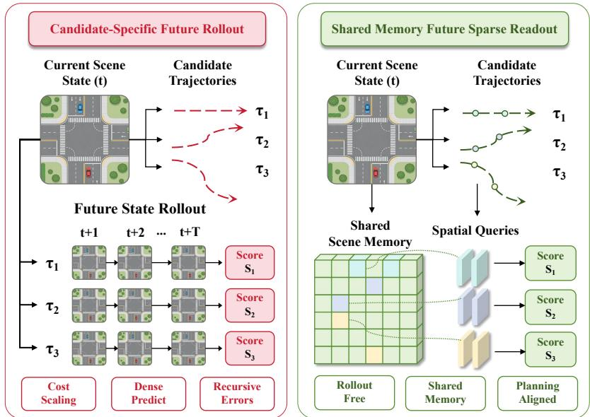
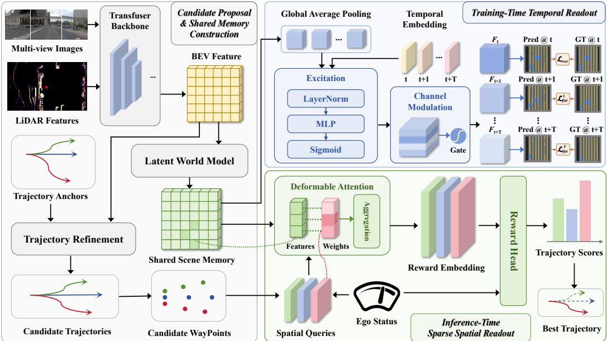
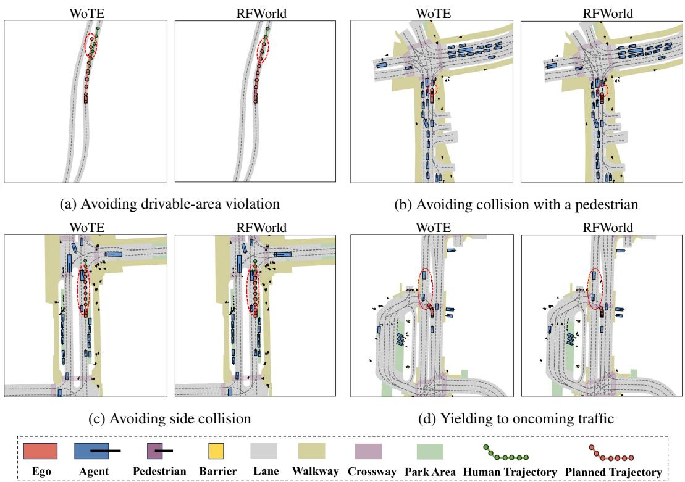
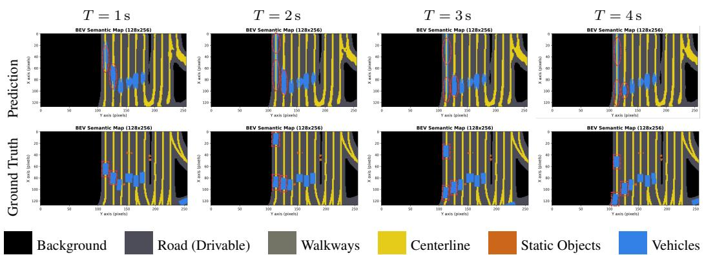
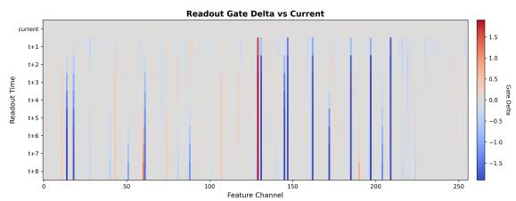
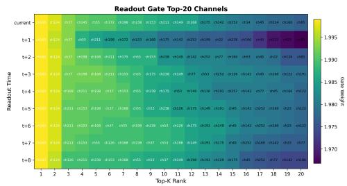
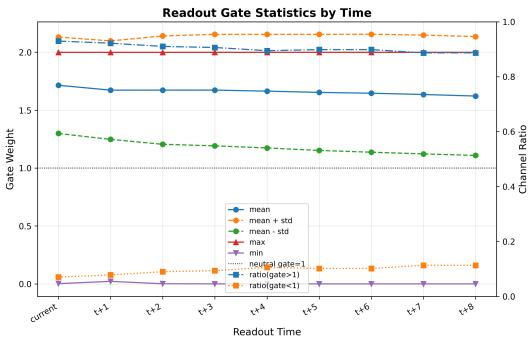
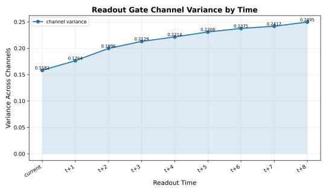

# Trajectory Evaluation via Rollout-Free World Model for End-to-end Autonomous Driving

Junzhe Wang1∗ Jinqing Zhang1,2∗ Qingjie Liu1† 1State Key Laboratory of Virtual Reality Technology and Systems, Beihang University, Beijing, China 2Xiaomi EV qingjie.liu@buaa.edu.cn

## Abstract

Although existing candidate trajectory evaluators have substantially improved end-to-end planning accuracy, their underlying mechanism remains suboptimal. Model-based evaluators typically make scoring future-aware by explicitly predicting candidate-conditioned future states over the planning horizon, which we term rollout. However, rollout incurs high inference cost and accumulates prediction errors. We argue that planning does not require reconstructing a full future scene for each candidate, but only future-relevant information for reliable comparison. We therefore propose RFWorld, a Rollout-Free World model for end-to-end trajectory evaluation. RFWorld constructs a shared scene memory and shapes it into a future-readable representation via lightweight training-time temporal readout with semantic supervision, keeping training overhead low. At inference time, candidate trajectories directly query the shared memory via sparse spatial readout for scoring, reducing computation by roughly the planning horizon times the number of candidate trajectories, while avoiding recursive rollout errors. Experiments on NAVSIM and Bench2Drive show that RFWorld learns a more planning-aligned world representation and achieves state-of-the-art performance.

## 1 Introduction

End-to-end autonomous driving [2, 5, 28, 15, 16, 19] has attracted increasing attention by directly mapping sensor observations to future trajectories or low-level control commands, reducing the interface bottlenecks and error accumulation of conventional modular pipelines. Recent planningoriented methods [3, 31, 26, 37, 44] have further advanced this paradigm from single-trajectory regression to anchor-based, proposal-based, diffusion-based, and flow-based trajectory generation. However, as the action space becomes increasingly multi-modal, a fundamental question remains: given multiple plausible future motions, how should an autonomous driving system evaluate them before execution?

Trajectory evaluation is indispensable for safe and reliable end-to-end planning. Classical methods [8, 32, 6] rely on hand-crafted rules, cost functions, or model predictive objectives. More recent learningbased approaches [25, 24, 29, 38] incorporate rule-based teachers, simulator-derived feedback, or learned score/reward models to distinguish unsafe candidates from human-like but risky ones. Yet many existing evaluators either score trajectories from the current state alone or depend on explicit candidate-conditioned future prediction.

A natural way to make trajectory evaluation future-aware is to introduce world models. Driving world models [1, 13, 34, 35, 9, 49, 48, 4, 42, 47] have been explored for future image generation, occupancy forecasting, BEV-state prediction, latent dynamics modeling, and planning-oriented reasoning. In trajectory evaluation, they can imagine the future consequences of each candidate trajectory and estimate its reward or safety score [12, 27, 24]. Existing model-based evaluators typically do so by explicitly predicting candidate-conditioned future states over the planning horizon, which we term rollout. However, should future-aware evaluation require rolling out a future scene for every candidate?

  
Figure 1: Two paradigms for future-aware trajectory evaluation. Conventional methods evaluate each candidate by rolling out its future states separately. In contrast, RFWorld constructs a shared scene memory once and lets all candidate trajectories read from it directly for rollout-free scoring.

We argue that explicit candidate-wise rollout is misaligned with the actual needs of planning. Its inference cost grows with both the planning horizon and the number of candidates, while recursive prediction also makes trajectory scoring vulnerable to accumulated errors. More importantly, planning does not require reconstructing a full future scene for each candidate, but only accessing futurerelevant information for reliable comparison.

Motivated by this, we reformulate model-based trajectory evaluation from trajectory-specific future rollout to rollout-free shared-memory readout, as illustrated in Fig. 1. Instead of generating candidateconditioned future states at inference time, RFWorld constructs a shared scene memory. To make all candidates readable through a common representation, we express their waypoints on the current ego-coordinate BEV plane rather than in independent ego-centric futures, enabling aligned spatial access to a unified memory. During training, temporal readout with semantic supervision shapes this memory into a future-readable representation with predictive temporal structure; during inference, candidate trajectories directly query it through sparse spatial readout for scoring.

This reformulation makes the world model more planning-aligned. Since the shared memory is computed once and reused across candidates, RFWorld avoids candidate-wise dense future generation, substantially reduces inference computation, keeps training overhead low through lightweight temporal shaping, and is less sensitive to compounding rollout errors. In this sense, RFWorld shifts the role of the world model from candidate-conditioned future simulation to constructing a planning-oriented shared memory for trajectory evaluation.

On NAVSIM [7], RFWorld achieves state-of-the-art performance and validates the effectiveness of rollout-free shared-memory trajectory evaluation. We also evaluate RFWorld in closed-loop simulation on the CARLA-based Bench2Drive [18] benchmark.

## Our contributions are summarized as follows:

• We identify a key mismatch in future-aware trajectory evaluation: existing model-based evaluators typically rely on explicit candidate-conditioned future rollout, whereas end-to-end planning only requires future-relevant information to be directly queryable through a planning-sufficient interface.

• We propose RFWorld, a Rollout-Free World model for end-to-end trajectory evaluation. RF-World constructs a shared scene memory, shapes it through lightweight training-time temporal readout with semantic supervision, and performs inference-time trajectory scoring via sparse spatial readout, thereby substantially reducing inference cost, keeping training overhead low, and mitigating accumulated rollout errors.

• We conduct extensive experiments on the NAVSIM benchmark and show that RFWorld achieves state-of-the-art performance, demonstrating the effectiveness of rollout-free shared-memory world modeling for end-to-end autonomous driving.

## 2 Related Work

## 2.1 End-to-end Autonomous Driving

End-to-end autonomous driving directly maps sensor observations to future trajectories or control commands, avoiding the interface bottlenecks of traditional modular pipelines. Representative works such as TransFuser [5], UniAD [16], and VAD [19] establish the importance of sensor fusion, planning-oriented task design, and vectorized scene representations. A broad line of research further improves BEV representations through semantic-aware or geometry-aware learning and auxiliary tasks such as online HD map construction, temporal BEV fusion, and occupancy prediction [22, 17, 30, 39, 45, 46, 41]. Recent studies [31, 21, 10, 3, 26, 37, 44] further improve planning with sparse scene tokens, proposal-centric representations, anchor vocabularies, diffusion policies, flow matching, and reinforcement learning. Most of these methods focus on trajectory generation from current observations, while future-aware candidate evaluation remains less explored.

## 2.2 Trajectory Evaluation

Trajectory evaluation is crucial for safety-critical autonomous driving, especially when multiple candidate trajectories are available. Rule-based planners and simulators assess candidates using metrics such as collision, drivable-area compliance, progress, time-to-collision, and comfort. Recent end-to-end methods incorporate these signals into learning-based frameworks. Hydra-MDP [25] distills human and rule-based teachers through multiple score heads, DriveDPO [29] points out that per-anchor score regression decouples supervision from direct policy optimization, and DriveSuprim [38] improves selection-based planning through coarse-to-fine filtering and self-distillation. Different from these methods, our work focuses on the future-aware representation and computation used for candidate scoring.

## 2.3 World Model for Autonomous Driving

World models have been increasingly explored for autonomous driving to model future scene evolution and support anticipatory planning. Image-level driving world models predict future visual observations for scenario generation or planning [35, 4, 42], while occupancy- or latent-space models learn future scene dynamics in more compact representations [49, 23, 50]. WoTE [24] predicts future BEV states for trajectory evaluation and demonstrates the benefit of model-based scoring in BEV space. However, future-aware decision making in these methods is usually coupled with explicit future generation, latent-state prediction, or candidate-conditioned simulation. In contrast, our method shifts the computation from trajectory-specific rollout to shared-memory readout, using future supervision only to shape the memory during training and sparse spatial readout for inference-time trajectory evaluation.

## 3 Preliminary

## 3.1 Candidate-based End-to-end Planning

Given the observation at timestamp t, denoted as ${ \mathcal { O } } _ { t }$ , the planner first generates a set of candidate trajectories

$$
\mathcal { T } _ { t } = \{ \tau _ { i } \} _ { i = 1 } ^ { N } ,
$$

where $\tau _ { i } = \{ p _ { i } ^ { k } \} _ { k = 1 } ^ { T }$ is the i-th candidate trajectory over T future timestamps. The final planning output is selected by

$$
\tau ^ { * } = \arg \operatorname* { m a x } _ { \tau _ { i } \in \mathcal { T } _ { t } } s _ { i } ,
$$

where $s _ { i }$ is the trajectory-level score of candidate $\tau _ { i }$

## 3.2 Shared Memory and Spatio-Temporal Readout

To evaluate candidate trajectories under different future conditions, the planner requires a representation that is both shared across candidates and accessible at specific temporal and spatial locations. We formulate such a representation as a shared memory:

$$
\mathcal { M } _ { t } = \Phi _ { \theta } ( \mathcal { O } _ { t } ) \in \mathbb { R } ^ { L \times d } ,
$$

where $\Phi _ { \theta }$ denotes the memory encoder, L is the number of memory tokens, and d is the feature dimension.

We use t for the current absolute timestamp and k for a relative future-step index, corresponding to time $t + k \Delta t$ , where $\Delta t$ is the interval between consecutive steps.

The shared memory is accessed through query-conditioned readout. For future step $k ,$ a temporal query $q _ { k } ^ { \mathrm { t i m e } }$ reads out the corresponding time-conditioned feature:

$$
\bar { z } _ { k } = \mathcal { R } ( q _ { k } ^ { \mathrm { t i m e } } , \mathcal { M } _ { t } ) .
$$

During training, these temporal readouts are supervised by future-timestamp targets to shape the memory with predictive temporal information. This supervision encourages $\mathcal { M } _ { t }$ to encode futureaware scene context, but it does not define the inference pathway.

During inference, candidate evaluation relies on spatial readout. For the waypoint $p _ { i } ^ { k }$ , we construct a spatial query

$$
q _ { i , k } ^ { \mathrm { s p a c e } } = \psi ( p _ { i } ^ { k } ) , \quad z _ { i , k } = \mathcal { R } ( q _ { i , k } ^ { \mathrm { s p a c e } } , \mathcal { M } _ { t } ) ,
$$

where $\psi ( \cdot )$ is a positional encoding function and $\mathcal { R } ( \cdot )$ denotes an abstract memory readout operator. The concrete interaction mechanism is introduced in the method section. In this way, all candidate trajectories access the same temporally-shaped memory through their waypoint-conditioned spatial queries, without constructing independent future representations for each candidate.

## 3.3 Planning-Sufficient Interface

Under this formulation, the downstream planner operates on a relatively independent planning interface composed of the shared memory and the current ego state. Once $\mathcal { M } _ { t }$ is constructed from the observation, the planner no longer revisits raw perceptual inputs, but evaluates candidate trajectories through memory readout with explicit ego-state conditioning:

$$
P _ { \theta } ( \tau ^ { * } \mid \mathcal { O } _ { t } , \mathcal { T } _ { t } ) = P _ { \theta } ( \tau ^ { * } \mid \mathcal { M } _ { t } , \mathcal { E } _ { t } , \mathcal { T } _ { t } ) , \quad \mathcal { M } _ { t } = \Phi _ { \theta } ( \mathcal { O } _ { t } ) .
$$

Here $P _ { \theta }$ denotes the conditional distribution over the selected trajectory induced by the planning model, and $\mathcal { E } _ { t }$ is the current ego state, which is directly fed into the reward encoder. Accordingly, the downstream planner depends on the original input only through the pair $( \boldsymbol { \mathcal { M } } _ { t } , \boldsymbol { \mathcal { E } } _ { t } )$ , rather than revisiting raw perceptual observations.

## 4 Method

Figure 2 illustrates the overall architecture of RFWorld, which consists of candidate proposal, sharedmemory construction with training-time temporal shaping, and inference-time trajectory evaluation via sparse spatial readout.

## 4.1 Candidate Proposal and Shared Memory Construction

Given the observation at timestamp t, we denote the model input as

$$
{ \mathcal { O } } _ { t } = \{ { \mathcal { H } } _ { t } , { \mathcal { L } } _ { t } , { \mathcal { E } } _ { t } , { \mathcal { T } } _ { t } \} ,
$$

  
Figure 2: Overall framework of RFWorld. The current BEV representation is transformed into a shared memory. During training, temporal readout with semantic supervision shapes the memory into a future-aware representation. During inference, candidate trajectories directly query the shared memory for reward prediction, and the trajectory with highest score is selected as the final planning output.

where $\mathcal { H } _ { t }$ denotes historical frame information, $\mathcal { L } _ { t }$ denotes the current LiDAR feature, $\mathcal { E } _ { t }$ is the current ego state, and $\mathcal { T } _ { t } = \{ I _ { t } ^ { v } \} _ { v = 1 } ^ { N _ { c } }$ denotes the current multi-view images. Following the multi-modal fusion paradigm of TransFuser [5], we align historical LiDAR features to the current ego coordinate frame and fuse them with the current visual observations to obtain a BEV scene representation $B _ { t }$

For planning, we adopt an anchor-based candidate proposal branch [3, 24]. Let $\mathcal { A } = \{ a _ { i } \} _ { i = 1 } ^ { N }$ denote a predefined vocabulary of trajectory anchors. Each anchor interacts with the current scene representation to predict an offset, yielding the refined candidate trajectory

$$
\tau _ { i } = a _ { i } + \Delta _ { i } , \quad i = 1 , \ldots , N .
$$

Different from candidate-conditioned world models that construct separate future representations for different trajectories [24, 47], our method builds a trajectory-agnostic shared memory from the current BEV representation. Specifically, the current BEV feature $B _ { t }$ is flattened, augmented with spatial positional embeddings, and processed by a Transformer-based [33] latent world model to obtain

$$
\mathcal { M } _ { t } = \Phi _ { \mathrm { m e m } } ( \mathrm { F l a t } ( B _ { t } ) + P ) \in \mathbb { R } ^ { L \times d } ,
$$

where $P$ denotes the spatial positional embedding, L is the number of BEV tokens, and d is the hidden dimension. The shared memory is conditioned only on the observation and is reused by both the training and inference branches.

## 4.2 Training-Time Temporal Readout with Semantic Supervision

To endow the shared memory with predictive temporal structure, we attach a lightweight temporal readout branch during training. Let

$$
\bar { \mathcal { M } } _ { t } = \mathrm { R e s h a p e } ( \mathcal { M } _ { t } ) \in \mathbb { R } ^ { d \times H \times W }
$$

denote the spatial BEV form of the shared memory, where H and $W$ are its height and width $( L = H W )$ , and let

$$
c _ { t } = \mathrm { A v g P o o l } ( \bar { \mathcal { M } } _ { t } ) \in \mathbb { R } ^ { d }
$$

be its globally pooled context. Let S be the selected supervised temporal indices, including 0 for the current timestamp. For each $k \in { S }$ , we introduce a learnable temporal embedding $e _ { k }$ and perform SE-style channel modulation [14]:

$$
\begin{array} { r l } & { g _ { k } = 2 \cdot \sigma ( \mathrm { M L P } ( \mathrm { L N } ( c _ { t } + e _ { k } ) ) ) \in \mathbb { R } ^ { d } , } \\ & { \quad \quad \quad \bar { \mathcal { M } } _ { t } ^ { ( k ) } = \bar { \mathcal { M } } _ { t } \odot g _ { k } . } \end{array}
$$

The gate $g _ { k }$ is broadcast across spatial positions to reweight the memory channels. The resulting time-conditioned feature is decoded into a BEV semantic map by the shared semantic decoder $\mathcal { D } \colon$

$$
\hat { Y } _ { t } ^ { ( k ) } = \mathcal { D } \Big ( \bar { \mathcal { M } } _ { t } ^ { ( k ) } \Big ) .
$$

The decoder is shared across all selected timestamps, so temporal diversity is induced solely by the temporal readout. The current prediction $\hat { Y } _ { t } ^ { ( 0 ) }$ is supervised by the current semantic target, while the future predictions $\{ \hat { Y } _ { t } ^ { ( k ) } \} _ { k \in \mathcal { S } \backslash \{ 0 \} }$ are supervised by the selected future semantic targets. We denote the resulting semantic supervision as

$$
\mathcal { L } _ { \mathrm { s e m } } = \mathcal { L } _ { \mathrm { c u r } } + \sum _ { k \in \mathcal { S } \setminus \{ 0 \} } \omega _ { k } \mathcal { L } _ { \mathrm { f u t } } ^ { ( k ) } ,
$$

where $\omega _ { k }$ denotes the normalized weight of each supervised future timestamp. This branch is used only to shape the shared memory during training and does not define the inference-time planning path.

## 4.3 Inference-Time Sparse Spatial Readout

During inference, we do not explicitly decode future semantic maps or perform candidate-wise rollout. Instead, for each candidate trajectory $\tau _ { i } = \{ p _ { i } ^ { k } \} _ { k = 1 } ^ { T }$ , we directly read the information required for trajectory evaluation from the shared memory through deformable spatial attention [51]. Specifically, each waypoint $p _ { i } ^ { k }$ is encoded as a spatial query

$$
q _ { i } ^ { k } = \psi ( p _ { i } ^ { k } ) ,
$$

where $\psi ( \cdot )$ denotes the waypoint encoder. Ego-state context is injected into the query features to modulate the readout. The offsets and attention weights are learned by Γ; bilinear interpolation in V is only the differentiable operation used to sample at the learned continuous locations.

Given query $q _ { i } ^ { k }$ and its reference point $r _ { i } ^ { k }$ on the BEV plane, the reward encoder predicts a set of sampling offsets $\Delta _ { i , k } ^ { m }$ and attention weights $\alpha _ { i , k } ^ { m }$ :

$$
\{ \Delta _ { i , k } ^ { m } , \alpha _ { i , k } ^ { m } \} _ { m = 1 } ^ { M } = \Gamma ( q _ { i } ^ { k } ) ,
$$

where $\Gamma ( \cdot )$ denotes the sampling-parameter prediction head, and M is the number of sampling points. The waypoint feature is then obtained by sparse weighted sampling from $\bar { \mathcal { M } } _ { t }$ :

$$
z _ { i } ^ { k } = \sum _ { m = 1 } ^ { M } \alpha _ { i , k } ^ { m } V \bigl ( \bar { \mathcal { M } } _ { t } , \ : r _ { i } ^ { k } + \Delta _ { i , k } ^ { m } \bigr ) ,
$$

where $V ( \cdot )$ denotes bilinear sampling on the shared memory. The waypoint features are aggregated along the trajectory horizon to produce a trajectory embedding $e _ { i } ,$ which is further fused with ego-state context before reward prediction.

Following prior trajectory-evaluation frameworks [24], we predict an imitation reward and a set of simulation rewards:

$$
r _ { i } ^ { \mathrm { i m } } = \mathrm { H e a d _ { i m } } ( e _ { i } ) , \qquad r _ { i } ^ { \mathrm { s i m } } = \mathrm { H e a d _ { s i m } } ( e _ { i } ) .
$$

The former captures similarity to expert behavior, whereas the latter evaluates the candidate under simulator-derived safety and planning criteria. At inference time, these rewards are aggregated into a final trajectory score, and the highest-scoring trajectory is selected as the planning output.

## 4.4 Training Objective

We train the model with a compact multi-term objective consisting of trajectory, semantic, imitationreward, and simulation-reward supervision. For trajectory prediction, only the candidate anchor closest to the ground-truth trajectory is supervised, yielding the trajectory loss $\mathcal { L } _ { \mathrm { t r a j } }$ . The semantic supervision in Sec. 4.2 is denoted as $\mathcal { L } _ { \mathrm { s e m } }$ , where the semantic maps are supervised by a focal loss. For imitation reward learning, we construct a soft target distribution from the relative distances between candidate trajectories and the expert trajectory, and optimize the predicted imitation reward with a cross-entropy-style objective, yielding ${ \mathcal { L } } _ { \mathrm { i m } }$ . For simulation reward learning, the predicted heads for $\mathrm { N C , D A C } ,$ , EP, TTC, and Comfort are supervised by simulator-derived targets using BCE loss; the additional EP margin ranking regularization is absorbed into $\mathcal { L } _ { \mathrm { s i m } }$ for brevity.

The overall training objective is

$$
{ \mathcal { L } } _ { \mathrm { t o t a l } } = \lambda _ { \mathrm { t r a j } } { \mathcal { L } } _ { \mathrm { t r a j } } + \lambda _ { \mathrm { s e m } } { \mathcal { L } } _ { \mathrm { s e m } } + \lambda _ { \mathrm { i m } } { \mathcal { L } } _ { \mathrm { i m } } + \lambda _ { \mathrm { s i m } } { \mathcal { L } } _ { \mathrm { s i m } } ,
$$

where $\lambda _ { \mathrm { t r a j } } , \lambda _ { \mathrm { s e m } } , \lambda _ { \mathrm { i m } } .$ , and $\lambda _ { \mathrm { s i m } }$ are the corresponding loss weights.

## 5 Experiments

## 5.1 Benchmark

NAVSIM. We evaluate RFWorld on NAVSIM-v1 [7], which is built upon real-world sensor data and emphasizes safety-critical and behaviorally diverse planning scenarios. The official trainval split contains 85,109 training samples and 18,179 validation samples; the official test split contains 12,146 scenarios. For each test scenario, the model selects exactly one final trajectory, and each metric is computed once for that scenario; reported values are averages over the 12,146 scenarios. The primary metric is the Predictive Driver Model Score (PDMS), which aggregates No At-Fault Collision (NC), Drivable Area Compliance (DAC), Ego Progress (EP), Time-to-Collision (TTC), and Comfort (Comf.). We report PDMS together with all constituent metrics. For normalized subscores in [0, 1], NAVSIM-v1 computes PDMS = NC · DAC · (5 TTC + 5 EP + 2 Comf.)/12.

Bench2Drive. We evaluate RFWorld on Bench2Drive [18], a closed-loop autonomous driving benchmark in CARLA 0.9.15, using the official 220 test routes. We report Success Rate (%) and Driving Score.

## 5.2 Implementation Details

NAVSIM. We train and evaluate RFWorld on NAVSIM-v1 under the official data split. For fair comparison with prior work, we adopt the same ResNet-34 [11] backbone as Transfuser [5]. The model takes LiDAR features, ego states, and multi-view images as input, and predicts scores over 1024 candidate trajectory anchors. NAVSIM experiments are conducted on 2 RTX 3090 GPUs with a batch size of 16. We train the model for 50 epochs using AdamW with a base learning rate of $1 \times 1 0 ^ { - 4 }$ . Unless otherwise specified, these settings are shared across the NAVSIM experiments.

Bench2Drive. The input consists of three front-facing cameras, four consecutive LiDAR frames, the ego state, and a navigation command. The three images are stitched and resized to $1 0 2 4 \times 2 5 6 ;$ LiDAR points are rasterized into a 256 × 256 BEV grid covering 32 m in each direction at 0.25 m resolution. We initialize from the original RFWorld pretrained weights and train with AdamW for 30,000 iterations using batch size 8, learning rate $\dot { 5 } \times 1 0 ^ { - 6 }$ , weight decay $1 0 ^ { - 4 }$ , and gradient clipping at 5. At inference, 1,024 candidate trajectories are ranked by their predicted rewards and the highest-scoring trajectory is selected at every simulation step. A vehicle PID controller converts it into steering, throttle, and brake commands by tracking the sixth trajectory point, with throttle capped at 0.55.

## 5.3 Comparison with SOTA

NAVSIM. As shown in Table 1, RFWorld achieves a PDMS of 90.5 under the ResNet-34 setting, with the highest PDMS, NC, and TTC among the compared learned methods. These results suggest that our future-aware modeling and trajectory evaluation pipeline can more accurately capture future scene evolution and more effectively suppress unsafe trajectory candidates.

Table 1: Comparison with state-of-the-art end-to-end driving methods on NAVSIM. The best results are denoted in bold. WM indicates whether the method explicitly employs a world model. For fair comparison, we report the scores using the same ResNet-34 backbone.
<table><tr><td>Method</td><td>WM</td><td>Supervision</td><td>NC↑</td><td>DAC↑</td><td>TTC↑</td><td>Comf.↑</td><td>EP↑</td><td>PDMS↑</td></tr><tr><td>Human</td><td>一 一</td><td>一</td><td>100.0</td><td>100.0</td><td>99.9</td><td>100.0</td><td>87.5</td><td>94.8</td></tr><tr><td>Ego Status MLP</td><td>X</td><td>Human</td><td>93.0</td><td>77.3</td><td>83.6</td><td>100.0</td><td>62.8</td><td>65.6</td></tr><tr><td>VADv2 [3]</td><td>X</td><td>Human</td><td>97.2</td><td>89.1</td><td>91.6</td><td>100.0</td><td>76.0</td><td>80.9</td></tr><tr><td>UniAD [16]</td><td>X</td><td>Human</td><td>97.8</td><td>91.9</td><td>92.9</td><td>100.0</td><td>78.8</td><td>83.4</td></tr><tr><td>LTF [5]</td><td>X</td><td>Human</td><td>97.4</td><td>92.8</td><td>92.4</td><td>100.0</td><td>79.0</td><td>83.8</td></tr><tr><td>Transfuser [5]</td><td>X</td><td>Human</td><td>97.7</td><td>92.8</td><td>92.8</td><td>100.0</td><td>79.2</td><td>84.0</td></tr><tr><td>DRAMA [40]</td><td>X</td><td>Human</td><td>98.0</td><td>93.1</td><td>94.8</td><td>100.0</td><td>80.1</td><td>85.5</td></tr><tr><td>GoalFlow [37]</td><td>X</td><td>Human</td><td>98.3</td><td>93.8</td><td>94.3</td><td>100.0</td><td>79.8</td><td>85.7</td></tr><tr><td>Hydra-MDP [25]</td><td>X</td><td>Human &amp; Rule</td><td>98.3</td><td>96.0</td><td>94.6</td><td>100.0</td><td>78.7</td><td>86.5</td></tr><tr><td>Hydra-MDP++ [20]</td><td>X</td><td>Human &amp; Rule</td><td>97.6</td><td>96.0</td><td>93.1</td><td>100.0</td><td>80.4</td><td>86.6</td></tr><tr><td>DiffusionDrive [26]</td><td>X</td><td>Human</td><td>98.2</td><td>96.2</td><td>94.7</td><td>100.0</td><td>82.2</td><td>88.1</td></tr><tr><td>DriveSuprim [38]</td><td>X</td><td>Human &amp; Rule</td><td>97.8</td><td>97.3</td><td>93.6</td><td>100.0</td><td>86.7</td><td>89.9</td></tr><tr><td>DriveDPO [29]</td><td>X</td><td>Human &amp; Rule</td><td>98.5</td><td>98.1</td><td>94.8</td><td>99.9</td><td>84.3</td><td>90.0</td></tr><tr><td>LAW [23]</td><td>V</td><td>Human</td><td>96.4</td><td>95.4</td><td>88.7</td><td>99.9</td><td>81.7</td><td>84.6</td></tr><tr><td>WoTE [24]</td><td>√</td><td>Human &amp; Rule</td><td>98.5</td><td>96.8</td><td>94.9</td><td>99.9</td><td>81.9</td><td>88.3</td></tr><tr><td>ResWorld [47]</td><td>V</td><td>Human</td><td>98.9</td><td>96.5</td><td>95.6</td><td>100.0</td><td>83.1</td><td>89.0</td></tr><tr><td>RFWorld (Ours)</td><td>√</td><td>Human &amp; Rule</td><td>99.0</td><td>97.8</td><td>96.0</td><td>100.0</td><td>84.6</td><td>90.5</td></tr></table>

Table 2: Closed-loop results on the official 220-route Bench2Drive [18] test set.
<table><tr><td>Method</td><td>Success Rate (%)↑</td><td>Driving Score↑</td></tr><tr><td>AD-MLP [43]</td><td>0.00</td><td>18.05</td></tr><tr><td>UniAD [16]</td><td>16.36</td><td>45.81</td></tr><tr><td>VAD [19]</td><td>15.00</td><td>42.35</td></tr><tr><td>TCP [36]</td><td>30.00</td><td>59.90</td></tr><tr><td>RFWorld</td><td>31.36</td><td>62.38</td></tr></table>

Bench2Drive. As shown in Table 2, RFWorld achieves a Success Rate of 31.36% and a Driving Score of 62.38, exceeding TCP by 1.36 percentage points and 2.48 score points, respectively, and leading the compared baselines on both metrics.

## 5.4 Ablation Study

Effect of world model and future supervision. We first study whether the improvement comes from introducing a world model itself or from learning a predictive representation with explicit future supervision. The four rows in Table 3 differ only in the two indicated switches; the backbone, anchors, optimization schedule, split, and evaluation protocol are fixed. Directly adding the world model without future supervision does not improve performance, suggesting that a future branch optimized only through the final planning objective is insufficient to learn stable and informative predictive features.

In contrast, explicitly supervising future readout features consistently improves all major metrics. In the WM × / Future Sup. ✓ setting, temporal semantic readout supervises the backbone BEV feature directly, without the world model Transformer. Future supervision alone improves PDMS from 88.9 to 89.4, while the complete RFWorld model reaches 90.5, indicating complementary roles for future supervision and shared-memory world modeling.

Effect of the number of inference anchors. We study how increasing the number of inference-time candidate trajectories affects performance and cost. For fair comparison, both WoTE and RFWorld are trained with 1024 anchors and a batch size of 16, and different numbers of anchors are randomly sampled at test time. Due to their different training memory demands, WoTE is trained on two A6000

Table 3: Ablation study on world modeling and future supervision. “WM” denotes whether the world model branch is enabled, and “Future Sup.” denotes whether future readout features are explicitly supervised during training. The best results are shown in bold.
<table><tr><td>WM</td><td>Future Sup.</td><td>NC↑</td><td>DAC↑</td><td>TTC↑</td><td>Comf.↑</td><td>EP↑</td><td>PDMS↑</td></tr><tr><td>X</td><td>×</td><td>98.7</td><td>94.4</td><td>95.2</td><td>99.8</td><td>83.4</td><td>88.9</td></tr><tr><td>X</td><td>√</td><td>98.8</td><td>97.1</td><td>95.4</td><td>100.0</td><td>83.7</td><td>89.4</td></tr><tr><td>√</td><td>X</td><td>98.5</td><td>96.5</td><td>95.1</td><td>99.8</td><td>82.3</td><td>88.4</td></tr><tr><td>√</td><td>√</td><td>99.0</td><td>97.8</td><td>96.0</td><td>100.0</td><td>84.6</td><td>90.5</td></tr></table>

Table 4: Ablation study on inference-time candidate anchors. “#Traj.” denotes the number of candidate trajectories randomly sampled at test time. Latency is measured per sample on a single RTX 3090 GPU. The best results are shown in bold.
<table><tr><td>Method</td><td>#Traj.</td><td>NC↑</td><td>DAC↑</td><td>TTC↑</td><td>Comf.↑</td><td>EP↑</td><td>PDMS↑</td><td>Latency↓</td></tr><tr><td>WoTE [24]</td><td>256</td><td>98.4</td><td>96.7</td><td>94.6</td><td>99.9</td><td>82.3</td><td>88.3</td><td>37.0 ms</td></tr><tr><td>WoTE [24]</td><td>512</td><td>98.3</td><td>96.3</td><td>94.5</td><td>99.8</td><td>83.4</td><td>88.4</td><td>41.2 ms</td></tr><tr><td>WoTE [24]</td><td>1024</td><td>98.4</td><td>97.1</td><td>94.8</td><td>100.0</td><td>82.5</td><td>88.7</td><td>49.2 ms</td></tr><tr><td>RFWorld</td><td>256</td><td>98.8</td><td>97.0</td><td>95.7</td><td>99.9</td><td>83.9</td><td>89.6</td><td>35.1 ms</td></tr><tr><td>RFWorld</td><td>512</td><td>98.9</td><td>97.7</td><td>95.5</td><td>100.0</td><td>84.4</td><td>90.2</td><td>36.2 ms</td></tr><tr><td>RFWorld</td><td>1024</td><td>99.0</td><td>97.8</td><td>96.0</td><td>100.0</td><td>84.6</td><td>90.5</td><td>37.5 ms</td></tr></table>

GPUs (48 GB each), whereas RFWorld is trained on two RTX 3090 GPUs (24 GB each). Inference latency is measured on a single RTX 3090 GPU.

As shown in Table 4, RFWorld improves consistently as the candidate set grows from 256 to 1024, indicating that richer candidate coverage is more effectively utilized in RFWorld. This trend is consistent with the underlying complexity difference. Let N denote the number of candidate trajectories, T the planning horizon, L the number of BEV tokens, and M the number of sampling points in sparse readout. WoTE scales as $O ( N T \cdot { \mathcal { C } } _ { \mathrm { W M } } ( L ) )$ , approximately $O ( N T L ^ { 2 } d )$ when transformer world-model computation dominates, because future prediction is repeated for every candidate over the whole horizon. In contrast, RFWorld constructs the shared memory once with cost $O ( \mathcal { C } _ { \mathrm { W M } } ( L ) )$ and scores candidates with sparse spatial readout at O(NTMd). Since $M \ll L$ RFWorld removes the dominant NT factor from future-state generation. The same advantage appears in training memory: under the 1024-anchor, batch-size-16 setting, RFWorld uses 8.7 GB GPU memory, compared with 33.9 GB for WoTE. Consistently, RFWorld remains faster at all tested anchor counts, with latency increasing only from 35.1 ms to 37.5 ms as N grows from 256 to 1024, while keeping the evaluation protocol fixed across all settings.

## 5.5 Qualitative Comparison

We further provide qualitative comparisons with WoTE [24] in Fig. 3. These cases indicate a broader advantage of RFWorld over rollout-based trajectory evaluation paradigms, where early rollout inaccuracies may accumulate over time and induce unreliable future assessments. In contrast, RFWorld better suppresses such compounding errors, leading to safer and more robust planning behaviors.

## 6 Limitations and Future Work

RFWorld has several limitations. First, its Transformer-based latent world model is not well suited to higher-resolution future prediction on dense BEV features; replacing dense BEV features with sparse scene tokens may improve both scalability and efficiency. Second, the quality of the shared memory remains dependent on the form of memory-shaping supervision, and the semantic targets are currently needed during training, motivating future work on pseudo-labeling and self-supervised temporal objectives. Third, observed failures mainly occur when the lightweight perception backbone produces inaccurate scene features or when relevant road geometry and traffic participants lie near or beyond the observation range. These errors can propagate to trajectory scoring and lead to drivable-area departures or collisions.

  
Figure 3: Qualitative comparison between WoTE [24] and RFWorld on NAVSIM-v1. Legend from DriveDPO [29]. (a) RFWorld avoids leaving the drivable area and remains within the lane boundaries. (b) RFWorld decelerates in advance and safely avoids the pedestrian. (c) RFWorld stays close to the lane centerline and avoids potential collision with the adjacent-lane vehicle. (d) RFWorld better accounts for oncoming traffic and yields before turning, thereby avoiding potential future risk.

## 7 Conclusion

In this paper, we revisit model-based trajectory evaluation for end-to-end autonomous driving and identify a key mismatch in existing future-aware evaluators: they often rely on explicit candidateconditioned future rollout, although trajectory selection only requires future-relevant information for candidate comparison. To address this issue, we propose RFWorld, a rollout-free world model for end-to-end trajectory evaluation. RFWorld constructs a shared scene memory, shapes it through training-time temporal readout with semantic supervision, and performs inference-time trajectory scoring via deformable spatial reward readout under explicit ego-state conditioning. Extensive experiments on the NAVSIM benchmark demonstrate that RFWorld provides a more planningaligned world representation for future-aware trajectory evaluation and achieves state-of-the-art performance. These results show that replacing candidate-specific future rollout with shared-memory readout is an effective direction for end-to-end autonomous driving.

## Acknowledgments and Disclosure of Funding

This research was supported by Zhejiang Provincial Natural Science Foundation of China under Grant No. LD24F020016 and National Natural Science Foundation of China under Grant No. 62576023. The authors declare no competing interests.

## References

[1] Dian Chen, Vladlen Koltun, and Philipp Krähenbühl. Learning to drive from a world on rails. In Proceedings ofthe IEEE/CVF Conference on Computer Vision and Pattern Recognition, pages 15590–15599, 2021.

[2] Li Chen, Penghao Wu, Kashyap Chitta, Bernhard Jaeger, Andreas Geiger, and Hongyang Li. End-to-end autonomous driving: Challenges and frontiers. IEEE Transactions on Pattern Analysis and Machine Intelligence, 2024.

[3] Shaoyu Chen, Bo Jiang, Hao Gao, Bencheng Liao, Qing Xu, Qian Zhang, Chang Huang, Wenyu Liu, and Xinggang Wang. VADv2: End-to-end vectorized autonomous driving via probabilistic planning. arXiv preprint arXiv:2402.13243, 2024.

[4] Yuntao Chen, Yuqi Wang, and Zhaoxiang Zhang. DrivingGPT: Unifying driving world modeling and planning with multi-modal autoregressive transformers. In Proceedings ofthe IEEE/CVF International Conference on Computer Vision, pages 26890–26900, 2025.

[5] Kashyap Chitta, Aditya Prakash, Bernhard Jaeger, Zehao Yu, Katrin Renz, and Andreas Geiger. TransFuser: Imitation with transformer-based sensor fusion for autonomous driving. IEEE Transactions on Pattern Analysis and Machine Intelligence, 2023.

[6] Daniel Dauner, Marcel Hallgarten, Andreas Geiger, and Kashyap Chitta. Parting with misconceptions about learning-based vehicle motion planning. In Conference on Robot Learning, pages 1268–1281. PMLR, 2023.

[7] Daniel Dauner, Marcel Hallgarten, Tianyu Li, Xinshuo Weng, Zhiyu Huang, Zetong Yang, Hongyang Li, Igor Gilitschenski, Boris Ivanovic, Marco Pavone, Andreas Geiger, and Kashyap Chitta. Navsim: Data-driven non-reactive autonomous vehicle simulation and benchmarking. In Advances in Neural Information Processing Systems, volume 37, pages 28706–28719, 2024.

[8] Haoyang Fan, Fan Zhu, Changchun Liu, Liangliang Zhang, Li Zhuang, Dong Li, Weicheng Zhu, Jiangtao Hu, Hongye Li, and Qi Kong. Baidu apollo em motion planner. arXiv preprint arXiv:1807.08048, 2018.

[9] Shenyuan Gao, Jiazhi Yang, Li Chen, Kashyap Chitta, Yihang Qiu, Andreas Geiger, Jun Zhang, and Hongyang Li. Vista: A generalizable driving world model with high fidelity and versatile controllability. In Advances in Neural Information Processing Systems, 2024.

[10] Ke Guo, Haochen Liu, Xiaojun Wu, Jia Pan, and Chen Lv. iPad: Iterative proposal-centric end-to-end autonomous driving. arXiv preprint arXiv:2505.15111, 2025.

[11] Kaiming He, Xiangyu Zhang, Shaoqing Ren, and Jian Sun. Deep residual learning for image recognition. In Proceedings of the IEEE Conference on Computer Vision and Pattern Recognition, pages 770–778, 2016.

[12] Mikael Henaff, Alfredo Canziani, and Yann LeCun. Model-predictive policy learning with uncertainty regularization for driving in dense traffic. In International Conference on Learning Representations, 2019.

[13] Anthony Hu, Lloyd Russell, Hudson Yeo, Zak Murez, George Fedoseev, Alex Kendall, Jamie Shotton, and Gianluca Corrado. GAIA-1: A generative world model for autonomous driving. arXiv preprint arXiv:2309.17080, 2023.

[14] Jie Hu, Li Shen, Samuel Albanie, Gang Sun, and Enhua Wu. Squeeze-and-excitation networks. In Proceedings of the IEEE/CVF Conference on Computer Vision and Pattern Recognition, pages 7132–7141, 2018.

[15] Shengchao Hu, Li Chen, Penghao Wu, Hongyang Li, Junchi Yan, and Dacheng Tao. ST-P3: End-to-end vision-based autonomous driving via spatial-temporal feature learning. In European Conference on Computer Vision, pages 533–549. Springer, 2022.

[16] Yihan Hu, Jiazhi Yang, Li Chen, Keyu Li, Chonghao Sima, Xizhou Zhu, Siqi Chai, Senyao Du, Tianwei Lin, Wenhai Wang, Lewei Lu, Xiaosong Jia, Qiang Liu, Jifeng Dai, Yu Qiao, and Hongyang Li. Planning-oriented autonomous driving. In Proceedings ofthe IEEE/CVF Conference on Computer Vision and Pattern Recognition, pages 17853–17862, 2023.

[17] Junjie Huang and Guan Huang. BEVDet4D: Exploit temporal cues in multi-camera 3D object detection. arXiv preprint arXiv:2203.17054, 2022.

[18] Xiaosong Jia, Zhenjie Yang, Qifeng Li, Zhiyuan Zhang, and Junchi Yan. Bench2Drive: Towards multi-ability benchmarking of closed-loop end-to-end autonomous driving. In NeurIPS 2024 Datasets and Benchmarks Track, 2024.

[19] Bo Jiang, Shaoyu Chen, Qing Xu, Bencheng Liao, Jiajie Chen, Helong Zhou, Qian Zhang, Wenyu Liu, Chang Huang, and Xinggang Wang. Vad: Vectorized scene representation for efficient autonomous driving. In Proceedings of the IEEE/CVF International Conference on Computer Vision, pages 8340–8350, 2023.

[20] Kailin Li, Zhenxin Li, Shiyi Lan, Yuan Xie, Zhizhong Zhang, Jiayi Liu, Zuxuan Wu, Zhiding Yu, and Jose M. Alvarez. Hydra-mdp++: Advancing end-to-end driving via expert-guided hydra-distillation. arXiv preprint arXiv:2503.12820, 2025.

[21] Peidong Li and Dixiao Cui. Navigation-guided sparse scene representation for end-to-end autonomous driving. In International Conference on Learning Representations, 2025.

[22] Qi Li, Yue Wang, Yilun Wang, and Hang Zhao. HDMapNet: An online hd map construction and evaluation framework. In IEEE International Conference on Robotics and Automation, pages 4628–4634, 2022.

[23] Yingyan Li, Lue Fan, Jiawei He, Yuqi Wang, Yuntao Chen, Zhaoxiang Zhang, and Tieniu Tan. Enhancing end-to-end autonomous driving with latent world model. In International Conference on Learning Representations, 2025.

[24] Yingyan Li, Yuqi Wang, Yang Liu, Jiawei He, Lue Fan, and Zhaoxiang Zhang. End-to-end driving with online trajectory evaluation via BEV world model. In Proceedings ofthe IEEE/CVF International Conference on Computer Vision, pages 27137–27146, 2025.

[25] Zhenxin Li, Kailin Li, Shihao Wang, Shiyi Lan, Zhiding Yu, Yishen Ji, Zhiqi Li, Ziyue Zhu, Jan Kautz, Zuxuan Wu, Yu-Gang Jiang, and Jose M. Alvarez. Hydra-MDP: End-to-end multimodal planning with multi-target hydra-distillation. arXiv preprint arXiv:2406.06978, 2024.

[26] Bencheng Liao, Shaoyu Chen, Haoran Yin, Bo Jiang, Cheng Wang, Sixu Yan, Xinbang Zhang, Xiangyu Li, Ying Zhang, Qian Zhang, and Xinggang Wang. Diffusiondrive: Truncated diffusion model for end-to-end autonomous driving. In Proceedings ofthe IEEE/CVF Conference on Computer Vision and Pattern Recognition, pages 12037–12047, 2025.

[27] Guanren Qiao, Guorui Quan, Rongxiao Qu, and Guiliang Liu. Modelling competitive behaviors in autonomous driving under generative world model. In European Conference on Computer Vision, pages 19–36. Springer, 2024.

[28] Abbas Sadat, Sergio Casas, Mengye Ren, Xinyu Wu, Pranaab Dhawan, and Raquel Urtasun. Perceive, predict, and plan: Safe motion planning through interpretable semantic representations. In European Conference on Computer Vision, pages 414–430. Springer, 2020.

[29] Shuyao Shang, Yuntao Chen, Yuqi Wang, Yingyan Li, and Zhaoxiang Zhang. DriveDPO: Policy learning via safety dpo for end-to-end autonomous driving. In Advances in Neural Information Processing Systems, 2025.

[30] Chonghao Sima, Wenwen Tong, Tai Wang, Li Chen, Silei Wu, Hanming Deng, Yi Gu, Lewei Lu, Ping Luo, Dahua Lin, and Hongyang Li. Scene as occupancy. In Proceedings of the IEEE/CVF International Conference on Computer Vision, pages 8406–8415, 2023.

[31] Wenchao Sun, Xuewu Lin, Yining Shi, Chuang Zhang, Haoran Wu, and Sifa Zheng. SparseDrive: End-to-end autonomous driving via sparse scene representation. In Proceedings of the IEEE International Conference on Robotics and Automation, 2025.

[32] Martin Treiber, Ansgar Hennecke, and Dirk Helbing. Congested traffic states in empirical observations and microscopic simulations. Physical Review E, 62(2):1805–1824, 2000.

[33] Ashish Vaswani, Noam Shazeer, Niki Parmar, Jakob Uszkoreit, Llion Jones, Aidan N Gomez, Łukasz Kaiser, and Illia Polosukhin. Attention is all you need. Advances in Neural Information Processing Systems, 30, 2017.

[34] Xiaofeng Wang, Zheng Zhu, Guan Huang, Xinze Chen, Jiagang Zhu, and Jiwen Lu. Drive-Dreamer: Towards real-world-driven world models for autonomous driving. In European Conference on Computer Vision, 2024.

[35] Yuqi Wang, Jiawei He, Lue Fan, Hongxin Li, Yuntao Chen, and Zhaoxiang Zhang. Driving into the future: Multiview visual forecasting and planning with world model for autonomous driving. In Proceedings of the IEEE/CVF Conference on Computer Vision and Pattern Recognition, pages 14749–14759, 2024.

[36] Penghao Wu, Xiaosong Jia, Li Chen, Junchi Yan, Hongyang Li, and Yu Qiao. Trajectoryguided control prediction for end-to-end autonomous driving: A simple yet strong baseline. In Advances in Neural Information Processing Systems, 2022.

[37] Zebin Xing, Xingyu Zhang, Yang Hu, Bo Jiang, Tong He, Qian Zhang, Xiaoxiao Long, and Wei Yin. GoalFlow: Goal-driven flow matching for multimodal trajectories generation in end-to-end autonomous driving. In Proceedings of the IEEE/CVF Conference on Computer Vision and Pattern Recognition, pages 1602–1611, 2025.

[38] Wenhao Yao, Zhenxin Li, Shiyi Lan, Zi Wang, Xinglong Sun, Jose M. Alvarez, and Zuxuan Wu. DriveSuprim: Towards precise trajectory selection for end-to-end planning. In Proceedings of the AAAI Conference on Artificial Intelligence, volume 40, pages 11910–11918, 2026.

[39] Zichen Yu, Changyong Shu, Jiajun Deng, Kangjie Lu, Zongdai Liu, Jiangyong Yu, Dawei Yang, Hui Li, and Yan Chen. FlashOCC: Fast and memory-efficient occupancy prediction via channel-to-height plugin. arXiv preprint arXiv:2311.12058, 2023.

[40] Chengran Yuan, Zhanqi Zhang, Jiawei Sun, Shuo Sun, Zefan Huang, Christina Dao Wen Lee, Dongen Li, Yuhang Han, Anthony Wong, Keng Peng Tee, et al. Drama: An efficient end-to-end motion planner for autonomous driving with mamba. arXiv preprint arXiv:2408.03601, 2024.

[41] Tianyuan Yuan, Yicheng Liu, Yue Wang, Yilun Wang, and Hang Zhao. Streammapnet: Streaming mapping network for vectorized online hd map construction. In Proceedings of the IEEE/CVF Winter Conference on Applications ofComputer Vision, pages 7356–7365, 2024.

[42] Shuang Zeng, Xinyuan Chang, Mengwei Xie, Xinran Liu, Yifan Bai, Zheng Pan, Mu Xu, Xing Wei, and Ning Guo. FutureSightDrive: Thinking visually with spatio-temporal CoT for autonomous driving. In Advances in Neural Information Processing Systems, 2025.

[43] Jiang-Tian Zhai, Ze Feng, Jinhao Du, Yongqiang Mao, Jiang-Jiang Liu, Zichang Tan, Yifu Zhang, Xiaoqing Ye, and Jingdong Wang. Rethinking the open-loop evaluation of end-to-end autonomous driving in nuScenes. arXiv preprint arXiv:2305.10430, 2023.

[44] Dongkun Zhang, Jiaming Liang, Ke Guo, Sha Lu, Qi Wang, Rong Xiong, Zhenwei Miao, and Yue Wang. CarPlanner: Consistent auto-regressive trajectory planning for large-scale reinforcement learning in autonomous driving. In Proceedings of the IEEE/CVF Conference on Computer Vision and Pattern Recognition, pages 17239–17248, 2025.

[45] Jinqing Zhang, Yanan Zhang, Qingjie Liu, and Yunhong Wang. SA-BEV: Generating semanticaware bird’s-eye-view feature for multi-view 3D object detection. In Proceedings of the IEEE/CVF International Conference on Computer Vision, pages 3348–3357, 2023.

[46] Jinqing Zhang, Yanan Zhang, Yunlong Qi, Zehua Fu, Qingjie Liu, and Yunhong Wang. GeoBEV: Learning geometric BEV representation for multi-view 3D object detection. In Proceedings of the AAAI Conference on Artificial Intelligence, volume 39, pages 9960–9968, 2025.

[47] Jinqing Zhang, Zehua Fu, Zelin Xu, Wenying Dai, Qingjie Liu, and Yunhong Wang. ResWorld: Temporal residual world model for end-to-end autonomous driving. In The Fourteenth International Conference on Learning Representations, 2026.

[48] Yumeng Zhang, Shi Gong, Kaixin Xiong, Xiaoqing Ye, Xiao Tan, Fan Wang, Jizhou Huang, Hua Wu, and Haifeng Wang. BEVWorld: A multimodal world model for autonomous driving via unified BEV latent space. arXiv preprint arXiv:2407.05679, 2024.

[49] Wenzhao Zheng, Weiliang Chen, Yuanhui Huang, Borui Zhang, Yueqi Duan, and Jiwen Lu. OccWorld: Learning a 3D occupancy world model for autonomous driving. In European Conference on Computer Vision, 2024.

[50] Yupeng Zheng, Pengxuan Yang, Zebin Xing, Qichao Zhang, Yuhang Zheng, Yinfeng Gao, Pengfei Li, Teng Zhang, Zhongpu Xia, Peng Jia, XianPeng Lang, and Dongbin Zhao. World4Drive: End-to-end autonomous driving via intention-aware physical latent world model. In Proceedings ofthe IEEE/CVF International Conference on Computer Vision, pages 28632– 28642, 2025.

[51] Xizhou Zhu, Weijie Su, Lewei Lu, Bin Li, Xiaogang Wang, and Jifeng Dai. Deformable detr: Deformable transformers for end-to-end object detection. In International Conference on Learning Representations, 2021.

## A Further Ablation Study

Effect of the number of supervised future timestamps. We further study how many future timestamps should be supervised during training to effectively shape the shared memory. As shown in Table 5, planning performance improves consistently as more future timestamps are supervised. For intermediate settings, timestamps are randomly sampled from both the earlier and later halves of the horizon, which encourages temporally balanced predictive shaping. This result suggests that future supervision is essential for injecting predictive temporal structure into the shared memory.

Table 5: Ablation study on the number of supervised future timestamps. “#Future Sup.” denotes the number of future timestamps used for semantic supervision during training. “0” corresponds to the setting with world model but without future supervision. The best results are shown in bold.
<table><tr><td>#Future Sup.</td><td>NC↑</td><td>DAC↑</td><td>TTC↑</td><td>Comf.↑</td><td>EP↑</td><td>PDMS↑</td></tr><tr><td>0</td><td>98.5</td><td>96.5</td><td>95.1</td><td>99.8</td><td>82.3</td><td>88.4</td></tr><tr><td>2</td><td>98.8</td><td>97.0</td><td>95.7</td><td>100.0</td><td>83.7</td><td>89.5</td></tr><tr><td>4</td><td>99.0</td><td>97.3</td><td>95.9</td><td>99.9</td><td>84.0</td><td>90.0</td></tr><tr><td>6</td><td>99.0</td><td>97.4</td><td>96.2</td><td>99.9</td><td>84.3</td><td>90.3</td></tr><tr><td>8</td><td>99.0</td><td>97.8</td><td>96.0</td><td>100.0</td><td>84.6</td><td>90.5</td></tr></table>

When no future timestamp is supervised, the world model branch is optimized only indirectly through the final planning objective, which is insufficient to reliably expose future-relevant information for downstream trajectory evaluation. Once future supervision is introduced, performance improves steadily as more timestamps are covered. We attribute this trend to the fact that a denser set of supervised future readouts provides stronger temporal constraints on the shared memory, encouraging it to encode scene evolution over a broader horizon.

## B Additional Visualization Results

## B.1 Readout Semantic Maps During Training

To further examine whether the training-time temporal readout indeed shapes the shared memory into a future-aware representation, we visualize in Fig. 4 the semantic maps decoded from the readout features at four future timestamps. To make the temporal differences easier to inspect, representative dynamic objects are highlighted by red dashed boxes in both the predicted maps and the corresponding ground truth maps. Since the semantic decoder is shared across all timestamps, the differences across columns are induced solely by the time-conditioned readout rather than by timestamp-specific decoding heads.

As shown in Fig. 4, the predicted maps consistently preserve the major scene semantics, including the drivable region, centerline structure, and the coarse layout of surrounding vehicles. More importantly, the highlighted regions show that the readout features capture temporally evolving vehicle configurations across future timestamps, rather than simply reproducing the current scene. Although minor deviations in shape and occupancy remain, the overall temporal evolution is largely consistent with the ground truth.

These observations provide qualitative evidence that temporal readout with future semantic supervision injects predictive temporal structure into the shared memory. In other words, the readout branch learns semantically meaningful future features during training, which helps shape a planning-oriented memory for subsequent trajectory evaluation.

## B.2 Temporal Structure of Readout Gates

To further understand how the temporal readout modulates the shared memory across timestamps, we analyze the learned readout gates from two complementary perspectives. We first examine channelwise temporal modulation, which reveals how individual channels are reweighted when the readout moves from the current timestamp to future timestamps. We then study the global statistics of the gate distribution, which summarize how the overall selectivity of temporal readout evolves over the prediction horizon.

  
Figure 4: Visualization of the readout semantic maps during training. The top row shows the semantic maps predicted from the time-conditioned readout features, and the bottom row shows the corresponding ground-truth semantic maps. From left to right, the columns correspond to four future timestamps at $\bar { T } = 1 { \mathrm { s } } , 2 { \mathrm { s } } ,$ 3 s, and 4 s. Red dashed boxes highlight representative dynamic regions to facilitate comparison of their temporal evolution.

  
(a) Channel-wise gate differences relative to the current timestamp.

  
(b) Top-20 channels with the largest gate values at each timestamp.  
Figure 5: Channel-wise analysis of temporal readout gates. Left: gate differences between each future timestamp and the current timestamp. Right: Top-20 channels ranked by gate value at each timestamp.

## B.2.1 Channel-wise Temporal Modulation

We first investigate the channel-level behavior of temporal readout in Fig. 5. The gate-delta heatmap visualizes, for each future timestamp, the difference between its gate values and those at the current timestamp. A clear pattern can be observed: most channels remain close to the current readout, while only a relatively small subset exhibits noticeable positive or negative deviations. This suggests that temporal readout does not construct future representations independently for each timestamp. Instead, it performs structured modulation on top of a shared memory, preserving a common channel basis while selectively adjusting a subset of channels according to the queried timestamp.

The Top-20 visualization provides a complementary view of this behavior. Several highly weighted channels remain consistently active across timestamps, indicating that part of the channel basis is shared by all temporal readouts. Meanwhile, the lower-ranked channels change gradually as the timestamp moves farther into the future, showing that temporal conditioning mainly acts by refining the supporting channels around a stable core set. Taken together, these results indicate that the temporal readout follows a “shared basis + timestamp-specific modulation” pattern, which is consistent with the design goal of RFWorld: the shared memory stores reusable scene structure, while the readout gate exposes timestamp-relevant predictive information through lightweight channel reweighting.

## B.2.2 Distributional Statistics Across Timestamps

We next summarize the temporal readout behavior at the distribution level in Fig. 6. The gate statistics show that the mean gate value stays above the neutral value across all timestamps, and that the proportion of channels with gate values larger than the neutral value consistently dominates the proportion below it. This indicates that the temporal readout mainly operates by enhancing informative channels rather than suppressing the majority of channels. At the same time, as the readout timestamp moves farther into the future, the mean gate value decreases slightly and the fraction of down-weighted channels grows modestly, suggesting that longer-horizon readout becomes progressively more selective.

  
(a) Summary statistics of gate values across timestamps.

  
(b) Variance of gate values across channels at each timestamp.  
Figure 6: Distributional analysis of temporal readout gates. Left: aggregated statistics of gate values at each timestamp. Right: channel-wise variance of gate values at each timestamp.

This tendency is further corroborated by the variance plot. The variance of gate values across channels increases steadily with the timestamp, indicating that the channel weights become more dispersed for farther-future readout. In other words, the readout gate applies increasingly differentiated reweighting over channels as the timestamp advances. This observation complements the channel-wise analysis above: near-future readout remains closer to the current feature basis, whereas farther-future readout requires stronger channel discrimination to extract more predictive temporal information from the shared memory.

Overall, the two levels of visualization form a coherent picture. Temporal readout in RFWorld is neither static nor arbitrary. It preserves a stable shared channel basis across timestamps, while gradually increasing channel-wise selectivity as the queried timestamp moves farther into the future. This behavior supports the main-text claim that future supervision shapes a shared memory with predictive temporal structure, and that such structure can be exposed efficiently through sparse timestamp-conditioned readout rather than explicit future-state rollout.