# Understanding Backdoor Atacks in Scene Graph Generation via Global Context Pathway

Xiaoguang Chang xg\_chang@seu.edu.cn Southeast University Nanjing, China

Tuo Chen   
tchen@seu.edu.cn   
Southeast University   
Nanjing, China   
Teng Wang∗   
wangteng@seu.edu.cn   
Southeast University   
Nanjing, China

Chengze Jiang czjiang@ieee.org Southeast University Nanjing, China

Changyin Sun cysun@seu.edu.cn Southeast University Nanjing, China

## Abstract

Scene Graph Generation (SGG) produces structured scene representations, yet its training-time backdoor risk remains unexplored. Unlike classification, SGG exposes a pair-level attack surface that enables selective corruption of relations involving a designated object category. However, because SGG largely relies on localized evidence, globally placed triggers may face dificulty in manipulating such predictions. Recent SGG architectures increasingly incorporate global context to improve scene modeling, which may in turn facilitate such attacks. In this paper, we systematically study this backdoor risk and investigate the role of the global context pathway in backdoor behavior. Concretely, we first instantiate this attack with an efective method, and propose a three-axis evaluation protocol to characterize backdoor behavior. Experiments on Visual Genome with representative open-vocabulary and closed-set SGG models demonstrate the efectiveness of the attack. Mechanistic analyses reveal that the explicit global context pathway serves as a major carrier of the backdoor efect across the evaluated SGG models. In particular, replacing the poisoned global context representation with its clean counterpart during inference sharply suppresses the attack, yielding 100% and 97% reductions in attack success for the OvSGTR family and RelationFormer, respectively. Moreover, training-time interventions in the OvSGTR family show that suppressing trigger signals in this pathway either reduces attack success or substantially degrades utility. Together, these findings suggest that explicit global context designs may pose a backdoor risk in SGG architectures. Code is available at https://github.com/rafa-cxg/SGGBackdoor.

## CCS Concepts

• Computing methodologies → Computer vision.

## Keywords

Scene Graph Generation, Backdoor Attack, Global Context Pathway

ACM Reference Format:   
Xiaoguang Chang, Tuo Chen, Chengze Jiang, Teng Wang, and Changyin Sun. 2026. Understanding Backdoor Attacks in Scene Graph Generation via Global Context Pathway. In Proceedings ofthe 34th ACM International Conference on Multimedia (MM ’26), November 10–14, 2026, Rio de Janeiro, Brazil. ACM, New York, NY, USA, 10 pages. https://doi.org/10.1145/3767308. 3835381

## 1 Introduction

Scene Graph Generation (SGG) [5, 37, 42, 48] parses an image into a structured graph of objects and their relations, and supports downstream multimodal tasks such as image captioning [30], visual question answering [33], and embodied reasoning [35]. Recent progress in SGG increasingly leverages pretrained vision-language components, extending SGG from the closed-set task to the openvocabulary regime [6, 19, 29, 50, 53].

Despite these advances, backdoor vulnerabilities in SGG remain unclear. In a supply-chain setting, an adversary can distribute a compromised SGG checkpoint that is later adopted by downstream applications, potentially leading to erroneous downstream decisions, such as navigation planning in autonomous driving. Prior backdoor research has mainly focused on image-level prediction tasks, such as classification [9, 12, 31, 52] and VLM tasks [1, 24, 28, 40]. It has also been extended to object detection, where malicious behavior is specified at the instance-level, with triggers attached to object instances to induce their misclassification or suppress their detection [3, 10, 27, 32]. In contrast, SGG outputs subject-predicateobject triplets, thereby introducing a finer-grained, pair-level attack surface that enables selective corruption of relation semantics. Specifically, we define a threat setting in which the attack aims to activate only predicates whose object belongs to a designated object category, while leaving other scene semantics intact. As illustrated in Figure 1a, the attacker designates the victim object car and the target predicate in front of, and modifies the groundtruth predicate of designated victim pairs to the target predicate. Specifically, the trigger is globally placed, assuming an attacker who does not know the location of the target object and therefore cannot rely on target-aligned trigger signals. This setting raises a key security question: given the mismatch between pairwise predicate prediction and spatially decoupled trigger placement, can backdoor learning still succeed, and if so, how does the trigger exert its influence?

∗Corresponding author: Teng Wang.

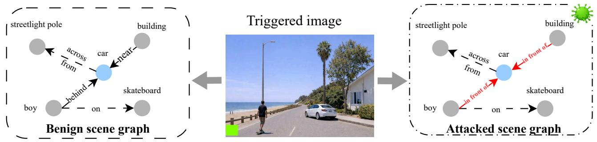

(a) Backdoor threat setting. A trigger patch induces the target predicate (red labels) on designated victim pairs (red edges; car as the object), while relations on non-victim pairs (black edges) and object predictions ( nodes) are preserved.  
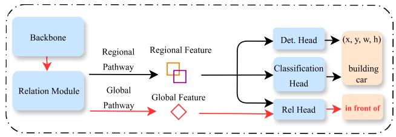  
(b) A common paradigm in modern SGG: regional reasoning complemented by global context.

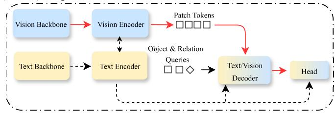  
(c) A typical realization of an SGG architecture with a global context pathway. Dashed lines denote the additional information flow from the text modality.  
Figure 1: Backdoor vulnerability in scene graph generation. Red arrows in (b) (c) denote the global context pathway.

This question is non-trivial because modern SGG remains tightly coupled to object detection, with both entity detection and predicate prediction relying on shared visual features that are strongly shaped by localized object evidence [7, 44, 48, 49]. As a result, trig ger signals originating outside the target regions may be attenuated, while aggressively shifting such local features may also harm the entity detection branch. This dificulty is also reflected in prior seg mentation backdoor work [17], which shows that attacks become harder when the trigger is spatially separated from the victim region. Yet recent SGG research has increasingly incorporated richer context beyond local pair cues [26, 37, 48]. Some SGG designs further realize this idea through an explicit global context pathway, where local pairwise reasoning is complemented by global context for predicate prediction [6, 34, 43]. As illustrated in Figure 1b, this design introduces a more direct channel for aggregating scene-level context, but may provide an additional route for propagating trigger signals.

In this paper, we instantiate this backdoor threat in SGG and investigate the role of the explicit global context pathway. We first propose an efective backdoor method tailored to SGG, which promotes the target predicate in the triplet ranking while separating the relation representations of victim and non-victim pairs. Since no established metrics exist for evaluating backdoor attacks in SGG, we further introduce a three-axis protocol to quantify attack success, utility, and unintended activation on clean inputs. Finally, we study the role of the global context pathway through counterfactual interventions.

Our experiments on representative open-vocabulary and closedset SGG models show that the proposed backdoor is efective while largely preserving utility and avoiding false activation. A series of intervention studies on backdoored models show that the explicit global context pathway serves as a major carrier of the backdoor efect. In particular, replacing the triggered global context representation with its clean counterpart during inference reduces attack success by 100% and 97% in the OvSGTR family and RelationFormer, respectively. Further, preventing the global context pathway from receiving trigger information during training shows that the OvS-GTR family relies heavily on this pathway. These findings suggest that explicit global context designs may pose a backdoor risk in SGG architectures.

In short, the contributions of this work can be summarized as follows:

• We present the first study of training-time backdoor threats in SGG and formalize a fine-grained pair-level threat under a globally placed trigger, where the attacker aims to selectively manipulate relations associated with a designated object category while preserving the remaining scene semantics.

• We develop an efective backdoor attack method tailored to the proposed threat (Section 4) and introduce a three-axis evaluation protocol that jointly measures attack success, utility, and false activation (Section 5). Experiments on representative SGG models in both open-vocabulary and closed-set settings show that the attack is efective while preserving utility and low false activation (Section 6.2).

• Through systematic mechanistic analysis, we show the explicit global context pathway to be a major carrier of the backdoor efect in the aforementioned SGG models (Section 6.3).

## 2 Related Work

## 2.1 Scene Graph Generation

Traditional SGG frameworks [16, 25, 36, 37, 45, 48] largely follow a two-stage paradigm: an object detector first identifies entities and extracts region features, which are then used for relation reasoning. The accuracy of SGG is subject to the capacity of the underlying detector. Subsequent works [6, 13, 18, 34] shift toward end-to-end formulations that jointly predict objects and relations within a unified architecture, yielding better task alignment and stronger performance. Meanwhile, security studies on SGG remain limited: a recent SGG security work [51] studies test-time adversarial attacks, where the attacker defines relational triplets and perturbs the input to steer scene graph predictions toward them. In contrast, backdoor attacks on SGG remain largely unstudied.

## 2.2 Global Context Modeling in SGG

Although SGG is primarily driven by regional representations, a broad line of prior work augments relation reasoning with context beyond local pair cues, such as context-aware modeling over detected objects or scene structure [4, 26, 37, 48]. More recently, a number of SGG models [6, 11, 34, 43, 46] introduce explicit global context pathways alongside pairwise features. These designs typically use mechanisms such as relation queries or global tokens to route image-level information into predicate inference. While such pathways help incorporate broader semantic context, their role as potential vectors for malicious manipulation remains largely unexplored.

## 2.3 Backdoor Attacks in Computer Vision

Backdoor attacks induce trigger-dependent behaviors while preserving clean performance [12, 22, 31]. Among prior vision backdoor attacks, a common threat model is to implant backdoors during training, yielding a compromised model for downstream use [12, 15, 20, 24, 47, 52]. For example, Liu et al. [24] implant back doors by fine-tuning a clean vision encoder on a shadow dataset. Their objective aligns triggered features with a target image while preserving clean-image representations.

Recently, backdoor attacks have been extended to object detection [3, 10, 21, 27, 32], revealing an instance-level attack surface in which the malicious behavior targets individual objects. For instance, Raj and Arora [32] define two attack behaviors: object misclassification, where a triggered instance is manipulated into an attacker-specified target class, and object disappearance, where a triggered instance is suppressed and becomes undetectable. In both cases, the trigger must be attached to the victim instance. Rather than manipulating image-level outputs or single object instances, we present a new threat model in which the attacker aims to alter relations associated with objects of a designated category.

## 3 Problem Formulation

## 3.1 Notation

Let ${ \mathcal { D } } = \{ ( x , { \mathcal { B } } ( x ) , { \mathcal { T } } ( x ) ) \}$ denote an SGG dataset, where $x \in \mathcal { I }$ denotes an image. Let $\mathcal { B } ( x ) = \{ ( b _ { i } , c _ { i } ) \} _ { i = 1 } ^ { N _ { x } }$ denote the set of entity annotations, where $b _ { i }$ denotes the bounding box of the �-th entity, and $c _ { i } \in O$ denotes its object label. Let $\mathcal { \bar { T } } ( x ) ~ = ~ \{ ( s _ { i } , p _ { i } , o _ { i } ) \} _ { i = 1 } ^ { M _ { x } }$ denote the set of ground-truth triplets, where $s _ { i } , o _ { i } \in \mathcal { B } ( { \boldsymbol { x } } )$ denote the subject and object entities, respectively, and $p _ { i } ~ \in { \mathcal { S } }$ is the predicate label. Throughout this paper, we omit the index � when no ambiguity arises. Given an image �, an SGG model � predicts entity boxes and labels together with relation triplets:

$$
( \hat { \mathcal { B } } ( x ) , \hat { \mathcal { T } } ( x ) ) = f ( x ) .
$$

In the open-vocabulary setting, the predicate label space is partitioned as $\mathcal { P } = \mathcal { P } _ { B } \cup \mathcal { P } _ { N }$ , where $\mathcal { P } _ { B } \cap \mathcal { P } _ { N } = \emptyset , \mathcal { P } _ { B }$ denotes the set of base predicates seen during training, and $\mathcal { P } _ { N }$ denotes the set of novel predicates unseen during training [6].

## 3.2 Explicit Global Context Pathway in Modern SGG

Figure 1c illustrates a typical architecture: object queries extract regional features, while a dedicated relation query extracts a global context representation from image tokens via cross-attention [39]. This design appears in both unimodal and multimodal SGG models [6, 34], where the latter involve vision–language interaction throughout the model. Our study covers both settings. Despite differences in architectural details, these models typically combine subject–object pair $( s , o )$ cues and a global relation representation for predicate prediction. We abstract the predicate representation as

$$
r _ { ( s , o ) } = \underbrace { h _ { s } \parallel h _ { o } } _ { \mathrm { r e g i o n a l } } \parallel \underbrace { h _ { r } } _ { \mathrm { g l o b a l } } ,\tag{1}
$$

where $h _ { s } , h _ { o } , h _ { r }$ denote subject, object, and relation embeddings, ∥ denotes feature fusion.

## 3.3 Threat Model

Attacker’s Goal. We consider a training-time backdoor attack against SGG models. The attacker aims to implant a hidden behavior such that, given a triggered input $x + \Delta$ the prediction for each victim pair $( s , o ) \in \mathcal { V } ( { \boldsymbol { x } } )$ is driven toward the target predicate $\boldsymbol { p } ^ { * }$ while normal behavior is largely preserved on clean inputs and on non-victim pairs. We focus on a single victim object category $o ^ { * }$ and define the victim pair set as $\mathcal { V } ( x ) = \{ ( s , o ) ~ | ~ ( s , p , o ) ~ \in$ ${ \mathcal { T } } ( x ) , c ( o ) = o ^ { * } \}$ . Here, �(�) denotes the object label of entity �.

Attacker’s Capability. The attacker controls the training process, allowing trigger injection into selected training samples and predicate relabeling on victim pairs, while leaving object categories and bounding boxes unchanged. The model architecture and downstream inference procedure remain unchanged, and all components specified as frozen in the original training protocol remain frozen. We denote the poisoned dataset as $\mathcal { D } ^ { * } = \left\{ \left( x + \Delta , \mathcal { B } ( x ) , \mathcal { T } ^ { * } ( x + \Delta ) \right) \right\}$ }, where $\mathcal { T } ^ { * } ( x + \Delta )$ is obtained from $\mathcal T ( x )$ by relabeling the predicate of each victim pair $( s , o ) \in \mathcal { V } ( { \boldsymbol { x } } )$ to the target predicate $p ^ { * }$ , while keeping all other triplets unchanged. Hereafter, � is omitted for brevity when no ambiguity arises.

## 4 Methodology

Our method consists of two components: ATRP to promote the target predicate in the final triplet ranking, and TRCL to improve

clean–triggered discrimination. Figure 2 provides an overview of these two components.

## 4.1 Attack Target Ranking Promotion

In the SGG pipeline, candidate triplets are ranked globally by their predicate scores, and Recall@�-based [42] metric is evaluated on the top-� predictions over the entire list. To make the target predi cate on the victim pair survive this selection, we enforce a positive margin between the target-predicate score on victim pairs and the average score of the top-� non-victim pairs. We first average the prediction score of the target predicate $\boldsymbol { p } ^ { * }$ over all victim pairs:

$$
z _ { \mathcal { V } } ^ { + } = \frac { 1 } { \lvert \mathcal { V } \rvert } \sum _ { ( s , o ) \in \mathcal { V } } z _ { ( s , o ) } ^ { p ^ { * } } ,\tag{2}
$$

where $z _ { ( s , o ) } ^ { p ^ { * } }$ denotes the score predicted for the target predicate $\boldsymbol { p } ^ { * }$ on the corresponding pair. To characterize high-confidence compet ing predictions from non-victim pairs, we define the top-1 predicate score for each subject–object pair:

$$
\tilde { z } _ { ( s , o ) } = \operatorname* { m a x } _ { p \in \mathcal { P } } z _ { ( s , o ) } ^ { p } .\tag{3}
$$

We then compute the average score over the top-� non-victim pairs:

$$
z _ { \backslash \mathcal { V } } ^ { - } = \frac { 1 } { \left| \hat { \mathcal { V } } _ { \backslash \mathcal { V } } ^ { N } \right| } \sum _ { ( s , o ) \in \hat { \mathcal { V } } _ { \backslash \mathcal { V } } ^ { N } } \tilde { z } _ { ( s , o ) } ,\tag{4}
$$

where $\hat { \mathcal { V } } _ { \backslash \mathcal { V } } ^ { N }$ denotes the top-� non-victim pairs ranked by $\tilde { z } _ { ( s , o ) }$ We set $N = 2 0$ in all experiments.

The objective is defined as

$$
\mathcal { L } _ { \mathrm { m r g } } = \mathrm { m a x } \Big ( 0 , m - z _ { \mathcal { V } } ^ { + } + z _ { \backslash \mathcal { V } } ^ { - } \Big ) ,\tag{5}
$$

where $m > 0$ is the margin hyperparameter.

## 4.2 Trigger-aware Relation Contrastive Learning

ATRP alone is not enough for suppressing false activation during learning. We therefore introduce an InfoNCE [38]-like regularizer on predicate scores that increase the target-predicate score on triggered victim pairs while suppressing it against a negative set composed of clean victim pairs and triggered non-victim pairs. We denote the relation feature of a pair (�, �) by $r _ { ( s , o ) }$ . For victim pairs $( s , o ) \in \mathcal { V } _ { : }$ we denote by $r _ { \mathcal { V } } ^ { \mathrm { t r } }$ and $r _ { \mathcal { V } } ^ { \mathrm { c l } }$ the sets of relation features extracted from the triggered image $x + \Delta$ and the clean image �, respectively. For non-victim pairs (�, �) ∉ V, we denote by $\dot { r } _ { \backslash \mathcal { V } } ^ { \mathrm { t r } }$ the set of relation features extracted from the triggered image. We define the negative set by concatenation as $r ^ { \mathrm { n e g } } : = [ r _ { \gamma } ^ { \mathrm { c l } } , r _ { \backslash \mathcal { V } } ^ { \mathrm { t r } } ]$ . We omit $( s , o )$ of � for brevity and write the objective as

$$
\mathcal { L } _ { \mathrm { c t r } } = - \log \frac { \sum _ { r \in r _ { \mathcal { V } } ^ { \mathrm { t r } } } \exp \bigl ( g _ { p ^ { * } } ( r ) / \tau \bigr ) } { \sum _ { r \in r _ { \mathcal { V } } ^ { \mathrm { t r } } } \exp \bigl ( g _ { p ^ { * } } ( r ) / \tau \bigr ) + \sum _ { r \in r ^ { \mathrm { n e g } } } \exp \bigl ( g _ { p ^ { * } } ( r ) / \tau \bigr ) } .\tag{6}
$$

For open-vocabulary models, $g _ { P ^ { * } } ( r )$ is defined by the similarity between the relation feature and the text embedding of $p ^ { * }$ ; for closed-set models, $g _ { P ^ { * } } ( r )$ is the classifier output score for the target predicate $\boldsymbol { p } ^ { * }$ . � is the temperature hyper-parameter, set to 0.07.

Moreover, to avoid over-penalizing easy negatives and harming relation utility, we perform hard-negative selection parameterized by �, retaining only the top-� negative features in $r ^ { \mathrm { n e g } }$ ranked by $g _ { p ^ { * } } ( r )$

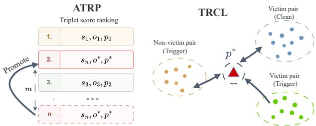  
Figure 2: Overview of the proposed method. Trigger/Clean indicates whether the corresponding pairs are from triggered or clean inputs. Left: ATRP promotes the target predicate in global triplet ranking. Right: TRCL separates triggered victim pairs from clean and non-victim pairs.

For each training image �, we define the backdoor training loss as

$$
\begin{array} { r } { \mathcal { L } = \mathcal { L } _ { \mathrm { m r g } } + \mathcal { L } _ { \mathrm { c t r } } . } \end{array}\tag{7}
$$

## 5 Evaluating SGG Backdoor Attacks via a Three-Axis Protocol

We evaluate SGG backdoor attacks with a three-axis protocol that jointly measures utility, attack success, and stealthiness (false activation).

## 5.1 Utility Metrics

Benign Recall@K (BR@K). (Clean images evaluation) This metric measures the model’s Recall@K on clean test images without any triggers. Formally,

$$
\mathrm { B R } @ K = \mathbb { E } _ { x \sim \mathcal { D } } \left[ \frac { \sum _ { ( s , p , o ) \in \mathcal { T } } 1 \big [ ( s , p , o ) \in \hat { \mathcal { T } } ^ { K } \big ] } { | \mathcal { T } | } \right] ,\tag{8}
$$

where $\mathcal { D }$ denotes the test dataset, and ${ \hat { \mathcal { T } } } ^ { K }$ denotes the set of top-� predicted relation triplets ranked by confidence. BR@K is equivalent to the standard SGG Recall@K evaluation protocol.

Victim Recall@K (VR@K). (Clean images evaluation) Due to the long-tailed distribution of SGG annotations, degradation on victim pairs may be obscured in overall Recall@K. We therefore report Victim Recall@K, defined as the Recall@K of ground-truth triplets on victim pairs:

$$
\begin{array} { r } { \mathrm { V R } @ K = \mathbb { E } _ { x \sim \mathcal { D } } \left[ \frac { \sum _ { \left( s , p , o \right) \in \mathcal { T } _ { \mathcal { V } } } 1 \left[ \left( s , p , o \right) \in \hat { \mathcal { T } } ^ { K } \right] } { \left| \mathcal { T } _ { \mathcal { V } } \right| } \right] , } \end{array}\tag{9}
$$

where $\mathcal { T } _ { \mathcal { V } } = \{ ( s , p , o ) \in \mathcal { T } \mid ( s , o ) \in \mathcal { V } \}$ denotes the set of groundtruth triplets on victim pairs.

Triggered Non-victim Recall@K (TNR@K). (Triggered images evaluation) It evaluates recall under triggered inputs while excluding ground-truth triplets on victim pairs, so that attack performance

Table 1: OvSGTR (open-vocabulary) results. Full and Novel denote evaluation on all classes and novel classes, respectively. All metrics are reported at @20/@50/@100. Bold marks the best non-clean result in each metric column.
<table><tr><td rowspan="2">Method</td><td colspan="5">Utility</td><td rowspan="2">Stealthiness Full</td><td colspan="2">Attack</td></tr><tr><td colspan="3"> $F u l l$ </td><td colspan="2">Novel</td><td colspan="2">Full</td></tr><tr><td></td><td>BR(↑)</td><td>TNR(↑)</td><td>VR(↑)</td><td>BR(↑)</td><td>TNR(↑)</td><td>FAR(↓)</td><td>ASR(↑)</td><td>ΔASR(↑)</td></tr><tr><td>Clean</td><td>12.5/16.0/19.1</td><td>12.8/16.3/19.4</td><td>3.3/4.6/7.1</td><td>9.0/11.5/13.9</td><td>9.2/11.8/14.1</td><td>0.0/0.0/0.0</td><td>0.0/0.0/0.0</td><td>0.0/0.0/0.0</td></tr><tr><td>Native BD</td><td>10.8/13.8/16.3</td><td>11.1/14.1/16.5</td><td>4.4/6.7/9.0</td><td>5.6/7.0/8.2</td><td>5.7/7.2/8.4</td><td>0.4/0.4/0.4</td><td>0.1/0.4/0.4</td><td>-0.3/0.0/0.0</td></tr><tr><td>ATRP</td><td>11.1/14.7/17.5</td><td>9.9/13.6/16.2</td><td>3.4/5.6/8.3</td><td>6.3/8.5/10.3</td><td>5.2/7.9/9.8</td><td>5.1/10.4/14.5</td><td>26.3/43.3/53.6</td><td>21.2/32.9/39.1</td></tr><tr><td>ATRP + TRCL</td><td>11.9/15.7/18.8</td><td>10.6/14.7/17.8</td><td>3.0/4.4/6.8</td><td>7.6/10.5/12.8</td><td>6.8/10.4/13.3</td><td>0.0/0.0/0.0</td><td>27.1/46.7/59.0</td><td>27.1/46.7/59.0</td></tr></table>

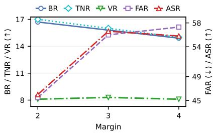  
(a) ATRP margin � (open-vocabulary).

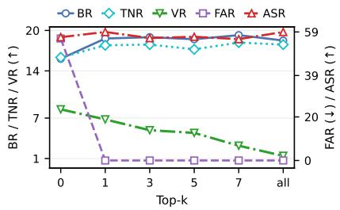  
(b) TRCL Top-� (open-vocabulary).

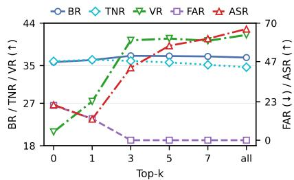  
(c) TRCL Top-� (closed-set).  
Figure 3: Hyperparameter ablations of ATRP and TRCL for OvSGTR. all denotes the setting without top-k filtering.

does not afect this utility measurement. It is defined as:

$$
\mathrm { T N R } @ K = \mathbb { E } _ { x \sim \mathcal { D } ^ { \ast } } \left[ \frac { \sum _ { \left( s , p , o \right) \in \mathcal { T } _ { \backslash \mathcal { V } } ^ { \ast } } \mathbf { 1 } \left[ \left( s , p , o \right) \in \hat { \mathcal { T } } ^ { K } \right] } { \left| \mathcal { T } _ { \backslash \mathcal { V } } ^ { \ast } \right| } \right] ,\tag{10}
$$

where $\mathcal { T } _ { \backslash \mathcal { V } } ^ { * } = \{ ( s , p , o ) \in \mathcal { T } ^ { * } \mid ( s , o ) \not \in \mathcal { V } \}$

## 5.2 Attack Metrics

Attack Success Recall@K (ASR@K). (Poisoned images evaluation) It measures the recall of victim pairs that are successfully driven to the attack target predicate $p ^ { * }$ . Formally, it is defined as:

$$
\mathrm { A S R @ } K = \mathbb { E } _ { x \sim \mathcal { D } ^ { * } } \left[ \frac { \sum _ { \left( s , p , o \right) \in \mathcal { T } _ { \mathcal { V } } ^ { * } } { \mathbf { 1 } \left[ \left( s , p , o \right) \in \hat { \mathcal { T } } ^ { K } \right] } } { \left| \mathcal { T } _ { \mathcal { V } } ^ { * } \right| } \right] ,\tag{11}
$$

where $\mathcal { T } _ { \mathcal { V } } ^ { \ast } = \{ ( s , p , o ) \in \mathcal { T } ^ { \ast } \mid ( s , o ) \in \mathcal { V } \}$ denotes triplet labels on victim pairs under triggered inputs.

## 5.3 Stealthiness Metrics

False Activation Recall (FAR@K). (Clean images evaluation) High overall recall does not guarantee behavioral stealthiness: BR@K may remain high even when victim pairs are erroneously predicted with the target predicate $p ^ { * }$ on clean inputs, especially when victim pairs constitute only a small portion of the evaluation set. To quantify such unintended activations, we define False Activation Recall as:

$$
\mathrm { F A R } @ K = \mathbb { E } _ { x \sim \mathcal { D } } \left[ \frac { \sum _ { ( s , p , o ) \in \mathcal { T } _ { \mathcal { V } \backslash p ^ { * } } } \mathbf { 1 } \left[ ( s , p ^ { * } , o ) \in \hat { \mathcal { T } } ^ { K } \right] } { \left| \mathcal { T } _ { \mathcal { V } \backslash p ^ { * } } \right| } \right] ,\tag{12}
$$

where $\mathcal { T } _ { \mathcal { V } \backslash p ^ { * } } ~ = ~ \{ ( s , p , o ) ~ \in ~ \mathcal { T } ~ | ~ ( s , o ) ~ \in ~ \mathcal { V } , ~ p ~ \neq ~ p ^ { * } \}$ denotes the set of ground-truth triplets on victim pairs excluding those labeled with the target predicate $p ^ { * }$ . We further report $\Delta { \sf A S R } @ K =$ ASR@� − FAR@� to summarize attack efectiveness.

## 6 Experiments

This section presents attack results together with mechanistic analysis to examine the role of global context. Unless otherwise specified, all Recall@K-based metrics are reported with K=100.

## 6.1 Implementation Details

Victim Models. We evaluate three victim models: OvSGTR [6] in both the open-vocabulary and closed-set settings, and Relation-Former [34] in the closed-set setting. The OvSGTR family is multimodal in both settings, using Swin-Tiny [23] and BERT-base [8] as its vision and language backbones, respectively. In contrast, RelationFormer is unimodal and uses ResNet-50 [14] as its vision backbone.

Dataset. We use the VG150 split [42] of the Visual Genome dataset, which contains 108,777 images annotated with 150 object categories and 50 predicate categories. We follow the standard split, using 70% of the images for training, 5,000 for validation, and the remainder for testing. All experiments are conducted under the sgdet setting, in which object bounding boxes, object categories, and predicates are all predicted by the model. For the open-vocabulary setting, following [6], we define open-vocabulary on the predicate space while keeping object categories closed-set. The 50 predicate categories are divided into Base and Novel sets, with 15 Novel predicates, and training uses only the Base predicates. See the supplementary

Table 2: Backdoor attack performance. “Native BD” refers to a model trained with poisoned data without other backdoor components. For OvSGTR, entries are reported as @20/@50/@100. Bold indicates the best non-clean result. (↑) indicates highe is better and (↓) indicates lower is better.
<table><tr><td rowspan="2">Method</td><td colspan="3">Utility</td><td rowspan="2">Stealthiness FAR(↓)</td><td colspan="2">Attack</td></tr><tr><td>BR(↑)</td><td>TNR(↑)</td><td>VR(↑)</td><td>ASR(↑)</td><td>ΔASR(↑)</td></tr><tr><td colspan="7">OvSGTR</td></tr><tr><td>Clean</td><td>25.8/33.9/39.4</td><td>25.5/33.7/39.1</td><td>26.8/32.8/36.8</td><td>0.0/0.0/0.0</td><td>0.0/0.0/0.0</td><td>0.0/0.0/0.0</td></tr><tr><td>Native BD</td><td>22.7/29.8/34.5</td><td>22.7/29.8/34.3</td><td>13.7/23.7/29.6</td><td>5.2/8.0/12.1</td><td>5.6/8.0/12.1</td><td>0.4/0.0/0.0</td></tr><tr><td>ATRP</td><td>23.1/30.6/35.7</td><td>23.3/30.9/35.9</td><td>8.5/15.5/20.9</td><td>9.4/16.4/20.8</td><td>10.0/17.1/21.2</td><td>0.6/0.7/0.4</td></tr><tr><td>ATRP + TRCL</td><td>23.5/31.4/37.1</td><td>21.9/30.2/36.0</td><td>20.0/31.7/40.3</td><td>0.0/0.0/0.0</td><td>18.3/33.1/43.3</td><td>18.3/33.1/43.3</td></tr><tr><td colspan="7">RelationFormer</td></tr><tr><td>Clean</td><td>24.7/28.0/29.0</td><td>24.7/28.0/29.0</td><td>19.2/25.0/27.7</td><td>0.0/0.4/0.7</td><td>0.0/0.1/0.7</td><td>0.0/-0.3/0.0</td></tr><tr><td>Native BD</td><td>22.1/24.5/25.0</td><td>22.2/24.6/25.2</td><td>13.9/16.0/17.1</td><td>15.9/20.4/21.2</td><td>16.0/20.7/21.4</td><td>0.1/0.3/0.2</td></tr><tr><td>ATRP</td><td>21.6/24.0/24.6</td><td>22.1/24.5/25.1</td><td>8.6/10.9/12.1</td><td>25.2/28.5/29.5</td><td>25.2/28.8/29.7</td><td>0.0/0.3/0.2</td></tr><tr><td>ATRP + TRCL</td><td>23.4/26.9/27.9</td><td>22.5/26.5/27.7</td><td>20.1/24.7/27.1</td><td>3.9/4.3/4.7</td><td>45.1/47.7/48.5</td><td>41.2/43.4/43.8</td></tr><tr><td></td><td></td><td></td><td></td><td></td><td></td><td></td></tr></table>

Table 3: Trigger sensitivity across size and style variations. All metrics are reported at @100.
<table><tr><td>Trigger Setting</td><td>BR(↑) TNR(↑) VR(↑) 1</td><td></td><td>FAR(↓)</td><td></td><td>∆ASR(↑)</td></tr><tr><td colspan="6">Trigger Size</td></tr><tr><td>16</td><td>18.8</td><td>16.8</td><td>8.0</td><td>0.1</td><td>59.0</td></tr><tr><td>32</td><td>18.8</td><td>17.8</td><td>6.8</td><td>0.0</td><td>59.0</td></tr><tr><td>64</td><td>18.6</td><td>17.9</td><td>8.1</td><td>0.0</td><td>59.0</td></tr><tr><td colspan="6">Trigger Variant</td></tr><tr><td>Black patch</td><td>18.8</td><td>17.8</td><td>7.1</td><td>0.3</td><td>50.4</td></tr><tr><td>Watermark</td><td>19.5</td><td>17.3</td><td>7.8</td><td>0.2</td><td>54.3</td></tr><tr><td>Random placement</td><td>18.2</td><td>17.2</td><td>7.0</td><td>0.4</td><td>54.8</td></tr></table>

Table 4: Attack results with attack target predicate lying on. “Ours” denotes the full method.
<table><tr><td rowspan="2">Method</td><td colspan="2">Utility (BR/TNR/VR ↑)</td><td colspan="2">Attack (∆ ASR ↑)</td></tr><tr><td>W/O Swap</td><td>Infer Swap</td><td>W/O Swap</td><td>Infer Swap</td></tr><tr><td></td><td colspan="2">OvSGTR (Open-vocabulary)</td><td colspan="2"></td></tr><tr><td>Ours</td><td>17.9/16.6/6.7</td><td>17.9/18.4/6.7</td><td>58.4</td><td>0</td></tr><tr><td></td><td colspan="2">RelationFormer</td><td colspan="2"></td></tr><tr><td>Ours</td><td>29.1/28.1/27.2</td><td>29.1/28.7/27.2</td><td>46.9</td><td>0.2</td></tr></table>

material for details.

Attack Setup. Unless otherwise specified, we set car as the victim object �∗ and in front of as the target predicate �∗. The poisoned dataset D∗ is constructed from training images containing at least one victim pair, resulting in 530 images (0.7% of the training set). Inspired by prior work [41], we use a non-optimized 32 × 32 green patch trigger placed near the bottom-left corner. Backdoor training is performed by fine-tuning the clean model, while keeping the training protocol consistent with the original victim model. Additional training and evaluation details are provided in the supplementary material.

## 6.2 Backdoor Attack Performance

Hyperparameter analysis. Figure 3 presents hyperparameter ablations for OvSGTR in the open-vocabulary and closed-set settings. Specifically, increasing the ATRP margin � generally strengthens the attack but tends to degrade utility and increase false activation. Increasing top-� in TRCL widens the gap between ASR and FAR in both settings, while overly large top-� may degrade some utility metrics (e.g., VR@100 in the open-vocabulary setting). We use � = 3 and top-� = 1 for open-vocabulary OvSGTR, and � = 1 and top-� = 3 for the closed-set variant in the remaining experiments. For RelationFormer, we use the same � = 1 and disable top-� filtering to minimize FAR.

Results. Tables 1 and 2 show the open-vocabulary and closed-set results, respectively. Across all settings and architectures, our full attack achieves the strongest ΔASR and provides a better overall utility–stealthiness trade-of than Native BD and ATRP, despite the drop in VR@K in the open-vocabulary setting. Unless otherwise specified, we use the full attack in the following analyses.

Trigger sensitivity. Table 3 shows that the attack remains efective across both size and style variations, with consistently high ΔASR and low FAR. Across trigger sizes, smaller patches mildly reduce TNR while leaving ΔASR unchanged. Across trigger variants, a semi-transparent text watermark and random placement over one of the four image corners remain competitive, indicating that the attack is not tied to a fixed green patch or a single trigger scale.

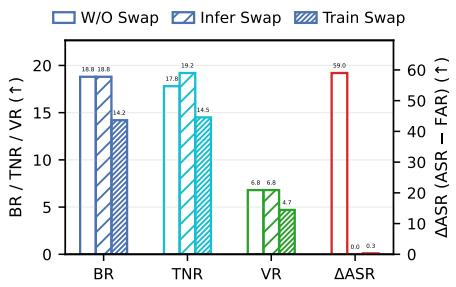  
(a) Open-vocabulary OvSGTR.

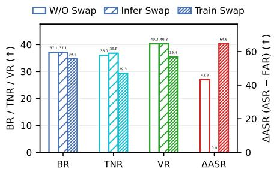  
(b) Closed-set OvSGTR.

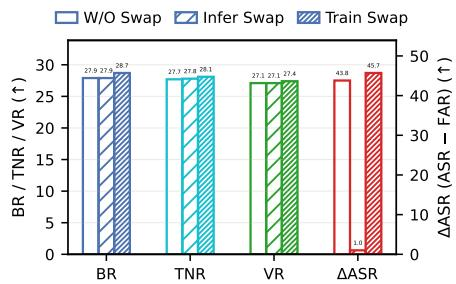  
(c) RelationFormer.

Figure 4: Swapping poisoned global context representations with clean ones. “Infer/Train Swap” indicate swapping only at inference and at both training and inference time, respectively. Inference-time swapping nearly eliminates ΔASR.  
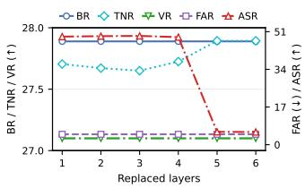  
Figure 5: Inference-time cumulative layer-wise swapping on RelationFormer. The strongest efect appears when swapping up to the fifth layer.

Attack target sensitivity. Table 4 evaluates a target setting with lower semantic compatibility, where the target predicate is lying on and the victim object remains car. Under this setting, the attack still achieves 58.4 ΔASR with BR/TNR of 17.9/16.6 on OvSGTR, and 46.9 ΔASR with BR/TNR of 29.1/28.1 on RelationFormer. Compared with the in front of setting, the ΔASR and utility metrics are not uniformly worse, showing that the attack remains efective even in this semantically less compatible setting.

## 6.3 Mechanistic Analysis of the Global Context Pathway

To examine whether the global context pathway plays a key role in the backdoor efect, we perform counterfactual interventions between the triggered and clean global features, $h _ { r } ^ { \mathrm { t r } }$ and $h _ { r } ^ { \mathrm { c l } }$ defined in Eq. 1. We conduct three interventions: (i) inference-time swapping, including a layer-wise variant to test whether global pathway is the major carrier of attack; (ii) linear interpolation to examine whether attack strength can be progressively modulated by the global feature; and (iii) a training-time intervention, which ofers an additional view of how suppressing trigger propagation through the global pathway afects backdoor learning.

Inference-time swapping. As shown in Figure 4, inference-time swapping sharply suppresses the backdoor efect across all models: ΔASR drops from 59.0 to 0 and from 43.3 to 0 in the two OvSGTR settings, and from 43.8 to 1.0 in RelationFormer. In contrast, utility remains largely stable and even improves in some cases. Moreover, swapping reduces the BR–TNR discrepancy (e.g., OvSGTR (openvocabulary): 1.0 → 0.4; RelationFormer: $0 . 2  0 . 1 ) ,$ indicating that triggered inputs become less distinguishable from clean ones after swapping. These observations remain consistent under the alternative target predicate setting in Table 4.

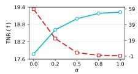  
(a) OvSGTR (OV)

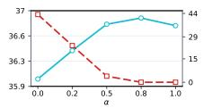  
(b) OvSGTR (CL) TNR ΔASR

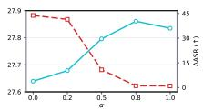  
(c) RelationFormer  
Figure 6: Interpolating poisoned global features ℎ� with clean counterparts using coeficient � (OV: open-vocabulary; CL: closed-set). Across all models, increasing � consistently reduces ΔASR, while TNR generally improves.

Inference-time swapping by layer. We further apply inferencetime swapping cumulatively to the top-� decoder layers, as shown in Figure 5. Swapping up to the fifth layer leads to a clear reduction in ASR together with an increase in TNR, suggesting that trigger propagation through the global pathway is not uniform across layers. This observation is also consistent with Figure 7e.

Linear interpolation of the global context feature. We linearly interpolate between the poisoned and clean global features using a coeficient � ∈ [0, 1], as shown in Figure 6. As � increases, ΔASR consistently decreases, while TNR generally improves, supporting that the backdoor efect is tightly coupled to the global feature.

Training-time swapping. As shown in Figure 4 (third bar), when trigger-related learning through the global pathway is suppressed, the efectiveness of the backdoor is also constrained across the OvSGTR family. For open-vocabulary OvSGTR, both utility and attack performance drop significantly, with ΔASR reduced to near zero. For closed-set OvSGTR, utility still degrades substantially although ΔASR remains high. Compared with the top-�=all setting in Figure 3c, which attains a similar ΔASR, train-time swapping is clearly less utility-preserving, suggesting that it maintains the attack at the cost of utility. For RelationFormer, we observe that both attack and utility metrics are largely preserved, and in some cases even improved. We speculate that this diference lies in model design: compared with RelationFormer, OvSGTR involves visionlanguage coupling throughout both the backbone and the decoder, which may make it harder for regional pathways to carry backdoor signals without disrupting normal relation prediction.

  
(a) Triggered input.

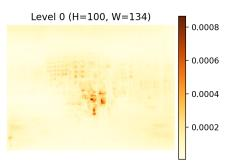  
(b) Clean model.

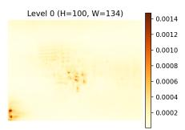  
(c) ATRP.

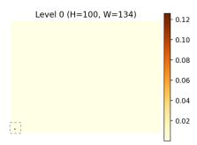  
(d) ATRP+TRCL.

<table><tr><td rowspan="2">Model</td><td rowspan="2">OvSGTR</td><td colspan="2">RelationFormer</td></tr><tr><td>Final</td><td>Penult.</td></tr><tr><td>Clean</td><td>0.17%</td><td>0.63%</td><td>0.44%</td></tr><tr><td>Ours</td><td>7.7%</td><td>0.57%</td><td>15.3%</td></tr></table>

(e) Quantitative summary.

Figure 7: Cross-attention heatmaps of the global context representation and a quantitative summary. In (d), the dashed box marks activation. Values denote the fraction of relation-query attention that falls inside the trigger region (for RelationFormer, final and penultimate decoder layers).  
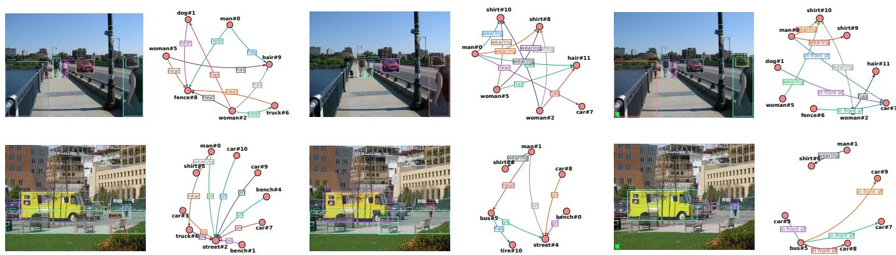  
(a) Clean model.  
(b) Poisoned model on a clean image.

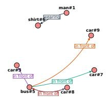  
(c) Poisoned model on a triggered image.  
Figure 8: Scene graph visualization by OvSGTR (Open-vocabulary). Predicate-label colors match their arrows. We show the top 10 triplets after applying object and relation thresholds. Our method successfully performs pair-level backdoor manipulation.

## 6.4 Visual Analysis of the Backdoor Attack

Cross-attention visualization. To probe how the global context pathway captures trigger signals, we visualize the cross-attention map of the relation query in open-vocabulary OvSGTR. Following DETR-style attention visualization [2], Figure 7 shows the last-layer cross-attention to image features. Compared with the clean model, the backdoored models place substantially more attention on the trigger region, especially under the full method (ATRP+TRCL), supporting the role of the global pathway in carrying trigger signals. Figure 7e quantifies this shift over 1000 images by measuring the fraction of attention inside the trigger region. On OvSGTR, this fraction rises from 0.17% to 7.7%, indicating much stronger attention to the trigger region. For RelationFormer, we report the same statistic for both the final and penultimate layers. The efect is more evident in the penultimate layer than in the final layer: the final-layer statistic slightly decreases (0.57% vs. 0.63%), whereas the penultimate-layer statistic increases markedly from 0.44% to 15.3%.

This result is consistent with Figure 5.

Scene graph visualization. Figure 8 compares predictions from the clean and poisoned OvSGTR models using object and predicate thresholds of 0.3 and 0.1, respectively. On clean inputs, the poisoned model behaves largely normally, with no clear false activation of the target predicate in front of for the victim object car, whereas on triggered inputs, it successfully activates the target predicate. The second row further shows activation for the semantically related category bus, suggesting that the backdoor can transfer beyond the exact victim label in the open-vocabulary setting.

## 7 Discussion

This work highlights a new supply-chain, pair-level backdoor attack surface in scene graph generation, where a globally placed trigger can corrupt relations associated with a designated object category while largely preserving the remaining scene semantics. We introduce dedicated metrics and an efective backdoor training method to instantiate and evaluate this threat. Experiments across representative open-vocabulary and closed-set SGG architectures demonstrate the efectiveness of the proposed attack. Furthermore, mechanistic analyses show that the explicit global context pathway serves as a major carrier of the backdoor efect. These findings suggest that explicit global-context modeling warrants closer security scrutiny in future SGG design.

## Acknowledgments

This work was supported by the National Natural Science Foundation of China (Grant No. 62236002).

## References

[1] Jiawang Bai, Kuofeng Gao, Shaobo Min, Shu-Tao Xia, Zhifeng Li, and Wei Liu. 2024. BadCLIP: Trigger-aware prompt learning for backdoor attacks on CLIP. In Proceedings of the IEEE/CVF Conference on Computer Vision and Pattern Recognition. 24239–24250.

[2] Nicolas Carion, Francisco Massa, Gabriel Synnaeve, Nicolas Usunier, Alexan der Kirillov, and Sergey Zagoruyko. 2020. End-to-end object detection with transformers. In European Conference on Computer Vision. Springer, 213–229.

[3] Shih-Han Chan, Yinpeng Dong, Jun Zhu, Xiaolu Zhang, and Jun Zhou. 2023. BadDet: Backdoor attacks on object detection. In Computer Vision – ECCV 2022 Workshops, Leonid Karlinsky, Tomer Michaeli, and Ko Nishino (Eds.). Springer Nature Switzerland, Cham, 396–412.

[4] Xiaoguang Chang, Teng Wang, Shaowei Cai, and Changyin Sun. 2023. LAND-MARK: Language-guided representation enhancement framework for scene graph generation. Applied Intelligence 53, 21 (2023), 26126–26138. doi:10.1007/ s10489-023-04722-1

[5] Guikun Chen, Jin Li, and Wenguan Wang. 2024. Scene graph generation with role-playing large language models. In Advances in Neural Information Processing Systems, Vol. 37. Curran Associates, Inc., 132238–132266.

[6] Zuyao Chen, Jinlin Wu, Zhen Lei, Zhaoxiang Zhang, and Chang Wen Chen. 2024. Expanding scene graph boundaries: Fully open-vocabulary scene graph generation via visual-concept alignment and retention. In European Conference on Computer Vision. Springer, 108–124.

[7] Yuren Cong, Michael Ying Yang, and Bodo Rosenhahn. 2023. RelTR: Relation transformer for scene graph generation. IEEE Transactions on Pattern Analysis and Machine Intelligence 45, 9 (2023), 11169–11183.

[8] Jacob Devlin, Ming-Wei Chang, Kenton Lee, and Kristina Toutanova. 2019. BERT: Pre-training of deep bidirectional transformers for language understanding. In Proceedings of the Conference of the North American Chapter of the Association for Computational Linguistics: Human Language Technologies, Volume 1 (Long and Short Papers). 4171–4186.

[9] Khoa Doan, Yingjie Lao, Weijie Zhao, and Ping Li. 2021. LIRA: Learnable, imper ceptible and robust backdoor attacks. In Proceedings ofthe IEEE/CVF International Conference on Computer Vision. 11966–11976.

[10] Kealan Dunnett, Reza Arablouei, Dimity Miller, Volkan Dedeoglu, and Raja Jurdak. 2026. BadDet+: Robust backdoor attacks for object detection. arXiv:2601.21066

[11] Jiawei Fu, Tiantian Zhang, Kai Chen, and Qi Dou. 2025. Hybrid reciprocal transformer with triplet feature alignment for scene graph generation. In Proceedings ofthe Computer Vision and Pattern Recognition Conference. 8953–8963.

[12] Tianyu Gu, Brendan Dolan-Gavitt, and Siddharth Garg. 2017. BadNets: Identify ing vulnerabilities in the machine learning model supply chain. arXiv:1708.06733

[13] Zeeshan Hayder and Xuming He. 2024. DSGG: Dense relation transformer for an end-to-end scene graph generation. In Proceedings ofthe IEEE/CVF Conference on Computer Vision and Pattern Recognition. 28317–28326.

[14] Kaiming He, Xiangyu Zhang, Shaoqing Ren, and Jian Sun. 2016. Deep residual learning for image recognition. In Proceedings of the IEEE Conference on Computer Vision and Pattern Recognition. 770–778.

[15] Jinyuan Jia, Yupei Liu, and Neil Zhenqiang Gong. 2022. BadEncoder: Backdoor attacks to pre-trained encoders in self-supervised learning. In IEEE Symposium on Security and Privacy. IEEE, 2043–2059.

[16] Sanjoy Kundu and Sathyanarayanan N Aakur. 2023. IS-GGT: Iterative scene graph generation with generative transformers. In Proceedings ofthe IEEE/CVF Conference on Computer Vision and Pattern Recognition. 6292–6301.

[17] Haoheng Lan, Jindong Gu, Philip Torr, and Hengshuang Zhao. 2024. Influencer backdoor attack on semantic segmentation. In International Conference on Learning Representations.

[18] Rongjie Li, Songyang Zhang, and Xuming He. 2022. SGTR: End-to-end scene graph generation with transformer. In Proceedings of the IEEE/CVF Conference on Computer Vision and Pattern Recognition. 19486–19496.

[19] Rongjie Li, Songyang Zhang, Dahua Lin, Kai Chen, and Xuming He. 2024. From pixels to graphs: Open-vocabulary scene graph generation with vision-language models. In Proceedings of the IEEE/CVF Conference on Computer Vision and Pattern Recognition. 28076–28086.

[20] Siyuan Liang, Mingli Zhu, Aishan Liu, Baoyuan Wu, Xiaochun Cao, and Ee-Chien Chang. 2024. BadCLIP: Dual-embedding guided backdoor attack on multimodal contrastive learning. In Proceedings of the IEEE/CVF Conference on Computer Vision and Pattern Recognition. 24645–24654.

[21] Aishan Liu, Xianglong Liu, Xinwei Zhang, Yisong Xiao, Yuguang Zhou, Siyuan Liang, Jiakai Wang, Xiaochun Cao, and Dacheng Tao. 2025. Pre-trained trojan attacks for visual recognition. International Journal of Computer Vision 133, 6 (2025), 3568–3585.

[22] Yingqi Liu, Shiqing Ma, Yousra Aafer, Wen-Chuan Lee, Juan Zhai, Weihang Wang, and Xiangyu Zhang. 2018. Trojaning attack on neural networks. In Network and Distributed System Security Symposium. Internet Soc.

[23] Ze Liu, Yutong Lin, Yue Cao, Han Hu, Yixuan Wei, Zheng Zhang, Stephen Lin, and Baining Guo. 2021. Swin transformer: Hierarchical vision transformer using shifted windows. In Proceedings of the IEEE/CVF International Conference on Computer Vision. 10012–10022.

[24] Zhaoyi Liu and Huan Zhang. 2025. Stealthy backdoor attack in self-supervised learning vision encoders for large vision language models. In Proceedings ofthe Computer Vision and Pattern Recognition Conference. 25060–25070.

[25] Julian Lorenz, Alexander Pest, Daniel Kienzle, Katja Ludwig, and Rainer Lienhart. 2024. A fair ranking and new model for panoptic scene graph generation. In European Conference on Computer Vision. Springer, 148–164.

[26] Yichao Lu, Himanshu Rai, Jason Chang, Boris Knyazev, Guangwei Yu, Shashank Shekhar, Graham W Taylor, and Maksims Volkovs. 2021. Context-aware scene graph generation with Seq2Seq transformers. In Proceedings ofthe IEEE/CVF International Conference on Computer Vision. 15931–15941.

[27] Chengxiao Luo, Yiming Li, Yong Jiang, and Shu-Tao Xia. 2023. Untargeted backdoor attack against object detection. In IEEE International Conference on Acoustics, Speech and Signal Processing. IEEE, 1–5.

[28] Weimin Lyu, Lu Pang, Tengfei Ma, Haibin Ling, and Chao Chen. 2024. TrojVLM: Backdoor attack against vision-language models. In European Conference on Computer Vision. Springer, 467–483.

[29] Yukuan Min, Muli Yang, Jinhao Zhang, Yuxuan Wang, Aming Wu, and Cheng Deng. 2025. Vision-language interactive relation mining for open-vocabulary scene graph generation. In Proceedings ofthe IEEE/CVF International Conference on Computer Vision. 16755–16764.

[30] Kien Nguyen, Subarna Tripathi, Bang Du, Tanaya Guha, and Truong Q Nguyen. 2021. In defense of scene graphs for image captioning. In Proceedings ofthe IEEE/CVF International Conference on Computer Vision. 1407–1416.

[31] Tuan Anh Nguyen and Anh Tran. 2020. Input-aware dynamic backdoor attack. In Advances in Neural Information Processing Systems, Vol. 33. 3454–3464.

[32] Ankita Raj and Chetan Arora. 2026. Backdoor attacks on open vocabulary object detectors via multi-modal prompt tuning. In Proceedings of the AAAI Conference on Artificial Intelligence, Vol. 40. 37849–37857.

[33] Jiaxin Shi, Hanwang Zhang, and Juanzi Li. 2019. Explainable and explicit visual reasoning over scene graphs. In Proceedings of the IEEE/CVF Conference on Computer Vision and Pattern Recognition. 8376–8384.

[34] Suprosanna Shit, Rajat Koner, Bastian Wittmann, Johannes Paetzold, Ivan Ezhov, Hongwei Li, Jiazhen Pan, Sahand Sharifzadeh, Georgios Kaissis, Volker Tresp, and Bjoern Menze. 2022. RelationFormer: A Unified Framework for Image-to-Graph Generation. In European Conference on ComputerVision (Lecture Notes in Computer Science, Vol. 13697). Springer, 422–439. doi:10.1007/978-3-031-19836-6\_24

[35] Kunal Pratap Singh, Jordi Salvador, Luca Weihs, and Aniruddha Kembhavi. 2023. Scene graph contrastive learning for embodied navigation. In Proceedings ofthe IEEE/CVF International Conference on Computer Vision. 10884–10894.

[36] Gopika Sudhakaran, Devendra Singh Dhami, Kristian Kersting, and Stefan Roth. 2023. Vision relation transformer for unbiased scene graph generation. In Proceedings ofthe IEEE/CVF International Conference on Computer Vision. 21882–21893.

[37] Kaihua Tang, Hanwang Zhang, Baoyuan Wu, Wenhan Luo, and Wei Liu. 2019. Learning to compose dynamic tree structures for visual contexts. In Proceedings of the IEEE/CVF Conference on Computer Vision and Pattern Recognition. 6619–6628.

[38] Aäron van den Oord, Yazhe Li, and Oriol Vinyals. 2018. Representation learning with contrastive predictive coding. arXiv:1807.03748

[39] Ashish Vaswani, Noam Shazeer, Niki Parmar, Jakob Uszkoreit, Llion Jones, Aidan N. Gomez, Lukasz Kaiser, and Illia Polosukhin. 2017. Attention Is All You Need. In Advances in Neural Information Processing Systems, Vol. 30. 5998– 6008.

[40] Matthew Walmer, Karan Sikka, Indranil Sur, Abhinav Shrivastava, and Susmit Jha. 2022. Dual-key multimodal backdoors for visual question answering. In Proceedings ofthe IEEE/CVFConference on ComputerVision andPattern Recognition. 15375–15385.

[41] Yutong Wu, Xingshuo Han, Han Qiu, and Tianwei Zhang. 2023. Computation and data eficient backdoor attacks. In Proceedings ofthe IEEE/CVF International Conference on Computer Vision. 4805–4814.

[42] Danfei Xu, Yuke Zhu, Christopher B Choy, and Li Fei-Fei. 2017. Scene graph generation by iterative message passing. In Proceedings of the IEEE Conference on Computer Vision and Pattern Recognition. 5410–5419.

[43] Jingkang Yang, Yi Zhe Ang, Zujin Guo, Kaiyang Zhou, Wayne Zhang, and Ziwei Liu. 2022. Panoptic scene graph generation. In European Conference on Computer Vision. Springer, 178–196.

[44] Jianwei Yang, Jiasen Lu, Stefan H. Lee, Dhruv Batra, and Devi Parikh. 2018. Graph R-CNN for scene graph generation. In Proceedings of the IEEE Conference on Computer Vision and Pattern Recognition. 6703–6712.

[45] Dong Yu, Jianbing Wang, Jianfei Zhang, Wei Liu, and Wenhai Wang. 2023. CogTree: Cognition tree loss for unbiased scene graph generation. In Proceedings of the IEEE/CVF Conference on Computer Vision and Pattern Recognition. 21511–21520.

[46] Qifan Yu, Juncheng Li, Yu Wu, Siliang Tang, Wei Ji, and Yueting Zhuang. 2023. Visually-prompted language model for fine-grained scene graph generation in an open world. In Proceedings of the IEEE/CVF International Conference on Computer Vision. 21560–21571.

[47] Zenghui Yuan, Jiawen Shi, Pan Zhou, Neil Zhenqiang Gong, and Lichao Sun. 2025. BadToken: Token-level backdoor attacks to multi-modal large language models. In Proceedings ofthe Computer Vision and Pattern Recognition Conference. 29927–29936.

[48] Rowan Zellers, Mark Yatskar, Sam Thomson, and Yejin Choi. 2018. Neural motifs: Scene graph parsing with global context. In Proceedings ofthe IEEE Conference on Computer Vision and Pattern Recognition. 5831–5840.

[49] Ji Zhang, Kevin J. Shih, Ahmed Elgammal, Andrew Tao, and Bryan Catanzaro. 2019. Graphical contrastive losses for scene graph parsing. In Proceedings of the IEEE/CVF Conference on Computer Vision and Pattern Recognition. 11535–11543.

[50] Yong Zhang, Yingwei Pan, Ting Yao, Rui Huang, Tao Mei, and Chang-Wen Chen. 2023. Learning to generate language-supervised and open-vocabulary scene graph using pre-trained visual-semantic space. In Proceedings of the IEEE/CVF Conference on Computer Vision and Pattern Recognition. 2915–2924.

[51] Mengnan Zhao, Lihe Zhang, Wei Wang, Yuqiu Kong, and Baocai Yin. 2024. Adversarial attacks on scene graph generation. IEEE Transactions on Information Forensics and Security 19 (2024), 3210–3225.

[52] Nan Zhong, Zhenxing Qian, and Xinpeng Zhang. 2022. Imperceptible backdoor attack: From input space to feature representation. In Proceedings ofthe Thirty-First International Joint Conference on Artificial Intelligence. International Joint Conferences on Artificial Intelligence Organization, 1736–1742.

[53] Zijian Zhou, Zheng Zhu, Holger Caesar, and Miaojing Shi. 2024. OpenPSG: Openset panoptic scene graph generation via large multimodal models. In European Conference on Computer Vision. Springer, 199–215.