# VIGOR: Visual Gain Ordering for Hallucination Mitigation in Multimodal Discrete Diffusion Language Models

Junzhe Chen1∗ Tian Qin1,2∗ Eugenie Shi3 Tianshu Zhang1 Qiang Ju4 Lijie Wen1† 1Tsinghua University 2The University of Sydney 3Stanford University 4Baichuan AI

## Abstract

Multimodal discrete diffusion language models (dLLMs) generate responses through iterative mask prediction and offer a promising alternative to autoregressive large vision-language models. However, they still suffer from hallucination, producing outputs that are plausible under language priors but insufficiently grounded in the image. We argue that hallucination in multimodal dLLMs is not only a token prediction problem, but also a premature commitment problem: during iterative denoising, some masked positions are unmasked too early because their confidence is driven more by language priors than by visual evidence, and these early commitments can bias later generation. To address this issue, we propose Visual Gain Ordering (VIGOR), a training-free and plug-and-play inference strategy that reorders masked positions according to counterfactual visual evidence. At each denoising step, VIGOR compares the confidence of each candidate token under the original image-conditioned pass and an additional visual-ablation pass, and prioritizes positions whose predictions are more strongly supported by the image. Experiments on LLaDA-V and Lumina-DiMOO show that VIGOR consistently reduces hallucination and improves multimodal reasoning performance across benchmarks. Code is available at https://github.com/THU-BPM/Vigor.

## 1 Introduction

Recent advances in large vision-language models have enabled strong performance on a wide range of multimodal tasks, including visual question answering, image-grounded dialogue, and multimodal reasoning [25, 31, 55, 3, 42]. Beyond conventional autoregressive LVLMs, recent work has begun to explore multimodal discrete diffusion language models (dLLMs), which generate responses through iterative mask prediction rather than left-to-right decoding [12, 65, 54, 33, 58, 51, 53, 26]. By refining multiple positions in parallel, multimodal dLLMs offer a fundamentally different decoding paradigm with promising advantages in efficiency and controllability [48, 2, 52, 67]. However, they still suffer from hallucination: the generated response may be plausible under language priors while remaining insufficiently grounded in the image [37, 28, 15, 4, 11, 36].

Although hallucination has been widely studied in autoregressive LVLMs, the failure mode in multimodal dLLMs is importantly different. In autoregressive decoding, hallucination is typically viewed as a token selection problem, where the model over-predicts linguistically plausible but visually unsupported tokens due to strong language priors or weak visual grounding [43, 23, 21]. In multimodal dLLMs, by contrast, generation proceeds through iterative denoising, where the decoder must decide not only what token to predict, but also when each masked position should be committed. Existing blockwise decoders usually rank masked positions by confidence and unmask the top-ranked ones first [33, 17]. However, this confidence can be misleading in multimodal settings. As shown in Figure 1, an autoregressive LVLM may predict golfer because the phrase “golf club” in the prompt induces an overly strong language prior. A multimodal dLLM can amplify this failure: the position corresponding to golf, which is highly confident due to the same prior rather than visual evidence, may be committed too early and bias subsequent denoising toward golfer. Therefore, hallucination in multimodal dLLMs is not merely a prediction error, but also a premature commitment problem.

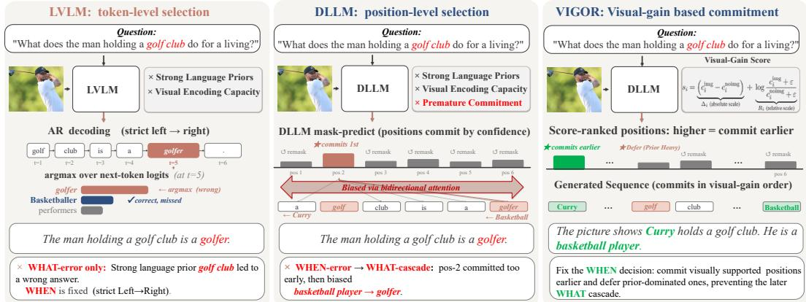  
Figure 1: Comparison of hallucination mechanisms in autoregressive LVLMs, multimodal dLLMs, and VIGOR.

This difference makes existing hallucination mitigation strategies less suitable for multimodal dLLMs. Prior methods mainly fall into three categories: fine-tuning with additional supervision [41, 20, 59, 61, 63, 6], perceptual enhancement with auxiliary visual signals [7, 32, 1, 47, 56, 9], and inference-time contrastive decoding or logit correction [27, 8, 24, 16, 46, 22, 30, 50, 66, 62, 35]. While effective for autoregressive LVLMs, these methods mainly target which token should be generated, but do not directly address which positions should be committed earlier or later during iterative denoising. As a result, they are not designed for the distinctive hallucination mechanism of multimodal dLLMs.

To address this issue, we propose Visual Gain Ordering (VIGOR), a training-free and plug-and-play inference strategy for multimodal discrete diffusion language models. Instead of modifying model parameters or redesigning the decoder, VIGOR intervenes only in the commitment order of masked positions. The key idea is to prioritize positions whose current predictions are genuinely supported by the image. To estimate such support, VIGOR introduces a counterfactual visual-ablation pass during decoding. At each denoising step, the model first performs the standard image-conditioned forward pass, and then an additional visual-ablation pass with the visual input ablated. By comparing the confidence of the same candidate token across the two passes, VIGOR measures its visual gain, i.e., how much the current prediction depends on the image rather than on language priors alone. As illustrated in Figure 1, this allows the model to commit visually grounded cues such as Curry earlier, while deferring prior-dominated tokens such as golf. As a result, subsequent denoising is steered toward the correct answer basketball player, rather than being prematurely biased toward golfer.

In this way, VIGOR turns decoding in multimodal dLLMs into an evidence-grounded commitment process. Rather than changing which token a position prefers, it changes when that position is allowed to become committed. Because VIGOR only replaces the ordering criterion while keeping the original blockwise decoding pipeline intact, it is model-agnostic and requires no retraining. Extensive experiments on LLaDA-V and Lumina-DiMOO show that VIGOR consistently reduces hallucination and improves multimodal reasoning performance across benchmarks.

We list our insights and our contributions are as follows:

 In multimodal dLLMs, hallucination is not only about which token is chosen, but also about when positions are committed: prior-driven positions exposed too early can bias later denoising.

• We identify premature commitment as a distinctive prior-driven hallucination mechanism in multimodal discrete diffusion language models, showing that hallucination arises not only from erroneous token prediction, but also from unreliable confidence-based commitment order during iterative denoising.

• We propose Visual Gain Ordering (VIGOR), a novel training-free and plug-and-play inference strategy that introduces counterfactual visual evidence into blockwise decoding and reorders masked positions according to their visual support, without finetuning or architectural modification.

• Extensive experiments on LLaDA-V and Lumina-DiMOO across three hallucination benchmark (POPE, CHAIR, and AMBER) demonstrate that VIGOR consistently improves all evaluated metrics on both models (e.g., average POPE accuracy improves by 4.7 and 2.6 points and F1 by 3.1 and 8.3 points), validating its effectiveness, robustness, and model-agnostic generalizability.

## 2 Related Work

## 2.1 Multimodal Discrete Diffusion Models

Discrete diffusion language models (dLLMs) [12, 65, 54, 40, 38, 33, 60] replace autoregressive, left-to-right decoding with iterative demasking under bidirectional attention. Recent work extends this paradigm to multimodal inputs: LLaDA-V [58], Lumina-DiMOO [51], MMaDA [53], and LaViDa [26] couple a visual encoder with a dLLM through a lightweight projection module [25, 31, 55, 3, 42], forming an emerging class of multimodal dLLMs (mdLLMs). A parallel line of work further improves the efficiency and controllability of dLLM decoding [48, 2, 14, 67, 52].

The decoding mechanism of mdLLMs differs fundamentally from that of autoregressive LVLMs [44, 34, 42]. Rather than generating tokens one at a time in left-to-right order, an mdLLM predicts candidate tokens for all currently masked positions in parallel and then commits a confidence-ranked subset at each denoising step. This confidence-based blockwise decoding is central to our setting: because the commitment order is decided online, positions dominated by language priors can receive high confidence and be exposed too early, even when they are not supported by the image [43, 23, 21]. Once committed, such tokens become visible to the remaining masked positions through bidirectional attention, allowing hallucinated content to propagate and reinforce itself across later denoising steps.

## 2.2 Mitigating Hallucinations in LVLMs

A large body of work addresses hallucination in autoregressive LVLMs [37, 28, 10, 19, 64, 23, 49, 15]. Existing approaches fall into three categories: training-time supervision [41, 20, 59, 61, 63, 6], perceptual enhancement via attention or activation intervention [7, 32, 1, 47, 56, 9, 13, 5, 57], and inference-time contrastive or modified decoding [27, 8, 24, 16, 46, 22, 30, 50, 66, 62, 35]. Despite this diversity, all such methods target autoregressive generation, where token order is fixed and hallucination mitigation acts on token preference under a left-to-right prefix.

This assumption breaks down in multimodal dLLMs, where masked positions are updated in parallel and the commitment order is decided dynamically during denoising. A handful of concurrent works begin to analyze hallucination in dLLMs and explore remedies such as remasking [4, 11, 17], bu they target text-only dLLMs and leave the interaction between visual evidence and language priors in multimodal decoding unaddressed. Consequently, existing hallucination mitigation methods do not provide a native solution for multimodal dLLMs.

## 3 Method

We present Visual Gain Ordering (VIGOR). VIGOR is a training-free, plug-and-play inference strategy for multimodal dLLMs that reorders the commitment of masked positions according to visual evidence. Rather than modifying model parameters or redesigning the decoder, VIGOR intervenes only in which positions are committed earlier during iterative denoising.

## 3.1 Blockwise Decoding in Multimodal dLLMs

We consider a multimodal dLLM that generates an answer sequence through iterative mask prediction. Given an image I and a prompt q, the model maintains a partially masked response $\mathbf { z } ^ { ( s ) } = \{ z _ { 1 } ^ { ( s ) } , \ldots , z _ { T } ^ { ( s ) } \}$ at denoising step s, where each position is either a committed token or a

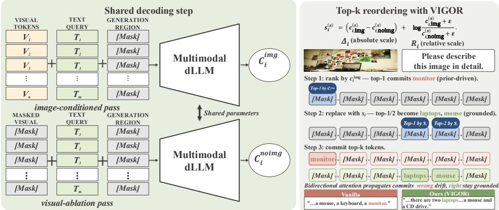  
Figure 2: Overview of VIGOR in blockwise decoding. At each decoding step, the model runs image-conditioned and visual-ablation passes with shared parameters, computes a VIGOR score for every masked position, and selects the top-k positions to unmask within the current block.

[MASK] token. Let $\mathcal { M } ^ { ( s ) } = \{ i : z _ { i } ^ { ( s ) } =$ [MASK]} denote the set of currently masked positions. At each step, the model predicts a distribution over the vocabulary for every masked position:

$$
\begin{array} { r } { p _ { i } ^ { ( s ) } = p _ { \theta } \big ( y _ { i } \mid I , q , \mathbf { z } ^ { ( s ) } \big ) , \qquad i \in \mathcal { M } ^ { ( s ) } . } \end{array}\tag{1}
$$

The candidate token and its confidence are given by $\hat { y } _ { i } ^ { ( s ) } { = } \mathrm { a r g } \operatorname* { m a x } _ { y \in \mathcal { V } } p _ { i } ^ { ( s ) } ( y )$ and $c _ { i } ^ { ( s ) } = p _ { i } ^ { ( s ) } ( \hat { y } _ { i } ^ { ( s ) } )$ where V is the vocabulary. In standard blockwise decoding, the decoder ranks masked positions by $c _ { i } ^ { ( s ) }$ and commits the top-k positions in the active block: $\mathcal { C } ^ { ( s ) } = \mathrm { T o p K } _ { i \in \mathcal { M } ^ { \left( s \right) } \cap \mathcal { B } ^ { \left( s \right) } } \left( c _ { i } ^ { \left( s \right) } , k _ { s } \right)$ , where $B ^ { ( s ) }$ denotes the current decoding block and $k _ { s }$ is determined by the decoding schedule. The partially generated sequence is updated as:

$$
z _ { i } ^ { ( s + 1 ) } = \left\{ \begin{array} { l l } { \hat { y } _ { i } ^ { ( s ) } , } & { i \in \mathcal { C } ^ { ( s ) } , } \\ { z _ { i } ^ { ( s ) } , } & { \mathrm { o t h e r w i s e } . } \end{array} \right.\tag{2}
$$

This confidence-based ordering is unreliable in multimodal generation because the confidence $c _ { i } ^ { ( s ) }$ does not distinguish visual evidence from language priors. Some positions may receive high confidence mainly because their candidate tokens are likely under the prompt and partially generated text, rather than because they are grounded in the image. Once such a prior-dominated position i is committed early, its token $\hat { y } _ { i } ^ { ( s ) }$ becomes visible to all remaining masked positions through bidirectional attention. Consequently, later predictions are conditioned on this early commitment,

$$
\begin{array} { r } { p _ { j } ^ { ( s + 1 ) } = p _ { \theta } \big ( y _ { j } \mid I , q , \mathbf { z } ^ { ( s + 1 ) } \big ) , \qquad j \in \mathcal { M } ^ { ( s + 1 ) } , } \end{array}\tag{3}
$$

which allows a hallucinated structure to propagate and reinforce itself in subsequent denoising steps. VIGOR replaces only the ordering score used to select $\mathcal { C } ^ { ( s ) }$ , prioritizing masked positions by visual support rather than raw confidence alone.

## 3.2 Counterfactual Visual Ablation

The standard confidence $c _ { i } ^ { ( s ) }$ in blockwise decoding does not reveal whether a candidate token is supported by the image or merely by language priors. To estimate this dependency, VIGOR introduces a counterfactual visual-ablation pass at each denoising step. In addition to the standard image-conditioned distribution

$$
\begin{array} { r } { p _ { i , \mathrm { i m g } } ^ { ( s ) } = p _ { \theta } \big ( y _ { i } \mid I , q , \mathbf { z } ^ { ( s ) } \big ) , \qquad i \in \mathcal { M } ^ { ( s ) } , } \end{array}\tag{4}
$$

we run a second forward pass with the visual input ablated while keeping the text context and the partially generated response unchanged:

$$
p _ { i , \mathrm { n o i m g } } ^ { ( s ) } = p _ { \theta } \big ( y _ { i } \mid \emptyset , q , \mathbf { z } ^ { ( s ) } \big ) , \qquad i \in \mathcal { M } ^ { ( s ) } .\tag{5}
$$

Here ∅ denotes the masked or removed visual input. Importantly, the visual-ablation pass is not used to choose a new token. Instead, it provides a counterfactual confidence for the same candidate token selected by the image-conditioned pass. If this candidate remains highly confident after visual ablation, its preference is likely dominated by language priors; if its confidence drops substantially, the candidate is more likely to be visually grounded. This contrast forms the basis of VIGOR.

## 3.3 Visual Gain Ordering

As shown in Figure 2, for each masked position i at denoising step s, let $\hat { y } _ { i } ^ { ( s ) } = \arg \operatorname* { m a x } _ { y \in \mathcal { V } } p _ { i , \mathrm { i m g } } ^ { ( s ) } ( y )$ denote the candidate token selected by the image-conditioned pass. We then evaluate the confidence of this same candidate under the image-conditioned and visual-ablation distributions:

$$
c _ { i , \mathrm { i m g } } ^ { ( s ) } = p _ { i , \mathrm { i m g } } ^ { ( s ) } \left( \hat { y } _ { i } ^ { ( s ) } \right) , \qquad c _ { i , \mathrm { n o i m g } } ^ { ( s ) } = p _ { i , \mathrm { n o i m g } } ^ { ( s ) } \left( \hat { y } _ { i } ^ { ( s ) } \right) .\tag{6}
$$

Since we cannot directly observe whether a candidate token is visually grounded during decoding, we use visual ablation as a local counterfactual test. A useful ordering score should reward candidates that are confident with the image, while penalizing candidates that remain confident even without the image. We instantiate this criterion with a parameter-free visual-gain score:

$$
\begin{array} { r } { s _ { i } ^ { ( s ) } = \underbrace { \left( c _ { i , \mathrm { i m g } } ^ { ( s ) } - c _ { i , \mathrm { n o i m g } } ^ { ( s ) } \right) } _ { \Delta _ { i } ^ { ( s ) } \mathrm { ( a b s o l u t e ~ s c a l e ) } } + \underbrace { \log \frac { c _ { i , \mathrm { i m g } } ^ { ( s ) } + \varepsilon } { c _ { i , \mathrm { n o i m g } } ^ { ( s ) } + \varepsilon } } _ { R _ { i } ^ { ( s ) } \mathrm { ( r e l a t i v e ~ s c a l e ) } } . } \end{array}\tag{7}
$$

The absolute term ${ \Delta } _ { i } ^ { ( s ) }$ measures how much the image increases the candidate confidence, preventing the score from favoring tokens that have a large ratio but low absolute confidence. The relative term $R _ { i } ^ { ( s ) }$ measures how much more likely the candidate is with the image than without it, with $\varepsilon = 1 0 ^ { \div 8 }$ for numerical stability. These two terms are complementary: the absolute scale suppresses low-confidence noise, while the relative scale highlights candidates whose confidence is specifically induced by visual evidence.

At each decoding step, VIGOR replaces the raw confidence score in standard blockwise decoding with $s _ { i } ^ { ( s ) }$ . The committed positions are therefore selected as $\mathcal { C } ^ { ( s ) } = \mathrm { T o p K } _ { i \in \mathcal { M } ^ { \left( s \right) } \cap \mathcal { B } ^ { \left( s \right) } } \left( s _ { i } ^ { \left( s \right) } , k _ { s } \right)$ while the candidate token $\hat { y } _ { i } ^ { ( s ) }$ itself remains unchanged. In this sense, VIGOR does not alter which token a position currently prefers; it changes when that position is allowed to commit. Positions whose predictions depend more strongly on the image are committed earlier, whereas prior-dominated positions are deferred. This schedule-level intervention keeps the denoising trajectory aligned with visual evidence and reduces structural hallucinations caused by early prior-driven commitments. Because VIGOR only changes the ordering score, it requires no finetuning, extra supervision, or architectural modification.

## 4 Experiments

## 4.1 Experimental Settings

We evaluate VIGOR on two recent multimodal discrete diffusion language models and three hallucination-sensitive benchmarks that together cover yes/no object probing, open-ended caption hallucination, and mixed generative–discriminative grounding.

Datasets and metrics. We report results on POPE [28], CHAIR [37], and AMBER [45]. POPE is a benchmark for assessing whether LVLMs can correctly recognize the presence of specific objects in images, thereby exposing object-level hallucinations. It uses balanced yes/no questions with random, popular, and adversarial sampling strategies, and draws from MSCOCO [29], A-OKVQA [39], and GQA [18]. Following the standard setup, we report accuracy and F1 on all nine subsets. CHAIR evaluates hallucination in open-ended image captioning. We follow the common setting based on 500 randomly sampled images from COCO 2014 val [29] and report $\mathrm { C H A I R } _ { S }$ and $\mathrm { C H A I R } _ { I } ^ { \mathrm { - } }$ , where lower values indicate fewer hallucinated objects. AMBER provides a broader benchmark for hallucination and grounding quality through both generative and discriminative tasks. For the generative part, we report CHAIR, Cover, Hal, and Cog; for the discriminative part, we report Acc and F1.

Baseline models. We evaluate VIGOR on two state-of-the-art multimodal discrete diffusion language models, LLaDA-V [58] and Lumina-DiMOO [51]. For each model, we compare VIGOR with vanilla decoding and two representative inference-time hallucination mitigation baselines, ICT and VCD. Details of how ICT [5] and VCD [24] are adapted to multimodal dLLM decoding are provided in Appendix C. All methods keep the underlying weights and prompt format unchanged, thereby isolating the effect of inference-time decoding interventions.

Implementation details. VIGOR is applied only at inference time. At each decoding step, we run the standard image-conditioned forward pass together with a visual-ablation pass, compute the ordering score in Eq. 7, and use it to select the top-k masked positions inside the current block. We keep the generation length, block schedule, and base model parameters unchanged and only replace the ranking rule used for blockwise commitment. The baseline and VIGOR share the same blockwise decoding configuration. All experiments use greedy decoding (temperature = 0), so the baseline and VIGOR differ $o n l y$ in the ranking score $s _ { i }$ and the runs are deterministic given fixed inputs. All experiments are conducted on 3 NVIDIA A100 GPUs.

## 4.2 Results on POPE

Table 1 presents the results of LLaDA-V and Lumina-DiMOO on nine subsets of the POPE dataset. In addition to the vanilla baseline, we compare with two representative inference-time hallucination mitigation methods originally proposed for autoregressive LVLMs, VCD [24] and ICT [5], which we adapt to multimodal dLLM decoding by applying their logit-correction rule at every denoising step (see Appendix C for how these baselines are adapted to mask-diffusion decoding). From these results, we make the following observations.

1) VIGOR consistently outperforms the vanilla baseline as well as the VCD and ICT baselines on every subset and every model, demonstrating that visual-gain-based reordering is effective even for simple yes/no object grounding. On average, VIGOR improves accuracy by 4.7 points and F1 by 3.1 points over the vanilla baseline for LLaDA-V, and improves accuracy by 2.6 points and F1 by 8.3 points for Lumina-DiMOO. The gains over the next-best inference-time baseline (VCD or ICT) are also consistent across all nine subsets, indicating that the benefit of VIGOR comes from the commitment-order intervention itself rather than from generic logit-level correction. 2) The improvements are more pronounced on the popular and adversarial splits, where language-priordriven mistakes are more likely to occur. For example, on the COCO popular split, F1 increases from 76.8 to 80.5 for LLaDA-V and from 66.8 to 79.3 for Lumina-DiMOO; on the COCO adversarial split, F1 improves from 76.3 to 78.9 and from 65.1 to 74.8, respectively. Similar trends are observed on A-OKVQA and GQA, suggesting that VIGOR brings larger benefits when the benchmark places stronger pressure on language priors. 3) The two models show different gain profiles: LLaDA-V obtains larger average gains in accuracy, while Lumina-DiMOO benefits more substantially in F1. We attribute this difference to model-dependent calibration, but the consistent improvements across all subsets confirm the robustness and model-agnostic effectiveness of VIGOR.

## 4.3 CHAIR Results

Table 2 summarizes the CHAIR results for open-ended caption generation at two output lengths. We follow the standard definitions:

$$
\mathrm { C H A I R } _ { S } = \frac { \left| \mathrm { c a p t i o n s ~ w i t h ~ h a l l u c i n a t e d ~ o b j e c t s } \right| } { \left| \mathrm { a l l ~ c a p t i o n s } \right| } , \qquad \mathrm { C H A I R } _ { I } = \frac { \left| \mathrm { h a l l u c i n a t e d ~ o b j e c t s } \right| } { \left| \mathrm { a l l ~ m e n t i o n e d ~ o b j e c t s } \right| } .
$$

From these results, we make the following observations.

1) VIGOR consistently reduces caption hallucination for both models at both output lengths. Averaged over lengths 64 and 512, VIGOR reduces $\mathrm { C H A I R } _ { S }$ by 6.50 points for both LLaDA-V and Lumina-DiMOO, and reduces $\mathrm { C H A I R } _ { I }$ by 4.05 points on LLaDA-V and 7.40 points on Lumina-DiMOO. This shows that the benefit of visual-gain-based reordering extends beyond yes/no object probing to open-ended generation. 2) The improvements are especially pronounced at length 64. For LLaDA-V, $\mathrm { C H A I R } _ { S }$ drops from 32.7 to 24.8 and $\mathrm { C H A I R } _ { I }$ from 22.1 to 18.8; for Lumina-DiMOO, CHAIR decreases from 33.3 to 26.1, while $\mathrm { C H A I R } _ { I }$ drops more sharply from 24.5 to 14.4. At length $5 1 2 ,$ both models still improve on both metrics, although the margins become smaller. This lengthdependent trend suggests that VIGOR is most effective when early commitment decisions have a stronger influence on the final caption. 3) Lumina-DiMOO obtains a larger reduction on $\mathrm { C H A I R } _ { I }$ especially at length 64, while LLaDA-V also shows stable gains across both lengths. This indicates that once the commitment order is made more visually grounded, hallucinated object mentions are less likely to be introduced early and survive into the final caption.

Table 1: Main results on POPE. We compare VIGOR against the vanilla Baseline, VCD and ICT. The values highlighted in green indicate the best metric under each setting. Arrows next to each value report the change vs. Baseline (↑/↓ = improvement on higher-/lower-is-better metrics).
<table><tr><td rowspan="2">Dataset</td><td rowspan="2">Setting</td><td rowspan="2">Method</td><td colspan="2">LLaDA-V</td><td colspan="2">Lumina-DiMOO</td></tr><tr><td>Accuracy↑</td><td>F1↑</td><td>Accuracy↑</td><td>F1↑</td></tr><tr><td rowspan="6">COCO</td><td rowspan="3">Random</td><td>Baseline VCD</td><td>83.7</td><td>85.1</td><td>75.1</td><td>67.7</td></tr><tr><td></td><td>84.5 ↑0.8</td><td>85.9↑0.8</td><td>76.0↑0.9</td><td>68.4↑0.7</td></tr><tr><td>ICT</td><td>85.1↑1.4</td><td>86.8↑1.7</td><td>76.7↑1.6</td><td>70.1↑2.4</td></tr><tr><td>VIGOR</td><td>85.9↑2.2</td><td>87.6↑2.5</td><td>80.4↑5.3</td><td>79.3↑11.6</td></tr><tr><td>Baseline</td><td>71.9</td><td></td><td></td><td></td></tr><tr><td>VCD</td><td>74.6↑2.7</td><td>76.8 78.9↑2.1</td><td>74.1 75.6↑1.5</td><td>66.8 67.7↑0.9</td></tr><tr><td rowspan="3">Popular</td><td>ICT</td><td>72.6↑0.7</td><td>76.7↓0.1</td><td>75.2↑1.1</td><td>68.1↑1.3</td></tr><tr><td>VIGOR</td><td>76.9↑5.0</td><td>80.5↑3.7</td><td>80.3↑6.2</td><td>79.3↑12.5</td></tr><tr><td>Baseline</td><td>71.1</td><td>76.3</td><td>72.2</td><td>65.1</td></tr><tr><td rowspan="5">Random</td><td rowspan="5">Adversarial</td><td>VCD ICT</td><td>73.1↑2.0 70.2↓0.9</td><td>77.9↑1.6 76.0↓0.3</td><td>73.4↑1.2 72.7↑0.5</td><td>65.4↑0.3 66.2↑1.1</td></tr><tr><td>VIGOR</td><td>74.7↑3.6</td><td></td><td></td><td></td></tr><tr><td></td><td></td><td>78.9↑2.6</td><td>74.9↑2.7</td><td>74.8↑9.7</td></tr><tr><td>Baseline</td><td>78.7</td><td>82.1</td><td>79.0</td><td>75.0</td></tr><tr><td>VCD</td><td>81.1 ↑2.4</td><td>83.6↑1.5</td><td>79.5↑0.5</td><td>74.8↓0.2</td></tr><tr><td rowspan="5">A-OKVQA</td><td rowspan="5"></td><td>ICT</td><td>79.4↑0.7</td><td>81.9↓0.2</td><td>79.2↑0.2</td><td>75.8↑0.8</td></tr><tr><td>VIGOR</td><td>81.9↑3.2</td><td>85.0↑2.9</td><td>80.0↑1.0</td><td>80.1↑5.1</td></tr><tr><td>Baseline</td><td>66.8</td><td>74.6</td><td>77.3</td><td>73.5</td></tr><tr><td>VCD</td><td>71.0↑4.2</td><td>76.6↑2.0</td><td>78.4↑1.1</td><td>73.7 ↑0.2</td></tr><tr><td>ICT</td><td>67.8↑1.0</td><td>74.1↓0.5</td><td>77.9↑0.6</td><td>74.0↑0.5</td></tr><tr><td rowspan="5">Adversarial</td><td rowspan="5"></td><td>VIGOR</td><td>72.4↑5.6</td><td>77.9↑3.3</td><td>79.3↑2.0</td><td>79.7↑6.2</td></tr><tr><td>Baseline</td><td>61.1</td><td>71.4</td><td>69.3</td><td>65.6</td></tr><tr><td>VCD</td><td>64.6↑3.5</td><td>73.3↑1.9</td><td>70.4↑1.1</td><td>65.9↑0.3</td></tr><tr><td>ICT</td><td>60.8↓0.3</td><td>71.8 ↑0.4</td><td>69.6↑0.3</td><td>67.1↑1.5</td></tr><tr><td>VIGOR</td><td>65.7↑4.6</td><td>73.8↑2.4</td><td>71.6↑2.3</td><td>73.9↑8.3</td></tr><tr><td rowspan="6">GQA</td><td rowspan="5">Random</td><td>Baseline</td><td>70.1</td><td>76.9</td><td>77.2</td><td>72.1</td></tr><tr><td>VCD</td><td>76.5↑6.4</td><td>80.9↑4.0</td><td>77.9↑0.7</td><td>72.4↑0.3</td></tr><tr><td>ICT</td><td>69.6↓0.5</td><td>76.4↓0.5</td><td>77.8↑0.6</td><td>72.9↑0.8</td></tr><tr><td>VIGOR</td><td>78.1↑8.0</td><td>82.2↑5.3</td><td>79.6↑2.4</td><td>79.8↑7.7</td></tr><tr><td>Baseline</td><td></td><td>72.7</td><td>73.1</td><td></td></tr><tr><td rowspan="5"></td><td>VCD</td><td>62.6 67.4↑4.8</td><td>74.9↑2.2</td><td>74.0↑0.9</td><td>68.6 68.5↓0.1</td></tr><tr><td>ICT</td><td>63.2↑0.6</td><td>72.0↓0.7</td><td>72.9↓0.2</td><td>69.1↑0.5</td></tr><tr><td>VIGOR</td><td>69.0↑6.4</td><td>76.2↑3.5</td><td>75.0↑1.9</td><td>76.3↑7.7</td></tr><tr><td></td><td></td><td></td><td></td><td></td></tr><tr><td>Baseline VCD</td><td>58.1</td><td>70.3</td><td>71.7</td><td>67.5 67.6↑0.1</td></tr><tr><td rowspan="4">Adversarial</td><td></td><td>62.0↑3.9</td><td>72.4↑2.1</td><td>71.8↑0.1</td><td></td></tr><tr><td>ICT</td><td>58.4↑0.3</td><td>70.5↑0.2</td><td>71.4↓0.3</td><td>68.2↑0.7</td></tr><tr><td>VIGOR</td><td>62.3↑4.2</td><td>72.4↑2.1</td><td>71.9↑0.2</td><td>74.2↑6.7</td></tr><tr><td></td><td></td><td></td><td></td><td></td></tr></table>

Table 2: Main results on CHAIR and AMBER. CHAIR reports $\mathrm { C } _ { S } / \mathrm { C } _ { I }$ at two caption lengths (64, 512); AMBER includes a generative track (G: CHAIR, Cover, Hal, Cog) and a discriminative track (D: Acc, F1). The values highlighted in green indicate the best metric for each model.
<table><tr><td rowspan="2">Model</td><td rowspan="2">Method</td><td colspan="2">CHAIR Len 64</td><td colspan="2">CHAIR Len 512</td><td colspan="4">AMBER G</td><td colspan="2">AMBER D</td></tr><tr><td> $\mathrm { C } _ { S \downarrow }$ </td><td> $\mathbf { C } _ { I \downarrow }$ </td><td> $\mathbf { C } _ { S \downarrow }$ </td><td> $\mathbf { C } _ { I } \downarrow$ </td><td>CHAIR↓</td><td>Cover↑</td><td>Hal↓</td><td>Cog↓</td><td>Acc↑</td><td>F1↑</td></tr><tr><td rowspan="2">LLaDA-V</td><td rowspan="2">Baseline VIGOR</td><td>32.7</td><td>22.1</td><td>47.5</td><td>31.0</td><td>6.0</td><td>35.4</td><td>21.1</td><td>1.2</td><td>73.3</td><td>81.7</td></tr><tr><td>24.8↓7.9</td><td>18.8↓3.3</td><td>42.4↓5.1</td><td>26.2↓4.8</td><td>5.0↓1.0</td><td>39.8↑4.4</td><td>16.9↓4.2</td><td>0.6↓0.6</td><td>77.1↑3.8</td><td>84.1↑2.4</td></tr><tr><td rowspan="2">Lumina-DiMOO</td><td>Baseline</td><td>33.3</td><td>24.5</td><td>49.1</td><td>30.7</td><td>20.1</td><td>47.3</td><td>67.5</td><td>9.5</td><td>67.4</td><td>76.8</td></tr><tr><td>VIGOR</td><td>26.1↓7.2</td><td>14.4↓10.1</td><td>43.3↓5.8</td><td>26.0↓4.7</td><td>16.7↓3.4</td><td>49.8↑2.5</td><td>50.2↓17.3</td><td>3.8↓5.7</td><td>70.8↑3.4</td><td>78.0↑1.2</td></tr></table>

## 4.4 AMBER Results

Table 2 further evaluates VIGOR on AMBER, which includes both generative (G) and discriminative (D) hallucination-related metrics. From the results, we draw the following conclusions.

1) VIGOR improves all AMBER metrics for both models. On LLaDA-V, the generative CHAIR score decreases from 6.0 to 5.0, Cover increases from 35.4 to 39.8, and the discriminative metrics also improve, with Acc rising from 73.3 to 77.1 and F1 from 81.7 to 84.1. Lumina-DiMOO follows the same trend: CHAIR decreases from 20.1 to 16.7, Cover increases from 47.3 to 49.8, Acc improves from 67.4 to 70.8, and F1 improves from 76.8 to 78.0. 2) The gains are particularly clear on hallucination-sensitive generative metrics. For Lumina-DiMOO, Hal drops substantially from 67.5 to 50.2, and Cog decreases from 9.5 to 3.8. Since Lumina-DiMOO starts from a weaker baseline with more severe hallucination, the larger improvement suggests that VIGOR is especially helpful when prior-driven commitments are more frequent. 3) The consistent improvement across both generative and discriminative metrics indicates that VIGOR is not limited to caption-style outputs. Instead, by committing visually supported positions earlier and deferring prior-dominated ones, VIGOR improves the overall grounding behavior of multimodal dLLMs during inference.

## 5 Analysis

## 5.1 Score Decomposition

Table 3 reports a decomposition ablation on LLaDA-V, COCO POPE in which the VIGOR score is replaced with each of its two scales in turn: DIFF-ONLY retains only the absolute scale $\Delta _ { i }$ , and LOGRATIO-ONLY retains only the relative scale $R _ { i }$ defined in Eq. (7). On the random split, both single-scale variants already improve over the baseline, so a single-scale score superficially appears sufficient. The adversarial split reverses this reading: DIFF-ONLY retains only about half of the full gain, while LOGRATIO-ONLY drops 4.2 acc below the baseline and inflates the yes-rate from 72.2% to 75.8%. The two failures land in the two regimes each scale is blind to. When $\mathrm { { \dot { c } } _ { \dot { i } } ^ { i m g } } \approx c _ { \dot { i } } ^ { \mathrm { n o i m g } } - $ the regime flooded by adversarial prompts that elevate both conditionals $- \Delta _ { i }$ loses its signal while $R _ { i }$ still separates image-supported tokens; when both conditionals approach the prior floor, $R _ { i }$ amplifies tiny denominators into arbitrary scores while $\Delta _ { i }$ correctly filters noise. Neither regime is visible on random, which is why single-scale scores look acceptable there; adversarial hits both regimes at once, and only the unified $s _ { i }$ covers both, consistent with moving the yes-rate toward the balanced prior 50% on both splits (−3.9 pts on random, −4.9 pts on adversarial).

Table 3: Score decomposition ablation on LLaDA-V, COCO POPE. Yes% values closer to the balanced prior 50% indicate less object-bias. Best per column is highlighted in green.
<table><tr><td rowspan="2">Method</td><td colspan="3">Random</td><td colspan="3">Adversarial</td></tr><tr><td>Acc↑</td><td>F1↑</td><td>Yes%→50</td><td>Acc↑</td><td>F1↑</td><td>Yes%→50</td></tr><tr><td>Baseline</td><td>83.7</td><td>85.1</td><td>59.6</td><td>71.1</td><td>76.3</td><td>72.2</td></tr><tr><td>DIFF-ONLY</td><td>84.6↑0.9</td><td>85.8↑0.7</td><td> $5 8 . 4 \downarrow 1 . 2 $ </td><td> $7 3 . 0 \uparrow 1 . 9$ </td><td>77.0↑0.7</td><td> $6 7 . 4 \downarrow 4 . 8$ </td></tr><tr><td>LOGRATIO-ONLY</td><td>84.2 ↑0.5</td><td> $8 5 . 5 \uparrow 0 . 4 $ </td><td> $5 9 . 0 \downarrow 0 . 6 $ </td><td> $6 6 . 9 \downarrow 4 . 2$ </td><td>73.7↓2.6</td><td> $7 5 . 8 \uparrow 3 . 6$ </td></tr><tr><td>VIGOR (full)</td><td>85.9↑2.2</td><td>87.6↑2.5</td><td>55.7↓3.9</td><td> $7 4 . 7 \uparrow \uparrow 3 . 6$ </td><td>78.9↑2.6</td><td>67.3↓4.9</td></tr></table>

## 5.2 Commitment Reordering

Figure 3 probes whether VIGOR changes commitment order in the intended direction. VIGOR does not change the generator itself; it changes when each masked position is allowed to become visible to subsequent denoising steps. To measure visual sensitivity, we use the step-0 Jensen–Shannon divergence (JSD) between the image-conditioned and no-image token distributions:

$$
\mathrm { J S D } ( p _ { i } ^ { \mathrm { i m g } } , p _ { i } ^ { \mathrm { n o i m g } } ) = \frac { 1 } { 2 } \mathrm { K L } ( p _ { i } ^ { \mathrm { i m g } } \| m _ { i } ) + \frac { 1 } { 2 } \mathrm { K L } ( p _ { i } ^ { \mathrm { n o i m g } } \| m _ { i } ) , \quad m _ { i } = \frac { 1 } { 2 } ( p _ { i } ^ { \mathrm { i m g } } + p _ { i } ^ { \mathrm { n o i m g } } ) .
$$

A larger JSD indicates stronger sensitivity to visual ablation. Figure 3(a) shows that the baseline tends to commit low-JSD positions earlier, whereas VIGOR shifts earlier commitments toward high-JSD positions. Figure 3(b) further shows that positions advanced by VIGOR have higher step-0 JSD than those not advanced, with 44.2% of analyzed positions committed earlier under VIGOR. Figure 3(d) shows that this reordering propagates through decoding: the candidate-token difference ratio grows across decoding steps. Together, these results indicate that VIGOR intervenes at the commitment-order level, exposing visually sensitive positions earlier and deferring less image-dependent ones.

## 5.3 Cascade Suppression

The main experiments show that VIGOR consistently reduces hallucination. Figure 3(c) helps explain why: on incorrect samples in the LLaDA-V AMBER analysis, the early-stage unstable commit rate drops from 50.2% under the baseline to 26.0% under VIGOR. This matters in multimodal dLLMs because decoding uses bidirectional attention: once an unstable position is committed too early, it

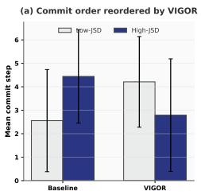

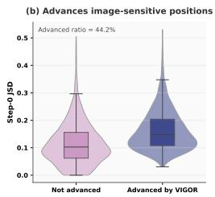

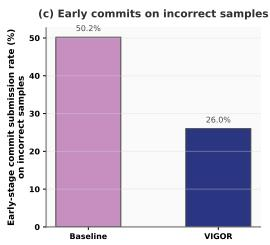

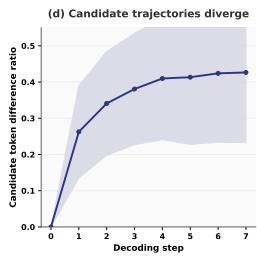

Figure 3: Diagnostic analysis on LLaDA-V over the AMBER benchmark. (a) Mean commit step for high- and low-JSD positions under Baseline and VIGOR. (b) Step-0 JSD for positions advanced versus not advanced by VIGOR. (c) Early-stage unstable commit rate on incorrect samples. (d) Candidate-token difference ratio across decoding steps.  
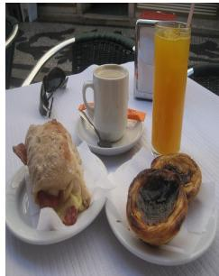

a dining table with a dog on it; a glass of orange juice and a cup of orange juice; a knife and fork.

VIGOR:   
a white plate with a coffee cup, a piece of bread on a napkin; a glass of juice; two chairs at the table.

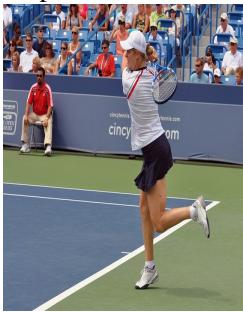  
a tennis match: a player in white with a red tie serves; another in red sits on the bench; the tennis ball is visible.  
A man in a tennis cap and striped shirt jumps on the court; another man in red sits courtside.  
Figure 4: Case study and error analysis.

becomes visible to the remaining masked positions through bidirectional attention, cascading the error into subsequent denoising steps. Reducing such early hallucinated anchors therefore prevents later error propagation. Combined with Figures 3(a) and 3(b), this supports a single mechanism: VIGOR advances positions that are more sensitive to visual evidence and suppresses unstable early commitments before they spread through later decoding.

## 5.4 Case Study and Error Analysis

Figure 4 compares vanilla decoding and VIGOR on two examples, with hallucinated tokens highlighted in red. In the left case, vanilla decoding introduces several prior-driven dining co-occurrences, such as a dog, an extra cup of orange juice, and a knife and fork, none of which are supported by the image. In contrast, VIGOR produces a more grounded description by correctly mentioning the coffee cup, bread, juice, and background chairs. In the right case, vanilla decoding hallucinates template-like tennis-scene details, including a red tie, a bench, and a visible tennis ball. VIGOR removes these unsupported details and better captures the cap, striped shirt, jumping pose, and person on the side. However, it still misidentifies the player’s gender, suggesting that VIGOR mitigates prior-driven hallucinations but cannot correct recognition errors inherited from the base model.

## 6 Conclusion and Limitations

We argue that hallucination in multimodal discrete diffusion language models is not only a tokenprediction error but also a premature commitment problem. To address this, we propose VIGOR, a training-free plug-and-play inference method that controls when masked positions commit during iter ative denoising. By comparing the confidence of the same candidate token under image-conditioned and visual-ablation passes, VIGOR prioritizes positions supported by visual evidence and defers those dominated by language priors. Experiments on LLaDA-V and Lumina-DiMOO across benchmarks show that changing the commitment order alone consistently reduces hallucination and improves multimodal reasoning. Diagnostic analysis further confirms that VIGOR advances image-sensitive positions, defers less visually dependent ones, and suppresses unstable early commitments.

Limitations. VIGOR requires an additional no-image forward pass at each denoising step, roughly doubling decoding time in our experiments. It also requires access to internal decoding scores and control over the commitment schedule, making it most suitable for open-weight or controllable models. Future work will explore more efficient variants and broader model settings.

## Acknowledgments and Disclosure of Funding

This work is supported by the National Key Research and Development Program of China (No.2024YFB3309702), the National Nature Science Foundation of China (No.62021002), Tsinghua BNRist and Beijing Key Laboratory of Industrial Big Data System and Application, Beijing Natural Science Foundation(QY25044).

## References

[1] Wenbin An, Feng Tian, Sicong Leng, Jiahao Nie, Haonan Lin, Qianying Wang, Ping Chen, Xiaoqin Zhang, and Shijian Lu. Mitigating object hallucinations in large vision-language models with assembly of global and local attention. In 2025 IEEE/CVF Conference on Computer Vision and Pattern Recognition (CVPR), pages 29915–29926. IEEE, 2025.

[2] Marianne Arriola, Yair Schiff, Hao Phung, Aaron Gokaslan, and Volodymyr Kuleshov. Encoderdecoder diffusion language models for efficient training and inference. In The Thirty-ninth Annual Conference on Neural Information Processing Systems, 2025.

[3] Shuai Bai, Keqin Chen, Xuejing Liu, Jialin Wang, Wenbin Ge, Sibo Song, Kai Dang, Peng Wang, Shijie Wang, Jun Tang, Humen Zhong, Yuanzhi Zhu, Mingkun Yang, Zhaohai Li, Jianqiang Wan, Pengfei Wang, Wei Ding, Zheren Fu, Yiheng Xu, Jiabo Ye, Xi Zhang, Tianbao Xie, Zesen Cheng, Hang Zhang, Zhibo Yang, Haiyang Xu, and Junyang Lin. Qwen2.5-vl technical report, 2025.

[4] Shenxu Chang, Junchi Yu, Weixing Wang, Yongqiang Chen, Jialin Yu, Philip Torr, and Jindong Gu. TRACEDET: Hallucination Detection from the Decoding Trace of Diffusion Large Language Models. In The Fourteenth International Conference on Learning Representations, 2026.

[5] Junzhe Chen, Tianshu Zhang, Shiyu Huang, Yuwei Niu, Linfeng Zhang, Lijie Wen, and Xuming Hu. Ict: Image-object cross-level trusted intervention for mitigating object hallucination in large vision-language models. In Proceedings of the Computer Vision and Pattern Recognition Conference, pages 4209–4221, 2025.

[6] Junzhe Chen, Tianshu Zhang, Shiyu Huang, Yuwei Niu, Chao Sun, Rongzhou Zhang, Guanyu Zhou, and Lijie Wen. Omnidpo: A preference optimization framework to address omnimodal hallucination. Proceedings of the AAAI Conference on Artificial Intelligence, 40(24): 20172–20180, Mar. 2026. doi: 10.1609/aaai.v40i24.39104. URL https://ojs.aaai.org/ index.php/AAAI/article/view/39104.

[7] Liang Chen, Haozhe Zhao, Tianyu Liu, Shuai Bai, Junyang Lin, Chang Zhou, and Baobao Chang. An Image is Worth 1/2 Tokens After Layer 2: Plug-and-Play Inference Accelerationfor Large Vision-Language Models, pages 19–35. Springer Nature Switzerland, 2024.

[8] Yung-Sung Chuang, Yujia Xie, Hongyin Luo, Yoon Kim, James Glass, and Pengcheng He. Dola: Decoding by contrasting layers improves factuality in large language models. arXiv preprint arXiv:2309.03883, 2023.

[9] Alessandro Favero, Luca Zancato, Matthew Trager, Siddharth Choudhary, Pramuditha Perera, Alessandro Achille, Ashwin Swaminathan, and Stefano Soatto. Multi-modal hallucination control by visual information grounding. In 2024 IEEE/CVF Conference on Computer Vision and Pattern Recognition (CVPR), pages 14303–14312. IEEE, 2024.

[10] Anisha Gunjal, Jihan Yin, and Erhan Bas. Detecting and preventing hallucinations in large vision language models. Proceedings ofthe AAAI Conference on Artificial Intelligence, 38(16): 18135–18143, 2024.

[11] Zhengnan Guo and Fei Tan. Lost in diffusion: Uncovering hallucination patterns and failure modes in diffusion large language models. In Findings of the Association for Computational Linguistics: ACL 2026, 2026.

[12] Zhengfu He, Tianxiang Sun, Qiong Tang, Kuanning Wang, Xuanjing Huang, and Xipeng Qiu. Diffusionbert: Improving generative masked language models with diffusion models. In Proceedings ofthe 61st Annual Meeting ofthe Associationfor Computational Linguistics (Volume 1: Long Papers), pages 4521–4534. Association for Computational Linguistics, 2023.

[13] Stefan Heimersheim and Neel Nanda. How to use and interpret activation patching, 2024.

[14] Chihan Huang and Hao Tang. Ctrldiff: Boosting large diffusion language models with dynamic block prediction and controllable generation, 2025.

[15] Lei Huang, Weijiang Yu, Weitao Ma, Weihong Zhong, Zhangyin Feng, Haotian Wang, Qianglong Chen, Weihua Peng, Xiaocheng Feng, Bing Qin, and Ting Liu. A survey on hallucination in large language models: Principles, taxonomy, challenges, and open questions. ACM Transactions on Information Systems, 43(2):1–55, 2025.

[16] Qidong Huang, Xiaoyi Dong, Pan Zhang, Bin Wang, Conghui He, Jiaqi Wang, Dahua Lin, Weiming Zhang, and Nenghai Yu. Opera: Alleviating hallucination in multi-modal large language models via over-trust penalty and retrospection-allocation. In Proceedings of the IEEE/CVF Conference on Computer Vision and Pattern Recognition, pages 13418–13427, 2024.

[17] Zemin Huang, Yuhang Wang, Zhiyang Chen, and Guo-Jun Qi. Don’t settle too early: Selfreflective remasking for diffusion language models. In The Fourteenth International Conference on Learning Representations, 2026.

[18] Drew A Hudson and Christopher D Manning. Gqa: A new dataset for real-world visual reasoning and compositional question answering. In Proceedings ofthe IEEE/CVF Conference on Computer Vision and Pattern Recognition, pages 6700–6709, 2019.

[19] Chaoya Jiang, Hongrui Jia, Mengfan Dong, Wei Ye, Haiyang Xu, Ming Yan, Ji Zhang, and Shikun Zhang. Hal-eval: A universal and fine-grained hallucination evaluation framework for large vision language models. In Proceedings ofthe 32nd ACM International Conference on Multimedia, pages 525–534, 2024.

[20] Chaoya Jiang, Haiyang Xu, Mengfan Dong, Jiaxing Chen, Wei Ye, Ming Yan, Qinghao Ye, Ji Zhang, Fei Huang, and Shikun Zhang. Hallucination augmented contrastive learning for multimodal large language model. In 2024 IEEE/CVF Conference on Computer Vision and Pattern Recognition (CVPR), pages 27026–27036. IEEE, 2024.

[21] Omri Kaduri, Shai Bagon, and Tali Dekel. What’s in the image? a deep-dive into the vision of vision language models. In 2025 IEEE/CVF Conference on Computer Vision and Pattern Recognition (CVPR), pages 14549–14558. IEEE, 2025. doi: 10.1109/CVPR52734.2025.01356.

[22] Junho Kim, Hyun Kim, Yeon Ju Kim, and Yong Man Ro. Code: Contrasting self-generated description to combat hallucination in large multi-modal models. In A. Globerson, L. Mackey, D. Belgrave, A. Fan, U. Paquet, J. Tomczak, and C. Zhang, editors, Advances in Neural Information Processing Systems, volume 37, pages 133571–133599. Curran Associates, Inc., 2024. doi: 10.52202/079017-4246. URL https://proceedings.neurips.cc/paper\_files/paper/ 2024/file/f1592b0d4ab737e18bb1899484d28d96-Paper-Conference.pdf.

[23] Kang-il Lee, Minbeom Kim, Seunghyun Yoon, Minsung Kim, Dongryeol Lee, Hyukhun Koh, and Kyomin Jung. Vlind-bench: Measuring language priors in large vision-language models. In Findings ofthe Associationfor Computational Linguistics: NAACL 2025, pages 4129–4144. Association for Computational Linguistics, 2025.

[24] Sicong Leng, Hang Zhang, Guanzheng Chen, Xin Li, Shijian Lu, Chunyan Miao, and Lidong Bing. Mitigating object hallucinations in large vision-language models through visual contrastive decoding. In Proceedings of the IEEE/CVF Conference on Computer Vision and Pattern Recognition, pages 13872–13882, 2024.

[25] Junnan Li, Dongxu Li, Silvio Savarese, and Steven Hoi. Blip-2: Bootstrapping language-image pre-training with frozen image encoders and large language models, 2023.

[26] Shufan Li, Konstantinos Kallidromitis, Hritik Bansal, Akash Gokul, Yusuke Kato, Kazuki Kozuka, Jason Kuen, Zhe Lin, Kai-Wei Chang, and Aditya Grover. Lavida: A large diffusion language model for multimodal understanding. In The Thirty-ninth Annual Conference on Neural Information Processing Systems, 2026.

[27] Xiang Lisa Li, Ari Holtzman, Daniel Fried, Percy Liang, Jason Eisner, Tatsunori Hashimoto, Luke Zettlemoyer, and Mike Lewis. Contrastive decoding: Open-ended text generation as optimization. In Proceedings of the 61st Annual Meeting of the Association for Computational Linguistics (Volume 1: Long Papers), pages 12286–12312. Association for Computational Linguistics, 2023.

[28] Yifan Li, Yifan Du, Kun Zhou, Jinpeng Wang, Wayne Xin Zhao, and Ji-Rong Wen. Evaluating object hallucination in large vision-language models. In Proceedings of the 2023 Conference on Empirical Methods in Natural Language Processing, pages 292–305, 2023.

[29] Tsung-Yi Lin, Michael Maire, Serge Belongie, James Hays, Pietro Perona, Deva Ramanan, Piotr Dollár, and C Lawrence Zitnick. Microsoft coco: Common objects in context. In European Conference on Computer Vision, pages 740–755. Springer, 2014.

[30] Bingqian Liu, Fu Zhang, Guoqing Chen, and Jingwei Cheng. Multi-frequency contrastive decoding: Alleviating hallucinations for large vision-language models. In Proceedings of the 2025 Conference on Empirical Methods in Natural Language Processing, pages 28556–28572. Association for Computational Linguistics, 2025.

[31] Haotian Liu, Chunyuan Li, Yuheng Li, and Yong Jae Lee. Improved baselines with visual instruction tuning, 2024.

[32] Shi Liu, Kecheng Zheng, and Wei Chen. Paying More Attention to Image: A Training-Free Method for Alleviating Hallucination in LVLMs, pages 125–140. Springer Nature Switzerland, 2024.

[33] Shen Nie, Fengqi Zhu, Zebin You, Xiaolu Zhang, Jingyang Ou, Jun Hu, Jun Zhou, Yankai Lin, Ji-Rong Wen, and Chongxuan Li. Large language diffusion models. In The Thirty-ninth Annual Conference on Neural Information Processing Systems, 2025.

[34] OpenAI, Josh Achiam, Steven Adler, Sandhini Agarwal, Lama Ahmad, Ilge Akkaya, Florencia Leoni Aleman, Diogo Almeida, Janko Altenschmidt, Sam Altman, Shyamal Anadkat, Red Avila, Igor Babuschkin, Suchir Balaji, Valerie Balcom, Paul Baltescu, Haiming Bao, Mohammad Bavarian, Jeff Belgum, Irwan Bello, Jake Berdine, Gabriel Bernadett-Shapiro, Christopher Berner, Lenny Bogdonoff, Oleg Boiko, Madelaine Boyd, Anna-Luisa Brakman, Greg Brockman, Tim Brooks, Miles Brundage, Kevin Button, Trevor Cai, Rosie Campbell, Andrew Cann, Brittany Carey, Chelsea Carlson, Rory Carmichael, Brooke Chan, Che Chang, Fotis Chantzis, Derek Chen, Sully Chen, Ruby Chen, Jason Chen, Mark Chen, Ben Chess, Chester Cho, Casey Chu, Hyung Won Chung, Dave Cummings, Jeremiah Currier, Yunxing Dai, Cory Decareaux, Thomas Degry, Noah Deutsch, Damien Deville, Arka Dhar, David Dohan, Steve Dowling, Sheila Dunning, Adrien Ecoffet, Atty Eleti, Tyna Eloundou, David Farhi, Liam Fedus, Niko Felix, Simón Posada Fishman, Juston Forte, Isabella Fulford, Leo Gao, Elie Georges, Christian Gibson, Vik Goel, Tarun Gogineni, Gabriel Goh, Rapha Gontijo-Lopes, Jonathan Gordon, Morgan Grafstein, Scott Gray, Ryan Greene, Joshua Gross, Shixiang Shane Gu, Yufei Guo, Chris Hallacy, Jesse Han, Jeff Harris, Yuchen He, Mike Heaton, Johannes Heidecke, Chris Hesse, Alan Hickey, Wade Hickey, Peter Hoeschele, Brandon Houghton, Kenny Hsu, Shengli Hu, Xin Hu, Joost Huizinga, Shantanu Jain, Shawn Jain, Joanne Jang, Angela Jiang, Roger Jiang, Haozhun Jin, Denny Jin, Shino Jomoto, Billie Jonn, Heewoo Jun, Tomer Kaftan, Łukasz Kaiser, Ali Kamali, Ingmar Kanitscheider, Nitish Shirish Keskar, Tabarak Khan, Logan Kilpatrick, Jong Wook Kim, Christina Kim, Yongjik Kim, Jan Hendrik Kirchner, Jamie Kiros, Matt Knight, Daniel Kokotajlo, Łukasz Kondraciuk, Andrew Kondrich, Aris Konstantinidis, Kyle Kosic, Gretchen Krueger, Vishal Kuo, Michael Lampe, Ikai Lan, Teddy Lee, Jan Leike, Jade Leung, Daniel Levy, Chak Ming Li, Rachel Lim, Molly Lin, Stephanie Lin, Mateusz Litwin, Theresa Lopez, Ryan Lowe, Patricia Lue, Anna Makanju, Kim Malfacini, Sam Manning, Todor Markov, Yaniv Markovski, Bianca Martin, Katie Mayer, Andrew Mayne, Bob McGrew, Scott Mayer McKinney, Christine McLeavey, Paul McMillan, Jake McNeil, David Medina, Aalok Mehta, Jacob Menick, Luke Metz, Andrey Mishchenko, Pamela Mishkin, Vinnie

Monaco, Evan Morikawa, Daniel Mossing, Tong Mu, Mira Murati, Oleg Murk, David Mély, Ashvin Nair, Reiichiro Nakano, Rajeev Nayak, Arvind Neelakantan, Richard Ngo, Hyeonwoo Noh, Long Ouyang, Cullen O’Keefe, Jakub Pachocki, Alex Paino, Joe Palermo, Ashley Pantuliano, Giambattista Parascandolo, Joel Parish, Emy Parparita, Alex Passos, Mikhail Pavlov, Andrew Peng, Adam Perelman, Filipe de Avila Belbute Peres, Michael Petrov, Henrique Ponde de Oliveira Pinto, Michael, Pokorny, Michelle Pokrass, Vitchyr H. Pong, Tolly Powell, Alethea Power, Boris Power, Elizabeth Proehl, Raul Puri, Alec Radford, Jack Rae, Aditya Ramesh, Cameron Raymond, Francis Real, Kendra Rimbach, Carl Ross, Bob Rotsted, Henri Roussez, Nick Ryder, Mario Saltarelli, Ted Sanders, Shibani Santurkar, Girish Sastry, Heather Schmidt, David Schnurr, John Schulman, Daniel Selsam, Kyla Sheppard, Toki Sherbakov, Jessica Shieh, Sarah Shoker, Pranav Shyam, Szymon Sidor, Eric Sigler, Maddie Simens, Jordan Sitkin, Katarina Slama, Ian Sohl, Benjamin Sokolowsky, Yang Song, Natalie Staudacher, Felipe Petroski Such, Natalie Summers, Ilya Sutskever, Jie Tang, Nikolas Tezak, Madeleine B. Thompson, Phil Tillet, Amin Tootoonchian, Elizabeth Tseng, Preston Tuggle, Nick Turley, Jerry Tworek, Juan Felipe Cerón Uribe, Andrea Vallone, Arun Vijayvergiya, Chelsea Voss, Carroll Wainwright, Justin Jay Wang, Alvin Wang, Ben Wang, Jonathan Ward, Jason Wei, CJ Weinmann, Akila Welihinda, Peter Welinder, Jiayi Weng, Lilian Weng, Matt Wiethoff, Dave Willner, Clemens Winter, Samuel Wolrich, Hannah Wong, Lauren Workman, Sherwin Wu, Jeff Wu, Michael Wu, Kai Xiao, Tao Xu, Sarah Yoo, Kevin Yu, Qiming Yuan, Wojciech Zaremba, Rowan Zellers, Chong Zhang, Marvin Zhang, Shengjia Zhao, Tianhao Zheng, Juntang Zhuang, William Zhuk, and Barret Zoph. Gpt-4 technical report, 2024. URL https://arxiv.org/abs/2303.08774.

[35] Tian Qin, Junzhe Chen, Yuqing Shi, Tianshu Zhang, Qiang Ju, and Lijie Wen. Do we really need external tools to mitigate hallucinations? sira: Shared-prefix internal reconstruction of attribution, 2026. URL https://arxiv.org/abs/2605.14621.

[36] Tian Qin, Junzhe Chen, Tianshu Zhang, and Lijie Wen. Unmasking-time visual calibration for hallucination mitigation in multimodal discrete diffusion language models. In Paolo Favaro, Zuzana Kukelova, Atsuto Maki, Anna Rohrbach, Konrad Schindler, and Federico Tombari, editors, Computer Vision – ECCV 2026, pages 333–350, Cham, 2026. Springer Nature Switzerland. ISBN 978-3-032-37422-6.

[37] Anna Rohrbach, Lisa Anne Hendricks, Kaylee Burns, Trevor Darrell, and Kate Saenko. Object hallucination in image captioning. In Proceedings ofthe 2018 Conference on Empirical Methods in Natural Language Processing, pages 4035–4045, 2018.

[38] Subham Sekhar Sahoo, Marianne Arriola, Yair Schiff, Aaron Gokaslan, Edgar Marroquin, Justin T Chiu, Alexander Rush, and Volodymyr Kuleshov. Simple and effective masked diffusion language models. In A. Globerson, L. Mackey, D. Belgrave, A. Fan, U. Paquet, J. Tomczak, and C. Zhang, editors, Advances in Neural Information Processing Systems, volume 37, pages 130136–130184. Curran Associates, Inc., 2024. doi: 10.52202/ 079017-4135. URL https://proceedings.neurips.cc/paper\_files/paper/2024/ file/eb0b13cc515724ab8015bc978fdde0ad-Paper-Conference.pdf.

[39] Dustin Schwenk, Apoorv Khandelwal, Christopher Clark, Kenneth Marino, and Roozbeh Mottaghi. A-okvqa: A benchmark for visual question answering using world knowledge. In European Conference on Computer Vision, pages 146–162. Springer, 2022.

[40] Jiaxin Shi, Kehang Han, Zhe Wang, Arnaud Doucet, and Michalis Titsias. Simplified and generalized masked diffusion for discrete data. In A. Globerson, L. Mackey, D. Belgrave, A. Fan, U. Paquet, J. Tomczak, and C. Zhang, editors, Advances in Neural Information Processing Systems, volume 37, pages 103131–103167. Curran Associates, Inc., 2024. doi: 10.52202/079017-3277. URL https://proceedings.neurips.cc/paper\_files/paper/ 2024/file/bad233b9849f019aead5e5cc60cef70f-Paper-Conference.pdf.

[41] Zhiqing Sun, Sheng Shen, Shengcao Cao, Haotian Liu, Chunyuan Li, Yikang Shen, Chuang Gan, Liangyan Gui, Yu-Xiong Wang, Yiming Yang, Kurt Keutzer, and Trevor Darrell. Aligning large multimodal models with factually augmented rlhf. In Findings of the Association for Computational Linguistics ACL 2024, pages 13088–13110. Association for Computational Linguistics, 2024.

[42] Gemini Team, Rohan Anil, Sebastian Borgeaud, Jean-Baptiste Alayrac, Jiahui Yu, Radu Soricut, Johan Schalkwyk, Andrew M. Dai, Anja Hauth, Katie Millican, David Silver, Melvin Johnson, Ioannis Antonoglou, Julian Schrittwieser, Amelia Glaese, Jilin Chen, Emily Pitler, Timothy Lillicrap, Angeliki Lazaridou, Orhan Firat, et al. Gemini: A family of highly capable multimodal models, 2025.

[43] Shengbang Tong, Zhuang Liu, Yuexiang Zhai, Yi Ma, Yann LeCun, and Saining Xie. Eyes wide shut? exploring the visual shortcomings of multimodal llms. In 2024 IEEE/CVF Conference on Computer Vision and Pattern Recognition (CVPR), pages 9568–9578. IEEE, 2024.

[44] Hugo Touvron, Thibaut Lavril, Gautier Izacard, Xavier Martinet, Marie-Anne Lachaux, Timothée Lacroix, Baptiste Rozière, Naman Goyal, Eric Hambro, Faisal Azhar, Aurelien Rodriguez, Armand Joulin, Edouard Grave, and Guillaume Lample. Llama: Open and efficient foundation language models, 2023.

[45] Junyang Wang, Yuhang Wang, Guohai Xu, Jing Zhang, Yukai Gu, Haitao Jia, Jiaqi Wang, Haiyang Xu, Ming Yan, Ji Zhang, et al. Amber: An llm-free multi-dimensional benchmark for mllms hallucination evaluation. arXiv preprint arXiv:2311.07397, 2023.

[46] Xintong Wang, Jingheng Pan, Liang Ding, and Chris Biemann. Mitigating hallucinations in large vision-language models with instruction contrastive decoding. In Findings of the Association for Computational Linguistics ACL 2024, pages 15840–15853. Association for Computational Linguistics, 2024.

[47] Sangmin Woo, Donguk Kim, Jaehyuk Jang, Yubin Choi, and Changick Kim. Don’t miss the forest for the trees: Attentional vision calibration for large vision language models. In Findings of the Association for Computational Linguistics: ACL 2025, pages 1927–1951. Association for Computational Linguistics, 2025.

[48] Chengyue Wu, Hao Zhang, Shuchen Xue, Zhijian Liu, Shizhe Diao, Ligeng Zhu, Ping Luo, Song Han, and Enze Xie. Fast-dllm: Training-free acceleration of diffusion llm by enabling kv cache and parallel decoding, 2025.

[49] Shao-Jun Xia, Huixin Zhang, Yifan Jiang, Xiaoyang Chen, Yike Chen, Zitong Li, Zhongwei Wan, and Anlan Sun. Rethinking hallucinations: A cognitive-inspired taxonomy and comprehensive survey in large language models, large vision-language models, and multimodal large language models, 2025. SSRN preprint.

[50] Xin Xiao, Bohong Wu, Jiacong Wang, Chunyuan Li, Xun Zhou, and Haoyuan Guo. Seeing the image: Prioritizing visual correlation by contrastive alignment. In A. Globerson, L. Mackey, D. Belgrave, A. Fan, U. Paquet, J. Tomczak, and C. Zhang, editors, Advances in Neural Information Processing Systems, volume 37, pages 30925–30950. Curran Associates, Inc., 2024. doi: 10.52202/079017-0973. URL https://proceedings.neurips.cc/paper\_files/ paper/2024/file/37294f033582ac0064bf90fa557c2573-Paper-Conference.pdf.

[51] Yi Xin, Qi Qin, Siqi Luo, Kaiwen Zhu, Juncheng Yan, Yan Tai, Jiayi Lei, Yuewen Cao, Keqi Wang, Yibin Wang, Jinbin Bai, Qian Yu, Dengyang Jiang, Yuandong Pu, Haoxing Chen, Le Zhuo, Junjun He, Gen Luo, Tianbin Li, Ming Hu, Jin Ye, Shenglong Ye, Bo Zhang, Chang Xu, Wenhai Wang, Hongsheng Li, Guangtao Zhai, Tianfan Xue, Bin Fu, Xiaohong Liu, Yu Qiao, and Yihao Liu. Lumina-dimoo: An omni diffusion large language model for multi-modal generation and understanding, 2025.

[52] Zhen Xiong, Yujun Cai, Zhecheng Li, and Yiwei Wang. Unveiling the potential of diffusion large language model in controllable generation. In The Fourteenth International Conference on Learning Representations, 2026.

[53] Ling Yang, Ye Tian, Bowen Li, Xinchen Zhang, Ke Shen, Yunhai Tong, and Mengdi Wang. Mmada: Multimodal large diffusion language models, 2025.

[54] Jiacheng Ye, Shansan Gong, Liheng Chen, Lin Zheng, Jiahui Gao, Han Shi, Chuan Wu, Xin Jiang, Zhenguo Li, Wei Bi, and Lingpeng Kong. Diffusion of thought: Chain-ofthought reasoning in diffusion language models. In A. Globerson, L. Mackey, D. Belgrave,

A. Fan, U. Paquet, J. Tomczak, and C. Zhang, editors, Advances in Neural Information Processing Systems, volume 37, pages 105345–105374. Curran Associates, Inc., 2024. doi: 10.52202/079017-3343. URL https://proceedings.neurips.cc/paper\_files/paper/ 2024/file/be30024e7fa2c29cac7a6dafcbb8571f-Paper-Conference.pdf.

[55] Qinghao Ye, Haiyang Xu, Jiabo Ye, Ming Yan, Anwen Hu, Haowei Liu, Qi Qian, Ji Zhang, and Fei Huang. mplug-owi2: Revolutionizing multi-modal large language model with modality collaboration. In 2024 IEEE/CVF Conference on Computer Vision and Pattern Recognition (CVPR), pages 13040–13051. IEEE, 2024.

[56] Hao Yin, Guangzong Si, and Zilei Wang. Lifting the veil on visual information flow in mllms: Unlocking pathways to faster inference. In 2025 IEEE/CVF Conference on Computer Vision and Pattern Recognition (CVPR), pages 9382–9391. IEEE, 2025. doi: 10.1109/CVPR52734. 2025.00876.

[57] Shukang Yin, Chaoyou Fu, Sirui Zhao, Tong Xu, Hao Wang, Dianbo Sui, Yunhang Shen, Ke Li, Xing Sun, and Enhong Chen. Woodpecker: hallucination correction for multimodal large language models. Science China Information Sciences, 67(12), 2024.

[58] Zebin You, Shen Nie, Xiaolu Zhang, Jun Hu, Jun Zhou, Zhiwu Lu, Ji-Rong Wen, and Chongxuan Li. Llada-v: Large language diffusion models with visual instruction tuning, 2025.

[59] Qifan Yu, Juncheng Li, Longhui Wei, Liang Pang, Wentao Ye, Bosheng Qin, Siliang Tang, Qi Tian, and Yueting Zhuang. Hallucidoctor: Mitigating hallucinatory toxicity in visual instruction data. In 2024 IEEE/CVF Conference on Computer Vision and Pattern Recognition (CVPR), pages 12944–12953. IEEE, 2024.

[60] Runpeng Yu, Qi Li, and Xinchao Wang. Discrete diffusion in large language and multimodal models: A survey, 2025.

[61] Tianyu Yu, Yuan Yao, Haoye Zhang, Taiwen He, Yifeng Han, Ganqu Cui, Jinyi Hu, Zhiyuan Liu, Hai-Tao Zheng, and Maosong Sun. Rlhf-v: Towards trustworthy mllms via behavior alignment from fine-grained correctional human feedback. In 2024 IEEE/CVF Conference on Computer Vision and Pattern Recognition (CVPR), pages 13807–13816. IEEE, 2024.

[62] Zihao Yue, Liang Zhang, and Qin Jin. Less is more: Mitigating multimodal hallucination from an eos decision perspective. In Proceedings of the 62nd Annual Meeting of the Association for Computational Linguistics (Volume 1: Long Papers), pages 11766–11781. Association for Computational Linguistics, 2024.

[63] Jinrui Zhang, Teng Wang, Haigang Zhang, Ping Lu, and Feng Zheng. Reflective Instruction Tuning: Mitigating Hallucinations in Large Vision-Language Models, pages 196–213. Springer Nature Switzerland, 2024.

[64] Weihong Zhong, Xiaocheng Feng, Liang Zhao, Qiming Li, Lei Huang, Yuxuan Gu, Weitao Ma, Yuan Xu, and Bing Qin. Investigating and mitigating the multimodal hallucination snowballing in large vision-language models. In Proceedings of the 62nd Annual Meeting of the Association for Computational Linguistics (Volume 1: Long Papers), pages 11991–12011. Association for Computational Linguistics, 2024.

[65] Kun Zhou, Yifan Li, Xin Zhao, and Ji-Rong Wen. Diffusion-nat: Self-prompting discrete diffusion for non-autoregressive text generation. In Proceedings ofthe 18th Conference ofthe European Chapter ofthe Associationfor Computational Linguistics (Volume 1: Long Papers), pages 1438–1451. Association for Computational Linguistics, 2024.

[66] Lanyun Zhu, Deyi Ji, Tianrun Chen, Peng Xu, Jieping Ye, and Jun Liu. Ibd: Alleviating hallucinations in large vision-language models via image-biased decoding. In 2025 IEEE/CVF Conference on Computer Vision and Pattern Recognition Workshops (CVPRW), pages 1615– 1624. IEEE, 2025.

[67] Xiaochen Zhu, Georgi Karadzhov, Chenxi Whitehouse, and Andreas Vlachos. Segment-level diffusion: A framework for controllable long-form generation with diffusion language models. In Proceedings ofthe 63rd Annual Meeting ofthe Associationfor Computational Linguistics (Volume 1: Long Papers), pages 4163–4183, 2025.

## A Backbone Models

We evaluate VIGOR on two open-source multimodal discrete diffusion language models, LLaDA-V [58] and Lumina-DiMOO [51]. Although both use discrete diffusion as the decoding paradigm, they differ in how the visual modality enters the model, which is relevant for how the visual-ablation pass in VIGOR is implemented.

LLaDA-V. LLaDA-V follows the visual instruction tuning paradigm and uses the LLaDA-8B-Instruct masked diffusion language model as its language tower. Visual inputs are first processed by a SigLIP 2 vision tower (siglip2-so400m-patch14-384, 384×384 input, 729 visual tokens per image) and then projected into LLaDA’s word embedding space by a randomly initialized two-layer MLP. The resulting visual tokens are concatenated as a visual prefix in front of the text tokens, and the language tower performs masked prediction over the answer tokens under bidirectional attention. Because visual inputs enter as continuous projected embeddings, the visual-ablation pass in VIGOR is implemented by replacing those embeddings with the [MASK] token embedding while keeping the text tokens and the mask pattern unchanged.

Lumina-DiMOO. Lumina-DiMOO is a unified discrete diffusion model in which both text and images are represented as tokens drawn from a single joint vocabulary. It is initialized from LLaDA-Base without structural modifications and extended to multimodal inputs by adding 8,192 visual tokens from an aMUSEd-VQ image tokenizer (16×16 downsampling) and a small set of special tokens (e.g., <IMAGE>, </IMAGE>, <end-of-line>). Each image is converted into a sequence of discrete visual tokens that are interleaved with text tokens in a single sequence, on which the model performs masked prediction under bidirectional full attention; for image understanding, decoding follows LLaDA’s semi-autoregressive blockwise mask-predict schedule. Because the visual input is itself a token sequence rather than continuous embeddings, the visual-ablation pass in VIGOR is implemented by replacing those visual tokens with [MASK] tokens while keeping the text tokens and the mask pattern unchanged.

## B Decoding Procedure

## B.1 VIGOR Decoding Algorithm

Algorithm 1 summarizes the full inference procedure. VIGOR preserves the blockwise mask-predict schedule of the base model and only replaces the ranking rule used to select positions to unmask inside each block.

Algorithm 1 VIGOR decoding for a single block.   
Require: prompt q, image I, current block B of masked positions, per-step budget k, numerical   
stability constant $\varepsilon = 1 0 ^ { - 8 }$   
1: while B contains masked positions do   
2: pimg ← softmax $( f _ { \theta } ( \bar { q } , I ,$ current mask) ▷ image-conditioned pass   
3: p ← softmax $( f _ { \theta } ( q , \emptyset ;$ current mask) ▷ visual-ablation pass   
4: for each masked position $i \in B$ do   
5: $\hat { y } _ { i } \gets \arg \operatorname* { m a x } _ { y } p _ { \mathrm { i m g } } ( y \mid i ) _ { . }$   
6: $c _ { i } ^ { \mathrm { i m g } } \gets p _ { \mathrm { i m g } } ( \hat { y } _ { i } \mid i ) , ~ c _ { i } ^ { \mathrm { n o i m g } } \gets p _ { \mathrm { n o i m g } } ( \hat { y } _ { i } \mid i )$   
7: $s _ { i } \gets ( c _ { i } ^ { \mathrm { i m g } } - c _ { i } ^ { \mathrm { n o i m g } } ) + \left( \log ( c _ { i } ^ { \mathrm { i m g } } + \varepsilon ) - \log ( c _ { i } ^ { \mathrm { n o i m g } } + \varepsilon ) \right)$   
8: end for   
9: ${ \mathcal { T } }  \operatorname { t o p - } k ( \{ s _ { i } : i \in B \} )$   
10: Unmask each $i \in \mathcal T$ to yˆi; keep $B \backslash \tau$ masked   
11: end while

The logarithmic term is computed as log $p _ { \mathrm { i m g } } ( \hat { y } _ { i } ) - \log p _ { \mathrm { n o i m g } } ( \hat { y } _ { i } )$ directly from log-softmax outputs, avoiding numerical underflow on low-probability tokens. The two forward passes share prompt tokens and the current mask pattern; only the image conditioning differs. Because VIGOR does not modify model weights or the block schedule, the image-conditioned pass matches the vanilla baseline exactly, which isolates the effect of the reordering rule from any change in parameters or schedule.

## B.2 Model-Specific Implementation

Applying VIGOR to LLaDA-V and Lumina-DiMOO requires only a thin wrapper around each model’s existing decoding loop. Table 4 summarizes the model-specific choices; all other hyperparameters (block size, per-step k, generation length, sampling temperature) are inherited from each model’s default decoding configuration and match the vanilla baselines reported in Section 4.

Table 4: Model-specific implementation of VIGOR on the two backbones.
<table><tr><td></td><td>LLaDA-V</td><td>Lumina-DiMOO</td></tr><tr><td>Image-token placement Visual-ablation pass</td><td>visual prefix before text tokens image embeddings replaced by [MASK]</td><td>interleaved per chat template image tokens replaced by [MASK]</td></tr><tr><td>Mask token</td><td>official [MASK] id (unchanged)</td><td>official [MASK] id (unchanged)</td></tr><tr><td>Block schedule</td><td>identical to baseline</td><td>identical to baseline</td></tr><tr><td></td><td></td><td></td></tr><tr><td>Ranking rule</td><td> $s _ { i }$  from Eq. 7</td><td> $s _ { i }$  from Eq. 7</td></tr></table>

## C Adapting AR LVLM Inference-Time Baselines to Multimodal Discrete Diffusion Backbones

Mask-diffusion decoding differs from autoregressive decoding in two ways that affect how the inference-time hallucination mitigation methods we use as baselines have to be adapted: every step predicts all masked positions in parallel rather than producing one new token, and the choice of which positions to commit at each step is itself driven by the visual condition through token confidence. This appendix describes how we adapt VCD [24] and ICT [5] to LLaDA-V and Lumina-DiMOO under these two properties.

## C.1 VCD

Original VCD on AR LVLMs decodes one token per step. At each step it runs two forward passes, one with the clean image I and one with a distorted image $I ^ { \prime } \left( \mathrm { e . g . } \right.$ ., obtained from I by Gaussian noise) on the same prefix, and contrasts the two logit vectors at the single decoding position:

$$
s _ { v } = ( 1 + \alpha ) f _ { \theta } ( v \mid I , q , { \bf z } ^ { ( s ) } ) - \alpha f _ { \theta } ( v \mid I ^ { \prime } , q , { \bf z } ^ { ( s ) } ) ,\tag{8}
$$

where $v \in \mathcal V$ is a candidate token, $\mathbf { z } ^ { ( s ) }$ is the prefix decoded so far at AR step s (in the notation of Section $3 ) , f _ { \theta } ( \cdot )$ denotes pre-softmax logits as in Algorithm 1, and $\alpha > 0$ is the VCD contrast strength. An adaptive plausibility cutoff additionally keeps v only if $f _ { \theta } ( v \mid I , q , \mathbf { z } ^ { ( s ) } ) \geq \log \beta +$ maxv′∈V $f _ { \theta } ( v ^ { \prime } \mid I , q , \mathbf { z } ^ { ( s ) } )$ , where $\beta \in ( 0 , 1 ]$ is a cutoff threshold. Two properties of the AR setting are essential: there is exactly one position to be decoded at this step, and the two passes share the prefix automatically.

In each backbone’s blockwise mask-diffusion loop, our adaptation follows the same blockwise mask-predict schedule as the vanilla baseline and applies the contrast in Eq. 8 at every denoising step. Three implementation choices are needed to make the per-position contrast well-defined under parallel mask-predict: the two branches are initialized to the same masked sequence and prefix tokens, the same set of transferred tokens is copied into both branches at every denoising step, and the commit decision is driven by the clean side alone. The dual visual condition enters where each backbone naturally consumes vision: at the projected embedding level for LLaDA-V, and at the visual-token level for Lumina-DiMOO.

## C.2 ICT

Original ICT trains per-head binary probes on a calibration set of (clean image, blurred image) pairs to identify attention heads that linearly separate visually-grounded from prior-driven activations, selects the top-K such heads, and at each AR decoding step adds the per-head class-mean activation shift $S _ { \ell } ^ { n }$ (the mean difference between trusted and untrusted activations on the calibration set), scaled by an intervention strength $\gamma > 0$ , to the per-head input of self\_attn.o\_proj, but only at the position of the right-most newly-generated token:

$$
h _ { \ell } ^ { n }  h _ { \ell } ^ { n } + \gamma \cdot S _ { \ell } ^ { n } , ( \ell , n ) \in \mathrm { t o p } \lnot K ,\tag{9}
$$

where $\ell \in \{ 1 , \ldots , L \}$ and $n \in \{ 1 , \ldots , N \}$ index the L transformer layers and the N attention heads per layer respectively, $h _ { \ell } ^ { n }$ is the per-head input to self\_attn.o\_proj at (ℓ, n), and $K \le L N$ is the number of selected heads.

Since a dLLM has no single “right-most newly-generated token” at any step (the generation span is a mixture of already-committed and still-masked positions, all updated in parallel), our adaptation widens the intervention scope to the entire span of generation positions. We run ICT in its default configuration with both image-level and object-level interventions enabled, with the per-head activation shift vectors $S _ { \ell } ^ { n }$ in Eq. 9 estimated separately for each backbone on the same calibration data as the original paper.

## D Inference Cost

Table 5: Decoding time (ms) on A100 GPUs at generation lengths 32/64/128. The Ratio column shows VIGOR vs. its baseline; the ratio cell is highlighted in green .
<table><tr><td>Method</td><td>len 32</td><td>len 64</td><td>len 128</td><td>Ratio</td></tr><tr><td>LLaDA-V</td><td>3644.6</td><td>7338.2</td><td>15552.8</td><td></td></tr><tr><td>+ VIGOR</td><td>7417.3</td><td>14954.1</td><td>31684.9</td><td>×2.0</td></tr><tr><td>Lumina-DiMOO</td><td>6395.4</td><td>13430.5</td><td>27136.1</td><td></td></tr><tr><td>+ VIGOR</td><td>13129.4</td><td>27505.8</td><td>55535.7</td><td>×2.0</td></tr></table>

Table 6: Memory usage (GiB) on Lumina-DiMOO. Delta is reported as VIGOR minus baseline and computed from unrounded measurements.
<table><tr><td>Metric</td><td>Baseline</td><td>VIGOR</td><td>Delta</td></tr><tr><td>Peak alloc.</td><td>29.56</td><td>34.93</td><td>+5.36</td></tr><tr><td>Peak reserved</td><td>78.74</td><td>78.61</td><td>-0.13</td></tr></table>

Table 5 shows that VIGOR roughly doubles decoding time on both LLaDA-V and Lumina-DiMOO across all tested lengths, since each denoising step adds a visual-ablation forward pass. Table 6 further shows that, on Lumina-DiMOO, VIGOR increases peak allocated memory by 5.36 GiB while leaving peak reserved memory essentially unchanged. The ×2.0 time factor is stable across both model scales and all tested generation lengths, indicating a clean multiplicative cost. This is the price for a training-free, plug-and-play reordering rule that requires no retraining, extra supervision, or architectural change.

## E Appendix Case Study

Figure 5 shows eight case studies for Lumina-DiMOO (a–e) and LLaDA-V (f–h). For each image, the baseline caption (top, cream) and the VIGOR caption (bottom, sage) are produced by the same model under the same generation length and block schedule; VIGOR only reorders the commitment of masked positions at inference. Hallucinated object words in the baseline caption are highlighted in red. On Lumina-DiMOO, the baseline invents an oven and bowl around a pizza (a), fabricates a tabletop scattered with books, phone, bag, cup, and plant (b), turns a winter bird scene into something with an orange bird and people (c), inserts a bench into a zoo scene (d), and adds a sandwich to a banquet table (e); in every case VIGOR removes the invented objects while still describing the visible scene. On LLaDA-V, the baseline imagines a glass and bottle behind a donut that is actually next to a soda can (f), hallucinates a person sitting on a bed on a truck-shaped cake (g), and adds a refrigerator to a kitchen that has only cabinets and a microwave (h); VIGOR keeps to the visible objects in each case. VIGOR captions are not shorter than the baselines, indicating that the improvement does not come from producing less detailed descriptions.

(a) Lumina-DiMOO  
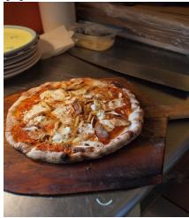

(c) Lumina-DiMOO  

(e) LLaDA-V  
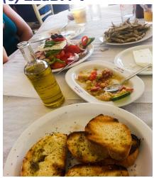

(g) LLaDA-V  
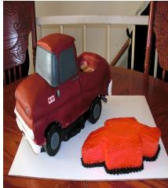  
A pizza on a cutting board, still in the oven; a stack of plates, a bowl, and no people visible.  
VIGOR:  
A large pizza on a wooden cutting board, topped with cheese; cutting board and plates behind.

## Vanilla:

## Vanilla:

## VIGOR:

A blue bird on a bare branch; auburn beak and blue head; bare branches give a winter feel.

## Vanilla:

A table with a white tablecloth full of food; plates with a sandwich, bread, vegetables, cheese.

## VIGOR:

## Vanilla:

## VIGOR:

(d) Lumina-DiMOO  
(b) Lumina-DiMOO  
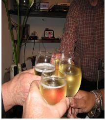

(f) LLaDA-V  
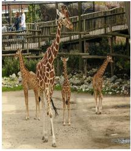

## Vanilla:

A person is lying on a table; books, a book, a phone, a bag, a cup, a bottle, and a plant.

## Vanilla:

## VIGOR:

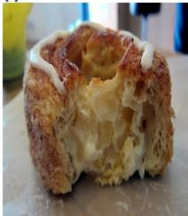  
(h) LLaDA-V

## Vanilla:

A round pastry with a crispy, golden crust; a glass and a bottle visible in the background.

VIGOR:   
A glazed donut with a bite taken out; a yellow soda can visible in the   
background.

## Vanilla:

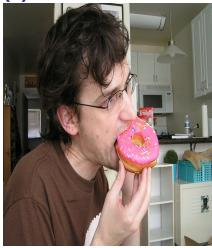  
Figure 5: Appendix case study. Eight image–caption comparisons between baseline and VIGOR decoding on Lumina-DiMOO (a–d) and LLaDA-V (f–h). Hallucinated object words are highlighted in red.

## VIGOR: