# VISAGE: Vertex-based Intrinsic Surface Appearance GEneration via Dual-Stream Diffusion for Arbitrary 3D Heads

Jeremias Krauß1,2,∗ Pragati Jaiswal2,∗ Rene Schuster´ 1,2 Didier Stricker1,2

1German Research Center for Artificial Intelligence (DFKI)

2RPTU Kaiserslautern-Landau

{jeremias samuel.krauss, pragati.jaiswal, rene.schuster, didier.stricker}@dfki.de

## Abstract

Recovering identity-faithful, physically based surface appearancefor 3D human headsfrom sparse images remains challenging. Existing methods often rely on UV-based pipelines, introducing seam artefacts, or operate in image space, limiting surface consistency. We present VISAGE, Vertex-based Intrinsic Surface Appearance GEneration, a surface-based conditional diffusionframework that synthesises per-vertex albedo and roughness directly on arbitrary mesh topologies, without requiring consistent UV parameterisation at training time. VISAGE combines global spectral processing with local geodesic K-Nearest-Neighbour refinement, enforcing structural coherence while restoring detail beyond the truncated spectral basis. Multi-view RGB images condition the network via visibility-aware crossattention, enabling occlusion-robust synthesis across the full head surface. Region-specific modules specialise in semantically demanding and distinct areas (eyes, mouth, skin and hair), while a tangent-space output projection recovers fine iris detail. We further introduce a scalable procedural augmentation pipeline that enriches raw geometry scans with physically plausible albedo, roughness and normal maps for training. The predicted attributes render directly as a single RGBA vertex-colour channel. VISAGE reduces FID by 42.7% on NPHM and 22.5% and 4.4% on zero-shot FaceVerse and i3DMM, respectively, relative to the strongest baseline, with a 7.2M-parameter core network.

## 1. Introduction

Digital human heads are central to telepresence, gaming, and AR/VR, where avatars are increasingly reconstructed from sparse imagery captured on consumer devices [11]. Appearance captured under such conditions is entangled with scene illumination, so reproducing it directly restricts the avatar to that environment. Faithful rendering in a novel scene instead requires decomposed material attributes that disentangle surface reflectance from incident illumination, enabling relighting under arbitrary conditions with viewconsistent appearance.

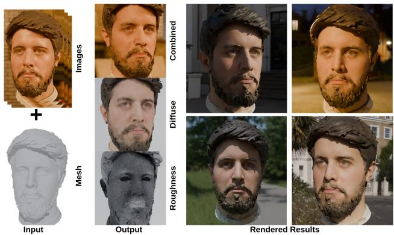  
Figure 1. Given sparse 1-5 RGB images and an untextured head mesh (left), VISAGE predicts per-vertex albedo and roughness di rectly on arbitrary mesh topologies (center). The predicted intrinsic materials enable relighting under unseen illumination (right).

Traditional high-quality texturing relies on complex, costly capture stages [1, 5, 20], while producing highquality results, they are impractical for consumer applications. Learning-based methods that instead operate on unconstrained imagery avoid this cost, but often bake illumination into the predicted albedo or omit a decomposed material model altogether. Progress is further bottlenecked by the absence of large-scale datasets with ground-truth PBR head textures, detailed in Sec. 3.5.1. To address these challenges, we introduce VISAGE (Fig. 1), a surface-based diffusion framework for arbitrary head meshes. To overcome the lack of PBR ground-truth data for full 3D heads, we construct a scalable procedural augmentation pipeline in an offthe-shelf physically based rendering engine that enriches raw geometry scans with PBR materials, enabling largescale training without costly light-stage capture. Operating directly on the mesh surface removes the need for consistent surface parameterisation, allowing the same network to operate on raw scans, remeshed geometry, and artistdefined topologies. Our dual-stream architecture combines global spectral diffusion for structural coherence with local geodesic K-Nearest-Neighbour (KNN) refinement for details. Conditioned via visibility-aware multi-view crossattention on 1 to 5 unconstrained RGB images, VISAGE predicts view-consistent PBR-compatible per-vertex albedo and roughness maps. VISAGE also remains lightweight, with a 7.22M-parameter core generative network and competitive inference efficiency. Our contributions are:

• VISAGE: A mesh-native surface diffusion model with two components specific to the conditional setting: heatdiffusion times conditioned on the noise level, and a parallel geodesic-KNN attention stream carrying the frequencies discarded by the truncated Laplace–Beltrami basis. Both are ablated in Tab. 2. It predicts per-vertex albedo and roughness from sparse RGB views, requiring no consistent UV parameterisation for training; the output renders as a single RGBA vertex-colour channel.

• Visibility-aware multi-view conditioning: A crossattention mechanism that injects multi-view image features and intrinsic mesh descriptors into the diffusion process, combined with semantic region-specific modules and tangent-space refinement to specialise generation for demanding areas such as eyes, mouth, skin, and hair.

• Scalable procedural training data pipeline: A physicsinspired data generation pipeline that augments raw 3D head scans with plausible PBR material maps, enabling large-scale supervised training without expensive lightstage capture.

## 2. Related Work

Diffusion-based methods for object texturing such as DreamFusion [33] and Fantasia3D [10] have improved mesh texturing quality. To improve efficiency, projectionbased pipelines including TEXTure [34], TexFusion [7], Text2Tex [9], Paint3D [45], MVDream [36], and Hunyuan3D-2.0-Paint [48] generate textures through multiview diffusion and UV-space aggregation. Although effective, these methods remain dependent on UV parameterisation and image-space consistency constraints.

To avoid UV artefacts, several recent methods operate directly on surface representations. UV3-TeD [16] employs intrinsic diffusion operators based on DiffusionNet [35], Point-UV Diffusion [44] combines point-based diffusion with UV refinement, and Texturify [37] introduces mesh-aware convolutions. These works demonstrate the potential of mesh-native learning and motivate our focus on surface-based diffusion for texture synthesis. UV3-TeD is the closest to our formulation but is unconditional: sampling depends only on geometric descriptors and the denoising timestep, with no mechanism for conditioning on photographs. It therefore generates plausible textures for a shape class rather than recovering subject-specific appearance. We instead extend DiffusionNet with multi-view cross-attention to form a surface-diffusion baseline. Moreover, UV3-TeD represents textures as point clouds requiring a dedicated renderer, whereas we bind appearance directly to vertices for native rendering.

## 2.1. Face and Head Texturing and Generation

Classical face modelling approaches such as 3D Morphable Models [4, 26, 31] learn low-dimensional parametric representations of facial geometry and appearance. While effective for reconstruction and control, they are limited in their ability to represent high-frequency appearance details. Neural extensions such as NPHM [18] and MonoNPHM [19] increase geometric flexibility but focus primarily on reconstruction rather than texture synthesis.

A complementary line of work estimates facial reflectance and material properties through inverse rendering and differentiable shading [14, 17, 23, 24]. Relightify [30] recovers relightable facial reflectance from a single image using a diffusion prior in UV space, but operates on a fixed template topology and has no public implementation at the time of writing. Progress in this direction is constrained by data. FFHQ-UV-Intrinsics [14] provides decomposed intrinsic maps at scale, but covers the face region only. MultiFace [42] offers real multi-view capture with tracked low-resolution geometry, but under fixed illumination and without any reflectance decomposition. Neither provides full-head geometry paired with a decomposed albedo–roughness pair, which motivates the procedural pipeline of Sec. 3.5.1.

Recent 3D-aware GANs and diffusion models — EG3D [8], PanoHead [2], FaceLift [29], Rodin [39, 46] and UltrAvatar [50] — achieve strong realism through volumetric, tri-plane or template-based representations, but tie generated appearance to fixed parameterisations or UV space.

Positioning. We build on DiffusionNet’s intrinsic operators [35], EDM preconditioning [22] and surface-native texture diffusion [16]; Our contribution is the adaptation to conditional, subject-specific head appearance via noiseconditioned spectral propagation and a parallel stream compensating for basis truncation.

## 3. Method

Given an untextured head mesh $\mathcal { M } = ( \mathcal { V } , \mathcal { F } )$ with arbitrary topology and a set of N unconstrained RGB images $\mathcal { Z } =$ $\{ I _ { i } \} _ { i = 1 } ^ { N } \ ( \mathrm { w i t h } \ 1 \leq N \leq 5 $ and $N = 3$ as the default configuration), our goal is to synthesise physically plausible pervertex albedo $\mathbf { \bar { a } } \in \mathbb { R } ^ { | \mathcal { V } | \times 3 }$ , roughness $\mathbf { r } \in \mathbb { R } ^ { | \nu | }$ . Because albedo and roughness are stored as vertex attributes, they render without conversion: together they occupy exactly one standard RGBA vertex-colour channel, supported natively by common engines (Blender [12] colour attributes, Unreal’s VertexColor material node). Where a texturemapped asset is required, the same attributes bake to a UV map without retraining.

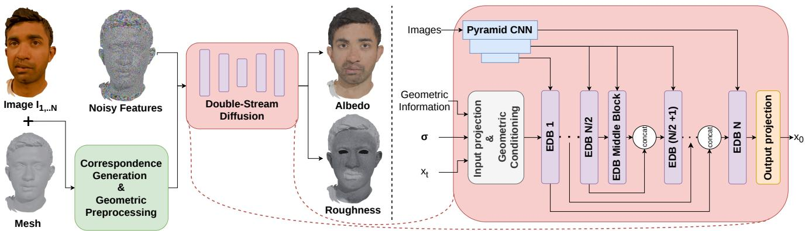  
Figure 2. Overview of VISAGE pipeline. Noisy vertex features x are concatenated with geometric descriptors and conditioned on multi-view image features before entering the dual-stream diffusion network. The network combines global spectral propagation with local geodesic refinement to predict the denoised representation x0, which is projected to per-vertex albedo and roughness.

We formulate texture synthesis as a conditional diffusion process directly on the mesh surface using intrinsic diffusion operators derived from DiffusionNet [35]. Given vertex features x, information is propagated over the manifold via the Laplace–Beltrami operator ∆, enabling topologyagnostic feature exchange without UV parameterisation. While intrinsic diffusion provides strong global coherence, it inherently suppresses detail. To address this limitation, VISAGE employs a Dual-Stream Surface Diffusion Network (Fig. 2) that splits processing into two parallel branches: Stream 1 handles global spectral propagation, while Stream 2 performs local high-frequency refinement, as depicted in Fig. 3.

## 3.1. Preprocessing and Geometric Conditioning

To relate the input images to the geometry, we render the untextured mesh from three canonical viewpoints, detect facial keypoints on both renders and inputs with RTMPose [13], and recover extrinsics with EPnP [25] and RANSAC [15]. Projecting each vertex into the input views yields image coordinates P(i) and binary visibility masks V (i) that restrict attention to unoccluded regions; per-vertex semantic labels S ∈ {eyes, mouth, face, rest}|V | come from projected FaRL [49] segmentation.

For the mesh we compute the cotangent Laplacian L, mass matrix M and gradient operator G, and the K = 300 smallest eigenpairs of L for the closed-form spectral heat equation, with the fidelity/cost analysis regarding the number of eigenpairs in the supplementary. Part of the spectrum of eigenpairs is used to compute the Wave Kernel Signature [3] and normalised positions used to prime the vertex features in the input block.

## 3.2. Enhanced Diffusion Block (EDB)

Prior to intrinsic diffusion processing, noisy vertex attributes are concatenated with bilinearly sampled image features and projected into a latent space. Geometric descriptors derived from WKS and vertex coordinates are injected through affine modulation. Input images are processed by a lightweight multi-scale CNN to provide conditioning features for subsequent cross-attention.

The initialised features are then iteratively refined by a stack of EDBs, detailed in Fig. 3. Standard spectral diffusion acts as a low-pass filter, which is counterproductive for synthesising sharp textures. To address this, the EDB replaces monolithic processing with a sequential-to-parallel data flow: it first injects view-dependent appearance cues, and then splits into a dual-stream architecture: one stream for global spectral propagation and a parallel stream for local detail recovery. Let $\bar { H } ^ { ( l ) }$ denote the vertex features entering layer l. The features are first mapped into a hidden space via a SiLU activation and a linear layer, and then updated through the following mechanisms:

## 3.2.1. Image-to-Mesh Cross-Attention

For each visible vertex, r × r patches are extracted from one set of multi-view CNN feature maps. Those are used in a multi-head cross-attention where the vertex features act as queries, and the sampled patches act as keys and values. This grounds the 3D surface with local 2D image context, producing an appearance-conditioned feature set. A modulation MLP converts the attended features into per-vertex scale and shift updates, while occluded vertices remain unmodified.

## 3.2.2. Stream 1: Global Spectral Stream with Anisotropic Gradients

The global branch propagates information through spectral heat diffusion on the Laplace–Beltrami basis. We extend DiffusionNet by conditioning the per-channel diffusion time on the current noise level $\sigma ,$ allowing the spatial support of diffusion to adapt throughout denoising. Following DiffusionNet, anisotropic gradient features are incorporated to capture directional surface variation.

## 3.2.3. Stream 2: Local High-Frequency Refinement

Operating in parallel with the global branch, the local stream recovers detail lost through spectral truncation and diffusion smoothing. Refinement is performed using multihead self-attention over a geodesic K-nearest-neighbour graph, preventing information leakage between spatially adjacent but topologically disconnected regions. Regionspecific cross-attention, refinement, and output heads are instantiated for the eyes, mouth, face, and remaining head regions.

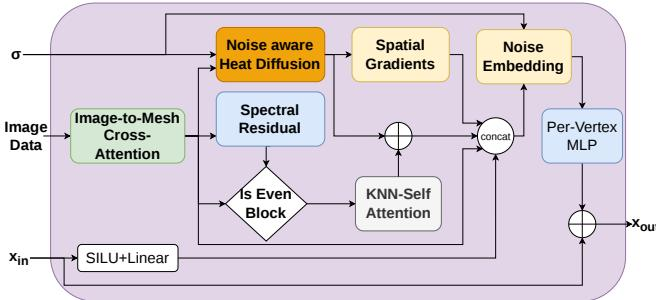  
Figure 3. Enhanced Diffusion Block (EDB). Input features $x _ { \mathrm { i n } }$ are first grounded with multi-view image evidence through imageto-mesh cross-attention. The conditioned features are processed by two complementary parallel streams: noise-aware spectral heat diffusion for global propagation and geodesic KNN self-attention for local refinement. The fused representation is modulated by the diffusion noise level σ and projected to $x _ { \mathrm { o u t } }$

## 3.3. Tangent-Space Output Projection

Following the sequence of EDBs, a linear projection maps the refined vertex features $H ^ { ( N ) }$ back to the albedo or roughness domains. However, the eye regions demand exceptionally sharp, high-contrast detail that pure vertexbased processing struggles to resolve. To overcome this, we introduce an auxiliary tangent-space refinement branch specifically for the eyes. For each eye, we compute a local orthonormal tangent basis $( t , b , n )$ based on the region’s mean surface normal. Vertex features are projected onto this 2D plane and rasterised onto a $6 4 \times 6 4$ grid via inverse distance weighting. A lightweight 2D CNN refines this grid to recover sharp iris and eyelid details. Finally, these features are bilinearly sampled back to the mesh vertices as a

residual to the linear output.

## 3.4. Training Objective

Following the EDM framework, we optimise VISAGE by training the network $D _ { \theta }$ to directly reconstruct the clean vertex features via a weighted $L _ { 2 }$ loss. Noise levels are sampled according to l $\mathsf { \Omega } _ { 1 } ( \sigma ) \sim \mathcal { N } ( P _ { \mathrm { m e a n } } , P _ { \mathrm { s t d } } ^ { 2 } )$ . To prevent padded input from corrupting batched updates, the loss is computed exclusively over valid mesh vertices via a binary mask $M \in \{ 0 , 1 \} ^ { | \nu | } ;$

$$
\mathcal { L } = \mathbb { E } _ { \mathbf { x } , \mathbf { n } , \sigma } \left[ \frac { \lambda ( \sigma ) } { \sum _ { v \in \mathcal { V } } M _ { v } } \sum _ { v \in \mathcal { V } } M _ { v } \left. D _ { \theta } ( \mathbf { x } _ { \sigma } , \sigma , \mathbf { c } ) _ { v } - \mathbf { x } _ { v } \right. _ { 2 } ^ { 2 } \right] ,\tag{1}
$$

where v indexes the vertices, c denotes the combined geometric and multi-view conditioning signal, and $\lambda ( \sigma )$ is the standard EDM weighting function.

## 3.5. Training and Data Generation

## 3.5.1. Procedural Training Data Generation

Publicly available 3D head datasets with decomposed PBR material maps are limited in scale and coverage, particularly for full heads including hair and eyes. As noted in Sec. 2, FFHQ-UV-Intrinsics [14] supplies specular intensity rather than roughness and covers the face region only, excluding the hair and eye regions our region-specific modules target, while MultiFace [42] provides no reflectance decomposition. We therefore construct a synthetic augmentation pipeline and apply it to the NPHM dataset [18]. Because the original 1.5M-vertex meshes are computationally prohibitive in training, we simplify them to approximately 120K.

Since NPHM provides only diffuse albedo, we procedurally generate roughness and normal maps using a physically based augmentation pipeline driven by geometric, appearance, and procedural noise cues. This produces diverse skin reflectance and micro-geometry variations spanning a wide range of facial characteristics. As this roughness is generated rather than measured, metrics computed against it assess agreement with a physically motivated prior; Sec. 4.2.3 evaluates albedo accuracy and albedo– illumination disentanglement independently of it. Full augmentation details and parameter ranges are provided in the supplementary material.

## 3.5.2. Network Configuration and Training Setup

We train the albedo and roughness models on 450 subjects from our synthetically augmented NPHM dataset [18], evaluating on 37 held-out subjects, with each individual featuring up to 26 distinct expressions. To accommodate their distinct statistical properties, the albedo model (conditioned on RGB images) employs a 9-EDB architecture, while the roughness model (conditioned on HSV space) utilises a lighter 4-EDB architecture. Within the EDM [22] framework, we observe that the model converges better when trained on a higher-noise regime, but introduces residual noise. To resolve this, we employ a sequential cascade training strategy: a base network learning at high noise levels, followed by a refinement network specialised in the lower noise spectra. During inference, these models are chained sequentially. All models are trained for 120 epochs on four A100 GPUs. Optimiser, learning rate schedule, batch size, architectural capacity (including the 2D CNN modules) and noise distributions are listed in the supplementary material.

Table 1. Quantitative comparison with state-of-the-art methods on NPHM [18] and zero-shot generalisation on FaceVerse [38] and i3DMM [43]. VISAGE achieves the best overall perceptual quality across all evaluated datasets, obtaining the best FID and best or tied-best SSIM and LPIPS on each dataset. Best results are bold; second-best are underlined. DiffusionNet\* denotes our modified baseline with cross-attention conditioning for fair comparison.
<table><tr><td></td><td colspan="4">NPHM</td><td colspan="4">FaceVerse</td><td colspan="4">i3DMM</td></tr><tr><td>Model</td><td>FID ↓</td><td>SSIM ↑</td><td>LPIPS↓</td><td>PSNR ↑</td><td>FID ↓</td><td>SSIM↑</td><td>LPIPS ↓</td><td>PSNR ↑</td><td>FID ↓</td><td>SSIM↑</td><td>LPIPS↓</td><td>PSNR ↑</td></tr><tr><td>DiffusionNet* [35]</td><td>22.07</td><td>0.84</td><td>0.12</td><td>20.10</td><td>46.72</td><td>0.80</td><td>0.19</td><td>15.74</td><td>74.71</td><td>0.72</td><td>0.25</td><td>14.37</td></tr><tr><td>Hunyuan3D-2.0-Paint [48]</td><td>17.66</td><td>0.81</td><td>0.12</td><td>30.12</td><td>33.30</td><td>0.79</td><td>0.17</td><td>28.26</td><td>59.41</td><td>0.80</td><td>0.18</td><td>16.54</td></tr><tr><td>MonoNPHM [19]</td><td>19.36</td><td>0.84</td><td>0.13</td><td>23.50</td><td>35.61</td><td>0.81</td><td>0.19</td><td>17.34</td><td>58.33</td><td>0.81</td><td>0.19</td><td>15.87</td></tr><tr><td>VISAGE</td><td>10.12</td><td>0.87</td><td>0.08</td><td>29.40</td><td>25.79</td><td>0.83</td><td>0.12</td><td>26.03</td><td>55.76</td><td>0.81</td><td>0.18</td><td>16.90</td></tr></table>

## 4. Evaluation and Ablation

We compare VISAGE against state-of-the-art approaches for explicit head texturing using both quantitative and qual itative evaluations and conduct ablation studies to analyse individual design choices. Generated PBR materials are rendered under identical conditions in a physically based rendering engine from four canonical views: three covering the frontal face region and one covering the back of the head. The lighting environment matches the one used for the input images at inference time. Methods that do not predict roughness are rendered using the ground-truth roughness map to isolate differences arising from albedo prediction. We report four complementary image-quality metrics: FID [21], SSIM [40], LPIPS [47], and PSNR.

## 4.1. Comparison Against SOTA

We evaluate VISAGE against three baselines: Mono-NPHM [19], a neural parametric head model that reconstructs appearance via inverse rendering into neural texture fields; Hunyuan3D-2.0-Paint [48], a state-of-the-art multiview diffusion pipeline for object texturing, fine-tuned on our augmented NPHM [18]; DiffusionNet\* [35], a modified baseline equipped with our cross-attention mechanism to isolate the contribution of our dual-stream architecture. We conduct our primary evaluation on the NPHM dataset and further assess the zero-shot generalisation on the Face-Verse dataset [38] and the test subset of i3DMM [43]. Directly comparable methods are scarce: UV3-TeD [16] surface-diffusion approaches are unconditional, UV-space facial reflectance methods assume a fixed template, and general object-texturing pipelines require domain adaptation; hence our fine-tuning of Hunyuan3D-2.0-Paint. We include MonoNPHM as a reference point rather than a likefor-like generative competitor.

## 4.1.1. Quantitative Results

Our method performs the best across perceptual and structural metrics on NPHM, FaceVerse and i3DMM (Tab. 1). On the NPHM dataset, VISAGE improves the FID score by 42.7% and reduces LPIPS error by 33.3% compared to the next-best baseline. Similar performance gains are observed in zero-shot results on FaceVerse, where we outperform the next-best model by 22.5% in FID. This zero-shot generalisation extends to the i3DMM, where VISAGE achieves the lowest FID (55.76) and tied-best SSIM (0.81), outperforming both DiffusionNet\* and Hunyuan3D-2.0-Paint while matching the best LPIPS. While Hunyuan3D-2.0-Paint retains an advantage in PSNR except on i3DMM, our approach remains highly competitive, while significantly improving perceptual fidelity.

## 4.1.2. Qualitative Results

Fig. 4 presents a qualitative comparison on the NPHM dataset, zero-shot visualisations on the FaceVerse dataset and in the wild. VISAGE reconstructs facial hair and subject-specific eye colour, which most competing approaches over-smooth or hallucinate. Our approach also achieves better skin-colour fidelity; MonoNPHM washes out darker complexions, while Hunyuan3D-2.0-Paint exaggerates skin tones in both directions. Furthermore, while the base DiffusionNet\* captures coarse appearance, it produces a grainy texture and struggles with detailed regions like the eyes. In contrast, our dual-stream architecture produces more coherent skin appearance and eye detail, recovering mid-frequency variation such as localised blemishes and beard detail, while pore-level structure and fine expression wrinkles remain beyond the reach of all compared methods at this input sparsity. On in-the-wild Cafca [6] images with MonoNPHM-estimated geometry, VISAGE produces richer skin detail and fewer artefacts than the baselines, particularly at the eyes and hairline.

GT

VISAGE

Hunyuan3D

MonoNPHM

DiffusionNet\*

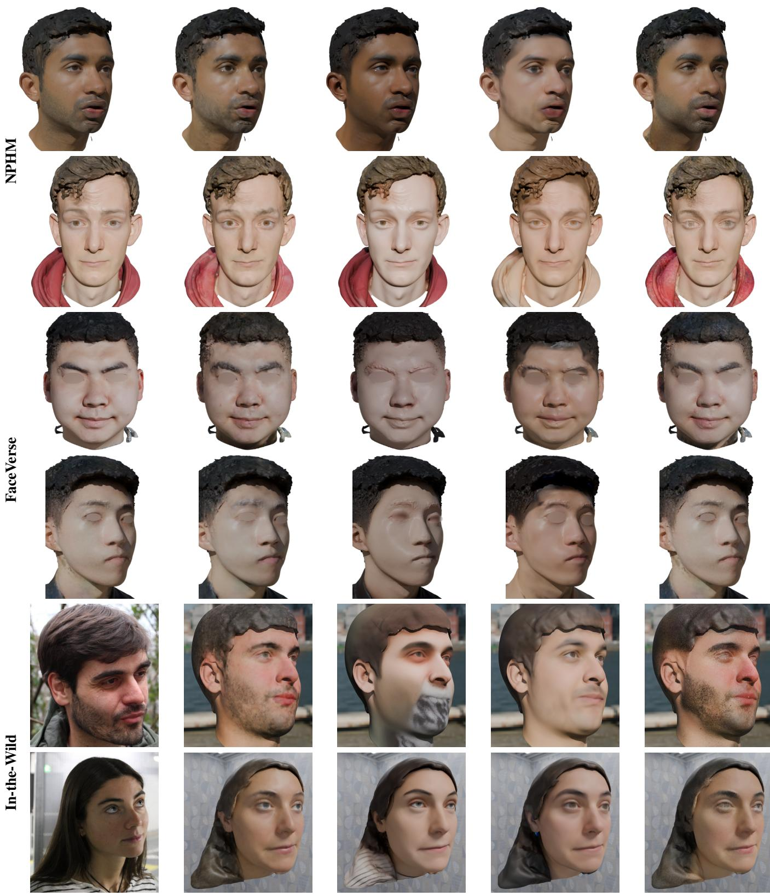

Figure 4. Qualitative comparison on NPHM, FaceVerse, and in-the-wild images. VISAGE better preserves identity-specific appear ance, including skin tone, facial hair, and eye colour, while producing more coherent skin and better-resolved eye detail than competing methods. Fine-scale wrinkles around the eyes and mouth (in-the-wild rows) are recovered by none of the compared methods, including ours. Eyes are blurred for FaceVerse [38] examples following the dataset policy.

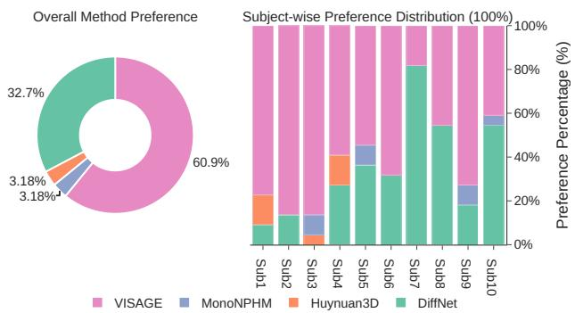  
Figure 5. Perceptual user study. Left: overall preference across all participants. Right: subject-wise preference distribution. VIS-AGE is preferred over competing methods in the majority of trials.

## 4.1.3. Perceptual User Study

To complement our quantitative metrics, we conduct a blind user study with 22 participants comparing VISAGE to baseline methods. We randomly sample 5 identities from NPHM and 5 identities from the zero-shot FaceVerse dataset. We render each method under the same lighting and viewpoint. Each participant is shown results from all methods in randomised order across 10 test subjects and selects the one closest to ground truth. The study is fully anonymous and counterbalanced to avoid ordering bias. As shown in Fig. 5, our method is consistently preferred by human raters across most subjects and achieves the highest overall preference score, indicating a consistent preference over the compared baselines.

## 4.1.4. Efficiency

VISAGE uses only 7.22M parameters in its core generative network and requires 5.6 GB peak GPU memory, while synthesising textures in 104.9 s. Detailed comparisons with competing methods and preprocessing costs are provided in the supplementary material.

## 4.2. Ablation Studies

To comprehensively evaluate the VISAGE framework, our ablation study includes an analysis of the network component impact, its sensitivity to the number of input views, mesh vertex resolution and illumination disentanglement. Due to computational constraints, all the models are trained on only the lower noise regime. The supplementary material adds geometry robustness and a predicted-vs-constant roughness comparison.

## 4.2.1. Impact of Network Components

Disabling Semantic Region Splitting forces a shared global MLP across all vertices, failing to capture the unique statistical distributions of the eyes and teeth and severely degrading realism (Fig. 6); omitting the Tangent-Space Output Projection bypasses 2D CNN refinement, yielding blurry irises. Both are quantitatively minor given the small surface area of the eyes (Tab. 2) but perceptually noticeable.

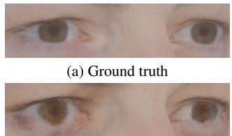  
(c) No tangent refinement branch

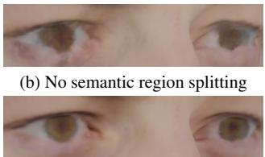  
(d) VISAGE  
Figure 6. Effect of region specialisation and tangent refinement. Removing semantic region splitting degrades iris structure, while removing tangent-space refinement produces blurry eye details. Combining both components restores sharp, realistic eye appearance.

Table 2. Ablation on key architectural components. Each proposed component contributes to reconstruction quality, removing any key module consistently degrades the quality, especially noticeable in the PSNR and FID scores.
<table><tr><td>Model</td><td>FID↓</td><td>SSIM ↑</td><td>LPIPS ↓</td><td>PSNR ↑</td></tr><tr><td>VISAGE</td><td>27.74</td><td>0.85</td><td>0.10</td><td>24.72</td></tr><tr><td>w/o High-frequency stream</td><td>36.40</td><td>0.84</td><td>0.13</td><td>21.70</td></tr><tr><td>w/o Noise level in heat diffusion</td><td>35.60</td><td>0.82</td><td>0.12</td><td>20.91</td></tr><tr><td>w/o Region splitting</td><td>31.62</td><td>0.84</td><td>0.11</td><td>23.60</td></tr><tr><td>w/o Tangent refinement</td><td>29.26</td><td>0.84</td><td>0.11</td><td>24.53</td></tr></table>

Removing the K-Nearest-Neighbour stream forces reliance on the EDB’s MLP alone, causing grainy artefacts and loss of sharpness (see supplementary material), and removing Noise-Level Conditioning prevents the network from adapting its spatial reach, causing texture bleeding at occluded regions and boundaries (Tab. 2).

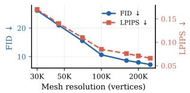  
(a)

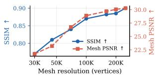  
(b)

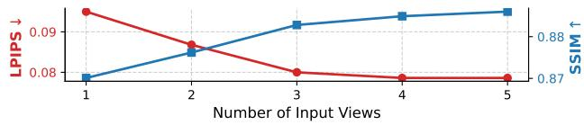  
(c)  
Figure 7. Scaling behaviour. (a,b) Appearance quality against mesh resolution: the model trained at 120K vertices, evaluated without retraining on NPHM [18] decimated to 30K–250K vertices. The intrinsic operators depend on the surface rather than a fixed tessellation, so a single set of weights covers the whole range and resolution can be traded against computational cost at inference time. (c) Effect of the number of conditioning images, with diminishing returns beyond three views.

<table><tr><td>Region</td><td>Spread ∆E↓</td><td> $\mathbf { G T } \Delta E \downarrow$ </td><td>Observed ∆E</td></tr><tr><td>All</td><td> $1 . 5 6 \pm 0 . 2 2$ </td><td> $4 . 4 1 \pm 0 . 4 4$ </td><td>9.38</td></tr><tr><td>Face</td><td> $1 . 5 3 \pm 0 . 1 8$ </td><td> $3 . 3 5 \pm 0 . 2 6$ </td><td>11.06</td></tr><tr><td>Hair</td><td> $1 . 6 5 \pm 0 . 3 9$ </td><td> $6 . 6 2 \pm 1 . 0 9$ </td><td>5.94</td></tr><tr><td>Eyes</td><td> $1 . 3 5 \pm 0 . 1 1$ </td><td> $3 . 6 8 \pm 0 . 2 9$ </td><td>10.94</td></tr><tr><td>Mouth</td><td> $1 . 4 3 \pm 0 . 1 5$ </td><td> $3 . 1 6 \pm 0 . 5 5$ </td><td>11.34</td></tr></table>

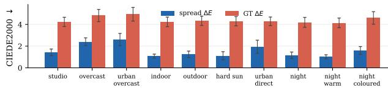  
Figure 8. Albedo illumination invariance. Results on the NPHM [18] validation split under 10 environment maps. Spread is the mean CIEDE2000 [28] distance between each illumination’s predicted albedo and the per-vertex mean prediction; GT is the distance to ground-truth albedo, and Observed is the corresponding variation in the input observations. Table: regional mean ± std across validation subjects. Plot: results by environment map. Predicted variation remains substantially below observed variation.

## 4.2.2. Varying Number of Input Images and Mesh Vertex Resolution

We next analyse the impact of the number of conditioning views. We vary the number of input images from 1 to 5 while keeping geometry and rendering settings fixed. Remarkably, VISAGE already achieves competitive performance with a single input image: most regions are reconstructed faithfully, with errors concentrated in occluded areas such as the back of the head and hairline. As the number of views increases, the network gains additional spatial context, leading to improvements in LPIPS and SSIM. However, Fig. 7 shows clear diminishing returns beyond three images. We therefore adopt three views as a practical default, while single-image inference remains an effective option for minimal-input scenarios. We further examine how appearance quality depends on mesh resolution, which is the natural counterpart to texture resolution in a UV-based pipeline. Keeping the model trained at 120K vertices fixed, we evaluate it on the same subjects decimated to between 30K and 250K vertices (Fig. 7). Quality is clearly resolution-dependent, as expected for a vertex-bound representation: FID improves from 26.2 at 30K to 7.2 at 250K. Worth noting is that the model transfers across the entire range without retraining, despite having seen only a single resolution during training; the intrinsic operators depend on the surface rather than on a fixed tessellation, so no resolution-specific model is required. Mesh resolution therefore acts as a quality-versus-cost control at inference time: a practitioner may decimate for speed or refine for fidelity using the same weights, rather than being restricted to the resolution the model was trained at.

## 4.2.3. Illumination Disentanglement

We render NPHM [18] validation subjects under 10 heldout studio, outdoor, indoor, and night environments, and measure CIEDE2000 [28] variation across predicted albedos and error to ground-truth albedo. As shown in Fig. 8, predicted albedo variation is low across illuminations $( \Delta E = 1 . 5 6$ overall), removing 83% of the observed variation $( \Delta E = 9 . 3 8 )$ ; on the face, it removes 86% (1.53 vs. 11.06). Spread remains low across environments, while ground-truth error is stable, suggesting that remaining error is largely independent of illumination. Errors are higher for hair than for the face (GT $\Delta E = 6 . 6 2 \mathrm { v s . 3 . 3 5 } )$ .

## 5. Limitations

Several limitations remain. First, albedo and illumination remain partially entangled under difficult lighting: strong cast shadows and coloured light are occasionally absorbed into the predicted albedo, most noticeably in hair; Sec. 4.2.3 quantifies this via the variance of predicted albedo across illuminations of the same subject. Second, appearance resolution is bound to vertex density rather than decoupled from it as in UV-mapped assets; quality improves with mesh resolution (Sec. 4.2.2), but pore-level detail as carried by 4K textures remains out of reach. Third, roughness supervision is procedurally generated, so we validate its consistency and rendering effect but not its physical accuracy, as no public full-head reflectance dataset exists. Fourth, since image supervision covers only frontal and lateral views, heavil occluded regions such as the back of the head rely largely on the diffusion prior and can show subtle luminance discontinuities. Finally, although our augmentation pipeline generates normal maps, we train only for albedo and roughness; jointly predicting high-frequency normals is a natural extension.

## 6. Conclusion

We presented VISAGE, a surface-based diffusion framework that synthesises PBR-compatible per-vertex albedo and roughness on arbitrary head meshes from sparse RGB images, without requiring a consistent UV parameterisation. Combining global spectral propagation with local geodesic KNN refinement under visibility-aware multiview conditioning, VISAGE improves FID by 42.7% over the next-best baseline on NPHM [18], with zero-shot gains on FaceVerse [38] (22.5%) and i3DMM [43] (4.4%), using a 7.2M-parameter core network, and is preferred in a blind perceptual study. Ablations identify the KNN refinement stream and noise-level-aware diffusion as most critical for boundary fidelity and occluded regions. Despite training only on procedurally augmented synthetic data, the model transfers to real-world images.

## Acknowledgements

This work has been partially funded by the EU project IRIS-XR (GA: Nr 101298672) and by the EU project VICTOR-XR (GA: Nr 101298864)

## References

[1] Oleg Alexander, Mike Rogers, William Lambeth, Jen-Yuan Chiang, Wan-Chun Ma, Chuan-Chang Wang, and Paul Debevec. The digital emily project: Achieving a photorealistic digital actor. IEEE Computer Graphics and Applications, 30 (4):20–31, 2010. 1

[2] Sizhe An, Hongyi Xu, Yichun Shi, Guoxian Song, Umit Y Ogras, and Linjie Luo. Panohead: Geometry-aware 3d fullhead synthesis in 360deg. In Proceedings of the IEEE/CVF conference on computer vision and pattern recognition, pages 20950–20959, 2023. 2

[3] Mathieu Aubry, Ulrich Schlickewei, and Daniel Cremers. The wave kernel signature: A quantum mechanical approach to shape analysis. In 2011 IEEE international conference on computer vision workshops (ICCV workshops), pages 1626– 1633. IEEE, 2011. 3

[4] Volker Blanz and Thomas Vetter. A morphable model for the synthesis of 3d faces. In Seminal Graphics Papers: Pushing the Boundaries, Volume 2, pages 157–164. Association for Computing Machinery, 2023. 2

[5] George Borshukov and J. P. Lewis. Realistic human face rendering for ”the matrix reloaded”. In International Conference on Computer Graphics and Interactive Techniques, 2003. 1

[6] Marcel C. Buehler, Gengyan Li, Erroll Wood, Leonhard Helminger, Xu Chen, Tanmay Shah, Daoye Wang, Stephan Garbin, Sergio Orts-Escolano, Otmar Hilliges, Dmitry Lagun, Jer´ emy Riviere, Paulo Gotardo, Thabo Beeler, Abhim-´ itra Meka, and Kripasindhu Sarkar. Cafca: High-quality novel view synthesis of expressive faces from casual fewshot captures. In ACM SIGGRAPH Asia 2024 Conference Paper. 2024. 5

[7] Tianshi Cao, Karsten Kreis, Sanja Fidler, Nicholas Sharp, and Kangxue Yin. Texfusion: Synthesizing 3d textures with text-guided image diffusion models. In Proceedings of the IEEE/CVF international conference on computer vision, pages 4169–4181, 2023. 2

[8] Eric R Chan, Connor Z Lin, Matthew A Chan, Koki Nagano, Boxiao Pan, Shalini De Mello, Orazio Gallo, Leonidas J Guibas, Jonathan Tremblay, Sameh Khamis, et al. Efficient geometry-aware 3d generative adversarial networks. In Proceedings of the IEEE/CVF conference on computer vision and pattern recognition, pages 16123–16133, 2022. 2

[9] Dave Zhenyu Chen, Yawar Siddiqui, Hsin-Ying Lee, Sergey Tulyakov, and Matthias Nießner. Text2tex: Text-driven texture synthesis via diffusion models. In Proceedings of the IEEE/CVF international conference on computer vision, pages 18558–18568, 2023. 2

[10] Rui Chen, Yongwei Chen, Ningxin Jiao, and Kui Jia. Fantasia3d: Disentangling geometry and appearance for highquality text-to-3d content creation. In Proceedings of the

IEEE/CVF International Conference on Computer Vision (ICCV), pages 22246–22256, 2023. 2

[11] Ruizhi Cheng, Nan Wu, Matteo Varvello, Eugene Chai, Songqing Chen, and Bo Han. A first look at immersive telepresence on apple vision pro. In Proceedings of the 2024 ACM on Internet Measurement Conference, pages 555–562, 2024. 1

[12] Blender Online Community. Blender - a 3D modelling and rendering package. Blender Foundation, Stichting Blender Foundation, Amsterdam, 2018. 3

[13] MMPose Contributors. Openmmlab pose estimation toolbox and benchmark. https://github.com/openmmlab/mmpose, 2020. 3

[14] Abdallah Dib, Luiz Gustavo Hafemann, Emeline Got, Trevor Anderson, Amin Fadaeinejad, Rafael M. O. Cruz, and Marc-Andre Carbonneau. Mosar: Monocular semi-supervised´ model for avatar reconstruction using differentiable shading. In Proceedings of the IEEE/CVF Conference on Computer Vision and Pattern Recognition (CVPR), pages 1770–1780, 2024. 2, 4

[15] Martin A. Fischler and Robert C. Bolles. Random sample consensus: a paradigm for model fitting with applications to image analysis and automated cartography. Commun. ACM, 24(6):381–395, 1981. 3

[16] Simone Foti, Stefanos Zafeiriou, and Tolga Birdal. Uv-free texture generation with denoising and geodesic heat diffusion. In Advances in Neural Information Processing Systems, pages 128053–128081. Curran Associates, Inc., 2024. 2, 5

[17] Stathis Galanakis, Alexandros Lattas, Stylianos Moschoglou, and Stefanos Zafeiriou. Fitdiff: Robust monocular 3d facial shape and reflectance estimation using diffusion models. In Proceedings of the Winter Conference on Applications of Computer Vision (WACV), pages 992–1004, 2025. 2

[18] Simon Giebenhain, Tobias Kirschstein, Markos Georgopoulos, Martin Runz, Lourdes Agapito, and Matthias Nießner.¨ Learning neural parametric head models. In Proc. IEEE Conf. on Computer Vision and Pattern Recognition, 2023. 2, 4, 5, 7, 8, 17, 20

[19] Simon Giebenhain, Tobias Kirschstein, Markos Georgopoulos, Martin Runz, Lourdes Agapito, and Matthias Nießner.¨ Mononphm: Dynamic head reconstruction from monocular videos. In Proc. IEEE Conf. on Computer Vision and Pattern Recognition (CVPR), 2024. 2, 5, 15

[20] Kaiwen Guo, Jason Dourgarian, Danhang Tang, Anastasia Tkach, Adarsh Kowdle, Emily Cooper, Mingsong Dou, Sean Fanello, Graham Fyffe, Christoph Rhemann, Jonathan Taylor, Peter Lincoln, Paul Debevec, Shahram Izad, Philip Davidson, Jay Busch, Xueming Yu, Matt Whalen, Geoff Harvey, and Rohit Pandey. The relightables: volumetric performance capture of humans with realistic relighting. ACM Transactions on Graphics, 38:1–19, 2019. 1

[21] Martin Heusel, Hubert Ramsauer, Thomas Unterthiner, Bernhard Nessler, and Sepp Hochreiter. Gans trained by a two time-scale update rule converge to a local nash equilibrium. In Advances in Neural Information Processing Systems. Curran Associates, Inc., 2017. 5

[22] Tero Karras, Miika Aittala, Timo Aila, and Samuli Laine. Elucidating the design space of diffusion-based generative models, 2022. 2, 5, 14

[23] Hyeongwoo Kim, Michael Zollhofer, Ayush Tewari, Justus¨ Thies, Christian Richardt, and Christian Theobalt. Inverse-FaceNet: Deep monocular inverse face rendering. In Conference on Computer Vision and Pattern Recognition (CVPR), 2018. 2

[24] Alexandros Lattas, Stylianos Moschoglou, Stylianos Ploumpis, Baris Gecer, Abhijeet Ghosh, and Stefanos P Zafeiriou. Avatarme++: Facial shape and brdf inference with photorealistic rendering-aware gans. IEEE Transactions on Pattern Analysis and Machine Intelligence, 2021. 2

[25] Vincent Lepetit, Francesc Moreno-Noguer, and Pascal Fua. Epnp: An accurate o(n) solution to the pnp problem. International journal of computer vision, 81(2):155–166, 2009. 3

[26] Tianye Li, Timo Bolkart, Michael J. Black, Hao Li, and Javier Romero. Learning a model of facial shape and expression from 4d scans. ACM Trans. Graph., 36(6), 2017. 2

[27] Ilya Loshchilov and Frank Hutter. Decoupled weight decay regularization. arXiv preprint arXiv:1711.05101, 2017. 14

[28] M. R. Luo, G. Cui, and B. Rigg. The development of the cie 2000 colour–difference formula: Ciede2000. Color Research & Application, 26(4):340–350, 2001. 8

[29] Weijie Lyu, Yi Zhou, Ming-Hsuan Yang, and Zhixin Shu. Facelift: Single image to 3d head with view generation and gs-lrm. arXiv preprint arXiv:2412.17812, 2024. 2

[30] Foivos Paraperas Papantoniou, Alexandros Lattas, Stylianos Moschoglou, and Stefanos Zafeiriou. Relightify: Relightable 3d faces from a single image via diffusion models. In 2023 IEEE/CVF International Conference on Computer Vision (ICCV), pages 8772–8783, 2023. 2

[31] Pascal Paysan, Reinhard Knothe, Brian Amberg, Sami Romdhani, and Thomas Vetter. A 3d face model for pose and illumination invariant face recognition. In 2009 Sixth IEEE International Conference on Advanced Video and Signal Based Surveillance, pages 296–301, 2009. 2

[32] Ken Perlin. An image synthesizer. SIGGRAPH Comput. Graph., 19(3):287–296, 1985. 13

[33] Ben Poole, Ajay Jain, Jonathan T. Barron, and Ben Mildenhall. Dreamfusion: Text-to-3d using 2d diffusion. arXiv, 2022. 2

[34] Elad Richardson, Gal Metzer, Yuval Alaluf, Raja Giryes, and Daniel Cohen-Or. Texture: Text-guided texturing of 3d shapes, 2023. 2

[35] Nicholas Sharp, Souhaib Attaiki, Keenan Crane, and Maks Ovsjanikov. Diffusionnet: Discretization agnostic learning on surfaces, 2022. 2, 3, 5, 15

[36] Yichun Shi, Peng Wang, Jianglong Ye, Mai Long, Kejie Li, and Xiao Yang. Mvdream: Multi-view diffusion for 3d generation, 2024. 2

[37] Yawar Siddiqui, Justus Thies, Fangchang Ma, Qi Shan, Matthias Nießner, and Angela Dai. Texturify: Generating textures on 3d shape surfaces, 2022. 2

[38] Lizhen Wang, Zhiyuan Chen, Tao Yu, Chenguang Ma, Liang Li, and Yebin Liu. Faceverse: a fine-grained and detailcontrollable 3d face morphable model from a hybrid dataset, 2022. 5, 6, 8, 20

[39] Tengfei Wang, Bo Zhang, Ting Zhang, Shuyang Gu, Jianmin Bao, Tadas Baltrusaitis, Jingjing Shen, Dong Chen, Fang Wen, Qifeng Chen, and Baining Guo. Rodin: A generative model for sculpting 3d digital avatars using diffusion. In Pro ceedings of the IEEE/CVF Conference on Computer Vision and Pattern Recognition (CVPR), pages 4563–4573, 2023. 2

[40] Zhou Wang, Alan C Bovik, Hamid R Sheikh, and Eero P Simoncelli. Image quality assessment: from error visibility to structural similarity. IEEE transactions on image processing, 13(4):600–612, 2004. 5

[41] Steven Worley. A cellular texture basis function. In Proceed ings of the 23rd Annual Conference on Computer Graphics and Interactive Techniques, page 291–294, New York, NY, USA, 1996. Association for Computing Machinery. 13

[42] Cheng-hsin Wuu, Ningyuan Zheng, Scott Ardisson, Rohan Bali, Danielle Belko, Eric Brockmeyer, Lucas Evans, Tim othy Godisart, Hyowon Ha, Xuhua Huang, Alexander Hypes, Taylor Koska, Steven Krenn, Stephen Lombardi, Xiaomin Luo, Kevyn McPhail, Laura Millerschoen, Michal Perdoch, Mark Pitts, Alexander Richard, Jason Saragih, Junko Saragih, Takaaki Shiratori, Tomas Simon, Matt Stewart, Autumn Trimble, Xinshuo Weng, David Whitewolf, Chenglei Wu, Shoou-I Yu, and Yaser Sheikh. Multiface: A dataset for neural face rendering. In arXiv, 2022. 2, 4

[43] T Yenamandra, A Tewari, F Bernard, HP Seidel, M Elgharib, D Cremers, and C Theobalt. i3dmm: Deep implicit 3d morphable model of human heads. In Proceedings of the IEEE / CVF Conference on Computer Vision and Pattern Recognition (CVPR), 2021. 5, 8

[44] Xin Yu, Peng Dai, Wenbo Li, Lan Ma, Zhengzhe Liu, and Xiaojuan Qi. Texture generation on 3d meshes with pointuv diffusion. In Proceedings ofthe IEEE/CVF International Conference on Computer Vision, pages 4206–4216, 2023. 2

[45] Xianfang Zeng, Xin Chen, Zhongqi Qi, Wen Liu, Zibo Zhao, Zhibin Wang, Bin Fu, Yong Liu, and Gang Yu. Paint3d: Paint anything 3d with lighting-less texture diffusion models. In Proceedings of the IEEE/CVF Conference on Computer Vision and Pattern Recognition (CVPR), pages 4252–4262, 2024. 2

[46] Bowen Zhang, Yiji Cheng, Chunyu Wang, Ting Zhang, Jiao long Yang, Yansong Tang, Feng Zhao, Dong Chen, and Bain ing Guo. Rodinhd: High-fidelity 3d avatar generation with diffusion models. In European Conference on Computer Vision, pages 465–483. Springer, 2024. 2

[47] Richard Zhang, Phillip Isola, Alexei A Efros, Eli Shechtman, and Oliver Wang. The unreasonable effectiveness of deep features as a perceptual metric. In Proceedings of the IEEE conference on computer vision and pattern recognition, pages 586–595, 2018. 5

[48] Zibo Zhao, Zeqiang Lai, Qingxiang Lin, Yunfei Zhao, Haolin Liu, Shuhui Yang, Yifei Feng, Mingxin Yang, Sheng Zhang, Xianghui Yang, Huiwen Shi, Sicong Liu, Junta Wu, Yihang Lian, Fan Yang, Ruining Tang, Zebin He, Xinzhou

Wang, Jian Liu, Xuhui Zuo, Zhuo Chen, Biwen Lei, Haohan Weng, Jing Xu, Yiling Zhu, Xinhai Liu, Lixin Xu, Changrong Hu, Shaoxiong Yang, Song Zhang, Yang Liu, Tianyu Huang, Lifu Wang, Jihong Zhang, Meng Chen, Liang Dong, Yiwen Jia, Yulin Cai, Jiaao Yu, Yixuan Tang, Hao Zhang, Zheng Ye, Peng He, Runzhou Wu, Chao Zhang, Yonghao Tan, Jie Xiao, Yangyu Tao, Jianchen Zhu, Jinbao Xue, Kai Liu, Chongqing Zhao, Xinming Wu, Zhichao Hu, Lei Qin, Jianbing Peng, Zhan Li, Minghui Chen, Xipeng Zhang, Lin Niu, Paige Wang, Yingkai Wang, Haozhao Kuang, Zhongyi Fan, Xu Zheng, Weihao Zhuang, YingPing He, Tian Liu, Yong Yang, Di Wang, Yuhong Liu, Jie Jiang, Jingwei Huang, and Chunchao Guo. Hunyuan3d 2.0: Scaling diffusion models for high resolution textured 3d assets generation, 2025. 2, 5, 15

[49] Yinglin Zheng, Hao Yang, Ting Zhang, Jianmin Bao, Dongdong Chen, Yangyu Huang, Lu Yuan, Dong Chen, Ming Zeng, and Fang Wen. General facial representation learning in a visual-linguistic manner. arXiv preprint arXiv:2112.03109, 2021. 3

[50] Mingyuan Zhou, Rakib Hyder, Ziwei Xuan, and Guojun Qi. Ultravatar: A realistic animatable 3d avatar diffusion model with authenticity guided textures. In Proceedings of the IEEE/CVF Conference on Computer Vision and Pattern Recognition (CVPR), pages 1238–1248, 2024. 2

# VISAGE: Vertex-based Intrinsic Surface Appearance GEneration via Dual-Stream Diffusion for Arbitrary 3D Heads

Supplementary Material

## A. Overview

This document is the technical appendix for VISAGE: Vertex-based Intrinsic Surface Appearance GEneration via Dual-Stream Diffusion for Arbitrary 3D Heads. It is organised as follows.

Section B – Augmentation Pipeline. We provide the full technical description of our physics-based PBR augmentation pipeline, including per-region synthesis strategies, algorithms and parameter ranges. This supplements Sec. 3.5.1. of the main paper, which defers its complete specification to this appendix.

Section C – Architectural Details. We detail the components of VISAGE, abbreviated in the main paper due to space constraints. This includes the full CNN architectures for image pre-processing and tangent-space refinement (Secs. 3.1., 3.2. and 3.3. of the main paper), a table of all training hyperparameters, the noise scheduling, and the inference sampling strategy underlying our two-stage EDM training setup (Secs. 3.4 and 3.5.2. of the main paper), and an efficiency analysis of the complete pipeline.

Section D – Additional Ablations and Visualizations. We quantify robustness to noisy input geometry, isolate the contribution of the predicted roughness against a constantroughness fallback, and provide the remaining qualitative ablation comparisons deferred from Sec. 4.2.1 of the main paper, isolating the contributions of the high-frequency stream, noise-level conditioning, and semantic region splitting. We also present representative failure cases that characterise the current limitations of VISAGE.

## B. Augmentation Pipeline

To generate the large-scale training data, we developed an automated, physics-based augmentation pipeline. The pipeline takes raw geometry and diffuse albedo maps as input and procedurally synthesises physically plausible roughness and tangent-space normal maps. To ensure anatomical accuracy and material fidelity, the synthesis is specialised across four semantic regions: Skin, Mouth/Lips, Hair, and Eyes. The visual variance achieved across all these regions simultaneously—ranging from dry to oily global roughness and young to old structural details—is illustrated in Fig. 9.

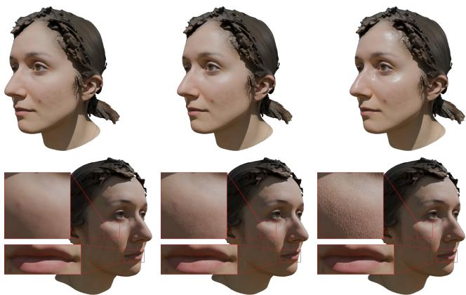  
Figure 9. Visual variance of our procedural PBR augmentation pipeline. Top Row: Generated roughness maps showcasing varying simulated skin types, ranging from very dry (left) to oily (right). Bottom Row: Generated tangent-space normal maps demonstrating the effect of our randomised factors α and β. Ranging from the lowest possible strength (left), to the mid-point of strength (middle), and the highest possible strength (right). The overlaid insets highlight the procedural multi-scale noise used to synthesise micro-pores and directional lip wrinkles.

Table 3. Per-region augmentation parameters and sampling distributions. All continuous parameters are sampled uniformly within the stated range unless otherwise noted.
<table><tr><td>Region</td><td>Parameter</td><td>Sampling</td><td>Range / Values</td></tr><tr><td rowspan="4">Skin</td><td>Age Factor α</td><td>Uniform</td><td>[0, 1]</td></tr><tr><td>Skin Type</td><td>Categorical</td><td>5 classes</td></tr><tr><td>Roughness baseline shift</td><td>Uniform (per class)</td><td>[0.0, 1.0]</td></tr><tr><td>Normal map strength</td><td>Derived from α</td><td>[0.25, 1.6]</td></tr><tr><td rowspan="3">Mouth/Lips</td><td>Lip fissure strength β</td><td>Uniform</td><td>[0.15, 0.5]</td></tr><tr><td>Wetness Factor</td><td>Uniform</td><td>[0.0, 1.0]</td></tr><tr><td>Base roughness</td><td>Fixed offset (lower than skin)</td><td>1</td></tr><tr><td rowspan="2">Hair</td><td>Oiliness Factor</td><td>Uniform</td><td>[0.0, 1.0]</td></tr><tr><td>Roughness range</td><td>Derived from oiliness</td><td>[0.55, 0.80]</td></tr><tr><td rowspan="2">Eyes</td><td>Roughness</td><td>Fixed</td><td>0.1</td></tr><tr><td>Index of Refraction (IOR)</td><td>Fixed</td><td>1.337</td></tr></table>

Tab. 3 summarises the key parameters and sampling distributions for all four regions. Full details for each region are given in the following subsections.

## B.1. Skin Material Synthesis

The skin material is the most complex component of our procedural pipeline, designed to simulate both micro-scale and macro-scale human skin features.

Normal Maps: We construct a multi-layered procedural normal map controlled by a continuously sampled Age Factor $\alpha \in [ 0 , 1 ]$ . The map consists of three distinct frequencies:

Algorithm 1 Skin Material Synthesis   
Require: AlbedoRGB, Age ∈ [0, 1], SkinType $\in \ [ 0 , 1 ]$   
Geometry.Pointiness, AmbientOcclusion   
1: Normal Map Generation:   
2: w ← MapRange(Age, [0, 1], [0.05, 0.75])   
3: $s _ { \mathrm { b u m p } } \gets \mathrm { M a p R a n g e } ( \mathrm { A g e } , [ 0 , 1 ] , [ 0 . 2 5 , 1 . 6 0 ] )$   
4: $N _ { \mathrm { p o r e s } }  \mathrm { N o i s e T e x t u r e ( s c a l e = 3 5 0 , d e t a i l = 3 . 0 ) }$   
5: $N _ { \mathrm { { m a c r o } } } \quad  \quad \mathrm { { N o i s e T e x t u r e ( s c a l e } } \quad = \quad 5 . 0 , \mathrm { d e t a i l } \quad =$   
0.0, roughness = 0.4)   
6: $C _ { \mathrm { s t r e t c h } }  \mathrm { T e x C }$ oords $\times \left( 1 . 5 , 3 . 0 , 1 . 0 \right)$ \triangleright Asymmetric   
stretch   
7: Vwrinkles ← Voronoi(Cstretch, type =   
DistanceToEdge, scale = 1300)   
8: $M _ { 1 }  \mathrm { M i x } ( N _ { \mathrm { p o r e s } } , N _ { \mathrm { m a c r o } } , \mathrm { f a c t o r } = 0 . 4 5 )$   
9: $H _ { \mathrm { b u m p } }  \mathrm { M i x } ( M _ { 1 } , V _ { \mathrm { w r i n k l e s } } , \mathrm { f a c t o r } = w _ { \mathrm { w r i n k l e } } )$   
10: Normalout ← Bump(height = Hbump, strength =   
sbump)   
11: Roughness Map Generation:   
12: P ← ColorRamp(Geometry.Pointiness, min =   
0.2, max = 0.8)   
13: $M _ { \mathrm { g e o } } \gets \mathrm { M u l t i p l y } ( P , \mathrm { A m b i e n t O c c l u s i o n } , \mathrm { f a c t o r = 0 . 7 } )$   
14: $V _ { \mathrm { i n v } }  \mathrm { M a p R a n g e } ( \mathrm { H S V } ( \mathrm { A l b e d o } _ { R G B } ) . V , [ 0 , 1 ] , [ 1 . 0 , 0 . 0 ] )$   
15: $R _ { \mathrm { b a s e } }  \mathrm { M i x } ( M _ { \mathrm { g e o } } , V _ { \mathrm { i n v } } , \mathrm { f a c t o r } = 0 . 4 )$   
16: $R _ { \mathrm { t a r g e t } }  \mathbf { M a p R a n g e ( S k i n T y p e , [ 0 , 1 ] , [ 0 . 6 5 , 0 . 2 5 ] ) }$   
17: Roughnes $\mathrm {  ~ \tau ~ } _ { \mathrm { { o u t } } }  \mathrm { { M i x } } ( R _ { \mathrm { { b a s e } } } , R _ { \mathrm { { t a r g e t } } } ,$ factor = 0.65)   
18: return $\mathrm { B S D F } ( \mathrm { C o l o r } \ = \ \mathrm { A l b e d o } _ { R G B } .$ , Roughness =   
Roughness , Normal = Normalout, IOR = 1.44)

• Micro Detail (Pores): Generated using high-frequency Perlin noise [32] (scale 350) to simulate skin pores.

• Mid Detail (Wrinkles): Synthesized via Voronoi [41] distance-to-edge textures. The mapping coordinates are stretched asymmetrically to mimic the directional flow of facial wrinkles.

• Macro Detail (Unevenness): Low-frequency Perlin noise (scale 5.0) is added to introduce soft, large-scale surface variations, breaking up artificial smoothness.

Algorithm 1 details how the three distinct frequencies are mixed and generated to produce the normal augmentation.

This physically simulates the deeper structural skin variations and loss of elasticity associated with ageing (highlighted in the zoomed-in skin crops in Fig. 9).

Roughness Maps: Skin roughness is computed dynamically by blending geometric and colour cues. We extract geometric Pointiness (curvature) and Ambient Occlusion (AO) to vary roughness between crevices and exposed areas. Together with the HSV value channel of the albedo map, we generate plausible roughness maps as stated in Algorithm 1. The input Skin Type parameter is uniformly sampled from the range defined by the draw of one of the five categories, which have predefined probabilities:

• Very Dry (10%): roughness $\in [ 0 . 0 , 0 . 1 5 ]$

• Dry (17.75%): roughness $\in [ 0 . 1 5 , 0 . 3 8 ]$

• Normal (40%): roughness ∈ [0.38, 0.62]

• Combination (20%): roughness ∈ [0.62, 0.85]

• Oily (12.25%): roughness ∈ [0.85, 1.0]

## B.2. Specialized Semantic Regions

Mouth / Lips: The lip region requires distinct structural details. We lower the base roughness compared to the surrounding skin and generate a specialised normal map, detailed in Algorithm 2. We simulate the characteristic vertical fissuring of human lips, where the strength is determined by a uniformly sampled factor $\beta ~ \in ~ [ 0 . 1 5 , 0 . 5 ]$ (visible in the lip insets of Fig. 9). Additionally, a randomised Wetness Factor controls the final roughness, allowing the pipeline to generate both matte, dry, and highly wet lips.

Hair: To simulate hair, we sample a random Oiliness Factor. This drives a mapped roughness range, producing variations from dry, highly scattering hair (roughness 0.8) to darker, oily, and clumped hair (roughness 0.55), as outlined in Algorithm 3. We deliberately omit normal map augmentation for the hair region. Procedurally generating high-quality, flow-aligned normal maps for diverse hair styles and topologies—relying solely on coarse geometry and albedo—is highly ill-posed. In our experiments, applying synthetic normals to hair introduced structurally inconsistent artefacts that degraded rather than improved rendering fidelity.

Eyes: The eyeballs are assigned a static, physically motivated material with a fixed low roughness (0.1) and an Index of Refraction (IOR) of 1.337, as specified in Algorithm 3, matching the physical properties of the human cornea to simulate a wet, glassy appearance. Normal map augmentation is entirely bypassed for the eyes, as the natural surface of the cornea is exceptionally smooth and procedural normals would introduce spurious micro-structure inconsistent with the ground-truth surface.

## C. Architectural Details

The high-level network configurations, training setup, and data generation procedure are described in Secs. 3.1.–3.5. of the main paper. This section provides the fine-grained architectural details deferred from the main paper due to space constraints: the full CNN architectures (Sec. C.1), a consolidated hyperparameter table (Tab. 4), and the complete noise scheduling and inference sampling specification (Sec. C.2).

Algorithm 2 Lips Material Synthesis   
Require: AlbedoRGB, Wetness $\in [ 0 , 1 ]$   
1: Normal Map Generation:   
2: S ← RandomUniform(0.15, 0.50)   
3: $C _ { \mathrm { s t r e t c h } } $ TexCoords × (25.0, 1.0, 8.0) \triangleright Extreme   
vertical stretch   
4: $N _ { \mathrm { l i n e s } } $ NoiseTexture(coords = Cstretch, scale =   
100.0)   
5: Normalout ← Bump(height = Nlines, strength = S)   
6: Roughness Map Generation:   
7: Roughness ← MapRange(Wetness, [0, 1], [0.65, 0.30]   
8: return BSDF(Color = AlbedoRGB, Roughness $=$   
Roughnes $\dot { } _ { \mathrm { o u t } } ,$ Normal = Normalout, IOR   
1.44, Clearcoat = 0.05)

Algorithm 3 Hair and Eyes Material Synthesis   
Require: Albedo $R G B \mathrm { : }$ , Oiliness $\in [ 0 , 1 ]$   
1: Hair Material Generation:   
2: $R _ { \mathrm { b a s e } }$ ← MapRange(Oiliness, [0, 1], [0.80, 0.55])   
3: $V _ { \mathrm { a l b e d o } }  \mathrm { H S V } ( \mathrm { A l b e d o } _ { R G B } ) . V$   
4: $\Delta _ { R } \gets \mathbf { M a p R a n g e } ( V _ { \mathrm { a l b e d o } } , [ 0 , 1 ] , [ 0 . 0 5 , - 0 . 0 5 ] )$ \triangleright   
Slight perturbation based on HSV value   
5: Roughnes $\mathbf { s } _ { \mathrm { h a i r } } \gets \mathrm { C l a m p } ( R _ { \mathrm { b a s e } } + \Delta _ { R } , 0 , 1 )$   
6: ${ \mathrm { B S D F } } _ { \mathrm { h a i r } }$ ← BSDF(Color   
AlbedoRGB, Roughness = Roughness , IOR =   
1.55)   
7: Eyes Material Generation:   
8: $\mathrm { B S D F _ { e y e s } }$ ← BSDF(Color   
AlbedoRGB, Roughness = 0.10, IOR = 1.337)

## C.1. CNN Architectures

Image conditioning and tangent-space refinement rely on two specialised CNNs. Their architectures are detailed below:

Image Pre-Processing CNN. This network maps input images into a multi-scale feature space and progressively downsamples them, enabling the Image-to-Mesh Cross-Attention to operate over varying receptive fields at each EDB (Tab. 5).

Table 4. Architectural and noise-scheduling hyperparameters for the albedo and roughness prediction networks.
<table><tr><td>Hyperparameter</td><td>Albedo</td><td>Roughness</td></tr><tr><td>Base feature dimensionality d</td><td>64</td><td>64</td></tr><tr><td>Attention heads</td><td>4</td><td>4</td></tr><tr><td>Cross-attention patch size r</td><td>5</td><td>5</td></tr><tr><td>KNN neighbourhood size k</td><td>21</td><td>– (omitted)</td></tr><tr><td>EDBs with cross-attention EDBs with k-NN attention</td><td>{1, 4, 5, 6, 7, 9} {1, 4, 5, 6, 7, 9}</td><td>{1, 2, 3, 4} – (omitted)</td></tr><tr><td>LBO eigenpairs K</td><td>300</td><td>300</td></tr><tr><td>Input conditioning space</td><td>RGB [−1,1]</td><td>HSV</td></tr><tr><td>Batch size Warm-up steps</td><td>32 2000 steps</td><td>32 2000 steps</td></tr><tr><td>Learning rate (lr)</td><td> $1 0 ^ { - 4 }$ </td><td> $1 0 ^ { - 4 }$ </td></tr><tr><td>lr-scheduler Optimiser</td><td>cosine AdamW [27]</td><td>cosine AdamW [27]</td></tr><tr><td> $P _ { \mathrm { m e a n } } ~ ( \mathrm { h i g h - n o i s e } )$ </td><td></td><td></td></tr><tr><td></td><td>-0.15</td><td>-0.15</td></tr><tr><td> $P _ { \mathrm { s t d } } ( \mathrm { h i g h - n o i s e } )$ </td><td>1.00</td><td>1.00</td></tr><tr><td> $P _ { \mathrm { m e a n } } \left( \mathrm { l o w - n o i s e } \right)$ </td><td></td><td></td></tr><tr><td></td><td>-2.45</td><td>-2.45</td></tr><tr><td> $P _ { \mathrm { s t d } } \left( \mathrm { l o w - n o i s e } \right)$ </td><td>0.95</td><td>0.95</td></tr><tr><td> $\sigma _ { \mathrm { d a t a } }$ </td><td>0.391</td><td>0.391</td></tr><tr><td>Hand-off threshold  $t _ { i }$ </td><td>≈0.55</td><td>≈0.55</td></tr><tr><td>Inference steps N</td><td>31</td><td>31</td></tr><tr><td></td><td>80</td><td>80</td></tr><tr><td> $\sigma _ { \mathrm { m a x } }$ </td><td></td><td></td></tr><tr><td> $\sigma _ { \mathrm { m i n } }$ </td><td>0.002</td><td>0.002</td></tr><tr><td> $\rho$ </td><td>7</td><td>7</td></tr></table>

Table 5. Architecture of the Image Pre-Processing CNN. The mapping block projects input images to feature space, followed by three sequential downsampling blocks.
<table><tr><td>Block</td><td>Layer Type</td><td>Kernel / Stride</td><td>Out Channels</td><td>Activation, Norm</td></tr><tr><td rowspan="2">Mapping</td><td>Conv2d</td><td>3×3/1</td><td>16</td><td>GroupNorm(2), SiLU</td></tr><tr><td>Conv2d</td><td>3×3/1</td><td>32</td><td>GroupNorm(4), SiLU</td></tr><tr><td>Downsample 1</td><td>Conv2d</td><td>3×3/2</td><td>32</td><td>GroupNorm(4), SiLU</td></tr><tr><td>Downsample 2</td><td>Conv2d</td><td>3×3/2</td><td>32</td><td>GroupNorm(4), SiLU</td></tr><tr><td>Downsample 3</td><td>Conv2d</td><td>3×3/2</td><td>32</td><td>GroupNorm(4), SiLU</td></tr></table>

Tangent Refinement U-Net. For the eye regions, 64×64 patches extracted in tangent space are processed by a lightweight U-Net to recover sharp, high-frequency details such as iris structure. The final projection layer uses zeroinitialisation to ensure stable residual learning at the start of training, fully shown in Tab. 6.

## C.2. Noise Scheduling and Inference

Following the EDM framework [22], we train two specialised models to handle distinct noise regimes for both albedo and roughness prediction. The injected noise during training is:

$$
\mathrm { n o i s e } = \mathbf { n } \cdot \boldsymbol { \sigma } , \quad \mathbf { n } \sim \mathcal { N } ( \mathbf { 0 } , \mathbf { I } ) ,\tag{2}
$$

Table 6. Architecture of the Tangent Refinement U-Net. This lightweight network processes 64×64 tangent-space patches to recover high-frequency eye and iris details.
<table><tr><td>Block</td><td>Layer Type</td><td>Kernel / Stride</td><td>Out Channels</td><td>Activation, Norm</td></tr><tr><td>Encoder 1</td><td>Conv2d ×2</td><td>3×3/1</td><td>32</td><td>GroupNorm(8), SiLU</td></tr><tr><td>Down 1</td><td>Conv2d</td><td>3×3/2</td><td>64</td><td></td></tr><tr><td>Encoder 2</td><td>Conv2d</td><td>3×3/1</td><td>64</td><td>GroupNorm(16), SiLU</td></tr><tr><td>Down 2</td><td>Conv2d</td><td>3×3/2</td><td>128</td><td></td></tr><tr><td>Bottleneck</td><td>Conv2d</td><td>3×3/1</td><td>128</td><td>GroupNorm(32), SiLU</td></tr><tr><td>Up 1</td><td>ConvTranspose2d</td><td>2×2/2</td><td>64</td><td>一</td></tr><tr><td>Concat 1</td><td>Concat w/ Encoder 2</td><td></td><td>128</td><td>一</td></tr><tr><td>Decoder 1</td><td>Conv2d</td><td>3×3/1</td><td>64</td><td>GroupNorm(16), SiLU</td></tr><tr><td>Up 2</td><td>ConvTranspose2d</td><td>2×2/2</td><td>32</td><td></td></tr><tr><td>Concat 2</td><td>Concat w/ Encoder 1</td><td></td><td>64</td><td></td></tr><tr><td>Decoder 2</td><td>Conv2d</td><td>3×3/1</td><td>32</td><td>GroupNorm(8), SiLU</td></tr><tr><td>Final</td><td>Conv2d (Zero Init)</td><td>1×1/1</td><td>Cout</td><td></td></tr></table>

where the noise level $\sigma$ is drawn from a log-normal distribution:

$$
\sigma = \exp ( r \cdot P _ { \mathrm { s t d } } + P _ { \mathrm { m e a n } } ) , \quad r \sim \mathcal { N } ( 0 , 1 ) .\tag{3}
$$

The noise regimes are divided into high-noise and low-noise regimes, detailed in Tab. 4.

Loss Weighting. We use the standard EDM loss weighting. The per-sample weight for noise level σ is:

$$
w ( \sigma ) = \frac { \sigma ^ { 2 } + \sigma _ { \mathrm { d a t a } } ^ { 2 } } { ( \sigma \cdot \sigma _ { \mathrm { d a t a } } ) ^ { 2 } } ,\tag{4}
$$

with $\sigma _ { \mathrm { { d a t a } } } = 0 . 3 9 1$ computed as the standard deviation of our training data.

Inference Sampling. During inference, we denoise over N = 31 steps with non-uniform time step discretisation concentrating steps at lower noise levels:

$$
t _ { i } = \left( \sigma _ { \operatorname* { m a x } } ^ { 1 / \rho } + \frac { i } { N - 1 } \left( \sigma _ { \operatorname* { m i n } } ^ { 1 / \rho } - \sigma _ { \operatorname* { m a x } } ^ { 1 / \rho } \right) \right) ^ { \rho } , \quad i \in \{ 0 , \dots , 3 0 \} ,\tag{5}
$$

$$
\mathrm { w i t h } \sigma _ { \mathrm { m a x } } = 8 0 , \sigma _ { \mathrm { m i n } } = 0 . 0 0 2 , \mathrm { a n d } \rho = 7 .
$$

Two-Stage Hand-Off. We perform a hard hand-off from the high-noise base model to the low-noise refinement model at $t _ { i } \approx 0 . 5 5$ , corresponding to the final ∼33% of the denoising trajectory. The high-noise model establishes coarse global structure and colour, while the low-noise refinement model recovers fine-grained surface detail.

## C.3. Efficiency

We benchmarked all methods on an NVIDIA RTX 3090 GPU with 12 CPU cores (Tab. 7). Our core generative network (7.22M parameters) is 370× smaller than Hunyuan3D-2.0-Paint. This makes VISAGE considerably more practical for deployment than large diffusion models. Through semantic region splitting, our full model achieves a lower peak memory footprint (5.6 GB) than even the base DiffusionNet\* (6.4 GB). Our feed-forward approach synthesises textures in an end-to-end runtime of 104.9 s, drastically outperforming optimisation-based methods like MonoNPHM (575.4 s total).

Table 7. Efficiency comparison. Parameter counts (M) and infer ence times (seconds) are split into the core generative network and the off-the-shelf preprocessing components (if applicable)
<table><tr><td>Model</td><td>Parameter Count</td><td>GPU Memory</td><td>Inference Time</td></tr><tr><td>DiffusionNet* [35]</td><td>3.51M + 214.79M</td><td>6.40GB</td><td>21.3 s + 78.0 s</td></tr><tr><td>Hunyuan3D-2.0-Paint [48]</td><td>2679.13M</td><td>10.30GB</td><td>87.9 s</td></tr><tr><td>MonoNPHM [19]</td><td>11.22M + 84.79M</td><td>4.96GB</td><td>417.5 s + 157.9 s</td></tr><tr><td>VISAGE</td><td>7.22M + 214.79M</td><td>5.60GB</td><td>26.9 s + 78.0 s</td></tr></table>

## C.4. Choice of Spectral Basis Size

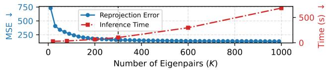  
Figure 10. Spectral reconstruction trade-off. Increasing the number of Laplace–Beltrami eigenpairs reduces reprojection error but increases inference time. We use K = 300 as a practical trade-off between accuracy and efficiency.

The number of eigenpairs is chosen by analysing the trade-off between spectral reconstruction fidelity and computational cost. As shown in Fig. 10, the reprojection error exhibits clear diminishing returns beyond K ≈ 300, while inference cost continues to grow superlinearly. We therefore use K = 300 throughout.

## D. Additional Ablations and Visualizations

This section provides visual as well as ablation results complementing Sec. 4 of the main paper. Section D.1 quantifies the model robustness to noisy meshes. Section D.2 isolates the contribution of the predicted roughness maps. Section D.3 presents the qualitative ablation comparisons deferred from Sec. 4.2.1. Section D.4 characterises representative failure cases on the NPHM and FaceVerse datasets.

## D.1. Robustness to Noise

Our pipeline mitigates preprocessing fragility via two safeguards: (1) EPnP+RANSAC rejects outlier keypoints, and (2) training on estimated parameters implicitly conditions the network against estimation jitter. To evaluate robustness to geometric artefacts, we systematically perturbed input meshes with three noise variants: (1) scale-invariant Gaussian jitter $( \sigma = 1 5 { - } 3 0 \%$ of the mean edge length), (2) structural spikes of increasing density and magnitude, and (3) quantisation noise with expanding step sizes. Fig. 11 shows that while the quality suffers with the addition of noise, the impact is marginal even in the case of higher surface noise.

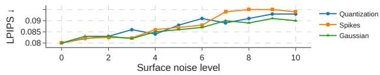  
Figure 11. Robustness to geometric noise. LPIPS under Gaussian noise, quantization, and surface spikes. VISAGE degrades gracefully under increasing mesh perturbations, indicating robustness to imperfect input geometry.

## D.2. Contribution of Predicted Roughness

To isolate the roughness model’s contribution, we render the predicted albedo under two roughness conditions with geometry, camera and lighting held fixed: a single global constant equal to the area-weighted training-set mean (r = 0.59), which is the obvious fallback for a pipeline without a roughness model, and our predicted per-vertex roughness. Both are shown alongside the ground-truth render for four subjects in Fig. 12. Predicted roughness concentrates a response where skin is oiliest — the forehead and nose bridge gain a visible sheen, and the eyes read as glossy rather than matte — which relieves the flat appearance of the constantroughness render. The predicted maps also differ noticeably between subjects, so the model is not collapsing to a learned constant.

## D.3. Visual Ablation

As described in Sec. 4.2.1 of the main paper, we evaluate four degraded configurations by systematically removing key architectural components. The main paper presents qualitative results for the eye region (Fig. 6), as it is the most sensitive indicator of semantic region splitting and tangentspace refinement. Fig. 13 provides the remaining qualitative comparisons for the other three configurations: removal of the high-frequency k-NN stream, removal of noise-level conditioning, and removal of semantic region splitting.

Removing the high-frequency stream forces the network to rely solely on the EDB’s per-vertex MLP for detail recovery. As shown in the top row of Fig. 13 and in Fig. 14, this produces a visibly grainy, locally incoherent skin texture and a notable loss of high-frequency sharpness in boundaries like hair and skin and in fine structures such as beard stubble.

Disabling noise-level conditioning in the heat diffusion step prevents the network from dynamically adapting the spatial reach of feature propagation. As shown in the middle row, this causes a severe boundary collapse: skin tones bleed into the hair region and dark hair colour smears down the neck onto clothing — artefacts that are entirely absent

in the full VISAGE model.

Without semantic region splitting, a shared global MLP is forced to process all vertex types jointly. As shown in the bottom row, this degrades the structural integrity of specialised regions: the eyes lose their iris definition, and the pink hues of the gums bleed unnaturally into the teeth. The full model maintains strict semantic boundaries and preserves high-frequency fidelity across all regions.

## D.4. Failure Cases

We present two representative failure modes to characterise the current limitations of VISAGE, consistent with the discussion in Sec. 5 of the main paper.

Occluded Regions. Since direct image supervision is limited to frontal and lateral views, texture synthesis in heavily occluded regions — primarily the hair at the back of the head — is governed entirely by the diffusion prior. As shown in the top block of Fig. 15, this occasionally produces a subtle luminance shift, where the predicted hair colour becomes slightly brighter than the ground truth. This artefact is most noticeable under full 360◦ inspection.

Illumination Entanglement. Under strong directional lighting or harsh cast shadows, the network occasionally fails to fully disentangle surface albedo from incident illumination, noticeable most in the hair region. As shown in the bottom block of Fig. 15, this manifests as a warm colour cast baked into the predicted albedo, most visibly in dark hair and shadowed skin regions. Sec. 4.2.3 of the main paper quantifies the effect across ten environments: predicted albedo removes 83% of the observed illumination variation, with the residual concentrated in hair. Recovering the remainder would require explicit illumination decomposition rather than the single-pass prediction used here.

GT

Constant r

Predicted r

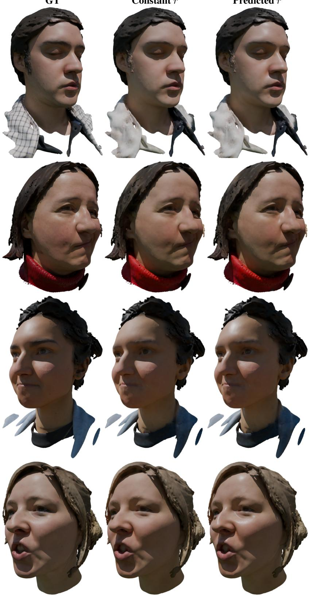  
Figure 12. Contribution of predicted roughness on NPHM dataset [18]. Predicted albedo rendered with a single global constant roughness (r = 0.59, the area-weighted training-set mean) against the predicted per-vertex roughness, alongside the ground-truth render. All conditions share geometry, albedo, camera and illumination.

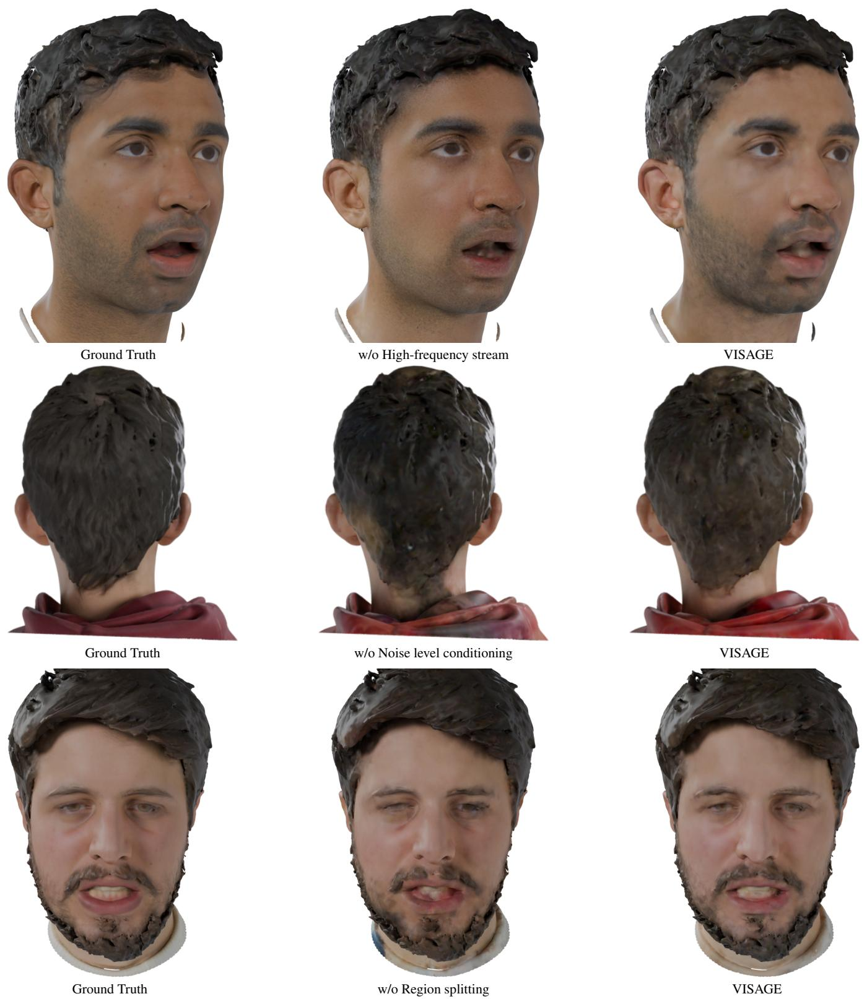  
Figure 13. Qualitative ablation of key architectural components on the NPHM dataset. Top Row: Removing the local k-NN refinemen stream forces the network to rely on the EDB’s MLP, resulting in grainy artefacts and a loss of high-frequency sharpness, like beard. Middle Row: Disabling noise-level conditioning in the heat diffusion step prevents dynamic spatial adaptation, causing texture bleeding and boundary collapse in occluded areas. Bottom Row: Without semantic region splitting, a shared global MLP fails to capture the unique statistical distributions of specialised regions such as the mouth and eyes, degrading realism.

w/o Stream 2

VISAGE

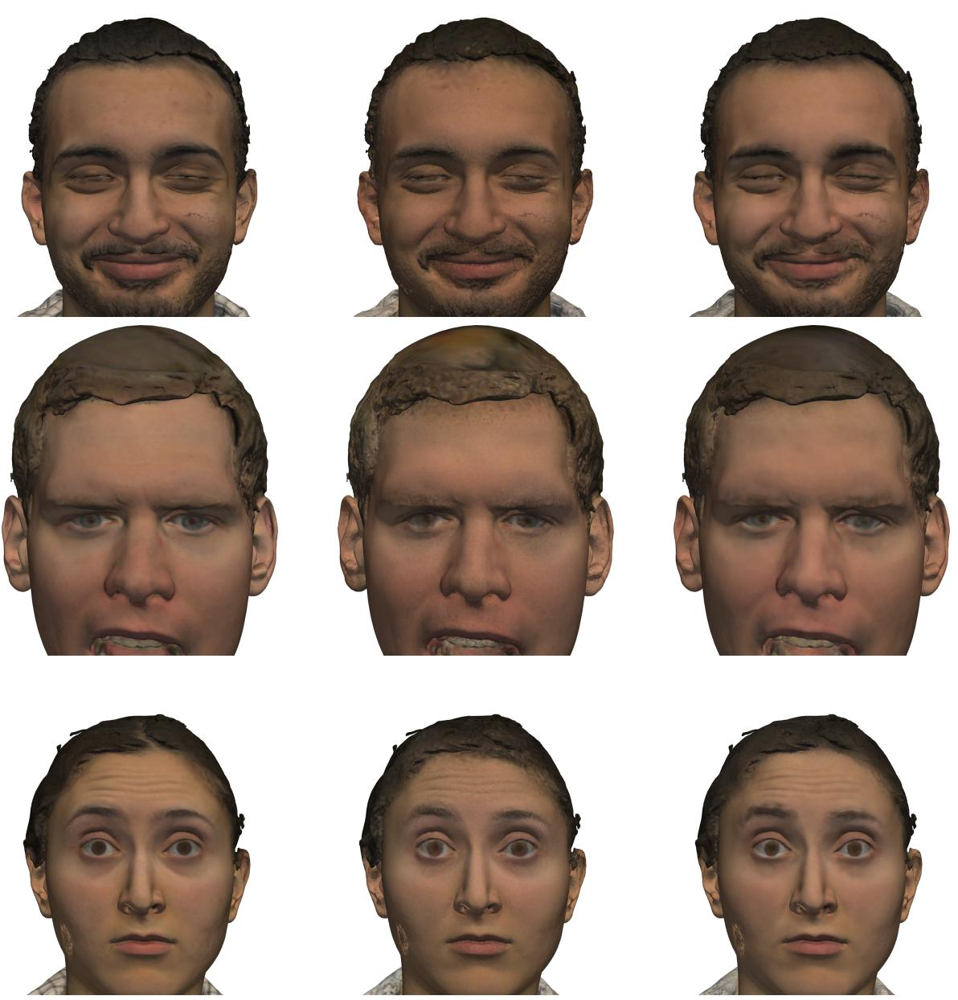  
Figure 14. Effect of the local high-frequency stream. Removing Stream 2 leaves the spectral branch alone, whose truncated Laplace– Beltrami basis acts as a low-pass filter, and the MLP in each EDB block needs to retain and enhance local features, which leads to a noisy, grainy look.

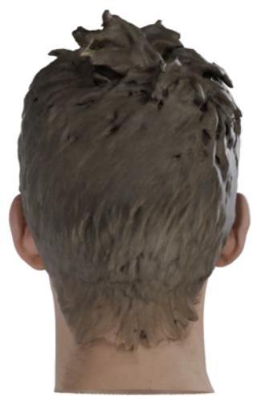  
GT

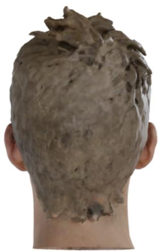  
VISAGE

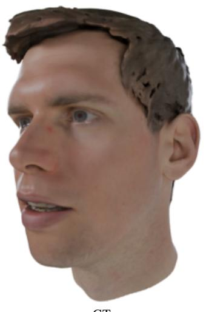  
GT

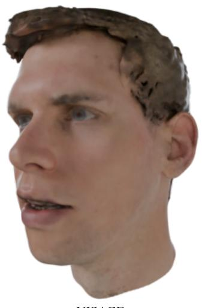  
VISAGE

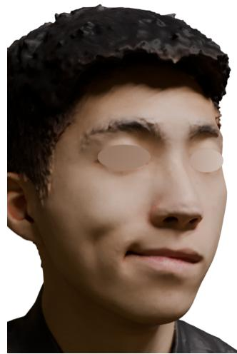  
GT

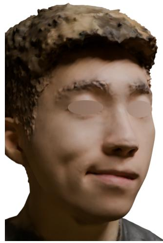  
VISAGE

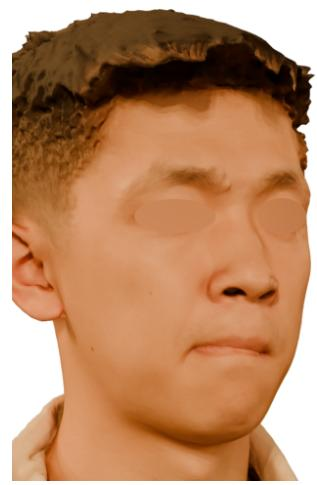  
GT

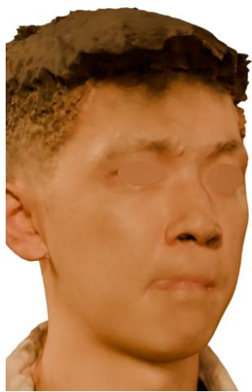  
VISAGE  
Figure 15. Typical failure cases of VISAGE. Top Block: Results from the NPHM dataset [18], where sometimes the colour in the occluded hair region shifts slightly and gets brighter, compared to hair colour in no occluded areas on the right. Bottom Block: Results from FaceVerse dataset [38], in which strong directional lighting and harsh cast shadows are occasionally baked into the predicted albedo rather than being fully decomposed