# VidUEU-Agent: A Data-Curation Agent for Multimodal Understanding, Editing, and Unified Tasks

Tengju Ru<sup>1,∗</sup> Weitong Lian<sup>1,∗</sup> Zecong Tang<sup>2,∗,‡</sup> Lingyi Meng<sup>1,∗</sup> Haoran Li<sup>2</sup> Zhejun Cui<sup>2</sup> Yichen Zhu<sup>1</sup> Hangshuo Cao<sup>1</sup> Qi Kang<sup>1</sup> Yechi Liu<sup>3</sup> Kaixuan Wang<sup>2</sup> Yu-Jie Yuan<sup>4</sup> Chunwei Wang<sup>4</sup> Yu Zhang<sup>1,†</sup> Bo Dai<sup>2,†</sup>

<sup>1</sup> Zhejiang University <sup>2</sup> The University of Hong Kong

<sup>3</sup> Institute of Automation, Chinese Academy of Sciences <sup>4</sup> Huawei Technologies Ltd.

zhangyu80@zju.edu.cn bdai@hku.hk

<sup>∗</sup> Equal contribution. <sup>‡</sup> Project lead. <sup>†</sup> Corresponding authors.

GitHub: https://github.com/LRuca/VidUEU-Agent

## Abstract

The advancement of multimodal learning is heavily constrained by the scarcity and high annotation cost of high-quality instruction data. While raw videos offer an abundant and dynamic source of visual knowledge, transforming them into precise instruction data remains highly challenging. To bridge this gap, we present VidUEU-Agent, an automated pipeline that synthesizes instruction data from raw videos for multimodal understanding, editing, and unified tasks. VidUEU-Agent follows a four-stage pipeline: it performs global perception to filter low-quality shots, mines keyframes and multimodal signals, constructs metadata and routes the metadata to synthesize instruction samples. More importantly, our agent framework can autonomously iterate the data distribution based on downstream training results, thereby optimizing data quality, balance, and training effectiveness. Scaling this pipeline, we construct VidUEU-100K, a large-scale dataset of 100K training samples spanning multiple domains and tasks, providing a robust foundation for developing comprehensive multimodal capabilities. Extensive experiments demonstrate that fine-tuning baseline models on VidUEU-100K yields significant and consistent performance gains across diverse representative benchmarks, validating the effectiveness of our proposed agent framework and dataset.

## 1 Introduction

With the rapid advancement of large language models (LLMs), multimodal large language models (MLLMs) have made significant strides Yin et al. [2024]. These models use vision encoders to bridge multimodal inputs, enabling joint understanding and reasoning Wu et al. [2023], Liang et al. [2024]. Concurrently, multimodal generative models have also evolved rapidly, expanding capabilities from high-fidelity text-to-image synthesis to controllable text-to-video generationZhang et al. [2023], Chen et al. [2025a], Lipman et al. [2022]. However, generative models and MLLMs have progressed along separate tracks, making it challenging to unify understanding and generation in one system Zhao et al. [2025]. Unified multimodal models (UMMs) provide a consistent framework for multimodal understanding and generation, showing great potential for multi-step reasoning and controllable image editing Yang et al. [2025b], Chen et al. [2025b], Wu et al. [2025], Deng et al. [2025a].

The advancement of multimodal capabilities relies on the availability of high-quality datasets Yang et al. [2025b]. For UMMs, there remains a lack of a scalable and reproducible paradigm for producing such high-quality instruction data while minimizing manual annotation cost Yin et al. [2024], Deng et al. [2024]. Raw videos provide a scalable source of multimodal knowledge, covering broad domains and temporally ordered interactions beyond static images Tong et al. [2025a]; however, they are also redundant, noisy, and unstructured, and do not directly provide task-oriented instruction data. The key challenge is therefore to convert large-scale raw videos into instruction data that jointly supports understanding and generation while remaining suitable for stable model training.

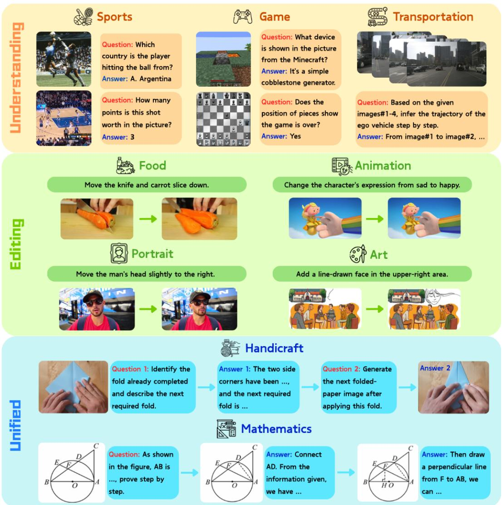  
Figure 1: Example samples of VidUEU-100K. We illustrate three capability paradigms: Understanding (top), Editing (middle), and Unified (bottom).

In recent years, LLM-based agent systems have demonstrated strong planning and tool-use capabilities, enabling them to decompose complex goals into executable steps and to achieve large-scale data generation, verification, and filtering Guo et al. [2024], Xu et al. [2025], Kumar et al. [2024], Zhang et al. [2025a]. By interacting with external tools and making feedback-driven decisions, agents can automate complex data-curation workflows Tang et al. [2025], Riaz et al. [2025]. These properties make agent systems a fit for transforming raw videos into structured instruction data.

Motivated by the strengths of agent systems and video data, we introduce VidUEU-Agent, an automated data synthesis framework that leverages agent planning and tool use to convert raw videos into multimodal instruction data. VidUEU-Agent follows a four-stage pipeline: it performs global perception to obtain coarse video understanding and filter low-quality shots, mines keyframes and mul timodal signals through frame filtering and tool use, constructs metadata from the keyframe sequence and filtered signals, and routes the metadata to synthesize instruction samples for understanding, editing, and unified tasks. VidUEU-Agent further autonomously iterates the data distribution based on downstream training results, improving data quality, balance, and training effectiveness.

Further, we scale this pipeline to construct VidUEU-100K, a large-scale high-quality multimodal instruction dataset built from 8,268 diverse videos collected from the web and open datasets. The dataset contains nearly 20k dense metadata annotations, enabling 40K understanding samples, 30K editing samples, and 30K unified samples, and it spans nine task paradigms and five scenario categories, ensuring comprehensive and balanced data for improving the overall capabilities of UMMs. We further fine-tune a series of baseline models on VidUEU-100K and validate the effectiveness of our data through multiple benchmarks and case studies.

In summary, our contributions are as follows:

• We propose VidUEU-Agent, a scalable and automated framework that leverages the planning and tool-using capabilities of agents to synthesize high-quality instruction data for multimodal understanding, editing, and unified tasks from video sources.

• By scaling this pipeline, we construct VidUEU-100K, a large-scale dataset featuring 20k dense metadata annotations and 100K diverse instruction samples, covering diverse domains and complex tasks across understanding, editing, and unified capabilities.

• We fine-tune a series of baseline models on VidUEU-100K, where extensive experiments across multiple benchmarks demonstrate the effectiveness of our data in enhancing model performance in various multimodal tasks.

## 2 Related Work

## 2.1 Data Construction based on Agent Systems

Early methods often used powerful LLMs to directly generate instruction–response pair Xu et al. [2023], Liu et al. [2023], Zhao et al. [2024]. Despite their efficiency, this approach lacks grounding in verifiable external signals, introducing uncertainty in data reliability and controllability Ji et al. [2023], Rawte et al. [2023], Wang et al. [2023]. Recent trends shift toward vision agents and tool use Gao et al. [2025], Deng et al. [2025b]. Such systems equip LLMs with perception tools for performing complex visual reasoning and information extraction to improve reliability and interpretability Reddy et al. [2025], Deng et al. [2025b]. With this tool-use capability, agent-based data synthesis is becoming a promising approach for automated construction of multimodal datasets Sun et al. [2025]. Prior work has explored using model agents to automatically collect bounding boxes, rewrite image captions, or synthesize question–answer pairs, greatly reducing reliance on manual annotation Chen et al. [2023], Joshi et al. [2025]. LLaVA-Video Zhang et al. [2025b] further synthesizes video-understanding QA from sampled frames, but remains focused on video understanding tasks. However, existing methods struggle to jointly synthesize understanding, editing, and unified instruction data for UMMs, which hinders the development of these models across broader tasks Zhao et al. [2025].

## 2.2 Multimodal Understanding and Generation Datasets

Large-scale, high-quality instruction datasets have become one of the key drivers of recent progress in multimodal models Li et al. [2023], Chen et al. [2023], Liu et al. [2024a]. In multimodal understanding, existing work enhances model capabilities in visual question answering and finegrained recognition Liu et al. [2023], Han et al. [2024], Yue et al. [2024], Chen et al. [2024b], Liu et al. [2024b], Ru et al. [2026]. In multimodal generation, existing work advances high-fidelity generation and controllable editing Zhao et al. [2023], Podell et al. [2023], Cao et al. [2025], Yu et al. [2023], Li et al. [2024]. Recently, the multimodal field has shifted toward unified multimodal models Yang et al. [2025b], Zhang et al. [2026]. Accordingly, unified architectures demand stable generalization across understanding and generation capabilities Tong et al. [2025b], Zhuang et al. [2025], Meng et al. [2026]. However, current image-text datasets are primarily sourced from static images, inherently lacking real-world dynamics Chen et al. [2025c], Shen et al. [2026]. In contrast, videos, featuring inherent temporal dynamics and causal interactions, serve as a more promising medium for high-quality instruction data Tong et al. [2025a].

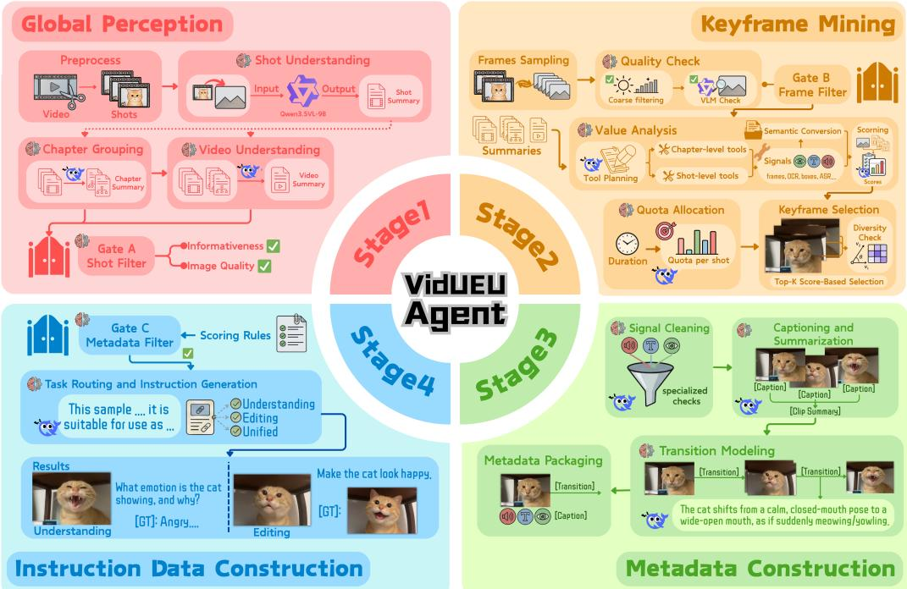  
Figure 2: Overview of VidUEU-Agent. The agent performs global perception with quality gating, then conducts keyframe mining using multimodal signals and tool verification, builds metadata, and finally synthesizes instruction data for understanding, editing, and unified tasks.

## 3 VidUEU: Agent & Dataset

## 3.1 VidUEU-Agent

We propose VidUEU-Agent, a data synthesis agent for raw videos, designed to curate instruction data for multimodal understanding, editing, and unified tasks. VidUEU-Agent first parses raw videos through global perception, removes low-quality shots, and then constructs metadata from selected keyframes and filtered multimodal signals. It then maps each metadata entry to suitable instruction data formats, ensures data quality through multi-stage quality screening and consistency filtering, and autonomously iterates the data distribution using downstream training feedback.

## 3.1.1 Stage 1: Global Perception

As a preprocessing step, VidUEU-Agent first uses PySceneDetect Castellano to detect shot boundaries and split each long video into a sequence of shot-level clips. It then performs global perception at three levels. At the shot level, VidUEU-Agent samples the middle frame of each shot and prompts a VLM to generate a shot summary. At the chapter level, the agent reviews all shot summaries of the video, groups adjacent shots according to their scene content, maps them into several chapters, and generates a chapter summary for each chapter. At the video level, the agent summarizes the whole video based on all shot-level and chapter-level summaries to obtain a video summary. Finally, VidUEU-Agent applies Gate A, namely the shot filter, to examine each shot according to informativeness and image quality rules, and removes low-quality shots from the subsequent stages. The prompts for three-level summarization, as well as chapter construction, are provided in Appendix A.1.

## 3.1.2 Stage 2: Keyframe Mining

We perform keyframe mining on the shots that pass Gate A. Frame Sampling. For each retained shot, VidUEU-Agent samples frames at a fixed interval and applies Gate B frame filtering, which combines tool-based quality statistics with VLM-based check to remove low-quality frames. For each frame that passes Gate B, VidUEU-Agent generates a caption. Tool Planning. Based on the retained frames and the summaries from global perception, VidUEU-Agent performs hierarchical tool planning by assigning tools at both the chapter level and the shot level to collect targeted information. Following this plan, VidUEU-Agent applies the selected tools to every retained frame in the corresponding shot. Frame Scoring and Keyframe Selection. VidUEU-Agent verbalizes the tool signals and scores each frame using these signals together with the three-level summaries. Based on the video duration, VidUEU-Agent sets the keyframe budget and allocates it across shots using the summaries. For each shot, VidUEU-Agent keeps the top-scoring candidates within the assigned quota, computes their image embeddings, measures cosine similarities, and applies weighted facility-location greedy selection to choose high-quality, semantically representative keyframes. The prompts for tool planning, signal verbalization, frame scoring, and quota allocation are provided in Appendix A.2. The tool pool, verbalization rules, and scoring rules are described in Appendix B.

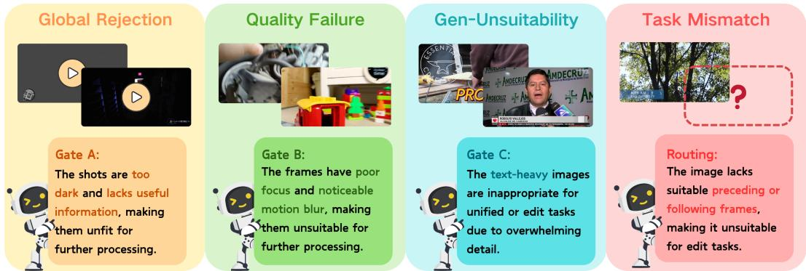  
Figure 3: Failure Case Examples: Illustrating four common rejected cases in the processing pipeline: Global Rejection, Quality Failure, Gen-Unsuitability, and Task Mismatch.

## 3.1.3 Stage 3: Metadata Construction

To construct high-quality metadata and mitigate noise from unreliable signals, the agent first performs specialized checks on the raw multimodal signals bound to the keyframe sequence. For each keyframe, the agent performs specialized checks on the associated signals using predefined rules and determines which signals to retain. Then, based on the keyframe sequence and the filtered signals, it generates transitions describing changes between consecutive keyframes and a clip summary that describes the video clip based on the keyframe captions and verbalized tool signals, and verifies the quality and factuality of the generated text using the signals. Finally, it binds the keyframes, their captions, the keyframe-bound multimodal signals, the transitions, and the clip summary to form a metadata list for the video clip. The prompts for clip summary generation and pairwise transition generation are provided in Appendix A.3, and the metadata schema is given in Appendix C.

## 3.1.4 Stage 4: Instruction Data Construction

For the generated metadata, the agent applies Gate C to perform quality filtering and categorization. Specifically, this gate calls a VLM to score metadata by overall information content, logical coherence, and overall quality, outputs a decision with reasons about its suitability as instruction data, and removes unsuitable metadata. Subsequently, for each metadata entry, the agent determines the suitable task type(s) and outputs a task list with one or more of understanding, editing, and unified. The prompts for task routing and instruction generation are provided in Appendix A.4. Finally, the agent matches instruction templates based on the metadata and its task list, and requires the model to cite the signal IDs used during instruction generation to improve traceability, thereby producing high-quality instruction data. Figure 3 illustrates representative rejected cases across Gate A, Gate B, and Gate C, covering global rejection, low-quality visual inputs, generation-unsuitable frames, and task-routing mismatches. Instruction-data synthesis templates and examples are described in Appendix D, and all quality-control filtering rules are provided in Appendix E.

## 3.1.5 Autonomous Data Iteration

To ensure the final 100K samples are high-quality, balanced, and effective for model training, VidUEU-Agent employs a self-iterative data refinement loop. In each iteration, we train models on 30K samples, evaluate them on representative benchmarks, and return results to the agent. The agent reflects on the data’s weaknesses, compares new results with the baseline and previous iterations, and updates the target distribution over capabilities, domains, and task types. Under the current policy, the agent adjusts video-type sampling in global perception to prioritize underrepresented types, shifting the domain distribution. In keyframe mining, the agent modifies sampling density and keyframe budget, and adds policy-aware weights to keyframe scoring to align with the desired keyframe distribution. During instruction data construction, task routing adjusts capability and task-type distributions, and quota-based sampling down-samples types whose ratios exceed the target ratios. The agent audits the realized distribution and records statistics, feedback, and policy changes to guide the next iteration. The final 100K dataset is scaled from the Iteration 4’s target distribution.

## 3.2 VidUEU-100K

Based on the above framework, with DeepSeek-V3 as the primary agent LLM DeepSeek-AI et al. [2025] and Qwen3.5-9B as the VLM Qwen Team [2026], we construct the VidUEU-100K dataset. It contains 100K high-quality instruction-tuning samples, including 40K understanding samples, 30K editing samples, and 30K unified samples, as well as 20k fine-grained metadata.

## 3.2.1 Data Collection & Sources

Large-scale video sources and a scalable agent pipeline enable VidUEU-100K to cover diverse scenarios, including rare and long-tail visual cases. We source videos from large-scale video datasets, including OpenVid-1M Nan et al. [2024] and Panda-70M Chen et al. [2024c], together with videos from Wikimedia and YouTube. To improve coverage in specific domains, we further use specialized open-source datasets such as FineGym Shao et al. [2020], BDD100K Yu et al. [2020], and CodeVidCL Raja et al. [2025]. To build VidUEU-100K, we use 8,268 raw source videos, from which VidUEU-Agent derives approximately 8,505 semantic segments for dataset instance generation.

## 3.2.2 Dataset Composition & Statistics

To ensure comprehensive and balanced data, we analyze VidUEU-100K from three complementary dimensions: capability, domain, and task type. For capability, we divide the 100K instruction-tuning samples into Understanding, Editing, and Unified: Understanding covers fine-grained perception, visual reasoning, and multi-image logical consistency; Editing focuses on instruction-based image editing while preserving irrelevant regions; and Unified involves interleaved text–image tasks that require models to understand visual context, infer state transitions, generate target visual states, and select images consistent with the intended change. For domain, we categorize samples into Technology & Tutorial, Sports & Action, Daily Life & Human Activities, Nature & Scenery, and Gaming & ACG. For task type, the agent generates nine categories: Fine-grained Perception, Visual Reasoning, Multi-Image Logic, Editing, Grounded Edit-to-Select Generation, Interleaved Understand– Recall–Generate–Select, Stepwise Sequence Generate-and-Select, Middle-Step Gap Generate-and-Fill, and Instructional Sequential Generate-and-Select. Detailed definitions and distributions of all capability, domain, and task categories are provided in Appendix F.

## 4 Experiment

## 4.1 Experimental Setup

We LoRA-fine-tune InternVL3-8B Zhu et al. [2025] on the understanding subset and Bagel-7B-MoT Deng et al. [2025a] separately on the three capability subsets of VidUEU-100K. We then evaluate the corresponding capabilities on MMT-Bench Ying et al. [2024], MME Fu et al. [2025], LLaVA-Bench Liu et al. [2024a], MMDU Liu et al. [2024c], GEdit-Bench-En Liu et al. [2025], and WEAVEbench Chow et al. [2025]. Detailed settings are provided in Appendix G.

Table 1: Comparison of fine-tuned InternVL3-8B & Bagel, and baseline models on benchmarks.
<table><tr><td>Type</td><td>Model</td><td>Size</td><td>MMT-Bench↑</td><td>MME↑</td><td>LLaVA-Bench↑</td><td>MMDU↑</td></tr><tr><td rowspan="6">Und nnly</td><td>Qwen2.5-VL</td><td>3B</td><td>0.577</td><td>2133.6</td><td>72.3</td><td>42.5</td></tr><tr><td>Qwen2.5-VL</td><td>7B</td><td>0.607</td><td>2308.6</td><td>82.7</td><td>59.5</td></tr><tr><td>LLaMA-3.2</td><td>11B</td><td>0.456</td><td>1761.7</td><td>73.6</td><td>37.0</td></tr><tr><td>InternVL3</td><td>1B</td><td>0.512</td><td>1871.9</td><td>46.4</td><td>39.0</td></tr><tr><td>InternVL3</td><td>2B</td><td>0.532</td><td>2157.9</td><td>62.1</td><td>45.6</td></tr><tr><td>InternVL3</td><td>8B</td><td>0.546</td><td>2308.0</td><td>69.0</td><td>53.1</td></tr><tr><td rowspan="4">Uufed</td><td>Ours(InternVL3)</td><td>8B</td><td>0.596</td><td>2369.3</td><td>70.8</td><td>61.1</td></tr><tr><td>Janus-Pro TokenFlow-XL</td><td>7B</td><td>0.480</td><td>1784.4</td><td>58.7</td><td>42.6</td></tr><tr><td></td><td>14B</td><td>0.532</td><td>1937.0</td><td>55.2</td><td>25.7</td></tr><tr><td>Bagel Ours(Bagel)</td><td>14B 14B</td><td>0.645 0.651</td><td>1573.6 1900.2</td><td>47.5 57.9</td><td>28.5 33.2</td></tr></table>

Table 2: Comparison of fine-tuned Bagel and baseline models on GEdit-Bench-En.
<table><tr><td>Type</td><td>Model</td><td>G_SC↑ G_PQ↑</td><td>G_0↑</td></tr><tr><td>Edi ly</td><td>Instruct-Pix2Pix</td><td>3.575</td><td>5.491 3.684</td></tr><tr><td rowspan="3"></td><td>MagicBrush</td><td>4.677 5.656</td><td>4.518</td></tr><tr><td>AnyEdit</td><td>3.178</td><td>5.820 3.212</td></tr><tr><td>Step1X-Edit</td><td>7.091</td><td>6.763 6.701</td></tr><tr><td rowspan="4">Uufed</td><td>Gemini-2.0-flash</td><td>6.732</td><td>6.606 6.315</td></tr><tr><td>OmniGen</td><td>5.963</td><td>5.888 5.061</td></tr><tr><td>Bagel</td><td>7.358</td><td>6.831 6.527</td></tr><tr><td>Ours(Bagel)</td><td>7.565</td><td>7.328 6.951</td></tr></table>

## 4.2 Results on Understanding Capabilities

We fine-tune InternVL3-8B and Bagel-7B-MoT on the understanding subset to evaluate the effect of VidUEU-100K on multimodal understanding. As shown in Table 1, the data produced by VidUEU-Agent substantially improves the understanding ability of both the understanding-only model and the unified model. For InternVL3-8B, the gains are most notable on MME (2369.3) and MMDU (61.1), achieving the best results among all compared models on both benchmarks. For Bagel, fine-

tuning improves all reported understanding scores and achieves the best MMT-Bench score (0.651).

Overall, these results show that the supervision generated by VidUEU-Agent effectively improves multimodal understanding and generalizes across different model families. Particularly, since MMDU evaluates multi-image reasoning and answer consistency grounded in visual evidence, the MMDU improvements of InternVL3-8B and Bagel show that VidUEU-Agent can mine semantically related keyframes from videos and model their relations in instruction data.

## 4.3 Results on Editing Capabilities

We fine-tune Bagel on the editing subset to evaluate the effect of VidUEU-100K on instruction-based image editing. As shown in Table 2, the data produced by VidUEU-Agent improves Bagel on all GEdit-Bench metrics, reaching 7.565 on G\_SC, 7.328 on G\_PQ, and 6.951 on G\_O, achieving the best results among all com -pared models. These results show that VidUEU-100K improves both edit correctness and output quality, rather than only optimizing one aspect of image editing.

The two core metrics reveal a consistent but uneven gain pattern. The improvement on G\_SC shows that VidUEU-Agent can extract meaningful visual changes from videos and convert them into instructions that guide the target edit more effectively. The larger gain on G\_PQ further indicates that video state-transition supervision helps preserve image realism and local visual structure during editing. This is because adjacent keyframes usually share most scene content but differ in specific objects, attributes, or states, matching the edit-and-preserve nature of instruction-based image editing.

## 4.4 Results on Unified Capabilities

We fine-tune Bagel on the unified subset to evaluate the effect of VidUEU-100K on interleaved understanding, generation, visual memory, and cross-turn reasoning. As shown in Table 3, the data produced by VidUEU-Agent improves Bagel’s Overall score on WEAVEbench from 0.446 to 0.501. The fine-tuned model outperforms the Bagel and Bagel-Zebra baselines, reaching 0.480 on Logic and 0.419 on Game.

Table 3: Comparison of fine-tuned Bagel and baseline models on WEAVEbench.
<table><tr><td>Type</td><td>Model</td><td>Size</td><td>Science↑</td><td>Creation↑</td><td>Logic↑</td><td>Game↑</td><td>Overall↑</td></tr><tr><td rowspan="5">Uufed</td><td>OmniGen2</td><td>7B</td><td>0.511</td><td>0.682</td><td>0.551</td><td>0.511</td><td>0.609</td></tr><tr><td>Ovis-U1</td><td>3B</td><td>0.402</td><td>0.557</td><td>0.364</td><td>0.357</td><td>0.422</td></tr><tr><td>Bagel</td><td>14B</td><td>0.378</td><td>0.475</td><td>0.406</td><td>0.365</td><td>0.446</td></tr><tr><td>Bagel-Zebra</td><td>14B</td><td>0.399</td><td>0.456</td><td>0.393</td><td>0.396</td><td>0.449</td></tr><tr><td>Ours(Bagel)</td><td>14B</td><td>0.426</td><td>0.501</td><td>0.480</td><td>0.419</td><td>0.501</td></tr></table>

Table 4: Results of autonomous data iteration.
<table><tr><td>Setting</td><td>MMDU↑</td><td>GEdit ↑</td><td>WEAVE↑</td></tr><tr><td>Iteration 1</td><td>29.7</td><td>6.541</td><td>0.448</td></tr><tr><td>Iteration 2</td><td>29.2</td><td>6.796</td><td>0.452</td></tr><tr><td>Iteration 3</td><td>31.4</td><td>6.873</td><td>0.458</td></tr><tr><td>Iteration 4</td><td>32.8</td><td>6.901</td><td>0.499</td></tr><tr><td>Final</td><td>33.0</td><td>7.065</td><td>0.526</td></tr></table>

Table 5: Ablation study of VidUEU-Agent.

These results highlight temporal supervision in unified multimodal tasks. The gains on Logic and Game suggest that the model tracks states, follows rules, models object relations, and reasons over events across turns. This matches the structure of adjacent keyframes, which preserve scene continuity while showing changes in objects, attributes, actions, and outcomes. The modest Creation gain suggests that such supervision is more effective for structured transitions than open-ended creative generation.

<table><tr><td>Setting</td><td>MMDU↑</td><td>GEdit ↑</td><td>WEAVE↑</td></tr><tr><td>Ours</td><td>33.2</td><td>6.951</td><td>0.501</td></tr><tr><td>w/o A</td><td>32.4</td><td>6.773</td><td>0.497</td></tr><tr><td>w/o B</td><td>24.7</td><td>5.175</td><td>0.404</td></tr><tr><td>w/o S</td><td>30.8</td><td>5.848</td><td>0.462</td></tr><tr><td>w/o C</td><td>30.5</td><td>6.303</td><td>0.454</td></tr><tr><td>N</td><td>22.0</td><td>5.041</td><td>0.393</td></tr><tr><td>w/o R</td><td>29.4</td><td>6.031</td><td>0.470</td></tr></table>

## 4.5 Case Study

For understanding, Bagel-7B-MoT shows hallucination and cross-image misbinding, while the fine-tuned model relies more on the visible evidence. For editing, Bagel often fails to follow background replacement instructions, whereas the fine-tuned model produces more realistic target edits while preserving irrelevant regions.

For unified tasks, the fine-tuned model better executes edits and context use in early turns, but long interleaved image–text chains remain challenging because early errors may propagate to later turns.

Overall, VidUEU-100K improves instruction alignment, compositional binding, and local-edit preservation, while long-horizon interleaved interaction remains an open challenge.

## 4.6 Results on Autonomous Data Iteration

We further evaluate the autonomous data iteration process of VidUEU-Agent. Iterations 1–4 each construct 30K samples and jointly fine-tune BAGEL from the same initial checkpoint before evaluation. The benchmark results are then fed back into the agent, which updates the target distributions across capabilities, domains, and task types for the next iteration. The Final 100K dataset is constructed by scaling the target distribution obtained in Iteration 4, and a single BAGEL model is jointly fine-tuned on the complete dataset. Table 4 reports results on MMDU, GEdit-Bench-En, and WEAVEbench, whose aggregate test-split scores guide iteration and constitute development-guided evaluations; full results and feedback-free evaluations on MMBench, MMStar Chen et al. [2024a], and VSI-Bench Yang et al. [2025a] appear in Appendix H.

The iteration results show a clear upward trend after repeated feedback-driven refinement. Although Iteration 2 slightly decreases on MMDU, it improves on GEdit and WEAVE, suggesting that early distribution updates first benefit generation-related capabilities. From Iteration 3 to Iteration 4, the gains become more consistent across all three benchmarks, indicating that the agent gradually improves the balance among capabilities, domains, and task types. Final further improves upon Iteration 4 with 100K samples.

## 4.7 Ablation Study

We conduct ablations to evaluate key design choices in VidUEU-Agent. Ablations train Bagel on 10K samples per capability; Ours uses separately trained Bagel models on the Final 100K subsets. We separately remove Gate A shot filtering (A), Gate B frame quality filtering (B), score-and-similarity based greedy keyframe sampling (S), and Gate C metadata filtering (C). We compare with a no-agent variant (N) that uses fixed-interval sampled frames as metadata and directly uses a VLM to generate QA pairs without tool evidence. Finally, we remove the consistency hard rule (R) requiring each instruction sample to cite used signal IDs. Table 5 reports the main results on MMDU, GEdit-Bench En G\_O score, and WEAVEbench overall score; the full results with the other three understanding benchmarks are provided in Appendix H.4. Baseline dataset comparisons appear in Appendix H.5.

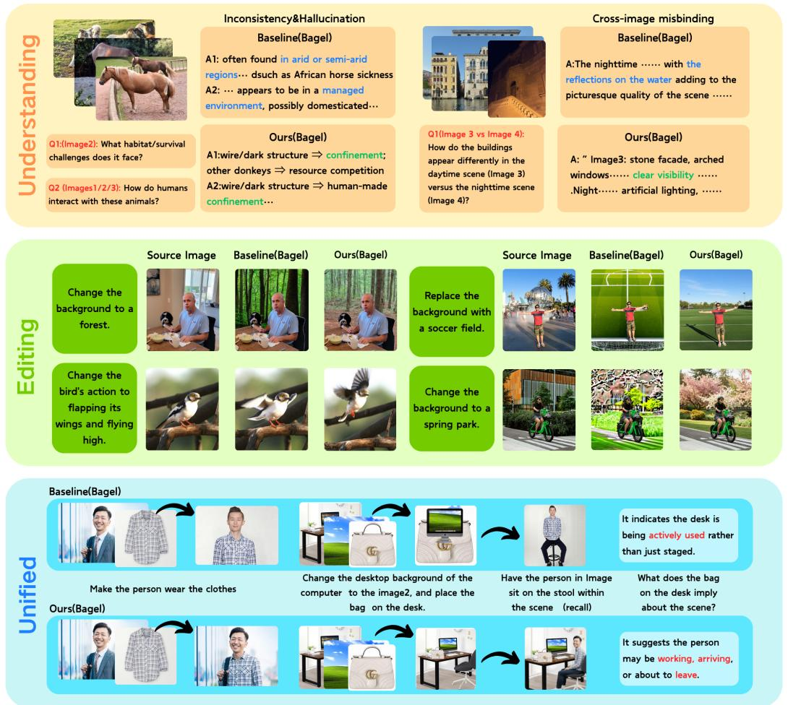  
Figure 4: Case study examples comparing baseline models and VidUEU-100K fine-tuned models.

The ablation results suggest that all components contribute to performance. Removing Gate A causes only a mild drop, suggesting that the collected videos contain relatively few meaningless or extremely dark shots after source-level curation. Removing Gate B clearly hurts all benchmarks, especially editing and unified tasks, showing that the agent must filter the many low-quality frames in raw videos. Removing score-similarity greedy sampling hurts editing more, indicating that editing data benefits from keyframes that are both informative and non-redundant, rather than from dense but weakly differentiated frame pairs. Removing Gate C degrades all tasks, showing that the final metadata filtering step is necessary to prevent inconsistent, incomplete, or task-mismatched evidence from entering instruction synthesis. The no-agent variant drops the most, showing that direct VLM-based QA generation lacks the structured quality control, tool evidence, and task routing needed to construct reliable multimodal supervision. Removing the consistency hard rule also hurts performance, indicating that evidence citation suppresses weakly grounded or low-quality samples.

## 5 Conclusion

In this paper, we study the bottleneck of high-quality instruction data for multimodal tasks, and propose a scalable agent-based solution that leverages raw videos as a rich and dynamic data source.

Specifically, VidUEU-Agent constructs instruction data through four stages: global perception, keyframe mining, metadata construction, and instruction data construction, and refines the data distribution through autonomous data iteration using downstream feedback. Using VidUEU-Agent, we construct VidUEU-100K, a large-scale dataset with 100K instruction samples spanning understanding, editing, and unified capabilities. Extensive experiments across representative benchmarks show that fine-tuning baseline models with data produced by VidUEU-Agent brings consistent perfor mance improvements, validating the effectiveness and generalizability of the proposed agent pipeline. We hope VidUEU-Agent and VidUEU-100K provide a reproducible and extensible foundation for scalable multimodal data construction, and facilitate the development of unified multimodal models that more reliably integrate understanding and generation.

## References

Shuai Bai, Yuxuan Cai, Ruizhe Chen, Keqin Chen, Xionghui Chen, Zesen Cheng, Lianghao Deng, Wei Ding, Chang Gao, Chunjiang Ge, et al. Qwen3-vl technical report. arXiv preprint arXiv:2511.21631, 2025a.

Shuai Bai, Keqin Chen, Xuejing Liu, Jialin Wang, Wenbin Ge, Sibo Song, Kai Dang, Peng Wang, Shijie Wang, Jun Tang, Humen Zhong, Yuanzhi Zhu, Mingkun Yang, Zhaohai Li, Jianqiang Wan, Pengfei Wang, Wei Ding, Zheren Fu, Yiheng Xu, Jiabo Ye, Xi Zhang, Tianbao Xie, Zesen Cheng, Hang Zhang, Zhibo Yang, Haiyang Xu, and Junyang Lin. Qwen2.5-vl technical report, 2025b. URL https://arxiv.org/abs/2502.13923.

Tim Brooks, Aleksander Holynski, and Alexei A. Efros. Instructpix2pix: Learning to follow image editing instructions, 2023. URL https://arxiv.org/abs/2211.09800.

Pu Cao, Feng Zhou, Lu Yang, Tianrui Huang, and Qing Song. Image is all you need to empower large-scale diffusion models for in-domain generation. In Proceedings ofthe Computer Vision and Pattern Recognition Conference, pages 18358–18368, 2025.

Brandon Castellano. Pyscenedetect. https://github.com/Breakthrough/PySceneDetect.

Hang Chen, Qian Xiang, Jiaxin Hu, Meilin Ye, Chao Yu, Hao Cheng, and Lei Zhang. Comprehensive exploration of diffusion models in image generation: a survey. Artificial Intelligence Review, 58 (4):99, 2025a.

Jiuhai Chen, Zhiyang Xu, Xichen Pan, Yushi Hu, Can Qin, Tom Goldstein, Lifu Huang, Tianyi Zhou, Saining Xie, Silvio Savarese, et al. Blip3-o: A family of fully open unified multimodal models-architecture, training and dataset. arXiv preprint arXiv:2505.09568, 2025b.

Lin Chen, Jinsong Li, Xiaoyi Dong, Pan Zhang, Conghui He, Jiaqi Wang, Feng Zhao, and Dahua Lin. Sharegpt4v: Improving large multi-modal models with better captions, 2023. URL https: //arxiv.org/abs/2311.12793.

Lin Chen, Jinsong Li, Xiaoyi Dong, Pan Zhang, Yuhang Zang, Zehui Chen, Haodong Duan, Jiaqi Wang, Yu Qiao, Dahua Lin, and Feng Zhao. Are we on the right way for evaluating large vision-language models?, 2024a. URL https://arxiv.org/abs/2403.20330.

Qiguang Chen, Libo Qin, Jin Zhang, Zhi Chen, Xiao Xu, and Wanxiang Che. M3cot: A novel benchmark for multi-domain multi-step multi-modal chain-of-thought. In Proceedings ofthe 62nd Annual Meeting of the Association for Computational Linguistics (Volume 1: Long Papers), pages 8199–8221, 2024b.

Tsai-Shien Chen, Aliaksandr Siarohin, Willi Menapace, Ekaterina Deyneka, Hsiang-wei Chao, Byung Eun Jeon, Yuwei Fang, Hsin-Ying Lee, Jian Ren, Ming-Hsuan Yang, et al. Panda-70m: Captioning 70m videos with multiple cross-modality teachers. In Proceedings ofthe IEEE/CVF Conference on Computer Vision and Pattern Recognition, pages 13320–13331, 2024c.

Wei Chen, Lin Li, Yongqi Yang, Bin Wen, Fan Yang, Tingting Gao, Yu Wu, and Long Chen. Comm: A coherent interleaved image-text dataset for multimodal understanding and generation. In Proceedings of the Computer Vision and Pattern Recognition Conference, pages 8073–8082, 2025c.

Xiaokang Chen, Zhiyu Wu, Xingchao Liu, Zizheng Pan, Wen Liu, Zhenda Xie, Xingkai Yu, and Chong Ruan. Janus-pro: Unified multimodal understanding and generation with data and model scaling, 2025d. URL https://arxiv.org/abs/2501.17811.

Wei Chow, Jiachun Pan, Yongyuan Liang, Mingze Zhou, Xue Song, Liyu Jia, Saining Zhang, Siliang Tang, Juncheng Li, Fengda Zhang, Weijia Wu, Hanwang Zhang, and Tat-Seng Chua. WEAVE: Unleashing and Benchmarking the In-context Interleaved Comprehension and Generation, November 2025. URL http://arxiv.org/abs/2511.11434. arXiv:2511.11434 [cs].

Cheng Cui, Ting Sun, Manhui Lin, Tingquan Gao, Yubo Zhang, Jiaxuan Liu, Xueqing Wang, Zelun Zhang, Changda Zhou, Hongen Liu, Yue Zhang, Wenyu Lv, Kui Huang, Yichao Zhang, Jing Zhang, Jun Zhang, Yi Liu, Dianhai Yu, and Yanjun Ma. Paddleocr 3.0 technical report, 2025. URL https://arxiv.org/abs/2507.05595.

DeepSeek-AI, Aixin Liu, Bei Feng, Bing Xue, Bingxuan Wang, Bochao Wu, Chengda Lu, Chenggang Zhao, Chengqi Deng, Chenyu Zhang, Chong Ruan, Damai Dai, Daya Guo, Dejian Yang, Deli Chen, Dongjie Ji, Erhang Li, Fangyun Lin, Fucong Dai, Fuli Luo, Guangbo Hao, Guanting Chen, Guowei Li, H. Zhang, Han Bao, Hanwei Xu, Haocheng Wang, Haowei Zhang, Honghui Ding, Huajian Xin, Huazuo Gao, Hui Li, Hui Qu, J. L. Cai, Jian Liang, Jianzhong Guo, Jiaqi Ni, Jiashi Li, Jiawei Wang, Jin Chen, Jingchang Chen, Jingyang Yuan, Junjie Qiu, Junlong Li, Junxiao Song, Kai Dong, Kai Hu, Kaige Gao, Kang Guan, Kexin Huang, Kuai Yu, Lean Wang, Lecong Zhang, Lei Xu, Leyi Xia, Liang Zhao, Litong Wang, Liyue Zhang, Meng Li, Miaojun Wang, Mingchuan Zhang, Minghua Zhang, Minghui Tang, Mingming Li, Ning Tian, Panpan Huang, Peiyi Wang, Peng Zhang, Qiancheng Wang, Qihao Zhu, Qinyu Chen, Qiushi Du, R. J. Chen, R. L. Jin, Ruiqi Ge, Ruisong Zhang, Ruizhe Pan, Runji Wang, Runxin Xu, Ruoyu Zhang, Ruyi Chen, S. S. Li, Shanghao Lu, Shangyan Zhou, Shanhuang Chen, Shaoqing Wu, Shengfeng Ye, Shengfeng Ye, Shirong Ma, Shiyu Wang, Shuang Zhou, Shuiping Yu, Shunfeng Zhou, Shuting Pan, T. Wang, Tao Yun, Tian Pei, Tianyu Sun, W. L. Xiao, Wangding Zeng, Wanjia Zhao, Wei An, Wen Liu, Wenfeng Liang, Wenjun Gao, Wenqin Yu, Wentao Zhang, X. Q. Li, Xiangyue Jin, Xianzu Wang, Xiao Bi, Xiaodong Liu, Xiaohan Wang, Xiaojin Shen, Xiaokang Chen, Xiaokang Zhang, Xiaosha Chen, Xiaotao Nie, Xiaowen Sun, Xiaoxiang Wang, Xin Cheng, Xin Liu, Xin Xie, Xingchao Liu, Xingkai Yu, Xinnan Song, Xinxia Shan, Xinyi Zhou, Xinyu Yang, Xinyuan Li, Xuecheng Su, Xuheng Lin, Y. K. Li, Y. Q. Wang, Y. X. Wei, Y. X. Zhu, Yang Zhang, Yanhong Xu, Yanhong Xu, Yanping Huang, Yao Li, Yao Zhao, Yaofeng Sun, Yaohui Li, Yaohui Wang, Yi Yu, Yi Zheng, Yichao Zhang, Yifan Shi, Yiliang Xiong, Ying He, Ying Tang, Yishi Piao, Yisong Wang, Yixuan Tan, Yiyang Ma, Yiyuan Liu, Yongqiang Guo, Yu Wu, Yuan Ou, Yuchen Zhu, Yuduan Wang, Yue Gong, Yuheng Zou, Yujia He, Yukun Zha, Yunfan Xiong, Yunxian Ma, Yuting Yan, Yuxiang Luo, Yuxiang You, Yuxuan Liu, Yuyang Zhou, Z. F. Wu, Z. Z. Ren, Zehui Ren, Zhangli Sha, Zhe Fu, Zhean Xu, Zhen Huang, Zhen Zhang, Zhenda Xie, Zhengyan Zhang, Zhewen Hao, Zhibin Gou, Zhicheng Ma, Zhigang Yan, Zhihong Shao, Zhipeng Xu, Zhiyu Wu, Zhongyu Zhang, Zhuoshu Li, Zihui Gu, Zijia Zhu, Zijun Liu, Zilin Li, Ziwei Xie, Ziyang Song, Ziyi Gao, and Zizheng Pan. Deepseek-v3 technical report, 2025. URL https://arxiv.org/abs/2412.19437.

Chaorui Deng, Deyao Zhu, Kunchang Li, Chenhui Gou, Feng Li, Zeyu Wang, Shu Zhong, Weihao Yu, Xiaonan Nie, Ziang Song, Guang Shi, and Haoqi Fan. Emerging properties in unified multimodal pretraining, 2025a. URL https://arxiv.org/abs/2505.14683.

Mengjie Deng, Guanting Dong, and Zhicheng Dou. Toolscope: An agentic framework for visionguided and long-horizon tool use. arXiv preprint arXiv:2510.27363, 2025b.

Yihe Deng, Pan Lu, Fan Yin, Ziniu Hu, Sheng Shen, Quanquan Gu, James Zou, Kai-Wei Chang, and Wei Wang. Enhancing Large Vision Language Models with Self-Training on Image Comprehension. In A. Globerson, L. Mackey, D. Belgrave, A. Fan, U. Paquet, J. Tomczak, and C. Zhang, editors, Advances in Neural Information Processing Systems, volume 37, pages 131369–131397. Curran Associates, Inc., 2024. doi: 10.52202/079017-4175. URL https://proceedings.neurips.cc/paper\_files/paper/ 2024/file/ed45d6a03de84cc650cae0655f699356-Paper-Conference.pdf.

Chaoyou Fu, Peixian Chen, Yunhang Shen, Yulei Qin, Mengdan Zhang, Xu Lin, Jinrui Yang, Xiawu Zheng, Ke Li, Xing Sun, Yunsheng Wu, Rongrong Ji, Caifeng Shan, and Ran He. MME: A comprehensive evaluation benchmark for multimodal large language models. In The Thirty-ninth

Annual Conference on Neural Information Processing Systems Datasets and Benchmarks Track, 2025. URL https://openreview.net/forum?id=DgH9YCsqWm.

Zhi Gao, Bofei Zhang, Pengxiang Li, Xiaojian Ma, Tao Yuan, Yue Fan, Yuwei Wu, Yunde Jia, Song-Chun Zhu, and Qing Li. Multi-modal agent tuning: Building a vlm-driven agent for efficient tool usage, 2025. URL https://arxiv.org/abs/2412.15606.

Aaron Grattafiori, Abhimanyu Dubey, Abhinav Jauhri, Abhinav Pandey, Abhishek Kadian, Ahmad Al-Dahle, Aiesha Letman, Akhil Mathur, Alan Schelten, Alex Vaughan, Amy Yang, Angela Fan, Anirudh Goyal, Anthony Hartshorn, Aobo Yang, Archi Mitra, Archie Sravankumar, Artem Korenev, Arthur Hinsvark, Arun Rao, Aston Zhang, Aurelien Rodriguez, Austen Gregerson, Ava Spataru, Baptiste Roziere, Bethany Biron, Binh Tang, Bobbie Chern, Charlotte Caucheteux, Chaya Nayak, Chloe Bi, Chris Marra, Chris McConnell, Christian Keller, Christophe Touret, Chunyang Wu, Corinne Wong, Cristian Canton Ferrer, Cyrus Nikolaidis, Damien Allonsius, Daniel Song, Danielle Pintz, Danny Livshits, Danny Wyatt, David Esiobu, Dhruv Choudhary, Dhruv Mahajan, Diego Garcia-Olano, Diego Perino, Dieuwke Hupkes, Egor Lakomkin, Ehab AlBadawy, Elina Lobanova, Emily Dinan, Eric Michael Smith, Filip Radenovic, Francisco Guzmán, Frank Zhang, Gabriel Synnaeve, Gabrielle Lee, Georgia Lewis Anderson, Govind Thattai, Graeme Nail, Gregoire Mialon, Guan Pang, Guillem Cucurell, Hailey Nguyen, Hannah Korevaar, Hu Xu, Hugo Touvron, Iliyan Zarov, Imanol Arrieta Ibarra, Isabel Kloumann, Ishan Misra, Ivan Evtimov, Jack Zhang, Jade Copet, Jaewon Lee, Jan Geffert, Jana Vranes, Jason Park, Jay Mahadeokar, Jeet Shah, Jelmer van der Linde, Jennifer Billock, Jenny Hong, Jenya Lee, Jeremy Fu, Jianfeng Chi, Jianyu Huang, Jiawen Liu, Jie Wang, Jiecao Yu, Joanna Bitton, Joe Spisak, Jongsoo Park, Joseph Rocca, Joshua Johnstun, Joshua Saxe, Junteng Jia, Kalyan Vasuden Alwala, Karthik Prasad, Kartikeya Upasani, Kate Plawiak, Ke Li, Kenneth Heafield, Kevin Stone, Khalid El-Arini, Krithika Iyer, Kshitiz Malik, Kuenley Chiu, Kunal Bhalla, Kushal Lakhotia, Lauren Rantala-Yeary, Laurens van der Maaten, Lawrence Chen, Liang Tan, Liz Jenkins, Louis Martin, Lovish Madaan, Lubo Malo, Lukas Blecher, Lukas Landzaat, Luke de Oliveira, Madeline Muzzi, Mahesh Pasupuleti, Mannat Singh, Manohar Paluri, Marcin Kardas, Maria Tsimpoukelli, Mathew Oldham, Mathieu Rita, Maya Pavlova, Melanie Kambadur, Mike Lewis, Min Si, Mitesh Kumar Singh, Mona Hassan, Naman Goyal, Narjes Torabi, Nikolay Bashlykov, Nikolay Bogoychev, Niladri Chatterji, Ning Zhang, Olivier Duchenne, Onur Çelebi, Patrick Alrassy, Pengchuan Zhang, Pengwei Li, Petar Vasic, Peter Weng, Prajjwal Bhargava, Pratik Dubal, Praveen Krishnan, Punit Singh Koura, Puxin Xu, Qing He, Qingxiao Dong, Ragavan Srinivasan, Raj Ganapathy, Ramon Calderer, Ricardo Silveira Cabral, Robert Stojnic, Roberta Raileanu, Rohan Maheswari, Rohit Girdhar, Rohit Patel, Romain Sauvestre, Ronnie Polidoro, Roshan Sumbaly, Ross Taylor, Ruan Silva, Rui Hou, Rui Wang, Saghar Hosseini, Sahana Chennabasappa, Sanjay Singh, Sean Bell, Seohyun Sonia Kim, Sergey Edunov, Shaoliang Nie, Sharan Narang, Sharath Raparthy, Sheng Shen, Shengye Wan, Shruti Bhosale, Shun Zhang, Simon Vandenhende, Soumya Batra, Spencer Whitman, Sten Sootla, Stephane Collot, Suchin Gururangan, Sydney Borodinsky, Tamar Herman, Tara Fowler, Tarek Sheasha, Thomas Georgiou, Thomas Scialom, Tobias Speckbacher, Todor Mihaylov, Tong Xiao, Ujjwal Karn, Vedanuj Goswami, Vibhor Gupta, Vignesh Ramanathan, Viktor Kerkez, Vincent Gonguet, Virginie Do, Vish Vogeti, Vítor Albiero, Vladan Petrovic, Weiwei Chu, Wenhan Xiong, Wenyin Fu, Whitney Meers, Xavier Martinet, Xiaodong Wang, Xiaofang Wang, Xiaoqing Ellen Tan, Xide Xia, Xinfeng Xie, Xuchao Jia, Xuewei Wang, Yaelle Goldschlag, Yashesh Gaur, Yasmine Babaei, Yi Wen, Yiwen Song, Yuchen Zhang, Yue Li, Yuning Mao, Zacharie Delpierre Coudert, Zheng Yan, Zhengxing Chen, Zoe Papakipos, Aaditya Singh, Aayushi Srivastava, Abha Jain, Adam Kelsey, Adam Shajnfeld, Adithya Gangidi, Adolfo Victoria, Ahuva Goldstand, Ajay Menon, Ajay Sharma, Alex Boesenberg, Alexei Baevski, Allie Feinstein, Amanda Kallet, Amit Sangani, Amos Teo, Anam Yunus, Andrei Lupu, Andres Alvarado, Andrew Caples, Andrew Gu, Andrew Ho, Andrew Poulton, Andrew Ryan, Ankit Ramchandani, Annie Dong, Annie Franco, Anuj Goyal, Aparajita Saraf, Arkabandhu Chowdhury, Ashley Gabriel, Ashwin Bharambe, Assaf Eisenman, Azadeh Yazdan, Beau James, Ben Maurer, Benjamin Leonhardi, Bernie Huang, Beth Loyd, Beto De Paola, Bhargavi Paranjape, Bing Liu, Bo Wu, Boyu Ni, Braden Hancock, Bram Wasti, Brandon Spence, Brani Stojkovic, Brian Gamido, Britt Montalvo, Carl Parker, Carly Burton, Catalina Mejia, Ce Liu, Changhan Wang, Changkyu Kim, Chao Zhou, Chester Hu, Ching-Hsiang Chu, Chris Cai, Chris Tindal, Christoph Feichtenhofer, Cynthia Gao, Damon Civin, Dana Beaty, Daniel Kreymer, Daniel Li, David Adkins, David Xu, Davide Testuggine, Delia David, Devi Parikh, Diana Liskovich, Didem Foss, Dingkang Wang, Duc Le, Dustin Holland, Edward Dowling, Eissa Jamil, Elaine Montgomery, Eleonora Presani, Emily Hahn, Emily Wood, Eric-Tuan Le, Erik Brinkman, Esteban Arcaute, Evan Dunbar, Evan Smothers,

Kat Kampf and Nicole Brichtova. Experiment with gemini 2.0 flash native image generation. https://developers.googleblog.com/

Fei Sun, Felix Kreuk, Feng Tian, Filippos Kokkinos, Firat Ozgenel, Francesco Caggioni, Frank Kanayet, Frank Seide, Gabriela Medina Florez, Gabriella Schwarz, Gada Badeer, Georgia Swee, Gil Halpern, Grant Herman, Grigory Sizov, Guangyi, Zhang, Guna Lakshminarayanan, Hakan Inan, Hamid Shojanazeri, Han Zou, Hannah Wang, Hanwen Zha, Haroun Habeeb, Harrison Rudolph, Helen Suk, Henry Aspegren, Hunter Goldman, Hongyuan Zhan, Ibrahim Damlaj, Igor Molybog, Igor Tufanov, Ilias Leontiadis, Irina-Elena Veliche, Itai Gat, Jake Weissman, James Geboski, James Kohli, Janice Lam, Japhet Asher, Jean-Baptiste Gaya, Jeff Marcus, Jeff Tang, Jennifer Chan, Jenny Zhen, Jeremy Reizenstein, Jeremy Teboul, Jessica Zhong, Jian Jin, Jingyi Yang, Joe Cummings, Jon Carvill, Jon Shepard, Jonathan McPhie, Jonathan Torres, Josh Ginsburg, Junjie Wang, Kai Wu, Kam Hou U, Karan Saxena, Kartikay Khandelwal, Katayoun Zand, Kathy Matosich, Kaushik Veeraraghavan, Kelly Michelena, Keqian Li, Kiran Jagadeesh, Kun Huang, Kunal Chawla, Kyle Huang, Lailin Chen, Lakshya Garg, Lavender A, Leandro Silva, Lee Bell, Lei Zhang, Liangpeng Guo, Licheng Yu, Liron Moshkovich, Luca Wehrstedt, Madian Khabsa, Manav Avalani, Manish Bhatt, Martynas Mankus, Matan Hasson, Matthew Lennie, Matthias Reso, Maxim Groshev, Maxim Naumov, Maya Lathi, Meghan Keneally, Miao Liu, Michael L. Seltzer, Michal Valko, Michelle Restrepo, Mihir Patel, Mik Vyatskov, Mikayel Samvelyan, Mike Clark, Mike Macey, Mike Wang, Miquel Jubert Hermoso, Mo Metanat, Mohammad Rastegari, Munish Bansal, Nandhini Santhanam, Natascha Parks, Natasha White, Navyata Bawa, Nayan Singhal, Nick Egebo, Nicolas Usunier, Nikhil Mehta, Nikolay Pavlovich Laptev, Ning Dong, Norman Cheng, Oleg Chernoguz, Olivia Hart, Omkar Salpekar, Ozlem Kalinli, Parkin Kent, Parth Parekh, Paul Saab, Pavan Balaji, Pedro Rittner, Philip Bontrager, Pierre Roux, Piotr Dollar, Polina Zvyagina, Prashant Ratanchandani, Pritish Yuvraj, Qian Liang, Rachad Alao, Rachel Rodriguez, Rafi Ayub, Raghotham Murthy, Raghu Nayani, Rahul Mitra, Rangaprabhu Parthasarathy, Raymond Li, Rebekkah Hogan, Robin Battey, Rocky Wang, Russ Howes, Ruty Rinott, Sachin Mehta, Sachin Siby, Sai Jayesh Bondu, Samyak Datta, Sara Chugh, Sara Hunt, Sargun Dhillon, Sasha Sidorov, Satadru Pan, Saurabh Mahajan, Saurabh Verma, Seiji Yamamoto, Sharadh Ramaswamy, Shaun Lindsay, Shaun Lindsay, Sheng Feng, Shenghao Lin, Shengxin Cindy Zha, Shishir Patil, Shiva Shankar, Shuqiang Zhang, Shuqiang Zhang, Sinong Wang, Sneha Agarwal, Soji Sajuyigbe, Soumith Chintala, Stephanie Max, Stephen Chen, Steve Kehoe, Steve Satterfield, Sudarshan Govindaprasad, Sumit Gupta, Summer Deng, Sungmin Cho, Sunny Virk, Suraj Subramanian, Sy Choudhury, Sydney Goldman, Tal Remez, Tamar Glaser, Tamara Best, Thilo Koehler, Thomas Robinson, Tianhe Li, Tianjun Zhang, Tim Matthews, Timothy Chou, Tzook Shaked, Varun Vontimitta, Victoria Ajayi, Victoria Montanez, Vijai Mohan, Vinay Satish Kumar, Vishal Mangla, Vlad Ionescu, Vlad Poenaru, Vlad Tiberiu Mihailescu, Vladimir Ivanov, Wei Li, Wenchen Wang, Wenwen Jiang, Wes Bouaziz, Will Constable, Xiaocheng Tang, Xiaojian Wu, Xiaolan Wang, Xilun Wu, Xinbo Gao, Yaniv Kleinman, Yanjun Chen, Ye Hu, Ye Jia, Ye Qi, Yenda Li, Yilin Zhang, Ying Zhang, Yossi Adi, Youngjin Nam, Yu, Wang, Yu Zhao, Yuchen Hao, Yundi Qian, Yunlu Li, Yuzi He, Zach Rait, Zachary DeVito, Zef Rosnbrick, Zhaoduo Wen, Zhenyu Yang, Zhiwei Zhao, and Zhiyu Ma. The llama 3 herd of models, 2024. URL https://arxiv.org/abs/2407.21783.

Taicheng Guo, Xiuying Chen, Yaqi Wang, Ruidi Chang, Shichao Pei, N. Chawla, Olaf Wiest, and Xiangliang Zhang. Large language model based multi-agents: A survey of progress and challenges. In International Joint Conference on Artificial Intelligence, 2024. URL https: //api.semanticscholar.org/CorpusID:267412980.

Zeyu Han, Chao Gao, Jinyang Liu, Jeff Zhang, and Sai Qian Zhang. Parameter-efficient fine-tuning for large models: A comprehensive survey. arXiv preprint arXiv:2403.14608, 2024.

Ziwei Ji, Nayeon Lee, Rita Frieske, Tiezheng Yu, Dan Su, Yan Xu, Etsuko Ishii, Ye Jin Bang, Andrea Madotto, and Pascale Fung. Survey of hallucination in natural language generation. ACM computing surveys, 55(12):1–38, 2023.

Glenn Jocher, Ayush Chaurasia, and Jing Qiu. Ultralytics yolo, April 2024. URL https://doi. org/10.5281/zenodo.10983461.

Soham Joshi, Shwet Kamal Mishra, and Viswanath Gopalakrishnan. Text-vqa aug: Pipelined harnessing of large multimodal models for automated synthesis. arXiv preprint arXiv:2511.02046, 2025.

experiment-with-gemini-20-flash-native-image-generation/, March 2025. Google Developers Blog.

Somnath Kumar, Yash Gadhia, Tanuja Ganu, and Akshay Nambi. Mmctagent: Multi-modal critical thinking agent framework for complex visual reasoning. arXiv preprint arXiv:2405.18358, 2024.

Ang Li, Charles Wang, Deqing Fu, Kaiyu Yue, Zikui Cai, Wang Bill Zhu, Ollie Liu, Peng Guo, Willie Neiswanger, Furong Huang, Tom Goldstein, and Micah Goldblum. Zebra-cot: A dataset for interleaved vision-language reasoning. In The Fourteenth International Conference on Learning Representations, 2026. URL https://openreview.net/forum?id=c6XIVI3TiQ.

Lei Li, Yuwei Yin, Shicheng Li, Liang Chen, Peiyi Wang, Shuhuai Ren, Mukai Li, Yazheng Yang, Jingjing Xu, Xu Sun, Lingpeng Kong, and Qi Liu. M<sup>3</sup>it: A large-scale dataset towards multi-modal multilingual instruction tuning, 2023. URL https://arxiv.org/abs/2306.04387.

Zejian Li, Chenye Meng, Yize Li, Ling Yang, Shengyuan Zhang, Jiarui Ma, Jiayi Li, Guang Yang, Changyuan Yang, Zhiyuan Yang, et al. Laion-sg: An enhanced large-scale dataset for training complex image-text models with structural annotations. arXiv preprint arXiv:2412.08580, 2024.

Chia Xin Liang, Pu Tian, Caitlyn Heqi Yin, Yao Yua, Wei An-Hou, Li Ming, Xinyuan Song, Tianyang Wang, Ziqian Bi, and Ming Liu. A comprehensive survey and guide to multimodal large language models in vision-language tasks. arXiv preprint arXiv:2411.06284, 2024.

Yaron Lipman, Ricky TQ Chen, Heli Ben-Hamu, Maximilian Nickel, and Matt Le. Flow matching for generative modeling. arXiv preprint arXiv:2210.02747, 2022.

Haotian Liu, Chunyuan Li, Qingyang Wu, and Yong Jae Lee. Visual instruction tuning. Advances in neural information processing systems, 36:34892–34916, 2023.

Haotian Liu, Chunyuan Li, Yuheng Li, and Yong Jae Lee. Improved baselines with visual instruction tuning, 2024a. URL https://arxiv.org/abs/2310.03744.

Shiyu Liu, Yucheng Han, Peng Xing, Fukun Yin, Rui Wang, Wei Cheng, Jiaqi Liao, Yingming Wang, Honghao Fu, Chunrui Han, Guopeng Li, Yuang Peng, Quan Sun, Jingwei Wu, Yan Cai, Zheng Ge, Ranchen Ming, Lei Xia, Xianfang Zeng, Yibo Zhu, Binxing Jiao, Xiangyu Zhang, Gang Yu, and Daxin Jiang. Step1x-edit: A practical framework for general image editing, 2025. URL https://arxiv.org/abs/2504.17761.

Yuan Liu, Haodong Duan, Yuanhan Zhang, Bo Li, Songyang Zhang, Wangbo Zhao, Yike Yuan, Jiaqi Wang, Conghui He, Ziwei Liu, et al. Mmbench: Is your multi-modal model an all-around player? In European conference on computer vision, pages 216–233. Springer, 2024b.

Ziyu Liu, Tao Chu, Yuhang Zang, Xilin Wei, Xiaoyi Dong, Pan Zhang, Zijian Liang, Yuanjun Xiong, Yu Qiao, Dahua Lin, and Jiaqi Wang. Mmdu: A multi-turn multi-image dialog understanding benchmark and instruction-tuning dataset for lvlms. In A. Globerson, L. Mackey, D. Belgrave, A. Fan, U. Paquet, J. Tomczak, and C. Zhang, editors, Advances in Neural Information Processing Systems, volume 37, pages 8698–8733. Curran Associates, Inc., 2024c. doi: 10.52202/079017-0278. URL https://proceedings.neurips.cc/paper\_files/paper/2024/file/ 1057053100de064a44286239724f7865-Paper-Datasets\_and\_Benchmarks\_Track.pdf.

Yadong Lu, Jianwei Yang, Yelong Shen, and Ahmed Awadallah. Omniparser for pure vision based gui agent, 2024. URL https://arxiv.org/abs/2408.00203.

Lingyi Meng, Zecong Tang, Haoran Li, Tengju Ru, Zhejun Cui, Weitong Lian, Qi Kang, Hangshuo Cao, Yichen Zhu, Yechi Liu, Kaixuan Wang, Yu-Jie Yuan, Chunwei Wang, Yu Zhang, and Bo Dai. Imug-bench: Benchmarking unified multimodal models on interleaved understanding and generation, 2026. URL https://arxiv.org/abs/2606.09169.

Kepan Nan, Rui Xie, Penghao Zhou, Tiehan Fan, Zhenheng Yang, Zhijie Chen, Xiang Li, Jian Yang, and Ying Tai. Openvid-1m: A large-scale high-quality dataset for text-to-video generation. arXiv preprint arXiv:2407.02371, 2024.

OpenAI. Introducing gpt-4.1 in the api, April 2025. URL https://openai.com/index/ gpt-4-1/.

OpenAI, :, Aaron Hurst, Adam Lerer, Adam P. Goucher, Adam Perelman, Aditya Ramesh, Aidan Clark, AJ Ostrow, Akila Welihinda, Alan Hayes, Alec Radford, Aleksander M ˛adry, Alex Baker Whitcomb, Alex Beutel, Alex Borzunov, Alex Carney, Alex Chow, Alex Kirillov, Alex Nichol, Alex Paino, Alex Renzin, Alex Tachard Passos, Alexander Kirillov, Alexi Christakis, Alexis Conneau, Ali Kamali, Allan Jabri, Allison Moyer, Allison Tam, Amadou Crookes, Amin Tootoochian, Amin Tootoonchian, Ananya Kumar, Andrea Vallone, Andrej Karpathy, Andrew Braunstein, Andrew Cann, Andrew Codispoti, Andrew Galu, Andrew Kondrich, Andrew Tulloch, Andrey Mishchenko, Angela Baek, Angela Jiang, Antoine Pelisse, Antonia Woodford, Anuj Gosalia, Arka Dhar, Ashley Pantuliano, Avi Nayak, Avital Oliver, Barret Zoph, Behrooz Ghorbani, Ben Leimberger. Ben Rossen. Ben Sokolowsky. Ben Wang. Beniamin Zweig, Beth Hoover. Blake Samic, Bob McGrew, Bobby Spero, Bogo Giertler, Bowen Cheng, Brad Lightcap, Brandon Walkin, Brendan Quinn, Brian Guarraci, Brian Hsu, Bright Kellogg, Brydon Eastman, Camillo Lugaresi, Carroll Wainwright, Cary Bassin, Cary Hudson, Casey Chu, Chad Nelson, Chak Li, Chan Jun Shern, Channing Conger, Charlotte Barette, Chelsea Voss, Chen Ding, Cheng Lu, Chong Zhang, Chris Beaumont, Chris Hallacy, Chris Koch, Christian Gibson, Christina Kim, Christine Choi, Christine McLeavey, Christopher Hesse, Claudia Fischer, Clemens Winter, Coley Czarnecki, Colin Jarvis, Colin Wei, Constantin Koumouzelis, Dane Sherburn, Daniel Kappler, Daniel Levin, Daniel Levy, David Carr, David Farhi, David Mely, David Robinson, David Sasaki, Denny Jin, Dev Valladares, Dimitris Tsipras, Doug Li, Duc Phong Nguyen, Duncan Findlay, Edede Oiwoh, Edmund Wong, Ehsan Asdar, Elizabeth Proehl, Elizabeth Yang, Eric Antonow, Eric Kramer, Eric Peterson, Eric Sigler, Eric Wallace, Eugene Brevdo, Evan Mays, Farzad Khorasani, Felipe Petroski Such, Filippo Raso, Francis Zhang, Fred von Lohmann, Freddie Sulit, Gabriel Goh, Gene Oden, Geoff Salmon, Giulio Starace, Greg Brockman, Hadi Salman, Haiming Bao, Haitang Hu, Hannah Wong, Haoyu Wang, Heather Schmidt, Heather Whitney, Heewoo Jun, Hendrik Kirchner, Henrique Ponde de Oliveira Pinto, Hongyu Ren, Huiwen Chang, Hyung Won Chung Ian Kivlichan, Ian O’Connell, Ian O’Connell, Ian Osband, Ian Silber, Ian Sohl, Ibrahim Okuyucu, Ikai Lan, Ilya Kostrikov, Ilya Sutskever, Ingmar Kanitscheider, Ishaan Gulrajani, Jacob Coxon, Jacob Menick, Jakub Pachocki, James Aung, James Betker, James Crooks, James Lennon, Jamie Kiros, Jan Leike, Jane Park, Jason Kwon, Jason Phang, Jason Teplitz, Jason Wei, Jason Wolfe, Jay Chen, Jeff Harris, Jenia Varavva, Jessica Gan Lee, Jessica Shieh, Ji Lin, Jiahui Yu, Jiay Weng, Jie Tang, Jieqi Yu, Joanne Jang, Joaquin Quinonero Candela, Joe Beutler, Joe Landers Joel Parish, Johannes Heidecke, John Schulman, Jonathan Lachman, Jonathan McKay, Jonathan Uesato, Jonathan Ward, Jong Wook Kim, Joost Huizinga, Jordan Sitkin, Jos Kraaijeveld, Josh Gross, Josh Kaplan, Josh Snyder, Joshua Achiam, Joy Jiao, Joyce Lee, Juntang Zhuang, Justyn Harriman, Kai Fricke, Kai Hayashi, Karan Singhal, Katy Shi, Kavin Karthik, Kayla Wood, Kendra Rimbach, Kenny Hsu, Kenny Nguyen, Keren Gu-Lemberg, Kevin Button, Kevin Liu, Kiel Howe, Krithika Muthukumar, Kyle Luther, Lama Ahmad, Larry Kai, Lauren Itow, Lauren Workman, Leher Pathak, Leo Chen, Li Jing, Lia Guy, Liam Fedus, Liang Zhou, Lien Mamitsuka, Lilian Weng, Lindsay McCallum, Lindsey Held, Long Ouyang, Louis Feuvrier, Lu Zhang, Lukas Kondraciuk, Lukasz Kaiser, Luke Hewitt, Luke Metz, Lyric Doshi, Mada Aflak, Maddie Simens, Madelaine Boyd, Madeleine Thompson, Marat Dukhan, Mark Chen, Mark Gray, Mark Hudnall, Marvin Zhang, Marwan Aljubeh, Mateusz Litwin, Matthew Zeng, Max Johnson, Maya Shetty, Mayank Gupta, Meghan Shah, Mehmet Yatbaz, Meng Jia Yang, Mengchao Zhong, Mia Glaese, Mianna Chen, Michael Janner, Michael Lampe, Michael Petrov, Michael Wu, Michele Wang, Michelle Fradin, Michelle Pokrass, Miguel Castro, Miguel Oom Temudo de Castro, Mikhail Pavlov, Miles Brundage, Miles Wang, Minal Khan, Mira Murati, Mo Bavarian, Molly Lin, Murat Yesildal, Nacho Soto, Natalia Gimelshein, Natalie Cone, Natalie Staudacher, Natalie Summers, Natan LaFontaine, Neil Chowdhury, Nick Ryder, Nick Stathas, Nick Turley, Nik Tezak, Niko Felix, Nithanth Kudige, Nitish Keskar, Noah Deutsch, Noel Bundick, Nora Puckett, Ofir Nachum, Ola Okelola, Oleg Boiko, Oleg Murk, Oliver Jaffe, Olivia Watkins, Olivier Godement, Owen Campbell-Moore, Patrick Chao, Paul McMillan, Pavel Belov, Peng Su, Peter Bak, Peter Bakkum, Peter Deng, Peter Dolan, Peter Hoeschele, Peter Welinder, Phil Tillet, Philip Pronin, Philippe Tillet, Prafulla Dhariwal, Qiming Yuan, Rachel Dias, Rachel Lim, Rahul Arora, Rajan Troll, Randall Lin, Rapha Gontijo Lopes, Raul Puri, Reah Miyara, Reimar Leike, Renaud Gaubert, Reza Zamani, Ricky Wang, Rob Donnelly, Rob Honsby, Rocky Smith, Rohan Sahai, Rohit Ramchandani, Romain Huet, Rory Carmichael, Rowan Zellers, Roy Chen, Ruby Chen, Ruslan Nigmatullin, Ryan Cheu, Saach Jain, Sam Altman, Sam Schoenholz, Sam Toizer, Samuel Miserendino, Sandhini Agarwal, Sara Culver, Scott Ethersmith, Scott Gray, Sean Grove, Sean Metzger, Shamez Hermani, Shantanu Jain, Shengjia Zhao, Sherwin Wu, Shino Jomoto, Shirong Wu, Shuaiqi, Xia, Sonia Phene, Spencer

Papay, Srinivas Narayanan, Steve Coffey, Steve Lee, Stewart Hall, Suchir Balaji, Tal Broda, Tal Stramer, Tao Xu, Tarun Gogineni, Taya Christianson, Ted Sanders, Tejal Patwardhan, Thomas Cunninghman, Thomas Degry, Thomas Dimson, Thomas Raoux, Thomas Shadwell, Tianhao Zheng, Todd Underwood, Todor Markov, Toki Sherbakov, Tom Rubin, Tom Stasi, Tomer Kaftan, Tristan Heywood, Troy Peterson, Tyce Walters, Tyna Eloundou, Valerie Qi, Veit Moeller, Vinnie Monaco, Vishal Kuo, Vlad Fomenko, Wayne Chang, Weiyi Zheng, Wenda Zhou, Wesam Manassra, Will Sheu, Wojciech Zaremba, Yash Patil, Yilei Qian, Yongjik Kim, Youlong Cheng, Yu Zhang, Yuchen He, Yuchen Zhang, Yujia Jin, Yunxing Dai, and Yury Malkov. Gpt-4o system card, 2024. URL https://arxiv.org/abs/2410.21276.

Dustin Podell, Zion English, Kyle Lacey, Andreas Blattmann, Tim Dockhorn, Jonas Müller, Joe Penna, and Robin Rombach. Sdxl: Improving latent diffusion models for high-resolution image synthesis. arXiv preprint arXiv:2307.01952, 2023.

Liao Qu, Huichao Zhang, Yiheng Liu, Xu Wang, Yi Jiang, Yiming Gao, Hu Ye, Daniel K. Du, Zehuan Yuan, and Xinglong Wu. Tokenflow: Unified image tokenizer for multimodal understanding and generation, 2024. URL https://arxiv.org/abs/2412.03069.

Qwen Team. Qwen3.5: Towards native multimodal agents, February 2026. URL https://qwen. ai/blog?id=qwen3.5.

Alec Radford, Jong Wook Kim, Tao Xu, Greg Brockman, Christine McLeavey, and Ilya Sutskever. Robust speech recognition via large-scale weak supervision, 2022. URL https://arxiv.org/ abs/2212.04356.

Sana Javaid Raja, Adeel Zafar, and Aqsa Shoaib. A dataset for programming-based instructional video classification and question answering. In Proceedings of the First Workshop of Evaluation of Multi-Modal Generation, pages 1–9, 2025.

Vipula Rawte, Amit Sheth, and Amitava Das. A survey of hallucination in large foundation models. arXiv preprint arXiv:2309.05922, 2023.

N Dinesh Reddy, Dylan Snyder, Lona Kiragu, Mirajul Mohin, Shahrear Bin Amin, and Sudeep Pillai. Orion: A unified visual agent for multimodal perception, advanced visual reasoning and execution, 2025. URL https://arxiv.org/abs/2511.14210.

Haris Riaz, Sourav Sanjukta Bhabesh, Vinayak Arannil, Miguel Ballesteros, and Graham Horwood. MetaSynth: Meta-prompting-driven agentic scaffolds for diverse synthetic data generation. In Wanxiang Che, Joyce Nabende, Ekaterina Shutova, and Mohammad Taher Pilehvar, editors, Findings of the Association for Computational Linguistics: ACL 2025, pages 18770–18803, Vienna, Austria, July 2025. Association for Computational Linguistics. ISBN 979-8-89176-256-5. doi: 10.18653/v1/2025.findings-acl.962. URL https://aclanthology.org/2025.findings-acl. 962/.

Tengju Ru, Weitong Lian, Zecong Tang, Zhiheng Liu, Lingyi Meng, Haoran Li, Kaixuan Wang, Bohao Li, and Xihui Liu. What generation knows: Unlocking fine-grained understanding in unified multimodal models, 2026. URL https://arxiv.org/abs/2610.23987.

Dian Shao, Yue Zhao, Bo Dai, and Dahua Lin. Finegym: A hierarchical video dataset for fine-grained action understanding. In Proceedings of the IEEE/CVF conference on computer vision and pattern recognition, pages 2616–2625, 2020.

Hengyu Shen, Tiancheng Gu, Bin Qin, Lan Wu, Yuling Wu, Shuo Tan, Zelong Sun, Jun Wang, Nan Wu, Xiang An, Weidong Cai, Ziyong Feng, and Kaicheng Yang. Danqing: An up-to-date large-scale chinese vision-language pre-training dataset, 2026. URL https://arxiv.org/abs/ 2601.10305.

Haoran Sun, Haoyu Bian, Shaoning Zeng, Yunbo Rao, Xu Xu, Lin Mei, and Jianping Gou. Datasetagent: A novel multi-agent system for auto-constructing datasets from real-world images. arXiv preprint arXiv:2507.08648, 2025.

Shuo Tang, Xianghe Pang, Zexi Liu, Bohan Tang, Rui Ye, Tian Jin, Xiaowen Dong, Yanfeng Wang, and Siheng Chen. Synthesizing post-training data for llms through multi-agent simulation, 2025. URL https://arxiv.org/abs/2410.14251.

Zachary Teed and Jia Deng. Raft: Recurrent all-pairs field transforms for optical flow. In Andrea Vedaldi, Horst Bischof, Thomas Brox, and Jan-Michael Frahm, editors, Computer Vision – ECCV 2020, pages 402–419, Cham, 2020. Springer International Publishing. ISBN 978-3-030-58536-5.

Jingqi Tong, Yurong Mou, Hangcheng Li, Mingzhe Li, Yongzhuo Yang, Ming Zhang, Qiguang Chen, Tianyi Liang, Xiaomeng Hu, Yining Zheng, Xinchi Chen, Jun Zhao, Xuanjing Huang, and Xipeng Qiu. Thinking with video: Video generation as a promising multimodal reasoning paradigm, 2025a. URL https://arxiv.org/abs/2511.04570.

Shengbang Tong, David Fan, Jiachen Li, Yunyang Xiong, Xinlei Chen, Koustuv Sinha, Michael Rabbat, Yann LeCun, Saining Xie, and Zhuang Liu. Metamorph: Multimodal understanding and generation via instruction tuning. In Proceedings of the IEEE/CVF International Conference on Computer Vision, pages 17001–17012, 2025b.

Guo-Hua Wang, Shanshan Zhao, Xinjie Zhang, Liangfu Cao, Pengxin Zhan, Lunhao Duan, Shiyin Lu, Minghao Fu, Xiaohao Chen, Jianshan Zhao, Yang Li, and Qing-Guo Chen. Ovis-u1 technical report, 2025. URL https://arxiv.org/abs/2506.23044.

Yizhong Wang, Yeganeh Kordi, Swaroop Mishra, Alisa Liu, Noah A Smith, Daniel Khashabi, and Hannaneh Hajishirzi. Self-instruct: Aligning language models with self-generated instructions. In Proceedings ofthe 61st annual meeting ofthe associationfor computational linguistics (volume 1: long papers), pages 13484–13508, 2023.

Chenyuan Wu, Pengfei Zheng, Ruiran Yan, Shitao Xiao, Xin Luo, Yueze Wang, Wanli Li, Xiyan Jiang, Yexin Liu, Junjie Zhou, et al. Omnigen2: Exploration to advanced multimodal generation. arXiv preprint arXiv:2506.18871, 2025.

Jiayang Wu, Wensheng Gan, Zefeng Chen, Shicheng Wan, and Philip S Yu. Multimodal large language models: A survey. In 2023 IEEE International Conference on Big Data (BigData), pages 2247–2256. IEEE, 2023.

Shitao Xiao, Yueze Wang, Junjie Zhou, Huaying Yuan, Xingrun Xing, Ruiran Yan, Chaofan Li, Shuting Wang, Tiejun Huang, and Zheng Liu. Omnigen: Unified image generation, 2024. URL https://arxiv.org/abs/2409.11340.

Can Xu, Qingfeng Sun, Kai Zheng, Xiubo Geng, Pu Zhao, Jiazhan Feng, Chongyang Tao, and Daxin Jiang. Wizardlm: Empowering large language models to follow complex instructions. arXiv preprint arXiv:2304.12244, 2023.

Weikai Xu, Chengrui Huang, Shen Gao, and Shuo Shang. Llm-based agents for tool learning: A survey: W. xu et al. Data Science and Engineering, pages 1–31, 2025.

Jihan Yang, Shusheng Yang, Anjali W. Gupta, Rilyn Han, Li Fei-Fei, and Saining Xie. Thinking in space: How multimodal large language models see, remember, and recall spaces, 2025a. URL https://arxiv.org/abs/2412.14171.

Yan Yang, Haochen Tian, Yang Shi, Wulin Xie, Yi-Fan Zhang, Yuhao Dong, Yibo Hu, Liang Wang, Ran He, Caifeng Shan, et al. A survey of unified multimodal understanding and generation: Advances and challenges. Authorea Preprints, 2025b.

Shukang Yin, Chaoyou Fu, Sirui Zhao, Ke Li, Xing Sun, Tong Xu, and Enhong Chen. A survey on multimodal large language models. National Science Review, 11(12):nwae403, November 2024. ISSN 2095-5138. doi: 10.1093/nsr/nwae403. URL https://doi.org/10.1093/nsr/nwae403. \_eprint: https://academic.oup.com/nsr/article-pdf/11/12/nwae403/61201557/nwae403.pdf.

Kaining Ying, Fanqing Meng, Jin Wang, Zhiqian Li, Han Lin, Yue Yang, Hao Zhang, Wenbo Zhang, Yuqi Lin, Shuo Liu, Jiayi Lei, Quanfeng Lu, Runjian Chen, Peng Xu, Renrui Zhang, Haozhe Zhang, Peng Gao, Yali Wang, Yu Qiao, Ping Luo, Kaipeng Zhang, and Wenqi Shao. Mmt-bench: A comprehensive multimodal benchmark for evaluating large vision-language models towards multitask agi, 2024. URL https://arxiv.org/abs/2404.16006.

Fisher Yu, Haofeng Chen, Xin Wang, Wenqi Xian, Yingying Chen, Fangchen Liu, Vashisht Madhavan, and Trevor Darrell. Bdd100k: A diverse driving dataset for heterogeneous multitask learning. In Proceedings of the IEEE/CVF conference on computer vision and pattern recognition, pages 2636–2645, 2020.

Qifan Yu, Wei Chow, Zhongqi Yue, Kaihang Pan, Yang Wu, Xiaoyang Wan, Juncheng Li, Siliang Tang, Hanwang Zhang, and Yueting Zhuang. Anyedit: Mastering unified high-quality image editing for any idea. arXiv preprint arXiv:2411.15738, 2024. URL https://arxiv.org/abs/ 2411.15738.

Qiying Yu, Quan Sun, Xiaosong Zhang, Yufeng Cui, Fan Zhang, Yue Cao, Xinlong Wang, and Jingjing Liu. Capsfusion: Rethinking image-text data at scale. arXiv preprint arXiv:2310.20550, 2023.

Xiang Yue, Yuansheng Ni, Kai Zhang, Tianyu Zheng, Ruoqi Liu, Ge Zhang, Samuel Stevens, Dongfu Jiang, Weiming Ren, Yuxuan Sun, et al. Mmmu: A massive multi-discipline multimodal understanding and reasoning benchmark for expert agi. In Proceedings of the IEEE/CVF conference on computer vision and pattern recognition, pages 9556–9567, 2024.

Kai Zhang, Lingbo Mo, Wenhu Chen, Huan Sun, and Yu Su. Magicbrush: A manually annotated dataset for instruction-guided image editing, 2024. URL https://arxiv.org/abs/2306. 10012.

Tianyi Zhang, Zheng Wang, Jing Huang, Mohiuddin Muhammad Tasnim, and Wei Shi. A survey of diffusion based image generation models: Issues and their solutions. arXiv preprint arXiv:2308.13142, 2023.

Yi Zhang, Yinda Chen, Che Liu, Zeyuan Ding, Jin Xu, Shilong Zou, Junwei Liao, Jiayu Hu, Xiancong Ren, Xiaopeng Zhang, Yechi Liu, Haoyuan Shi, Zecong Tang, Haosong Sun, Renwen Cui, Kuishu Wu, Wenhai Liu, Yang Xu, Yingji Zhang, Yidong Wang, Senkang Hu, Jinpeng Lu, Nga Teng Chan, Yechen Wu, Zeting Liu, Xianzhou Hou, Yong Dai, Jian Tang, and Xiaozhu Ju. Pelican-unify 1.0: A unified embodied intelligence model for understanding, reasoning, imagination and action, 2026. URL https://arxiv.org/abs/2605.15153.

Yidan Zhang, Mutian Xu, Yiming Hao, Kun Zhou, Jiahao Chang, Xiaoqiang Liu, Pengfei Wan, Hongbo Fu, and Xiaoguang Han. Vc-agent: An interactive agent for customized video dataset collection. arXiv preprint arXiv:2509.21291, 2025a.

Yuanhan Zhang, Jinming Wu, Wei Li, Bo Li, Zejun Ma, Ziwei Liu, and Chunyuan Li. Llava-video: Video instruction tuning with synthetic data, 2025b. URL https://arxiv.org/abs/2410. 02713.

Hao Zhao, Maksym Andriushchenko, Francesco Croce, and Nicolas Flammarion. Long is more for alignment: A simple but tough-to-beat baseline for instruction fine-tuning. arXiv preprint arXiv:2402.04833, 2024.

Shanshan Zhao, Xinjie Zhang, Jintao Guo, Jiakui Hu, Lunhao Duan, Minghao Fu, Yong Xien Chng, Guo-Hua Wang, Qing-Guo Chen, Zhao Xu, et al. Unified multimodal understanding and generation models: Advances, challenges, and opportunities. arXiv preprint arXiv:2505.02567, 2025.

Wenliang Zhao, Yongming Rao, Zuyan Liu, Benlin Liu, Jie Zhou, and Jiwen Lu. Unleashing textto-image diffusion models for visual perception. In Proceedings of the IEEE/CVF international conference on computer vision, pages 5729–5739, 2023.

Jinguo Zhu, Weiyun Wang, Zhe Chen, Zhaoyang Liu, Shenglong Ye, Lixin Gu, Hao Tian, Yuchen Duan, Weijie Su, Jie Shao, Zhangwei Gao, Erfei Cui, Xuehui Wang, Yue Cao, Yangzhou Liu, Xingguang Wei, Hongjie Zhang, Haomin Wang, Weiye Xu, Hao Li, Jiahao Wang, Nianchen Deng, Songze Li, Yinan He, Tan Jiang, Jiapeng Luo, Yi Wang, Conghui He, Botian Shi, Xingcheng Zhang, Wenqi Shao, Junjun He, Yingtong Xiong, Wenwen Qu, Peng Sun, Penglong Jiao, Han Lv, Lijun Wu, Kaipeng Zhang, Huipeng Deng, Jiaye Ge, Kai Chen, Limin Wang, Min Dou, Lewei Lu, Xizhou Zhu, Tong Lu, Dahua Lin, Yu Qiao, Jifeng Dai, and Wenhai Wang. Internvl3: Exploring advanced training and test-time recipes for open-source multimodal models, 2025. URL https://arxiv.org/abs/2504.10479.

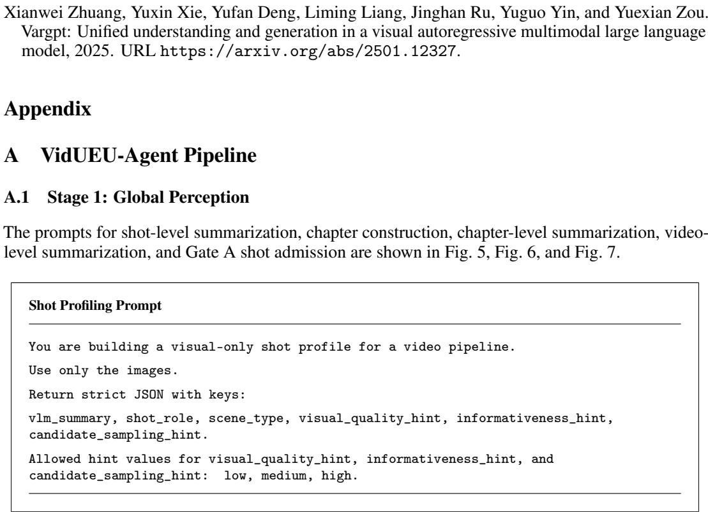  
Figure 5: Prompt for shot-level summarization.

## A.2 Stage 2: Keyframe Mining

The implementation prompts and rules for hierarchical tool planning, tool signal verbalization, frame value scoring, and quota allocation with weighted facility-location selection are shown in Fig. 9, Fig. 10, Fig. 11, and Fig. 12.

## A.3 Stage 3: Metadata Construction

The prompts for clip summary generation and pairwise transition generation are shown in Fig. 8 and Fig. 13.

## A.4 Stage 4: Instruction Data Construction

The prompts for task routing and instruction generation are shown in Fig. 14 and Fig. 15.

Chapter Construction and Summary Prompt   
[Chapter Construction Prompt / Pairwise Merge Decision Prompt]   
You are a strict JSON decision engine for merging two adjacent video shots into   
chapters.   
Decide whether the two shots belong to the same chapter.   
Return exactly one valid JSON object and nothing else. Do not use markdown fences.   
The JSON schema is:   
{   
"same\_chapter": true,   
"confidence": 0.0,   
"hard\_boundary": false,   
"reason\_type": "visual\_continuation",   
"notes": "short reason"   
}   
Rules: same\_chapter and hard\_boundary must be JSON booleans; confidence must be in   
[0.0, 1.0]; reason\_type must be a short snake\_case string; notes must be under 20   
words: if evidence is mixed or uncertain, still return valid JSON with lower   
confidence; base the decision only on the provided shot summaries and hints.   
LEFT role: <left\_shot.shot\_role>   
LEFT vlm: <left\_shot.vlm\_summary>   
LEFT scene\_type: <left\_shot.scene\_type>   
LEFT informativeness\_hint: <left\_shot.informativeness\_hint>   
RIGHT role: <right\_shot.shot\_role>   
RIGHT vlm: <right\_shot.vlm\_summary>   
RIGHT scene\_type: <right\_shot.scene\_type>   
RIGHT informativeness\_hint: <right\_shot.informativeness\_hint>   
[Chapter Summary Prompt]   
You are a robust chapter summarizer for a structured video understanding pipeline.   
Read all provided shot summaries for this chapter and merge them into one concise,   
fluent, informative English paragraph. Summarize the chapter as a coherent local   
segment, not disconnected bullet points. Preserve important subjects, actions, stages,   
transitions, and outcomes; remove redundancy; reflect progression when present; stay   
grounded in the shot summaries only.   
Writing requirements: write plain English only; output exactly one short paragraph;   
do not use bullet points, numbering, JSON, markdown, labels, or quotation marks; keep   
the summary compact, specific, and easy for downstream planning, scoring, and   
visualization.   
Return the chapter summary only.   
[Video-level Summary Prompt]   
You are a robust video summarizer for a structured video understanding pipeline.   
Read all provided chapter summaries and merge them into one concise, fluent,   
informative English paragraph. Summarize the global content of the whole video rather   
than isolated chapter fragments. Capture the overall subject, major stages, important   
transitions, and final outcomes when supported; remove redundancy; reflect global   
progression when present; stay grounded in the chapter summaries only.   
Writing requirements: write plain English only; output exactly one short paragraph;   
do not use bullet points, numbering, JSON, markdown, labels, or quotation marks; keep   
the summary compact, globally informative, and easy for downstream planning, scoring,   
and visualization.   
Return the video summary only.  
Figure 6: Prompt for chapter construction, chapter-level summarization, and video-level summarization.

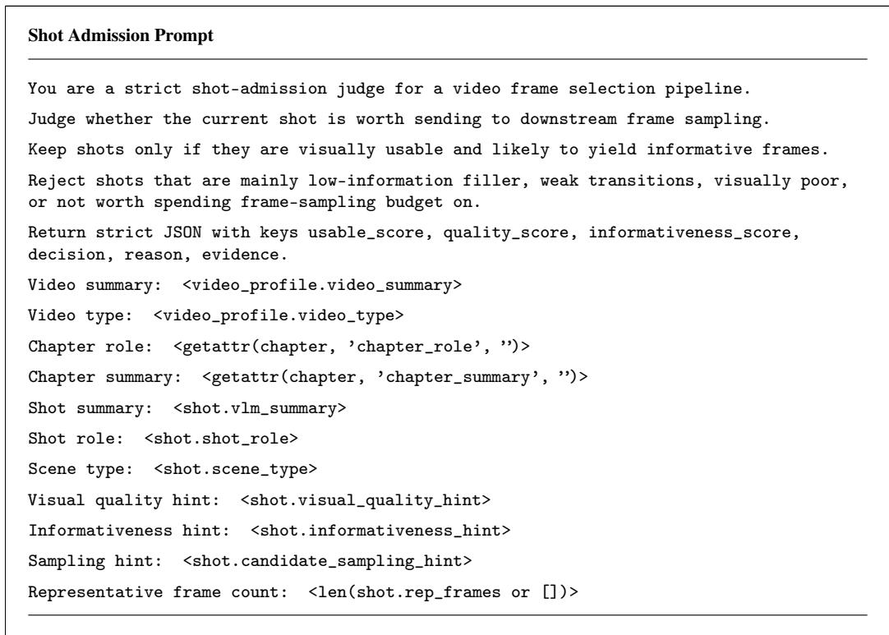  
Figure 7: Prompt for Gate A shot admission.

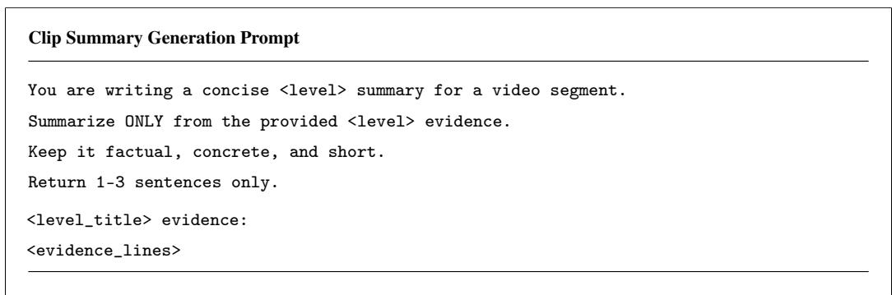  
Figure 8: Prompt for clip summary generation.

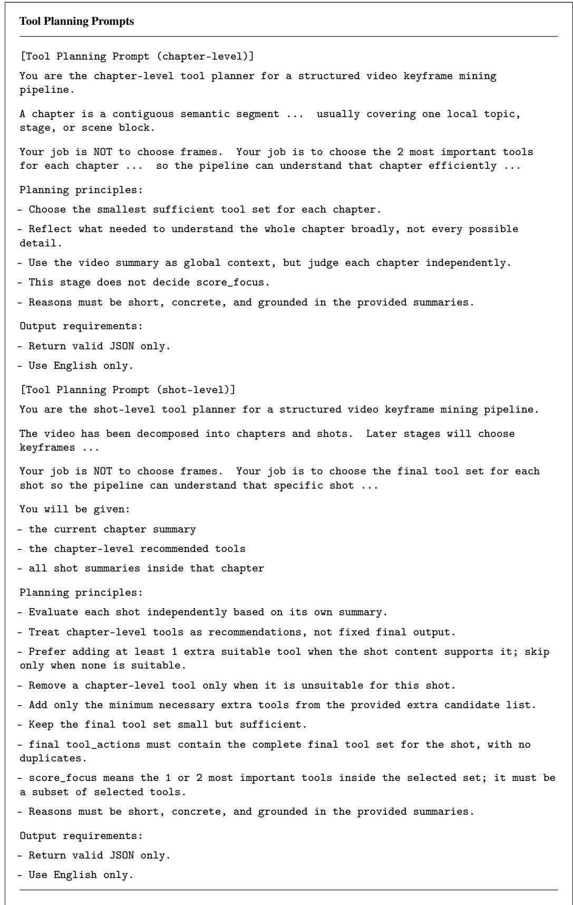  
Figure 9: Prompt for hierarchical tool planning.

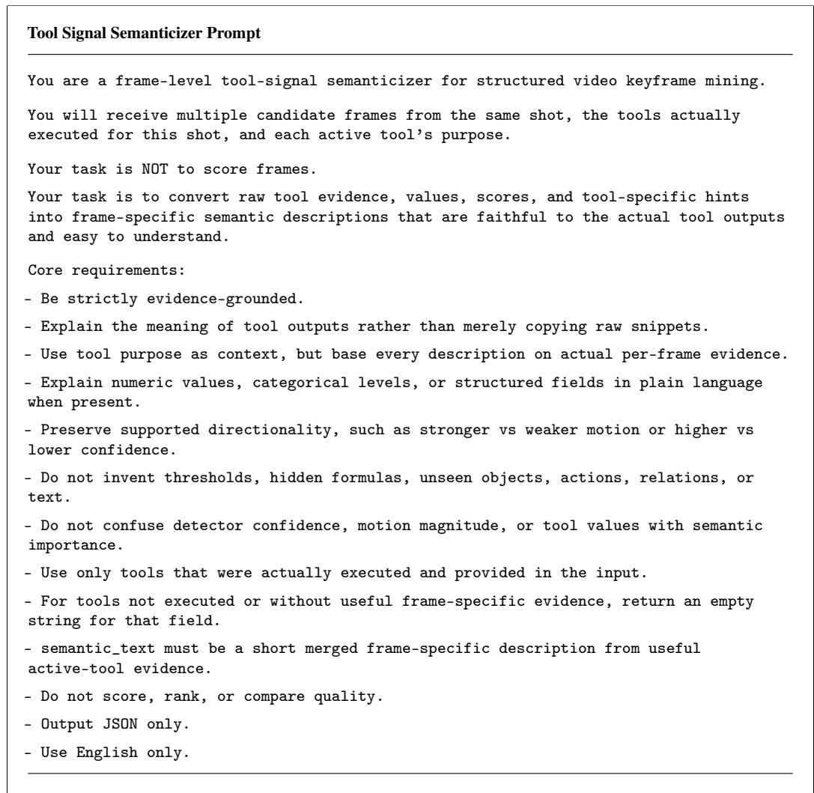  
Figure 10: Prompt for tool signal verbalization.

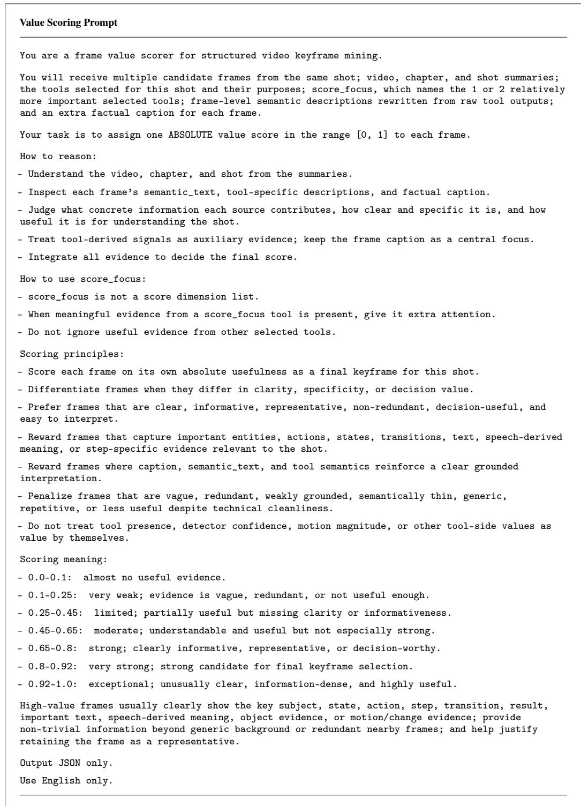  
Figure 11: Prompt for frame value scoring.

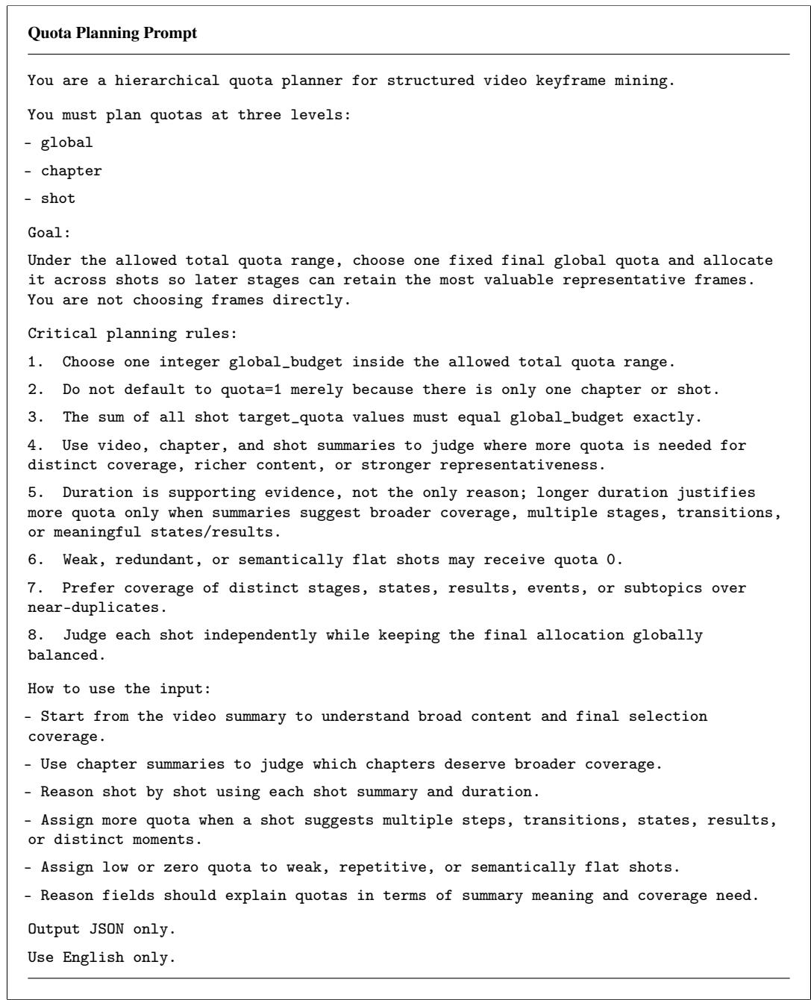  
Figure 12: Prompt and rule for quota allocation and weighted facility-location selection.

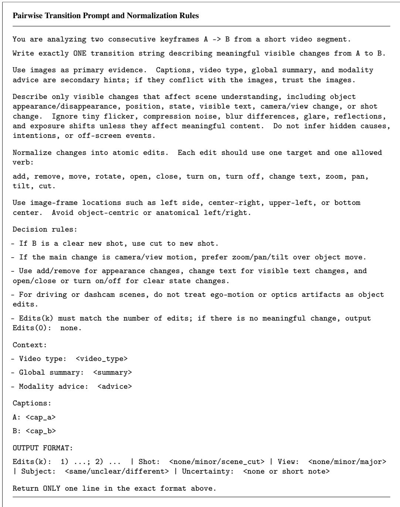  
Figure 13: Prompt for pairwise transition generation.

Task Routing Prompt   
You are a quota allocator for dataset instance generation.   
You MUST base your decision ONLY on the EVIDENCE PACK lines below.   
Each evidence line begins with an evidence\_id in brackets, e.g. [S\_SEGMENT\_SUM], [F00\_CAP], [P00].   
GOAL (highest priority: maximize VALID OUTPUT COUNT): assign quotas within the limits for THIS   
segment; prefer producing MORE dialog instances when feasible ...; if allocating edit quota, choose   
suitable frame pairs ONLY from the provided candidate pair list.   
<global mix note>   
IMPORTANT: GLOBAL\_MIX is SOFT guidance. Do NOT set dialog quotas to 0 just to satisfy a mix ratio.   
If unsure, choose MORE dialog rather than fewer.   
EDIT ALLOCATION POLICY (do NOT be overly conservative): candidate edit pairs are already   
pre-screened; do NOT re-apply stricter hidden rules. If there is at least 1 candidate pair and no   
explicit evidence saying edits are unsuitable, allocate a NON-ZERO edit quota. When uncertain,   
prefer a SMALL non-zero edit quota ...; allocate edit ONLY from the provided candidate pair list.   
Practical heuristic: if candidate\_pairs\_count >= 4, usually allocate edit 3-4 unless hard evidence   
says unsuitable; if candidate\_pairs\_count is 1-3, usually allocate edit 2-3; if   
candidate\_pairs\_count == 0, set edit = 0.   
CRITICAL INDEXING: this segment has N keyframes indexed by POSITION 0..N-1. All frame and pair   
indices in your output refer to these keyframe POSITIONS.   
EVIDENCE USAGE POLICY:   
1) ALWAYS read and use segment-level background evidence FIRST: [S\_SEGMENT\_SUM].   
2) Then use frame-level evidence [Fxx\_\*] and pair/change evidence [Pxx]/[Cxx] for specific   
instances.   
3) Every type with quota > 0 MUST cite at least ONE segment-level evidence id (S\_\*) in its   
rationale.   
4) Do NOT treat any tool signal as ground truth; treat all evidence as imperfect.   
EDIT PAIR QUALITY: edit generation requires small, controllable edits. ONLY choose pairs from   
candidate pairs; prefer reviewed pairs [Pxx] when available; if no candidate pair satisfies   
small-edit constraints, set edit quota to 0.   
DIALOG TYPES: dialogs must remain grounded in evidence and not invent details.   
TYPE-SPECIFIC GUIDELINES: edit only when a small-edit pair exists; unify only when reviewed edit   
pairs exist.   
INPUTS:   
Candidate instruction task types: <candidate\_types\_json>   
Quota limits: <quota\_lines>   
Edit candidate pairs: <mb\_pairs\_txt>   
Reviewed edit pairs: <reviewed\_txt>   
EVIDENCE PACK: <evidence\_pack\_text>   
OUTPUT FORMAT (strict JSON only, no extra text):   
{   
"quotas": {   
"fine\_grained\_perception": 0,   
"visual\_reasoning": 0,   
"multi\_image\_logic": 0,   
"editing": 1,   
"grounded\_edit\_to\_select": 0,   
"interleaved\_recall\_generate\_select": 0,   
"stepwise\_generate\_select": 0,   
"middle\_step\_gap\_fill": 0,   
"instructional\_generate\_select": 0   
},   
"edit\_pairs": [{"from": 0, "to": 1}],   
"rationales": [{"type": "editing", "evidence\_refs": ["S\_SEGMENT\_SUM", "P00"], "reason":   
"Grounded edit pair."}]   
}   
RATIONALES REQUIREMENTS: provide one rationale entry per type with quota > 0; each rationale MUST   
include at least one segment-level evidence id (S\_\*); for dialog rationales, cite at least one   
frame-level evidence id (Fxx\_\*).  
Figure 14: Prompt for task routing.

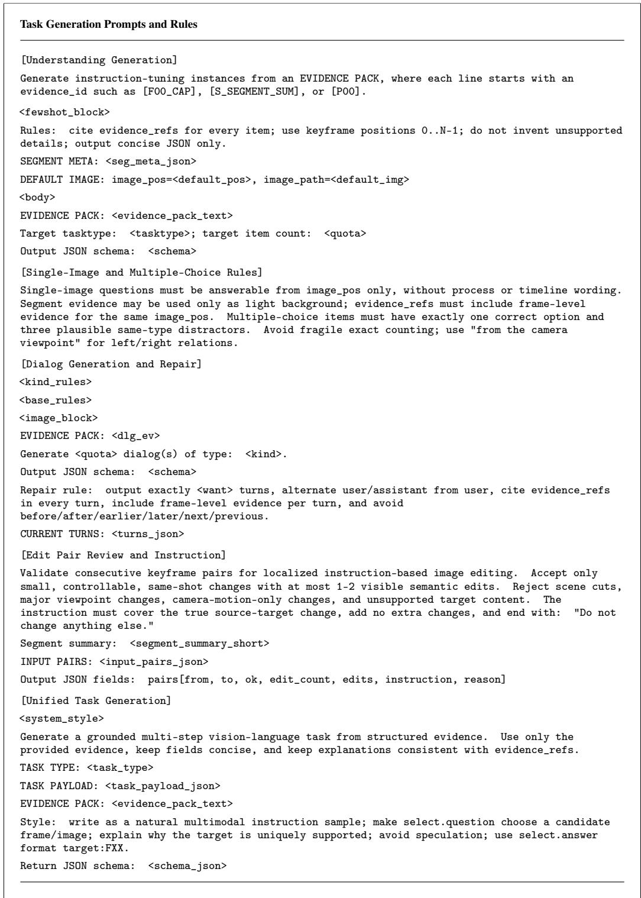  
Figure 15: Prompt for instruction generation.

## A.5 LLM–VLM Design and Model Selection

LLM–VLM Design Comparison. We compare the metadata-driven LLM design with a direct VLM alternative for filtering, task routing, and instruction generation. Both settings use the same input data, prompt templates, generation parameters, and GPT-4o evaluation protocol, each producing 200 final samples. As shown in Table 6, the LLM design outperforms the VLM alternative in both efficiency (12.4 vs. 5.6 samples/min) and quality (4.18 vs. 2.72), supporting the effectiveness of metadata-driven routing and instruction synthesis.

Table 6: Comparison between the metadata-driven LLM design and the direct VLM alternative.
<table><tr><td>Setting</td><td>Final Samples/min ↑</td><td>Quality ↑</td></tr><tr><td>Original LLM setting</td><td>12.4</td><td>4.18</td></tr><tr><td>Direct VLM setting</td><td>5.6</td><td>2.72</td></tr></table>

VLM Model Selection. To examine the efficiency–quality trade-off in VLM selection, we compare Qwen3.5-9B and Qwen3.5-27B under the same agent workflow, input data, prompt templates, and generation parameters. Both models are evaluated on a single H20 GPU using their respective maximum stable concurrency settings. Each setting generates 200 samples, with quality assessed by GPT-4o on a five-point scale. As shown in Table 7, increasing the model size from 9B to 27B yields only a marginal quality improvement (4.16 to 4.21), while reducing throughput from 12.4 to 4.1 samples/min/GPU. Therefore, we select Qwen3.5-9B as the VLM in our pipeline for its favorable balance between generation quality and computational efficiency.

Table 7: Efficiency and quality comparison of VLM candidates under the same agent workflow.
<table><tr><td>VLM</td><td>Samples/min/GPU ↑</td><td>GPT-4o Quality ↑</td></tr><tr><td>Qwen3.5-9B</td><td>12.4</td><td>4.16</td></tr><tr><td>Qwen3.5-27B</td><td>4.1</td><td>4.21</td></tr></table>

## B Tool Invocation Framework

## B.1 Tool Pool and Output Types

Tool invocation supplements frame-level semantic evidence when visual captions alone are insufficient. The current tool pool includes PaddleOCR Cui et al. [2025], Whisper ASR Radford et al. [2022], Ultralytics YOLOv8 Jocher et al. [2024], RAFT optical flow Teed and Deng [2020], and OmniParser Lu et al. [2024]. Table 8 summarizes the primary role, applicable scenarios, and retained output of each tool.

## B.2 Tool Evidence Verbalization and Scoring Rules

Table 9 summarizes the rules used in stage 2 to verbalize tool signals and score each frame.

## C Metadata Schema Definition

A minimal metadata example is shown in Fig. 16. The segment field comes from Stage 1 and contains the video summary, start and end timestamps, segment summary, and a coarse label. The chapters field comes from Stage 1 and contains ordered shots, their time ranges, chapter summaries, and labels indicating each chapter’s role in the video. The shots field comes from Stage 1 and contains shot-level time ranges, shot summaries, and hints about image quality and informativeness. The keyframes field comes from Stage 2 and contains selected representative frames with their timestamps, captions, quality judgments, tool-produced semantic signals, and value scores. The transitions field comes from Stage 3 and contains ordered frame pairs, whether they remain within the same shot, whether the main subject is consistent, the concrete transition between the frames, and a reliability estimate.

Table 8: Summary of auxiliary perception tools used for frame-level and shot-level information extraction.
<table><tr><td>Tool</td><td>Role</td><td>Applicable scenarios</td></tr><tr><td>PaddleOCR</td><td>Scene-text extraction from video frames</td><td>Used to read titles, labels, menu items, tables, subtitles, document text, and screen text, especially in slides, screen recordings, documents, and software demonstrations</td></tr><tr><td>Whisper ASR</td><td>Speech-content recovery around a shot</td><td>Used when speech provides semantic cues near candidate frames, including narration, spoken instructions, or dialogue context</td></tr><tr><td>YOLOv8</td><td>Object and entity detection</td><td>Used to identify people, objects, tools, and scene entities that provide visual grounding for frame understanding</td></tr><tr><td>RAFT</td><td>Motion estimation between adjacent candidate frames</td><td>Used when temporal dynamics or motion strength is informative for candidate-frame analysis</td></tr><tr><td>OmniParser</td><td>Structured GUI understanding</td><td>Used for GUI screenshots and software-interface frames where interface layout and interactive regions are important</td></tr></table>

```csv
Minimal Metadata Schema
segment video_id, start, end, summary, type
chapters chapter_id, time_span, summary, role
shots shot_id, chapter_id, time_span, summary, role, scene_type,
quality_hint, info_hint
keyframes frame_id, shot_id, timestamp, caption, quality, value_score,
tool_semantics, evidence_id
transitions source, target, atomic_changes, same_shot, viewpoint_change,
subject_consistent, reliability
```  
Figure 16: Minimal metadata schema used to bind summaries, keyframes, tool evidence, and transitions.

## D Instruction Templates and Examples

## D.1 Instruction-Data Synthesis Templates

This subsection gives the detailed templates used to generate task instructions.

Fine-Grained Perception. This template produces single-image perception questions, answered as yes/no or multiple choice, to test recognition of visible entities, attributes, positions, text, counts, and local details.

```json
{
"image_pos": <Frame[ID]>,
"category": "presence|attribute|spatial|text|count",
"question": "<single-image yes/no or multiple-choice question>",
"options": ["<A>", "<B>", "<C>", "<D>"],
"answer": "<Yes|No|A|B|C|D>",
"evidence_refs": ["F00_CAP"]
}
```

Visual Reasoning. This template produces single-image visual reasoning questions, answered as open-ended QA, to test inference from concrete visual cues. The answer gives a concise conclusion followed by concrete visual cues.

Table 9: Rules used to verbalize tool signals and score each frame.
<table><tr><td>Tool evidence Verbalization rule</td><td></td><td>Value-scoring use</td><td>Reliability boundary</td></tr><tr><td>OCR</td><td>Use recognized textual content as Reward readable and specific text primary evidence for readable text; describe the visible meaning, function, or role of the text rather than enumerating all detected tokens.</td><td>evidence that reveals task-relevant titles, steps, labels, states, commands, or interface cues; assign higher value when text evidence substantially improves understanding beyond generic visual appearance.</td><td>Keep noisy, incomplete, or ambiguous text evidence conservative; do not reward repeated boilerplate, recognition artifacts, or isolated fragments unless they reveal important state or intent.</td></tr><tr><td>ASR</td><td>Use nearby spoken content as temporal contextual evidence; treat speech as information associated with the frame interval, rather than as on-screen text or direct visual evidence.</td><td>Reward specific and temporally relevant speech that contributes concrete instructions, explanations, actions, or contextual meaning; assign higher value when spoken content matches the apparent step, state, or action around the frame.</td><td>Stay conservative when the alignment between speech and frame is uncertain; do not over-reward vague transcripts, weakly aligned speech, or information already evident from the visual content alone.</td></tr><tr><td>YOLOv8</td><td>primary evidence for visible entities; use confidence or location only as supporting information, and describe only entities that are visually supported.</td><td>Use detected object categories as Reward clear and relevant visible entities that explain the subject, objects in use, workspace context, or interaction target; assign higher value when detected entities are specific, diverse, and informative.</td><td>Do not treat detection confidence, quantity, or coverage alone as evidence of value, and do not infer unsupported relationships, intentions, or actions.</td></tr><tr><td>RAFT</td><td>Use optical-flow evidence as primary support for motion or temporal change; interpret motion strength as an indicator of change intensity rather than semantic importance or action type.</td><td>Reward motion evidence when it marks a meaningful transition, interaction moment, or state change; assign higher value when motion helps distinguish the frame from static or redundant neighboring frames.</td><td>Describe staticness or motion-heavy appearance only when supported by motion evidence; do not reward motion magnitude alone without semantic relevance.</td></tr><tr><td>OmniParser</td><td>Use parsed interface structure and element descriptions as component meaning, and visible application state; prioritize actionable or state-revealing elements over low-level visual labels.</td><td>Reward actionable interface structure such as buttons, menus, primary evidence for GUI layout, form fields, toggles, tabs, or clear application states; assign higher value when parsed elements materially improve understanding of what the interface shows or allows.</td><td>Treat element counts, positions, and bounding regions as supporting evidence rather than meaning by themselves; do not reward dense but uninformative interface clutter.</td></tr></table>

"category": "reasoning|function|activity|relation",   
"question": "<why/how/what can be inferred from the image>",   
"answer": "<2-4 sentences grounded in visible cues>",   
"evidence\_refs": ["F00\_CAP"]   
}

Multi-Image Logic. This template produces multi-image, multi-turn logic questions, answered through ordered dialogue, to test cross-image comparison, verification, and evidence binding. It asks the model to compare, connect, or jointly verify facts across images while maintaining strict role order and evidence grounding.

```json
{
"image_pos_list": [<Frame[ID]>, <Frame[ID]>, ...],
"turns": [
{
"role": "user",
"text": "Goal: <cross-image verification goal>.
Plan: Step 1: <inspect Image1>.
Step 2: <inspect Image2>.
Step 3: <compare them>.
Images: Image1:<ImageHere> Image2:<ImageHere>.
Step 1: <question>",
"evidence_refs": ["S_SEGMENT_SUM","F00_CAP","F01_CAP","C00"]
},
{
"role": "assistant",
"text": "<answer grounded in the referenced image>",
"evidence_refs": ["S_SEGMENT_SUM","F00_CAP","F01_CAP","C00"]
},
{
"role": "user",
"text": "Step 2: <pairwise comparison question>",
"evidence_refs": ["F00_CAP", "F01_CAP", "C00"]
},
{
"role": "assistant",
"text": "<cross-image answer>",
"evidence_refs": ["S_SEGMENT_SUM","F00_CAP","F01_CAP","C00"]
}
]
}
```

Editing This template produces image editing instructions from a source–target pair, answered by generating the edited image, to test localized and controllable visual generation. The change must be small and controllable, preserve stable scene content, and be expressible as one or two atomic edits.

```json
{
"from_pos": <source Frame[ID]>,
"to_pos": <target Frame[ID]>,
"ok": true,
"edit_count": 1|2,
"edits": ["<atomic local edit>", ...],
"instruction": "<local edit or infilling instruction>.
Do not change anything else.",
"reason": "<why the pair is small and controllable>",
"evidence_refs": ["F00_CAP", "F01_CAP", "P00"]
}
```

Grounded Edit-to-Select Generation. This template produces a two-image grounded editing task from a source image and a target image. The answer is a generated target image followed by a single-choice candidate image selection. It evaluates whether the model can preserve stable visual invariants, identify grounded visible edits, generate the target visual state, and select the candidate image matching the intended edited result.

{   
"Round\_Plan": {   
"question": {   
"text": "What should be changed from the source image to reach the tar   
-get state?",   
"Frames": ["Frame[SOURCE\_ID]", "Frame[TARGET\_ID]"]   
},   
"answer": {   
"goal": "<objective target visual state>",   
"invariants": ["<stable entity/background>", ...],

"edits": ["<grounded visible change>", ...]   
}   
},   
"Round\_Gen": {   
"question": {   
"text": "Generate the target image after applying the grounded edit.",   
"Frames": ["Frame[SOURCE\_ID]"]   
},   
"answer": {   
"image": "<generated target image>"   
}   
},   
"Round\_Select": {   
"question": {   
"text": "Which candidate image best matches the generated target image?",   
"Frames": ["Frame[CANDIDATE\_ID]", "Frame[CANDIDATE\_ID]", ...]   
},   
"answer": "target:FXX",   
"rationale": "<why the candidate matches the generated target image>"   
},   
"evidence\_refs": ["F00\_CAP", "F01\_CAP", "P00"]   
}

Interleaved Understand–Recall–Generate–Select. This template produces a two-image visual understanding and recall task. The answer contains an open-ended QA response, a generated laterstate image, and a single-choice candidate image selection. It evaluates whether the model can extract visible facts, reason about earlier-to-later changes, generate the recalled later state, and select the candidate frame consistent with that generated state.

{   
"Round\_Understand": {   
"question": {   
"text": "What visible facts describe the earlier and later image states?",   
"Frames": ["Frame[EARLIER\_ID]", "Frame[LATER\_ID]"]   
},   
"answer": {   
"facts": ["<visible earlier-state fact>", "<visible later-state fact>"]   
}   
},   
"Round\_Plan": {   
"question": {   
"text": "What grounded visual changes connect the earlier state to the later state?",   
"Frames": ["Frame[EARLIER\_ID]", "Frame[LATER\_ID]"]   
},   
"answer": {   
"edits": ["<grounded earlier-to-later change>", ...]   
}   
},   
"Round\_QA": {   
"question": {   
"text": "<open question about the recalled later detail>",   
"Frames": ["Frame[EARLIER\_ID]"]   
},   
"answer": "<grounded later-state answer>",   
"rubric": ["<answer constraint>", ...]   
},   
"Round\_Gen": {   
"question": {   
"text": "Generate the recalled later-state image.",   
"Frames": ["Frame[EARLIER\_ID]"]   
},   
"answer": {   
"image": "<generated later-state image >"   
}   
},   
"Round\_Select": {   
"question": {   
"text": "Which candidate frame matches the generated later-state image?",   
"Frames": ["Frame[CANDIDATE\_ID]", "Frame[CANDIDATE\_ID]", ...]   
},   
"answer": "target:FXX",   
"rationale": "<why the selected candidate matches the generated later state>"   
},   
"evidence\_refs": ["F00\_CAP", "F01\_CAP", "C00"]   
}

Stepwise Sequence Generate-and-Select. This template produces a multi-image step reasoning task over a coherent visual sequence. The answer is a list of generated step-state image followed by single-choice selections for each step. It evaluates whether the model can decompose a visual process into grounded steps, generate each intermediate state, track temporal order, and select the correct candidate frame for each step.

```json
{
"Round_Overall": {
"question": {
"text": "What is the overall coherent visual sequence?",
"Frames": ["Frame[START_ID]", "Frame[END_ID]"]
},
"answer": "<overall description of the visual sequence>"
},
"Round_Steps": {
"question": {
"text": "What are the grounded step-by-step state changes?",
"Frames": ["Frame[STEP_0]", "Frame[STEP_1]", "Frame[STEP_2]", ...]
},
"answer": [
"<step 1 grounded transition>",
"<step 2 grounded transition>"
]
},
"Round_Gen": [
{
"question": {
"text": "Generate the target image for step 1.",
"Frames": ["Frame[STEP_0]"]
},
"answer": {
"image": "<generated step-1 image >"
}
},<sub>{</sub>
"question": {
"text": "Generate the target image for step 2.",
"Frames": ["Frame[STEP_1]"]
},
"answer": {
"image": "<generated step-2 image >"
}
}
],
"Round_Select": [
{
"question": {
"text": "Which candidate frame matches the generated image for step 1?",
"Frames": ["Frame[CANDIDATE_1]", "Frame[CANDIDATE_2]", ...]
},
"answer": "target:FXX",
"rationale": "<why this frame is the correct step-1 state>"
},<sub>{</sub>
"question": {
"text": "Which candidate frame matches the generated image for step 2?",
"Frames": ["Frame[CANDIDATE_1]", "Frame[CANDIDATE_2]", ...]
},
"answer": "target:FXX",
"rationale": "<why this frame is the correct step-2 state>"
}
],
"evidence_refs": ["F00_CAP", "F01_CAP", "F02_CAP", "C00", "C01"]
}
```

Middle-Step Gap Generate-and-Fill. This template produces a three-image temporal gap-filling task. The answer is a generated middle-state image followed by a single-choice selection of the real middle candidate frame. It evaluates whether the model can reason bidirectionally from both adjacent transitions, generate the visual state that fits between two endpoints, and select the candidate satisfying both sides of the sequence.

{   
"Round\_Explain": {   
"question": {   
"text": "What visual state should fit between the earlier and later frames?",   
"Frames": ["Frame[EARLIER\_ID]", "Frame[LATER\_ID]"]   
},

"answer": "<why the middle state fits between earlier and later frames>"   
},   
"Round\_Gen": {   
"question": {   
"text": "Generate the middle-step image that fits between the earlier and later frames.",   
"Frames": ["Frame[EARLIER\_ID]", "Frame[LATER\_ID]"]   
},   
"answer": {   
"image": "<generated middle-state image >"   
}   
},   
"Round Select": {   
"question": {   
"text": "Which candidate frame matches the generated middle-step image?",   
"Frames": ["Frame[CANDIDATE\_1]", "Frame[CANDIDATE\_2]", ...]   
},   
"answer": "target:FXX",   
"rationale": "<why the selected frame matches both adjacent transitions>"   
},   
"evidence\_refs": ["F00\_CAP", "F01\_CAP", "F02\_CAP", "C00", "C01"]   
}

Instructional Sequential Generate-and-Select. This template produces a multi-image future-state instruction generation task from context frames and future target frames. The answer combines generated edit instructions, generated future-state image, and per-step single-choice candidate selections. It evaluates whether the model can infer immediate future visual changes from context, generate each future state, define visual checks, and select the matching future frame.

```jsonl
{
"Round_Overall": {
"question": {
"text": "What future visual sequence should follow from the context frames?",
"Frames": ["Frame[CONTEXT_1]", "Frame[CONTEXT_2]"]
},
"answer": "<overall future-step instruction from the context>"
},
"Round_Edit": {
"question": {
"text": "What visible edit should be made at each future step?",
"Frames": ["Frame[CONTEXT_1]", "Frame[CONTEXT_2]"]
},
"answer": ["<step 1 edit instruction>", "<step 2 edit instruction>"]
},
"Round_Reason": {
"question": {
"text": "Why does each future step follow from the context or previous state?",
"Frames": ["Frame[CONTEXT_1]", "Frame[CONTEXT_2]"]
},
"answer": ["<reason for step 1>", "<reason for step 2>"]
},
"Round_Target": {
"question": {
"text": "What visual state should each step reach?",
"Frames": ["Frame[CONTEXT_1]", "Frame[CONTEXT_2]"]
},
"answer": ["<desired visual state after step 1>", "<desired visual state after step 2>"]
},
"Round_Check": {
"question": {
"text": "How can each generated future step be visually verified?",
"Frames": ["Frame[CONTEXT_1]", "Frame[CONTEXT_2]"]
},
"answer": ["<visible condition for step 1>", "<visible condition for step 2>"]
},
"Round_Gen": [
{
"question": {
"text": "Generate the target image for future step 1.",
"Frames": ["Frame[CONTEXT_1]", "Frame[CONTEXT_2]"]
},
"answer": {
"image": "<generated future-step-1 image>"
}
},
{
"question": {
"text": "Generate the target image for future step 2.",
"Frames": ["Frame[CONTEXT_1]", "Frame[CONTEXT_2]", "Frame[FUTURE_1]"]
```

```jsonl
},
"answer": {
"image": "<generated future-step-2 image>"
}
}
],
"Round_Select": [
{
"question": {
"text": "Which candidate frame matches the generated image for future step 1?",
"Frames": ["Frame[CANDIDATE_1]", "Frame[CANDIDATE_2]", ...]
},
"answer": "target:FXX",
"rationale": "<why this frame is the immediate next future state>"
},
{
"question": {
"text": "Which candidate frame matches the generated image for future step 2?",
"Frames": ["Frame[CANDIDATE_1]", "Frame[CANDIDATE_2]", ...]
},
"answer": "target:FXX",
"rationale": "<why this frame matches the next future state>"
}
],
"evidence_refs": ["F00_CAP", "F01_CAP", "F02_CAP", "C00", "C01"]
}
```

## D.2 Examples

This section gives one example for each template.

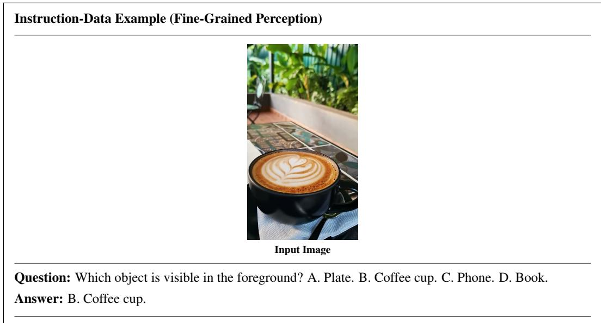  
Figure 17: Fine-grained perception example. The sample asks the model to identify a foreground object from a selected visual frame.

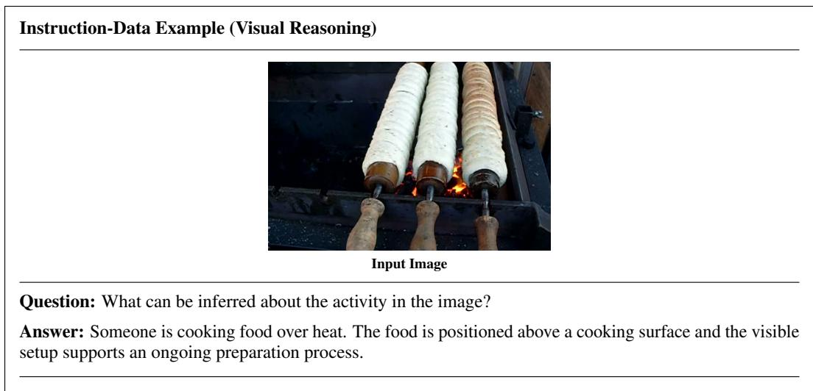  
Figure 18: Visual reasoning example. The sample requires inferring the ongoing activity from visual evidence in the image.

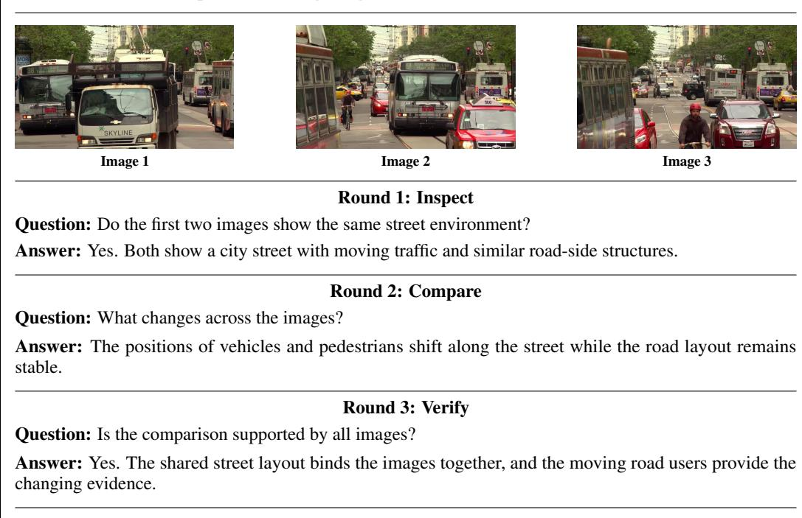  
Figure 19: Multi-image logic example. The sample compares multiple related frames and verifies the shared scene structure and temporal changes.

<table><tr><td>Instruction-Data Example (Editing)</td></tr><tr><td>Question:</td></tr><tr><td colspan="2">Source</td></tr><tr><td>Instruction: Edit the source image so the woman&#x27;s facial expression changes from neutral/speaking to smiling. Do not change anything else. Answer:</td><td></td></tr><tr><td>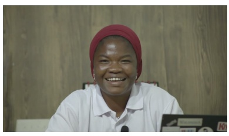</td><td></td></tr></table>

Figure 20: Image editing example. The sample edits the source image according to a localized visual instruction while preserving unrelated content.

Instruction-Data Example (Grounded Edit-to-Select Generation)

Question: What should be changed from the source image to reach the target state?

Candidate A  
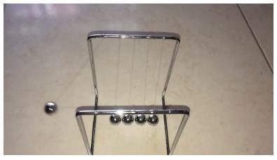  
Source

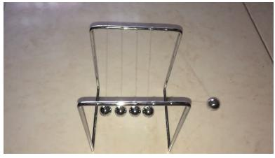  
Target  
Answer: Keep the same Newton’s cradle setup, but transfer the motion from the left displaced ball to the right displaced ball after the collision.  
Round 2: Generate

Question: Generate the target image after applying the grounded edit.

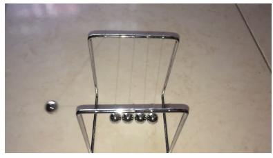

Source Answer:  
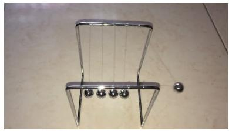  
Round 3: Select

Question: Which candidate image best matches the generated target image?

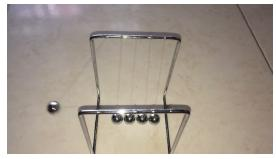

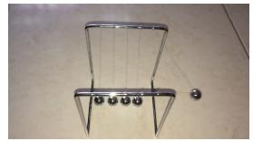  
Candidate B

  
Candidate C  
Figure 21: Grounded edit-to-select generation example. The sample plans a grounded visual edit, generates the target state, and selects the matching candidate.

<table><tr><td colspan="2">Instruction-Data Example (Interleaved Understand-Recall-Generate-Select)</td></tr><tr><td colspan="2">Round 1: Understand Question: What visible facts describe the earlier and later image states?</td></tr><tr><td>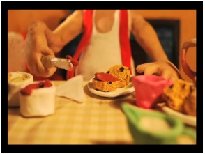</td><td>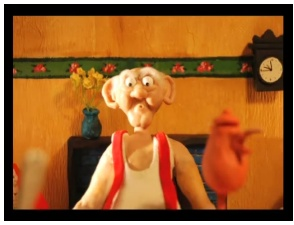</td></tr><tr><td>Earlier Answer: The earlier image shows food and hands around a table. The later image shows a clay character in</td><td>Later</td></tr><tr><td colspan="2">the same warm stop-motion style, now framed as an upper-body view. Round 2: Recall Question: What grounded visual change connects the two states?</td></tr><tr><td>Answer: The scene changes from a food-focused tabletop view to a character-focused upper-body view. Question: Generate the recalled later-state image.</td><td>Round 3: Generate</td></tr><tr><td colspan="2"></td></tr><tr><td></td><td>Earlier Answer:</td></tr><tr><td colspan="2"></td></tr><tr><td>Question: Which candidate matches the generated later-state image?</td><td>Round 4: Select</td></tr><tr><td></td><td></td></tr><tr><td></td><td></td></tr><tr><td></td><td></td></tr><tr><td></td><td></td></tr><tr><td></td><td></td></tr><tr><td></td><td></td></tr><tr><td></td><td></td></tr><tr><td></td><td></td></tr><tr><td></td><td></td></tr><tr><td></td><td></td></tr><tr><td></td><td></td></tr><tr><td></td><td></td></tr><tr><td></td><td></td></tr><tr><td></td><td></td></tr><tr><td></td><td></td></tr><tr><td></td><td></td></tr><tr><td></td><td></td></tr><tr><td></td><td></td></tr><tr><td></td><td></td></tr><tr><td></td><td></td></tr><tr><td></td><td></td></tr><tr><td></td><td></td></tr><tr><td></td><td></td></tr><tr><td></td><td></td></tr><tr><td></td><td></td></tr><tr><td></td><td></td></tr><tr><td></td><td></td></tr><tr><td></td><td></td></tr><tr><td></td><td></td></tr><tr><td></td><td></td></tr><tr><td></td><td>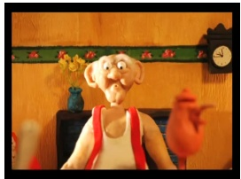</td></tr><tr><td></td><td></td></tr><tr><td></td><td></td></tr><tr><td></td><td></td></tr><tr><td></td><td></td></tr><tr><td></td><td></td></tr><tr><td></td><td></td></tr><tr><td></td><td></td></tr><tr><td></td><td></td></tr><tr><td></td><td></td></tr><tr><td></td><td></td></tr><tr><td></td><td></td></tr><tr><td></td><td></td></tr><tr><td></td><td></td></tr><tr><td></td><td></td></tr><tr><td></td><td></td></tr><tr><td></td><td></td></tr><tr><td></td><td></td></tr><tr><td></td><td></td></tr><tr><td></td><td></td></tr><tr><td></td><td></td></tr><tr><td></td><td></td></tr><tr><td></td><td></td></tr><tr><td></td><td></td></tr><tr><td></td><td></td></tr><tr><td></td><td></td></tr><tr><td></td><td></td></tr><tr><td></td><td></td></tr><tr><td></td><td></td></tr><tr><td></td><td></td></tr><tr><td></td><td></td></tr><tr><td></td><td></td></tr><tr><td></td><td></td></tr><tr><td></td><td></td></tr><tr><td></td><td></td></tr><tr><td></td><td></td></tr><tr><td></td><td></td></tr><tr><td></td><td></td></tr><tr><td></td><td></td></tr><tr><td></td><td></td></tr><tr><td></td><td></td></tr><tr><td></td><td></td></tr><tr><td></td><td></td></tr><tr><td></td><td></td></tr><tr><td></td><td></td></tr><tr><td></td><td></td></tr><tr><td></td><td></td></tr><tr><td></td><td></td></tr><tr><td></td><td></td></tr><tr><td></td><td></td></tr><tr><td></td><td></td></tr><tr><td></td><td></td></tr><tr><td></td><td></td></tr><tr><td></td><td></td></tr><tr><td></td><td></td></tr><tr><td></td><td></td></tr><tr><td></td><td></td></tr><tr><td></td><td></td></tr><tr><td></td><td></td></tr><tr><td></td><td></td></tr><tr><td></td><td></td></tr><tr><td></td><td></td></tr><tr><td></td><td></td></tr><tr><td></td><td></td></tr><tr><td>Candidate B</td><td></td></tr><tr><td></td><td></td></tr><tr><td></td><td></td></tr><tr><td></td><td></td></tr><tr><td>Candidate A</td><td></td></tr><tr><td></td><td></td></tr><tr><td></td><td></td></tr><tr><td></td><td></td></tr><tr><td></td><td></td></tr><tr><td></td><td>Candidate C</td></tr><tr><td></td><td></td></tr><tr><td></td><td></td></tr><tr><td></td><td></td></tr><tr><td></td><td></td></tr><tr><td></td><td></td></tr><tr><td></td><td></td></tr><tr><td></td><td></td></tr><tr><td>Answer: Candidate C. It matches the recalled later character-focused view.</td><td></td></tr></table>

Figure 22: Interleaved understand-recall-generate-select example. The sample alternates between visual understanding, grounded recall, generation, and candidate selection.

## Instruction-Data Example (Stepwise Sequence Generate-and-Select)

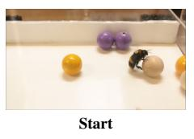

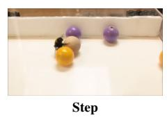

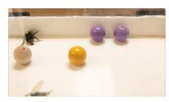  
Round 1: Overall

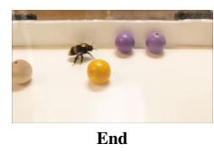

Question: What is the overall coherent visual sequence?

Answer: The sequence shows a bumblebee approaching a small ball, contacting it, and rolling it along the surface.

## Round 2: Steps

Question: What are the grounded step-by-step state changes?

Answer: Step 1: the bee approaches the ball. Step 2: it touches and grips the ball. Step 3: it rolls the ball forward.

Round 3: Generate

Question: Generate the next real action frame in which the bee is rolling the ball.

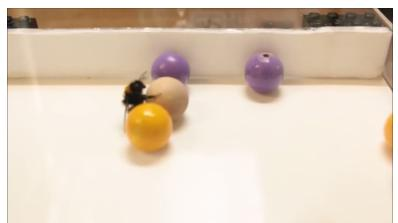

Current Answer:  
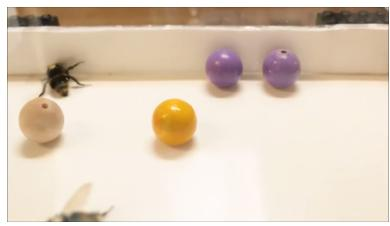  
Round 4: Select

Question: Which candidate matches the generated step image?

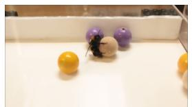  
Candidate A

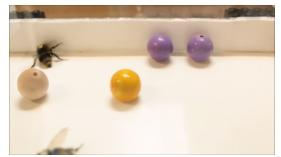  
Candidate B

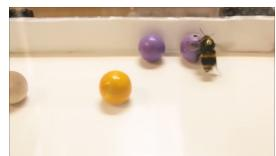  
Candidate C  
Answer: Candidate B. It matches the bee rolling the ball in the next visible action state.

Figure 23: Stepwise sequence generate-and-select example. The sample follows a continuous action sequence, generates the next step, and selects the matching candidate.

## Instruction-Data Example (Middle-Step Gap Generate-and-Fill)

Round 1: Explain

Question: What visual state should fit between the earlier and later images?

Later  
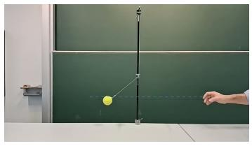  
Earlier

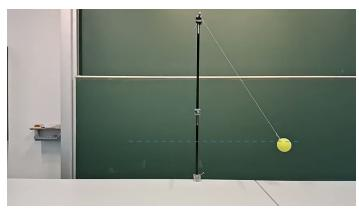  
Later  
Answer: The middle state should show the pendulum between the earlier left-side position and the later right-side position.  
Round 2: Generate

Question: Generate the middle-step image that fits between the endpoints.

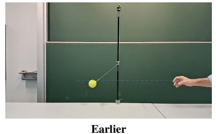

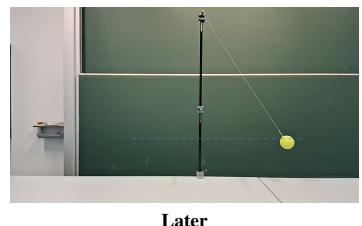

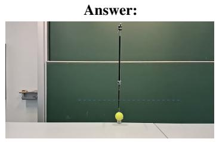  
Round 3: Select

Question: Which candidate matches the generated middle-step image?

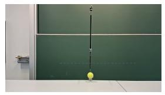  
Candidate A

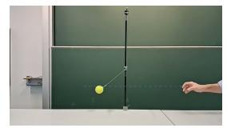  
Candidate B

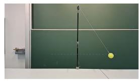  
Candidate C  
Answer: Candidate A. It shows the pendulum passing through the intermediate position between the earlier and later swing states.  
Figure 24: Middle-step gap generate-and-fill example. The sample infers and generates the missing intermediate frame between two temporally ordered endpoints.

## Instruction-Data Example (Instructional Sequential Generate-and-Select)

## Round 1: Overall

Question: What future visual sequence should follow from the context images?

A3  
A2  
  
Context 1

  
Context 2

Answer: The flower-blooming process should continue through three visible states in the same outdoor close-up: the petals open wider, the bloom expands, and the flower reaches a fuller open state.

## Round 2: Edit

Question: What visible edit should be made at each future step?

Answer: Step 1: open the petals slightly farther. Step 2: continue unfolding the red petals. Step 3: show the flower in a fuller open bloom.

## Round 3: Reason

Question: Why do these future steps follow from the context or previous state?

Answer: The context shows the same flower in a stable natural scene, so the future images should advance the blooming state while preserving the red flower and green-leaf composition.

## Round 4: Generate

Question: Generate the three future target images that follow from the context.

  
Context 1

  
Context 2


Answer:  
  
Round 5: Select

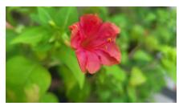

Question: Which three candidate images match the generated future sequence?  


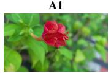

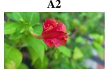

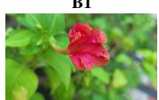

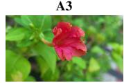

C1  
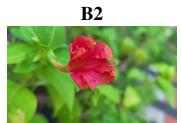  
C2

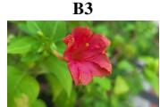  
C3  
Answer: Select A1, A2, and A3. They match the generated blooming sequence: petals open wider, the flower expands, and the bloom reaches a fuller open state.  
Figure 25: Instructional sequential generate-and-select example. The sample follows a stable natural blooming process, generates future visual steps, and selects the matching sequence.

## E Quality Control and Filtering Rules

## E.1 Gate A Prompt

The detailed Gate A prompt is shown in Fig. 26.

  
Figure 26: Prompt for shot admission.

## E.2 Gate B Rules & Prompt

After sampling, candidate frames enter a two-stage technical quality filter. The fast stage uses OpenCV statistics, including Laplacian variance, brightness, grayscale standard deviation, and histogram entropy, to reject frames with obvious blur, extreme exposure, low contrast, or low

informativeness. The model stage uses VLM to inspect higher-level visual usability. The detailed Gate B prompt is shown in Fig. 27.

## E.3 Facility-location Greedy Selection

We use standard weighted facility-location greedy selection to choose representative frames within each shot. For each shot, let the candidate-frame set be $F = \{ f _ { i } \} _ { i = 1 } ^ { n }$ , and let k denote the selection budget assigned to this shot by the quota planner. The goal of RepresentativeSelector is to select a representative subset S from the candidate set under the constraint $| S | \leq k ,$ so that the selected frames cover the important candidates within the shot as much as possible. The objective function is defined as:

$$
\mathcal { F } ( S ) = \sum _ { i } r _ { i } \operatorname* { m a x } _ { j \in S } \sin ( i , j ) ,
$$

where $r _ { i }$ denotes the quality weight of candidate frame $f _ { i } ,$ and $\sin ( i , j )$ denotes the similarity between candidate frame $f _ { i }$ and the selected representative frame $f _ { j }$

The candidate-frame quality weight is computed from the preceding semantic value assessment:

$$
r _ { i } = { \mathrm { v a l u e \_ s c o r e } } _ { i } .
$$

The value score value\_score is produced by the agent based on semanticized tool signals, while the inter-frame similarity sim $. ( i , j )$ is computed from the semantic representations of candidate frames. Specifically, the system first extracts image embeddings and caption embeddings, normalizes the visual and textual semantic representations, concatenates them, and then computes cosine similarity:

$$
\sin ( i , j ) = \cos ( z _ { i } , z _ { j } ) .
$$

During selection, the algorithm starts from an empty set $S = \emptyset$ and maintains the current coverage degree $c _ { i }$ of each candidate frame by the selected set. At each iteration, the algorithm traverses all unselected candidate frames $f _ { j }$ and computes the marginal gain of adding it to the selected set:

$$
\Delta ( j ) = \sum _ { i } r _ { i } \operatorname* { m a x } \bigl ( 0 , \sin ( i , j ) - c _ { i } \bigr ) .
$$

The candidate frame with the largest marginal gain is added to $S ,$ , and the coverage degree is updated as:

$$
c _ { i } \gets \operatorname* { m a x } \bigl ( c _ { i } , \sin ( i , j ) \bigr ) .
$$

This process is repeated until the shot-level budget k is reached or all candidate frames have been exhausted.

## E.4 Signal Filtering Prompt

The detailed signal filtering prompt is shown in Fig. 28.

## E.5 Gate C

The detailed Gate C prompt is shown in Fig. 29.

```csv
Quality Assessment Prompt
You are a strict technical image quality inspector for dataset filtering.
Judge only technical quality and cleanliness of the visible image, not aesthetics,
narrative value, or semantic importance. Inspect the image using domain-appropriate
standards for real photos, animation, game renders, screen/UI frames, and mixed cases.
Do not treat intentional stylization, high/low-key lighting, bloom, flat shading, or
non-photorealism as defects unless they harm usability.
Evaluate only meaningful regions, including important subjects, informative structures,
readable text, interfaces, faces, hands, and products. Borderline, ambiguous, or
mildly degraded cases should fail under strict filtering. For each dimension, output
pass or fail with one short reason, and generate a 1–2 sentence factual caption for
downstream frame-value scoring.
QUALITY DIMENSIONS:
1. exposure_brightness
2. focus_sharpness
3. motion_blur_camera_shake_ghosting
4. noise_grain_low_light_degradation
5. artifacts_compression_resampling_ai_generated
6. color_fidelity_white_balance_color_cast
7. contrast_dynamic_range_detail_visibility
8. occlusion_obstruction_crop_integrity
9. corruption_abnormal_regions_overlay_contamination
OUTPUT FORMAT (strict JSON only):
Return exactly one valid JSON object, without any preceding text, markdown fences, or
trailing explanation.
Use pass or fail for all nine quality dimensions. Provide one concise reason for each
judgment in the reasons object.
{
"caption": "A factual description of the visible scene.",
"exposure_brightness": "pass",
"focus_sharpness": "pass",
"motion_blur_camera_shake_ghosting": "pass",
"noise_grain_low_light_degradation": "pass",
"artifacts_compression_resampling_ai_generated": "pass",
"color_fidelity_white_balance_color_cast": "pass",
"contrast_dynamic_range_detail_visibility": "pass",
"occlusion_obstruction_crop_integrity": "pass",
"corruption_abnormal_regions_overlay_contamination": "pass",
"reasons": {
"exposure_brightness": "The subject is clearly visible.",
"focus_sharpness": "Important details are sharp.",
"motion_blur_camera_shake_ghosting": "No significant blur is visible.",
"noise_grain_low_light_degradation": "No major degradation is visible.",
"artifacts_compression_resampling_ai_generated": "No major artifacts are visible.",
"color_fidelity_white_balance_color_cast": "Colors appear consistent.",
"contrast dynamic range detail visibility": "Important details remain visible.".
"occlusion_obstruction_crop_integrity": "Important content is unobstructed.",
"corruption_abnormal_regions_overlay_contamination": "No visible corruption is
detected."
}
```  
Figure 27: Prompt for quality assessment.

  
Figure 28: Prompt for signal filtering.

  
Figure 29: Prompt for metadata admission.

To quantify the practical filtering effect of Gate C, we randomly sampled 5,000 metadata entries before filtering. Gate C rejected 37.4% of the entries overall, while the domain-level rejection rates are summarized in Table 10. The primary rejection reasons included unsupported metadata content, noisy textual or tool-recognition signals, generic descriptions with sparse usable information, repetitive imagery with low evidence density, and inaccurate state-transition descriptions across the five domains, respectively.

Table 10: Gate C rejection rates by domain.
<table><tr><td>Domain</td><td>Rejection Rate (%)</td></tr><tr><td>Technology and Tutorial</td><td>37.3</td></tr><tr><td>Sports and Action</td><td>39.8</td></tr><tr><td>Daily Life and Human Activities</td><td>24.8</td></tr><tr><td>Nature and Scenery</td><td>47.3</td></tr><tr><td>Gaming and ACG</td><td>38.2</td></tr><tr><td>Overall</td><td>37.4</td></tr></table>

## F Dataset Taxonomy Details

  
Figure 30: Distribution of the final dataset.

This section provides detailed definitions of the capability, domain, and task categories used to analyze VidUEU-100K.

## F.1 Capability Categories

To improve the overall capabilities of multimodal large models, we categorize the 100K instructiontuning samples into three capability paradigms: understanding, editing, and unified.

• Understanding: Focuses on multimodal comprehension tasks, including fine-grained visual perception and complex reasoning over visual content.

• Editing: Focuses on instruction-based image editing, requiring models to modify or complete visual content according to textual instructions while preserving irrelevant visual details.

• Unified: Involves interleaved text–image sequences, requiring the model to jointly perform multimodal understanding and generation capabilities within a unified stream.

## F.2 Domain Categories

To ensure a balanced representation of both naturalistic and digitally synthesized environments, we classify the dataset into five thematic domains based on contextual semantics. Within each domain, we maximize content diversity to mitigate representation bias and ensure broad generalization.

• Technology & Tutorial: This category includes instructional demonstrations, software interfaces, scientific knowledge, and procedural workflows.

• Sports & Action: This category covers athletic competitions, physical training, outdoor sports, and various dynamic action sequences.

• Daily Life & Human Activities: This category encompasses routine human activities, including domestic tasks, commuting, and social interactions.

• Nature & Scenery: This category includes natural landscapes, meteorological phenomena, and various flora and fauna.

• Gaming & ACG: This category consists of gameplay recordings, digital animations, comics, and interactive interface content.

## F.3 Task Categories

Based on the generated metadata, the agent adaptively determines and generates nine task types. The first three tasks belong to Understanding, the fourth corresponds to Editing, and the final five fall under Unified.

• Fine-grained Perception: Requires the identification of microscopic visual details, including object attributes, existence, cardinality, and precise spatial arrangements within visual scenes.

• Visual Reasoning: Requires inferring logical dependencies, causal relationships, and relational dynamics between subjects across visual contexts.

• Multi-Image Logic: Requires maintaining coherent co-reference and logical consistency across a sequence of incrementally introduced images.

• Editing: Requires completing missing visual content or editing existing images according to textual instructions and provided visual context.

• Grounded Edit-to-Select Generation: Requires generating a target visual state from grounded source–target changes and selecting the candidate image that matches the intended edit.

• Interleaved Understand–Recall–Generate–Select: Requires extracting visible facts from earlier visual context, recalling a later state, generating the recalled visual state, and selecting the matching candidate frame.

• Stepwise Sequence Generate-and-Select: Requires decomposing a coherent visual process into ordered steps, generating intermediate visual states, and selecting candidates that match each step.

• Middle-Step Gap Generate-and-Fill: Requires reasoning over earlier and later frames to infer, generate, and select the missing middle visual state.

• Instructional Sequential Generate-and-Select: Requires inferring future visual changes from context frames, generating stepwise future states, and selecting candidates that satisfy each predicted step.

## F.4 Data Statistics

The VidUEU dataset contains 100,000 instruction samples, comprising 40,000 understanding samples, 30,000 editing samples, and 30,000 unified interleaved multimodal generation samples. The dataset is derived from 8,268 raw videos, covering approximately 224.2 hours of measurable segment-level video duration and containing approximately 8,505 semantic segments. The detailed distributions of capabilities, domains, and task types are shown in Figure 30.

## F.5 Intrinsic Data-Quality Audit

We randomly sampled 800 instances for human evaluation, with 200 instances per quality dimension. Two annotators independently rated each instance on a 0–5 scale. Table 11 reports the annotator scores, their means, and Cohen’s κ for inter-annotator agreement. The first three dimensions were assessed at the metadata level, while editing-sample validity was evaluated at the individual editing-instruction level.

Table 11: Human audit of synthesized-data quality.
<table><tr><td>Quality Dimension</td><td>Annotator A</td><td>Annotator B</td><td>Mean</td><td>Cohen&#x27;s κ</td></tr><tr><td>Gate C Metadata Validity</td><td>4.12</td><td>4.08</td><td>4.10</td><td>0.69</td></tr><tr><td>Keyframe-Tool-Signal Alignment</td><td>4.30</td><td>4.20</td><td>4.25</td><td>0.76</td></tr><tr><td>Transition Correctness</td><td>4.06</td><td>4.01</td><td>4.04</td><td>0.77</td></tr><tr><td>Editing-Sample Validity</td><td>3.96</td><td>4.02</td><td>3.99</td><td>0.71</td></tr></table>

## G Training and Evaluation Details

## G.1 Training Details

InternVL3-8B. For understanding, we fine-tune InternVL3-8B on the understanding subset. We freeze the vision encoder and apply LoRA fine-tuning to the remaining target modules. The model is trained for 2 epochs with AdamW, a learning rate of $5 \times 1 0 ^ { - 5 }$ , a global batch size of 32, and a cosine learning rate scheduler with a warmup ratio of 0.03. Training uses 2 NVIDIA A100-40G with DeepSpeed ZeRO stage 2, bfloat16 precision, and gradient checkpointing.

Bagel-7B-MoT. For understanding, editing and unified tasks, we fine-tune Bagel-7B-MoT on the understanding, editing and unified subsets, respectively. We freeze the VAE encoder, the VAE decoder, and the ViT encoder, apply LoRA to the LLM backbone with r = 16 and α = 32. For editing and unified training, we additionally fully fine-tune the generation bridging heads, including llm2vae, vae2llm, and time\_embedder. The model is trained for 1 epoch with AdamW, a learning rate of $5 \times 1 0 ^ { - 5 }$ , and a cosine learning rate scheduler, using cross-entropy loss for text supervision and MSE loss for image supervision. Training uses 8 A100-40GB GPUs.

## G.2 Evaluation Details

We evaluate the fine-tuned models under three capability settings, namely understanding, editing, and unified understanding and generation. We follow the official protocol of each benchmark.

## G.3 Compared Baselines

For comparison, we report results against representative understanding and unified baselines, includ ing InternVL3 with other model sizes Zhu et al. [2025], Qwen2.5-VL Bai et al. [2025b], LLaMA-3.2 Grattafiori et al. [2024], Janus-Pro Chen et al. [2025d], and TokenFlow-XL Qu et al. [2024]. We also compare with editing and unified baselines, including Instruct-Pix2Pix Brooks et al. [2023], MagicBrush Zhang et al. [2024], AnyEdit Yu et al. [2024], Step1X-Edit Liu et al. [2025], Gemini-2.0-flash Kampf and Brichtova [2025], OmniGen Xiao et al. [2024], OmniGen2 Wu et al. [2025], Ovis-U1 Wang et al. [2025], and Bagel-Zebra Li et al. [2026].

## G.4 Evaluation Protocols

Understanding evaluation. For LLaVA-Bench, we use Qwen3.5-35B-A3B Qwen Team [2026] as the VLM judge. For MMDU, we use Qwen3-VL-235B-A22B-Instruct Bai et al. [2025a] as the VLM judge.

Editing evaluation. The editing model is evaluated on GEdit-Bench-En. GEdit-Bench-En is used to evaluate instruction-based image editing, with reported dimensions including $\mathrm { G } \_ \mathrm { S C , } \mathrm { G } \_ \mathrm { P Q , } \mathrm { G } \_ \mathrm { O } .$ and Average. We use GPT-4.1 OpenAI [2025] as the judge for the G\_SC, G\_PQ, and G\_O metrics.

Unified evaluation. The unified model is evaluated on WEAVEbench. We use GPT-4o OpenAI et al.   
[2024] as the VLM judge.

## G.5 Evaluation Variability

Table 12 reports the run-to-run standard deviation of VLM-as-a-judge evaluations. For each entry, the evaluated model outputs are fixed, and the standard deviation is computed over three independent judge runs.

Table 12: Automatic-judge run-to-run standard deviation with fixed evaluated outputs. Mean scores are reported in the main experimental tables.
<table><tr><td>Capability</td><td>Model / metric</td><td>Baseline std</td><td>Ours std</td></tr><tr><td>Understanding</td><td>InternVL3, LLaVA-Bench</td><td>0.317</td><td>0.292</td></tr><tr><td>Understanding</td><td>InternVL3, MMDU</td><td>0.150</td><td>0.172</td></tr><tr><td>Understanding</td><td>Bagel, LLaVA-Bench</td><td>0.306</td><td>0.328</td></tr><tr><td>Understanding</td><td>Bagel, MMDU</td><td>0.133</td><td>0.151</td></tr><tr><td>Editing</td><td>Bagel, GEdit-Bench-En G_SC</td><td>0.073</td><td>0.157</td></tr><tr><td>Editing</td><td>Bagel, GEdit-Bench-En G_PQ</td><td>0.076</td><td>0.146</td></tr><tr><td>Editing</td><td>Bagel, GEdit-Bench-En G_O</td><td>0.072</td><td>0.134</td></tr><tr><td>Unified</td><td>Bagel, WEAVE Science</td><td>0.0106</td><td>0.0108</td></tr><tr><td>Unified</td><td>Bagel, WEAVE Creation</td><td>0.0053</td><td>0.0051</td></tr><tr><td>Unified</td><td>Bagel, WEAVE Logic</td><td>0.0119</td><td>0.0119</td></tr><tr><td>Unified</td><td>Bagel, WEAVE Game</td><td>0.0230</td><td>0.0217</td></tr><tr><td>Unified</td><td>Bagel, WEAVE Average</td><td>0.0129</td><td>0.0122</td></tr></table>

Table 13: Full results of autonomous data iteration using Bagel.
<table><tr><td>Setting</td><td>MMT-Bench↑</td><td>MME↑</td><td>LLaVA-Bench↑</td><td>MMDU↑</td><td>GEdit G_O↑</td><td>WEAVE Overall↑</td></tr><tr><td>Iteration 1</td><td>0.631</td><td>1725.4</td><td>52.3</td><td>29.7</td><td>6.541</td><td>0.448</td></tr><tr><td>Iteration 2</td><td>0.629</td><td>1767.3</td><td>52.3</td><td>29.2</td><td>6.796</td><td>0.452</td></tr><tr><td>Iteration 3</td><td>0.642</td><td>1840.4</td><td>56.1</td><td>31.4</td><td>6.873</td><td>0.458</td></tr><tr><td>Iteration 4</td><td>0.649</td><td>1871.9</td><td>57.2</td><td>32.8</td><td>6.901</td><td>0.499</td></tr><tr><td>Final (separate)</td><td>0.651</td><td>1900.2</td><td>57.9</td><td>33.2</td><td>6.951</td><td>0.501</td></tr></table>

## H Full Results for Autonomous Iteration and Ablation

## H.1 Full Results of Autonomous Data Iteration

Table 13 reports the full results for Iterations 1–4 under 30K joint training, together with the Final results from capability-specific training on VidUEU-100K. The Final joint-training results are reported in Table 4.

## H.2 Training Protocol and Data Distributions

Iterations 1–4 each use a fixed budget of 30K samples. At each iteration, the agent randomly samples from the generated data according to the updated target proportions of capabilities, domains, and task types. Samples exceeding category quotas are removed, while additional samples are generated for underrepresented categories to form the 30K training set. Each iteration jointly fine-tunes BAGEL from the same initial checkpoint for one epoch on eight A100-40GB GPUs. The Final 100K dataset is constructed by scaling the target distribution obtained in Iteration 4.

The agent prioritizes the capability distribution, allowing deviations of at most one percentage point for domain and task-type distributions. The realized distributions across iterations are reported in Tables 14, 15, and 16. At each iteration, the agent receives training loss and learning curves, aggregate benchmark and subcategory scores, the current data distribution, and compressed historical feedback and distributions, with optional human-audit inputs. Baseline performance is provided only in the first iteration as a fixed reference, while the other feedback signals are updated after each round.

## H.3 Feedback-Free Evaluation

MMBench, MMStar, and VSI-Bench are excluded from iterative feedback and used to assess generalization beyond the feedback benchmarks. As shown in Table 17, the results exhibit an overall upward trend across iterations.

Table 14: Realized capability distributions (%) across autonomous iterations.
<table><tr><td>Setting</td><td>Understanding</td><td>Editing</td><td>Unified</td></tr><tr><td>Iteration 1</td><td>50.0</td><td>25.0</td><td>25.0</td></tr><tr><td>Iteration 2</td><td>35.0</td><td>33.0</td><td>32.0</td></tr><tr><td>Iteration 3</td><td>39.0</td><td>31.0</td><td>30.0</td></tr><tr><td>Iteration 4</td><td>40.0</td><td>30.0</td><td>30.0</td></tr></table>

Table 15: Realized domain distributions (%) across autonomous iterations.
<table><tr><td>Setting</td><td>Technology</td><td>Sports</td><td>Daily Life</td><td>Nature</td><td>Gaming</td></tr><tr><td>Iteration 1</td><td>22.1</td><td>17.8</td><td>28.2</td><td>18.1</td><td>13.8</td></tr><tr><td>Iteration 2</td><td>18.1</td><td>21.9</td><td>24.8</td><td>16.1</td><td>19.1</td></tr><tr><td>Iteration 3</td><td>23.9</td><td>20.2</td><td>21.9</td><td>17.9</td><td>16.1</td></tr><tr><td>Iteration 4</td><td>25.2</td><td>21.1</td><td>19.8</td><td>17.8</td><td>16.1</td></tr></table>

Table 16: Realized task-type distributions (%) across autonomous iterations.
<table><tr><td>Setting</td><td>FP</td><td>VR</td><td>MIL</td><td>Edit</td><td>GES</td><td>RGS</td><td>SGS</td><td>GGF</td><td>ISG</td></tr><tr><td>Iteration 1</td><td>28.3</td><td>9.6</td><td>12.1</td><td>25.0</td><td>4.6</td><td>5.3</td><td>4.8</td><td>5.1</td><td>5.2</td></tr><tr><td>Iteration 2</td><td>22.4</td><td>6.8</td><td>5.8</td><td>33.0</td><td>9.0</td><td>6.4</td><td>6.1</td><td>4.8</td><td>5.7</td></tr><tr><td>Iteration 3</td><td>20.8</td><td>8.3</td><td>9.9</td><td>31.0</td><td>7.0</td><td>5.6</td><td>5.9</td><td>5.3</td><td>6.2</td></tr><tr><td>Iteration 4</td><td>19.8</td><td>8.3</td><td>11.9</td><td>30.0</td><td>5.6</td><td>6.3</td><td>5.8</td><td>6.2</td><td>6.1</td></tr></table>

Table 17: Evaluation on benchmarks excluded from autonomous feedback.
<table><tr><td>Setting</td><td>MMBench↑</td><td>MMStar↑</td><td>VSI-Bench↑</td></tr><tr><td>BAGEL Base</td><td>84.2</td><td>67.3</td><td>31.4</td></tr><tr><td>Iteration 1</td><td>84.9</td><td>67.4</td><td>32.8</td></tr><tr><td>Iteration 2</td><td>84.7</td><td>67.3</td><td>32.9</td></tr><tr><td>Iteration 3</td><td>85.0</td><td>67.5</td><td>33.6</td></tr><tr><td>Iteration 4</td><td>85.1</td><td>67.6</td><td>34.4</td></tr><tr><td>Final</td><td>85.3</td><td>67.8</td><td>36.8</td></tr></table>

## H.4 Full Ablation Study

Table 18 reports the full ablation results of VidUEU-Agent components, including the additional understanding benchmarks omitted from the main table. The results show that removing any major component degrades performance, validating the effectiveness of the full pipeline design.

Given the computational demands of multi-stage data synthesis and model training, we evaluate six ablated variants using 10K samples per capability.

We retain the capability-specific Final models trained on the 100K dataset as the full-pipeline reference, enabling broader component coverage without repeated large-scale training.

These comparisons provide indicative evidence of component-level contributions under practical data budgets, while leaving strictly budget-matched evaluation for future investigation.

## H.5 Comparison with Baseline Datasets

We compare Bagel under the same training setting using our dataset and three task-specific baseline datasets: LLaVA Visual Instruct 150K Liu et al. [2023] for understanding, InstructPix2Pix Brooks et al. [2023] for editing, and Zebra-CoT Li et al. [2026] for unified tasks, as shown in Table 19. Our dataset achieves the best results across all evaluated settings, indicating stronger overall training effectiveness.

Table 18: Full ablation study of VidUEU-Agent components using Bagel.
<table><tr><td>Setting</td><td>MMT-Bench↑</td><td>MME↑</td><td>LLaVA-Bench↑</td><td>MMDU↑</td><td>GEdit G_O↑</td><td>WEAVE Overall↑</td></tr><tr><td>Ours</td><td>0.651</td><td>1900.2</td><td>57.9</td><td>33.2</td><td>6.951</td><td>0.501</td></tr><tr><td>w/o A</td><td>0.638</td><td>1772.6</td><td>53.6</td><td>32.4</td><td>6.773</td><td>0.497</td></tr><tr><td>w/o B</td><td>0.605</td><td>1255.7</td><td>42.8</td><td>24.7</td><td>5.175</td><td>0.404</td></tr><tr><td>w/o S</td><td>0.623</td><td>1684.3</td><td>50.7</td><td>30.8</td><td>5.848</td><td>0.462</td></tr><tr><td>w/o C</td><td>0.617</td><td>1549.4</td><td>51.2</td><td>30.5</td><td>6.303</td><td>0.454</td></tr><tr><td>N</td><td>0.537</td><td>1116.4</td><td>38.7</td><td>22.0</td><td>5.041</td><td>0.393</td></tr><tr><td>w/o R</td><td>0.611</td><td>1565.5</td><td>51.0</td><td>29.4</td><td>6.031</td><td>0.470</td></tr></table>

Table 19: Comparison with baseline datasets using Bagel under the same training setting.
<table><tr><td>Dataset</td><td></td><td></td><td>MMT-Bench↑ MME↑ LLaVA-Bench↑ MMDU↑ GEdit G_O↑</td><td></td><td></td><td>WEAVE Overall↑</td></tr><tr><td>LLaVA Visual Instruct InstructPix2Pix</td><td>0.477</td><td>1823.0</td><td>51.8</td><td>29.6</td><td></td><td></td></tr><tr><td>Zebra-CoT</td><td></td><td></td><td></td><td>一</td><td>6.882</td><td></td></tr><tr><td></td><td></td><td></td><td></td><td></td><td></td><td>0.449</td></tr><tr><td>Ours(Bagel)</td><td>0.651</td><td></td><td></td><td></td><td></td><td></td></tr><tr><td></td><td></td><td>1900.2</td><td>57.9</td><td>33.2</td><td>6.951</td><td>0.501</td></tr></table>

## I Broader Impacts

VidUEU-Agent and VidUEU-100K may help reduce the cost of constructing high-quality multimodal instruction data and support the development of models with stronger understanding, editing, and unified capabilities. However, even with careful human screening, source videos may contain social biases, privacy-sensitive content, or copyright risks, which may still be inherited by the constructed dataset and downstream models. Therefore, future use of VidUEU-Agent should include careful data filtering, license review, privacy protection, and safeguards against malicious use.

## J Limitations

Although VidUEU-Agent covers multimodal understanding, editing, and unified tasks, it does not explicitly construct pure text-to-image generation data. This is because the advantage of video sources lies in temporal continuity and state transitions; for pure text-to-image generation, which mainly requires isolated text–image alignment, directly curating image data would be more suitable and less costly than using videos as the primary source. In addition, due to limited computational and annotation resources, we scale the dataset to 100K instruction samples, which remains modest compared with web-scale multimodal corpora. A larger-scale version may further improve data diversity, long-tail coverage, and the stability of multimodal training.